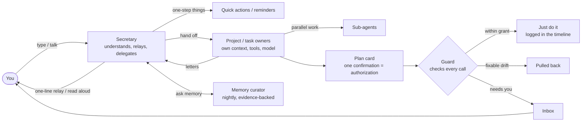
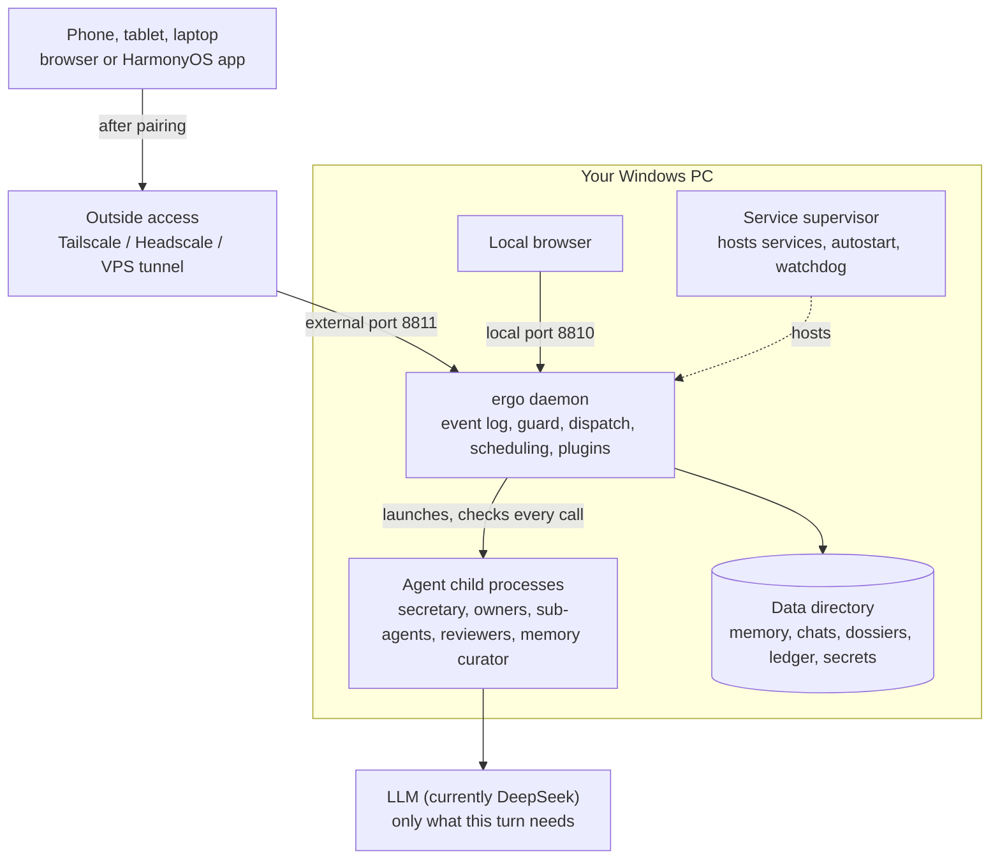

[中文](README.md) | **English**

# ergo (二狗)

> **A personal AI assistant that lives on your own computer.** What it knows about you stays on your machine; long jobs you hand it are authorized once, owned by a dedicated agent and watched by the runtime until done; and when you come back, you can see what happened at a glance.

**[Online demo](https://catmaniii.github.io/ergo/?lang=en)** (nothing to install, no key needed; the web prototype ships with made-up sample data) · [User Guide](docs/user-guide.en.md) · [Developer Guide](docs/developer-guide.en.md) · [Changelog](CHANGELOG.md)

<table>
<tr>
<td align="center"><br><b>Classic</b></td>
<td align="center"><br><b>Sticker bento</b></td>
<td align="center"><br><b>Pixel cottage</b></td>
</tr>
</table>
<p align="center"><sub>The same conversation in three of the 11 visual styles. Screenshots show the Chinese UI with the prototype's made-up sample data; the interface is fully available in English too.</sub></p>

> **Windows 10 / 11 only.** ergo relies on Windows-only features (Job objects, directory junctions, scheduled tasks) and won't start elsewhere.

The name: "ergo" sounds like 二狗 (*èr gǒu*, a homely Chinese nickname), and Latin *ergo* means "therefore" — inferring what you really want from what you say. ergo is built on [pi](https://github.com/earendil-works/pi) and can be seen as a single-user, rebuilt-to-taste take on [OpenClaw](https://github.com/openclaw/openclaw). The project is Chinese-first: code comments, the glossary and design records are in Chinese, while the UI, README, user guide and developer guide are in both languages.

## Up and running in 5 minutes

**1. Install with one line** (PowerShell, no admin rights; the package bundles Node, so no npm and no build):

```powershell
irm https://github.com/catmaniii/ergo/releases/latest/download/install.ps1 | iex
```

It installs into `%LOCALAPPDATA%\Programs\ergo\versions\<version>` (`current` is a one-line text file naming the one in use) and adds `bin` to your user PATH. Options for installing from source, switching mirrors or using the system Node are in [User Guide 2.1](docs/user-guide.en.md#21-one-line-install-recommended). If you already have Node 22, `npm i -g ergo-ai` works too; the command is still `ergo`.

**2. Set up with the wizard**: open <http://127.0.0.1:8810/> and walk the **setup wizard** in the web UI — language / how to address you / the assistant's name, the model key (currently [DeepSeek](https://platform.deepseek.com/); enter it, then click to test it), components (the embedding model for semantic search), pairing your phone by QR code, and an explanation of the safety defaults, followed by one screen about outside access. Every step can be postponed with "later"; when all are done it says you're set. Come back any time from the "Setup wizard" row at the top of **More · Settings**.

**3. Use it**: try "remind me to drink water in two minutes". Start, stop, status and logs: `ergo start | stop | status | logs`; if something's wrong, look at **More · Settings · Data & devices → Checkup** first (eight checks — ports, Node, pi, the service manager, the model key, components, disk, outside access — each with a fix).

> Neither the Release nor the npm packages are published yet, so both routes above don't work yet; until then please [install from source](docs/user-guide.en.md#23-install-from-source-works-today): install Node 22 and Git → `git clone` → `npm ci` → `npm run build:web` → start the supervisor and register ergo; about 15 minutes.

## ergo in one minute

1. **Your memory stays on your computer**: conversations, everything you said verbatim, project dossiers all live locally, backed up nightly. Each night the memory curator distills them into evidence-backed conclusions: confident ones get used, uncertain ones become a question for you. Only what the current turn needs is sent to the model.
2. **One owner per job, no mix-ups**: the secretary only relays; every project and task has a fixed owner with its own context, tools and model. The rules are kept by the system, however long the job runs.
3. **Hand off long jobs with confidence**: approve a plan once; every step is checked by the guard and accepted by an independent reviewer, and drift is pulled back automatically. A real project's first version took 247 operations and 7 clicks from its owner.
4. **Understand it at a glance when you return**: pinch to zoom from every sentence out to the whole job. Everything that needs your decision is in one place, and every cent spent is accounted for.
5. **Plug in what you need**: reminders, memory, calendar, voice, built-in browser, Claude Code, Google, Looki and phone are all plugins you can turn on and off in Settings.



## What it does

### 1. A memory that understands you, kept on your own computer

Many AI assistants get to know you by storing everything about you in the cloud. ergo does the opposite: **the part that understands you stays on your own computer.**

- **Every word kept**: an immutable verbatim copy of everything you said, indexed by keyword and vector; conversations, project dossiers, task records, attachments and the spending ledger all live in the local data directory.
- **Distilled nightly into evidence-backed conclusions**: at 3 am the memory curator turns new material into evidence and consolidates it into conclusions. Each conclusion opens to its evidence chain, supporting and contrary evidence, competing explanations and revision history — not just "I remember you like…".
- **From surface to motives**: it doesn't only record what you said; it reasons up from what you say, do and avoid to what you need and care about. If you just say "dinner with them again on Friday", and it remembers "them" is a partner team, you were tired after the last few dinners and you're racing a deadline this week, it can tell you're hesitating. **Grounded guesses, not mind-reading**: confident, it acts; unsure, it says its guess and asks at a convenient moment; it never overrides something you said explicitly just to avoid asking.
- **You're in charge**: view, correct and delete in the memory page; say "forget…" or "don't infer from this" and it complies; a hard delete also scrubs everything that referenced it. Sensitive categories such as health are recorded but not used for inference by default.
- **Getting-to-know-you interviews**: the memory curator may invite you to talk through one topic at a time (decline any time) and fills in your personal files from it.
- **Only what's needed leaves the machine**: each model call carries only what the current turn needs; **secrets live in a separate area no agent can read**; a consistent snapshot every night, optionally copied to a NAS or a cloud-drive sync folder.

### 2. One owner per job, no mix-ups

Cram several things into one chat and they blur together. ergo separates them by project and task:

- **The secretary only understands you and relays**, never touching your projects itself. Several jobs can run in the background while you keep chatting.
- **Every project and task has a fixed owner** (a maintainer agent) with its own context and toolkit (skills, MCP) that can only touch its own job; its system prompt and model can be configured individually. Parallelizable work goes to sub-agents.
- **Agents write letters**: owners write to the secretary when they make progress; letters fold into one line and the secretary passes them on.
- **Rules are kept by the system, not the agent's memory**: plans, grants and the boundaries you set are held by the runtime; understanding of a project lives in its dossier (charter, spec, progress), not in an ever-growing chat.
- **One work order at a time, checked for overreach**: an owner's work is queued as work orders by a dispatcher; after each one, a second model checks whether it strayed out of scope.
- **You decide when the first version is done**: put it into use, keep building, or abandon and archive. Live services are hosted by the supervisor and open right in ergo's built-in browser.
- **Bring your own Claude Code**: if Claude Code is signed in on your PC, owners can work through it (on your own subscription), with ergo's guard still checking each tool call; ergo can also take over your existing Claude Code sessions.

### 3. Hand off long jobs with confidence

Typical agents sit at one of two extremes: ask about everything, or full permissions and hope for the best. ergo takes the middle road: **spell out "what may be done" once before starting, then let the runtime — not the agent's good intentions — watch the execution.**

- **Before starting**: the plan card lists the stages, what each delivers, how it's accepted, which tools it uses and which operations are pre-approved (kind, scope, count, expiry). Confirming once is the authorization.
- **Acceptance doesn't rely on the agent saying it's done**: each stage passes scripted checks and then an independent reviewer agent that can run commands and look at real results.
- **Drift is pulled back automatically**: off-plan actions are flagged; temporal rules keep watch ("back up before deleting", "run tests before pushing", "never send anything out after reading a secret").
- **Plan changes only pause the affected stages**; **interrupted work resumes**: after the daemon is killed or the PC restarts, work continues where it stopped, and operations whose outcome is unknown stop and ask rather than being silently redone.
- **You decide what to be told about**: watch categories (spending money, sending in your name, deleting or overwriting, irreversible commits, accounts and security, leaving the project directory… plus your own) × six handlings (just do it and log, do it and tell me, only if in the plan, ask me first, hand it to me, never). **Three hard bottom lines nobody can override**: never write ergo's own config, database or program directory; never read the secrets area; never send something known to be a secret.

> **From real use**: a real project's first version took 247 operations and only 7 clicks; it drifted 5 times and was pulled back automatically each time.

<p align="center"><br><sub>The plan panel (Sticker bento): stages, dependencies and grants on one screen. Confirm once and work begins.</sub></p>

<p align="center"><br><sub>Open a tool call: what it did, which watch category it hit, how it was handled, whether it was within the grant, and what it actually changed.</sub></p>

### 4. Understand it at a glance when you return

**Three-level timeline zoom**: one continuous view, switched by pinching (Ctrl + scroll on a PC) — the conversation level shows everything, the key-points level one line per item, the overview the whole job as one colored bar. When zoomed out, markers for approvals, pull-backs, acceptance and watch-category hits stay pinned in the margin, with lines pointing to where things happened.

<table>
<tr>
<td align="center"><br><b>Conversation</b><br><sub>Full content</sub></td>
<td align="center"><br><b>Key points</b><br><sub>One line each; pull-backs and extra confirmations pinned to the margin</sub></td>
<td align="center"><br><b>Overview</b><br><sub>The whole job as one bar, with markers pointing to where things happened</sub></td>
</tr>
</table>

- **Everything that needs your decision is in the inbox**: approvals, plan confirmations, requests for help, pairing requests, with time-limited items first; system notifications on HarmonyOS phones.
- **Every cent accounted for**: a token ledger records each model call against its task, stage and agent.
- **Attachments open in place**: Markdown renders as a report page; HTML previews in an isolated sandbox.

<p align="center"><br><sub>Inbox (Sticker bento): time-limited approvals are grouped and shown first.</sub></p>

### 5. Everyday chores run themselves

| Kind | Good for | How it runs |
|---|---|---|
| Plain task | Download a video, look something up | A background agent just does it; the secretary tells you when it's done |
| Workflow | The same few steps every day | Steps laid out in advance and authorized once; every run is checked step by step and pulled back if it drifts |
| Long-running task | Build a tool, write a research report | Runs in stages with acceptance at each stage; the plan can change mid-way |

Three triggers: once now; scheduled (optionally "on my working days", with Chinese and Singaporean holidays and make-up days); on an event (another task finished, a new file arrived in a folder). Write "every Monday at 8 am…" when starting a task and the schedule is set from it; results can be read aloud to you automatically.

<table>
<tr>
<td align="center"><br><sub>Starting a task: pick a kind, write "every Monday at 8 am…" and the schedule is set.</sub></td>
<td align="center"><br><sub>Calendar (Pixel cottage): working days and holidays for two regions, plus the day's reminders, scheduled tasks and runs.</sub></td>
</tr>
</table>

### 6. Plugins you can hot-plug

The daemon is split into a kernel and plugins: **reminders, memory, calendar, voice, built-in browser, Claude Code, Google (calendar, contacts), Looki and phone** are all plugins that you can disable, enable or remove under **Settings · Plugins** without restarting; disabling only hides pages and tools, the data stays. To write one, follow the [plugin guide](docs/guides/plugin-development.md) (in Chinese), which starts from a minimal "notes" plugin.

### 7. Your way

- **11 visual styles**: Classic, Paper journal, Clean grid, Night cockpit, Soft candy, Glass glow, Blueprint, Sticker bento, Pixel cottage, Ink wash, Retro magazine — each in light and dark.
- **Your voice, your names**: push-to-talk is recognized locally; ergo answers in a reference voice you choose, synthesizing long replies in segments as it speaks. The assistant's name, system prompts, models, skills and MCP servers are all configurable.
- **Chinese and English** built in; add other languages by dropping language files into the data directory, no code changes.
- **Phone, tablet and PC**: designed phone-first, with multi-column layouts on wide screens; there's also a native HarmonyOS app.

<p align="center"><br><sub>Settings · Appearance & style: all 11 styles, each shown light (left) and dark (right).</sub></p>

## On your phone: three ways to reach ergo from outside

By default ergo is only used on the PC it runs on. To use it from a phone or tablet, pick one of three ways (details in the [User Guide](docs/user-guide.en.md#6-access-from-outside-phone-tablet)):

| | How | Good for |
|---|---|---|
| **Tailscale (recommended)** | Install Tailscale on PC and phone with the same account; only your devices can open it, certificates included | Most people; sign-in needs a Google / Microsoft / GitHub… account and relays are abroad, so it can be slow in mainland China |
| Self-hosted Headscale (advanced) | Run your own tailnet control server on a VPS; the supervisor opens a tailnet entry | Owning the control server; speed inside China |
| VPS + ssh reverse tunnel + nginx | A public HTTPS address any browser can open | Not wanting Tailscale; the hardest, with device pairing as the only gate |

Whichever you choose, a new device must be approved on your PC after checking a short code, and its credential can be revoked any time. **All three connect only to ergo's external port (8811); the local port (8810) is never exposed** — see [SECURITY.md](SECURITY.md) for why.

## Compared with OpenClaw

OpenClaw is a general-purpose, multi-channel personal agent with far broader scope than ergo, also running on your own machine. ergo serves one person and makes different trade-offs in these places (the OpenClaw column follows [research note 03](docs/research/03-openclaw-and-pi.md), as of 2026-10-06).

| | OpenClaw | ergo |
|---|---|---|
| Who does the work | The main agent can delegate to specialist sub-agents via prompts; officially, delegation is prompt-guided, not a scheduler | The secretary only relays; each task and project has a fixed owner with its own context, toolkit and model; dispatch is part of the runtime |
| Projects | No first-class "project" entity | Projects have a dossier, working directory, fixed owner and charter; scope review checks for overreach; you decide when the first version is done |
| Permissions | Sandbox and exec approvals are off by default; full access by default | Watch categories × six handlings, plan grants, temporal rules, three hard bottom lines; every call recorded and explained in plain words |
| Long jobs | heartbeat, cron | Staged plans, independent reviewer acceptance, automatic correction; plan changes pause only affected stages; resumes after restart without silently redoing side effects |
| Looking back | Chat history | Three-level timeline zoom with key markers pinned in the margin |
| Memory | Engineered layered memory (dreaming, hybrid retrieval); explicitly no person profiles | Every word kept locally; distilled nightly into conclusions with evidence chains and competing explanations, reasoning up to motives and what you care about; asks when unsure |
| Platforms | Cross-platform | Windows only |

## Architecture at a glance



- **Two processes**: the ergo daemon (`packages/daemon`) and the service supervisor (`packages/supervisor`). The supervisor is small and stable: it starts at login, restarts ergo if killed, and hosts services from projects that go live; its data defaults to `%LOCALAPPDATA%\ergo\supervisor`, ergo's to `%USERPROFILE%\.ergo`.
- **Code**: TypeScript (the daemon runs directly via Node's type stripping), npm workspaces; the web UI is React 19 + Vite; the HarmonyOS shell is in `frontend/harmony`. About 280k lines of code and 8,000+ automated tests; CI runs only on Windows and only Node 22 (the Node major version follows pi, [ADR-0031](docs/adr/0031-node-version-follows-pi.md)).
- **Agent runtime**: pi appears only in a thin wrapper layer ([ADR-0001](docs/adr/0001-pi-coding-agent-sdk-as-runtime.md)); domain state such as approvals, tasks and the ledger lives in ergo's own event log (SQLite).
- More in the [Developer Guide](docs/developer-guide.en.md), the [glossary](CONTEXT.md) and the [decision records](docs/adr/) (the latter two in Chinese).

## Documentation

| | |
|---|---|
| [User Guide](docs/user-guide.en.md) | Install, use, configure, outside access, backup, troubleshooting |
| [Developer Guide](docs/developer-guide.en.md) | Repository layout, architecture, plugins, web UI, i18n, testing, conventions |
| [Plugin guide](docs/guides/plugin-development.md) | Starting from a minimal plugin (Chinese) |
| [Memory system](docs/memory-system.md) | Modules, interfaces and workflows of the memory system (Chinese) |
| [CONTEXT.md](CONTEXT.md) | Glossary (Chinese) |
| [docs/adr/](docs/adr/) | Architecture decision records (Chinese) |
| [docs/research/](docs/research/) | Research notes: OpenClaw and pi, multi-agent, long tasks and interruptions, voice, Windows sandboxing, memory projects… (Chinese) |
| [CHANGELOG.md](CHANGELOG.md) | Version history (Chinese) |
| [SECURITY.md](SECURITY.md) | Security model, known limitations, reporting vulnerabilities |

"Ticket N" in code comments refers to internal development records that are not in the public repository; it doesn't affect reading the code.

## Contributing

Questions, docs, bug fixes, plugins and languages are all welcome; see [CONTRIBUTING.md](CONTRIBUTING.md#english) and the [Code of Conduct](CODE_OF_CONDUCT.md#english). Please report security issues privately as described in [SECURITY.md](SECURITY.md#english).

## License

[MIT](LICENSE) © ergo contributors. Licenses of third-party dependencies and fonts ship with the release package: `THIRD_PARTY_NOTICES.txt` (full texts) and `third-party-licenses.json` (name, version, license, origin) in the installed directory. Claude Code's Agent SDK is under Anthropic's own license; ergo treats it as an optional dependency and does not redistribute it.
