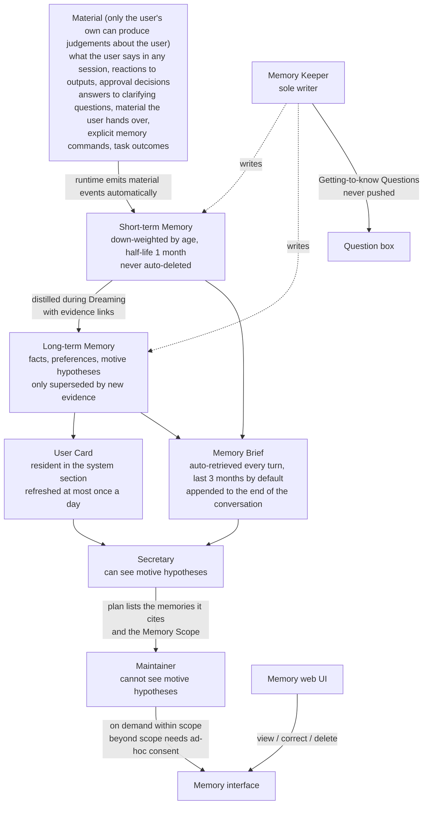
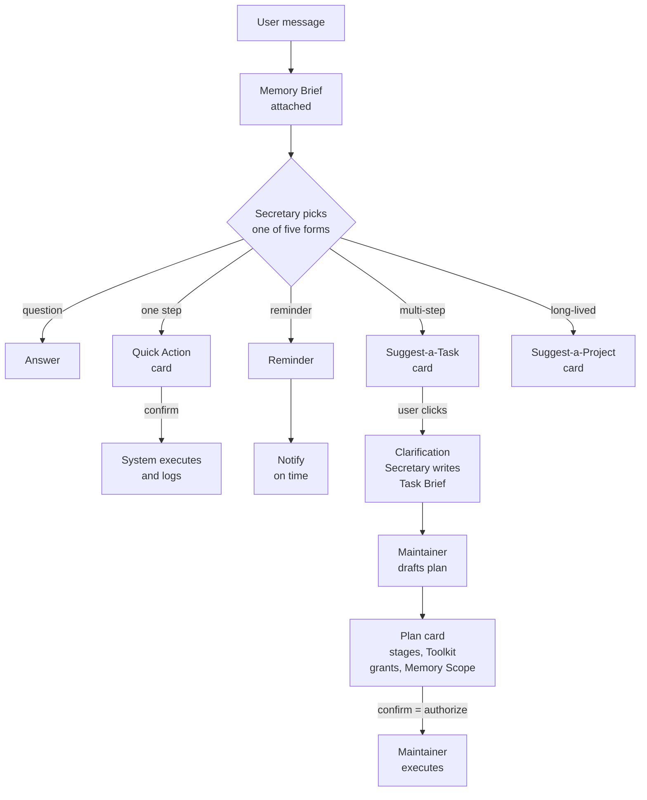
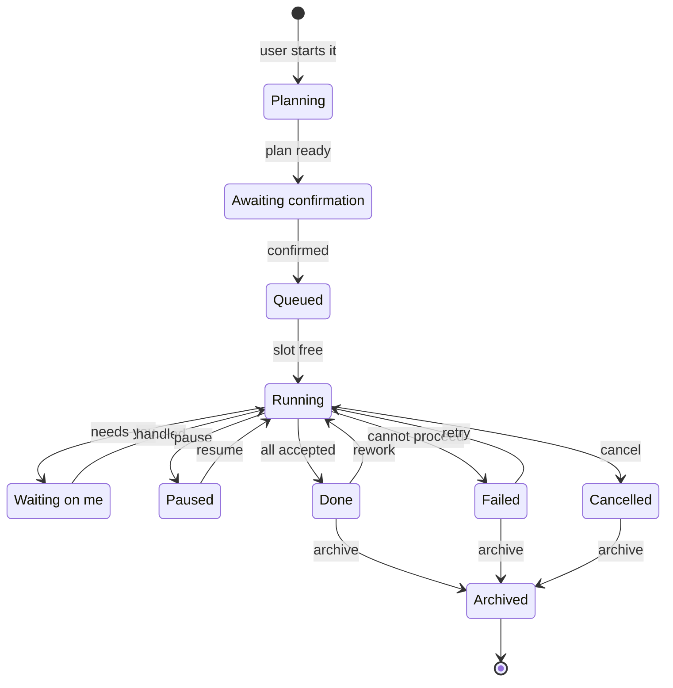
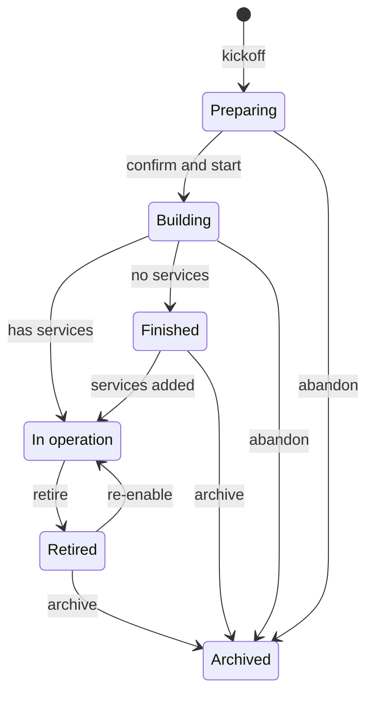
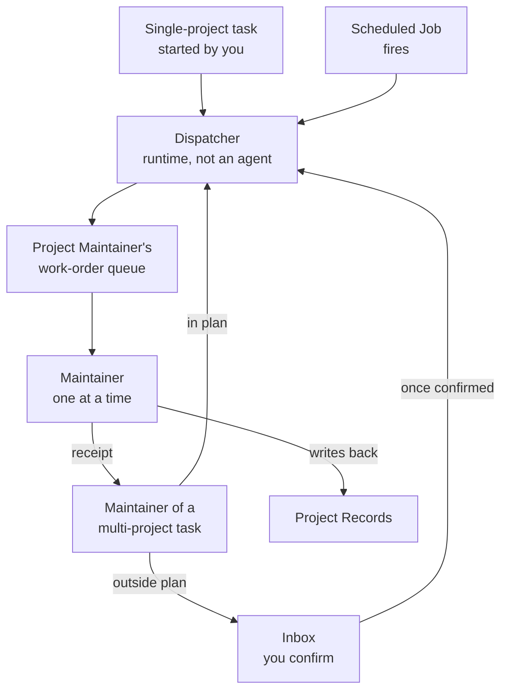
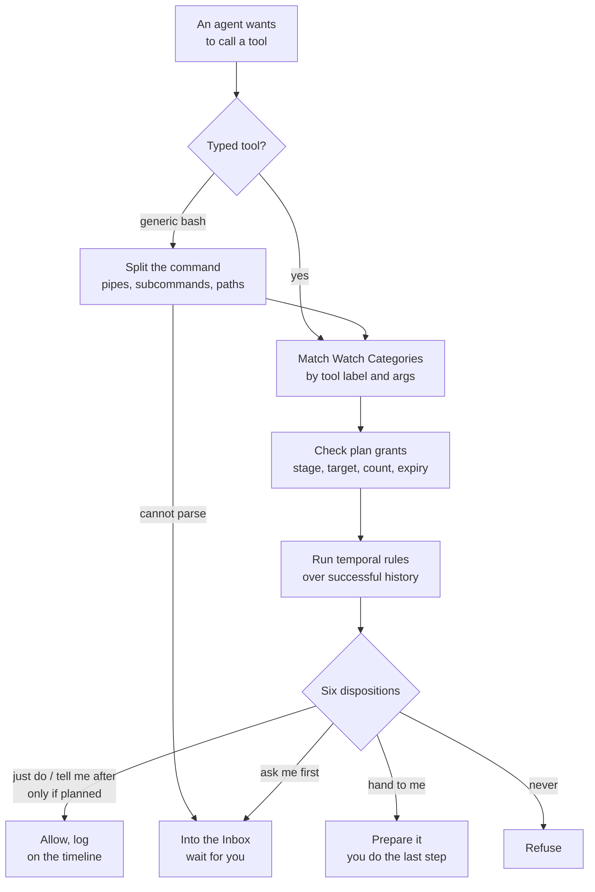
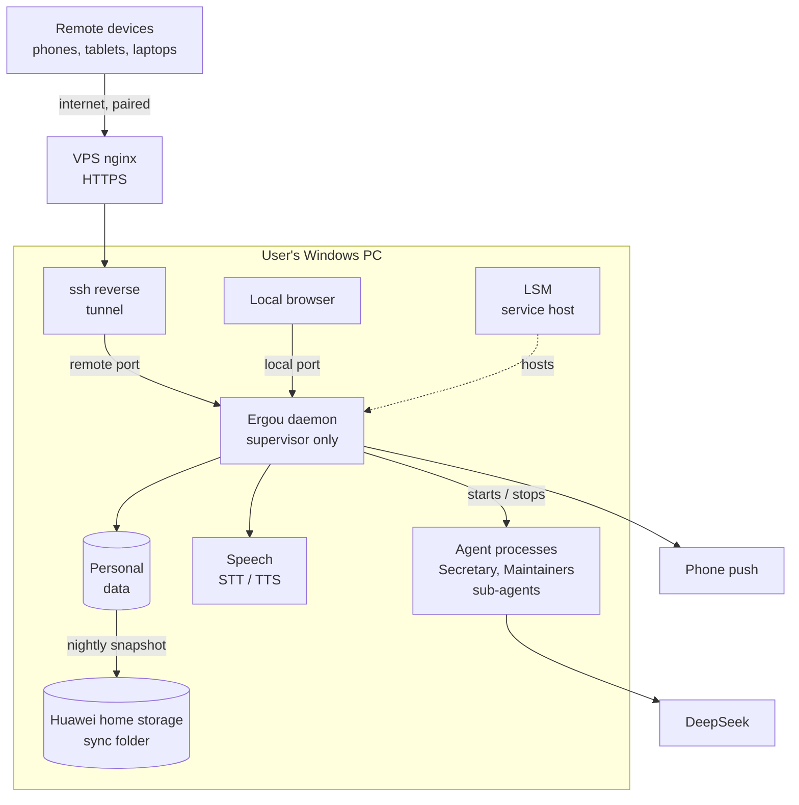
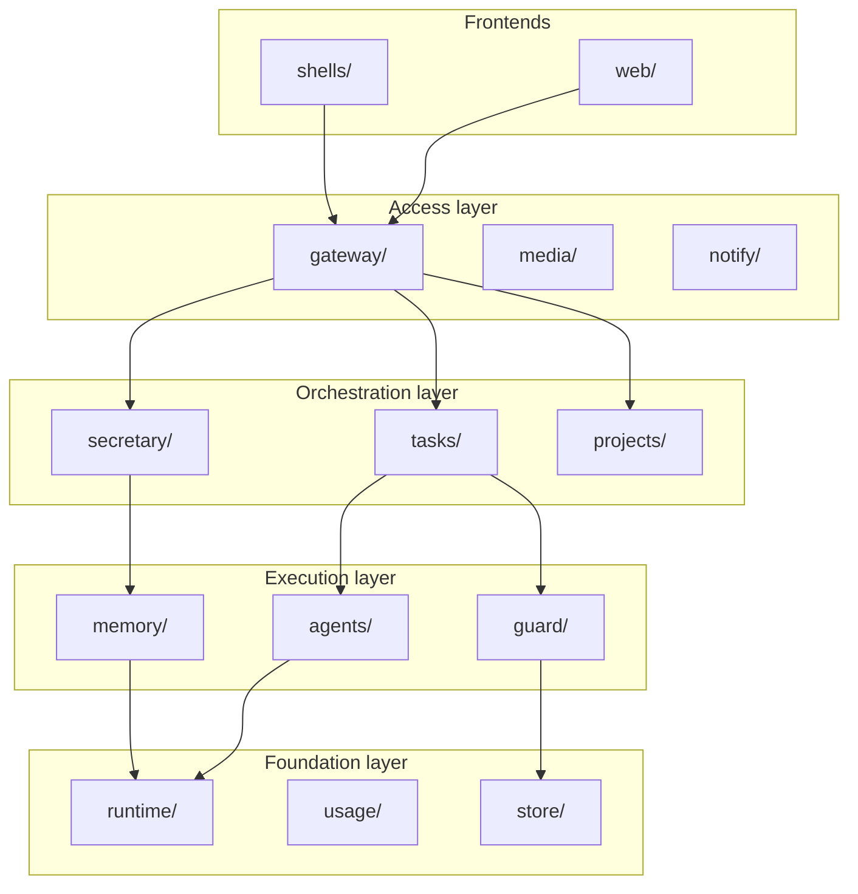

[中文](README.md) | **English**

# Ergou v2

A personal assistant agent that serves exactly one person. It is built from scratch on [pi](https://github.com/earendil-works/pi) as an improved take on OpenClaw. It runs on the user's own computer. The user mostly talks to the **Secretary**, actual work is dispatched as tasks and projects to dedicated **Maintainers**, and the system keeps building up its understanding of the user.

> **Status: planning.** The repository currently holds only specs, decisions and research notes — no implementation code yet. Diagrams below are marked either **decided** (from closed decision tickets) or **draft** (to be revised once the corresponding ticket is resolved).
>
> Note: apart from this README, the project documents are written in Chinese.

## Three differentiators

1. **Personal memory that mines motives.** What people say often depends on the situation and is not always accurate. Ergou infers the user's real needs and motives from fragmentary material, then turns those inferences into questions to check with the user. The method builds on intent-mining.
2. **Safe, with fewer interruptions.** Inherits AgentSense's "plan once, authorize once, run to completion". The user decides which operations they want to be reminded about — not limited to security. Everything that needs the user goes into a single **Inbox**.
3. **Secretary + Maintainer dispatch.** The Secretary only understands, clarifies, plans and dispatches; it does no domain work itself. Every task and project has one fixed Maintainer whose permissions are limited to what it is responsible for.

## Planning progress

Planning follows the wayfinder approach: one map plus a set of decision tickets, resolved one at a time.

- Main map: [Ergou v2](.scratch/ergou-v2/map.md)
- Sub-map: [Ergou memory system](.scratch/ergou-memory/map.md)
- Glossary: [CONTEXT.md](CONTEXT.md)
- Architecture decision records: [docs/adr/](docs/adr/)

Decided so far:

| Decision ticket | Outcome |
|---|---|
| [pi 1.0 layer capability mapping](.scratch/ergou-v2/issues/01-pi-layer-mapping.md) | Mapped pi's three layers; ruled out the experimental pi-durable; updating system-prompt sections on deepseek-flash busts the prompt cache |
| [Runtime base (ADR-0001)](docs/adr/0001-pi-coding-agent-sdk-as-runtime.md) | Use the `pi-coding-agent` SDK behind a thin Ergou-owned wrapper, with pinned versions |
| [Multi-agent architecture and token cost](.scratch/ergou-v2/issues/02-multi-agent-and-token-cost.md) | Each task or project is bound to one long-lived Maintainer, serial by default; parallelism is proposed by the Maintainer and confirmed by the user |
| [Memory boundary](.scratch/ergou-v2/issues/03-memory-boundary.md) | The Memory Keeper is the sole writer; the Secretary reads the User Card, Memory Briefs and deep queries; short-term vs long-term memory; motive hypotheses are visible to the Secretary only |
| [Task lifecycle and task board](.scratch/ergou-v2/issues/05-task-lifecycle-and-board.md) | Chat / Task / Project split; tasks are started explicitly by the user; completion is automatic, archiving is manual; the Inbox collects everything that needs the user |
| [Project lifecycle, workspace and Maintainer](.scratch/ergou-v2/issues/14-project-lifecycle-and-maintainer.md) | Six project states; whether a service is up belongs to the service layer; two-step kickoff; a Maintainer's understanding lives in the Project Records; all its work arrives as Work Orders through a dispatcher queue; scheduling lives in the daemon; no sandbox in v1 |
| [Windows native sandbox research](.scratch/ergou-v2/issues/22-windows-native-sandbox.md) | Feasible natively but not done in v1; a path fence in the daemon and a no-breakaway Job object are mandatory anyway |
| [Role model (ADR-0003)](.scratch/ergou-v2/issues/13-role-model.md) | No roles: each Maintainer gets a Toolkit configured per project or task. "Stay in your domain" becomes a soft Scope Review at compaction and at the end of each Work Order; overreach is recorded, injected into the prompt, and reported without a push |
| [Protocol and multiple frontends](.scratch/ergou-v2/issues/06-protocol-and-message-model.md) | One WebSocket per frontend with channel subscriptions; the event log is the single source of truth; cards are standalone entities; remote devices must pair and get an HttpOnly cookie; separate local and remote ports |
| [Watch categories and interruption policy](.scratch/ergou-v2/issues/04-watch-categories-and-interruption.md) | Categories are decided by deterministic rules, custom ones too; six dispositions; grants copied from AgentSense; common bash operations become typed tools, while generic bash is still checked and flagged on the timeline |
| [Long-task generalization](.scratch/ergou-v2/issues/12-long-task-generalization.md) | One plan type; acceptance by script, independent reviewer or the user; AgentSense's temporal-rule engine ported with rule templates for real tools; the runtime holds the plan and grants |
| [Clarification and planning flow](.scratch/ergou-v2/issues/15-clarification-and-planning-flow.md) | The Secretary routes within one turn; states assumptions, asks in batches, no cap; the Secretary writes a Task Brief and the Maintainer drafts the plan; one card confirms plan, Toolkit and grants |
| [Material management](.scratch/ergou-memory/issues/02-material-management.md) (memory sub-map) | Keep copies of the user's own words; collect all seven material kinds plus avoidance signals from day one; FTS5 trigram for keywords, bge-m3 on CPU for vectors; three kinds of deletion |
| [Runtime architecture (ADR-0002)](.scratch/ergou-v2/issues/11-runtime-architecture.md) | One child process per agent; the daemon only supervises; mixed recovery after a kill; Ergou's own skill library, granted per project or task; TypeScript + React 19 + Vite |
| [Deployment, data directory and backup](.scratch/ergou-v2/issues/10-deployment-data-backup.md) | Data directory under the user profile; every device goes through the public domain; nightly snapshot copied into the Huawei home-storage sync folder; after a reboot Ergou waits for login, then catches up |
| [Web UI information architecture](.scratch/ergou-v2/issues/17-web-ui-information-architecture.md) | Five bottom tabs in portrait, a left rail on wide screens; Secretary and Maintainer sessions share one component; the phase-1 page list is set |

All phase-1 decision tickets are resolved. Next: write the spec (`/to-spec`), then split it into implementation tickets.

## 1. Entities and relationships

### 1.1 Agents and work (decided)

Rules:

- **Only a project's Maintainer may change that project.** A task that touches a single project is executed by that project's Maintainer; a task touching several projects (or none) has its own Maintainer that coordinates.
- What a Maintainer can use is set by the Toolkit of its task or project: skills, external tools, and capability switches such as bash and network access. There are no roles (ADR-0003). Its visible memory and files are limited to what it is responsible for. No OS-level sandbox in v1.
- The Secretary cannot execute anything. A side-effecting operation is either a Quick Action executed by the system after the user confirms, or it becomes a Task.

Where the user looks at work:

| View | Shows |
|---|---|
| Task Board | Tasks, Reminders and Scheduled Jobs, grouped as "Waiting on me → In progress → In operation → Recently ended → Archived" |
| Project management | All projects and their states; each project card has a "Talk to the Maintainer" button; the project page shows the Maintainer's work-order pipeline |
| Inbox | Everything that needs the user's attention or confirmation; the tab shows a red dot when something is unread |

### 1.2 Memory (decided)

## 2. Workflows

### 2.1 Where a user message goes (decided)

- Every time the Secretary receives a message, the runtime first attaches a Memory Brief.
- The Secretary picks one of the five forms in the same turn, via structured output. If the user explicitly starts a task or clicks a button, this step is skipped.
- Quick Action: the Secretary spells out the action; after the user confirms (or within existing grants) the system executes it directly and records it in the action log. If the user named the target and content in this turn, no extra confirmation is asked.
- A task can only be started by the user: by clicking a Suggest-a-Task card, by saying so explicitly, or with the Start Task button.
- Clarification states the Secretary's assumptions first and asks questions in batches, each with a recommended answer. There is no cap on rounds; asking less is a long-term goal to explore.
- The Secretary writes a Task Brief (goal, acceptance criteria, constraints, projects involved, proposed Memory Scope); the executing Maintainer drafts the stage plan from it.
- The plan card lists the stages (deliverables, acceptance criteria, who accepts), the projects involved, the Toolkit, the grants, the memories cited, the Memory Scope the task may use while running, and the Watch Categories to flag for this task. Confirming the plan is the single authorization. Lines can be unticked or narrowed, or the plan sent back with comments.

### 2.2 Task states (decided)

- **slot free**: at most 3 tasks run at the same time globally (configurable). Sub-agents do not take a slot.
- **needs you**: a runtime approval, a task clarification, a stage the plan marks as "accepted by you", or a call for help when stuck. All of these go into the Inbox.
- **pause**: paused by the user, or by the system when over budget or stuck.
- **rework**: AgentSense's "reopen by dependency" — only the failing stage and its downstream stages are reopened.
- **cancel**: the diagram only shows cancelling from "Running", but any state that has not ended can be cancelled.
- Inside "Running" an AgentSense-style staged plan executes; the card shows "stage N/M". The stage-level mechanics are pending "Long-task mechanism generalization".
- Only the user can archive. Tasks that ended more than 7 days ago and are still unarchived are collected into the Inbox once a week.
- Reminder: pending → fired (one-off), or pending forever (recurring).
- Scheduled Job: in operation ⇄ paused; auto-paused after 3 consecutive failed runs.

### 2.3 Project states (decided)

- **Kickoff** has two steps:
  1. The Secretary does a light intake: confirms it is a project, sets a name and a one-line goal, and proposes a Memory Scope. Once you confirm, the project enters Preparing and its Maintainer is created.
  2. The Maintainer runs the kickoff Q&A with you and produces a Project Charter. When you click "confirm and start", the project enters Building and the first build task is started.
- **Has services / no services**: whether the project has services registered in LSM, a public entry point, or Scheduled Jobs. When the first version is done, the Maintainer proposes and you decide.
- **Whether a service is up is not a project state.** It is monitored at the service layer; the project page only displays it. A project in operation may run its services permanently or start them on demand.
- **Project state does not follow tasks**: a project in operation stays in operation while a task works on it; the card shows the number of running tasks.
- **Stages belong to tasks only.** A project has no "goal" entity or stage list; long-range plans live in the project's spec and progress docs.
- Only you can **archive**; unarchiving returns the project to its previous state. Deletion is only possible from Archived.
- **Files**: the Project Records (charter, spec, glossary, ADRs, progress, Maintainer session) live in the data directory; the Working Directory sits inside the records by default, and a development project may bind an external repository instead. A Maintainer can touch only these two. No OS-level sandbox in v1: path allowlists plus an AgentSense-style guard.

### 2.4 Work Orders: how a Maintainer receives work (decided)

- Everything a Maintainer does arrives as a **Work Order**. Chatting with a Maintainer directly is not a Work Order; it sees your message before its next step.
- Cross-project changes are confirmed once, with the task plan, which lists each project and what changes in it.
- A Maintainer sleeps until a Work Order arrives; if busy, the order queues. Its understanding of the project lives in the Project Records, not in the session.
- Work Orders are the only way agents talk to each other; there is no agent group chat. The project page shows the Maintainer's work-order pipeline and where each order came from.
- Reminders and Scheduled Jobs are fired by a scheduler inside the daemon, not by Windows Task Scheduler.

### 2.5 A tool call through the Guard (decided)

- Built-in Watch Categories: spending money; sending or publishing in your name; deleting or overwriting; irreversible commits; accounts and security; leaving the project directory; using memory outside the granted scope; unplanned Work Orders; unknown writes. You can define your own with deterministic rules; dispositions can only be made stricter.
- Two floors cannot be relaxed: payments and transfers, creating accounts, and changing passwords or 2FA are always "hand to me"; putting credentials into outbound content is always "never".
- Common special operations (git, tests, installing dependencies, …) are wrapped as typed tools. Generic bash with no predefined type is still checked, and is flagged separately in the key-point and global layers of the timeline.
- Temporal rules reuse AgentSense's engine with templates for real tools, e.g. back up before deleting, run tests before pushing, no outbound sending after reading a secrets file. Rules attach to one stage or to a Stage Group.
- Deviations escalate step by step: within the grants, only a summary is logged; beyond the grants, you are asked; for a category the plan did not anticipate, you are asked and that branch pauses.
- The Guard is the hard gate. Whether a Maintainer is doing what its project is for is a soft check, the Scope Review: run at every compaction and at the end of each Work Order; overreach is recorded, written into the Maintainer's prompt, and reported to you without a push.
- Stage acceptance: anything scriptable runs automatically from a hook; otherwise a reviewer sub-agent that sees only the deliverables and criteria judges it; stages the plan marks as yours wait for you. A Maintainer's self-check never counts on its own.

## 3. System architecture (deployment view)

| Node | Meaning |
|---|---|
| VPS nginx | Port 443, HTTPS, routes by host name into the ssh reverse tunnel. Devices at home use this path too |
| LSM | Local Service Manager: registers, starts and probes services. Hosts the Ergou daemon, the tunnel and the speech services |
| Ergou daemon | Long-running Node process that only supervises: starts and stops agent processes, Guard approvals, event log, dispatch and scheduling, UI. It runs no model itself (ADR-0002) |
| Agent processes | One per agent, resident while busy and exiting when idle; all inside a no-breakaway Job object, so they are cleaned up when the daemon restarts |
| Speech | faster-whisper for speech to text, audio.cpp for text to speech |
| Personal data | Data directory outside the repository (under the user profile by default), SQLite plus files; each agent may write only its assigned slot |
| DeepSeek | Everything starts on DeepSeek V4.1 Flash (`deepseek-flash`) |
| Phone push | HarmonyOS Push Kit, ntfy on Android, browser Web Push |
| Huawei home storage | A consistent local snapshot every night, copied into its sync folder, which syncs it to home storage. Dated folders, keeping 7 daily and 4 weekly; not encrypted; the secrets directory is excluded |

Constraints:

- Every Ergou service is registered with and started by LSM (Local Service Manager); Ergou never starts a service by itself.
- Remote devices must always pair; once approved they get a long-lived credential that page scripts cannot read and that can be revoked. Tunnelled connections also show up as 127.0.0.1 on the PC, so local trust is given only on a separate port that listens on 127.0.0.1 alone; the tunnel connects only to the remote port.
- After a night-time reboot Ergou is offline until you log in; then the scheduler catches up on missed reminders and jobs.
- pi types appear only inside `runtime/`; everything above depends only on Ergou's own interfaces (ADR-0001).
- Domain state — approvals, tasks, memory, the token ledger — lives only in Ergou's own store, never in pi sessions.
- Personal data lives in a data directory outside the repository. Everything that gets recorded has a fixed, managed home; temporary files go only into a dedicated temp area that is cleaned periodically.

## 4. Module breakdown (draft, finalized in the spec)

Organised in layers; each layer depends only on the layers below it.

| Layer | Module | Responsible for |
|---|---|---|
| Frontends | `web/` | Web UI, inheriting AgentSense's visual language |
| | `shells/` | HarmonyOS and Android shells |
| Access | `gateway/` | Frontend protocol, device pairing, media transfer |
| | `media/` | Speech-to-text and text-to-speech clients |
| | `notify/` | Inbox and per-channel push adapters |
| Orchestration | `secretary/` | Secretary, clarification, planning |
| | `tasks/` | Task Board, state machine, scheduling, Reminders, Scheduled Jobs, Quick Action execution |
| | `projects/` | Project registry, Project Standard, workspaces |
| Execution | `agents/` | Process management for Maintainers and sub-agents, Toolkits, Scope Review |
| | `guard/` | Watch categories, dispositions, grants, temporal rules, approval table |
| | `memory/` | Material, short/long-term memory, Dreaming, Memory Briefs |
| Foundation | `runtime/` | Thin wrapper over pi plus the child-process link — the only code that touches pi |
| | `usage/` | Token accounting |
| | `store/` | Personal data directory, event log, backup |

## Document index (in Chinese)

| Path | Contents |
|---|---|
| [CONTEXT.md](CONTEXT.md) | Glossary: Secretary, Task, Project, Maintainer, Short-term Memory, … |
| [docs/adr/](docs/adr/) | Architecture decision records |
| [docs/research/](docs/research/) | Research: AgentSense, intent-mining, OpenClaw and pi, multi-agent teams, memory, long tasks and interruptions, push, local infrastructure, multimedia, pi layers, user modelling, Windows sandbox |
| [docs/guides/](docs/guides/) | How-to guides, e.g. setting up Huawei AGC push |
| [.scratch/ergou-v2/](.scratch/ergou-v2/) | Main map and decision tickets |
| [.scratch/ergou-memory/](.scratch/ergou-memory/) | Memory-system sub-map and decision tickets |

## Conventions

- The repository holds only the framework. Personal data — memory, conversations, project records, secrets — never enters the repository.
- Project documents are written in Chinese; this README is the English counterpart of [README.md](README.md).
