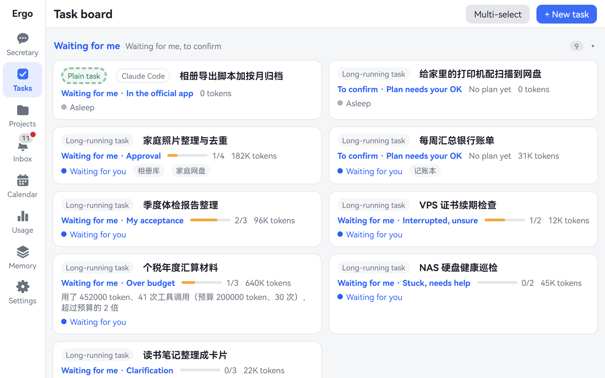
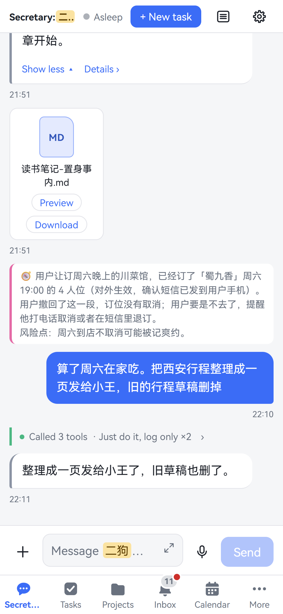
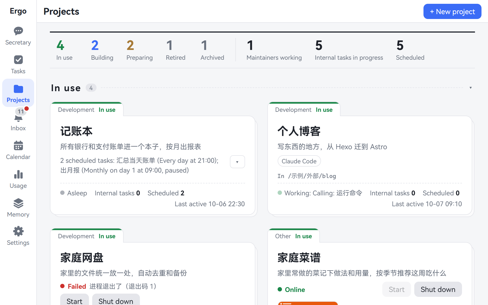
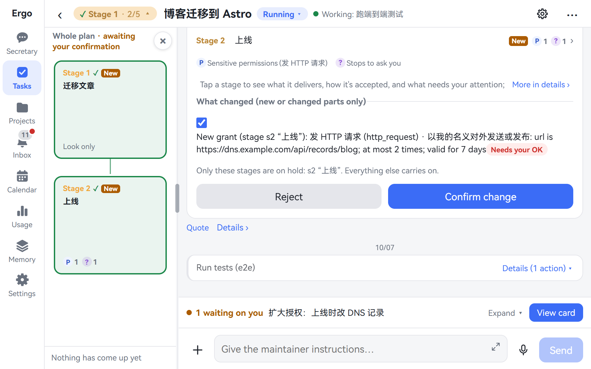
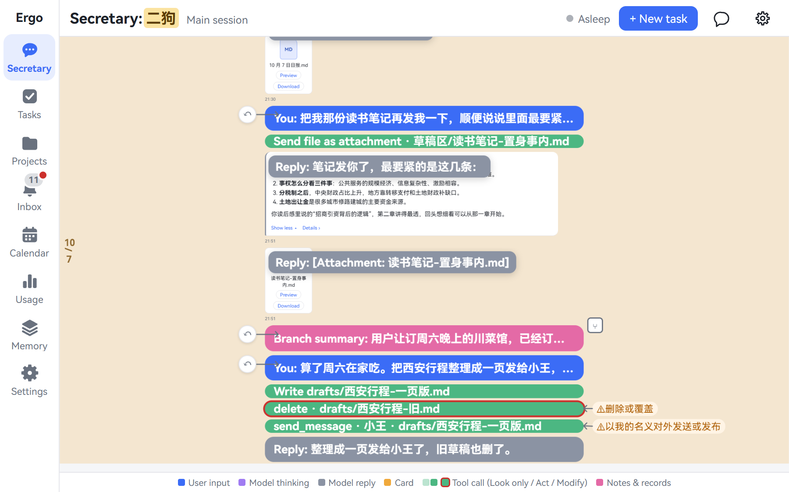
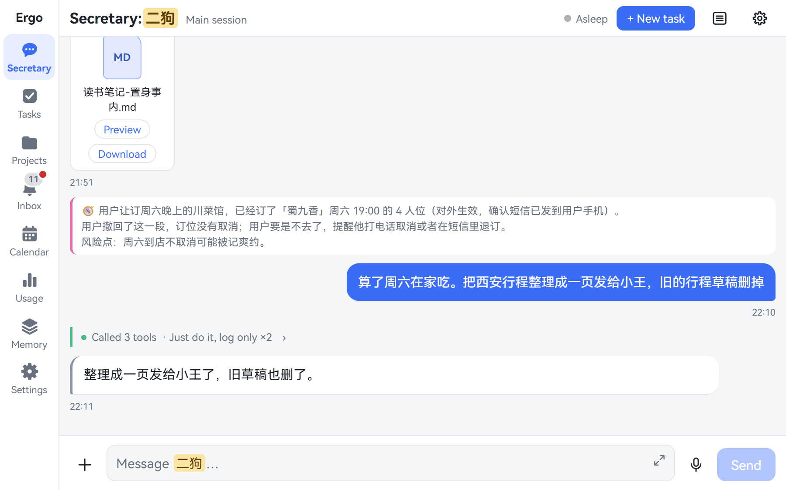
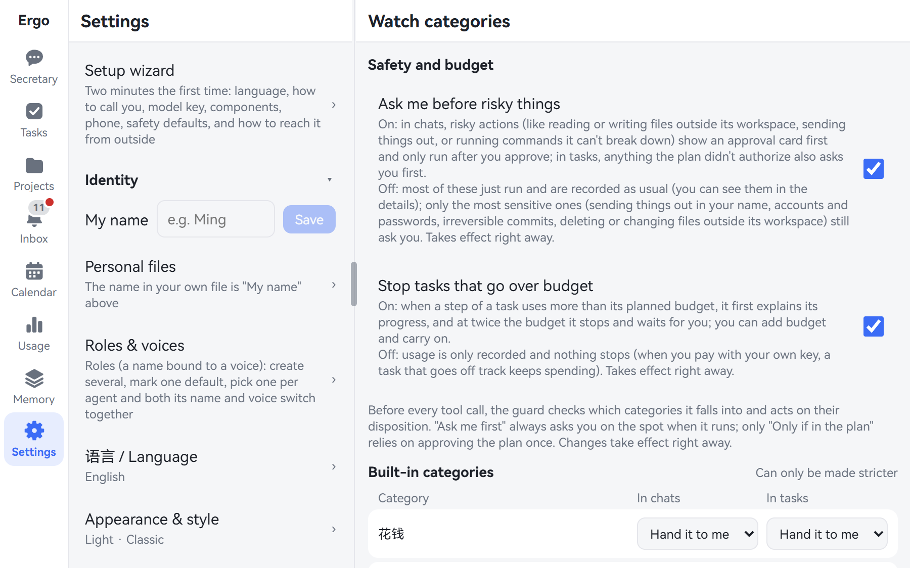
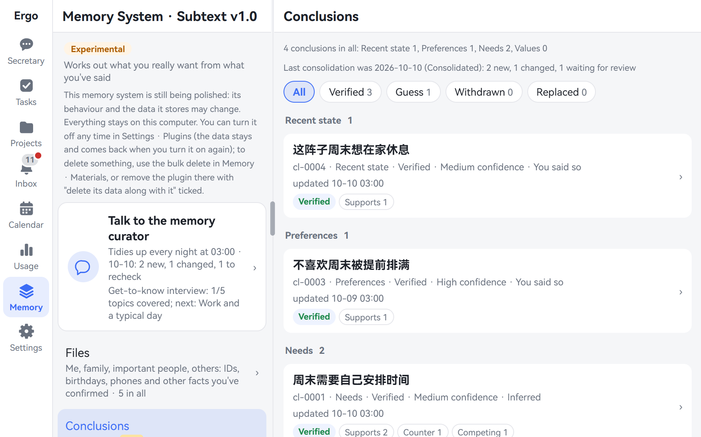
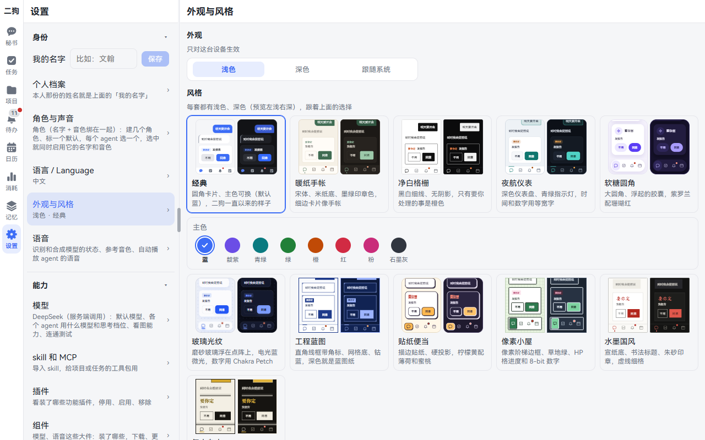
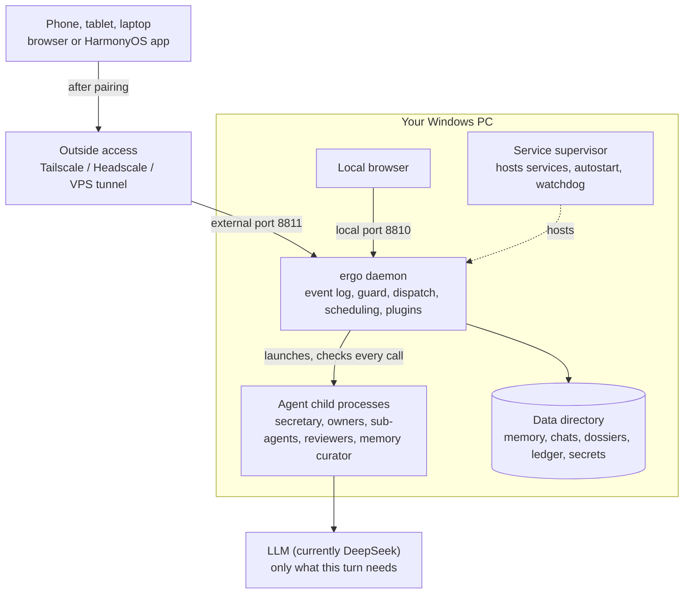

[中文](README.md) | **English**

# ergo (二狗)

> **The more it knows you, the more at ease you feel.** A personal AI assistant that lives on your own computer and takes orders by voice from your phone.

**[Online demo](https://catmaniii.github.io/ergo/?lang=en)** (nothing to install, no key needed; the web prototype ships with made-up sample data) · [User Guide](docs/user-guide.en.md) · [Developer Guide](docs/developer-guide.en.md) · [Changelog](CHANGELOG.md)

<p align="center"> <br><sub>The task board on a PC and the secretary on a phone. Every screenshot here comes from the online demo and shows made-up sample data.</sub></p>

> **Windows 10 / 11 only.** ergo relies on things only Windows has (Job objects, directory junctions, scheduled tasks) and won't start on other systems.

## The whole you stays with you

How much would an AI assistant have to know to really understand you? Your ID, passport and bank cards. Your medical report, payslip and mortgage. Your family's birthdays and where your kid goes to school. Things you said in anger, questions you searched at 2 am, plans you haven't told anyone.

Would you hand all of that to the cloud? But if you don't, how could it ever understand you? The more it knows you, the less at ease you feel.

So we built ergo: **everything about you is kept on your own computer, and only there.**

- It still calls large models and outside services, but each call carries only the small part this turn needs, and you decide who receives it.
- Models are swappable: use DeepSeek today, or point it at any OpenAI-compatible service.
- Claude Code sessions already on your PC can be taken over by ergo and handed back to the official app at any time. Codex is planned.
- Whatever you swap, the memory that understands you best stays in your hands.

The English name ergo sounds like the Chinese name "二狗" (Ergou), and Latin *ergo* means "therefore" — reasoning from what you say to what you really want. ergo is built on [pi](https://github.com/earendil-works/pi) and can be seen as a single-user [OpenClaw](https://github.com/openclaw/openclaw) rebuilt around one person's needs.

## Five things ergo does

| | | |
|---|---|---|
| 1 | [**One secretary**](#1-one-secretary) | You talk only to it, and it runs several projects for you at once, all by voice if you like |
| 2 | [**Long-running tasks**](#2-long-running-tasks) | Hand off a big project without babysitting it, and understand it at a glance when you return |
| 3 | [**From project to operations**](#3-from-project-to-operations) | A finished project becomes a service that keeps running, one sentence away from the secretary |
| 4 | [**Memory**](#4-memory) | Infers the needs you haven't put into words |
| 5 | [**Built-in browser**](#5-built-in-browser) | Talk to a web page in the HarmonyOS app and it does the work |

[The rest](#the-rest-is-there-too) is there too: scheduling and a calendar, a spending ledger, 11 visual styles, Chinese and English, phone, wide foldable and PC layouts, and everything is a plugin.

## Up and running in 5 minutes

**1. Install with one line** (PowerShell, no admin rights; the package bundles Node, so no npm and no build):

```powershell
irm https://github.com/catmaniii/ergo/releases/latest/download/install.ps1 | iex
```

It installs into `%LOCALAPPDATA%\Programs\ergo\versions\<version>` (`current` is a one-line text file naming the one in use) and adds `bin` to your user PATH. Options for switching mirrors or using the system Node are in [User Guide 2.1](docs/user-guide.en.md#21-one-line-install-recommended); to work on the code, see [Install from source](docs/user-guide.en.md#23-install-from-source-works-today). The npm package (`ergo-ai`) isn't published yet.

**2. Set up with the wizard**: open <http://127.0.0.1:8810/> and walk the **setup wizard** in the web UI — language / how to address you / the assistant's name, the model key (currently [DeepSeek](https://platform.deepseek.com/); enter it, then click to test it), components (the embedding model for semantic search), pairing your phone by QR code, and an explanation of the safety defaults, followed by one screen about outside access. Every step can be postponed with "later"; when all are done it says you're set. Come back any time from the "Setup wizard" row at the top of **More · Settings**.

**3. Use it**: try "remind me to drink water in two minutes". Start, stop, status and logs: `ergo start | stop | status | logs`; if something's wrong, look at **More · Settings · Data & devices → Checkup** first (eight checks — ports, Node, pi, the service manager, the model key, components, disk, outside access — each with a fix).

## One at a time

### 1. One secretary

You may have tried it: give one OpenClaw session several development jobs. It goes fine at first, then the contexts tangle together and it loses track itself.

In ergo, **you talk only to a secretary**. It doesn't do the work itself. It understands what you want, draws on your memory when needed, hands the work to the owner of each project and task, keeps an eye on progress, and sums it all up for you. Several projects run at once without crossing wires; you don't switch between sessions, you come back to one summary.

<p align="center"><br><sub>Each project has its own dossier, working directory and owner.</sub></p>

The working agents aren't a fixed cast of PM, architect, developer and tester either: that means retelling the same context over and over, which burns tokens. Our idea is **assembling a team on demand**: each project and task gets the tools, skills and MCP servers this job needs; steps that can run in parallel get temporary sub-agents that disband when done. No crowd of permanent roles to keep around.

**All of it works by voice.** Out and about, hold the button on your phone and say "fix that login bug from yesterday and tell me when it's done"; the PC at home gets to work, and ergo reads you the result when it's finished. Each project's owner can have its own name and voice, so you know who's reporting with your eyes closed. Speech recognition and synthesis run locally and need extra components, see the [User Guide](docs/user-guide.en.md#82-voice-replies-local-speech-synthesis); to reach home from your phone, see [below](#on-your-phone-three-ways-to-reach-ergo-from-outside).

If Claude Code is signed in on your PC, owners can also work through it (on your own subscription), with ergo's guard still checking each tool call.

### 2. Long-running tasks

The hardest thing about long-running tasks is balancing safety against interruptions. Claude Code keeps asking you to confirm sensitive actions, until many people give up and turn on `--dangerously-skip-permissions`; auto mode can fail too. Either you're interrupted to death, or you bet nothing goes wrong.

ergo **runs long tasks the way you'd manage a project**:

- **Charter first**: goals and scope, the stages, the tools, the pre-approved operations are all on the charter and plan card. Work starts after you confirm once.
- **Then stages**: each stage has clear deliverables. It passes scripted checks and then an independent reviewer agent that can run commands and look at real results, instead of taking the worker's word for it.
- **Deterministic safety rules on guard**: rules hold the line, not the model's good intentions, for example "back up before deleting", "run tests before pushing", "never send anything out after reading a secret". Drift is pulled back automatically.
- **It only comes to you for real surprises**: plan changes pause only the affected stages; after a restart, work continues where it stopped, and operations whose outcome is unknown stop and ask rather than being silently redone.

> **From real use**: a real project's first version took 247 operations and only 7 clicks; it drifted 5 times and was pulled back automatically each time. For developers who vibe-code for hours, what you save is whole blocks of attention.

<p align="center"><br><sub>The stage graph on the left and the plan card on the right: what each stage does and what it may touch. Confirm once and work begins.</sub></p>

**Come back much later without reading dozens of pages of chat.** ergo shows the work in layers. Pinch (Ctrl + scroll on a PC): the key-points level shows one line per item, with sensitive operations and files sent out pinned in the margin; the overview shows the whole job as one colored bar; for details, expand back to the conversation level.

<table>
<tr>
<td align="center"><br><b>Key points</b><br><sub>Deletions and outgoing sends are marked in the margin</sub></td>
<td align="center"><br><b>Conversation</b><br><sub>Full content; every operation opens up</sub></td>
</tr>
</table>

**You decide what matters.** Watch categories (spending money, sending in your name, deleting or overwriting, irreversible commits, accounts and security, leaving the project directory… plus your own) × six handlings (just do it and log, do it and tell me, only if in the plan, ask me first, hand it to me, never). **Three hard bottom lines nobody can override**: never write ergo's own config, database or program directory; never read the secrets area; never send something known to be a secret.

<p align="center"><br><sub>Settings · Watch categories.</sub></p>

Everything that needs your decision is in the inbox, with system notifications on HarmonyOS phones; a token ledger records each model call against its task, stage and agent.

### 3. From project to operations

Heavy AI users and geeks love hand-rolling tools. But building the tool is only the start: some need to be a website others can reach, some need to run on a schedule, some need to be callable by agents and models, and services have to work with each other. Background services pile up and you're managing them all yourself; manage them badly, and agents can't use what you built.

So ergo comes with a **service manager (Local Service Manager)** that looks after those background services in one place: start at boot, restart after a crash, start in dependency order, one web page showing all their status.

When a project is finished, you confirm once on a card and it goes into use:

- its services are hosted by the service manager and open right in ergo's built-in browser;
- the operations plan its owner wrote (a daily report at a set time, process new files arriving in a folder…) starts up as a whole, and runs from then on without asking item by item;
- its public interfaces are listed in an operations API list, in the same format as MCP tools. Say "log thirty-two yuan for lunch" and the secretary calls your ledger.

For now that list serves the secretary; turning it into a standard MCP service that other agents can use directly is still on the way.

The more of these services you collect, the bigger the things one sentence can do.

### 4. Memory

Being capable isn't enough; it also has to understand you. This is the heart of ergo, and it's still experimental.

Here's an example. A friend invites you out for all of Saturday, meeting at nine. An ordinary assistant digs up something you once said, "I'm skipping this Saturday's party", concludes you dislike parties, and declines for you.

ergo remembers that sentence too, but it doesn't decline. It asks: **"That's a packed day. Want to go just for the afternoon?"**

How did it know? ergo infers needs **with a reasoning graph**: from the literal words you said to the real need you didn't say out loud, and when it isn't sure, it asks you.

- **Stand up several explanations first**: the same sentence might mean you dislike parties, you've been too tired lately, or you don't want your weekend disturbed. ergo doesn't rush to choose; it lets the evidence compete.
- **Score every piece of evidence**: evidence comes from what you say and do, six points for strong, three for weak. You also signed up for a tech meetup on Wednesday night, strong evidence against. "Dislikes parties" loses points and lands at the bottom, so that sentence never becomes a conclusion.
- **Less than a six-point lead means no conclusion**: so ergo doesn't decline for you. It asks.
- **Conclusions stack upward, each step tied to evidence**: if the premise is a guess, so is the conclusion. One "I'm not tired" from you withdraws that explanation, and the conclusions resting on it fall with it, while the evidence stays.

So it isn't that you dislike socializing; you just don't want your weekend disturbed. **Without your having to spell it out, ergo can infer the need you didn't say.** (This example uses synthetic data; the scoring comes from a real run of the engine.)

<p align="center"><br><sub>The memory page: each conclusion opens to its evidence chain, supporting and contrary evidence, competing explanations and revision history.</sub></p>

- **Every word kept**: an immutable verbatim copy of everything you said, indexed by keyword and vector; conversations, project dossiers, task records, attachments and the spending ledger all live locally too.
- **Distilled nightly**: at 3 am the memory curator turns new material into evidence and consolidates it into conclusions.
- **You're in charge**: view, correct and delete in the memory page; say "forget…" or "don't infer from this" and it complies; a hard delete also scrubs everything that referenced it. Sensitive categories such as health are recorded but not used for inference by default.
- **Getting-to-know-you interviews**: the memory curator may invite you to talk through one topic at a time (decline any time) and fills in your personal files from it.
- **Safety**: **secrets live in a separate area no agent can read**; a consistent snapshot every night, optionally copied to a NAS or a cloud-drive sync folder.

Design details are in [the memory system](docs/memory-system.md) (in Chinese).

### 5. Built-in browser

The ergo HarmonyOS app has a built-in browser that understands speech and operates web pages for you.

Open a page and tap a text box or a photo upload area; a small ergo button appears beside it. Hold it and say "paste in the photos I took in Hangzhou over the weekend": it finds them in the folders you registered, shows you the list, and hands them to the upload box. Or with a form to fill in, it pulls your name, address and company from memory and fills them one box at a time.

Web pages used to make you click through everything. Now you just say what you want, and your memory and local data are right there. Web apps built with ergo work the same way when opened in this browser.

This is only in the HarmonyOS app for now, and the app currently has to be [built and signed by you](docs/user-guide.en.md#72-harmonyos-app).

### The rest is there too

**Everyday chores run themselves**:

| Kind | Good for | How it runs |
|---|---|---|
| Plain task | Download a video, look something up | A background agent just does it; the secretary tells you when it's done |
| Workflow | The same few steps every day | Steps laid out in advance and authorized once; every run is checked step by step and pulled back if it drifts |
| Long-running task | Build a tool, write a research report | Runs in stages with acceptance at each stage; the plan can change mid-way |

Three triggers: once now; scheduled (optionally "on my working days", with Chinese and Singaporean holidays and make-up days); on an event (another task finished, a new file arrived in a folder). Write "every Monday at 8 am…" when starting a task and the schedule is set from it; results can be read aloud to you automatically.

**Everything is a plugin**: the daemon is split into a kernel and plugins. **Reminders, memory, calendar, voice, built-in browser, Claude Code, Google (calendar, contacts), Looki and phone** are all plugins that you can disable, enable or remove under **Settings · Plugins** without restarting; disabling only hides pages and tools, the data stays. Want a new ability later? Write another plugin, following the [plugin guide](docs/guides/plugin-development.md) (in Chinese), which starts from a minimal "notes" plugin.

**Your way**:

- **11 visual styles**: Classic, Paper journal, Clean grid, Night cockpit, Soft candy, Glass glow, Blueprint, Sticker bento, Pixel cottage, Ink wash, Retro magazine — each in light and dark.
- **Your names, your voices**: ergo ships with a default voice, Xiaoman, and you can import a recording to switch to one you choose. The assistant's name, system prompts, models, skills and MCP servers are all configurable.
- **Chinese and English** built in; add other languages by dropping language files into the data directory, no code changes.
- **Phone, wide foldable and PC**: designed phone-first, with multi-column layouts on wide screens; there's also a native HarmonyOS app.

<p align="center"><br><sub>Settings · Appearance & style: all 11 styles, each shown light (left) and dark (right).</sub></p>

## Our vision

Both the computing power and the memory should be yours.

Large models still live elsewhere today, so we're handing back everything except the model first. When home computing power is ready, bring the model home too, and the whole of ergo will be under your own roof.

## On your phone: three ways to reach ergo from outside

By default ergo is only used on the PC it runs on. To use it from a phone or tablet, pick one of three ways (details in the [User Guide](docs/user-guide.en.md#6-access-from-outside-phone-tablet)):

| | How | Good for |
|---|---|---|
| **Tailscale (recommended)** | Install Tailscale on PC and phone with the same account; only your devices can open it, certificates included | Most people; sign-in needs a Google / Microsoft / GitHub… account and relays are abroad, so it can be slow in mainland China |
| Self-hosted Headscale (advanced) | Run your own tailnet control server on a VPS; the supervisor opens a tailnet entry | Owning the control server; speed inside China |
| VPS + ssh reverse tunnel + nginx | A public HTTPS address any browser can open | Not wanting Tailscale; the hardest, with device pairing as the only gate |

Whichever you choose, a new device must be approved on your PC after checking a short code, and its credential can be revoked any time. **All three connect only to ergo's external port (8811); the local port (8810) is never exposed** — see [SECURITY.md](SECURITY.md) for why.

## Compared with OpenClaw

OpenClaw is a general-purpose, multi-channel personal agent with far broader scope than ergo, also running on your own machine. ergo serves one person and makes different trade-offs in these places (the OpenClaw column follows [research note 03](docs/research/03-openclaw-and-pi.md), as of 2026-10-06).

| | OpenClaw | ergo |
|---|---|---|
| Who does the work | The main agent can delegate to specialist sub-agents via prompts; officially, delegation is prompt-guided, not a scheduler | The secretary understands you, hands out work and sums up, without touching anything itself; each task and project has a fixed owner with its own context, toolkit and model; dispatch is part of the runtime |
| Projects | No first-class "project" entity | Projects have a dossier, working directory, fixed owner and charter; scope review checks for overreach; you decide when the first version is done |
| Permissions | Sandbox and exec approvals are off by default; full access by default | Watch categories × six handlings, plan grants, temporal rules, three hard bottom lines; every call recorded and explained in plain words |
| Long-running tasks | heartbeat, cron | Staged plans, independent reviewer acceptance, automatic correction; plan changes pause only affected stages; resumes after restart without silently redoing side effects |
| Looking back | Chat history | Three-level timeline zoom with key markers pinned in the margin |
| Memory | Engineered layered memory (dreaming, hybrid retrieval); explicitly no person profiles | Every word kept locally; distilled nightly into conclusions with evidence chains and competing explanations, reasoning up to motives and what you care about; asks when unsure |
| Platforms | Cross-platform | Windows only |

## Architecture at a glance

How a request flows:


Where it runs:



- **Two processes**: the ergo daemon (`packages/daemon`) and the service supervisor (`packages/supervisor`). The supervisor is small and stable: it starts at login, restarts ergo if killed, and hosts services from projects that go live; its data defaults to `%LOCALAPPDATA%\ergo\supervisor`, ergo's to `%USERPROFILE%\.ergo`.
- **Code**: TypeScript (the daemon runs directly via Node's type stripping), npm workspaces; the web UI is React 19 + Vite; the HarmonyOS shell is in `frontend/harmony`. About 280k lines of code and 8,000+ automated tests; CI runs only on Windows and only Node 22 (the Node major version follows pi, [ADR-0031](docs/adr/0031-node-version-follows-pi.md)).
- **Agent runtime**: pi appears only in a thin wrapper layer ([ADR-0001](docs/adr/0001-pi-coding-agent-sdk-as-runtime.md)); domain state such as approvals, tasks and the ledger lives in ergo's own event log (SQLite).
- More in the [Developer Guide](docs/developer-guide.en.md), the [glossary](CONTEXT.md) and the [decision records](docs/adr/) (the latter two in Chinese).

## Documentation

| | |
|---|---|
| [User Guide](docs/user-guide.en.md) | Install, use, configure, outside access, backup, troubleshooting |
| [Developer Guide](docs/developer-guide.en.md) | Repository layout, architecture, plugins, web UI, i18n, testing, conventions |
| [Plugin guide](docs/guides/plugin-development.md) | Starting from a minimal plugin (Chinese) |
| [Memory system](docs/memory-system.md) | Modules, interfaces and workflows of the memory system (Chinese) |
| [CONTEXT.md](CONTEXT.md) | Glossary (Chinese) |
| [docs/adr/](docs/adr/) | Architecture decision records (Chinese) |
| [docs/research/](docs/research/) | Research notes: OpenClaw and pi, multi-agent, long tasks and interruptions, voice, Windows sandboxing, memory projects… (Chinese) |
| [CHANGELOG.md](CHANGELOG.md) | Version history (Chinese) |
| [SECURITY.md](SECURITY.md) | Security model, known limitations, reporting vulnerabilities |

"Ticket N" in code comments refers to internal development records that are not in the public repository; it doesn't affect reading the code.

## Contributing

Questions, docs, bug fixes, plugins and languages are all welcome; see [CONTRIBUTING.md](CONTRIBUTING.md#english) and the [Code of Conduct](CODE_OF_CONDUCT.md#english). Please report security issues privately as described in [SECURITY.md](SECURITY.md#english).

## License

[MIT](LICENSE) © ergo contributors. Licenses of third-party dependencies and fonts ship with the release package: `THIRD_PARTY_NOTICES.txt` (full texts) and `third-party-licenses.json` (name, version, license, origin) in the installed directory. Claude Code's Agent SDK is under Anthropic's own license; ergo treats it as an optional dependency and does not redistribute it.
