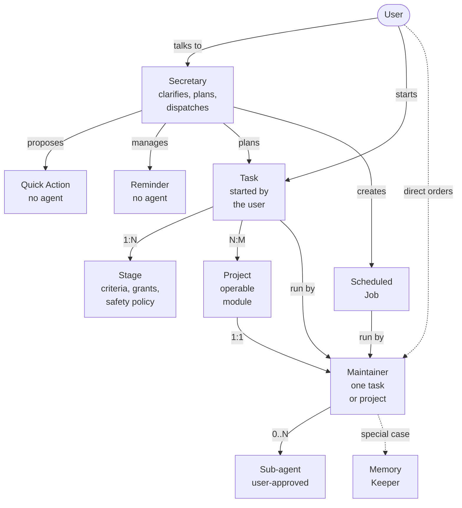
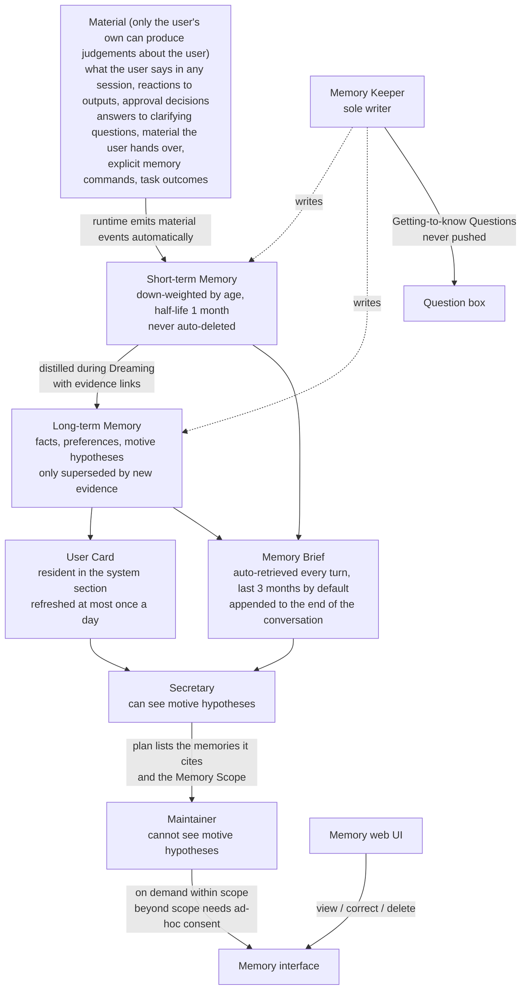
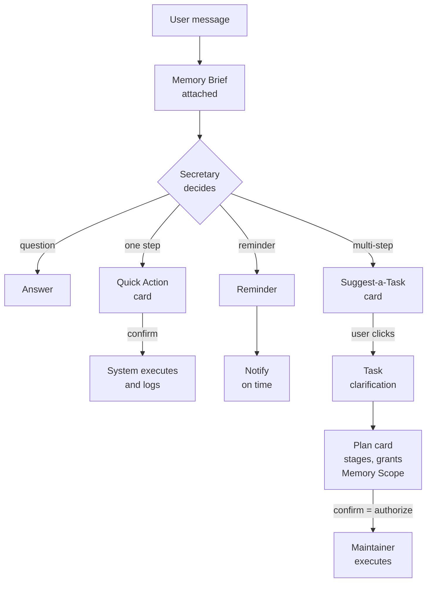
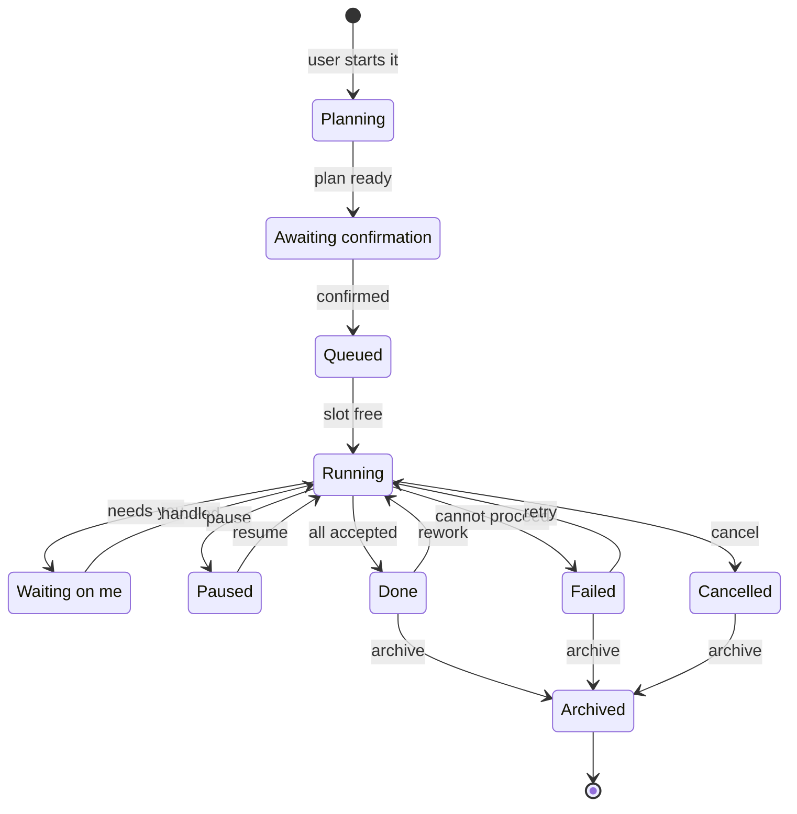
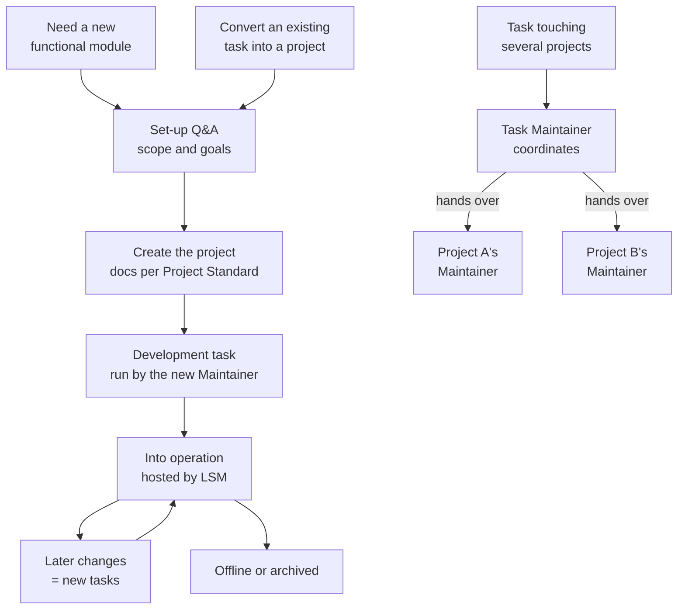
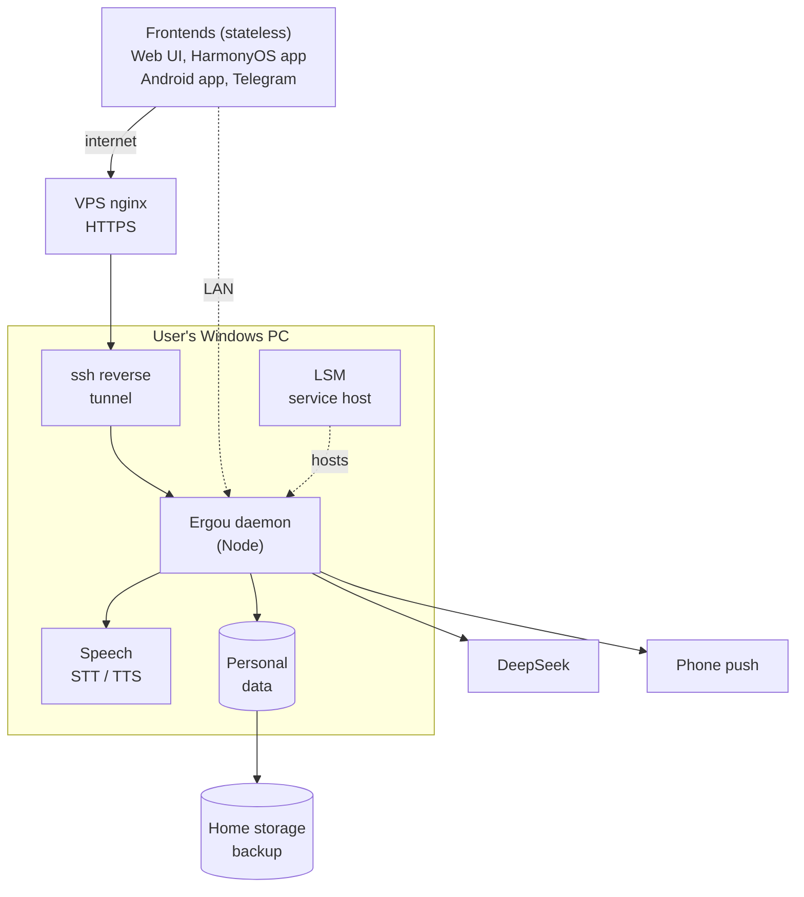
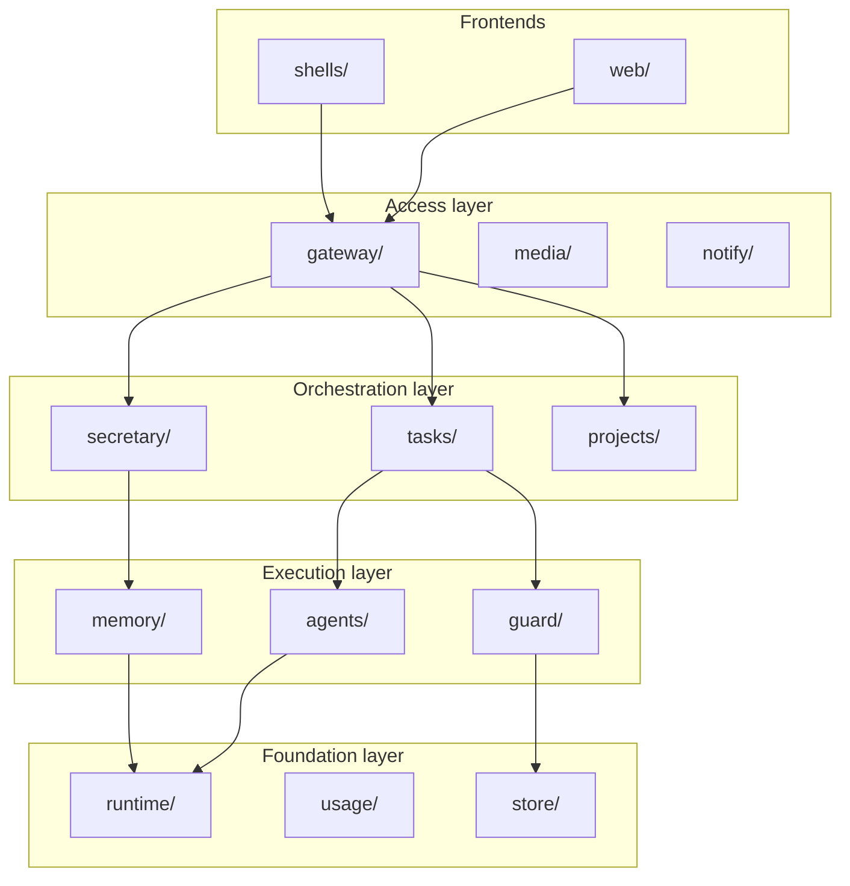

[中文](README.md) | **English**

# Ergou v2

A personal assistant agent that serves exactly one person. It is built from scratch on [pi](https://github.com/earendil-works/pi) as an improved take on OpenClaw. It runs on the user's own computer. The user mostly talks to the **Secretary**, actual work is dispatched as tasks and projects to dedicated **Maintainers**, and the system keeps building up its understanding of the user.

> **Status: planning.** The repository currently holds only specs, decisions and research notes — no implementation code yet. Diagrams below are marked either **decided** (from closed decision tickets) or **draft** (to be revised once the corresponding ticket is resolved).
>
> Note: apart from this README, the project documents are written in Chinese.

## Three differentiators

1. **Personal memory that mines motives.** What people say often depends on the situation and is not always accurate. Ergou infers the user's real needs and motives from fragmentary material, then turns those inferences into questions to check with the user. The method builds on intent-mining.
2. **Safe, with fewer interruptions.** Inherits AgentSense's "plan once, authorize once, run to completion". The user decides which operations they want to be reminded about — not limited to security. Everything that needs the user goes into a single **Inbox**.
3. **Secretary + Maintainer dispatch.** The Secretary only understands, clarifies, plans and dispatches; it does no domain work itself. Every task and project has one fixed Maintainer whose permissions are limited to what it is responsible for.

## Planning progress

Planning follows the wayfinder approach: one map plus a set of decision tickets, resolved one at a time.

- Main map: [Ergou v2](.scratch/ergou-v2/map.md)
- Sub-map: [Ergou memory system](.scratch/ergou-memory/map.md)
- Glossary: [CONTEXT.md](CONTEXT.md)
- Architecture decision records: [docs/adr/](docs/adr/)

Decided so far:

| Decision ticket | Outcome |
|---|---|
| [pi 1.0 layer capability mapping](.scratch/ergou-v2/issues/01-pi-layer-mapping.md) | Mapped pi's three layers; ruled out the experimental pi-durable; updating system-prompt sections on deepseek-flash busts the prompt cache |
| [Runtime base (ADR-0001)](docs/adr/0001-pi-coding-agent-sdk-as-runtime.md) | Use the `pi-coding-agent` SDK behind a thin Ergou-owned wrapper, with pinned versions |
| [Multi-agent architecture and token cost](.scratch/ergou-v2/issues/02-multi-agent-and-token-cost.md) | Each task or project is bound to one long-lived Maintainer, serial by default; parallelism is proposed by the Maintainer and confirmed by the user |
| [Memory boundary](.scratch/ergou-v2/issues/03-memory-boundary.md) | The Memory Keeper is the sole writer; the Secretary reads the User Card, Memory Briefs and deep queries; short-term vs long-term memory; motive hypotheses are visible to the Secretary only |
| [Task lifecycle and task board](.scratch/ergou-v2/issues/05-task-lifecycle-and-board.md) | Chat / Task / Project split; tasks are started explicitly by the user; completion is automatic, archiving is manual; the Inbox collects everything that needs the user |

## 1. Entities and relationships

### 1.1 Agents and work (decided)

Rules:

- **Only a project's Maintainer may change that project.** A task that touches a single project is executed by that project's Maintainer; a task touching several projects (or none) has its own Maintainer that coordinates.
- A Maintainer's tools, sandbox, visible memory and files are limited to the task or project it is responsible for.
- The Secretary cannot execute anything. A side-effecting operation is either a Quick Action executed by the system after the user confirms, or it becomes a Task.

Where the user looks at work:

| View | Shows |
|---|---|
| Task Board | Tasks, Reminders and Scheduled Jobs, grouped as "Waiting on me → In progress → In operation → Recently ended → Archived" |
| Project management | All projects and their states; each project card has a "Talk to the Maintainer" button |
| Inbox | Everything that needs the user's attention or confirmation; the tab shows a red dot when something is unread |

### 1.2 Memory (decided)

## 2. Workflows

### 2.1 Where a user message goes (decided; routing details pending "Clarification and planning flow")

- Every time the Secretary receives a message, the runtime first attaches a Memory Brief.
- Quick Action: the Secretary spells out the action; after the user confirms (or within existing grants) the system executes it directly and records it in the action log.
- A task can only be started by the user: by clicking a Suggest-a-Task card, by saying so explicitly, or with the Start Task button.
- The plan card lists the stages, the grants, which memories were cited, and the Memory Scope the task may use while running. Confirming the plan is the single authorization.

### 2.2 Task states (decided)

- **slot free**: at most 3 tasks run at the same time globally (configurable). Sub-agents do not take a slot.
- **needs you**: a runtime approval, a task clarification, a stage the plan marks as "accepted by you", or a call for help when stuck. All of these go into the Inbox.
- **pause**: paused by the user, or by the system when over budget or stuck.
- **rework**: AgentSense's "reopen by dependency" — only the failing stage and its downstream stages are reopened.
- **cancel**: the diagram only shows cancelling from "Running", but any state that has not ended can be cancelled.
- Inside "Running" an AgentSense-style staged plan executes; the card shows "stage N/M". The stage-level mechanics are pending "Long-task mechanism generalization".
- Only the user can archive. Tasks that ended more than 7 days ago and are still unarchived are collected into the Inbox once a week.
- Reminder: pending → fired (one-off), or pending forever (recurring).
- Scheduled Job: in operation ⇄ paused; auto-paused after 3 consecutive failed runs.

### 2.3 Projects and tasks (draft; pending "Project lifecycle", "Project Standard" and "Operation hosting")

## 3. System architecture (deployment view)

The split of components inside the daemon is a draft pending "Runtime architecture"; the deployment and external dependencies are decided.

| Node | Meaning |
|---|---|
| VPS nginx | Port 443, HTTPS, routes by host name into the ssh reverse tunnel |
| LSM | Local Service Manager: registers, starts and probes services. Hosts the Ergou daemon, the tunnel and the speech services |
| Ergou daemon | Long-running Node process; its modules are in section 4 |
| Speech | faster-whisper for speech to text, audio.cpp for text to speech |
| Personal data | Data directory outside the repository, SQLite plus files |
| DeepSeek | Everything starts on DeepSeek V4.1 Flash (`deepseek-flash`) |
| Phone push | HarmonyOS Push Kit, ntfy on Android, browser Web Push |
| Home storage | Huawei home storage, backed up periodically on a schedule run inside Ergou |

Constraints:

- Every Ergou service is registered with and started by LSM (Local Service Manager); Ergou never starts a service by itself.
- pi types appear only inside `runtime/`; everything above depends only on Ergou's own interfaces (ADR-0001).
- Domain state — approvals, tasks, memory, the token ledger — lives only in Ergou's own store, never in pi sessions.
- Personal data lives in a data directory outside the repository. Everything that gets recorded has a fixed, managed home; temporary files go only into a dedicated temp area that is cleaned periodically.

## 4. Module breakdown (draft, pending "Runtime architecture")

Organised in layers; each layer depends only on the layers below it.

| Layer | Module | Responsible for |
|---|---|---|
| Frontends | `web/` | Web UI, inheriting AgentSense's visual language |
| | `shells/` | HarmonyOS and Android shells |
| Access | `gateway/` | Frontend protocol, device pairing, media transfer |
| | `media/` | Speech-to-text and text-to-speech clients |
| | `notify/` | Inbox and per-channel push adapters |
| Orchestration | `secretary/` | Secretary, clarification, planning |
| | `tasks/` | Task Board, state machine, scheduling, Reminders, Scheduled Jobs, Quick Action execution |
| | `projects/` | Project registry, Project Standard, workspaces |
| Execution | `agents/` | Maintainers, sub-agents, role cards |
| | `guard/` | Watch categories, grants, approval table |
| | `memory/` | Material, short/long-term memory, Dreaming, Memory Briefs |
| Foundation | `runtime/` | Thin wrapper over the pi SDK — the only code that touches pi |
| | `usage/` | Token accounting |
| | `store/` | Personal data directory, event log, backup |

## Document index (in Chinese)

| Path | Contents |
|---|---|
| [CONTEXT.md](CONTEXT.md) | Glossary: Secretary, Task, Project, Maintainer, Short-term Memory, … |
| [docs/adr/](docs/adr/) | Architecture decision records |
| [docs/research/](docs/research/) | Research: AgentSense, intent-mining, OpenClaw and pi, multi-agent teams, memory, long tasks and interruptions, push, local infrastructure, multimedia, pi layers, user modelling |
| [docs/guides/](docs/guides/) | How-to guides, e.g. setting up Huawei AGC push |
| [.scratch/ergou-v2/](.scratch/ergou-v2/) | Main map and decision tickets |
| [.scratch/ergou-memory/](.scratch/ergou-memory/) | Memory-system sub-map and decision tickets |

## Conventions

- The repository holds only the framework. Personal data — memory, conversations, project records, secrets — never enters the repository.
- Project documents are written in Chinese; this README is the English counterpart of [README.md](README.md).
