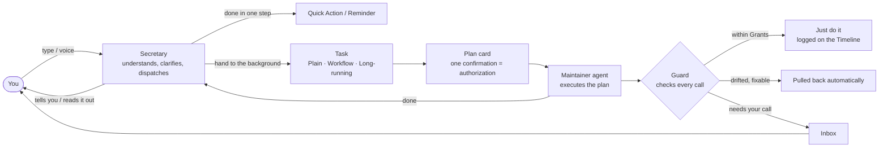
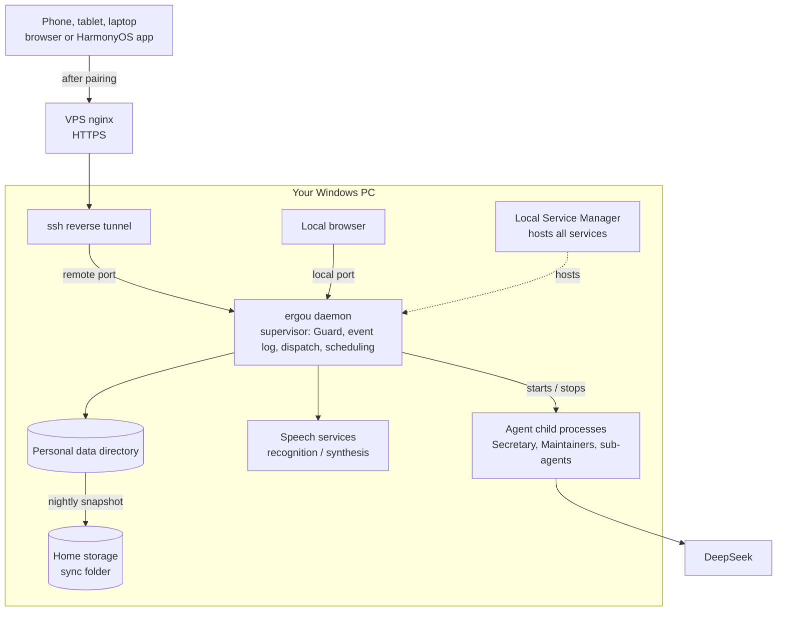

[中文](README.md) | **English**

# 二狗 · ergou

> A personal assistant agent that works for you alone. You only talk to the "Secretary"; the work goes to dedicated agents in the background. A long job is authorized once and carried through to the end, and pulled back automatically when it drifts. When you come back, pinch with two fingers and see only the key points.

**Current version 0.2.0 (2026-10-12)**: Phase 1, the "skeleton", is complete and in daily use. It has the Secretary, three kinds of tasks, the Guard, Timeline zoom, voice, access from multiple devices and a HarmonyOS app. ergou is built on [pi](https://github.com/earendil-works/pi) and can be seen as an OpenClaw rebuilt around its author's own needs.

<table>
<tr>
<td align="center"><br><b>Classic (经典)</b></td>
<td align="center"><br><b>Sticker Bento (贴纸便当)</b></td>
<td align="center"><br><b>Pixel Cabin (像素小屋)</b></td>
</tr>
</table>
<p align="center"><sub>The same conversation in three visual styles (11 in total). The screenshots show sample data from the UI prototype.</sub></p>

## In thirty seconds

- **Talk only to the Secretary.** The Secretary understands you, aligns with you on intent and dispatches the work. It never touches your projects itself. Several things can run in the background at once, and you can keep chatting with it about something else.
- **Authorize a long job once; it runs to the end.** You don't have to click "Allow" at every step, and you don't have to open up every permission and hope nothing goes wrong. Before work starts, you confirm the stages, acceptance criteria and Grants once, on a single plan card. During execution, the Guard checks every step against the plan: what is within the Grants just runs, fixable drift is pulled back automatically, and only what can't be fixed comes to you.
- **Come back, pinch, see the key points.** A task's Timeline zooms with a two-finger pinch, in three layers:
  - Conversation layer: the full text.
  - Key-points layer: each entry shrinks to one line.
  - Overview layer: only color blocks remain.

  Key markers such as approvals, deviations, acceptance results and Watch Category hits are pinned in the margin. A long job of hundreds of steps can be reviewed in seconds.
- **Everything that needs you is in one place.** Approvals, acceptance and calls for help when stuck all go to the "Inbox" instead of flooding the chat.
- **It can talk.** Hold to talk; your speech is recognized on your own machine. ergou replies in the reference voice you picked. When a scheduled task finishes, it can read the result out to you.



## Phase 1 highlights (0.2.0)

### 1. Long-running Tasks: authorize once, run to the end, correct drift automatically

Typical agents sit at one of two extremes: they ask about everything, or they get full permissions. ergou takes the middle way: **spell out "what may be done" once before work starts, and have the runtime keep watch during execution instead of relying on the agent's self-discipline.**

**Before work starts**
- The Secretary first aligns with you on intent and writes a one-page Task Brief for the responsible Maintainer agent. The Maintainer drafts the plan from it.
- The plan card lists everything at once. Confirming it once is the authorization:
  - which stages there are, what each stage delivers and how it is accepted;
  - which tools are used;
  - which operations are pre-approved (kind, target scope, count, expiry);
  - which operations in this task you want to be reminded of.

**During execution**
- The plan, the Grants and the boundaries you have set are held by the runtime, not in the agent's session memory. So even late in a long job, it won't "forget the rules".
- **Acceptance doesn't rely on the agent saying it's done.** Each acceptance criterion states how it is checked:
  - a script check;
  - an independent reviewer agent that sees only the deliverables;
  - you, in person.
- **Temporal Rules** keep watch the whole time, for example "back up before deleting", "run the tests before pushing", "nothing goes out after reading a secret".
- **Workflows** (tasks whose steps are laid out in advance) are compared with the plan step by step on every call. Fixable drift is pulled back automatically: a missed prerequisite step is led back in, and wrong arguments are changed back to match the plan.
- When a Grant needs to be widened, only the affected stages stop and wait for you. The rest carries on.
- If the daemon is killed or the computer restarts, work in progress resumes by rule. Operations with side effects are never quietly redone.

<p align="center"><br><sub>Plan panel (Sticker Bento (贴纸便当)): stages, dependencies and Grants on one screen. Confirm once and work starts.</sub></p>

### 2. Timeline zoom: come back, pinch, see the key points

When a long job finishes, you don't need to page through the record entry by entry. The Timeline is one continuous zoom over the same content: pinch with two fingers, or tap the button in the title bar.

<table>
<tr>
<td align="center"><br><b>Conversation layer</b><br><sub>Full content</sub></td>
<td align="center"><br><b>Key-points layer</b><br><sub>One line per entry; pull-backs, withdrawals and pending approvals pinned in the margin</sub></td>
<td align="center"><br><b>Overview layer</b><br><sub>The whole task as one color bar; marker lines point to where things happened</sub></td>
</tr>
</table>

- Once zoomed out, approvals, deviations, acceptance results and Watch Category hits are pinned to the right of the bar. Identical consecutive markers are shown once, written as ×N.
- Tool calls are shaded by their nature: read-only, acting, and deleting or changing.
- Each stage of a Long-running Task is drawn as a book spine, colored by that round's acceptance result.
- Open any entry to see the full call and how the Guard judged it, written in plain language.

### 3. The Guard: you decide what to be reminded about

- **Watch Categories** are not limited to security. Built-in ones include: spending money, sending in your name, deleting or overwriting, irreversible commits, accounts and security, leaving the project directory, unknown writes… You can also define your own categories with deterministic rules.
- **Six Dispositions**: just do it and log it, do it then tell me, only if it's in the plan, ask me first, hand it to me, never. Each category has one set for chats and one for tasks, and you can only make them stricter.
- **Common operations are wrapped as typed tools** (git, tests, installing dependencies…). Generic bash is also split into its parts and checked piece by piece.
- **Every tool call is fully recorded**: what it touched, which category it fell into, and on what basis it was allowed or stopped. All of it can be looked up afterwards.
- **Current defaults** (0.2.0, getting features working first):
  - When a task's agent goes beyond its Grants, it is not stopped for now, just flagged as usual.
  - The Secretary shows an approval card only for especially sensitive operations: sending things out, accounts and security, irreversible commits, and changing or deleting files outside its scratch area.
  - Three hard lines hold no matter who says otherwise: no writing to ergou's own config area, database area or program directory; no reading the secrets area; nothing that would definitely send a secret out.
  - Spending money, payments, creating accounts and changing passwords are always handed to you to do yourself.

<p align="center"><br><sub>An opened tool call: what it did, which Watch Category it falls into, which Disposition applies, whether it is within the Grants, and what it actually changed.</sub></p>

### 4. Three approaches × three triggers

| Approach | Good for | How it works |
|---|---|---|
| Plain Task | Downloading a video, looking something up | A background agent does it directly, round by round; when it's done, the Secretary passes the result on to you |
| Workflow | The same few steps every day | Steps are laid out in advance and authorized once; every run is then checked step by step and corrected automatically |
| Long-running Task | Writing a tool, doing a research report | Executed in stages and accepted stage by stage; the plan can change during execution |

- **There are three ways to trigger**: once, now; on a schedule (repeating, optionally "on my workdays", which counts public holidays and make-up workdays in both China and Singapore; or once at a set time); on an event (for example, another task finishes, or a new file arrives in a folder).
- **When starting a task, just write "tomorrow at 8 a.m. …"**, and the time is set exactly as you wrote it.
- **Scheduled tasks can be rescheduled, run once immediately, paused and resumed at any time.** With "auto-announce when done" turned on, the Secretary reads the key points to you after each run.

<table>
<tr>
<td align="center"><br><sub>Starting a task: pick the approach, write "every Monday at 8 a.m. …", and the schedule is set automatically.</sub></td>
<td align="center"><br><sub>Calendar (Pixel Cabin (像素小屋)): workdays and holidays in both places, plus the day's Reminders, scheduled tasks and each of their runs.</sub></td>
</tr>
</table>

<p align="center"><br><sub>Task Board (Pixel Cabin (像素小屋)): Waiting on me → In progress → In operation → Recently ended.</sub></p>

### 5. Projects and Maintainers: long-term work has a fixed owner

- A **Project** is a functional module meant for long-term use. It has its own records (Project Charter, spec, progress), a Working Directory and a fixed **Maintainer** agent. The Maintainer's understanding of the project lives in the records, so you don't have to explain the background again each time.
- Everything a Maintainer does is a **Work Order**. The dispatcher puts it into the Maintainer's queue, and the Maintainer does one at a time. This is scheduling done by the runtime, not a convention written into a prompt.
- **Scope Review**: at the end of every Work Order and at every session compaction, another model checks whether the Maintainer did anything outside its scope. Overreach is recorded and you are reminded, but nothing is blocked.
- For a task that touches several projects, the plan states which projects it touches and what changes in each. All of it is confirmed once, together with the plan.

### 6. Inbox: everything that needs you, in one place

Approvals, plan confirmations, acceptance and calls for help when stuck all collect in the "Inbox". The same card stays in sync across the chat, the Inbox and the Timeline. Clicking it in any of them has the same effect, and you can handle cards in batches.

<p align="center"><br><sub>Inbox (Sticker Bento (贴纸便当)): time-limited approvals form their own group at the top.</sub></p>

### 7. Voice

- **Hold to talk**: the microphone is warmed up in advance, recording starts the moment you press, and swiping up cancels. Recognition runs locally on the GPU with faster-whisper large-v3.
- **ergou replies in the reference voice you picked**: text-to-speech is synthesized locally, and long replies are split into segments that play while the rest is still being synthesized. A voice bubble can be switched to "show text" to see the original.
- **When a task finishes, the Secretary tells you on its own** and asks whether to read it out. Tasks with "auto-announce when done" turned on are read out directly.

### 8. Anywhere, anytime

- On the PC, open the local page directly. Phones and tablets connect through an HTTPS domain on a VPS. A new device must be paired and approved the first time, and its credential can be revoked at any time.
- Pages are designed for phone portrait first. Wide screens switch to multi-column layouts, and tablets work in both orientations.
- **Native HarmonyOS app**: native recording, file downloads to a location you choose, and the same web UI running inside the shell.

### 9. Stable, with visible costs

- The resident daemon is hosted by Local Service Manager and acts only as a supervisor. Each agent runs in its own child process, and all state is written to disk.
- A consistent snapshot is taken every night and copied into the home storage sync folder. It can be verified and restored.
- The **Token Ledger** records every model call one by one, under the task and agent it belongs to. Costs are estimated with DeepSeek's time-of-day pricing: weekday daytime in Beijing time is peak, and all other times are half price.

### 10. Good-looking, and yours to change

- 11 visual styles: Classic (经典), Warm Paper Journal (暖纸手帐), Night Flight Dashboard (夜航仪表), Soft Candy (软糖圆角), Glass Glow (玻璃光纹), Engineering Blueprint (工程蓝图), Sticker Bento (贴纸便当), Pixel Cabin (像素小屋), Ink Wash (水墨国风), Retro Magazine (复古杂志), Clean Grid (净白格栅). Light, dark and follow-system modes are all available.
- The Secretary's name, system prompt, model, skill library, slash commands and MCP tools can all be changed in Settings.

<p align="center"><br><sub>Settings · Appearance and style: 11 styles, each with light on the left and dark on the right.</sub></p>

### 11. Collecting material for Phase 2

From day one, everything you say and every reaction you have to outputs and approvals is stored as material. Your own words are also saved as a separate copy that cannot be changed, with keyword and vector indexes built for it. Phase 1 only collects and makes no inferences. That is left for the Phase 2 memory system.

## Compared with OpenClaw

OpenClaw is a general-purpose, multi-channel personal agent, and it covers far more ground than ergou. ergou serves only one person and makes different trade-offs in the places below. The OpenClaw column is based on [Research 03](docs/research/03-openclaw-and-pi.md), as of 2026-10-06.

| | OpenClaw | ergou |
|---|---|---|
| Who does the work | The main agent can delegate work to specialist sub-agents through its prompt; there are "coordinator + specialists" team presets, but the official docs say delegation is guided by prompts, not done by a scheduler | The Secretary only dispatches work and never does it itself. Every task and every project has a fixed Maintainer; the dispatcher is part of the runtime, and Work Orders queue up and are done one at a time |
| Projects | No "project" as a first-class entity | Projects have records, a Working Directory, a fixed Maintainer and a Project Charter; Scope Review checks for overreach |
| Permissions | Sandbox and exec approvals are both off by default; full access is the default | Watch Categories × six Dispositions, Grants in the plan, Temporal Rules, three hard lines; every call is recorded and explained in plain language |
| Interruptions | Push notifications are toggled per category, with optional quiet hours; by default only approvals are pushed | Each task specifies which operations to remind you about (not limited to security); the plan is authorized once; everything that needs you goes to the Inbox |
| Long jobs | heartbeat, cron | Staged plans, independent acceptance, automatic correction; changing the plan stops only the affected stages; after a kill, work resumes by rule and side effects are never quietly redone |
| Looking back | Chat history | Three-layer Timeline zoom, with key markers pinned in the margin |
| Memory | Engineered layered memory (dreaming, hybrid retrieval); explicitly does not build person profiles | Phase 1 collects material from day one; Phase 2 does motive mining, reaching deep needs and values |
| Size | Criticized as "nearly 500,000 lines of code, 53 config files, 70+ dependencies" (in the words of the NanoClaw author) | About 130,000 lines of TypeScript, 5,000+ automated tests, serves one person |

## Phase 2 plans

Phase 2 puts its main effort into two areas: the **memory system** and the **project system**.

### Memory: understanding what you really want from what you say

What people say often depends on the situation at the time. It isn't always accurate, and it isn't always what they really think. The Phase 2 memory system will infer your deeper needs and core values from these fragments. Then, even when you say only half a sentence, it will find it easier to understand what you want.

- The **Memory Keeper** distills long-term memory from the material during the "Dreaming" phase: facts, preferences and motive hypotheses, each with links to its evidence.
- **Motive mining** draws on [intent-mining](docs/research/02-ref-intent-mining.md): from surface behavior to deeper needs, and then to values. Inferred hypotheses are not taken as true. They become "getting to know you" questions, checked with you when it suits you (a question box, never pushed).
- The Secretary carries the **User Card** and a **Memory Brief** in every turn. A Maintainer can only get the part of memory that its plan authorizes.
- Memory can be viewed, corrected and deleted.

### From project to operation: what ergou builds becomes a long-term service

- Projects that ergou builds can go live as services: registered and hosted in LSM, with a public entry point, online monitoring and operational alerts.
- **Running projects you can operate by talking to the Secretary**: while a project is being built, it exposes every operational interface by default, and these are registered with ergou when it goes into operation. Checking data, changing settings, starting and stopping, and handling decisions that need a person can all be handed to the Secretary by voice, without opening the project's own UI.
- There will be a complete Project Standard (default workflow, document templates, checklists for retiring and re-enabling), a project management UI and an overview page.
- As projects accumulate, the capabilities behind ergou keep growing. It will keep using the services it has built, and its abilities will improve round after round.

### Voice as the default way to interact

Phase 1 can already do hold-to-talk, reply in a reference voice and auto-announce when done. Phase 2 makes voice the default way to deal with ergou, and adds system-level push notifications on the phone and remote approval.

### Capabilities keep growing

- External connectors: email, IM, calendar.
- A built-in skill library.
- Letting ergou direct external executors such as Claude Code.
- Operating computers and phones.
- Bootstrapping: using ergou to improve ergou.
- Security mechanisms added later: a review agent, a system-level sandbox, native signatures for high-risk approvals, and an Android app.

## Architecture at a glance



- **Code**: TypeScript (npm workspaces: `packages/daemon`, `packages/web`, `packages/protocol`), with a React 19 + Vite frontend. The HarmonyOS shell is in `frontend/harmony`.
- **Agent runtime**: pi appears only inside one thin wrapper; everything above it depends only on ergou's own interfaces ([ADR-0001](docs/adr/0001-pi-coding-agent-sdk-as-runtime.md)). Domain state such as approvals, tasks and the Token Ledger lives in ergou's own event log (SQLite), not in pi sessions.
- For the detailed design, see the [spec](.scratch/ergou-v2/spec.md), the [glossary](CONTEXT.md), the [architecture decisions](docs/adr/) and the [developer docs](docs/dev.md).

## Running and development

ergou is currently set up only for its author's own environment (Windows, hosted by Local Service Manager, DeepSeek). It is not yet an out-of-the-box install package.

```bash
npm ci                    # Node >= 22.19
npm run typecheck
npm test                  # vitest; on Windows, ERGOU_TEST_WORKERS=2 is recommended
npm run build:web         # build the web UI; opening packages/web/dist/index.html directly gives the UI prototype with sample data
npm run build:harmony     # build the HarmonyOS app (signing materials are not in the repo)
```

The daemon is registered and started by Local Service Manager; ergou never starts any service by itself. For configuration, ports and the data directory, see [docs/dev.md](docs/dev.md).

## Document index

| Path | Contents |
|---|---|
| [CONTEXT.md](CONTEXT.md) | Glossary: Secretary, Task, Project, Maintainer, Guard, Timeline… |
| [.scratch/ergou-v2/spec.md](.scratch/ergou-v2/spec.md) | Phase 1 spec |
| [.scratch/ergou-v2/impl/](.scratch/ergou-v2/impl/) | Implementation tickets (101 in Phase 1) |
| [docs/adr/](docs/adr/) | Architecture decision records |
| [docs/dev.md](docs/dev.md) | Developer docs: modules, protocol, test harness, deployment |
| [docs/research/](docs/research/) | Research: AgentSense, intent-mining, OpenClaw and pi, multi-agent, memory, long tasks and interruptions, voice, and more |
| [docs/guides/](docs/guides/) | How-to guides |

## Conventions

- The repository holds only the framework. Personal data such as memory, conversations, project records and secrets never enters the repository.
- Docs and discussion are in Chinese; this README is the English version of [README.md](README.md).
