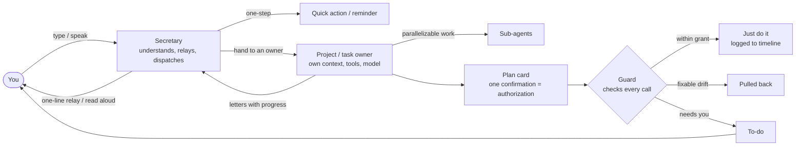
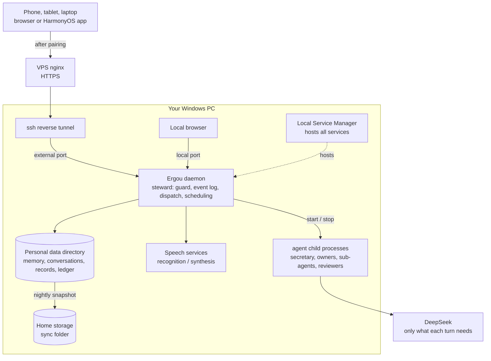

[中文](README.md) | **English**

# Ergou (二狗)

> **The better it knows you, the more you can trust it.**
>
> A personal assistant that lives on your own computer. What it knows about you stays on your machine. Work you hand off gets a dedicated owner and is carried through with safeguards. When you come back, you can see what happened at a glance. As it gets things right one by one, your trust in it builds up.

**Current version 0.2.0 (2026-10-12)**: phase one (the "skeleton") is done and in daily use. Changes since 0.2.0 are in the [CHANGELOG](CHANGELOG.md) (in Chinese). Ergou is built on [pi](https://github.com/earendil-works/pi) and can be seen as a rebuild of OpenClaw around one person's needs.

<table>
<tr>
<td align="center"><br><b>Classic</b></td>
<td align="center"><br><b>Sticker Bento</b></td>
<td align="center"><br><b>Pixel Cottage</b></td>
</tr>
</table>
<p align="center"><sub>The same conversation in three of the 11 visual styles. Screenshots show sample data from the UI prototype.</sub></p>

## One-minute overview

**Available now**

1. **Your memory stays on your computer.** Conversations, a verbatim copy of everything you've said, and project records are stored locally and backed up nightly. Each model call sends only what that turn needs, so the full picture of you is never held by someone else.
2. **One owner per job, no mix-ups.** The secretary only relays. Every project and task has its own dedicated owner, with its own context, tools and model. The rules you set are kept by the system, so nothing is forgotten however long the work runs.
3. **Hand off long jobs with confidence.** You approve the plan once. Each stage is checked by a reviewer, and drift is pulled back automatically. On one real project: 247 operations, and you clicked 7 times.
4. **See it all at a glance when you're back.** Pinch to zoom from every message out to the whole job. Everything that needs your decision is in one place, and every cent spent is accounted for.

**Coming in phase two**

5. **The apps you build can talk.** Apps built with Ergou plug straight into Ergou and take your voice commands. Anywhere you can click, hold a key and speak.
6. **Your coding assistants, managed in one place.** Ergou coordinates the Claude Code and Codex sessions on your computer.
7. **It understands you better.** It infers what you really want from what you've said. When it's confident it acts; when it isn't, it asks first.



## Available now

### 1. Your memory stays on your computer

Many AI assistants get to know you better over time, at the cost of storing everything about you in the cloud. Ergou does the opposite: **what it knows about you stays on your own computer.**

- **Data stays local.** Ergou runs on your computer and keeps these in a local data directory:
  - conversations;
  - an immutable verbatim copy of everything you've said, indexed by keyword and vector;
  - project records, task records, attachments and the cost ledger.
- **Only what's needed is sent.** Ergou still calls a large model (DeepSeek today), but each call carries only what that turn needs. Your long-term memory is never held in full by someone else.
- **Nightly backups.** A consistent snapshot is copied every night to a sync folder on your home storage, and can be verified and restored.
- **Keys stay out of reach.** Secrets live in a separate area that no agent can read.
- **New devices need your approval.** Phones and tablets connect back to this computer through your own VPS. A new device must be approved the first time, and its credentials can be revoked at any time.
- **Voice is processed locally.** Hold-to-talk is transcribed on your GPU (faster-whisper large-v3), and replies are synthesized locally too.

### 2. One owner per job, no mix-ups

Cram several jobs into one conversation — project A today, project B tomorrow — and sooner or later it gets them mixed up. Ergou keeps each project and task separate:

- **The secretary only listens and relays.** It never touches your projects. Several jobs can run in the background while you keep chatting with it.
- **Every project and task has a fixed owner** (a maintainer agent). Each owner has its own context and toolkit (skills, external tools) and can only touch its own work. Its system prompt and model can be set individually too: tap ⚙ in its conversation.
- **Parallelizable work goes to sub-agents.** They just do the work. To discuss a project in detail, talk to its owner directly.
- **Agents write letters.** Owners report progress to the secretary; letters fold into a single line, and the secretary relays them to you. Attachments follow the text and open with a tap.
- **Rules are kept by the system, not by an agent's memory.** The runtime holds the plan, the grants and the boundaries you set. A project's understanding lives in its records (charter, spec, progress), not in an ever-growing chat. A month in, it still remembers what was agreed.
- **One work order at a time.** Everything an owner does is a work order, queued by the dispatcher. This is runtime scheduling, not a convention written into a prompt.
- **Scope review.** After every work order and every context compaction, another model checks whether the owner did anything out of scope. Overreach is recorded and flagged, but not blocked.
- **You decide when the first version is done.** When a project's first build finishes, you choose: put it into use, keep building, or abandon and archive it.

### 3. Hand off long jobs with confidence

Most agents sit at one of two extremes: ask about everything, or get full access and hope nothing breaks. Ergou takes the middle road: **spell out what may be done once, up front, and let the runtime enforce it — not the agent's good behavior.**

**Before work starts**, the plan card lists everything; confirming it once is the authorization:
- the stages, what each delivers and how it's accepted;
- which tools are used, and which operations are pre-approved (kind, target scope, count, expiry);
- which operations in this task should alert you.

**While it runs**:
- **Acceptance isn't the agent's say-so.** Each stage passes scripted checks, then an independent reviewer agent. The reviewer can run commands in the working directory to see real results, so you don't have to sign off stage by stage.
- **Drift is pulled back automatically.** Off-plan actions are flagged. A workflow is checked step by step against its plan on every run, and a skipped step is brought back in.
- **Temporal rules are always on**, e.g. "back up before deleting", "run tests before pushing", "never send anything out after reading a secret".
- **Changing the plan pauses only the affected stage.** The owner submits just the stage it wants to change; one tap on the plan-change card applies it, and the other stages keep going.
- **Interrupted work resumes.** If the daemon is killed or the computer restarts, work continues where it stopped. A side-effecting operation that may or may not have finished stops and asks you instead of being silently repeated.

**You decide what to be alerted about**:
- **Watch categories go beyond security.** Built in: spending money, sending on your behalf, deleting or overwriting, irreversible commits, accounts and security, leaving the project directory, and more. You can define your own.
- **Six dispositions per category**: just do it and log, tell me afterwards, only if listed in the plan, ask me first, hand it to me, never.
- **Every tool call is fully recorded**: what it touched, which category it fell into, and why it was allowed or stopped, in plain language.
- **Three hard lines no one can override**: never write Ergou's own config, database or program directories; never read the secrets area; never send out something that is known to be a secret.
- **Spending, payments, creating accounts and changing passwords** are always left for you to do yourself.
- Phase one's defaults lean toward getting features working first, so some approvals are relaxed for now; see the [CHANGELOG](CHANGELOG.md) and the [developer docs](docs/dev.md).

> **Real numbers**: building the first version of a real project, "Memory Price Tracker", took 247 operations, and you clicked only 7 times. It drifted 5 times along the way and was pulled back automatically each time (counted from local data on 2026-10-14).

<p align="center"><br><sub>The plan panel (Sticker Bento): stages, dependencies and grants on one screen. Confirm once and work begins.</sub></p>

<p align="center"><br><sub>Open a tool call: what it did, which watch category it hit, how it was handled, whether it was within the grant, and what it actually changed.</sub></p>

### 4. See it all at a glance when you're back

After a long job, you don't need to read through every record.

**The timeline zooms in three levels.** It's one continuous view of the same content; pinch, or use the button in the title bar.
- **Conversation**: the full text.
- **Key points**: one line per item.
- **Overview**: the whole job as a single colored bar.

When zoomed out, approvals, deviations, acceptance results and watch-category hits are pinned to the margin. Each stage of a long-running task is drawn as a book spine, colored by its acceptance result.

<table>
<tr>
<td align="center"><br><b>Conversation</b><br><sub>Full content</sub></td>
<td align="center"><br><b>Key points</b><br><sub>One line each; pull-backs, withdrawals and pending approvals pinned to the margin</sub></td>
<td align="center"><br><b>Overview</b><br><sub>The whole task as one bar, with markers pointing to where things happened</sub></td>
</tr>
</table>

- **Everything that needs your decision is in one to-do list.** Approvals, plan confirmations and requests for help are collected under "To-do", and can also be handled right in the conversation they came from. Alerts rotate in a banner at the top, and arrive as system notifications on HarmonyOS phones.
- **Every cent is accounted for.** A token ledger records each model call against its task, stage and agent, with costs estimated from DeepSeek's time-of-day pricing.
- **Attachments open instantly.** Markdown renders as a report page; HTML previews in an isolated sandbox.

<p align="center"><br><sub>To-do (Sticker Bento): time-limited approvals are grouped and shown first.</sub></p>

### 5. Everyday jobs run themselves

| Kind | Good for | How it works |
|---|---|---|
| Plain task | Download a video, look something up | A background agent just does it; the secretary tells you when it's done |
| Workflow | The same few steps every day | Steps are laid out in advance and authorized once; every run is checked step by step and drift is corrected |
| Long-running task | Build a tool, write a research report | Runs in stages, each one accepted before the next; the plan can change mid-way |

- **Three triggers**:
  - run once now;
  - on a schedule, optionally "on my working days", which counts public holidays and make-up workdays in both China and Singapore;
  - on an event, e.g. when another task finishes or a new file lands in a folder.
- **Write "tomorrow at 8 am…" when starting a task** and the schedule is set from your words. Scheduled tasks can be rescheduled, run once now, paused and resumed at any time.
- **Read aloud when done.** With auto-read on, the secretary reads you the highlights after each run. Anything read while you were away can be replayed with a tap.

<table>
<tr>
<td align="center"><br><sub>Starting a task: pick a kind, write "every Monday at 8 am…" and the schedule is set.</sub></td>
<td align="center"><br><sub>Calendar (Pixel Cottage): working days and holidays for both regions, plus the day's reminders, scheduled tasks and runs.</sub></td>
</tr>
</table>

### 6. Your way

- **11 visual styles**: Classic, Warm Paper Journal, Night Flight Panel, Soft Candy, Glass Shimmer, Blueprint, Sticker Bento, Pixel Cottage, Ink Wash, Retro Magazine, Clean Grid. Light, dark or follow the system; Classic also comes in 8 accent colors.
- **You choose the voice.** Ergou replies in a reference voice you pick, synthesizing long replies in chunks as it speaks.
- **You choose the name.** The secretary's name, system prompt, model, skill library, slash commands and MCP tools are all configurable.
- **Phone, tablet and computer.** Pages are designed phone-portrait first and switch to multi-column layouts on wide screens. There's a native HarmonyOS app, and open pages prompt you to refresh after the server updates.

<p align="center"><br><sub>Settings · Appearance & style: all 11 styles, each shown light (left) and dark (right).</sub></p>

## Coming in phase two

Phase two focuses on two areas: **the memory system** and **the project system**.

### The apps you build can talk

- **Plugged into Ergou from day one.** Projects built with Ergou connect to it via MCP once they go live. All projects are reached through one on-demand `project_ops` tool, so a sentence to the secretary is enough to query data, change settings, start or stop, or handle things that need a human decision.
- **Voice anywhere in the classic UI.** Live apps keep their keyboard-and-mouse interfaces, but Ergou's voice is built in throughout. Wherever the cursor is, hold a key and speak:
  - while writing an email: "add the receipts from my business trip last March";
  - while uploading photos on an outside website: "paste in the photos I took in Hangzhou last weekend".

  Ergou knows where these are, because they're already on your computer.
- **More capable over time.** The more projects you build, the more Ergou can do.

### Your coding assistants, managed in one place

Ergou manages the Claude Code and Codex sessions on your computer: you can see what each is doing and whether it's waiting on you, progress is reported through the secretary, and you can relay instructions to them through Ergou.

### Understanding you better

Traditional memory only records what you said. But people are complicated: they behave differently in different settings, and often don't say exactly what they mean. Phase two's memory system is built on a reasoning graph that works from what you say and do, up to your motives, your real needs and your values.

Say all you tell it is: "Dinner with them again on Friday night."
- **An ordinary assistant** treats it as a calendar entry.
- **Ergou**, if it remembers that:
  - "them" is a business partner team;
  - you said you were exhausted after the last three dinners;
  - you're preparing an important project this week;
  - you once said you want less low-value socializing, but without hurting the partnership,

  can tell you're hesitating, and reply: "The same partner team as last time? If it's just a regular dinner again, you could politely leave early — no need to stay the whole evening."

This is an evidence-based guess, not mind reading: when confident it acts; when less sure it shares its guess; it asks only when it really needs to. It will never override something you've clearly said just to avoid asking.

- **A memory manager** distills long-term memory from the raw material during a "dreaming" phase — facts, preferences and motive hypotheses, each linked to its evidence. Memories can be viewed, corrected and deleted.
- **Motive mining** builds on [intent-mining](docs/research/02-ref-intent-mining.md). Inferred hypotheses aren't taken as fact; they're checked with you when it's convenient for you.
- **ID documents stay local.** Things like your ID card and passport stay only on your computer, and Ergou asks you before sending anything sensitive to a model.

### More to come

- External connectors: email, IM, calendar.
- System-level push notifications and remote approvals on phones.
- Operating your computer and phone.
- Self-improvement: using Ergou to improve Ergou.
- Security layers added later: a reviewer agent, an OS-level sandbox, native signatures for high-risk approvals, an Android app.

## Compared with OpenClaw

OpenClaw is a general-purpose, multi-channel personal agent that covers far more ground than Ergou, and it also runs on your own machine. Ergou serves one person and makes different trade-offs in the areas below. The OpenClaw column is based on [research note 03](docs/research/03-openclaw-and-pi.md) as of 2026-10-06.

| | OpenClaw | Ergou |
|---|---|---|
| Who does the work | The main agent can delegate to specialist sub-agents via prompting; there's a "coordinator + specialists" team preset, but the docs say delegation is prompt guidance, not a scheduler | The secretary only relays and never does the work. Every task and project has a fixed owner with its own context, toolkit and model; the dispatcher is part of the runtime and work orders run one at a time |
| Projects | No first-class "project" entity | Projects have records, a working directory, a fixed owner and a charter; scope review checks for overreach; you decide when the first version goes into use |
| Permissions | Sandbox and exec approvals are off by default; full access by default | Watch categories × six dispositions, plan grants, temporal rules, three hard lines; every call is logged and explained in plain language |
| Interruptions | Push notifications toggled by category, with quiet hours; only approvals pushed by default | Per-task choice of what to be alerted about (not just security); one-time plan authorization; everything that needs you goes to the to-do list |
| Long jobs | heartbeat, cron | Staged plans, independent reviewer acceptance, automatic correction; plan changes pause only the affected stage; resumes after a restart without silently repeating side effects |
| Looking back | Chat history | Three-level timeline zoom with key markers pinned to the margin |
| Memory | Engineered layered memory (dreaming, hybrid retrieval); explicitly no personal profiling | Phase one collects your verbatim words locally from day one; phase two adds reasoning-graph motive mining, from surface behavior to deeper needs and values |
| Size | Criticized for "nearly 500k lines of code, 53 config files, 70+ dependencies" (per NanoClaw's author) | About 130k lines of TypeScript and 5,000+ automated tests, serving one person |

## Architecture



- **Code**: TypeScript, split with npm workspaces into three packages: `packages/daemon`, `packages/web` and `packages/protocol`. The frontend is React 19 + Vite; the HarmonyOS shell is in `frontend/harmony`.
- **Agent runtime**: pi only appears behind a thin wrapper, and everything above depends on Ergou's own interfaces ([ADR-0001](docs/adr/0001-pi-coding-agent-sdk-as-runtime.md)). Domain state such as approvals, tasks and the token ledger lives in Ergou's own event log (SQLite), not in pi's sessions.
- Detailed design (in Chinese): [spec](.scratch/ergou-v2/spec.md), [glossary](CONTEXT.md), [architecture decisions](docs/adr/), [developer docs](docs/dev.md).

## Running and developing

For now Ergou is built only for the author's own setup (Windows, hosted by Local Service Manager, DeepSeek). It isn't yet a ready-to-install package.

```bash
npm ci                    # Node >= 22.19
npm run typecheck
npm test                  # vitest; on Windows, ERGOU_TEST_WORKERS=2 is recommended
npm run build:web         # build the web UI; opening packages/web/dist/index.html directly gives the prototype with sample data
npm run build:harmony     # build the HarmonyOS app (signing material is not in the repo)
```

The daemon is registered and started by Local Service Manager; Ergou never launches services itself. Configuration, ports and the data directory are described in [docs/dev.md](docs/dev.md).

## Docs index

| Path | Contents |
|---|---|
| [CHANGELOG.md](CHANGELOG.md) | Version history |
| [CONTEXT.md](CONTEXT.md) | Glossary: secretary, task, project, maintainer, guard, timeline… |
| [.scratch/ergou-v2/spec.md](.scratch/ergou-v2/spec.md) | Phase one spec (including the phase two plan) |
| [.scratch/ergou-v2/impl/](.scratch/ergou-v2/impl/) | Implementation tickets (122 in total: 101 before 0.2.0, 21 since) |
| [docs/adr/](docs/adr/) | Architecture decision records |
| [docs/dev.md](docs/dev.md) | Developer docs: modules, protocol, test harness, deployment |
| [docs/research/](docs/research/) | Research: AgentSense, intent-mining, OpenClaw and pi, multi-agent, memory, long jobs and interruptions, voice, Windows sandboxing, and more |
| [docs/guides/](docs/guides/) | How-to guides |

## Conventions

- The repository holds only the framework. Personal data such as memory, conversations, project records and secrets never goes into the repository.
- Documentation and discussion are in Chinese; this English README is a translation.
