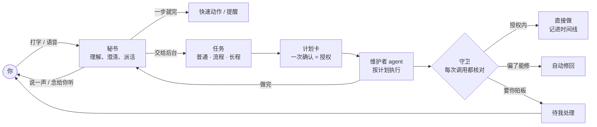
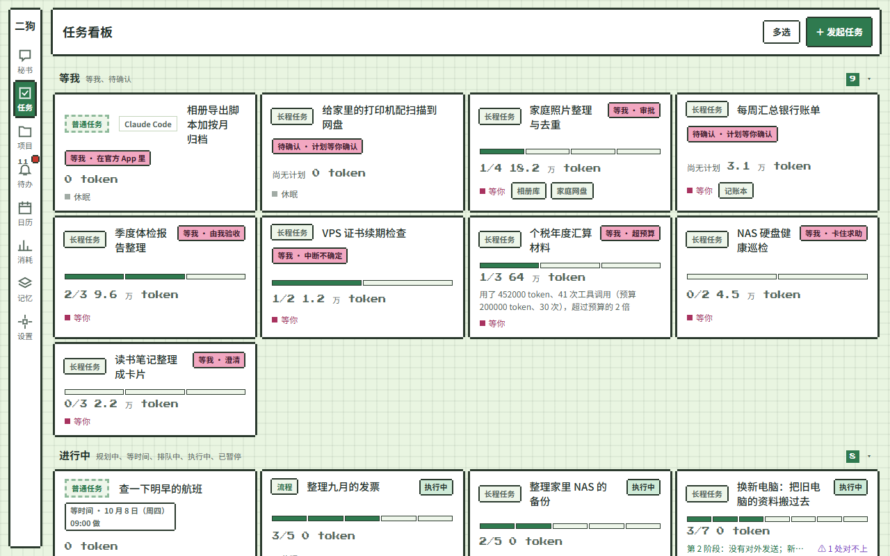
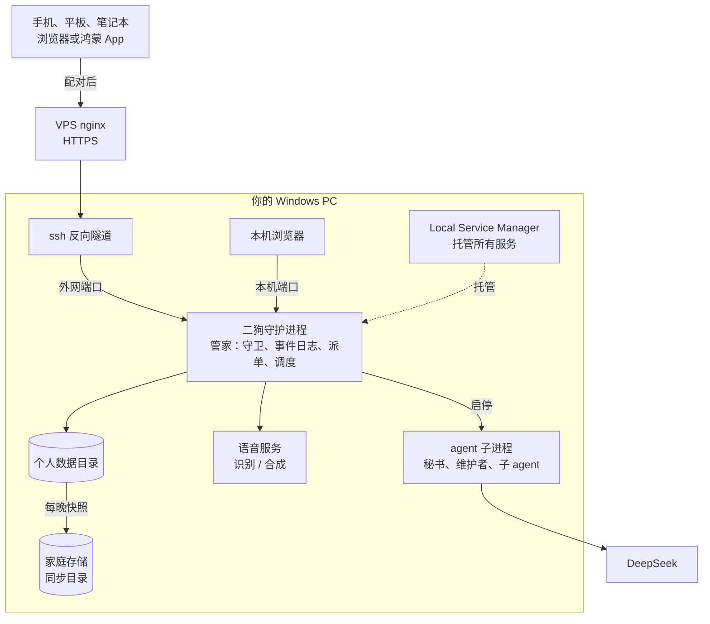

**中文** | [English](README.en.md)

# 二狗 · ergou

> 只为你一个人干活的个人助理 agent。你只跟"秘书"说话，活交给后台专门的 agent 去做。长活一次授权、执行到底，偏了自动拉回；回来双指一捏，只看要点。

**当前版本 0.2.0（2026-10-12）**：第一期"骨架"完成，已经在日常使用。有秘书、三种任务、守卫、时间线缩放、语音、多端访问和鸿蒙 App。二狗基于 [pi](https://github.com/earendil-works/pi) 搭建，可以看作一个按自己需求重做的 OpenClaw。

<table>
<tr>
<td align="center"><br><b>经典</b></td>
<td align="center"><br><b>贴纸便当</b></td>
<td align="center"><br><b>像素小屋</b></td>
</tr>
</table>
<p align="center"><sub>同一段对话的三套视觉风格（一共 11 套）。截图里是界面原型的示例数据。</sub></p>

## 三十秒看懂

- **只跟秘书说话。** 秘书负责理解你、和你对齐意图、把活派出去，自己不碰你的项目。几件事可以同时在后台做，你照样和它聊别的。
- **长活一次授权，执行到底。** 既不用每一步都点"允许"，也不用把权限全放开、躺平赌它别出事。开工前在一张计划卡上一次确认阶段、验收标准和授权。执行中，守卫每一步都对照计划核对：授权内的直接做，偏了能修的自动修回，修不了的才来问你。
- **回来一捏，只看要点。** 任务的时间线可以双指捏合缩放，分三层：
  - 对话层：看全文。
  - 要点层：每条缩成一行。
  - 全局层：只剩色块。

  审批、偏离、验收、关注类别命中这些关键标记钉在页边。几百步的长活，几秒钟就能看完。
- **要你处理的事都在一处。** 审批、验收、卡住求助统一进"待我处理"，不在聊天里刷屏。
- **能说话。** 按住说话，在本机识别；二狗用你选的参考音色回话。定时任务跑完可以直接念给你听。



## 第一期的亮点（0.2.0）

### 1. 长程任务：一次授权，执行到底，自动纠偏

一般的 agent 有两个极端：要么事事都问，要么权限全放开。二狗走中间：**在开工前把"能做什么"一次说清楚，执行中由运行时盯着，而不是靠 agent 自觉。**

**开工前**
- 秘书先和你对齐意图，写一页任务书，交给负责的维护者 agent。维护者据此起草计划。
- 计划卡上一次列清楚，你确认一次就是授权：
  - 分哪几个阶段，每个阶段交付什么、怎么验收；
  - 用哪些工具；
  - 预先批准哪些操作（种类、对象范围、次数、有效期）；
  - 这个任务里哪些操作要提醒你。

**执行中**
- 计划、授权和你说过的边界由运行时保管，不靠 agent 的会话记忆。所以长活做到后面，它也不会"忘了规矩"。
- **验收不靠 agent 自己说做完了**。每条验收标准写明用哪种方式验：
  - 脚本检查；
  - 只看交付件的独立评审 agent；
  - 你亲自验收。
- **时序规则**一直盯着，比如"删除之前必须已备份""push 之前必须跑过测试""读过密钥之后不许往外送"。
- **流程**（事先排好一串步骤的任务）每次调用都和计划逐步比对。偏了能修的自动修回：漏了前置步骤就引回去，参数不对就按计划改回来。
- 要扩大授权时，只有受影响的阶段停下来等你，其余照常做。
- 守护进程被杀、电脑重启，正在做的事按规则恢复，不会悄悄重做有副作用的操作。

<p align="center"><br><sub>计划栏（贴纸便当）：阶段、依赖关系和授权项一屏看清，确认一次即开工。</sub></p>

### 2. 时间线缩放：回来一捏，只看要点

长活跑完回来，你不需要逐条翻记录。时间线是同一份内容的一镜到底缩放：双指捏合，或者点标题栏的按钮。

<table>
<tr>
<td align="center"><br><b>对话层</b><br><sub>完整内容</sub></td>
<td align="center"><br><b>要点层</b><br><sub>每条一行；拉回、撤回、待批准钉在页边</sub></td>
<td align="center"><br><b>全局层</b><br><sub>整个任务一根色条，标记连线指到出事的位置</sub></td>
</tr>
</table>

- 缩小以后，审批、偏离、验收、关注类别命中钉在条外右侧。连着一样的只标一次，写成 ×N。
- 工具调用按性质分深浅：只看的、动手的、删改的。
- 长程任务的每个阶段画成一段书脊，颜色就是这一轮的验收结果。
- 任何一条点开，都能看到完整调用，以及守卫是怎么判的，用大白话写。

### 3. 守卫：你说了算要提醒什么

- **关注类别**不局限于安全。内置的有：花钱、以你的名义对外发送、删除或覆盖、不可逆的提交、账户与安全、越出项目目录、未知的写操作……你还可以用确定的规则自定义类别。
- **六档处置**：直接做只记录、做完告诉我、计划里列了才做、先问我、交给我做、永不。每个类别分对话和任务两套，你只能往严里调。
- **常用操作封装成带类型的工具**（git、测试、装依赖……）。通用 bash 也会拆开命令逐段检查。
- **每次工具调用都有完整记录**：碰了什么、落在哪个类别、按哪条依据放行或拦下，事后都查得到。
- **现在的默认**（0.2.0，功能优先跑通）：
  - 任务的 agent 超出授权时先不拦，照常标出。
  - 秘书只有特别敏感的操作才出审批卡：对外发送、账户与安全、不可逆的提交、改删草稿区以外的文件。
  - 三条硬底线谁说了都不放：不写二狗自己的配置区、数据库区、程序目录；不读密钥区；确定要把密钥发出去的不做。
  - 花钱、付款、建账户、改密码，永远交给你亲手做。

<p align="center"><br><sub>点开一条工具调用：做了什么、落在哪个关注类别、按什么处置、在不在授权内，以及它实际改了什么。</sub></p>

### 4. 三种做法 × 三种触发

| 做法 | 适合 | 怎么做 |
|---|---|---|
| 普通任务 | 下个视频、查点资料 | 交给后台 agent 一轮轮直接做，做完秘书转告你 |
| 流程 | 每天固定这么几步 | 事先排好步骤，一次授权，之后每次运行都逐步核对、自动纠偏 |
| 长程任务 | 写个工具、做份调研 | 分阶段执行、逐阶段验收，执行中可以改计划 |

- **触发方式有三种**：现在做一次；定时（反复做，可以"按我的工作日"，中国和新加坡的节假日、调休都算进去；或者某个时间做一次）；事件（比如某个任务做完、某个文件夹来了新文件）。
- **发起任务时直接写"明天早上 8 点……"**，时间就照你写的定。
- **定时任务可以随时改时间、立即运行一次、暂停和恢复**。打开"跑完自动播报"后，每次跑完秘书直接把要点念给你听。

<table>
<tr>
<td align="center"><br><sub>发起任务：选做法，写"每周一早上 8 点……"就自动定好时间表。</sub></td>
<td align="center"><br><sub>日历（像素小屋）：两地的工作日和节假日，当天的提醒、定时任务和每次运行。</sub></td>
</tr>
</table>

<p align="center"><br><sub>任务看板（像素小屋）：等我 → 进行中 → 运营中 → 最近结束。</sub></p>

### 5. 项目与维护者：长期的事有固定负责人

- **项目**是能长期使用的功能模块，有自己的档案（立项书、规格、进展）、工作目录和一个固定的**维护者** agent。对项目的理解存在档案里，不用每次重新交代背景。
- 维护者要做的所有事都是**工单**，由派单器送进它的队列，一次做一件。这是运行时的调度，不是写在提示词里的约定。
- **范围审视**：每张工单结束、每次会话压缩时，由另一个模型检查维护者有没有做范围外的事。越界的记下来、提醒你，但不卡死。
- 涉及多个项目的任务，计划里逐项写明动哪些项目、每个改什么，跟着计划一次确认。

### 6. 待我处理：要你的事都在一处

审批、计划确认、验收、卡住求助都汇总到"待我处理"。同一张卡在聊天、待我处理和时间线里状态同步，在哪里点都一样，可以批量处理。

<p align="center"><br><sub>待我处理（贴纸便当）：有时限的审批单独一组，排在前面。</sub></p>

### 7. 语音

- **按住说话**：麦克风提前预热，按下即录，上滑取消。识别在本机用 GPU 跑 faster-whisper large-v3。
- **二狗用你选的参考音色回话**：文字转语音在本机合成，长回复分段边合成边播。语音气泡可以"转文字"看原文。
- **任务做完秘书主动说一声**，问要不要念给你听；开了"跑完自动播报"的任务就直接念。

### 8. 随时随地

- PC 上直接打开本机页面。手机、平板经 VPS 的 HTTPS 域名访问，新设备第一次要配对批准，凭证随时可以吊销。
- 页面按手机竖屏优先设计，宽屏换成多列布局，平板横竖都能用。
- **鸿蒙原生 App**：原生录音、文件下载到你选的位置，外壳里跑同一套 Web 界面。

### 9. 稳、看得见成本

- 常驻守护进程由 Local Service Manager 托管，只当管家；每个 agent 跑在自己的子进程里，状态都落在磁盘上。
- 每晚做一次一致性快照，复制到家庭存储的同步目录，可以校验、可以恢复。
- **token 账本**逐笔记下每次模型调用，记在哪个任务、哪个 agent 名下。成本按 DeepSeek 的分时价格估算：北京时间工作日白天是高峰，其余时间半价。

### 10. 好看，也能按你改

- 11 套视觉风格：经典、暖纸手帐、夜航仪表、软糖圆角、玻璃光纹、工程蓝图、贴纸便当、像素小屋、水墨国风、复古杂志、净白格栅；浅色、深色、跟随系统都能选。
- 秘书的名字、系统提示词、模型、skill 库、斜杠命令、MCP 工具都能在设置里改。

<p align="center"><br><sub>设置 · 外观与风格：11 套风格，每套左浅右深。</sub></p>

### 11. 为二期攒好素材

从第一天起，你说过的每句话、对产出和审批的每个反应都作为素材入库。"本人"的原话另存一份不能改的副本，并建好关键词和向量索引。第一期只积累、不推断，留给第二期的记忆系统用。

## 和 OpenClaw 比

OpenClaw 是通用的、多渠道的个人 agent，覆盖面比二狗大得多。二狗只服务一个人，在下面这几处做了不同的取舍。OpenClaw 一栏依据 [调研 03](docs/research/03-openclaw-and-pi.md)，截至 2026-10-06。

| | OpenClaw | 二狗 |
|---|---|---|
| 谁在干活 | 主 agent 可以按提示词把活委派给专家子 agent；有"协调者 + 专家"的团队预设，但官方说委派是提示词引导，不是调度器 | 秘书只派活，不动手。每个任务、每个项目都有固定的维护者；派单器是运行时的一部分，工单排队一次做一件 |
| 项目 | 没有"项目"这个一等实体 | 项目有档案、工作目录、固定维护者和立项书；范围审视检查有没有越界 |
| 权限 | 沙箱和执行审批默认都关，默认是完全访问 | 关注类别 × 六档处置、计划里的授权项、时序规则、三条硬底线；每次调用都有记录，并用大白话解释 |
| 打扰 | 推送按类别开关，可设安静时段，默认只推审批 | 按任务指定哪些操作要提醒（不限于安全）；计划一次授权；要你的事集中进待我处理 |
| 长活 | heartbeat、cron | 阶段计划、独立验收、自动纠偏；改计划只停受影响的阶段；被杀后按规则恢复，不悄悄重做副作用 |
| 回看 | 聊天记录 | 时间线三层缩放，页边钉着要点标记 |
| 记忆 | 工程化的分层记忆（dreaming、混合检索），明确不做人物档案 | 第一期从第一天起攒素材；第二期做动机挖掘，推到深层需求和价值观 |
| 规模 | 被批评"近 50 万行代码、53 个配置文件、70 多个依赖"（NanoClaw 作者语） | 约 13 万行 TypeScript，5000 多个自动化测试，只服务一个人 |

## 第二期规划

第二期重点发力两块：**记忆系统**和**项目系统**。

### 记忆：从你说的话，读懂你真正要什么

人说的话常常跟当时的情境有关，不一定准确，也不一定是真实想法。第二期的记忆系统要从这些碎片里推出你更深层的需求和核心价值观。这样以后你说半句，它也更容易明白你要的是什么。

- **记忆管理者**在"做梦阶段"从素材里提炼长期记忆：事实、偏好、动机假设，每条都带证据链接。
- **动机挖掘**参考 [intent-mining](docs/research/02-ref-intent-mining.md)：从表象推到深层需求，再推到价值观。推出来的假设不直接当真，而是变成"了解你"的问题，在你方便时向你求证（问题箱，不推送）。
- 秘书每一轮都带着**用户卡**和**记忆简报**；维护者只拿得到计划里授权的那部分记忆。
- 记忆可以查看、纠正、删除。

### 项目转运营：二狗做的东西变成长期服务

- 二狗做出来的项目可以上线成服务：在 LSM 注册托管、开公网入口、在线监控、运营告警。
- **运营起来的项目，对秘书说句话就能操控**：项目在做的时候就默认留好运营态的全部接口，转运营时登记给二狗。查数据、改配置、启停、处理要人定的事，都能用语音交给秘书去做，不用打开项目自己的界面。
- 有完整的项目规范（默认工作流程、文档模板、停用和重新启用的检查清单）、项目管理界面和全景页。
- 项目越攒越多，二狗身后的能力就越来越强。它会不断用上自己做出来的服务，能力也跟着一轮轮迭代。

### 默认用语音交互

第一期已经能按住说话、用参考音色回话、跑完自动播报。第二期把语音变成和二狗打交道的默认方式，同时加上手机系统级推送和远程审批。

### 能力继续长

- 外部连接器：邮件、IM、日历。
- 内置 skill 库。
- 让二狗指挥 Claude Code 这类外部执行者。
- 操作电脑和手机。
- 二狗自举：用二狗改进二狗。
- 安全机制后接：审查 agent、系统级沙箱、高危审批的原生签名、安卓 App。

## 架构一览



- **代码**：TypeScript（npm workspaces：`packages/daemon`、`packages/web`、`packages/protocol`），前端是 React 19 + Vite；鸿蒙外壳在 `frontend/harmony`。
- **agent 运行时**：pi 只出现在一层薄封装里，上层只依赖二狗自己的接口（[ADR-0001](docs/adr/0001-pi-coding-agent-sdk-as-runtime.md)）。审批、任务、token 账本这些领域状态存在二狗自己的事件日志里（SQLite），不存在 pi 的会话里。
- 详细设计见 [规格](.scratch/ergou-v2/spec.md)、[术语表](CONTEXT.md)、[架构决策](docs/adr/)、[开发文档](docs/dev.md)。

## 运行与开发

二狗目前只按作者自己的环境搭建（Windows、Local Service Manager 托管、DeepSeek），还不是开箱即用的安装包。

```bash
npm ci                    # Node >= 22.19
npm run typecheck
npm test                  # vitest；Windows 上建议 ERGOU_TEST_WORKERS=2
npm run build:web         # 构建 Web 界面；直接打开 packages/web/dist/index.html 就是带示例数据的界面原型
npm run build:harmony     # 构建鸿蒙 App（签名材料不进仓库）
```

守护进程由 Local Service Manager 注册和启动，二狗自己不拉起任何服务。配置、端口、数据目录见 [docs/dev.md](docs/dev.md)。

## 文档索引

| 路径 | 内容 |
|---|---|
| [CONTEXT.md](CONTEXT.md) | 术语表：秘书、任务、项目、维护者、守卫、时间线…… |
| [.scratch/ergou-v2/spec.md](.scratch/ergou-v2/spec.md) | 第一期规格 |
| [.scratch/ergou-v2/impl/](.scratch/ergou-v2/impl/) | 实现票（第一期共 101 张） |
| [docs/adr/](docs/adr/) | 架构决策记录 |
| [docs/dev.md](docs/dev.md) | 开发文档：模块、协议、测试底座、部署 |
| [docs/research/](docs/research/) | 调研：AgentSense、intent-mining、OpenClaw 与 pi、多 agent、记忆、长任务与打扰、语音等 |
| [docs/guides/](docs/guides/) | 操作指南 |

## 约定

- 仓库只放框架。记忆、对话、项目档案、密钥等个人数据永远不进仓库。
- 文档和交流一律用中文；README 另有[英文版](README.en.md)。
