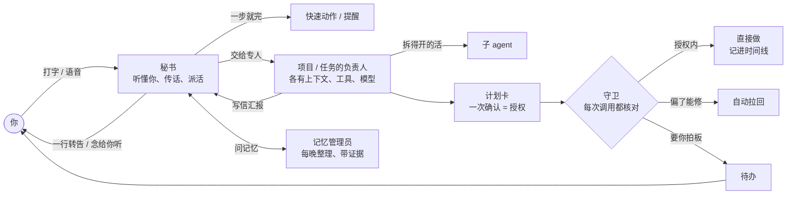
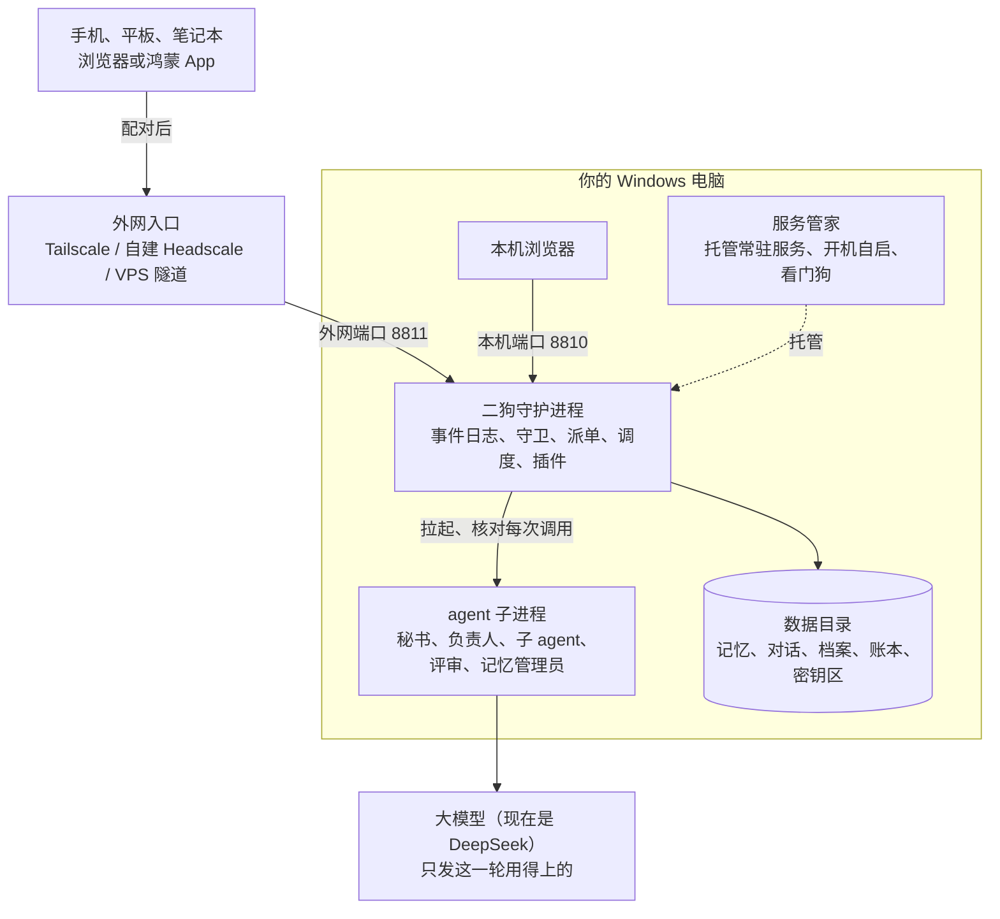

**中文** | [English](README.en.md)

# ergo（二狗）

> **一个装在你自己电脑上的个人 AI 助理。** 懂你的记忆只放在你电脑上；交给它的长活，一次授权、有专人负责、由运行时盯着做完；回来一眼就能看懂。

**[在线演示](https://catmaniii.github.io/ergo/)**（不用装、不用填 Key，点着看；网页原型自带编的示例数据。[English UI](https://catmaniii.github.io/ergo/?lang=en)）· [用户手册](docs/user-guide.md) · [开发者指南](docs/developer-guide.md) · [更新日志](CHANGELOG.md)

<table>
<tr>
<td align="center"><br><b>经典</b></td>
<td align="center"><br><b>贴纸便当</b></td>
<td align="center"><br><b>像素小屋</b></td>
</tr>
</table>
<p align="center"><sub>同一段对话的三套视觉风格（一共 11 套）。截图里都是界面原型自带的编的数据。</sub></p>

> **只支持 Windows 10 / 11。** 二狗靠的是 Windows 才有的东西（Job 对象、目录联接、计划任务），在别的系统上不启动。

英文名 ergo 取"二狗"的谐音，拉丁语 *ergo* 又是"所以、因此"——从你说的话里推出你真正想要的。二狗基于 [pi](https://github.com/earendil-works/pi) 搭建，可以看作一个只服务一个人、按自己需求重做的 [OpenClaw](https://github.com/openclaw/openclaw)。

## 5 分钟上手

**1. 一行命令装好**（PowerShell，不要管理员权限；安装包自带 Node，不用 npm、不用构建）：

```powershell
irm https://github.com/catmaniii/ergo/releases/latest/download/install.ps1 | iex
```

装到 `%LOCALAPPDATA%\Programs\ergo\versions\<版本>`（`current` 是一行文本，记着在用的是哪一份），`bin` 加进用户 PATH。从源码装、换镜像、用系统里那份 Node 之类的参数见[用户手册 2.1](docs/user-guide.md#21-一行命令安装推荐)。已经有 Node 22 的也可以用 `npm i -g ergo-ai`，装好后命令照样叫 `ergo`。

**2. 走向导设好**：浏览器打开 <http://127.0.0.1:8810/>，网页里的**设置向导**五步走完——语言 / 称呼 / 助手名、模型 Key（现在是 [DeepSeek](https://platform.deepseek.com/)，填完点一下测试）、组件（语义检索的向量模型）、手机扫码配对、安全默认值说明，后面还有一屏"外网访问"的说明。每步都能"以后再说"，全做完显示"设置完了"；以后随时从 **更多 · 设置** 最上面一行「设置向导」重进。

**3. 用起来**：跟它说"两分钟后提醒我喝水"试试。启停、看状态、看日志：`ergo start | stop | status | logs`；出问题先看 **更多 · 设置 · 数据与设备 →「体检」**（端口、Node、pi、服务管家、模型 key、组件、磁盘、外网入口八项，每条都写着怎么修）。

> Release 和 npm 包都还没发，上面这两条路现在还不通；在那之前请先[从源码安装](docs/user-guide.md#23-从源码安装现在就能用)：装 Node 22 和 Git → `git clone` → `npm ci` → `npm run build:web` → 起服务管家、登记二狗，大约 15 分钟。

## 一分钟看懂

1. **记忆留在你自己电脑上**：对话、你说过的每句原话、项目档案都存在本机，每晚备份。每晚由记忆管理员整理成带证据的结论：拿得准的就用，拿不准的先问你。每次只把这一轮用得上的内容发给模型。
2. **专人专项，不会乱**：秘书只传话，每个项目、每个任务有固定的负责人，各有自己的上下文、工具和模型。规矩由系统记着，做多久都不忘。
3. **长活放心交出去**：计划只批一次，每一步由守卫核对、由独立的评审验收，跑偏了自动拉回。一个真实项目做首版 247 次操作，只点了 7 次。
4. **回来一眼看懂**：双指一捏，从每一句话缩到整件事的全貌。要你拍板的事集中在一处，花了多少钱清清楚楚。
5. **按需插拔**：提醒、记忆、日历、语音、内置浏览器、Claude Code、Google、Looki、手机都是插件，设置里随时停用、启用。



## 它能做什么

### 1. 懂你的记忆，留在你自己电脑上

很多 AI 助理越用越懂你，代价是你的一切都存到了云上。二狗反过来：**懂你的那部分，只放在你自己的电脑上。**

- **原话都在**：你说过的每句话存一份不能改的原文副本，建好关键词和向量索引；对话、项目档案、任务记录、附件、花费账本也都在本机的数据目录里。
- **每晚整理成带证据的结论**：凌晨 3 点，记忆管理员把新的原话读成证据，整理成结论。每条结论都能点开看证据链、支持和反证、竞争的解释、修订记录，不是一句"我记得你喜欢……"就完了。
- **从表象推到动机**：不只记你说了什么，还从你说的、做的、回避的往上推需求和在意的东西。比如你只说"周五晚上又要跟他们吃饭了"，它记得"他们"是合作团队、最近几次聚餐后你都说累、这周你在赶项目，就能听出你在犹豫。**有根据的猜测，不是读心**：拿得准就替你办，拿不准就先说出猜测，在你方便时顺口问一句；不会为了少问一句，擅自改掉你明确说过的意思。
- **你说了算**：记忆页里能看、能纠正、能删；说"忘掉……""这个别推断"就照办，彻底删除连同引用它的地方一起抹掉。健康这类敏感信息默认只记录、不拿来推断。
- **了解你访谈**：记忆管理员会约你聊一个主题（随时可以拒绝），聊完把你的档案补全。
- **只发用得上的**：调用大模型时每次只发这一轮用得上的内容；**密钥放在单独的区域，任何 agent 都读不到**；每晚做一致性快照，可以另存到 NAS 或网盘同步目录。

### 2. 专人专项，不会乱

把好几件事塞进同一个对话，做着做着就混了。二狗按项目、按任务分开：

- **秘书只负责听懂你、帮你传话**，自己不碰你的项目。几件事可以同时在后台做，你照样和它聊别的。
- **每个项目、每个任务都有固定的负责人**（维护者 agent），有自己的上下文和工具包（skill、MCP），只能碰它这摊事；它的系统提示词和模型都能单独配。拆得开的活再分给子 agent 并行。
- **agent 之间会写信**：负责人有进展就写信给秘书，来信在秘书那里折成一行，由秘书统一转告你。
- **规矩由系统记着，不靠 agent 的记性**：计划、授权和你说过的边界由运行时保管；项目的理解记在档案里（立项书、规格、进展），不靠越拉越长的聊天记录。
- **工单一次做一件，做完有人查越界**：负责人要做的事都是工单，由派单器排队；每张工单结束后另一个模型检查它有没有做范围外的事。
- **首版做完由你拍板**：转入使用、继续建设，或放弃并归档。上线的服务交给服务管家托管，在二狗的内置浏览器里就能打开。
- **也能用你自己的 Claude Code**：本机登录了 Claude Code 的，负责人可以用它干活（用你自己的订阅），二狗的守卫照样核对它的每一次工具调用；也能接管你已有的 Claude Code 会话。

### 3. 长活放心交出去

一般的 agent 有两个极端：要么事事都问，要么权限全放开、赌它别出事。二狗走中间：**开工前把"能做什么"一次说清楚，执行中由运行时盯着，不靠 agent 自觉。**

- **开工前**：计划卡上列清楚分几个阶段、每个阶段交付什么、怎么验收、用哪些工具、预先批准哪些操作（种类、范围、次数、有效期），你确认一次就是授权。
- **验收不靠 agent 自己说做完了**：每个阶段先过脚本检查，再交给独立的评审 agent，它能跑命令、看实际效果。
- **跑偏了自动拉回**：计划外的动作会标出来；时序规则一直盯着（"删除之前必须已备份""push 之前必须跑过测试""读过密钥之后不许往外送"）。
- **改计划只停受影响的阶段**；**断了能接着做**：守护进程被杀或电脑重启后从断的地方接着做，说不清做没做完的操作会停下来问你，不会悄悄重做。
- **提醒什么，你说了算**：关注类别（花钱、以你的名义对外发送、删除或覆盖、不可逆的提交、账户与安全、越出项目目录……也能自定义）× 六档处置（直接做只记录、做完告诉我、计划里列了才做、先问我、交给我做、永不）。**三条硬底线谁说了都不放**：不写二狗自己的配置、数据库和程序目录；不读密钥区；确定要把密钥发出去的不做。

> **真实数据**：一个真实项目做首版，前后 247 次操作，只点了 7 次；中间跑偏了 5 次，都自动拉了回来。

<p align="center"><br><sub>计划栏（贴纸便当）：阶段、依赖关系和授权项一屏看清，确认一次就开工。</sub></p>

<p align="center"><br><sub>点开一条工具调用：做了什么、落在哪个关注类别、按什么处置、在不在授权内，以及它实际改了什么。</sub></p>

### 4. 回来一眼看懂

**时间线三层缩放**：同一份内容一镜到底，双指捏合（电脑上 Ctrl + 滚轮）就能切换——对话层看全文，要点层每条一行，全局层整件事一根色条。缩小以后，审批、拉回、验收、关注类别命中这些标记钉在页边，连线指到出事的位置。

<table>
<tr>
<td align="center"><br><b>对话层</b><br><sub>完整内容</sub></td>
<td align="center"><br><b>要点层</b><br><sub>每条一行；拉回、额外确认钉在页边</sub></td>
<td align="center"><br><b>全局层</b><br><sub>整件事一根色条，标记连线指到出事的位置</sub></td>
</tr>
</table>

- **要你拍板的事都在待办一处**：审批、计划确认、卡住求助、配对请求，有时限的排在前面；鸿蒙手机上走系统通知。
- **花了多少钱清清楚楚**：token 账本逐笔记下每次模型调用，记在哪个任务、哪个阶段、哪个 agent 名下。
- **附件点开就看**：Markdown 渲染成报告页，HTML 在隔离的沙箱里预览。

<p align="center"><br><sub>待办（贴纸便当）：有时限的审批单独一组，排在前面。</sub></p>

### 5. 日常的事，自己跑

| 做法 | 适合 | 怎么做 |
|---|---|---|
| 普通任务 | 下个视频、查点资料 | 交给后台 agent 直接做，做完秘书转告你 |
| 流程 | 每天固定这么几步 | 事先排好步骤，一次授权，之后每次运行都逐步核对、偏了自动修回 |
| 长程任务 | 写个工具、做份调研 | 分阶段执行、逐阶段验收，执行中可以改计划 |

三种触发：现在做一次；定时（可以"按我的工作日"，中国和新加坡的节假日、调休都算进去）；事件（某个任务做完、某个文件夹来了新文件）。发起时直接写"每周一早上 8 点……"，时间表就照你写的定；跑完可以自动念给你听。

<table>
<tr>
<td align="center"><br><sub>发起任务：选做法，写"每周一早上 8 点……"就自动定好时间表。</sub></td>
<td align="center"><br><sub>日历（像素小屋）：两地的工作日和节假日，当天的提醒、定时任务和每次运行。</sub></td>
</tr>
</table>

### 6. 插件，按需插拔

守护进程分内核和插件：**提醒、记忆、日历、语音、内置浏览器、Claude Code、Google（日历、联系人）、Looki、手机**都是插件，**设置 · 插件**里随时停用、启用、移除，不用重启；停用只是收起页面和工具，数据还在。写一个新插件照[插件开发手册](docs/guides/plugin-development.md)，从一个最小的"笔记"插件讲起。

### 7. 按你的意思来

- **11 套视觉风格**：经典、暖纸手帐、净白格栅、夜航仪表、软糖圆角、玻璃光纹、工程蓝图、贴纸便当、像素小屋、水墨国风、复古杂志，每套都有浅色、深色。
- **声音、名字你来定**：按住说话在本机识别；二狗用你选的参考音色回话，长回复分段边合成边播。助理的名字、系统提示词、模型、skill、MCP 都能在设置里改。
- **中文、英文**自带，往数据目录里放语言文件就能加别的语言，不用改代码。
- **手机、平板、电脑都能用**：页面按手机竖屏优先设计，宽屏换成多列布局；还有鸿蒙原生 App。

<p align="center"><br><sub>设置 · 外观与风格：11 套风格，每套左浅右深。</sub></p>

## 在手机上用：三种外网访问方式

默认只在这台电脑上用。要在手机、平板上用，三种方式任选（详见[用户手册](docs/user-guide.md#6-从外网访问手机平板)）：

| | 怎么接 | 适合 |
|---|---|---|
| **Tailscale 官方（推荐）** | 电脑、手机装 Tailscale 登同一个账号，只有你的设备能打开，证书自带 | 大多数人；注意登录要 Google / 微软 / GitHub 等账号，中转在海外、国内可能慢 |
| 自建 Headscale（进阶） | VPS 上跑自己的 tailnet 控制节点，服务管家开 tailnet 入口 | 想自己掌握控制节点、要国内快 |
| VPS + ssh 反向隧道 + nginx | 公网 HTTPS 地址，任何浏览器都能打开 | 不想装 Tailscale；最难，全靠设备配对把关 |

不管哪种，新设备第一次打开都要你在电脑上核对短码、批准配对，凭证随时可以吊销。**三种都只接二狗的外网端口（8811），本机端口（8810）绝不接出去**——为什么见 [SECURITY.md](SECURITY.md)。

## 和 OpenClaw 比

OpenClaw 是通用的、多渠道的个人 agent，覆盖面比二狗大得多，也装在你自己的机器上。二狗只服务一个人，在下面这几处做了不同的取舍（OpenClaw 一栏依据[调研 03](docs/research/03-openclaw-and-pi.md)，截至 2026-10-06）。

| | OpenClaw | 二狗 |
|---|---|---|
| 谁在干活 | 主 agent 可以按提示词把活委派给专家子 agent；官方说委派是提示词引导，不是调度器 | 秘书只传话、不动手；每个任务、每个项目有固定的负责人，各有上下文、工具包和模型；派单器是运行时的一部分 |
| 项目 | 没有"项目"这个一等实体 | 项目有档案、工作目录、固定负责人和立项书；范围审视检查有没有越界；首版做完由你拍板 |
| 权限 | 沙箱和执行审批默认都关，默认是完全访问 | 关注类别 × 六档处置、计划里的授权项、时序规则、三条硬底线；每次调用都有记录，并用大白话解释 |
| 长活 | heartbeat、cron | 阶段计划、独立评审验收、自动纠偏；改计划只停受影响的阶段；重启后接着做，不悄悄重做副作用 |
| 回看 | 聊天记录 | 时间线三层缩放，页边钉着要点标记 |
| 记忆 | 工程化的分层记忆（dreaming、混合检索），明确不做人物档案 | 原话都留在本机；每晚整理成带证据链、竞争解释的结论，推到动机和在意的东西；拿不准先问 |
| 平台 | 多平台 | 只支持 Windows |

## 架构一览



- **两个进程**：二狗守护进程（`packages/daemon`）和服务管家（`packages/supervisor`）。服务管家小而稳，负责开机自启、被杀后拉回、托管项目上线的服务；它的数据默认在 `%LOCALAPPDATA%\ergo\supervisor`，二狗的数据在 `%USERPROFILE%\.ergo`。
- **代码**：TypeScript（守护进程靠 Node 的类型剥离直接跑），npm workspaces；网页是 React 19 + Vite；鸿蒙外壳在 `frontend/harmony`。约 28 万行代码，8000 多条自动化测试，CI 只在 Windows、只跑 Node 22（Node 大版本跟着 pi 走，[ADR-0031](docs/adr/0031-node-version-follows-pi.md)）。
- **agent 运行时**：pi 只出现在一层薄封装里（[ADR-0001](docs/adr/0001-pi-coding-agent-sdk-as-runtime.md)），审批、任务、账本这些领域状态存在二狗自己的事件日志（SQLite）里。
- 详见[开发者指南](docs/developer-guide.md)、[术语表](CONTEXT.md)、[架构决策](docs/adr/)。

## 文档

| | |
|---|---|
| [用户手册](docs/user-guide.md) | 装、用、设置、外网访问、备份、出问题怎么办 |
| [开发者指南](docs/developer-guide.md) | 仓库结构、架构、插件、网页、多语言、测试、写代码的约定 |
| [插件开发手册](docs/guides/plugin-development.md) | 从一个最小的插件讲起 |
| [记忆系统](docs/memory-system.md) | 记忆系统的模块、接口和工作流 |
| [CONTEXT.md](CONTEXT.md) | 术语表 |
| [docs/adr/](docs/adr/) | 架构决策记录 |
| [docs/research/](docs/research/) | 调研：OpenClaw 与 pi、多 agent、长任务与打扰、语音、Windows 沙箱、记忆项目对比…… |
| [CHANGELOG.md](CHANGELOG.md) | 版本变更 |
| [SECURITY.md](SECURITY.md) | 安全模型、已知限制、怎么报漏洞 |

代码注释里的"N 号票"是开发时的内部记录编号，公开仓库里没有这些票，不影响读代码。

## 参与

欢迎提问题、改文档、修 bug、写插件、加语言，见 [CONTRIBUTING.md](CONTRIBUTING.md) 和[行为准则](CODE_OF_CONDUCT.md)。安全问题请按 [SECURITY.md](SECURITY.md) 私下报告。

## 许可证

[MIT](LICENSE) © ergo contributors。第三方依赖和字体的许可证清单随安装包一起提供：装好的目录里 `THIRD_PARTY_NOTICES.txt` 是全文，`third-party-licenses.json` 是清单（名字、版本、许可证、从哪来）。Claude Code 的 Agent SDK 是 Anthropic 自己的许可，二狗只把它当可选依赖，不随安装包分发。
