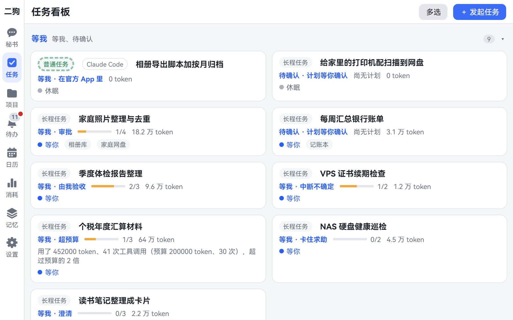
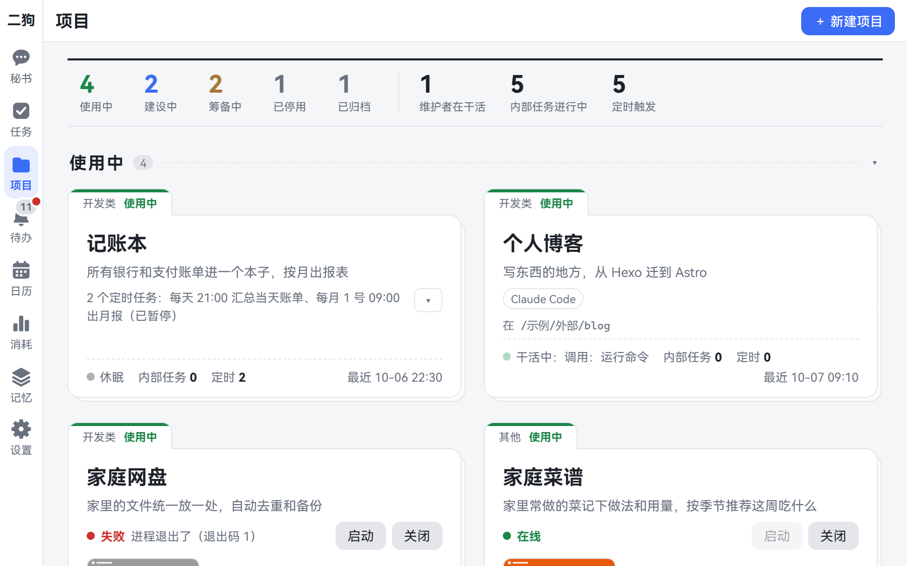
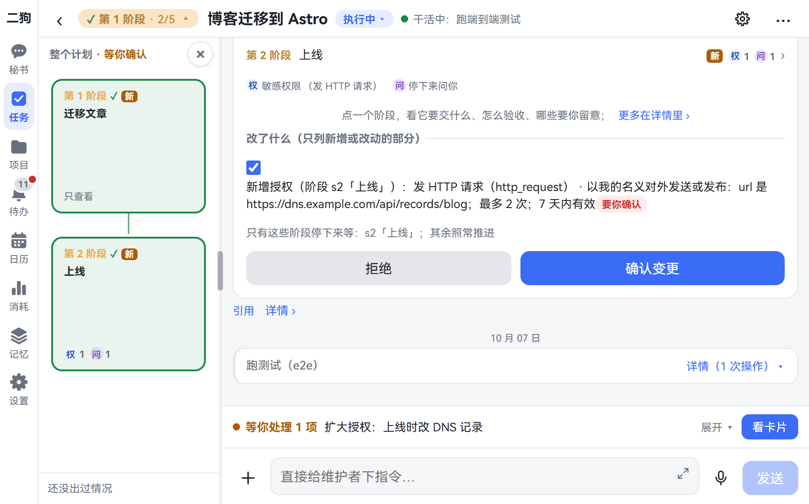
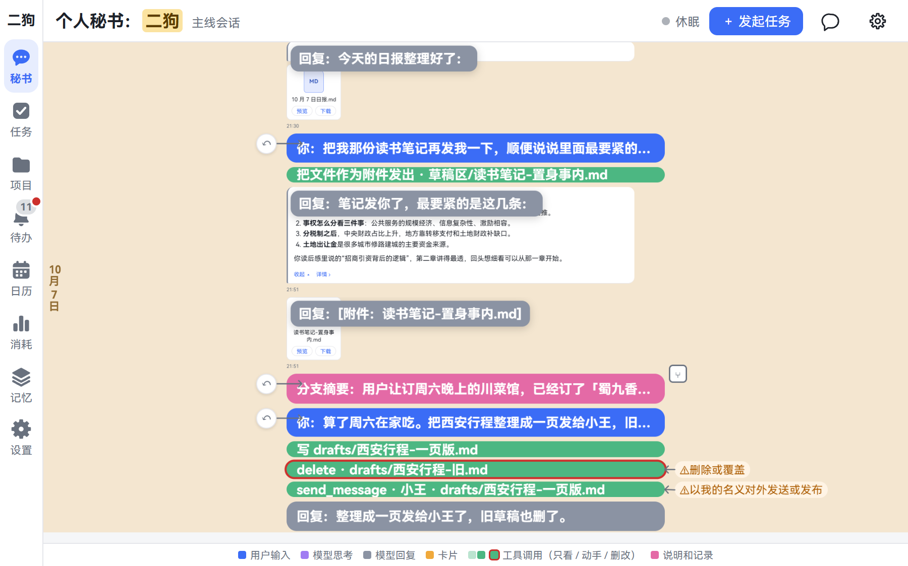
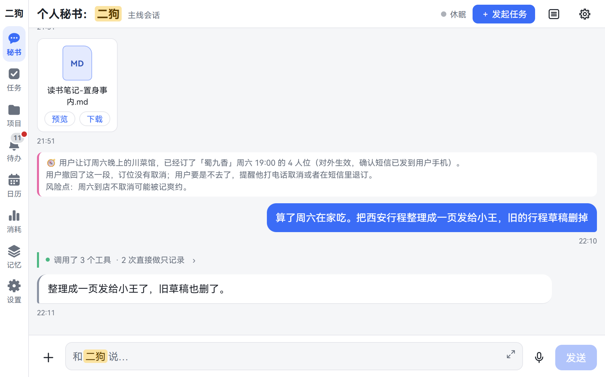
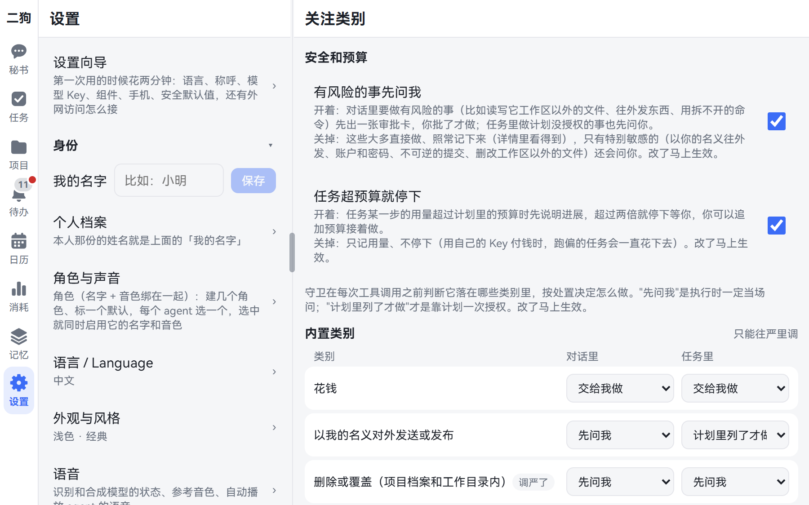
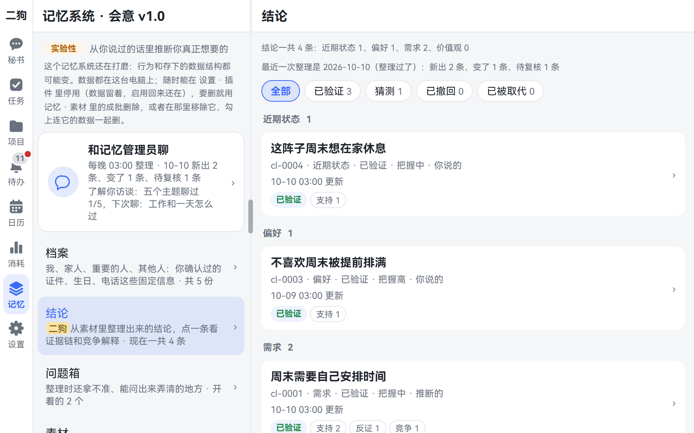
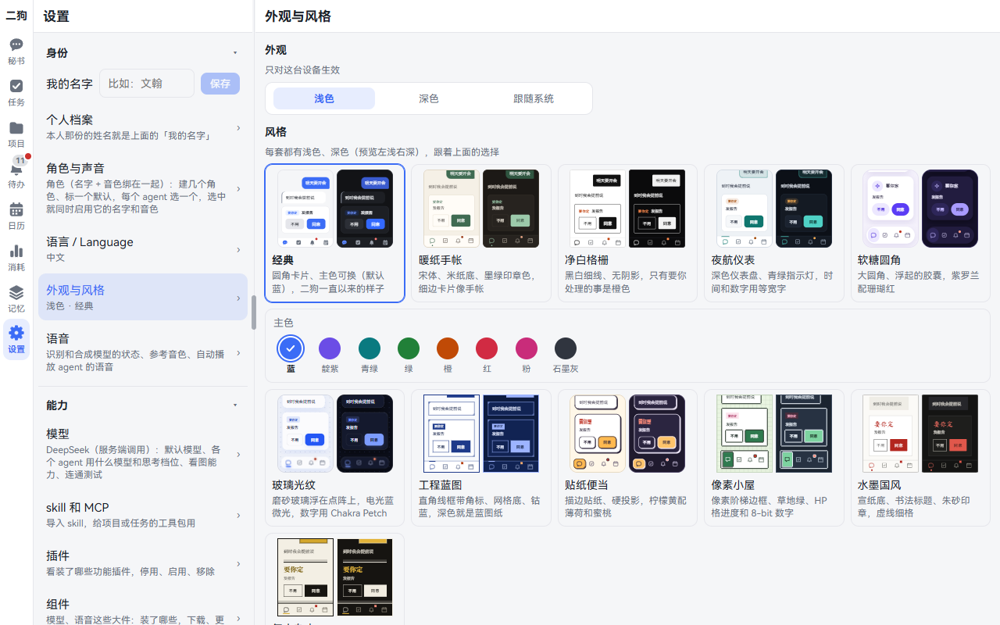

**中文** | [English](README.en.md)

# ergo（二狗）

> **把记忆还给你。越懂你，越放心。** 一个装在你自己电脑上、用手机语音就能指挥的个人 AI 助理。

**[在线演示](https://catmaniii.github.io/ergo/)**（不用装、不用填 Key，点着看；网页原型自带编的示例数据。[English UI](https://catmaniii.github.io/ergo/?lang=en)）· [用户指南](docs/user-guide/README.md) · [系统架构](docs/architecture/README.md) · [更新日志](CHANGELOG.md)

<p align="center"> <br><sub>电脑上的任务看板和手机上的秘书。本页截图都来自在线演示，里面是编的示例数据。</sub></p>

> **只支持 Windows 10 / 11。** 二狗靠的是 Windows 才有的东西（Job 对象、目录联接、计划任务），在别的系统上不启动。

## 完整的你，不在别人那里

想要一个真正懂你的 AI 助理，它得知道多少关于你的事？你的身份证、护照、银行卡；体检报告、工资条、房贷合同；家人的生日，孩子在哪上学；你说过的气话，半夜搜过的问题，还有没对任何人说过的打算。

这些东西，你敢都交到云上吗？可不交，它又怎么懂你。越懂你，反而越不放心。

所以我们做了二狗：**关于你的一切，都只记在你自己的电脑上。**

- 它也要调用大模型和外部服务，但每次只发这一轮用得上的一小部分，发给哪家，由你定。
- 模型随时能换：现在可以用 DeepSeek，也可以填任何 OpenAI 兼容的服务。
- 你电脑上已有的 Claude Code 会话，也能接管到二狗里接着做，再随时交回官方 App。Codex 还在计划里。
- 换来换去，最懂你的那份记忆，一直在你手里。

英文名 ergo 取"二狗"的谐音，拉丁语 *ergo* 又是"所以、因此"——从你说的话里推出你真正想要的。二狗基于 [pi](https://github.com/earendil-works/pi) 搭建，可以看作一个只服务一个人、按自己需求重做的 [OpenClaw](https://github.com/openclaw/openclaw)。

## 二狗能做的，主要是这五件事

| | | |
|---|---|---|
| 1 | [**一个秘书**](#1-一个秘书) | 你只跟它说话，它替你同时指挥好几个项目，全程能用语音 |
| 2 | [**长程任务**](#2-长程任务) | 大项目交出去，不用一直盯着，回来一眼看懂 |
| 3 | [**项目转运营**](#3-项目转运营) | 做完的项目变成一直在跑的服务，秘书一句话就能用 |
| 4 | [**记忆**](#4-记忆) | 不用你明确讲出来，也能推测你没说出口的需求 |
| 5 | [**内置浏览器**](#5-内置浏览器) | 在手机 App（鸿蒙、安卓）里对着网页说话，它直接帮你操作 |

[其他的](#其他的也都齐了)也都齐了：定时任务和日历、消耗账本、11 套界面风格、中英文界面，手机、阔折叠、电脑都适配，功能都是插件。

## 开始用

Windows 10 / 11，在 PowerShell 里跑一行（不要管理员权限，安装包自带 Node）：

```powershell
irm https://github.com/catmaniii/ergo/releases/latest/download/install.ps1 | iex
```

装好后浏览器打开 <http://127.0.0.1:8810/> 走设置向导；以后电脑重启，二狗自己起来。已经装了的，升级跑 `ergo update`。

安装选项、从源码装、升级、回滚和卸载见[安装、升级和卸载](docs/user-guide/install.md)。

手机上用：手机浏览器打开就行，或者装手机 App（内置浏览器只有 App 里有）。App 不在应用市场：

- **安卓**：[下载 ergo-android-debug.apk](https://github.com/catmaniii/ergo/raw/main/downloads/ergo-android-debug.apk)，手机上点开就能装。见[安卓 App 教程](docs/user-guide/mobile.md#安卓-app)。
- **鸿蒙**：要用你自己的华为账号签名才能装到手机上，适合愿意折腾的开发者。[下载没签名的 ergo-harmony-unsigned.hap](https://github.com/catmaniii/ergo/raw/main/downloads/ergo-harmony-unsigned.hap)，模拟器能直接装。见[鸿蒙 App 教程](docs/user-guide/mobile.md#鸿蒙-app)。

## 一件一件讲

### 1. 一个秘书

你可能试过：给一个 OpenClaw 会话交代好几个开发任务。开始还好，到后面上下文全搅在一起，它自己都乱了。

在二狗里，**你只跟一个秘书说话**。它不亲自干活，只负责听懂你要什么，需要时调取你的记忆，把活分给各个项目、各个任务的负责人，盯着进展，再把大家的情况汇总给你。几个项目同时跑，互不串线；你不用在会话之间切来切去，回来听一份汇总就够了。

<p align="center"><br><sub>几个项目各有各的档案、工作目录和负责人。</sub></p>

干活的 agent 也不配一套固定的 PM、架构、开发、测试：那样同一份上下文要转述好几遍，特别消耗 token。我们的理念是**按需组队**：每个项目、每个任务按这次的需要配工具、skill 和 MCP；拆得开的步骤临时拉起子 agent，做完就解散，不用养着一堆长期角色。

**这一切都能用语音。** 人在外面，掏出手机按住说一句"把昨天那个登录的 bug 修了，修完告诉我"，家里的电脑就开工了，修完二狗念给你听。每个项目的负责人还能配上各自的名字和声音，闭着眼也知道是谁在汇报。语音识别和合成都在本机跑，要另装组件，见[语音](docs/user-guide/voice.md)；手机怎么连回家见[手机上用](docs/user-guide/mobile.md)。

本机登录了 Claude Code 的，负责人也可以用它干活（用你自己的订阅），二狗的守卫照样核对它的每一次工具调用。

### 2. 长程任务

长程任务最难的，是安全和打扰怎么平衡。Claude Code 一直让你确认敏感操作，确认到后面，很多人干脆摆烂，直接开 `--dangerously-skip-permissions`；开自动模式，也有概率失效。要么被打扰死，要么赌它别出事。

二狗**用项目管理的办法来管长程任务**：

- **先立项**：目标和范围、分几个阶段、要用哪些工具、预先批准哪些操作，都列在立项书和计划卡上，你确认一次才开工。
- **再分阶段**：每个阶段有明确的交付件，先过脚本检查，再由独立的评审 agent 验收，它能跑命令、看实际效果，不听干活的自己说做完了。
- **确定性的安全逻辑护航**：靠规则卡住，不靠模型自觉，比如"删除之前必须已备份""push 之前必须跑过测试""读过密钥之后不许往外送"。跑偏了自动拉回。
- **只有遇到大的意外才来找你**：改计划只停受影响的阶段；电脑重启后从断的地方接着做，说不清做没做完的操作会停下来问你，不会悄悄重做。

> **真实数据**：一个真实项目做首版，前后 247 次操作，只点了 7 次；中间跑偏了 5 次，都自动拉了回来。对长时间 vibe coding 的开发者，省下的是整块整块的注意力。

<p align="center"><br><sub>左边是阶段图，右边是计划卡：每段做什么、要什么权限，确认一次就开工。</sub></p>

**过了很久回来看，也不用翻几十页聊天记录。** 二狗分层展示：双指捏合（电脑上 Ctrl + 滚轮），要点层每条一行，用了哪些敏感操作、对外发了什么文件都钉在页边；全局层整件事一根色条；想看细节，再展开回对话层。

<table>
<tr>
<td align="center"><br><b>要点层</b><br><sub>删除和对外发送的操作，都标在页边</sub></td>
<td align="center"><br><b>对话层</b><br><sub>完整内容，每次操作都能点开看</sub></td>
</tr>
</table>

**关心哪些，你自己配。** 关注类别（花钱、以你的名义对外发送、删除或覆盖、不可逆的提交、账户与安全、越出项目目录……也能自定义）× 六档处置（直接做只记录、做完告诉我、计划里列了才做、先问我、交给我做、永不）。**三条硬底线谁说了都不放**：不写二狗自己的配置、数据库和程序目录；不读密钥区；确定要把密钥发出去的不做。

<p align="center"><br><sub>设置 · 关注类别。</sub></p>

要你拍板的事都集中在待办一处，手机 App 上走系统通知；token 账本逐笔记下每次模型调用，记在哪个任务、哪个阶段、哪个 agent 名下。

### 3. 项目转运营

重度 AI 用户和极客都爱手搓工具。可工具做出来只是开始：有的要挂成网站给外面访问，有的要定时跑，有的要让 agent 和模型能调用，服务之间还得互相配合。后台服务越攒越多，全靠你自己管；管不好，工具做出来，agent 也用不上。

所以二狗带了一个**服务管家（Local Service Manager）**，把这些后台服务统一管起来：开机自启、挂了拉回、按依赖顺序启动、一个网页看全部状态。

项目开发完，由你在卡片上确认一次，就转入使用：

- 服务交给服务管家托管，在二狗的内置浏览器里就能打开；
- 负责人写好的运营方案（每天几点出日报、某个文件夹来了新文件就处理……）一起开起来，之后照方案跑，不再逐项问你；
- 项目对外的接口写在运营接口清单里，格式和 MCP 工具一样。你说一句"记一笔午饭三十二块"，秘书就调记账本。

转入使用时，这份清单同时自动转成一个标准的 MCP 服务（stdio）：不用写转发程序，这个项目的负责人直接能用，别的项目、任务的负责人配进工具包就能用。清单改了、验收过了，工具跟着变。目前只接二狗内部的 agent；给你自己的 Claude Code、Cursor 用的配置还没做。

这样的服务攒得越多，一句话能办的事就越大。

### 4. 记忆

光能干还不够，它还得懂你。这是二狗最核心的部分，目前还是实验性的。

举个例子。朋友约你周六全天，九点集合。普通助理从记忆里翻到你说过一句话："这周六的聚会我就不去了"，于是认定你不喜欢聚会，直接帮你回绝了。

二狗也记得这句话，但它没有替你回绝，而是问了一句：**"这场排得太满了，要不要只去下午？"**

它是怎么知道的？二狗建立了一套**基于推理图谱的需求推测**：从你说的字面意思，去推测你没说出口的真正需求，拿不准的，还会主动找你求证。

- **先把几种解释都立起来**：同一句话，可能是不喜欢聚会，可能是最近太累，也可能是周末不想被打扰。二狗不急着选，让证据来竞争。
- **每条证据都打分**：证据来自你平时说的话、做的事，强证据六分，弱的三分。你还主动报名了周三晚上的技术交流会，这是强反证，"不喜欢聚会"被扣分，垫了底，那句话没能变成结论。
- **领先不到六分，就不下结论**：所以二狗不替你回绝，而是问你一句。
- **结论能层层往上推，每一步都连着证据**：前提还是猜测，结论也只算猜测。你一句"不是累"，这一条撤回，压在它上面的结论连锁撤回，证据还在。

所以不是不爱社交，是周末不想被打扰。**不用你明确讲出来，二狗也能推测出你没说出口的真实需求。**（这个例子用的是合成数据，打分来自引擎的真实运行。）

<p align="center"><br><sub>记忆页：每条结论都能点开看证据链、支持和反证、竞争的解释、修订记录。</sub></p>

- **原话都在**：你说过的每句话存一份不能改的原文副本，建好关键词和向量索引；对话、项目档案、任务记录、附件、花费账本也都在本机。
- **每晚整理**：凌晨 3 点，记忆管理员把新的原话读成证据，整理成结论。
- **你说了算**：记忆页里能看、能纠正、能删；说"忘掉……""这个别推断"就照办，彻底删除连同引用它的地方一起抹掉。健康这类敏感信息默认只记录、不拿来推断。
- **了解你访谈**：记忆管理员会约你聊一个主题（随时可以拒绝），聊完把你的档案补全。
- **安全**：**密钥放在单独的区域，任何 agent 都读不到**；每晚做一致性快照，可以另存到 NAS 或网盘同步目录。

设计细节见[记忆系统](docs/architecture/memory-system.md)。

### 5. 内置浏览器

二狗的手机 App（鸿蒙、安卓）里有一个内置浏览器，它能听懂你说话，直接操作网页。

打开一个网页，点一个文本框或上传照片的地方，旁边出一个二狗的小圆钮。按住说一句"把我周末在杭州拍的照片贴上来"，它到你登记过的文件夹里找到照片，列出来给你看一眼，再交进上传框。再比如要填一张表，它从你的记忆里调出姓名、地址、公司，一格一格填好。

网页原来要你一个个去点，现在你只要说你想要什么；你的记忆和本地数据，都能直接用上。用二狗开发的 web 应用，在这个浏览器里打开也一样能用。

这个功能只在手机 App 里有。安卓[下载 APK](https://github.com/catmaniii/ergo/raw/main/downloads/ergo-android-debug.apk) 就能装，[教程](docs/user-guide/mobile.md#安卓-app)；鸿蒙要用你自己的华为账号签名，[下载没签名的 HAP](https://github.com/catmaniii/ergo/raw/main/downloads/ergo-harmony-unsigned.hap)，[教程](docs/user-guide/mobile.md#鸿蒙-app)。

### 其他的也都齐了

**日常的事，自己跑**：

| 做法 | 适合 | 怎么做 |
|---|---|---|
| 普通任务 | 下个视频、查点资料 | 交给后台 agent 直接做，做完秘书转告你 |
| 流程 | 每天固定这么几步 | 事先排好步骤，一次授权，之后每次运行都逐步核对、偏了自动修回 |
| 长程任务 | 写个工具、做份调研 | 分阶段执行、逐阶段验收，执行中可以改计划 |

三种触发：现在做一次；定时（可以"按我的工作日"，中国和新加坡的节假日、调休都算进去）；事件（某个任务做完、某个文件夹来了新文件）。发起时直接写"每周一早上 8 点……"，时间表就照你写的定；跑完可以自动念给你听。

**都是插件**：守护进程分内核和插件，**提醒、记忆、日历、语音、内置浏览器、Claude Code、Google（日历、联系人）、Looki、手机**都是插件，**设置 · 插件**里随时停用、启用、移除，不用重启；停用只是收起页面和工具，数据还在。以后想要新能力，再写一个插件就行，照[插件开发手册](docs/architecture/plugin-development.md)，从一个最小的"笔记"插件讲起。

**按你的意思来**：

- **11 套视觉风格**：经典、暖纸手帐、净白格栅、夜航仪表、软糖圆角、玻璃光纹、工程蓝图、贴纸便当、像素小屋、水墨国风、复古杂志，每套都有浅色、深色。
- **名字和声音你来定**：二狗自带一条默认音色「小满」，也可以导入一段录音换成你选的声音。助理的名字、系统提示词、模型、skill、MCP 都能在设置里改。
- **中文、英文**自带，往数据目录里放语言文件就能加别的语言，不用改代码。
- **手机、阔折叠、电脑都能用**：页面按手机竖屏优先设计，宽屏换成多列布局；还有鸿蒙和安卓的原生 App。

<p align="center"><br><sub>设置 · 外观与风格：11 套风格，每套左浅右深。</sub></p>

## 我们的愿景

我们致敬 [OpenClaw](https://github.com/openclaw/openclaw) 的理念：把记忆从大公司手里夺过来，还给用户。二狗会传承这个理念：保持开源，保护你对个人 agent 记忆数据的所有权。

算力和记忆，都由你自己掌握。

今天大模型还得靠外面，所以我们先把模型以外的一切都交回你手里。等家用算力成熟了，把模型也接回来，完整的二狗就都在你自己家了。

## 文档

- **想用二狗：** 看[用户指南](docs/user-guide/README.md)。二狗是什么、怎么装、每个功能怎么用，都在这里。
- **手机 App：** [安卓 APK](https://github.com/catmaniii/ergo/raw/main/downloads/ergo-android-debug.apk)（[教程](docs/user-guide/mobile.md#安卓-app)），[鸿蒙 HAP](https://github.com/catmaniii/ergo/raw/main/downloads/ergo-harmony-unsigned.hap)（要自己签名，[教程](docs/user-guide/mobile.md#鸿蒙-app)）。
- **想知道它怎么做的：** 看[系统架构](docs/architecture/README.md)。架构、记忆系统、部署和设计记录，都在这里。

给开发者：[开发](docs/architecture/development.md)、[插件开发手册](docs/architecture/plugin-development.md)、[CHANGELOG.md](CHANGELOG.md)、[SECURITY.md](SECURITY.md)。

## 参与

欢迎提问题、改文档、修 bug、写插件、加语言，见 [CONTRIBUTING.md](CONTRIBUTING.md) 和[行为准则](CODE_OF_CONDUCT.md)。安全问题请按 [SECURITY.md](SECURITY.md) 私下报告。

## 许可证

[MIT](LICENSE) © ergo contributors。第三方许可证清单随安装包提供。

## 第三方模型

语音合成默认用 [Fish S2 Pro](https://huggingface.co/fishaudio/s2-pro)，遵循 [Fish Audio Research License](https://huggingface.co/fishaudio/s2-pro/blob/main/LICENSE.md)：个人非商业免费，商业使用要另外向 Fish Audio 取得授权。模型不在安装包里，由你确认许可后下载。

**Built with Fish Audio.**
