**中文** | [English](README.en.md)

# 二狗 · ergou

> **越懂你，越放心。**
>
> 一个装在你自己电脑上的个人助理。懂你的记忆只放在你电脑上；交给它的事，有专人负责、有保障地做完；回来一眼就能看懂。事情一件件做到位，你对它的信任也一点点攒起来。

**当前版本 0.2.1（2026-10-14）**：第一期"骨架"完成，已经在日常使用。各版本的改动见 [CHANGELOG](CHANGELOG.md)。二狗基于 [pi](https://github.com/earendil-works/pi) 搭建，可以看作一个按自己需求重做的 OpenClaw。

<table>
<tr>
<td align="center">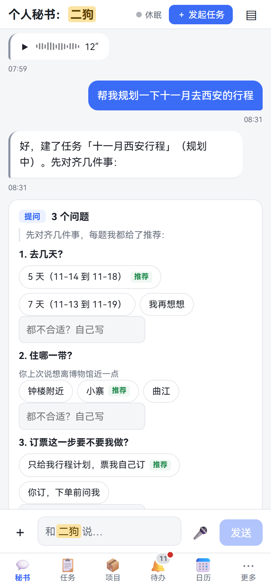<br><b>经典</b></td>
<td align="center">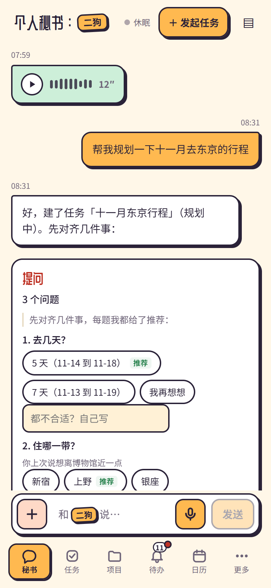<br><b>贴纸便当</b></td>
<td align="center">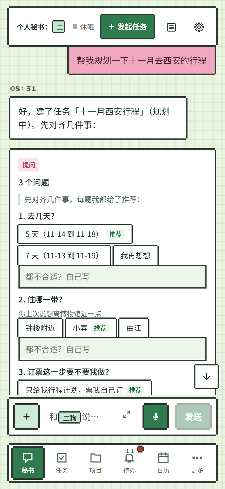<br><b>像素小屋</b></td>
</tr>
</table>
<p align="center"><sub>同一段对话的三套视觉风格（一共 11 套）。截图里是界面原型的示例数据。</sub></p>

## 一分钟看懂

**现在就有**

1. **记忆留在你自己电脑上**：对话、你说过的每句原话、项目档案都存在本机，每晚备份。每次只把这一轮用得上的内容发给模型，完整的你不在别人那里。
2. **专人专项，不会乱**：秘书只传话，每个项目、每个任务有固定的负责人，各有自己的上下文、工具和模型。规矩由系统记着，做多久都不忘。
3. **长活放心交出去**：计划只批一次，每一步由评审验收，跑偏了自动拉回。一个真实项目做了 247 次操作，你只点了 7 次。
4. **回来一眼看懂**：双指一捏，从每一句话缩到整件事的全貌。要你拍板的事集中在一处，花了多少钱清清楚楚。

**即将推出（第二期）**

5. **做出来的应用天生会说话**：用二狗做的应用直接接进二狗听你指挥；能点鼠标的地方，按住一个键就能说话。
6. **统一管理编程助手**：你电脑上的 Claude Code、Codex 会话，交给二狗统一调度。
7. **更懂你**：从你说过的话里推出你真正想要的。拿得准就替你办，拿不准就先问你。

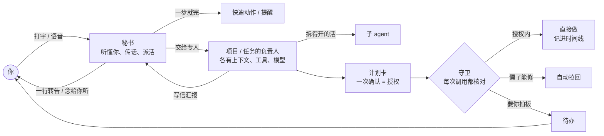

## 现在就有

### 1. 懂你的记忆，留在你自己电脑上

很多 AI 助理越用越懂你，代价是你的一切都存到了云上。二狗反过来：**懂你的那部分，只放在你自己的电脑上。**

- **数据在本机**：二狗跑在你的电脑上，下面这些都存在本机的数据目录里：
  - 对话；
  - 你说过的每句话的原话副本（不能改，建好了关键词和向量索引）；
  - 项目档案、任务记录、附件、花费账本。
- **只发用得上的**：二狗也要调用大模型（现在是 DeepSeek），但每次只把这一轮用得上的内容发过去，长期记忆的全量不在别人那里。
- **每晚备份**：做一次一致性快照，复制到你家里存储的同步目录，可以校验、可以恢复。
- **密钥碰不到**：密钥放在单独的区域，任何 agent 都读不到。
- **设备要你批准**：手机、平板经你自己的 VPS 连回这台电脑，新设备第一次要你批准，凭证随时可以吊销。
- **声音在本机处理**：按住说话在本机用 GPU 识别（faster-whisper large-v3），回话也在本机合成。

### 2. 专人专项，不会乱

把好几件事塞进同一个对话，今天做 A、明天做 B，做着做着就混了。二狗按项目、按任务分开：

- **秘书只负责听懂你、帮你传话**，自己不碰你的项目。几件事可以同时在后台做，你照样和它聊别的。
- **每个项目、每个任务都有固定的负责人**（维护者 agent）。每个负责人有自己的上下文和工具包（skill、外部工具），只能碰它这摊事。它的系统提示词和模型也能单独配，在它的会话里点 ⚙ 就能改。
- **拆得开的活，负责人再分给子 agent 并行去做**。子 agent 只干活，不添乱。要详细聊一个项目，直接找它的负责人。
- **agent 之间会写信**：负责人有进展就写信给秘书，来信在秘书那里折成一行，由秘书统一转告你。附件跟在文字后面，点开就能看。
- **规矩由系统记着，不靠 agent 的记性**：计划、授权和你说过的边界由运行时保管；项目的理解记在档案里（立项书、规格、进展），不靠越拉越长的聊天记录。项目做一个月，也不会忘了当初怎么约定的。
- **工单一次做一件**：负责人要做的事都是工单，由派单器排队，一次做一件。这是运行时的调度，不是写在提示词里的约定。
- **范围审视**：每张工单结束、每次会话压缩时，另一个模型会检查负责人有没有做范围外的事。越界的记下来提醒你，但不卡死。
- **首版做完由你拍板**：项目首版做完，你从三个选项里定：转入使用、继续建设，或放弃并归档。

### 3. 长活放心交出去

一般的 agent 有两个极端：要么事事都问，要么权限全放开、赌它别出事。二狗走中间：**开工前把"能做什么"一次说清楚，执行中由运行时盯着，不靠 agent 自觉。**

**开工前**：计划卡上一次列清楚，你确认一次就是授权。
- 分哪几个阶段，每个阶段交付什么、怎么验收；
- 用哪些工具，预先批准哪些操作（种类、对象范围、次数、有效期）；
- 这个任务里哪些操作要提醒你。

**执行中**：
- **验收不靠 agent 自己说做完了**：每个阶段先过脚本检查，再交给独立的评审 agent 验收。评审能在工作目录里跑命令、看实际效果，不用你逐段验收。
- **跑偏了自动拉回**：计划外的动作会标出来；流程类任务每次运行都逐步和计划比对，漏了步骤就引回去补上。
- **时序规则一直盯着**：比如"删除之前必须已备份""push 之前必须跑过测试""读过密钥之后不许往外送"。
- **改计划只停受影响的阶段**：负责人只交要改的那个阶段，你在计划变更卡上点一次确认就生效，其余阶段照常做。
- **断了能接着做**：守护进程被杀或电脑重启后，从断的地方接着做；有副作用又说不清做没做完的操作，会停下来问你，不会悄悄重做。

**提醒什么，你说了算**：
- **关注类别不只管安全**。内置的有：花钱、以你的名义对外发送、删除或覆盖、不可逆的提交、账户与安全、越出项目目录等，也可以自定义。
- **每类有六档处置**：直接做只记录、做完告诉我、计划里列了才做、先问我、交给我做、永不。
- **每次工具调用都有完整记录**：碰了什么、落在哪个类别、按哪条依据放行或拦下，都用大白话写清。
- **三条硬底线谁说了都不放**：不写二狗自己的配置区、数据库区和程序目录；不读密钥区；确定要把密钥发出去的不做。
- **花钱、付款、建账户、改密码**，永远交给你亲手做。
- 现在（第一期）的默认偏向先把功能跑通，有些审批暂时放宽了，见 [CHANGELOG](CHANGELOG.md) 和[开发文档](docs/dev.md)。

> **真实数据**：一个真实项目"内存行情台"做首版，前后 247 次操作，你只点了 7 次；中间跑偏了 5 次，都自动拉了回来（2026-10-14 从本机数据统计）。

<p align="center">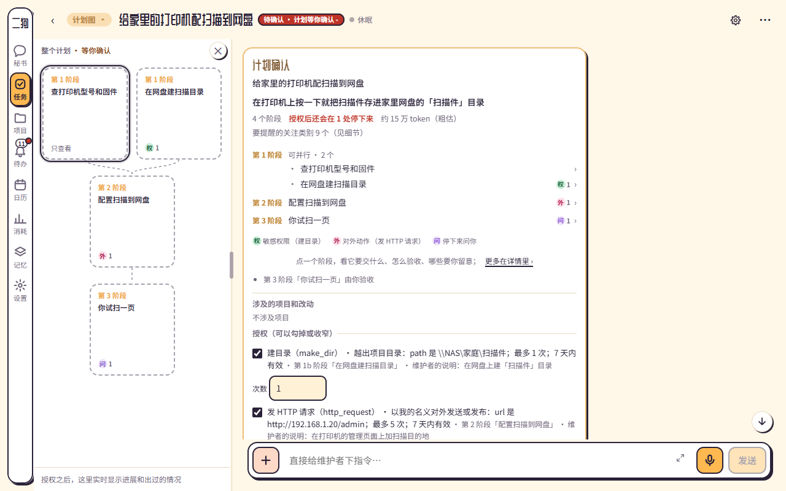<br><sub>计划栏（贴纸便当）：阶段、依赖关系和授权项一屏看清，确认一次就开工。</sub></p>

<p align="center">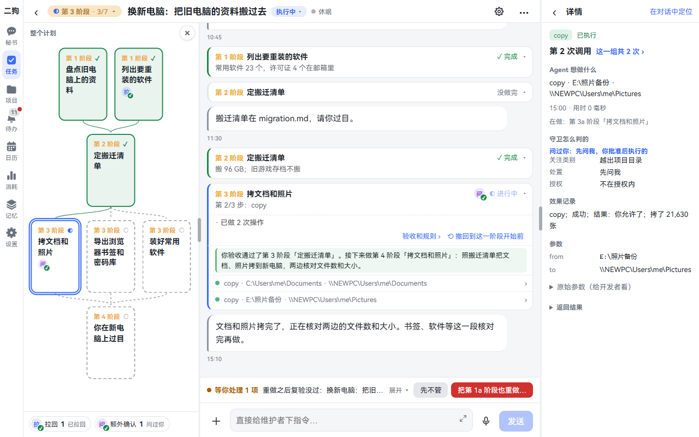<br><sub>点开一条工具调用：做了什么、落在哪个关注类别、按什么处置、在不在授权内，以及它实际改了什么。</sub></p>

### 4. 回来一眼看懂

长活跑完回来，不用逐条翻记录。

**时间线三层缩放**：同一份内容一镜到底，双指捏合或点标题栏的按钮就能切换。
- **对话层**：看全文。
- **要点层**：每条缩成一行。
- **全局层**：整件事一根色条。

缩小以后，审批、偏离、验收、关注类别命中这些关键标记钉在页边。长程任务的每个阶段画成一段书脊，颜色就是这一轮的验收结果。

<table>
<tr>
<td align="center">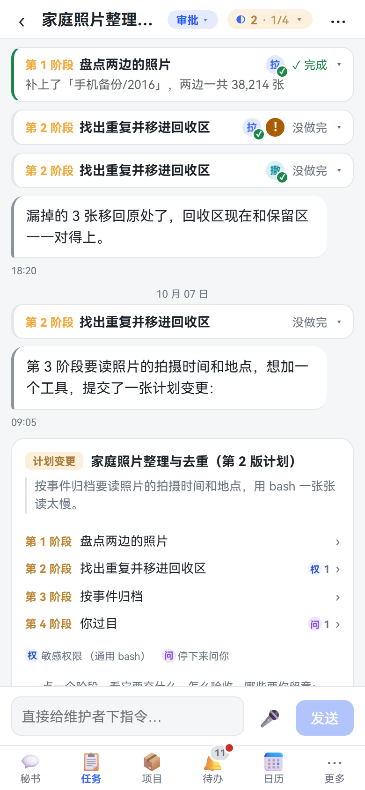<br><b>对话层</b><br><sub>完整内容</sub></td>
<td align="center">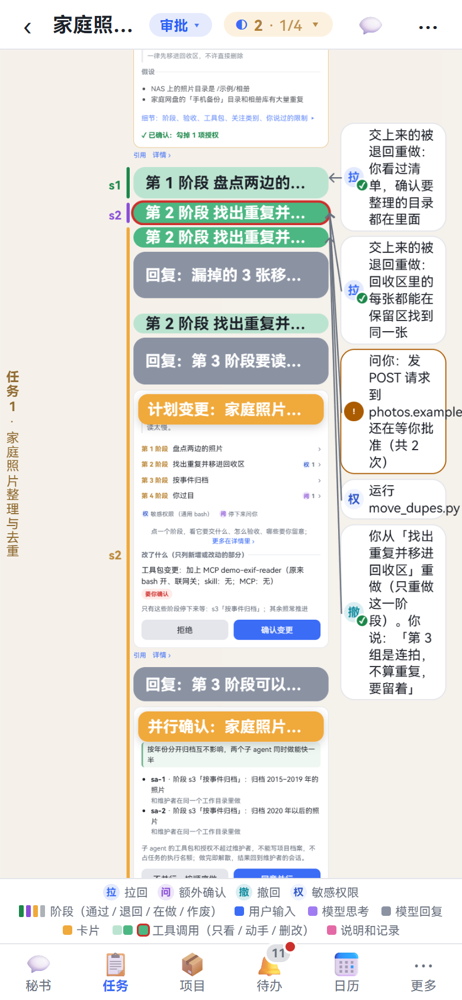<br><b>要点层</b><br><sub>每条一行；拉回、撤回、待批准钉在页边</sub></td>
<td align="center">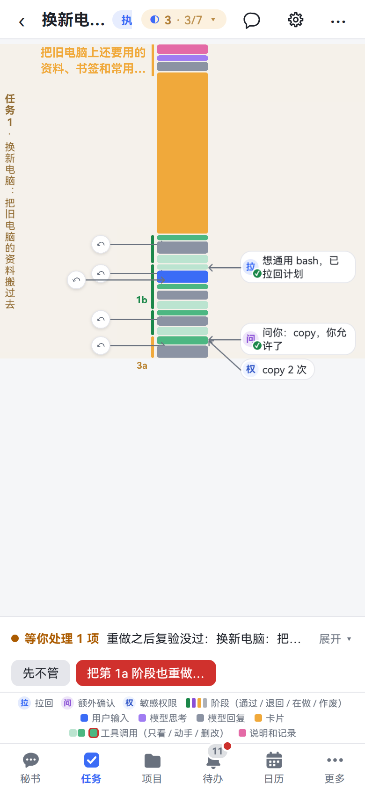<br><b>全局层</b><br><sub>整个任务一根色条，标记连线指到出事的位置</sub></td>
</tr>
</table>

- **要你拍板的事都在待办一处**：审批、计划确认、卡住求助汇总到"待办"，在它所在的会话里也能直接点掉。顶上的提醒框会轮播，鸿蒙手机上走系统通知。
- **花了多少钱清清楚楚**：token 账本逐笔记下每次模型调用，记在哪个任务、哪个阶段、哪个 agent 名下，按 DeepSeek 的分时价格估算成本。
- **附件点开就看**：Markdown 渲染成报告页；HTML 在隔离的沙箱里预览。

<p align="center">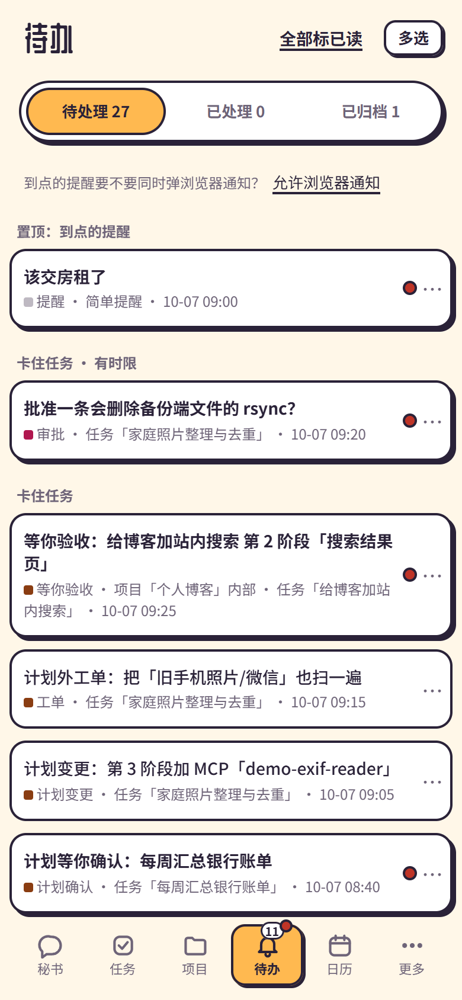<br><sub>待办（贴纸便当）：有时限的审批单独一组，排在前面。</sub></p>

### 5. 日常的事，自己跑

| 做法 | 适合 | 怎么做 |
|---|---|---|
| 普通任务 | 下个视频、查点资料 | 交给后台 agent 直接做，做完秘书转告你 |
| 流程 | 每天固定这么几步 | 事先排好步骤，一次授权，之后每次运行都逐步核对、偏了自动修回 |
| 长程任务 | 写个工具、做份调研 | 分阶段执行、逐阶段验收，执行中可以改计划 |

- **三种触发**：
  - 现在做一次；
  - 定时，可以"按我的工作日"，中国和新加坡的节假日、调休都算进去；
  - 事件，比如某个任务做完、某个文件夹来了新文件。
- **发起任务时直接写"明天早上 8 点……"**，时间就照你写的定。定时任务可以随时改时间、立即运行一次、暂停和恢复。
- **跑完自动念给你听**：打开"跑完自动播报"，每次跑完秘书直接把要点念给你。你不在时念过的，回来点一下就能补听。

<table>
<tr>
<td align="center">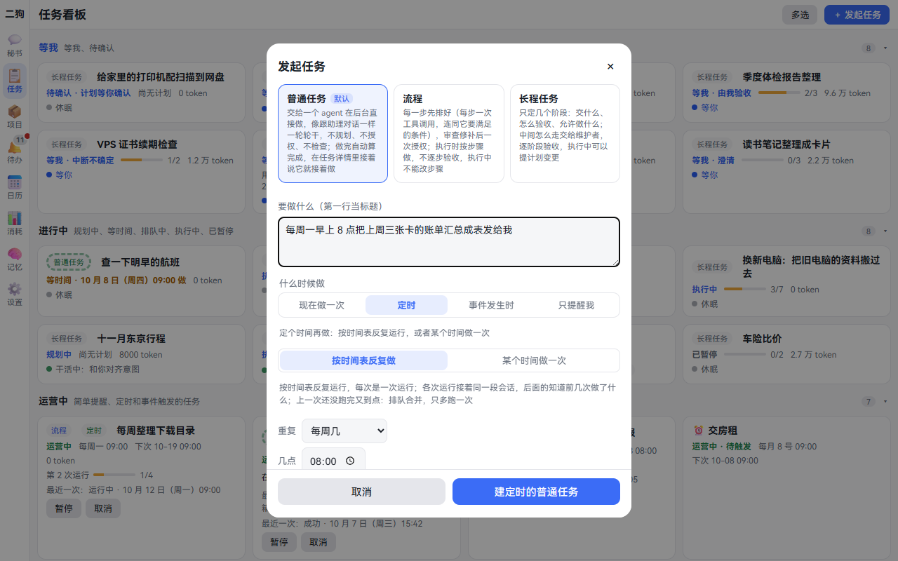<br><sub>发起任务：选做法，写"每周一早上 8 点……"就自动定好时间表。</sub></td>
<td align="center">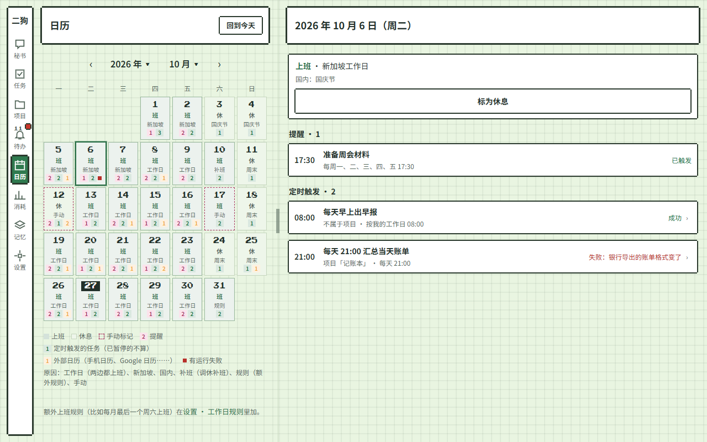<br><sub>日历（像素小屋）：两地的工作日和节假日，当天的提醒、定时任务和每次运行。</sub></td>
</tr>
</table>

### 6. 按你的意思来

- **11 套视觉风格**：经典、暖纸手帐、夜航仪表、软糖圆角、玻璃光纹、工程蓝图、贴纸便当、像素小屋、水墨国风、复古杂志、净白格栅。浅色、深色、跟随系统都能选，经典风格还有 8 种主色。
- **声音你来定**：二狗用你选的参考音色回话，长回复分段边合成边播。
- **名字你来起**：秘书的名字、系统提示词、模型、skill 库、斜杠命令、MCP 工具都能在设置里改。
- **手机、平板、电脑都能用**：页面按手机竖屏优先设计，宽屏换成多列布局。还有鸿蒙原生 App，服务端更新后打开的页面会提示刷新。

<p align="center"><br><sub>设置 · 外观与风格：11 套风格，每套左浅右深。</sub></p>

## 即将推出（第二期）

第二期重点发力两块：**记忆系统**和**项目系统**。

### 做出来的应用，天生会说话

- **天生接进二狗**：用二狗做出来的项目，转运营后以 MCP 的方式接进二狗。所有项目统一由一个 `project_ops` 工具按需加载，对秘书说一句就能操控：查数据、改配置、启停、处理要人定的事。
- **传统界面里处处能说话**：运营中的应用作为传统的键盘鼠标界面，也处处集成二狗的语音。光标停在哪，按住一个键就在哪说话：
  - 写邮件时说"把我去年三月出差报销的那几张发票加进来"；
  - 在外部网站上传照片时说"把我周末在杭州拍的照片贴上来"。

  二狗知道这些东西在哪，因为它们本来就在你电脑上。
- **能力越来越强**：项目越攒越多，二狗身后的能力就越来越强。

### 统一管理编程助手

你电脑上的 Claude Code、Codex 会话交给二狗统一管：在做什么、等不等你回复一目了然，进展经秘书汇报给你，你也能通过二狗给它们传话。

### 更懂你

传统的记忆只记你说了什么。可人很复杂：不同场合表现不同，还会口是心非。第二期的记忆系统基于推理图谱，从表象推到动机、真实需求，再推到价值观。

比如你只说："周五晚上又要跟他们吃饭了。"
- **普通助理**只会当成一条日程。
- **二狗**如果记得这些：
  - "他们"是你的合作团队；
  - 最近三次聚餐后你都说累；
  - 这周你在赶一个重要项目；
  - 你说过想少些低价值社交，但不想影响合作。

  它就能听出你是在犹豫，回你一句："又是上次那个合作团队吗？如果这次也只是普通聚餐，可以礼貌地缩短参加时间，不一定要全程留下。"

这是有根据的猜测，不是读心：拿得准就主动做，拿不准就先说出猜测，确有必要才问你；不会为了少问一句，就擅自改掉你明确说过的意思。

- **记忆管理者**在"做梦阶段"从素材里提炼长期记忆：事实、偏好、动机假设，每条都带证据链接。记忆可以查看、纠正、删除。
- **动机挖掘**参考 [intent-mining](docs/research/02-ref-intent-mining.md)。推出来的假设不直接当真，会在你方便时向你求证。
- **证件只存在本机**：身份证、护照这类资料只放在你电脑上；敏感信息要发给模型之前，先问你。

### 能力继续长

- 外部连接器：邮件、IM、日历。
- 手机系统级推送和远程审批。
- 操作电脑和手机。
- 二狗自举：用二狗改进二狗。
- 安全机制后接：审查 agent、系统级沙箱、高危审批的原生签名、安卓 App。

## 和 OpenClaw 比

OpenClaw 是通用的、多渠道的个人 agent，覆盖面比二狗大得多，也装在你自己的机器上。二狗只服务一个人，在下面这几处做了不同的取舍。OpenClaw 一栏依据[调研 03](docs/research/03-openclaw-and-pi.md)，截至 2026-10-06。

| | OpenClaw | 二狗 |
|---|---|---|
| 谁在干活 | 主 agent 可以按提示词把活委派给专家子 agent；有"协调者 + 专家"的团队预设，但官方说委派是提示词引导，不是调度器 | 秘书只传话、不动手；每个任务、每个项目有固定的负责人，各有上下文、工具包和模型；派单器是运行时的一部分，工单排队一次做一件 |
| 项目 | 没有"项目"这个一等实体 | 项目有档案、工作目录、固定负责人和立项书；范围审视检查有没有越界；首版做完由你拍板转入使用 |
| 权限 | 沙箱和执行审批默认都关，默认是完全访问 | 关注类别 × 六档处置、计划里的授权项、时序规则、三条硬底线；每次调用都有记录，并用大白话解释 |
| 打扰 | 推送按类别开关，可设安静时段，默认只推审批 | 按任务指定哪些操作要提醒（不限于安全）；计划一次授权；要你的事集中进待办 |
| 长活 | heartbeat、cron | 阶段计划、独立评审验收、自动纠偏；改计划只停受影响的阶段；重启后接着做，不悄悄重做副作用 |
| 回看 | 聊天记录 | 时间线三层缩放，页边钉着要点标记 |
| 记忆 | 工程化的分层记忆（dreaming、混合检索），明确不做人物档案 | 第一期从第一天起在本机攒原话素材；第二期基于推理图谱做动机挖掘，推到深层需求和价值观 |
| 规模 | 被批评"近 50 万行代码、53 个配置文件、70 多个依赖"（NanoClaw 作者语） | 约 13 万行 TypeScript，5000 多个自动化测试，只服务一个人 |

## 架构一览

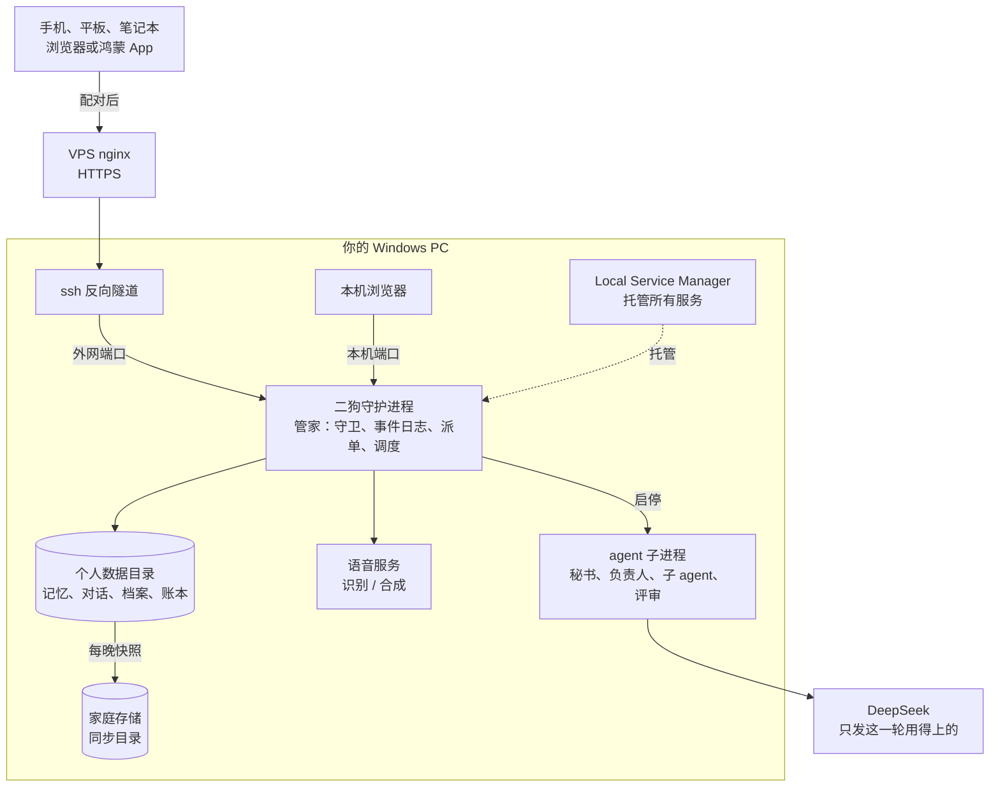

- **代码**：TypeScript，用 npm workspaces 分成 `packages/daemon`、`packages/web`、`packages/protocol` 三个包；前端是 React 19 + Vite；鸿蒙外壳在 `frontend/harmony`。
- **agent 运行时**：pi 只出现在一层薄封装里，上层只依赖二狗自己的接口（[ADR-0001](docs/adr/0001-pi-coding-agent-sdk-as-runtime.md)）。审批、任务、token 账本这些领域状态存在二狗自己的事件日志（SQLite）里，不存在 pi 的会话里。
- 详细设计见[规格](.scratch/ergou-v2/spec.md)、[术语表](CONTEXT.md)、[架构决策](docs/adr/)、[开发文档](docs/dev.md)。

## 运行与开发

二狗目前只按作者自己的环境搭建（Windows、Local Service Manager 托管、DeepSeek），还不是开箱即用的安装包。

```bash
npm ci                    # Node >= 22.19
npm run typecheck
npm test                  # vitest；Windows 上建议 ERGOU_TEST_WORKERS=2
npm run build:web         # 构建 Web 界面；直接打开 packages/web/dist/index.html 就是带示例数据的界面原型
npm run build:harmony     # 构建鸿蒙 App（签名材料不进仓库）
```

守护进程由 Local Service Manager 注册和启动，二狗自己不拉起任何服务。配置、端口、数据目录见 [docs/dev.md](docs/dev.md)。

## 文档索引

| 路径 | 内容 |
|---|---|
| [CHANGELOG.md](CHANGELOG.md) | 版本变更记录 |
| [CONTEXT.md](CONTEXT.md) | 术语表：秘书、任务、项目、维护者、守卫、时间线…… |
| [.scratch/ergou-v2/spec.md](.scratch/ergou-v2/spec.md) | 第一期规格（含第二期规划） |
| [.scratch/ergou-v2/impl/](.scratch/ergou-v2/impl/) | 实现票（共 122 张：0.2.0 101 张，0.2.1 21 张） |
| [docs/adr/](docs/adr/) | 架构决策记录 |
| [docs/dev.md](docs/dev.md) | 开发文档：模块、协议、测试底座、部署 |
| [docs/research/](docs/research/) | 调研：AgentSense、intent-mining、OpenClaw 与 pi、多 agent、记忆、长任务与打扰、语音、Windows 沙箱等 |
| [docs/guides/](docs/guides/) | 操作指南 |

## 约定

- 仓库只放框架。记忆、对话、项目档案、密钥等个人数据永远不进仓库。
- 文档和交流一律用中文；README 另有[英文版](README.en.md)。
