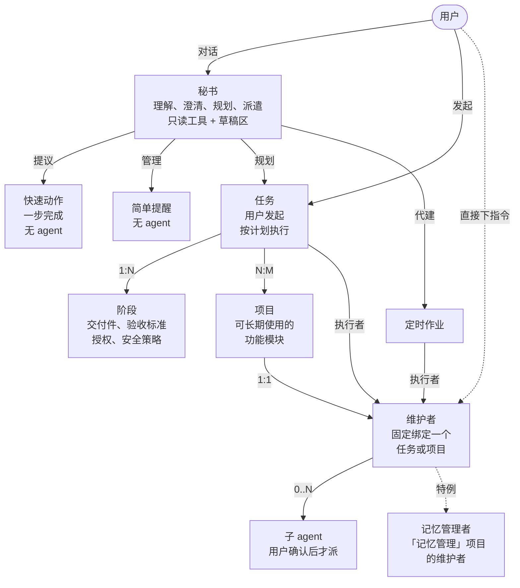
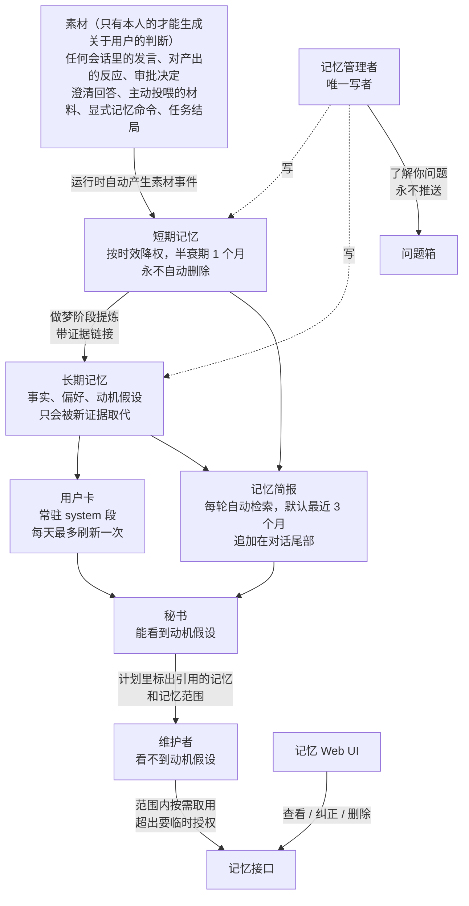
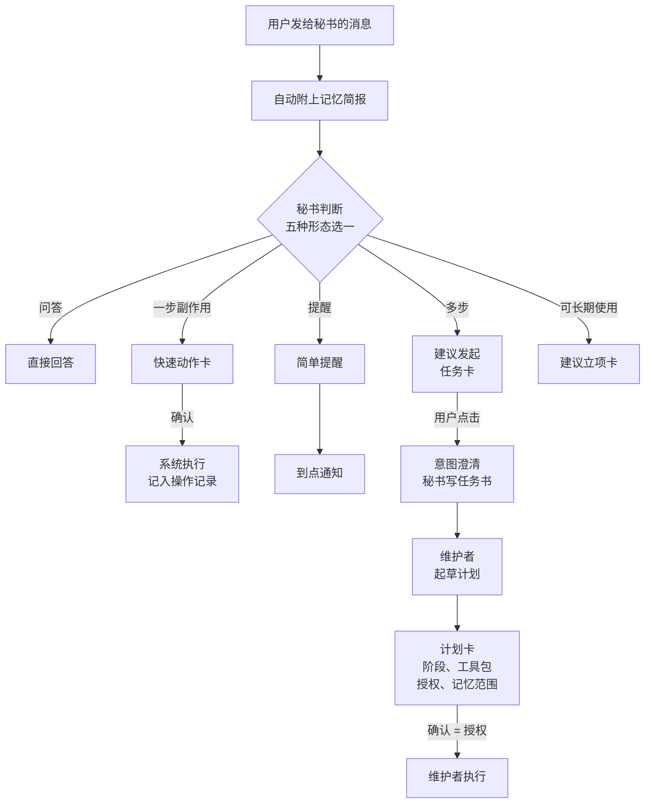
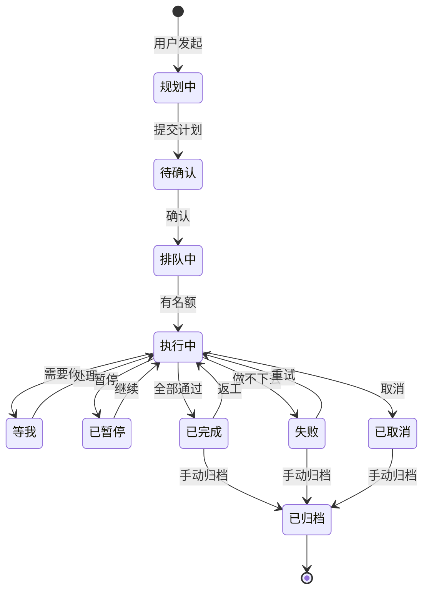
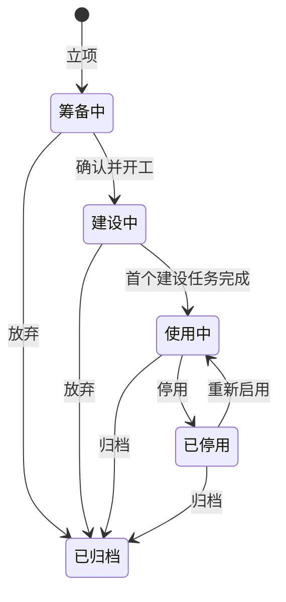
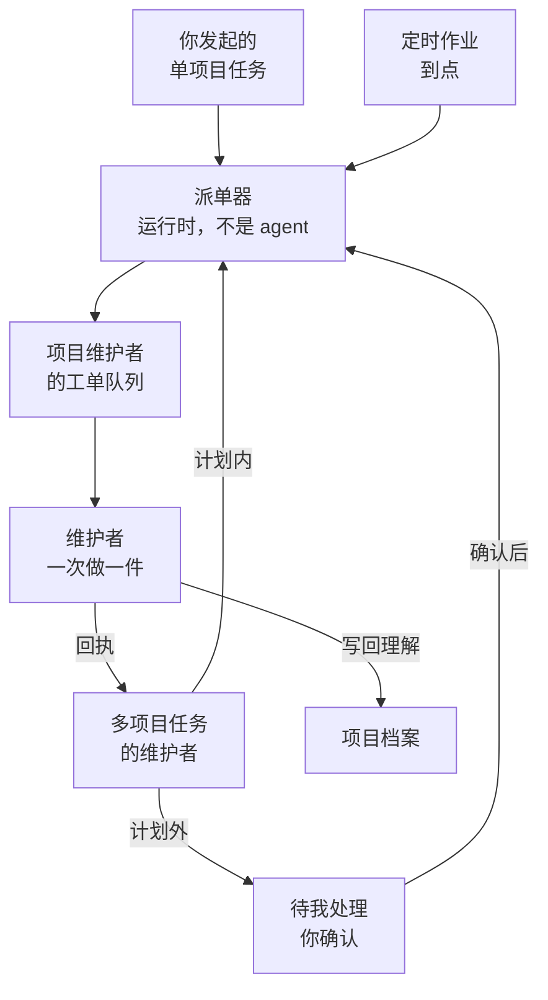
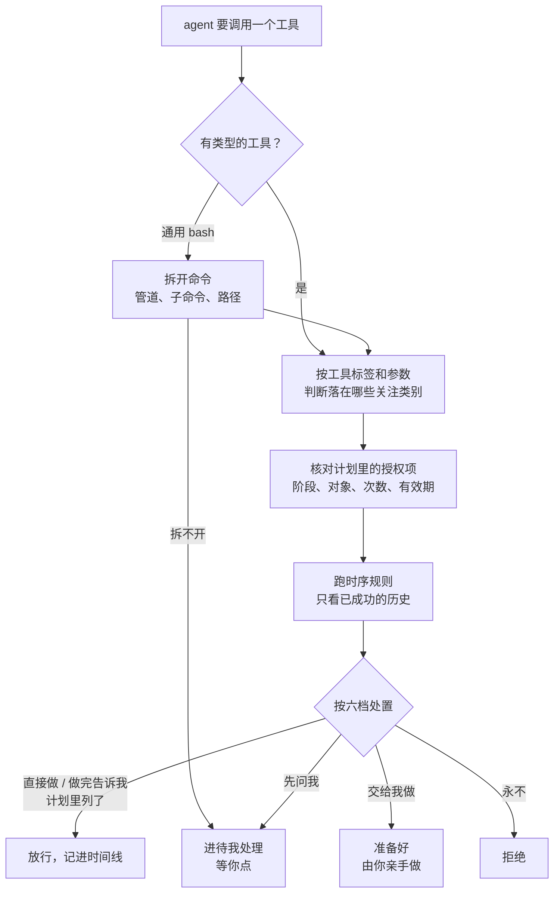
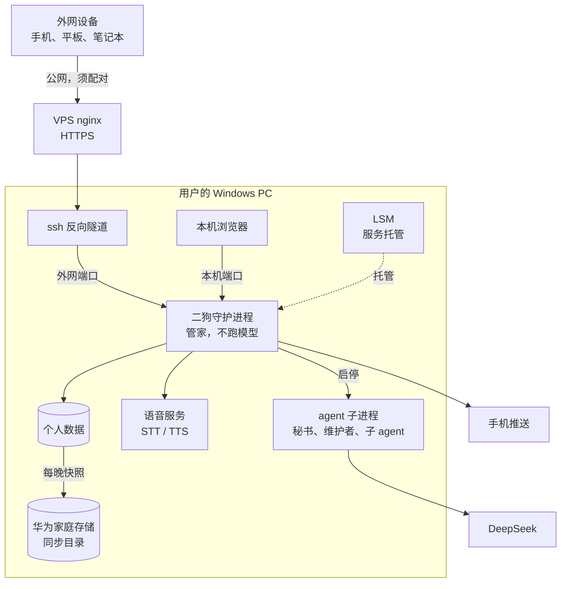
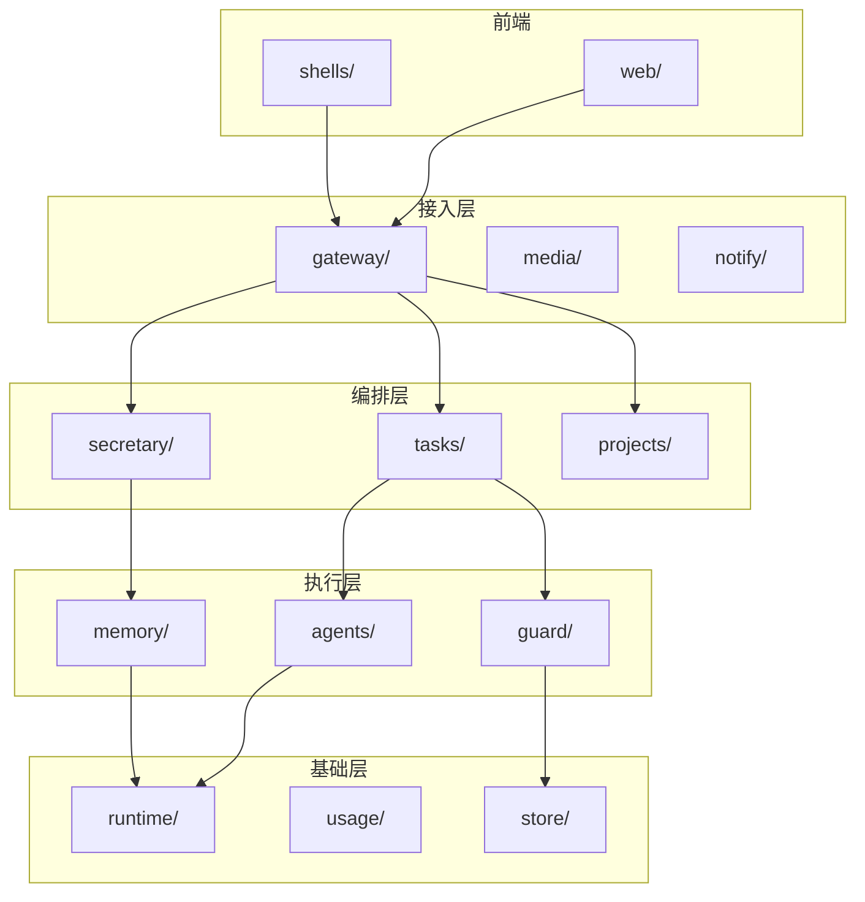

**中文** | [English](README.en.md)

# 二狗 v2（ergou）

一个只服务一个人的个人助理 agent，基于 [pi](https://github.com/earendil-works/pi) 从零搭建，是一个改进版的 OpenClaw。它常驻在用户自己的电脑上；用户主要和"秘书"对话，具体的活按任务和项目派给专门的维护者去做；系统持续积累对用户的理解。

> **状态：规划阶段。**仓库里目前只有规格、决策和调研文档，还没有实现代码。下文的图分两类：标"已定"的来自已关闭的决策票；标"草案"的要等对应的票定稿后再修订。

## 三个差异化

1. **挖掘动机的个人记忆**：人说的话常常跟情境有关，不一定准确。二狗从碎片化的素材里推测用户真正的需求和动机，再用推测出的问题向用户求证。方法参考 intent-mining。
2. **安全且少打扰**：继承 AgentSense 的"规划一次、授权一次、执行到底"。用户自己指定哪些操作要提醒，不局限于安全。需要用户的事统一收进"待我处理"。
3. **秘书 + 维护者的派遣**：秘书只负责理解、澄清、规划和派遣，不亲自干活。每个任务和项目都有一个固定的维护者，权限只限于自己负责的那部分。

## 规划进度

规划用 wayfinder 的方式进行：一张地图，加若干决策票，逐张解决。

- 主地图：[二狗 v2](.scratch/ergou-v2/map.md)
- 子地图：[二狗记忆系统](.scratch/ergou-memory/map.md)
- 术语表：[CONTEXT.md](CONTEXT.md)
- 架构决策记录：[docs/adr/](docs/adr/)

已经定下来的：

| 决策票 | 结论 |
|---|---|
| [pi 1.0 各层能力映射](.scratch/ergou-v2/issues/01-pi-layer-mapping.md) | 摸清了 pi 三层能力；排除实验性的 pi-durable；deepseek-flash 上分段改 system prompt 会打穿缓存 |
| [运行时底座（ADR-0001）](docs/adr/0001-pi-coding-agent-sdk-as-runtime.md) | 用 `pi-coding-agent` 的 SDK，外包一层二狗自己的薄封装，锁定版本 |
| [多 agent 架构与 token 成本](.scratch/ergou-v2/issues/02-multi-agent-and-token-cost.md) | 每个任务或项目绑定一个常驻维护者，默认串行；要并行时由维护者提议、用户确认 |
| [记忆边界](.scratch/ergou-v2/issues/03-memory-boundary.md) | 记忆管理者是唯一写者；秘书读用户卡、记忆简报和深查结果；分短期记忆和长期记忆；动机假设只给秘书看 |
| [任务生命周期与任务看板](.scratch/ergou-v2/issues/05-task-lifecycle-and-board.md) | 对话 / 任务 / 项目三分；任务由用户明确发起；完成自动、归档手动；"待我处理"汇集所有要用户确认的事 |
| [项目生命周期、工作空间与维护者](.scratch/ergou-v2/issues/14-project-lifecycle-and-maintainer.md) | 项目六种状态，服务在不在线归服务层；立项分两步；维护者的理解靠项目档案；维护者的所有工作都是工单，由派单器送进队列；定时调度在守护进程里；v1 不做沙箱 |
| [Windows 原生沙箱能力调研](.scratch/ergou-v2/issues/22-windows-native-sandbox.md) | 原生可行，但 v1 不做；守护进程里的路径围栏和不允许脱离的 Job 对象必须做 |
| [角色模型（ADR-0003）](.scratch/ergou-v2/issues/13-role-model.md) | 取消角色，维护者按项目或任务配工具包；"只做本领域"改成范围审视：压缩时和工单结束时检查，越界的记下来、写进提示，再不推送地告诉你 |
| [消息协议与多前端](.scratch/ergou-v2/issues/06-protocol-and-message-model.md) | 每个前端一条 WebSocket，按频道订阅，事件日志是唯一真相；卡片是独立实体；外网设备要配对，拿 HttpOnly cookie；本机和外网分两个端口 |
| [关注类别与打扰策略](.scratch/ergou-v2/issues/04-watch-categories-and-interruption.md) | 类别靠确定规则判断，自定义也写规则；六档处置；授权项照搬 AgentSense；常用 bash 操作封装成工具，通用命令照常检查并在时间线上标出 |
| [长程任务机制泛化](.scratch/ergou-v2/issues/12-long-task-generalization.md) | 统一一种计划；验收分系统检查、独立评审、用户验收；搬 AgentSense 的时序规则引擎，配一套真实工具的规则模板；计划和授权由运行时保管 |
| [意图澄清与规划交互](.scratch/ergou-v2/issues/15-clarification-and-planning-flow.md) | 秘书一轮内分流；先说假设、成批问、不设上限；秘书写任务书、维护者起草计划；一张计划卡一次确认计划、工具包和授权 |
| [素材管理](.scratch/ergou-memory/issues/02-material-management.md)（记忆子地图） | 保存"本人"原文副本；七类素材加回避信号从第一天起采集；关键词用 FTS5 trigram，向量用 CPU 跑 bge-m3；三种删除 |
| [运行时架构（ADR-0002）](.scratch/ergou-v2/issues/11-runtime-architecture.md) | 每个 agent 一个子进程，守护进程只当管家；被杀后混合恢复；二狗自有 skill 库，按项目或任务授权；TypeScript + React 19 + Vite |
| [部署、数据目录与备份](.scratch/ergou-v2/issues/10-deployment-data-backup.md) | 数据目录在用户目录下；所有设备走公网域名；每晚快照并复制到华为家庭存储的同步目录；重启后等你登录再补 |
| [Web UI 信息架构](.scratch/ergou-v2/issues/17-web-ui-information-architecture.md) | 竖屏底部 5 个 tab，宽屏变左侧竖栏；秘书和维护者会话共用一个组件；第一阶段页面清单已定 |

第一阶段的决策票已经全部定稿，下一步是写规格（`/to-spec`），再拆实现票。

## 1. 实体与关系

### 1.1 agent 与工作（已定）

几条规则：

- **只有项目的维护者能改它的项目。**只涉及一个项目的任务，由该项目的维护者执行；涉及多个项目或不涉及项目的任务，有自己的维护者负责统筹。
- 维护者能用什么，由它负责的任务或项目配的工具包决定：skill、外部工具，以及 bash、联网这类能力开关。不设角色（ADR-0003）。可见的记忆和文件也只限于它负责的那部分。v1 不做系统级沙箱。
- 秘书不碰项目，只有一块自己的草稿区：可以写文件、跑脚本做计算；能联网搜索、读网页（2026-10-10 起先把功能跑通，安全机制后接）。对项目或对外有副作用的操作，要么是用户确认后由系统执行的快速动作，要么成为任务。

用户在三个地方看工作：

| 界面 | 显示什么 |
|---|---|
| 任务看板 | 任务、简单提醒、定时作业，按"等我 → 进行中 → 运营中 → 最近结束 → 已归档"分组 |
| 项目管理界面 | 所有项目及其状态；每张项目卡片上有"和维护者交流"按钮；项目页能看维护者的工单流水线 |
| 待我处理 | 所有需要用户注意或确认的事项；有未读时 tab 亮小红点 |

### 1.2 记忆（已定）

## 2. 工作流

### 2.1 一条用户消息的去向（已定）

- 每轮秘书收到消息时，运行时都会先自动附上记忆简报。
- 秘书在同一轮里用结构化输出选定五种形态之一。用户明说要发起任务，或者点了按钮，就跳过判断。
- 快速动作：秘书写清动作，用户确认（或在已有授权内）后由系统直接执行，并记入操作记录。用户这一轮明确点了对象和内容的，不再额外确认。
- 任务由用户发起：点"建议发起任务"卡、点"发起任务"按钮，或者让秘书去做某件需要任务的事（用户的要求就是授权）。秘书自己发现、用户没要求的，只给建议卡。
- 意图澄清先说出秘书的假设，问题成批问、每题带推荐答案，不设轮数上限。"少问"是长期要探索的目标。
- 秘书写任务书（目标、验收标准、约束、涉及的项目、记忆范围提议），执行的维护者据此起草阶段计划。
- 计划卡上列出：阶段（交付件、验收标准、由谁验收）、涉及的项目、工具包、授权、引用了哪些记忆、执行中可能调用的记忆范围、本任务要提醒的关注类别。用户确认计划，就是一次授权。可以逐行勾掉或收窄，也可以附上意见打回。

### 2.2 任务的状态（已定）

- **有名额**：全局最多同时 3 个任务在执行，可调。子 agent 不占名额。
- **需要你**：运行时审批、任务澄清、计划里标明"由你验收"的阶段、卡住求助。这些事项都进"待我处理"。
- **暂停**：用户手动暂停，或系统因超预算、卡住而暂停。
- **返工**：沿用 AgentSense 的"按依赖重开"，只重开出问题的阶段和它的下游。
- **取消**：图里只画了从"执行中"取消，其实任何还没结束的状态都可以取消。
- "执行中"里面运行 AgentSense 式的阶段计划，卡片上显示"第 N/M 阶段"。阶段层的机制待「长程任务机制泛化」。
- 归档只能由用户手动触发。结束超过 7 天还没归档的任务，每周汇总一次放进"待我处理"。
- 简单提醒：待触发 → 已触发（一次性的），或者一直待触发（重复的）。
- 定时作业：运营中 ⇄ 已暂停；连续失败 3 次自动暂停。

### 2.3 项目的状态（已定）

- **立项**分两步：
  1. 秘书收口：确认是项目、定名字和一句话目标、提议记忆范围。你确认后项目进入筹备中，维护者随之产生。
  2. 维护者和你做立项问答，交出立项书。你点"确认并开工"，项目进入建设中，同时发起首个建设任务。
- **使用中**：首个建设任务完成后自动进入，不区分有没有服务。项目页直接显示它背后的服务在不在线、有哪些定时作业。
- **服务在不在线不是项目状态**，由服务层单独监控，项目页只把它显示出来。使用中的项目，服务可以常驻，也可以按需拉起。
- **项目状态不随任务变**：使用中的项目上有任务在做，状态不变，项目卡上显示进行中的任务数。
- **阶段只挂在任务上**，项目没有"目标"或阶段清单；长线规划写在项目的规格和进展文档里。
- **归档**只能你手动；取消归档就回到原状态。删除只能从已归档发起。
- **文件**：项目档案（立项书、规格、术语表、ADR、进展、维护者会话）固定在数据目录；工作目录默认在档案里，开发类项目可以绑定外部仓库。维护者只能碰这两处。v1 不做系统级沙箱，靠路径白名单和 AgentSense 式守卫。

### 2.4 工单：维护者怎样接活（已定）

- 维护者要做的所有事都是**工单**。你在会话里直接和维护者聊天不算工单，它会在下一步之前看到。
- 跨项目的改动随任务计划一次确认：计划逐项列出动哪些项目、每个项目改什么。
- 维护者平时休眠，工单到达时被唤起；正忙就排队。对项目的理解存在项目档案里，不靠会话。
- agent 之间只有工单这一种通信，不做群聊。项目页上能看到维护者的工单流水线和每张工单的来源。
- 简单提醒和定时作业由守护进程内的调度器触发，不用 Windows 计划任务。

### 2.5 一次工具调用经过守卫（已定）

- 内置的关注类别有：花钱；以你的名义对外发送或发布；删除或覆盖；不可逆的提交；账户与安全；越出项目目录；使用授权范围外的记忆；计划外工单；未知的写操作。你可以用确定的规则自定义类别，每个类别的处置只能往严里调。
- 两条底线不能放宽：付款转账、创建账户、改密码或两步验证，固定为"交给我做"；把凭据写进对外内容，固定为"永不"。
- 常用的特殊操作（git、测试、装依赖等）封装成带类型的工具。没有事先规定类型的通用 bash 照常检查，并在时间线的要点层和全局层单独标出。
- 时序规则照搬 AgentSense 的引擎，配一套针对真实工具的模板，例如：删除前须已备份、push 前须跑过测试、读过密钥文件后不许对外发送。规则可以挂在单个阶段上，也可以套给一组阶段。
- 偏离计划时逐级升级：在授权范围内只记摘要；超出授权先问你；出现计划没预料到的类别时，先问你并暂停这一支。
- 守卫是硬闸。"维护者有没有做本项目该做的事"是软约束，靠范围审视：每次压缩会话时、每张工单结束时各检查一次，越界的记下来、写进维护者的提示，再不推送地告诉你。
- 阶段验收：能写成脚本的，由钩子自动跑；写不成脚本的，派一个只看交付件和标准的评审子 agent；计划里标明的，由你验收。维护者自检不能单独算验收。

## 3. 系统架构（部署视图）

| 节点 | 说明 |
|---|---|
| VPS nginx | 443 端口，HTTPS，按域名转发到 ssh 反向隧道。家里的设备也走这条路 |
| LSM | Local Service Manager：注册、启动、探活。托管二狗守护进程、隧道和语音服务 |
| 二狗守护进程 | 常驻的 Node 进程，只当管家：启停 agent 子进程、守卫审批、事件日志、派单和调度、界面。自己不跑模型（ADR-0002） |
| agent 子进程 | 每个 agent 一个，有活时常驻、闲了退出；全部放进一个不允许脱离的 Job 对象，守护进程被重启时一起清掉 |
| 语音服务 | faster-whisper 做语音转文字，audio.cpp 做文字转语音 |
| 个人数据 | 仓库外的数据目录（默认在用户目录下），SQLite 加文件；agent 只能写分配给它的那一格 |
| DeepSeek | 先全部用 DeepSeek V4.1 Flash（`deepseek-flash`） |
| 手机推送 | 鸿蒙 Push Kit、Android 上的 ntfy、浏览器 Web Push |
| 华为家庭存储 | 每晚做一次本机一致性快照，复制到它的同步目录，由它同步到家庭存储。按日期分目录，保留每日 7 份、每周 4 份；不加密；密钥目录不进备份 |

约束：

- 二狗的所有服务都在 LSM 注册并由它启动，二狗不自行启动任何服务。
- 外网设备一律要配对，批准后拿到一个网页脚本读不到的长期凭证，可以吊销。隧道进来的连接在本机上也显示为 127.0.0.1，所以本机信任只给一个单独的、只监听 127.0.0.1 的本机端口；隧道只连外网端口。
- 夜里重启后，到你登录之前二狗都不在线；登录后，调度器补发错过的提醒和作业。
- pi 的类型只出现在 `runtime/` 里，上层只依赖二狗自己定义的接口（ADR-0001）。
- 审批、任务、记忆、token 账本等领域状态只存在二狗自己的库里，不存在 pi 的会话里。
- 个人数据放在仓库外的数据目录；要记下来的东西都有固定的归宿，临时文件只放专门的临时区并定期清理。

## 4. 模块拆分（草案，写规格时定稿）

按层组织，上层只依赖下层。

| 层 | 模块 | 负责 |
|---|---|---|
| 前端 | `web/` | Web UI，继承 AgentSense 的视觉语言 |
| | `shells/` | 鸿蒙、Android 外壳 |
| 接入层 | `gateway/` | 前端协议、设备配对、媒体收发 |
| | `media/` | 语音转文字、文字转语音的客户端 |
| | `notify/` | 待我处理、各渠道推送适配器 |
| 编排层 | `secretary/` | 秘书、意图澄清、规划 |
| | `tasks/` | 任务看板、状态机、调度、简单提醒、定时作业、快速动作执行 |
| | `projects/` | 项目登记、项目规范、工作空间 |
| 执行层 | `agents/` | 维护者、子 agent 的进程管理，工具包，范围审视 |
| | `guard/` | 关注类别、处置、授权项、时序规则、审批表 |
| | `memory/` | 素材、短期 / 长期记忆、做梦阶段、记忆简报 |
| 基础层 | `runtime/` | pi 的薄封装和子进程通信，全系统唯一接触 pi 的地方 |
| | `usage/` | token 记账 |
| | `store/` | 个人数据目录、事件日志、备份 |

## 文档索引

| 路径 | 内容 |
|---|---|
| [CONTEXT.md](CONTEXT.md) | 术语表：秘书、任务、项目、维护者、短期记忆…… |
| [docs/adr/](docs/adr/) | 架构决策记录 |
| [docs/research/](docs/research/) | 调研：AgentSense、intent-mining、OpenClaw 与 pi、多 agent、记忆、长任务与打扰、推送、本地设施、多媒体、pi 分层、用户建模、Windows 沙箱 |
| [docs/guides/](docs/guides/) | 操作指南，如华为 AGC 推送开通 |
| [.scratch/ergou-v2/](.scratch/ergou-v2/) | 主地图和决策票 |
| [.scratch/ergou-memory/](.scratch/ergou-memory/) | 记忆系统子地图和决策票 |

## 约定

- 仓库只放框架。记忆、对话、项目档案、密钥等个人数据永远不进仓库。
- 文档和交流一律用中文；README 另有[英文版](README.en.md)。
