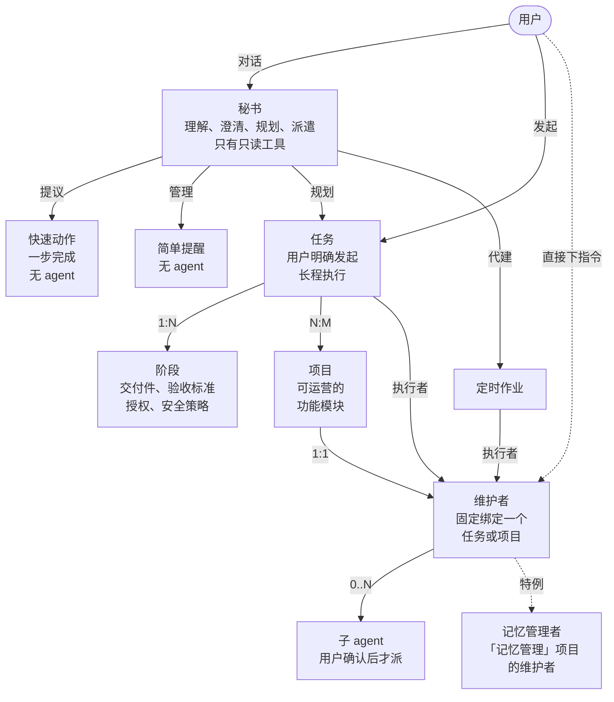
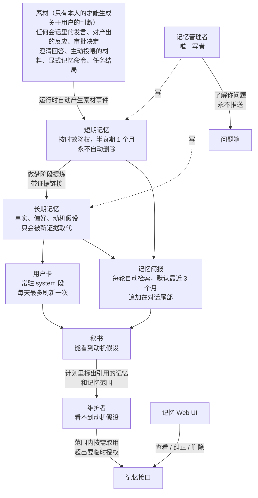
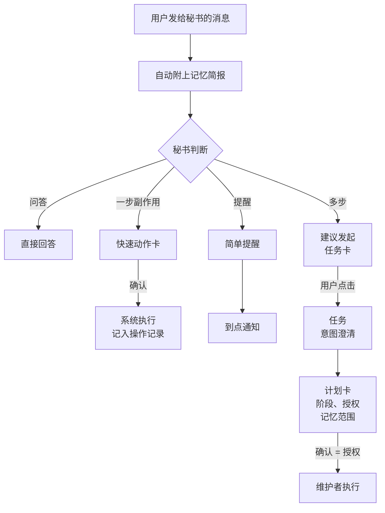
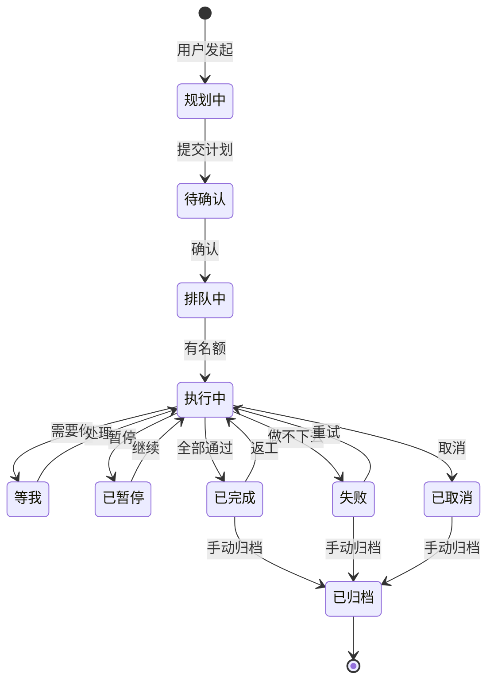
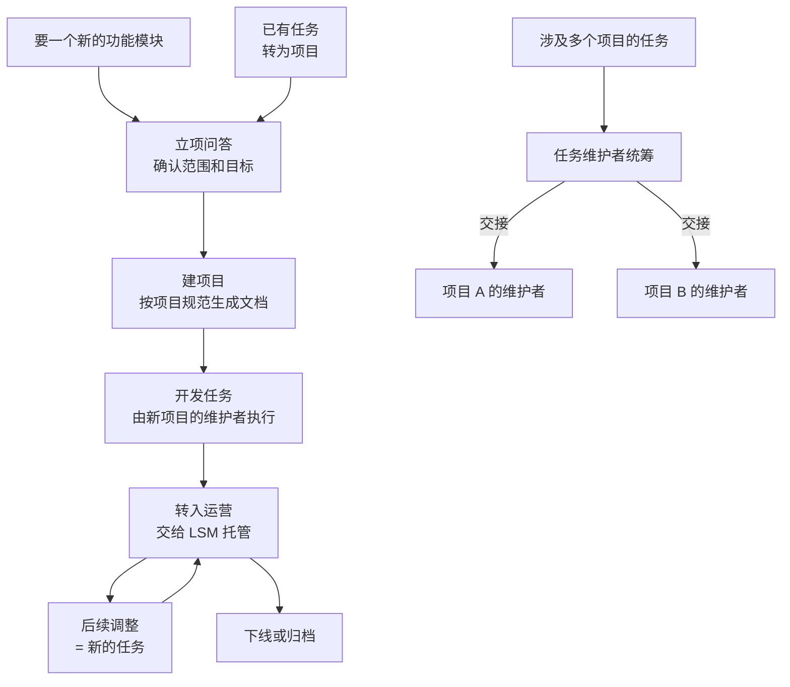
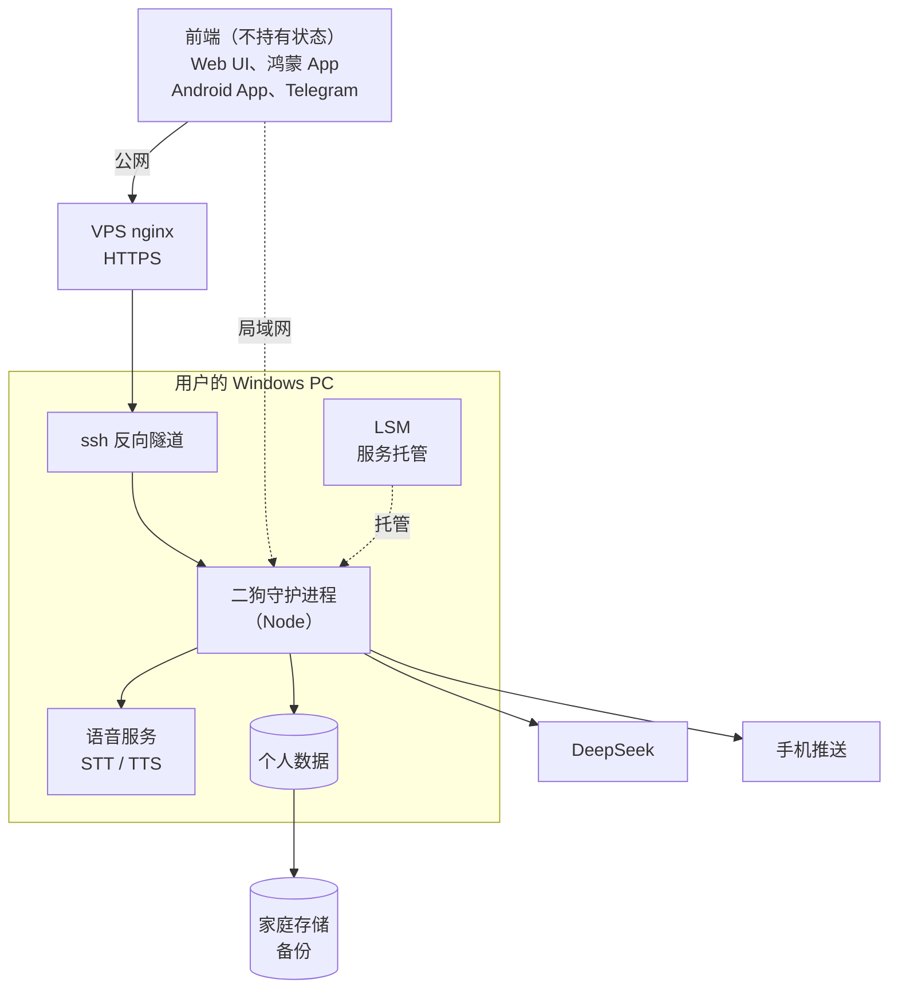
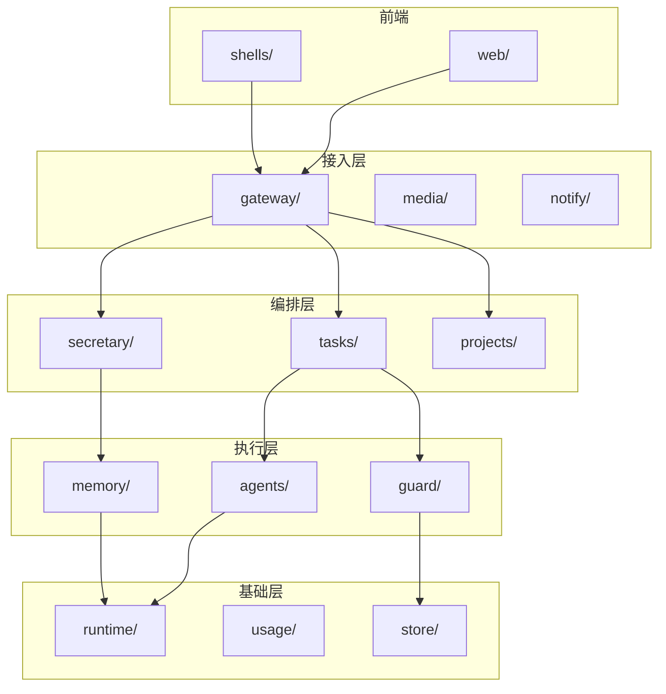

**中文** | [English](README.en.md)

# 二狗 v2（ergou）

一个只服务一个人的个人助理 agent，基于 [pi](https://github.com/earendil-works/pi) 从零搭建，是一个改进版的 OpenClaw。它常驻在用户自己的电脑上；用户主要和"秘书"对话，具体的活按任务和项目派给专门的维护者去做；系统持续积累对用户的理解。

> **状态：规划阶段。**仓库里目前只有规格、决策和调研文档，还没有实现代码。下文的图分两类：标"已定"的来自已关闭的决策票；标"草案"的要等对应的票定稿后再修订。

## 三个差异化

1. **挖掘动机的个人记忆**：人说的话常常跟情境有关，不一定准确。二狗从碎片化的素材里推测用户真正的需求和动机，再用推测出的问题向用户求证。方法参考 intent-mining。
2. **安全且少打扰**：继承 AgentSense 的"规划一次、授权一次、执行到底"。用户自己指定哪些操作要提醒，不局限于安全。需要用户的事统一收进"待我处理"。
3. **秘书 + 维护者的派遣**：秘书只负责理解、澄清、规划和派遣，不亲自干活。每个任务和项目都有一个固定的维护者，权限只限于自己负责的那部分。

## 规划进度

规划用 wayfinder 的方式进行：一张地图，加若干决策票，逐张解决。

- 主地图：[二狗 v2](.scratch/ergou-v2/map.md)
- 子地图：[二狗记忆系统](.scratch/ergou-memory/map.md)
- 术语表：[CONTEXT.md](CONTEXT.md)
- 架构决策记录：[docs/adr/](docs/adr/)

已经定下来的：

| 决策票 | 结论 |
|---|---|
| [pi 1.0 各层能力映射](.scratch/ergou-v2/issues/01-pi-layer-mapping.md) | 摸清了 pi 三层能力；排除实验性的 pi-durable；deepseek-flash 上分段改 system prompt 会打穿缓存 |
| [运行时底座（ADR-0001）](docs/adr/0001-pi-coding-agent-sdk-as-runtime.md) | 用 `pi-coding-agent` 的 SDK，外包一层二狗自己的薄封装，锁定版本 |
| [多 agent 架构与 token 成本](.scratch/ergou-v2/issues/02-multi-agent-and-token-cost.md) | 每个任务或项目绑定一个常驻维护者，默认串行；要并行时由维护者提议、用户确认 |
| [记忆边界](.scratch/ergou-v2/issues/03-memory-boundary.md) | 记忆管理者是唯一写者；秘书读用户卡、记忆简报和深查结果；分短期记忆和长期记忆；动机假设只给秘书看 |
| [任务生命周期与任务看板](.scratch/ergou-v2/issues/05-task-lifecycle-and-board.md) | 对话 / 任务 / 项目三分；任务由用户明确发起；完成自动、归档手动；"待我处理"汇集所有要用户确认的事 |

## 1. 实体与关系

### 1.1 agent 与工作（已定）

几条规则：

- **只有项目的维护者能改它的项目。**只涉及一个项目的任务，由该项目的维护者执行；涉及多个项目或不涉及项目的任务，有自己的维护者负责统筹。
- 维护者的工具、沙箱、可见的记忆和文件，都只限于它负责的任务或项目。
- 秘书没有执行权。有副作用的操作，要么是用户确认后由系统执行的快速动作，要么成为任务。

用户在三个地方看工作：

| 界面 | 显示什么 |
|---|---|
| 任务看板 | 任务、简单提醒、定时作业，按"等我 → 进行中 → 运营中 → 最近结束 → 已归档"分组 |
| 项目管理界面 | 所有项目及其状态；每张项目卡片上有"和维护者交流"按钮 |
| 待我处理 | 所有需要用户注意或确认的事项；有未读时 tab 亮小红点 |

### 1.2 记忆（已定）

## 2. 工作流

### 2.1 一条用户消息的去向（已定，分流细节待「意图澄清与规划交互」）

- 每轮秘书收到消息时，运行时都会先自动附上记忆简报。
- 快速动作：秘书写清动作，用户确认（或在已有授权内）后由系统直接执行，并记入操作记录。
- 任务只能由用户明确发起：点"建议发起任务"卡，或者直接说明要发起任务，或者点"发起任务"按钮。
- 计划卡上列出阶段、授权、引用了哪些记忆，以及执行中可能调用的记忆范围。用户确认计划，就是一次授权。

### 2.2 任务的状态（已定）

- **有名额**：全局最多同时 3 个任务在执行，可调。子 agent 不占名额。
- **需要你**：运行时审批、任务澄清、计划里标明"由你验收"的阶段、卡住求助。这些事项都进"待我处理"。
- **暂停**：用户手动暂停，或系统因超预算、卡住而暂停。
- **返工**：沿用 AgentSense 的"按依赖重开"，只重开出问题的阶段和它的下游。
- **取消**：图里只画了从"执行中"取消，其实任何还没结束的状态都可以取消。
- "执行中"里面运行 AgentSense 式的阶段计划，卡片上显示"第 N/M 阶段"。阶段层的机制待「长程任务机制泛化」。
- 归档只能由用户手动触发。结束超过 7 天还没归档的任务，每周汇总一次放进"待我处理"。
- 简单提醒：待触发 → 已触发（一次性的），或者一直待触发（重复的）。
- 定时作业：运营中 ⇄ 已暂停；连续失败 3 次自动暂停。

### 2.3 项目与任务（草案，待「项目生命周期」「项目规范」「运营态托管」定稿）

## 3. 系统架构（部署视图）

守护进程内部的部件划分是草案，待「运行时架构」定稿；部署方式和外部依赖已定。

| 节点 | 说明 |
|---|---|
| VPS nginx | 443 端口，HTTPS，按域名转发到 ssh 反向隧道 |
| LSM | Local Service Manager：注册、启动、探活。托管二狗守护进程、隧道和语音服务 |
| 二狗守护进程 | 常驻的 Node 进程，内部模块见第 4 节 |
| 语音服务 | faster-whisper 做语音转文字，audio.cpp 做文字转语音 |
| 个人数据 | 仓库外的数据目录，SQLite 加文件 |
| DeepSeek | 先全部用 DeepSeek V4.1 Flash（`deepseek-flash`） |
| 手机推送 | 鸿蒙 Push Kit、Android 上的 ntfy、浏览器 Web Push |
| 家庭存储 | 华为家庭存储，由二狗内部调度定期备份 |

约束：

- 二狗的所有服务都在 LSM 注册并由它启动，二狗不自行启动任何服务。
- pi 的类型只出现在 `runtime/` 里，上层只依赖二狗自己定义的接口（ADR-0001）。
- 审批、任务、记忆、token 账本等领域状态只存在二狗自己的库里，不存在 pi 的会话里。
- 个人数据放在仓库外的数据目录；要记下来的东西都有固定的归宿，临时文件只放专门的临时区并定期清理。

## 4. 模块拆分（草案，待「运行时架构」定稿）

按层组织，上层只依赖下层。

| 层 | 模块 | 负责 |
|---|---|---|
| 前端 | `web/` | Web UI，继承 AgentSense 的视觉语言 |
| | `shells/` | 鸿蒙、Android 外壳 |
| 接入层 | `gateway/` | 前端协议、设备配对、媒体收发 |
| | `media/` | 语音转文字、文字转语音的客户端 |
| | `notify/` | 待我处理、各渠道推送适配器 |
| 编排层 | `secretary/` | 秘书、意图澄清、规划 |
| | `tasks/` | 任务看板、状态机、调度、简单提醒、定时作业、快速动作执行 |
| | `projects/` | 项目登记、项目规范、工作空间 |
| 执行层 | `agents/` | 维护者、子 agent、角色卡 |
| | `guard/` | 关注类别、授权、审批表 |
| | `memory/` | 素材、短期 / 长期记忆、做梦阶段、记忆简报 |
| 基础层 | `runtime/` | pi SDK 的薄封装，全系统唯一接触 pi 的地方 |
| | `usage/` | token 记账 |
| | `store/` | 个人数据目录、事件日志、备份 |

## 文档索引

| 路径 | 内容 |
|---|---|
| [CONTEXT.md](CONTEXT.md) | 术语表：秘书、任务、项目、维护者、短期记忆…… |
| [docs/adr/](docs/adr/) | 架构决策记录 |
| [docs/research/](docs/research/) | 调研：AgentSense、intent-mining、OpenClaw 与 pi、多 agent、记忆、长任务与打扰、推送、本地设施、多媒体、pi 分层、用户建模 |
| [docs/guides/](docs/guides/) | 操作指南，如华为 AGC 推送开通 |
| [.scratch/ergou-v2/](.scratch/ergou-v2/) | 主地图和决策票 |
| [.scratch/ergou-memory/](.scratch/ergou-memory/) | 记忆系统子地图和决策票 |

## 约定

- 仓库只放框架。记忆、对话、项目档案、密钥等个人数据永远不进仓库。
- 文档和交流一律用中文；README 另有[英文版](README.en.md)。
