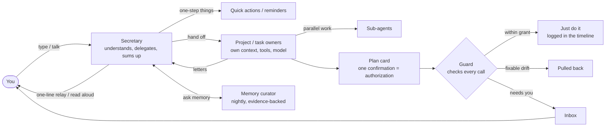
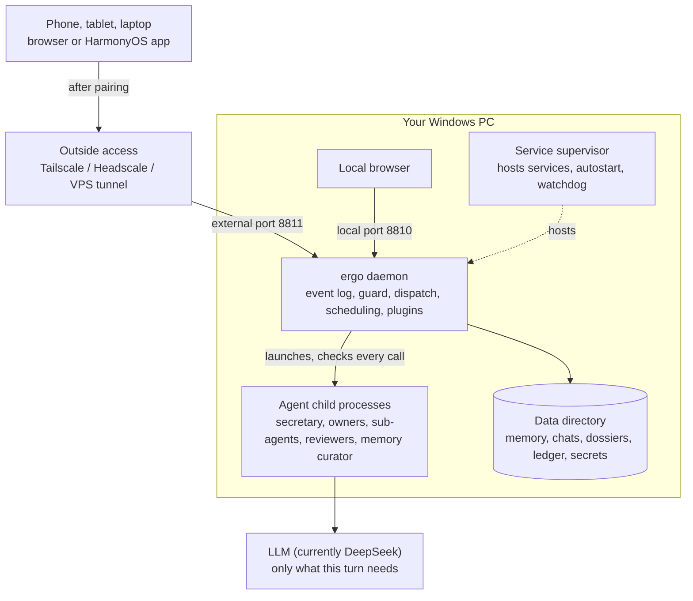

[中文](architecture.md) | **English**

# Architecture

To change the code or write plugins, go on to the [Developer Guide](developer-guide.en.md), the [glossary](../CONTEXT.md) and the [architecture decisions](adr/).

## How a request flows

## Where it runs

## The code

- **Two processes**: the ergo daemon (`packages/daemon`) and the service supervisor (`packages/supervisor`). The supervisor is small and stable: it starts at login, restarts ergo if killed, and hosts services from projects that go live; its data defaults to `%LOCALAPPDATA%\ergo\supervisor`, ergo's to `%USERPROFILE%\.ergo`.
- **Code**: TypeScript (the daemon runs directly via Node's type stripping), npm workspaces; the web UI is React 19 + Vite; the HarmonyOS shell is in `frontend/harmony`. About 280k lines of code and 8,000+ automated tests; CI runs only on Windows and only Node 22 (the Node major version follows pi, [ADR-0031](adr/0031-node-version-follows-pi.md)).
- **Agent runtime**: pi appears only in a thin wrapper layer ([ADR-0001](adr/0001-pi-coding-agent-sdk-as-runtime.md)); domain state such as approvals, tasks and the ledger lives in ergo's own event log (SQLite).
- More in the [Developer Guide](developer-guide.en.md), the [glossary](../CONTEXT.md) and the [decision records](adr/) (the latter two in Chinese).

The Claude Code Agent SDK is under Anthropic's own license; ergo treats it as an optional dependency and doesn't ship it in the package. Third-party license lists ship with the package: `THIRD_PARTY_NOTICES.txt` in the install directory has the full texts, `third-party-licenses.json` the list.

## Trade-offs against OpenClaw

OpenClaw is a general-purpose, multi-channel personal agent with far broader scope than ergo, also running on your own machine. ergo serves one person and makes different trade-offs in these places (the OpenClaw column follows [research note 03](research/03-openclaw-and-pi.md), as of 2026-10-06).

| | OpenClaw | ergo |
|---|---|---|
| Who does the work | The main agent can delegate to specialist sub-agents via prompts; officially, delegation is prompt-guided, not a scheduler | The secretary understands you, hands out work and sums up, without touching anything itself; each task and project has a fixed owner with its own context, toolkit and model; dispatch is part of the runtime |
| Projects | No first-class "project" entity | Projects have a dossier, working directory, fixed owner and charter; scope review checks for overreach; you decide when the first version is done |
| Permissions | Sandbox and exec approvals are off by default; full access by default | Watch categories × six handlings, plan grants, temporal rules, three hard bottom lines; every call recorded and explained in plain words |
| Long-running tasks | heartbeat, cron | Staged plans, independent reviewer acceptance, automatic correction; plan changes pause only affected stages; resumes after restart without silently redoing side effects |
| Looking back | Chat history | Three-level timeline zoom with key markers pinned in the margin |
| Memory | Engineered layered memory (dreaming, hybrid retrieval); explicitly no person profiles | Every word kept locally; distilled nightly into conclusions with evidence chains and competing explanations, reasoning up to motives and what you care about; asks when unsure |
| Platforms | Cross-platform | Windows only |
