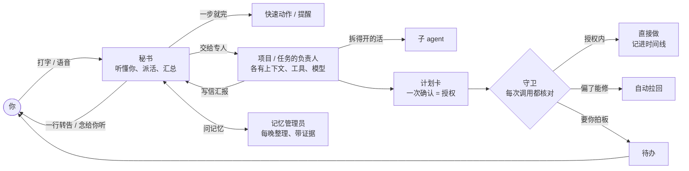
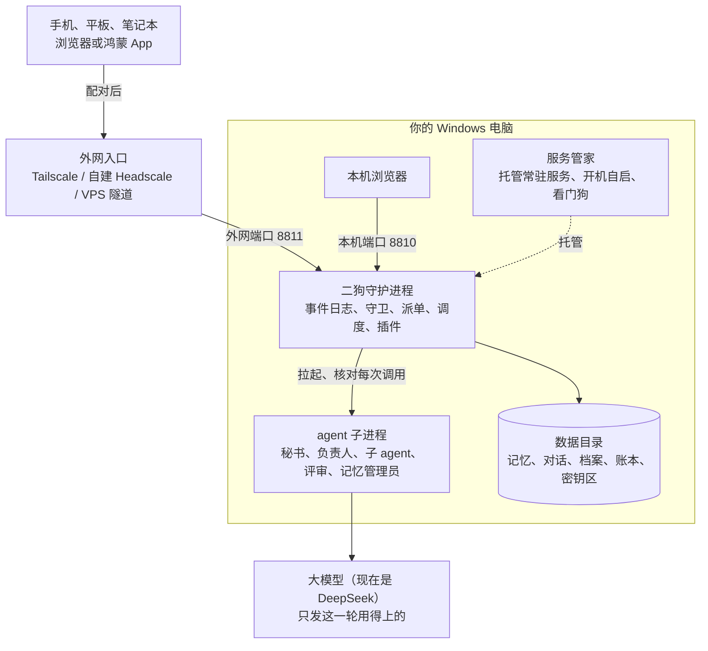

**中文** | [English](architecture.en.md)

# 技术架构

想改代码、写插件，接着看[开发者指南](developer-guide.md)、[术语表](../CONTEXT.md)和[架构决策](adr/)。

## 一个请求怎么走

## 部署结构

## 代码组成

- **两个进程**：二狗守护进程（`packages/daemon`）和服务管家（`packages/supervisor`）。服务管家小而稳，负责开机自启、被杀后拉回、托管项目上线的服务；它的数据默认在 `%LOCALAPPDATA%\ergo\supervisor`，二狗的数据在 `%USERPROFILE%\.ergo`。
- **代码**：TypeScript（守护进程靠 Node 的类型剥离直接跑），npm workspaces；网页是 React 19 + Vite；鸿蒙外壳在 `frontend/harmony`。约 28 万行代码，8000 多条自动化测试，CI 只在 Windows、只跑 Node 22（Node 大版本跟着 pi 走，[ADR-0031](adr/0031-node-version-follows-pi.md)）。
- **agent 运行时**：pi 只出现在一层薄封装里（[ADR-0001](adr/0001-pi-coding-agent-sdk-as-runtime.md)），审批、任务、账本这些领域状态存在二狗自己的事件日志（SQLite）里。
- 详见[开发者指南](developer-guide.md)、[术语表](../CONTEXT.md)、[架构决策](adr/)。

Claude Code 的 Agent SDK 是 Anthropic 自己的许可，二狗只把它当可选依赖，不随安装包分发。第三方依赖和字体的许可证清单随安装包提供：装好的目录里 `THIRD_PARTY_NOTICES.txt` 是全文，`third-party-licenses.json` 是清单。

代码注释里的"N 号票"是开发时的内部记录编号，公开仓库里没有这些票，不影响读代码。

## 和 OpenClaw 的取舍

OpenClaw 是通用的、多渠道的个人 agent，覆盖面比二狗大得多，也装在你自己的机器上。二狗只服务一个人，在下面这几处做了不同的取舍（OpenClaw 一栏依据[调研 03](research/03-openclaw-and-pi.md)，截至 2026-10-06）。

| | OpenClaw | 二狗 |
|---|---|---|
| 谁在干活 | 主 agent 可以按提示词把活委派给专家子 agent；官方说委派是提示词引导，不是调度器 | 秘书只负责听懂你、派活、汇总，不动手；每个任务、每个项目有固定的负责人，各有上下文、工具包和模型；派单器是运行时的一部分 |
| 项目 | 没有"项目"这个一等实体 | 项目有档案、工作目录、固定负责人和立项书；范围审视检查有没有越界；首版做完由你拍板 |
| 权限 | 沙箱和执行审批默认都关，默认是完全访问 | 关注类别 × 六档处置、计划里的授权项、时序规则、三条硬底线；每次调用都有记录，并用大白话解释 |
| 长程任务 | heartbeat、cron | 阶段计划、独立评审验收、自动纠偏；改计划只停受影响的阶段；重启后接着做，不悄悄重做副作用 |
| 回看 | 聊天记录 | 时间线三层缩放，页边钉着要点标记 |
| 记忆 | 工程化的分层记忆（dreaming、混合检索），明确不做人物档案 | 原话都留在本机；每晚整理成带证据链、竞争解释的结论，推到动机和在意的东西；拿不准先问 |
| 平台 | 多平台 | 只支持 Windows |
