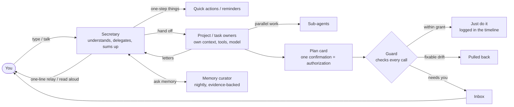
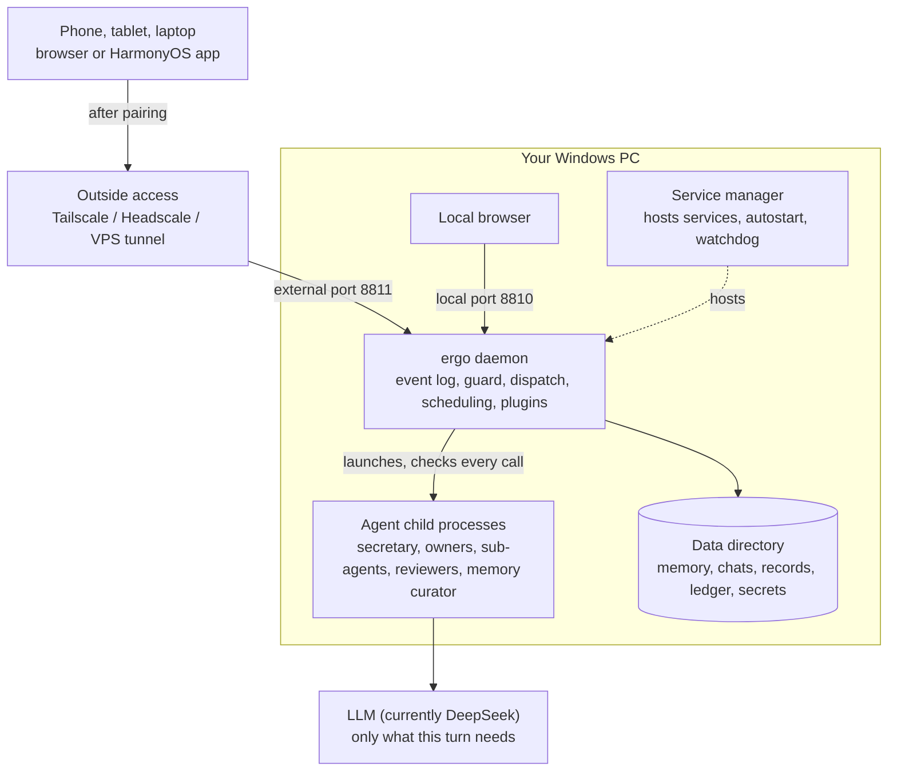

[中文](README.md) | **English**

# System architecture

For people who want to read or change the code, or write plugins: this layer covers ergo's architecture and technical details. If you just want to use ergo, see the [user guide](../user-guide/README.en.md).

## What's in this layer

| Document | What it covers |
|---|---|
| This page | System overview: how a request flows, where it runs, repository and modules, each part of the architecture, config and the data directory, plugin host, web UI, internationalization |
| [Development](development.en.md) | Setting up, running from source, common commands, building and debugging the phone apps, coding conventions, testing, upgrading pi, submitting changes |
| [Plugin guide](plugin-development.md) | From a minimal "notes" plugin to going live (in Chinese) |
| [Roles and permissions](../roles-and-permissions.en.md) | What each kind of agent can do and why: capability tables, the tools each agent gets, when it can send voice, checked against the code |
| [Memory system overview](memory-system.md) | Modules, interfaces and workflows, checked by tests (in Chinese) |
| [Memory engine architecture](memory-architecture.md) | The engine's data model and algorithms (in Chinese) |
| [Memory vocabulary](memory-vocabulary.md) | Names across the reasoning graph template, the reasoning DB and the code (in Chinese) |
| [Deployment and outside access](deployment.en.md) | Technical details of outside entry points: self-hosted Headscale, VPS tunnel |
| [Huawei push setup](huawei-agc-push-setup.md) | What HarmonyOS push needs on Huawei AGC; not yet verified on a device (in Chinese) |
| [adr/](adr/) | Decision records: why things are the way they are (in Chinese) |
| [research/](research/README.md) | Research done for the design (in Chinese) |
| [design/styles/](design/styles/README.md) | Visual style drafts |

**Terms** follow [CONTEXT.md](../../CONTEXT.md) (in Chinese): secretary, task, project, owner, guard, timeline and so on. Code, UI and docs share one vocabulary. **Why things are the way they are** is recorded in ADRs, cited below by number.

## How a request flows



## Where it runs



## The code

- **Two processes**: the ergo daemon (`packages/daemon`) and the service manager (`packages/supervisor`). The service manager is small and stable: it starts at login, restarts ergo if killed, and hosts services from projects that go live; its data defaults to `%LOCALAPPDATA%\ergo\supervisor`, ergo's to `%USERPROFILE%\.ergo`.
- **Code**: TypeScript (the daemon runs directly via Node's type stripping), npm workspaces; the web UI is React 19 + Vite; the HarmonyOS shell is in `frontend/harmony`. About 280k lines of code and 8,000+ automated tests; CI runs only on Windows and only Node 22 (the Node major version follows pi, [ADR-0031](adr/0031-node-version-follows-pi.md)).
- **Agent runtime**: pi appears only in a thin wrapper layer ([ADR-0001](adr/0001-pi-coding-agent-sdk-as-runtime.md)); domain state such as approvals, tasks and the ledger lives in ergo's own event log (SQLite).

The Claude Code Agent SDK is under Anthropic's own license; ergo treats it as an optional dependency and doesn't ship it in the package. Codex isn't a dependency: ergo uses the `codex` you installed yourself (ADR-0046). Third-party license lists ship with the package: `THIRD_PARTY_NOTICES.txt` in the install directory has the full texts, `third-party-licenses.json` the list.

## Trade-offs against OpenClaw

OpenClaw is a general-purpose, multi-channel personal agent with far broader scope than ergo, also running on your own machine. ergo serves one person and makes different trade-offs in these places (the OpenClaw column follows [research note 03](research/03-openclaw-and-pi.md), in Chinese, as of 2026-10-06).

| | OpenClaw | ergo |
|---|---|---|
| Who does the work | The main agent can delegate to specialist sub-agents via prompts; officially, delegation is prompt-guided, not a scheduler | The secretary understands you, hands out work and sums up, without touching anything itself; each task and project has a fixed owner with its own context, toolkit and model; dispatch is part of the runtime |
| Projects | No first-class "project" entity | Projects have records, a working directory, a fixed owner and a charter; scope review checks for overreach; you decide when the first version is done |
| Permissions | Sandbox and exec approvals are off by default; full access by default | Watch categories × six handlings, plan grants, temporal rules, three hard bottom lines; every call recorded and explained in plain words |
| Long-running tasks | heartbeat, cron | Staged plans, independent reviewer acceptance, automatic correction; plan changes pause only affected stages; resumes after restart without silently redoing side effects |
| Looking back | Chat history | Three-level timeline zoom with key markers pinned in the margin |
| Memory | Engineered layered memory (dreaming, hybrid retrieval); explicitly no person profiles | Every word kept locally; distilled nightly into conclusions with evidence chains and competing explanations, reasoning up to motives and what you care about; asks when unsure |
| Platforms | Cross-platform | Windows only |

## What's in the repository

### Packages and directories

```
packages/
  protocol/    @ergo/protocol    Protocol shared by daemon and frontends: frames, channel events, messages, cards (TypeBox); i18n runtime and language files
  daemon/      @ergo/daemon      The daemon: a steward that launches and manages agent child processes; event store, gateway, guard, tasks, plugin host
  web/         @ergo/web         Web UI: React 19 + Vite, hand-written CSS; a prototype with built-in sample data
  memory/      @ergo/memory      Memory engine: evidence, knowledge graph, reasoning graph, hybrid retrieval, nightly consolidation, a single write gate
  supervisor/  @ergo/supervisor  The service manager (command lsm): a separate small process hosting long-running services, autostart, watchdog, tunnels
frontend/
  harmony/     HarmonyOS app: a DevEco project; a native shell loading ergo's web UI
  android/     Android app: a Gradle project; a native shell loading ergo's web UI
config/        Config examples (ergo.example.json, watch-categories.example.json, mcp.example.json)
deploy/lsm/    Example service manager entries (ergo-daemon, ergo-tunnel, ergo-asr)
docs/          user-guide/ for everyday users; architecture/ is this layer (ADRs, memory system, research, design drafts)
```

npm workspaces manage the packages. `frontend/` is not a workspace (the HarmonyOS project's ArkTS is not checked by the root tsc, oxlint or vitest; hvigor type-checks it when compiling).

### Daemon modules (`packages/daemon/src/`)

| Directory / file | What it is |
|---|---|
| `main.ts`, `preflight.ts`, `stop.ts` | Entry: preflight checks (Windows only, Node version), then load the composition root; `stop.ts` is the service manager's stop hook (verifies the pid file before ending the process) |
| `daemon.ts` | **Composition root**: reads config, opens the event store, creates the Job object, wires modules, installs plugins from the manifest, opens both ports; shutdown and failed startup share one reverse-order cleanup list |
| `config/` | Read-only config, the data directory layout (`dataDirLayout()`; modules get paths only from here), which env var holds which secret |
| `storage/` | A thin SQLite interface: all database access goes through it, so swapping drivers touches one file |
| `events/` | **Event store**: the event log is the single source of truth (`ergo.db`, WAL); derived views are projected from it |
| `gateway/`, `pairing/` | The two ports, HTTP API, WebSocket; device pairing and credentials |
| `guard/`, `guard-runtime/`, `approvals/`, `hand-over/` | **Guard**: a pure judging function (`judgeToolCall`); wiring into the runtime (live environment facts, approval cards, effect log, "hand it to me") |
| `agent-manager/`, `agent-host/`, `runtime/`, `process/` | Launching agent child processes (assembly, env, Job object, resource limits); host for the three owner kinds; the runtime layer (pi lives only in `runtime/agent-child/`); process utilities |
| `secretary/`, `maintainers/`, `conversation/` | The secretary (a resident child process), waking owners, conversations (derived views, input queues, rollback and branches) |
| `tasks/`, `sub-agents/`, `scheduled-jobs/`, `event-sources/`, `recovery/` | Tasks (plans, execution, stage acceptance, drift and thresholds, workflows), parallel sub-agents, scheduled and event triggers, recovery after being killed |
| `projects/`, `work-orders/`, `operations/`, `project-ops/`, `project-services/`, `scope-review/` | **The project system**: records and standards, work-order dispatch, operations plans and APIs, project services (hosted by the service manager), scope review. Outsiders may only import `projects/api.ts` |
| `cards/`, `inbox/`, `board/`, `activity/`, `ledger/` | Card types and the button loop, the inbox, the board as the secretary sees it, activity state (a new kind of card the user must handle gets a line in `CARD_WAITS` in `activity/card-waits.ts`: the detail carries the card id, so the "waiting" text in the web title becomes clickable, see `web/src/state/activity-jump.ts`; put it in the inbox when creating the card), the token ledger |
| `plugins/`, `deletion/`, `data-sources/`, `components/`, `doctor/` | Plugin host, deletion participant registry, data sources and the shared import folder, on-demand components and the downloader, the checkup (the eight checks; the checks the core registers: main conversation, model calls lately (the agent manager's ring buffer `agent-manager/turn-log.ts`), DeepSeek balance (reads only the balance service's cache, `doctor/balance.ts`), conversation length, managed services (the service manager's snapshot), plugins, web page files; ten more checks the kernel registers in `doctor/housekeeping.ts`: backup, triggered tasks, internal job outcomes, stuck agents, log size, config files, missing skills, and three hints; checks plugins register, the items ergo generates for each plugin, the secretary's read-only `check_health`; the deep checkup `doctor/deep.ts`: checks with cost deep — one live request to the default model, a read-only integrity check of ergo.db, data sources' `probe`, Claude Code / Codex sign-in — run only when tapped, results kept in memory, GET / POST `/api/doctor/deep`; background watching in `doctor/watch.ts`: every 5 minutes it runs only backup, nightly tidy-up, speech synthesis and recognition, model calls lately and conversation length, puts repeated problems into the Inbox (`doctor_problem`), closes them once fixed, and keeps "don't remind me" in the config area's `doctor-watch.json`; the service manager's heartbeat and `/healthz` don't look at it) |
| `materials/`, `memory/`, `quick-actions/` | Materials store (verbatim copies, keyword and vector index), the memory plugin (nightly consolidation, memory curator, interviews), quick actions |
| `reminders/`, `calendar/`, `voice/`, `browsing/`, `claude-code/`, `codex/`, `google/`, `looki/`, `phone/`, `map/`, `openstreetmap/`, `amap/`, `google-maps/` | Plugins (each has a `plugin.ts`; other modules only take things from its `api.ts`) |
| `scheduler/`, `workday/`, `backup/` | Scheduler with an injectable clock, internal jobs; the personal work calendar and holidays; backup, verification, restore |
| `web/`, `typed-shell/`, `skills/`, `mcp/`, `toolkit/`, `apps/` | Web tools, typed shell tools (git, builds…), skill library (`skills/change.ts`: the card for owners submitting skills, built like `mcp/change.ts`, with validation shared with imports in `library.ts`), MCP registry, toolkits, proxying local service pages |
| `prompts/`, `agent-settings/`, `model-settings/`, `assistant/`, `agent-roles/`, `i18n/` | System prompts (markdown files users can edit), each agent's ⚙ panel, model settings (including provider balances in `model-settings/balance.ts`: the block at the top of the Usage page, the secretary's `check_balance`, the checkup's "DeepSeek balance"), the assistant's name, roles, i18n |
| `lsm/` | The service manager link protocol (health and busy reports, graceful stop, owned services, management commands); the secretary's six host tools for the service manager (`secretary-tools.ts`, secretary only via agent contributions: checking the list and logs and switching services happen directly (a service with no normal way to stop or restart is forced automatically); force stop, removing from autostart, stopping a scenario, removing, orphans, outside access and restarting itself fall in the secretary's especially sensitive categories and show an approval card; lifelines in the list are refused locally first, and the service manager has the final say by identity); `restart-hold.ts`: after a self-restart is queued, ergo also reports busy until the secretary finishes its turn; `services-page.ts`: the Settings · Services page (`GET /api/managed-services`, `POST /api/managed-services/<id>`, `GET /api/managed-services/<id>/logs`, over the same management commands, only for ergo-related services: the rule lives in the protocol package's `ergo-related.ts` and is shared with the checkup; voice ports come from the config in `voice-ports.ts`; log trimming and key wiping are shared with the secretary's `lsm_logs` in `log-lines.ts`) |
| `deploy/`, `deploy-nginx.ts`, `restore.ts`, `run-backup.ts`, `download-model.ts` | Command-line tools: generate and deploy the nginx site, restore, back up, download models |

Web directories are listed in [Where pages come from](#where-pages-come-from-prototype-and-online-demo).

## Architecture

### Two processes

| | The daemon (`packages/daemon`) | The service manager (`packages/supervisor`) |
|---|---|---|
| Does | Everything ergo is | Hosts long-running services: launch, probe, restart when killed, logs, autostart list, public tunnels, tailnet entries |
| Lifecycle | Restarts the most (every merge, config change) | Small, stable, rarely restarted |
| Data | `~/.ergo` (`ERGO_DATA_DIR`) | `%LOCALAPPDATA%\ergo\supervisor` (`--data-dir` / `LSM_DATA_DIR`) |

The service manager passes only an allowlist of env vars to the services it launches, not its own `--data-dir`, and no API reports that folder directly. The daemon's checkup reads the service manager's registry, so when the service manager isn't in its default location the ergo entry has to declare `LSM_DATA_DIR`. Entries written by `ergo start` include it; for hand-written ones see `deploy/lsm/ergo-daemon.example.yaml`.

They talk only over the **link protocol** (`packages/supervisor/docs/link-protocol.md`) and never import each other's code. After opening its ports the daemon connects out to the service manager (if any of the four `LSM_*` env vars is missing it silently skips this, as in tests and manual runs), announces its capabilities, and its heartbeat reports health (`ok` / `degraded`) and **busy** (a task is executing, or any agent has a side-effecting call in flight), so "stop when idle" waits for that work. Services from projects that go live are registered over the protocol as the daemon's **owned services** and launched and hosted by the service manager. ergo itself never starts long-running services.

### The daemon is a steward; agents are child processes

- The daemon runs no models itself. The secretary, owners, sub-agents, reviewers and the memory curator are each a **child process** ([ADR-0002](adr/0002-one-process-per-agent.md)), launched by the agent manager into a Windows Job object (cleaned up together if the daemon exits), with only an allow-listed environment plus explicit injections; model keys go to the child over stdin, never via environment variables.
- Children run [pi](https://github.com/earendil-works/pi) ([ADR-0001](adr/0001-pi-coding-agent-sdk-as-runtime.md)). **pi appears only in `runtime/agent-child/`**; daemon and child speak ergo's own host protocol ([ADR-0004](adr/0004-agent-host-protocol-sdk-over-stdio.md)), and `test/pi-boundary.test.ts` guards the boundary. Claude Code is another runtime plugged in through the same host protocol.
- Every project and task has a fixed owner (`maintainer` in code) with its own context, toolkit and model ([ADR-0003](adr/0003-no-roles-toolkit-per-project.md)).

### The event log is the single source of truth

- Domain state — approvals, tasks, plans, cards, inbox, ledger — consists of **events** appended to `db/ergo.db` (SQLite, WAL); UIs and modules read **derived views** projected from them. pi's session files are only the agent's context, not domain state.
- Frontends subscribe to **channels** over WebSocket (the secretary conversation, the board, the inbox, an owner's conversation…) and receive event streams; the frontend state layer is pure functions folding the stream into UI state (`packages/web/src/state/`).
- **Hard deletes** rewrite events rather than deleting rows: every event type that a delete might touch must register a rewriter, and deletes touching an unregistered type are refused entirely ([ADR-0008](adr/0008-purge-scope-and-session-rewrite.md)).
- The daemon is designed to be killed at any moment: on restart, work resumes by its rules, and side-effecting operations whose outcome is unknown go to the user to confirm rather than being silently redone (`recovery/`).

### Gateway: two ports

Both ports listen only on `127.0.0.1`:

- **Local port** (default 8810), trusted automatically. Every HTTP request and WebSocket handshake checks that Host is `127.0.0.1:<port>` or `localhost:<port>` (against DNS rebinding) and that Origin, if present, is one of those (against cross-site requests); `Origin: null` is always rejected.
- **External port** (default 8811), the only target for tunnels, Tailscale and similar: it ignores source IP and Host and looks only at the device credential (cookie `__Host-ergo-device`). Without a valid credential only three things pass: the page itself (showing the pairing page), `/api/access`, and the pairing API; everything else gets 401. Endpoints added later are automatically behind this gate.
- `/healthz`: whether the secretary is running, the web UI is built, and enabled plugins loaded (a plugin that failed to load means `degraded`, still 200).
- `/fonts/`: fonts for the visual styles (credentials required on the external port too). The web UI makes no requests to external hosts at runtime — the one exception is the AMap JS API the map page uses inside mainland China ([ADR-0051](adr/0051-map-amap-js-and-osm-tiles.md)).
- `/pdfjs/`: pdf.js for previewing PDFs on the report page (the legacy build of pdfjs-dist, cmaps, standard_fonts, and the pure-JS versions of two image decoders), copied into `dist/pdfjs/<version>/` by the web build and loaded only when a PDF is opened (credentials required on the external port too). Script responses carry `Content-Security-Policy: default-src 'self'` (it only applies to the worker: no eval, no WebAssembly); the page's own headers and the media API's are unchanged, and the PDF bytes come from the media API.
- `/tiles/osm/<z>/<x>/<y>` and `/_AMapService/…`: the OpenStreetMap plugin's tile forwarding (the daemon fetches with ergo's User-Agent and caches per the cache headers in the cache area) and the AMap plugin's JS API security-code proxy (it adds the security code from the secrets area before forwarding to AMap, so the code never reaches the page). The gateway hands both to the map plugin only (`MapService.tile`, `proxy`), which passes them to the registered provider by provider id or proxy prefix (455, ADR-0061). With the map plugin off they answer "Map plugin is not enabled", with that provider off "not connected"; credentials are required on the external port too (`gateway/map-routes.ts`).
- `/map-frame.html`: the sealed frame the map page runs Google Maps in (453; the web package's `public/map-frame.html`, copied into the build as is). It's served with `Content-Security-Policy: sandbox allow-scripts; frame-ancestors 'self'` and `X-Frame-Options: SAMEORIGIN`, so even opened directly it has an opaque origin and only ergo's own page may embed it; credentials are required on the external port too (`gateway/map-frame.ts`).

### Device pairing

- A new device `POST /api/pairing`s on the external port → a 6-digit code and an 8-hex-digit fingerprint (derived from a pairing cookie) → in one transaction a request event, a pairing request card and an inbox item → the user checks and approves locally (card button loop, first come first served) → the new device collects within 5 minutes → a 256-bit random credential is generated (only its hash is stored), and the raw value appears only in that one response.
- At most 5 requests per source per 10 minutes; pending requests expire after 5 minutes; a collected credential that is never used within 24 hours is voided (guarding against "ghost devices" whose response was lost); once used it lasts 365 days, extended on use.
- Requests that look automated (headless browsers, command-line tools, crawler user agents) are flagged on the card; the rules don't change.
- Revoking a device immediately closes its open WebSockets.
- When the page is open inside the phone app, it sends `report_app_version` as soon as it connects (and again on reconnect), recorded on this device (`appVersion`, `appPlatform`). Below the protocol package's `MIN_APP_VERSION` it adds an `app_outdated` inbox item and alerts; it's archived automatically once the app is new enough or the device is revoked. The bar at the top of the page (`ui/app-upgrade.tsx`) checks the local version against that constant itself (ADR-0047).

### The guard

`judgeToolCall(input)` in `packages/daemon/src/guard/` is a **pure function**: it reads no files, runs no commands, looks at no clock or environment (`test/guard/judge-basics.test.ts` scans the source), and the same input always yields the same verdict. Its caller (`guard-runtime/`) gathers live environment facts (does the file exist, real paths, git state…) and passes them in.

- **Input**: the call; which agent (working directory, toolkit); data directory areas and protected areas; the task's plan (grants, task-specific watch categories, each stage's temporal rules); the effect log (successful calls only); global watch-category settings; environment facts.
- **Verdict**: which watch categories match, the strictest of six handlings (just do it and log / do it and tell me / only if in the plan / ask me first / hand it to me / never), whether it's within a grant, which temporal rules it violates; every reason is written in plain words and stored in the tool-call detail.
- **Three hard bottom lines** nobody can override: never write ergo's own config area, database area or program directory; never read the secrets area; never send something known to be a secret.
- **Agents can't stop ergo with bash**: stopping ergo or killing the service manager only goes through the service manager tools. The service manager's registry and run state (`state.json`, the tailnet routes) are protected areas and its `.secrets` is a secrets area; running its command line (`lsm`, scripts in the program folder's `packages/supervisor/bin`, a copied `lsm.mjs` elsewhere), ergo stop/restart/update/rollback/uninstall and `svc`, and non-query requests to the manager port (read fresh from `manager.yaml` before judging) are hard refusals (`supervisor`); queries still go through. Killing processes (`taskkill`, `kill`, `pkill`, `Stop-Process`, `wmic process`…) becomes the pseudo-tool `kill_process`: the protected processes are read fresh before judging (the daemon itself, the service manager and lifeline services from `state.json`, and their parents, `lsm/guard-facts.ts`); hitting them (by ID, by a matching name, or killing a parent with `/T`) is Never; if they couldn't all be read or the target can't be pinned down it's near a bottom line and asks even with chat approvals off; anything else asks first. Commands the guard can't split that mention killing processes, the manager port, the service manager's command line, ergo stop/restart/update or its scheduled task also ask, near a bottom line. Under the same Windows account the guard is best effort (addresses built at run time and requests inside script files aren't recognized); a killed daemon is brought back by the service manager's auto-restart.
- Anything that cannot be judged (missing facts, arguments that can't be normalized…) is "ask me first".
- **Authorized folders** (`GuardInput.authorizedFolders`, re-read by the caller on every judgement): reading files inside doesn't count as leaving the project directory, and plan conformance doesn't count it as out of bounds either. Reading only, compared by real path; no real path means it doesn't count; the data directory, protected areas, secret files, running scripts, git, `cd` and bash paths written with `..` don't count ([ADR-0041](adr/0041-authorized-folders-read-only-in-guard.md), Chinese).
- **Folder grants** (`GuardInput.folderGrants`, the calling agent's own list, re-read by the caller on every judgement: one for the secretary, one per project, one per task; sub-agents and reviewers have none): in a registered folder, the kinds of access that were registered (read, write and delete are separate) don't count as leaving the project directory, and file-tool writes are no longer hard-refused; anything not registered works as before (ask in chat, look for a plan grant in tasks). Compared by real path, and a delete also needs the written path itself inside the folder; only file tools and plainly visible reads, writes and deletes split from bash count; protected areas and the data directory stay as they are, and secret-like files in a registered folder are always hard-refused (`secret_file`); expiry is checked against `now`. Every path let through is logged (`folder_grant_used`), and an approval card raised in chat for leaving the project directory can offer "Always allow" ([ADR-0049](adr/0049-per-agent-folder-grants.md), Chinese). The list lives in the config area's `folder-grants.json` (`folders/folder-grants.ts`) and only the runtime writes it.
- **With the network switch off, reaching only this machine doesn't count as network**: curl sending only to `127.0.0.1`, `localhost` or `::1` (ergo's own ports don't count as local); scripts using libraries that can stay local (`socket`, `urllib`, `http.server`, `fetch`) whose addresses are all local (`localOnly` in `guard-runtime/script-scan.ts`). Processes started by bash have those hosts in `NO_PROXY` (`process/child-env.ts`). Addresses coming from arguments or environment variables can't be seen: this layer is best effort anyway.
- Defaults follow "features first, security later" ([ADR-0026](adr/0026-features-first-security-later.md)); new installs leave two switches off (see [Watch categories](../user-guide/settings.en.md#watch-categories)).

#### Temporal rules

Rules like "back up before deleting", "run tests before pushing", "never send anything out after reading a secret" use a format compatible with planguard and run on its engine unchanged ([ADR-0005](adr/0005-temporal-rules-planguard-engine.md)):

- Four shapes: `before` (A must have happened before B), `not_before` (A must not have happened before B), `check` (a condition must hold now), and no `require` (always forbidden).
- "Before" looks only at the effect log (blocked or failed calls don't count); within a task, the same task; outside tasks, the same agent and conversation segment. Calls split out of one bash command are ordered by what can really run first (in `a && b`, a is before b).
- On violation: `pull_back` sends the agent back to fix it itself (no user prompt; counts as a pull-back), `block` means never, `confirm` or nothing means ask me first.
- What rules can use (`$current`, `$prior`, `$facts`, `$agent`, `$task`, `$now`, plus the `path_within` extension) is documented at the top of `guard/rule-validation.ts`; field tables live next to the code that builds them (`rule-steps.ts`, `rule-env.ts`). A malformed rule is rejected when the plan is saved.

### Deletion participant registry

Deleting a project, a task, a plugin's data (and deleting a person from personal files) all go through one registry (`deletion/participants.ts`). Deletion code only stops things, re-checks, commits and removes files; which events are rewritten and how is decided by **registered participants**:

- `deletionKind<S>(id)` defines a kind of deletion (`PROJECT_DELETION`, `TASK_DELETION`, `PLUGIN_DATA_DELETION`…) carrying what is being deleted; `participants.register(kind, { owner, join(subject, plan) })` registers and returns an undo function.
- Steps in order: `scope` (define the scope) → `claim` (replace whole events with a deleted marker, replace payloads, rewrite fields with registered rewriters; replace whole cards with a marker or rewrite them; append events in the same transaction; work to do after commit) → `follow` (for participants that need to see which cards others claimed) → the registry collects cards and does field-level rewrites (**an event type without a registered rewriter throws here and the whole deletion is refused**) → `settle` (for participants that need the full rewrite list).
- **Adding a new event type that belongs to a project / task**: register a participant that claims it in the owning module and register its rewriter; deletion code needn't change. **A new module needing a new kind of deletion**: define a `deletionKind`, register participants, and call `participants.plan(kind, subject, context)`. See `test/deletion/participants.test.ts`.

### Proxying local service pages

Project services run on `127.0.0.1:<port>`, which a phone can't reach. The daemon proxies by path: `/apps/<app name>/…` → `http://127.0.0.1:<port>/…` (`apps/`), and the built-in browser opens that address.

- **Only registered apps are proxied** (`AppRegistry.register({ name, target, title?, prefix? })`); it is not an open proxy: `target` must be a local address, host and port only. The kernel registers project services when they go live; plugins use `ctx.apps.register`.
- Authentication is the same as ergo's own pages: local port trusted, external port requires a device credential; ergo's own cookies (`__Host-ergo-*`) are never forwarded to services, and services cannot set them. Host, Origin, `Location` and `Set-Cookie` paths are rewritten, frame-blocking headers removed; streaming responses and WebSockets pass through.
- **Prefix convention** (for service authors): to the browser a service lives under `/apps/<app name>/`. By default (`prefix: "strip"`) the prefix is stripped, the service thinks it's at the root, and its pages must **use only relative URLs** (`fetch("api/items")`, not `/api/items` — a leading `/` hits ergo's own root). For absolute URLs read the `ERGO_BASE_PATH` env var or the `X-Forwarded-Prefix` header. Frameworks with their own base path (Vite `base`, Next `basePath`…) set it to `ERGO_BASE_PATH` and register with `prefix: "keep"`. Don't hard-code local addresses; don't use `__Host-` cookies in services. `npm run check:app-prefix` fetches the service's home page and lists URLs outside the prefix.
- **Known trade-off of same-origin proxying (not fixed)**: service pages run on ergo's origin, so their scripts can call ergo's API with the user's device credential (it's HttpOnly, so unreadable, but usable). Following "features first, security later", only services built by owners and approved by the user to go live are proxied; the plan is to move them to separate origins (own port or subdomain, own pairing or short-lived proxy tokens). See [SECURITY.md](../../SECURITY.md).

### The memory system

- **Materials**: the kernel's materials store collects the user's verbatim words (plus voice transcripts, avoidance signals…) from the event log, keeps immutable copies and builds keyword and vector indexes (`db/materials.db`). Agent voices don't count: the voice message in which the secretary relays an owner's progress (`AgentVoiceRecord.parts`) lives only on the voice object. The owner's part counts as the owner's words, and it never becomes a material or the secretary's own conclusion.
- **What a reply answers** (`memory/reply-context.ts`): when the user says something in a conversation as a reply to the other side, the memory curator judges it in a batch before the nightly consolidation (same model, at most 240 a night); a reply gets a one- or two-sentence gist of what was said before, a new topic gets nothing. The result is a `material_replies` event on the materials channel, and the materials store marks it on the material (like "don't infer": not in the original copy, back after rebuilding `materials.db`). Read as evidence, the text gets one more line, "［前文，不是用户说的］…" ("what came before, not the user's words"), used only to understand the reply ([ADR-0050](adr/0050-material-reply-context.md), Chinese).
- **The memory plugin** (`memory/plugin.ts`): at 03:00 an internal job wakes the **memory curator** (an on-demand agent), which uses the `@ergo/memory` engine to turn new materials into evidence (first asking every pull-based data source with import on to sync once and waiting for it, up to 3 minutes each: `memory/nightly-sync.ts`) and consolidate it into the reasoning DB `memory/subtext/rg.db` (conclusions, evidence chains, competing explanations, predictions, a question box), with at most `memory.maxModelCalls` model calls per night; all writes go through a single write gate ([ADR-0030](adr/0030-memory-keeper-maintains-reasoning-graph-through-write-gate.md)).
- The secretary gets a brief each time it wakes and a memory brief whenever the user's message touches relevant memories, and can "ask memory" on demand; deep discussion and edits are routed to the curator.
- Some `memory.*` switches in the config (e.g. per-context tags for emotion, finance, relationships, location) are placeholders for now: setting them does not change behavior; defaults live only in `config/config.ts`.
- Details: [memory system overview](memory-system.md), [memory engine architecture](memory-architecture.md), [vocabulary](memory-vocabulary.md), [ADR-0032](adr/0032-memory-reasoning-rules.md) (all in Chinese).

#### Degradation, acceptance and rollback

- **Degradation** (all four are tested): **no embedding model** — consolidation runs anyway, materials search falls back to keywords and says so; **consolidation model unavailable** (no key, failed requests) — the night is recorded as "skipped" (no key: no DB built, nothing spent) or "failed" (reason in the record, plus an inbox item); no material is lost and the next night continues; **`rg.db` can't be opened or its version doesn't match** — no automatic migration, "Reasoning DB needs rebuilding" is recorded, materials search keeps working, briefs are empty and "ask memory" answers "memory isn't ready yet"; **a crash mid-consolidation** — evidence and facts already written are kept, and the next night continues incrementally.
- **Switches**: `memory.enabled: false` only skips consolidation and building the DB (materials search and briefs keep working) — not the same as disabling the memory plugin; `memory.extractor: "rule"` extracts facts with rules (no model calls; a fallback only); `memory.nightlyTimeoutMinutes` caps each night's run (default 60).
- **Read-only acceptance**: `npm run memory:acceptance [-- --data-dir <dir>]` checks that `rg.db` opens with the right versions, shows the latest consolidation record, computes a brief and runs a search on a snapshot copy of the materials store. It changes nothing, never prints raw materials, and exits 1 if any check fails.
- **Offline consolidation** `npm run memory:build` (`--rebuild` to start over, `--max-model-calls <n>`) and **full re-judging** `npm run memory:rejudge` (re-evaluates all existing conclusions after the rules change; `--max-yuan` caps the spend, a snapshot is saved first, `--undo <report>` restores it): both require the daemon to be stopped and write only `memory/subtext/rg.db` (in the memory plugin's own data directory, `dataDirLayout().rgDb`).
- **Rollback**: to just stop consolidation, disable "Memory" in Settings · Plugins (`rg.db` is kept, the materials store untouched); to rebuild the reasoning DB from materials, stop the daemon → delete `memory/subtext/rg.db*` in the data directory (materials and verbatim copies stay; `rg.db` holds no raw text) → start the daemon → run "Consolidate memory now" or wait for 03:00 (a first build may take several nights within the nightly budget) → confirm with `npm run memory:acceptance`.

#### The memory plugin interface (Subtext / 会意)

The memory system is a replaceable **plugin**, and only one runs at a time. The interface lives in `packages/protocol/src/memory-provider.ts` (types only); the host lives in `packages/daemon/src/memory/provider/host.ts`:

- **Core methods** every memory system needs: `info()`, `start()`/`stop()`, `observe()` (feed one piece of raw material), `remember()` (store verbatim what the user asked you to remember; it may carry a `file` and an `origin` when the user says to remember a long-pressed web element, in which case `text` is the secretary's description. Set `extra.fileStored = true` on the returned item once the file is stored; otherwise the host tells the user only the words were saved), `search()` (returns the unified `MemoryItem`, **always with sources**), `forget()` (by item / source / time range / all — this is what privacy deletion relies on), `health()`.
- **Optional capabilities** declared in `capabilities`; the host uses them to decide behaviour and UI: `brief` (per-turn brief; if absent the host builds a default one from `search`), `consolidate` (its own consolidation), `settings` (setting declarations the host renders), `tabs` (which tabs the memory page has), `tools` (extra tools), `subject`/`timeline`/`graph` (profile, timeline, relationship graph).
- **Host rules**: only one provider runs at a time (`activate` stops the old one first); each plugin owns `<data dir>/memory/<id>/` and the core only copies/restores/migrates that whole directory without parsing it; plugins may not talk to models or open ports themselves — they use the host's `llm()`/`embed()`; a mismatched `api` version is refused.
- **The built-in one is "Subtext" (会意, id `subtext`)**: conclusions, evidence chains, competing explanations and a prediction ledger (the memory system above). Its implementation is `packages/daemon/src/memory/provider/subtext.ts`; the engine is `@ergo/memory`, and the DB lives in its own data directory, `<data dir>/memory/subtext/rg.db`. In the UI it is called **Memory System · Subtext v1.0** and marked **Experimental** (`pages.memory.*` in `packages/web/src/plugins/memory/system.ts`; the navigation entry says "Memory"), so a different memory system plugged in later changes those strings too.
- **Adding another memory system**: implement `MemoryProvider`, register a factory in the registry (`info` carries `api`/`id`/`name`/`capabilities`/`requirements`), set `memory.provider` to its id. The two fake providers under `packages/daemon/test/memory/provider/` are the smallest example (test-only; they prove that swapping is easy).

### Data directory and config

- Modules get paths only from `dataDirLayout()` in `config/data-dir.ts`, never by joining strings themselves. The two databases in the db area (`ergo.db`, `materials.db`) go into the nightly snapshot (consistent copies via `VACUUM INTO`), and the reasoning DB `memory/subtext/rg.db` lives in the plugin's own data directory and follows the whole directory into the snapshot; `secrets`, `tmp`, `backups`, `models`, `cache`, `components` and `imports` are excluded, and so is any `.ergo-tmp` folder at any depth (an agent's bash temp folder, e.g. `outputs/<task>/.ergo-tmp/`). A file another program holds open while the snapshot is taken (EBUSY / EPERM / EACCES) is retried a few times at short intervals, then skipped and noted in that backup's record (`skipped`: the total and the first 20), which counts as "succeeded with skips"; the db area, the config area and database files elsewhere (`*.db` and companions such as `-wal`) are key files, and if one can't be read the whole snapshot fails (`backup/snapshot.ts`).
- Config is read-only and missing items take defaults; **each threshold's default is defined once, in its own module** (`tasks/thresholds.ts`, `reminders/thresholds.ts`, `scheduled-jobs/thresholds.ts`, `event-sources/thresholds.ts`…); config files only list what changes.
- Files are always written to a temporary file and then renamed, via `util/atomic-file.ts` ([Coding conventions](development.en.md#coding-conventions)).

#### Data directory areas

The data directory defaults to `%USERPROFILE%\.ergo` (the `ERGO_DATA_DIR` environment variable changes it), and each area has its own purpose:

| Directory | What it holds |
|---|---|
| `config\` | Config: `ergo.json`, model settings, watch categories, language, system prompts, the MCP registry, the work calendar |
| `db\` | The event log `ergo.db` (the single source of truth), the materials store `materials.db` |
| `memory\subtext\` | Subtext's (the memory plugin's) own data: the reasoning DB `rg.db` |
| `secrets\` | Secrets (no agent can read them; keys entered on the web page are written here; the service manager reads them at startup and hands them to the daemon) |
| `materials\` | Verbatim copies, media, attachments |
| `sessions\`, `projects\` | Agent sessions; project records and working directories |
| `models\`, `components\` | Embedding models, on-demand components (not backed up, since they can be downloaded again) |
| `locales\` | Language files you add yourself ([Adding a language yourself](#adding-a-language-yourself)) |
| `backups\` | Nightly snapshots |
| `logs\`, `tmp\`, `cache\` | Logs, temporary files, caches |

**The repository holds only the framework**: personal data such as memory, conversations, records and secrets never enters it.

#### The config file

The config is optional, and without it everything uses defaults. To change something, copy `config\ergo.example.json` from the repository to `%USERPROFILE%\.ergo\config\ergo.json` and keep only the items you want to change (anything with `<…>` is a placeholder: replace it with a real value if you use it, delete it otherwise). Restart the daemon for changes to take effect (items that can be changed on the settings page take effect right away there). Common items:

| Item | What it controls | Default |
|---|---|---|
| `ports.local` / `ports.external` | The local port and the external port (both listen only on 127.0.0.1) | 8810 / 8811 |
| `guard.conversationApprovals` | Whether risky things in conversations ask you first (`"on"` / `"off"`) | `"off"` |
| `tasks.maxRunning` | How many tasks can execute at once | 3 |
| `tasks.thresholds` | How many pull-backs before stopping, how long without progress counts as stalled, how far over budget before stopping… | See the example |
| `agents.maxLive` | Maximum agent child processes alive at once | 8 |
| `approvals.waitMinutes` | How many minutes a call waits for you under "Ask me first" | 5 |
| `voice.recognizer.mode` | How speech recognition connects: `spawn` (ergo launches Python), `lsm` (a recognition service hosted by the service manager), `audiocpp` (the model with id `asr` on the audio.cpp service). Written automatically when the speech recognition model is installed on the Components page, and removed when it is deleted | `spawn` |
| `voice.recognizer.python` | The `python.exe` with faster-whisper installed (only `spawn` uses it) | `python` on PATH |
| `voice.speech.url` / `voice.speech.model` | The speech service's address and model | `http://127.0.0.1:8090` |
| `web.browserPath` | The Chrome / Edge used for web access; found automatically if not set | — |
| `backup.time` / `backup.syncDir` / `backup.schedule` | The nightly backup time, a sync folder for an extra copy, and what does the scheduling (can be changed under **Settings · Backup**, effective right away) | 03:30 / no extra copy / `"internal"` |
| `memory.maxModelCalls` / `memory.enabled` | Maximum model calls per nightly consolidation, whether this machine runs consolidation | 200 / `true` |
| `media.maxUploadBytes` | Size limit for a single upload | 200 MB |
| `timeZone` | The time zone for time markers sent to the model (usually left unset) | The machine's time zone |
| `plugins.disabled` | Disabled plugins (what you turn off in Settings · Plugins is written here) | Empty |
| `publicAccess` | The VPS public entry (read only by the deploy command, see [Deployment and outside access](deployment.en.md#option-3-vps--ssh-reverse-tunnel--nginx-public)) | — |
| `voice.recognizer.language` | The speech recognition language (Fun-ASR Nano only accepts Chinese, English, Japanese and automatic) | `zh` |
| `toolCallDetails.retentionDays` / `toolCallDetails.maxSizeGB` | How long the full contents of tool calls are kept, and how much space they may take | 90 / 2 |
| `materials.staleCardDays` | How long a question the secretary asked in passing counts as waiting for you | 7 |
| `eventSources.serviceReportsPerMinute` / `eventSources.serviceDataMaxBytes` | How many reports a project's service may send per minute, and how large one data payload may be | 30 / 8 KB |

These two switches are off on a new install: `guard.conversationApprovals` (ask first about risky things) and `tasks.thresholds.budgetControl` (stop a task that goes over budget). The daemon writes them into the config when it first starts; after that they are ordinary config.

Changing `backup.syncDir` by hand needs a daemon restart (`{ "backup": { "syncDir": "D:\\NAS同步\\ergo-backup" } }`). The settings page changes only these `backup` keys and leaves all other content and formatting alone; if the file is broken (invalid JSON and so on), it says what's wrong and doesn't overwrite it.

### Model providers

Models are called on the daemon's computer; the web page only holds settings (for how to use them see [Settings · Models](../user-guide/settings.en.md#models)). The settings live in `config\model-settings.json` in the data directory (a protected area agents can't write to). Providers are a **registry table** (`MODEL_PROVIDERS` in `model-settings/providers.ts`) that drives the settings page, the connection test, where keys live and the default used when there is no settings file (why there is only DeepSeek plus one custom OpenAI-compatible provider is [ADR-0037](adr/0037-configurable-model-provider.md), in Chinese).

| Field | Meaning |
|---|---|
| `id` | The provider id in pi's model catalog, the first half of "provider/model id" (`modelKeyOf`), and the key in `credentials` |
| `label` | Name on the settings page. Translated ones are written as a getter (`get label() { return t("…") }`); never call `t()` at module top level |
| `keyEnv` | Which environment variable the daemon reads the key from (`modelCredentials` in `config/secrets.ts` reads by it, keyed by `id`) |
| `secretFile` | Which file in the data directory's secrets area the service manager (LSM) injects the key from (relative to the data directory); a key entered on the web page is written to the same file |
| `defaultModelId` | Default model when there is no settings file. Empty for the custom provider — the model id is whatever the user typed, and nothing may use it as a default |

There are two entries today and **the first one is the default**: `deepseek` (`DEEPSEEK_API_KEY` / `secrets/deepseek-api-key.txt` / `deepseek-flash`) and `custom` (`CUSTOM_MODEL_API_KEY` / `secrets/custom-model-api-key.txt` / empty). `DEFAULT_MODEL_SETTINGS` is `MODEL_PROVIDERS[0]` plus thinking level `high`, and `providerOf(settings.provider) ?? MODEL_PROVIDERS[0]` appears all over `model-settings.ts`, so "the first entry is the default" must not be broken.

**Registering the custom provider in a child process.** pi's model catalog does not contain `custom`; without registration `getModel("custom", modelId)` is always `undefined` (the session won't start and the connection test answers "This model isn't in the model catalog"). Registration happens in exactly one place:

- `customProviderConfig()` in `runtime/agent-child/custom-provider.ts` builds that `ProviderConfig` (`name` is `custom`, `baseUrl` trimmed of trailing slashes, `api` defaulting to `openai-completions`, and a single entry in `models`: the id the user typed). Model metadata cannot be entered by the user, so it is fixed by estimate: `input: ["text"]`, `reasoning: false`, `contextWindow: 128_000`, `maxTokens: 8192`, all `cost` fields 0 (the ledger still records real usage; costs for such a model are rough estimates on the Usage page). Those two limits are defined only in `custom-provider.ts`.
- `registerCustomProvider(modelRuntime, custom)` is called from exactly four child-process entry points: `session.ts` (opening a session), `probe.ts` (model probing: catalog lookup and connection test), `recorded-generation.ts`, and `translate.ts` (translating slash-command descriptions). It **must run before `setRuntimeApiKey`** — only after registering does `getModel` know the model, and the key goes in through the following `setRuntimeApiKey` call into pi's in-memory credentials; the other order reports "no such provider".
- How much metadata is registered and where the key comes from are both settled in those two functions. Do not build a `ProviderConfig` anywhere else, and do not go around `pi-boundary.test.ts` to reach `@earendil-works/*`.

**The assembly field `SessionAssembly.custom`** (`runtime/host-protocol.ts`): `{ baseUrl, modelId, api? }`, and it is **absent** (not an empty object) when the custom provider is not selected. It contains no key — the key stays in `credentials` (under `custom`) and reaches the child over stdin. The same block also appears in three other requests: `ModelProbeRequest`'s `{ type: "catalog", custom? }` and `{ type: "ping", custom? }`, and `TranslationRequest.custom`. The daemon has a single source for it: `ModelSettingsService.customProvider()` (only when `custom` is selected; a copy of `settings.custom`), handed to the agent manager by the composition root (`customProvider: () => modelSettings.customProvider()`). While `custom` is selected, **every agent's model id becomes `custom.modelId`** (thinking levels still come from each row), because the provider has a single model — that happens in `effectiveChoiceOf`; the ids in `default` and the per-agent overrides are only what is used after switching back to DeepSeek.

**The two endpoints.** Both live with the rest of the settings, and the key never enters a request body nor comes back in a response:

| Endpoint | Request | Response |
|---|---|---|
| `POST /api/model-settings/custom-models` | `{ baseUrl? }` (falls back to the one saved in settings) | `{ ok, models: [{ id, name?, ownedBy? }], error? }` |
| `POST /api/model-settings/test` | `{ modelId?, custom? }` (`custom` tests that copy — for trying before the page is saved; omitted means what is saved) | `{ ok, modelId, firstTokenMs?, totalMs, error? }` |

- Listing models is a single `GET {baseUrl}/models` from the daemon with `Authorization: Bearer <key>` (the key is **always the custom provider's**: even when DeepSeek is still the selected provider, the DeepSeek key is never sent to the address in the request), a 15-second timeout, at most `CUSTOM_MODELS_MAX` (500) entries; it accepts `{ data: [{ id, name?, owned_by? }] }` and also a bare array. **Failing to list is not an error**: it still returns 200 with `ok: false` and an `error` explaining why, with any key material stripped.
- The connection test is a one-shot child process that registers the provider and sends a very short request; only one runs at a time and a second one gets 409 ("The previous test hasn't finished yet").
- The `custom` block in the settings file may stay while `provider` is not `custom` (switching back to DeepSeek does not clear it); if `POST /api/model-settings` omits `custom`, the saved one is kept. `checkModelCustom()` (`packages/protocol/src/model-settings.ts`) is the only place that validates it: the URL must be http(s), the model id may not be blank, trailing slashes are trimmed; `custom` selected without that block is treated as an unreadable settings file.

**To add another vendor preset, change this:**

1. Add a row to `MODEL_PROVIDERS` in `model-settings/providers.ts`: `id`, `label` (wrap in `t("modelSettings.provider.<id>")` if it should be translated, in both locale files), `keyEnv`, `secretFile`, `defaultModelId`.
2. Add an entry under `env:` in `deploy/lsm/ergo-daemon.example.yaml` — `{ name: <keyEnv>, from: file, path: <用户主目录>\.ergo\secrets\<文件>, optional: true }`, where `<用户主目录>` is that file's placeholder for your home directory and `<文件>` the secret file — otherwise the service manager will not inject the key (a key entered on the web page works until the daemon restarts).
3. If pi's model catalog already has that vendor, nothing changes in the child process; if not, register it under `runtime/agent-child/` the way `custom-provider.ts` does (`ProviderConfig` may only be built in that layer).
4. The settings page, the key block, the connection test and model listing all read the table, so they need no changes; extend `test/model-custom-provider.test.ts` (the fake OpenAI-compatible service is `test/helpers/fake-openai.ts`, no network).

**What this layer deliberately does not cover**: the nightly memory consolidation (`memory/nightly-job.ts` builds `DeepSeekChat` from `DEEPSEEK_API_KEY`), web search and page reading (`web/deepseek.ts` is a DeepSeek-proprietary API), and the token price table (`packages/protocol/src/token-prices.ts` knows only DeepSeek). They stay DeepSeek-only even after switching to a custom provider — when touching them, take the key from the `deepseek` row's `keyEnv` / `secretFile` (or `deepseekKey()` in `config/secrets.ts`) instead of "the currently selected provider".

**Provider balance (440).** The DeepSeek balance at the top of the Usage page, the secretary's read-only tool `check_balance` (`model-settings/balance-tool.ts`) and the checkup's "DeepSeek balance" item under ergo itself (`doctor/balance.ts`) all read one source: `createProviderBalances` in `model-settings/balance.ts`. Each provider has a balance source (`BalanceSource`: which key to use and how to query once); this ticket only has DeepSeek (`model-settings/deepseek-balance.ts`: `GET <base>/user/balance` with the key as a Bearer token, returning `is_available` and per-currency `total_balance`, `granted_balance`, `topped_up_balance`, all strings). Another provider gets a balance by adding a source to `sources`; the endpoint, page, checkup and tool don't change. The key is the one from the DeepSeek row of the registry (`credentials.deepseek`); a custom provider whose API address is api.deepseek.com counts too (`deepseekBalanceKey`). It is only used inside the daemon and never enters results, logs or events. A successful result is cached for `BALANCE_CACHE_MS` (5 minutes), a failed one is retried after `BALANCE_RETRY_FAILED_MS` (1 minute), and only one query per provider runs at a time; "Refresh" queries right away unless the last query started less than `BALANCE_REFRESH_GAP_MS` (10 seconds) ago; a query waits at most `BALANCE_TIMEOUT_MS` (10 seconds); changing the key (recognised by its digest) discards the previous result. Running low means unusable, or every currency with a known alert line below `BALANCE_LOW_BELOW` (CNY 10, USD 1.5). A source may carry its platform's top-up page (`topUpUrl`; DeepSeek's is `DEEPSEEK_TOP_UP_URL`); the page's "Top up" opens it through the core `openInAppBrowser` (`app/page-in-app-browser.ts`): inside an app with the native in-app browser and the browsing plugin enabled it opens in the Browse tab, otherwise in a new window (a new tab in a computer browser; an app without the in-app browser hands it to the system browser). Endpoints: `GET /api/usage/balance` (cached while fresh) and `POST /api/usage/balance` (refresh), both returning `ProviderBalanceView` (`usage-schema.ts` in the protocol package). Checking the balance is free and isn't recorded in the token ledger; the checkup only reads `cached()`, so the regular checkup stays offline. Tests point the address at a local fake (`test/helpers/fake-deepseek-balance.ts`; the test daemon defaults to the unreachable local port 1).

**The auto-compact point (420).** How many tokens a conversation may reach before it is compacted automatically lives in the same file: the default is a setting, `autoCompactAt` (absent means the built-in 700K; `POST /api/model-settings` without it keeps the stored one), and an agent's own value set in its ⚙ is kept in `agentAutoCompact` (by agent id, `PUT` / `DELETE /api/agents/<id>/auto-compact`). The effective point and the range live in the protocol package's `auto-compact.ts` (`effectiveAutoCompact`, `autoCompactProblem`, shared by the daemon and the web UI): at least 50K, at most the window minus pi's `reserveTokens` (16384); anything larger counts as that. The trigger is on the daemon side: at the end of every turn (`turn_end` appended, the reply already delivered), `conversation/agent-session.ts` compares the context of the child's latest working call with the agent's current point and, once past it, sends `compact` after the follow-up and before the next input (the same path as "Compact now", so the secretary's compaction instructions still apply). pi's `reserveTokens` is not repurposed, because it also caps how long the summary may be (0.8 of it in pi); pi's own "window − 16384" compaction stays as the last line. A failed compaction is not retried in a loop (`conversation/auto-compact.ts`: 15 minutes, doubling, at most 2 hours, then only when a later turn ends); the last result is in the ⚙ view's `context.autoCompact`. Agents run by Claude Code or Codex manage compaction themselves and don't use the point.

**When the model fails (421).** Retrying provider errors and timeouts is still pi's job (`settings.retry`: up to 3 times, starting at 2 seconds and doubling); ergo adds three things. First, an early retry when nothing comes back: the child wraps pi's call function (`agent.streamFunction`, in `runtime/agent-child/silence.ts`, with the timing in `runtime/silence-watch.ts`, which doesn't depend on pi). If a call gets no output at all (no text, thinking or tool-argument delta) within `agents.modelSilenceSeconds` (90 seconds by default, assembly field `silenceMs`), it aborts that request and hands pi an error containing "timed out" (`silentCallError`), which pi treats as retryable and counts against its retries. Every piece of output restarts the timer, so a slow but steady stream is never cut. The daemon's 5-minute limit per model call (`modelCallMs`) stays, and now also applies to each retried call. Second, a note in the chat: the child reports pi's `auto_retry_start` as the host-protocol `model_retry`; `conversation/agent-session.ts` appends a `model_retry` event on the conversation channel (which attempt, and the kind: provider busy / no response / error, classified from the raw text in `conversation/model-errors.ts`); the web UI shows one line "Retrying (attempt N)" at the end of the turn and removes it once stream output, an agent message or `turn_end` arrives. A turn that still ends in an error after retrying says in its "couldn't reply" note that it's the provider's side and that you can ask again later or switch models. Third, usage: the `usage` of a failed or aborted call carries `failed`; the ledger still records it (`token_ledger.failed`), but the ⚙ context usage and the auto-compact point use the most recent successful call.

### The install chain

After downloading, verifying and extracting, `install.ps1` writes `current` → fills `bin` → adds to PATH → runs `ergo svc install-autostart` (`ergo svc` passes through to lsm, with `LSM_DATA_DIR`) → runs `ergo onboard` (`ergo start` plus a line pointing at the wizard) → prints a summary. Only a failure before `current` is written fails the install (exit code 1, the version in use unchanged); each later step that fails is reported, the rest still runs, exit code 0. Switches: `-NoAutostart`, `-NoStart`; environment variables for `irm | iex`.

Three things bring ergo up at login, and each has a different keeper:

| | Where | Who writes it | On a version switch |
|---|---|---|---|
| Scheduled task `LocalServiceManager` | Hard-codes that version's `node.exe` and `lsm.mjs`, and `--data-dir` | The installer registers it by default (`supervisor/src/autostart.mjs`) | `syncAutostart` checks and re-registers |
| Autostart list `registry/autostart.yaml` | The service manager's data directory | The first `ergo start` writes one with only `ergo-daemon` (`wx`: never touched once it exists); after that it belongs to the service manager (web UI, `lsm autostart`) | Untouched |
| ergo's entry `registry/services/ergo-daemon.yaml` | The service manager's data directory | Rewritten for the current version by every `ergo start` and version switch; `env` items the user added (the ones ergo writes itself are overwritten as before) and a top-level `exposure:` the user wrote are kept, hand edits elsewhere are not | Rewritten |

`syncAutostart` (`cli/service.ts`) only acts on installed copies, and is called from `ensureSvc` (`start`, `restart`) and `switchTo` (`update`, `rollback`): no task means nothing is created (the user removed it); a task pointing outside the install folder is left alone (the user's own service manager; same rule as `ergo uninstall` and the installer); only a task pointing at another version in the install folder is re-registered; a failure is reported in one line. The `switchTo` process still runs on the old version (the launcher finds the version folder through `current`), so after switching, the entry, the service manager and the task must all use the new version's context (`contextOfVersion`).

At login the service manager decides "new login session" with `bootPlan`, comparing the previous `sessionEpoch` in its ledger: the first start has no record and counts as not a boot. So after a `-NoStart` install, restarting before ever running `ergo start` doesn't bring ergo up (there's no entry or list yet either).

Known and unsolved: a service manager started by the autostart task wasn't started by `ergo` (`managerPid` in `install.json` doesn't match), so `switchTo` doesn't restart it; after an update that process runs the old version's code until the next login. It occupies the old version folder, which `pruneVersions` leaves for next time when it can't be deleted.

### Components and long-running services (speech synthesis, speech recognition)

The component service (`components/service.ts`) only downloads, verifies, swaps in and deletes. Anything that must be connected after installing (a long-running service) goes through the `components/host.ts` interface; today's implementation is `audiocpp-host.ts` (ADR-0038, ADR-0039):

- **Manifest fields**: `license` (name, one sentence, link, `confirm`, `revision`, `attribution`), `recommended`, `slowWithoutGpu`; `service` (program component: its name in the service manager, program file name, port, health check), `serve` (model component: which program loads it, the model id on the service, family, task, mode, model file). `extract.format` also accepts `zip` (`components/zip.ts`, no dependencies), and `extract.beside` puts a package's files next to a given program (the runtime next to the program, wherever it sits in its package).
- **The package layout is unverified**: after extracting and before swapping in, `service.program` is looked up by file name, and nothing is swapped in if it's missing; `variant.expects` lists files that should sit next to the program (with `*`), and missing ones go into `service.warning`, which warns but never blocks starting.
- **Failed downloads**: `ComponentView.manualDownload` lists the files still needed and their links (only when a download failed or is paused); once downloaded, they go through the existing `POST /api/component-import`.
- **Adding another model**: write one more component with `serve` and a `dependsOn` on the program; generating the config and restarting need no code. For speech synthesis the model id follows `voice.speech.model`.
- **The speech recognition model** (`serve.task` is `asr`): one more layer, `components/recognizer-link.ts`. Only once the service is connected (`connect` succeeded) does it write `audiocpp` to `voice.recognizer.mode` and have the voice plugin switch on the spot through `VoiceApi.useRecognizer`; removing the model removes that entry. If the user set up their own (`probes.provided("voice-recognizer")`: `lsm`, a hand-written `audiocpp`, a Python path in the config, or the default `python` really having faster-whisper), nothing is written and it can't be installed.
- **Connecting recognition**: `voice/recognizer-audiocpp.ts` implements `Recognizer`. It shares the state machine `createServiceRecognizer` with the LSM one (`recognizer-client.ts`); what differs sits behind `ServiceProtocol`. Switching needs no restart: everyone holds the one from `recognizer-switch.ts`; on a switch the old one closes and `warmup.recognizerChanged()` clears the backoff and warms the new one. The service only takes WAV: `VoiceModelsView.recognizerInput` tells the web page to convert first (`finishTake` in `app/voice-browser.ts`; push-to-talk, Debug and the floating button all share `VoiceRecorder`), and anything else that arrives goes through ffmpeg in `audio-convert.ts`. Interface details found by trying the real service are at the top of `recognizer-audiocpp.ts`.
- **Connecting**: `server.json` (under `components/audiocpp-service/`, not the program directory, which is replaced whole on update) → `services.put` → `start` / `restart` → wait for `GET /health` → `autostart`. A failed step rolls back, and the result goes into `ComponentView.service` (`idle` / `starting` / `running` / `stopped` / `failed`) rather than being thrown at the download queue.
- **"Ours" means `server.json` exists**: with it, we connected this service; without it, someone on the port, a config pointing elsewhere or a registration conflict all count as the user's own setup (`provided: voice-speech` asks `host.provided()`) and are never overwritten. The protocol can't touch services hand-written in the registry, and a stopped hand-written service only shows up as `port-conflict`, so clicking Install does a dry-run `put`.
- **License**: `ComponentActionBody.licenseAccepted`; without it the answer is 400. Confirmations are kept in `licenses.json` in the components area.
- **Data folder with Chinese characters** (351, ADR-0062): audio.cpp can't read a model path with Chinese characters in `server.json`, or a reference-voice path with them in a request (the program, working directory and `--config` path are fine with them; tested). When the components folder fails `UNUSABLE_PATH`, `host.relocated(c)` makes service.ts install the program and models (and their half-downloaded `.staging/`) under `voiceFallbackRoot` (`ergo` under ProgramData plus an 8-hex fingerprint of the data folder path); `ComponentView.locationNote` says why. `server.json` stays in the data folder (the working directory). `speechVoiceRef` in `speech.ts`: when the reference-voice path has Chinese characters and the service is the one we connected (`audioCppWorkingDir`: our generated `server.json` is in the components folder and its port matches; it only reads the file, so it works right after startup when unfinished synthesis resumes before the component service exists; handed to the voice plugin through the kernel's `VoiceSetup.speechWorkingDir`, and only asked when the path isn't readable), it sends a path relative to the working directory; otherwise it still says "your own service can't read it". Prototype: `?demo-user=chinese`.
- **Which build** (351, `components/nvidia.ts`): `probes.nvidia()` asks nvidia-smi for the GPU model, driver and compute capability (once; the lowest capability across cards). For variants that need an NVIDIA GPU, `pickVariant` checks `CUDA_BUILDS`: `cuda` (13.3) needs driver 580 and capability 7.5, `cuda12` (12.4) driver 551.78 and capability 6.1; otherwise the CPU build. The requirements live in code by variant id, not in the manifest's `when` (older ergo versions reading a newer manifest would reject the whole thing). `variantReason` writes the reason on the **Build** line; when the installed build ranks after what can be picked now (the driver was updated) the state is `update`, and Update switches. Prototype: `?demo-gpu=none|old|too-old`.
- **Web**: `POST /api/components/<id>` also takes `start` and `stop`; `GET /api/components` calls `refresh()` first, which probes the port. In the prototype, `?demo-tts=missing|installing|running|stopped|failed|manual|download-failed|runtime-missing`, `?demo-asr=missing|installing|running|configured|external` and `?demo-gpu=none` show the states.
- **Update check** (`components/update-check.ts`, ADR-0042): the default address is `https://github.com/catmaniii/ergo/releases/latest/download/components-manifest.json`, and only the manifest and its signature are fetched, with no account, device or usage data. A build shipped without the release public key can't verify the signature, so it rejects the manifest and its components update along with ergo itself. `createUpdateChecker` fetches `components-manifest.json` and its signature from the release page, verifies them with the release public key and keeps them in the components area. `Components.checkUpdates()` puts entries newer than the shipped ones into `offered` (`release` greater than the shipped one, different version), and `view().updates` gives the address, the last result and the components with a new version. The `byId` entry in use stays as it is: what to download and show comes from `goalOf(c)`, and only a successful `commit` calls `adopt`, which also records the entry in `installed.json` (`entry`, `entryRelease`; used after a restart only if newer than the shipped one). The nightly job and the to-do reminder are `createComponentUpdateJob` (`component_update_available`, once per version, archived once replaced). API: `POST /api/components {"action":"check_updates"}`, answered when the check ends, 200 even if it failed. If the release page doesn't have the list yet (a 404 on the list itself), that's `updates.notPublished`, not a failed check. At release time `stageVersion` writes the version into the manifest's `release`, and `build/release.ts` puts the manifest and signature in the release folder. In the prototype, `?demo-updates=available|failed|not-published`.

**The wizard's capabilities step** (`pages/more/CapabilitiesStep.tsx`, pure logic in `app/setup-capabilities.ts`) has no API of its own: components use `GET /api/components` and `POST /api/components/<id>`, plugins use `GET /api/plugins` and `POST /api/plugins/<name>`. What's ticked by default comes from the component's `wanted`, with no second list; among stopped plugins only memory is ticked (`DEFAULT_ON_PLUGINS`). In `SETUP_STEPS` the step has no condition (`NO_CONDITION` in `setup-state.ts`): it counts as done only after the user has seen it. The config's `setup.format` records this step's format, currently 2. The start-at-boot switch is `lsm/autostart-switch.ts` (`GET / PUT /api/autostart`). It uses `runTaskCommand` in `cli/autostart.ts`, which like `runLsm` goes through `interceptTaskCommand` first; it only touches a task that belongs to this install, and a source run only shows the state. In the prototype, `?demo-bge=missing|failed`, `?demo-fail=<component id>`, `?demo-autostart=off|elsewhere|dev`. The end-to-end test `test/main/setup-capabilities.browser.test.ts` needs `npm run build:web` first.

#### Setting up voice by hand (fallback)

What the Components page installs is the default path (see [Voice](../user-guide/voice.en.md)). To set things up yourself:

- **Speech recognition with faster-whisper**: install Python (3.9 or later) and run `python -m pip install faster-whisper` in it. With an NVIDIA GPU and CUDA installed it runs large-v3 on the GPU; otherwise it falls back to small on the CPU. Put the Python path in `ergo.json`: `{ "voice": { "recognizer": { "python": "D:\\apps\\python311\\python.exe" } } }`, then restart `ergo-daemon`. The first recognition loads the model first; its state is in Settings · Voice.
- **Handing recognition to a separate service hosted by the service manager**: `deploy\lsm\ergo-asr.example.yaml`, with `voice.recognizer.mode` set to `"lsm"` in the config. This suits people who want it to restart separately from ergo.
- **Adding recognition to your own audio.cpp**: add a model with id `asr` (family `fun_asr_nano`, task `asr`), then set `voice.recognizer.mode` to `"audiocpp"`.
- **Speech synthesis**: download audio.cpp and a model yourself, write `server.json`, register a service on port 8090 with the service manager (with an id such as `audiocpp`), and put that service's model id in `voice.speech.model` in `ergo.json`. Other models and other ports (`voice.speech.url`) go the same way.
- **Your own setup is never changed**: if the config's `voice.recognizer.mode` says `lsm`, a Python path is set, `python` on PATH has faster-whisper, `voice.speech.url` points elsewhere, a program is already on 8090, or 8090 is already registered to another service in the service manager, the Components page says "You already have your own …; using it", won't install from there, and leaves the config file alone. To switch to what the Components page installs, remove your own setup first (change the config, restart ergo).
- Fun-ASR Nano doesn't support a prompt for the model (`initialPrompt`), and the recognized text has no segment timings. Filtering of stray phrases and automatic retries work the same.

Tests: `test/components/audiocpp-host.test.ts` (the real `lsm/link.ts` + the LSM stand-in + a fake download site + a fake speech service on a port the system picks), `test/voice/recognizer-audiocpp.test.ts` (a fake audio.cpp, `helpers/fake-audiocpp-asr.ts`, with errors written from what the real service does), `test/components/recognizer-link.test.ts` (existing setups checked byte for byte) and `test/main/components.test.ts` (the real daemon from install to a voice message); never touches 8090.

### Project services reporting events

When a project's own service finds something that matters, it reports an event that wakes the task in the operations plan waiting for it (ADR-0043).

- **API**: `POST /api/service-events` (local port only; `gateway.ts` refuses it on the external port right away, even with a device credential). Header `Authorization: Bearer <ERGO_SERVICE_TOKEN>`, body `{ "event": "<event name>", "data": <any JSON, optional> }` (`ServiceEventBody`). On success it returns 202 and `{ ok, event, runs: [{ taskId, runId, merged }] }` without waiting for the owner. Errors use the usual `{ code, message }`: 401 credential missing, wrong or revoked; 400 bad body; 404 nothing waits for this name (`message` lists the names you can report); 409 the waiting task is paused; 413 data too large; 429 over this service's rate limit; 403 external port.
- **When you write the service yourself**: once the service goes live its environment has `ERGO_NOTIFY_URL` and `ERGO_SERVICE_TOKEN`. Report an event like this (`data` is optional; `评论异常`, "unusual comments", is only an example event name):

  ```python
  urllib.request.urlopen(urllib.request.Request(os.environ["ERGO_NOTIFY_URL"], json.dumps({"event": "评论异常", "data": {"count": 3}}).encode(), {"Authorization": "Bearer " + os.environ["ERGO_SERVICE_TOKEN"], "Content-Type": "application/json"}))
  ```

  ```js
  await fetch(process.env.ERGO_NOTIFY_URL, { method: "POST", headers: { authorization: "Bearer " + process.env.ERGO_SERVICE_TOKEN, "content-type": "application/json" }, body: JSON.stringify({ event: "评论异常", data: { count: 3 } }) });
  ```

  You can also call the command: `ergo notify 评论异常 --data "{\"count\":3}"`.
- **Command**: `ergo notify <event name> [--data <JSON>]` (`cli/notify.ts`) reads `ERGO_NOTIFY_URL` and `ERGO_SERVICE_TOKEN`. Exit codes: 0 reported, 1 refused, 2 wrong usage (including missing environment variables), 3 can't connect. In development: `npm run ergo -- notify <event name>`. A `git clone` has no `ergo` command and the service manager's `PATH` is a snapshot from when it started, so the instructions tell service code to prefer the request.
- **Source**: `event-sources/service.ts` (`service` in the registry, one event `reported`, the name in the `name` filter, `planOnly`) only tracks who is waiting and hands the event over through `triggers.ts` → `ScheduledJobs.fire`; queue merging and auto-pause are reused. `DeliveringContext.deliver` is `emit` that also tells the source whether delivery worked.
- **Ops layer**: `project-services/service-events.ts` owns credentials (`secrets/service-tokens/<app name>.token`; only a digest stays in memory), the rate and size limits (`event-sources/thresholds.ts`, config `eventSources.serviceReportsPerMinute` and `serviceDataMaxBytes`), recent events (`event-sources/service-events.json`, `SERVICE_EVENTS_KEPT` per service, no data) and the owner's `recent_service_events`. `bringUp` in `project-services.ts` issues a credential if there is none and restarts a running service that got a new one; a withdrawing `service_desired` revokes it as soon as it is committed; deleting the project removes both. When a rollout is recorded as failed but the service manager reports the service online (`heal`): if the user hasn't switched it off and the project is in use, the service is registered again in full and goes back to live (`service_rollout` with `heal`, no notice), and one missing a credential or with a changed definition is restarted once. These services don't take the re-registration on connect (`resync` only covers live ones), so this is where they get their credential. When a start reports `already-running`, `health-check.ts` looks first: if the service really is running it isn't a failure.
- **Where the data goes**: only `JobRun.events` (rewritten when the project is deleted). `eventsBlock` in `scheduled-jobs/texts.ts` marks it as data, not instructions, when it is handed to the agent. No material source reads it, so it stays out of memory.
- **Instructions for owners**: the "woken by a service" passage in `prompts/project-maintainer.md` (the full recipe) and the means descriptions in `operations/builtin-means.ts` and `project-services/means.ts` (the fields). Change them together.
- **Notices when a service has trouble**: failed to go live, went down, recovered and failed prefix checks are all marked `chatOnly` (`MessageEventPayload`): they stay out of work order segments and wait for a chat segment once the owner is free (`accepts` in `work-orders/segments.ts`), so an alarm run isn't interrupted and `propose_operations` is actually there. The notice carries the service manager's reason and the health check address, and asks the owner to check for itself first.
- **Tests**: `test/main/grow-frictions.test.ts` (trouble notices don't interrupt an alarm), `test/main/service-events.test.ts` (fake LSM, faux owner), `test/main/service-events-real.test.ts` (real service manager, real child process, real command), `test/cli/notify.test.ts`, `test/build/stage.test.ts` (run from a version directory).

### MCP servers made from projects

When a project goes live, the operations in `ops.json` that passed the check automatically become a standard MCP server, which other agents can use once it's in their toolkit, with no hand-written forwarding (ADR-0045).

- **Process**: `project-ops/mcp-bridge-main.ts`, Node built-ins only. It speaks `initialize`, `ping`, `tools/list` and `tools/call` and asks the daemon over the local port. It forwards only the tool name, the arguments and `_meta["ergo/caller"]`, so acceptance's `ergo/test` can't come this way. It doesn't crash when the daemon can't be reached.
- **Registration**: `registrations()` in `project-ops/mcp-export.ts` computes it; `computed` in `createMcpService` merges it with `mcp.json` on every read, and `mcp.json` wins a name clash (`registrations().auto` marks the computed ones). Nothing is written to a file. `request_mcp_change` can't change or remove them, or add a new name starting with `project-p-`. The name is `projectOpsMcpName`: `project-<project id>`.
- **API**: `POST /api/project-ops-mcp` (local port only; `gateway.ts` refuses it on the external port straight away). `Authorization: Bearer`, body `ProjectOpsMcpBody` (`tools/list`, or `tools/call` with `name`, `arguments`, `caller`), replying with the MCP result; the call is aborted if the caller disconnects.
- **Credential**: one per project, only in memory in `mcp-export.ts`, injected into the forwarding program through the registration's `env` (`fromEnv`). It isn't in the daemon's environment, so it can't reach agents. `redactorOf` in `mcp.ts` scrubs the injected value, and `tool.ts` scrubs again before recording events. It's void once the project is no longer in use.
- **Execution**: `callFromMcp` in `tool.ts` shares `execute` (`prepareArgs`, `runOp`, recording) with the secretary's `call`. It only accepts operations that can be converted (`canExport`) in the registered version; built-in operations aren't converted. `project_op_called` records `by: "agent"`, `agentId` and how to name the caller; the timeline record goes on the caller's conversation. Telling the owner something this way is a notice, not the secretary's relay (that path means "the user's words").
- **Toolkit**: the project's own owner gets it automatically through `segmentToolkit` in `projects/maintainers.ts` (`ownMcp`), except in the plan-drafting segment; it isn't written into the project's toolkit. The secretary is unchanged: `mcp_call` points back to `project_ops`.
- **Lifecycle**: `layer.ts` listens for `ops_manifest_registered`: owners using it reassemble, and the forwarding program is launched once in the background as a self-check (`mcp.probe`), with the result on the owner's timeline, then closed (`mcp.release`). It also listens for project events: when a project is no longer in use, the credential is voided and the process closed (`mcp.sweep`).
- **Instructions for owners**: the "in use" passage in `prompts/project-maintainer.md` and `registeredMcpText` in `mcp/texts.ts`. The `ops.json` template doesn't mention this: `isTemplate` recognizes an untouched template by its full text, so editing the v1 template would stop an untouched copy already in a project's archive from being recognized, and its empty list would count as passing the check.
- **Tests**: `test/main/project-ops-mcp.test.ts` (real forwarding program, all four implementations, credential, external port, name clash, fake Claude Code), `test/project-ops/mcp-bridge.test.ts` (the forwarding program alone).

### Stage budgets

With budget control on (`tasks.thresholds.budgetControl`), each stage counts usage in tool calls and tokens (`tasks/thresholds.ts`): over budget asks the owner to explain its progress; over twice the budget stops the branch until the user decides.

- **Usage**: `budgetTokensOf` in `ledger/views.ts` is uncached input + output + one tenth of cached input (the factor is `BUDGET_CACHE_HIT_DIVISOR`, defined once). Only budgets use this number (`stageTokens(..., { budget: true })`, `budgetTokens` on the board); ledger entries and the Usage page show real tokens.
- **Budget**: the owner only estimates calls (`budget.toolCalls`); `tokens` and `tokenEstimate` it writes do not count (`planFromSubmission`, `withStoredTokens`). When a stage starts, `budgetFor` in `execution.ts` records `TaskStage.budget`: calls × call scale (`callScale`, 1 to 5 times: it only scales up, never down) × call meter (the ledger's `callMeter`), plus a rough cost at the ledger's prices. "Add budget and continue" and confirming a plan change that adds budget (`budgetReset`) work out a new one.
- **Calibration**: acceptance records `TaskStage.calls` (estimated and actual calls). The re-injected context block and the project owner's fixed context show them to the owner.
- **Stopping**: on a stage stopped over budget, the guard asks `heldCall` before judging and refuses everything except `complete_stage` and `propose_plan_change` (`report_step` for workflows) with `blockedBy: over_budget`; five refusals in a row abort the current turn. `refusalText` in `execution-tools.ts` says why a task isn't executing and what it is waiting for. If a declaration that was let through fails acceptance while usage is still over, the branch stops again.
- **Notices**: the three execution notices (explain progress, branch stopped, carry on) carry a `taskNotice` tag. When the state changes, `dropQueued` voids queued ones (`turn_end`, `aborted`), and a newer one of the same kind replaces the older, so stale notices alone never wake the model. A stop over budget with nothing else to do sends no notice.

## Plugins

The daemon is split into a **kernel** and **plugins** ([ADR-0027](adr/0027-plugin-host-kernel-and-agent-contributions.md)): the kernel (event log, task execution with the guard, host protocol, gateway…) is wired by hand in the composition root; plugins are installed from the manifest `plugins/manifest.ts` via the plugin host `plugins/host.ts`, and the composition root never names a plugin. A feature plugin = a daemon plugin + a web plugin of the same name, enabled and disabled together; users can hot-plug them under Settings · Plugins.

**To write a plugin, follow [docs/architecture/plugin-development.md](plugin-development.md)** (in Chinese): it starts from a minimal "notes" plugin and walks through the three parts (in the daemon, for the agents, on the web), dependencies and boundaries, data contracts and "delete with data", hot-plugging, i18n, testing and shipping; its code excerpts and names are checked against the code by `test/plugins/plugin-guide-doc.test.ts`. When an agent writes plugins, use the skill `.claude/skills/ergo-plugin/SKILL.md` (a checklist). Below is a reference for the host itself.

### What a plugin can register

During setup a plugin receives a `PluginContext`; every `register` returns an undo function and is recorded under the plugin's name, and the host undoes them in reverse order when the plugin is disabled:

| Registration | Goes into | On undo |
|---|---|---|
| `cardTypes.register` | Card types (`cards/registry.ts`) | Only its own registration is removed |
| `purge.register` / `purge.registerQuotes` | Hard-delete rewriters and quotes | This registration is removed |
| `quickActions.register` | Quick actions | Only its own |
| `internalJobs.register` | Internal jobs (below) | Timer cancelled; a run in progress finishes and is recorded |
| `boardKinds.register` | Board kinds | The secretary's board no longer lists it |
| `eventSubscribers.register` | Event-trigger subscribers | Events no longer go to it |
| `apps.register` | The proxy registry ([Proxying local service pages](#proxying-local-service-pages)) | 404 from then on; open pipes are closed |
| `register` on `agent.tools` / `agent.context` / `agent.hooks` / `agent.notes` | Tools for agents, per-turn context blocks, hooks, input notes | Agents assembled afterwards no longer get it; the resident secretary reassembles after its current message |
| `doctor.register` | Checkup items (`doctor/checks.ts`; the plugin's block in Settings · Checkup; those with `cost: "deep"` only run in the deep checkup) | The item goes away; a disabled plugin's whole block is hidden |
| `effect(execute)` | Timers, subscriptions and the like: run it and keep its undo | Its undo is called |
| `lifecycle({ start, stop })` | The plugin's own start / stop | `stop` is called (first) |
| `provide(key, value)` | A service the plugin provides | Removed; others get `undefined` |

Views and system-prompt fragments are declared in the definition. **Data contracts** (`contracts`: card types, rewriters, material sources, frontend requests, what to delete on removal) stay registered even when the plugin is disabled — events it wrote earlier must still be purgeable and still collectable as materials.

**Dependencies** are typed services (`serviceKey<T>(name)`): `needs` is required (the host orders installation by it; a plugin whose needs are unmet isn't installed, with the reason in the startup log and `/healthz`), `wants` is optional (fetch it live with `ctx.optional(key)`, don't store it). Kernel modules that need something from a plugin import only its `api.ts` (boundary tests enforce this).

**When disabled**: by config (`plugins.disabled`, effective after restart) or at runtime (disable / enable / remove in Settings · Plugins, effective immediately). All its registrations are undone and its views become dormant (tables kept but no longer updated; rebuilt from the event log when re-enabled); its past items in chats and the inbox show as one line "(X plugin is off — this item can't be shown for now)"; calling its tools mid-turn returns "The X plugin isn't enabled". Removal can also hard-delete its data (as declared with `removal.declare`).

### Plugin internal jobs

`ctx.internalJobs.register({ name, schedule, run })`: work the daemon does on a schedule, on its own scheduler rather than Windows scheduled tasks.

- `schedule` uses the same time rules as reminders (e.g. `{ kind: "daily", time: "03:00" }`), plus `{ kind: "every", minutes }` (counted from the end of the previous run).
- `run(trigger, signal)`: `trigger` says whether it's on time (`scheduled`) or catching up a missed run at startup (`catch_up`); `signal` fires when the daemon stops and the job should stop quickly (throwing `AbortError` counts as not run, so it catches up next start).
- A job's own errors only go to the log, and it is rescheduled as usual; to make an error visible, write it to the inbox yourself.
- The first time a job is seen it only records "from now on" without running; runs missed while stopped are caught up once at startup. Time always comes from the injected clock (tests advance a `ManualClock` instead of waiting).
- Register in `setup` with `ctx.effect(() => ctx.internalJobs.register(job))`; an in-flight run is not aborted by the undo, so the plugin should signal abort in `lifecycle.stop` and wait for it.

Data sources (`ctx.dataSources.register`, section 7 of the plugin guide) have two levels on the web: `#/more/data-sources` is a card overview (`pages/more/DataSourcesPage.tsx`, with no inputs or action buttons) and `#/more/data-sources/<id>` is a separate full-page detail (`pages/more/DataSourceDetail.tsx`: status, settings, data). The two tabs in the data block map to two optional source methods: `stored` (fetched data; sources that don't produce materials list their own, and the kernel lists the rest by `origin.dataSource`, the same result as `filter.dataSource` on `POST /api/materials/list`) and `live` (available now: asks the upstream, read-only, with no events, materials, memory or model involved). The endpoints are `POST /api/data-sources/<id>/stored` and `POST /api/data-sources/<id>/live`. On the external port they need a device credential like every other endpoint.

Gmail can connect several accounts (`google/gmail-accounts.ts`). In the secrets area, `values` in `secrets/data-sources/google-gmail.json` holds `accounts` (account ids, comma-separated) and `account.<id>.address`, `.password` and `.enabled` (`on` / `off`) for each account. The id is the first 10 hex digits of the hash of the lower-cased address, so the same address keeps its id if it's disconnected and added again; events record the id, which can't be turned back into the address. Each value has its own entry rather than one JSON blob, because the kernel replaces entries with `***` in error messages. Message numbers include the account (`<account id>.<mailbox>-<UIDVALIDITY>-<UID>`) since UIDs collide across accounts. Pages show the full address; logs and anything given to a model show a masked one. The kernel strips the full addresses in this entry from error messages, so the plugin writes masked ones there.

The map plugin (`map/`, [ADR-0051](adr/0051-map-amap-js-and-osm-tiles.md); since 455 only the map itself, [ADR-0061](adr/0061-map-providers-as-plugins.md)): the map page, footprints, map cards in chats, the map switch, the lookup tools and `show_on_map`, the map provider slot, the current-map rules and local drawing. It brings no provider and knows no provider's id (checked by `test/map/boundary.test.ts` and the web `test/plugins/boundary.test.ts`). The three providers are each a plugin that `needs` the map plugin's slot and stops with it: OpenStreetMap (`openstreetmap/`: tile forwarding in `osm-tiles.ts`, Nominatim / OSRM lookups in `osm-lookup.ts` and `osm-client.ts`; no key, no data source; its web half `plugins/openstreetmap/` only registers a tile basemap that the map plugin's own tile engine `plugins/map/tile-engine.ts` draws), AMap (`amap/`: the data source `amap` ("AMap") holds keys — the Web key, its security code and the Web service key, tested before saving — and imports nothing; when forwarding AMap requests the plugin reads its own entry through the kernel service `KERNEL.dataSourceSecrets`; basemap, lookups, static previews and usage live here; web half `plugins/amap/`: basemap, the panel in Settings · Data sources, the test lookup) and Google Maps (`google-maps/`, below). With none on (or none usable) the map page says "No map is available" and chat cards are text only. Before 455 AMap usage lived in the map plugin's `map/amap-usage.json`; the AMap plugin moves it to `amap/usage.json` when it starts (`migrateAmapUsage` in `amap/amap-usage.ts`). The key entry (`secrets/data-sources/amap.json`), the tile cache (`cache/map-tiles/osm`) and this device's map choices (`ergo-map-choice`) keep their ids and are recognized as they are. The data source itself gives the assistant no tools (the map plugin gives the secretary the lookup tools and `show_on_map` itself, see below). Coordinates live in `packages/protocol/src/geo.ts` (WGS-84 ↔ GCJ-02, inside mainland China or not); ergo stores and passes WGS-84 everywhere and converts only when talking to AMap.

Footprints ([ADR-0052](adr/0052-map-footprints-local-only.md)): `GET /api/map/day?date=YYYY-MM-DD` goes through the map plugin's `MAP_DAY` service (`map/day.ts`), which fetches the phone plugin's `footprints(date)` on the spot (pure function in `phone/footprints.ts`): that day's points, stays, photos with a location, named frequent places, and the days that have footprints. The phone plugin is an optional dependency of the map plugin (`wants`); when it's off the reply is "The Data source - Phone plugin isn't enabled". Stays use the same parameters as the daily location summary in memory (`phone/summaries.ts`, defined only there). Nothing goes online while computing; the page draws the points (`plugins/map/footprints.ts` turns them into a `MapScene`, ids starting with `fp-`). Since 451 the base map is the current map ([ADR-0059](adr/0059-map-one-current-map.md)); since 453 AMap and Google only provide the base map: footprints are drawn on the map page's own layer over the base map (`plugins/map/overlay.ts`) and on the layer over card previews (`plugins/map/static-overlay.tsx`), never handed to their scripts or APIs.

ergo on the map page (444): the chat on the right of the map page (`plugins/map/MapChat.tsx`) is the secretary itself, using the same conversation components and styles as the Browse sidebar; on wide screens it squeezes the map (map | `Splitter` | chat), sharing the Browse sidebar's width rules (`chatSideWidth*` in `app/stage-side-width.ts`, the drag hook in `ui/side-width.ts`, each with its own key), and on narrow screens it covers the page. While the chat is closed, the ergo button sits at the bottom right of the map (`plugins/map/MapFab.tsx`: the button is the page bridge's `fab.ts`, placed by `fabSpot` / `placeCornerButton` from `rules.ts`; the logic behind it is `plugins/map/map-talk.ts`, sharing recording, timings and bubble wording with Browse's floating button through `app/talk-button.ts`; a held-down recording goes to the kernel's `POST /api/talk-voice`, which depends only on the voice plugin, not on the browsing plugin — the recognize-and-strip-filler step lives in `conversation/talk-voice.ts`, and the browsing plugin's `POST /api/page-command/voice` calls it too, unchanged from outside). Messages from both carry map context in `SendMessageParams.map` (`MapContext`: center, zoom, basemap, which day's footprints or which map card; the floating button adds `via` and `spoken`; the user's location is not included). The daemon only accepts it in the secretary's chat, stores it as `MessageEnvelope.map` (the `map` column of the conversation view), and the map plugin hands it to the secretary as an input note (`map/chat-note.ts`). The basemap is the id of the provider actually drawn, from the map provider slot (445): what `MapCanvas` reports to the map picker as `basemapSwitch.status.rendered` (`amap`, `osm`, `google`…); the input note says "the map shows X (map provider id …)" and tells the secretary to set the lookup tools' `map` to that id — this is how "lookups follow the map" is wired up. Since 451 the basemap with footprints on is the current map too, so the id sent is always the provider actually drawn. Whether the chat is open, the left panel folded / closed and the phone drawer lowered are remembered on the device (`plugins/map/map-layout.ts`); while the chat is open, `app/secretary-watching.ts` tells the shell that the secretary's chat is being watched. Since 461, while the map page is open, whatever ergo draws goes straight onto the map (`plugins/map/drawn.ts`, pure functions): when the page opens and catch-up is done it notes the secretary chat's sequence number, and `map` cards referenced in the chat after that are drawn automatically (older cards are not); drawings in a row stack up (the card payload's `replace`, filled in by the secretary through `show_on_map`'s parameter of the same name for "replace it with" / "show only", replaces earlier ones), and footprint cards hand over to the footprints code to switch to that day; after each new drawing the view fits everything drawn, or just the newest one when fitting everything would zoom out 3 or more levels further (`drawnFit`); with several stacked, `MapContext.card` names the latest one plus `count`. On a narrow phone with the chat covering the page, the chat closes when that reply draws something and the floating button's bubble follows the reply by the card message's sequence number (`turnAround` in `state/page-button.ts`, `follow` in `map-talk.ts`); while the bubble is showing a reply it also reports the secretary's chat as watched (no extra alert at the top).

Using addresses in Browse with the map (447): when the selected text on a page looks like an address or place name (`guessAddress` in the page bridge's `rules.ts`: Chinese house numbers, roads, districts, postcodes and common English addresses; a short bit it isn't sure about still counts), a row with "Show on map" and "Directions" appears next to the round button (`page-bridge/map-chips.ts`), and tapping one reports `element-map`. Whether to offer it travels with the bridge's own strings (`map` in `texts`: the browsing plugin checks whether the pages slot has the map page), so there's no new bridge method and neither app's native code changes; the page bridge ships with the new app. The browsing plugin's `page-commands.ts` handles it: Show on map skips the conversation — `POST /api/map/find` (the map plugin's `MAP_FIND`, `findPlace` in `map/lookup-tools.ts`: asks providers one by one in the secretary's lookup order, searching places first and geocoding if nothing is found) puts the result into the drawable store and returns its id, and the page jumps to `#/more/map/lookup/<id>` (`mapLookupPath` in the protocol; the map page id is `MAP_PAGE_ID` in the protocol, so the browsing plugin doesn't import the map plugin), where it's drawn like a looked-up card; Directions sends a sentence with the element to the secretary's main conversation, which works out the route and posts a route card, and the reply in the bubble always offers "See in sidebar". The Browse sidebar (`?ergo=side`) renders only the sidebar and ignores the URL hash: when a `#/…` link is tapped there (a map card's "Open map"), the sidebar page stores the address in local storage (`plugins/browsing/side-handoff.ts`; the app's two web views share an origin and localStorage) and calls the app's "close", and the main page follows the stored address when the app forwards that close — both existing paths, so the apps don't change.

Show my location (442): the button at the bottom right of the map page (`plugins/map/LocateControl.tsx`); the order of sources is in `plugins/map/locate.ts`: the HarmonyOS app's native bridge `phonePlaceHere` (`NativeApp.phone.places.here`) → the browser's `navigator.geolocation` (secure contexts only, high accuracy, 10-second timeout) → the latest point the phone sent, `GET /api/map/latest` (same `MAP_DAY` service, `latest()`, which fetches the phone plugin's `latestPoint()` on the spot; only that one point, and no `point` when the phone plugin is off). Coordinates are WGS-84 throughout; on AMap, `amap-engine.ts` converts them to GCJ-02 as usual. The dot is `MapMark.kind = "me"` and the accuracy circle `MapCircle.kind = "accuracy"` (colored with `--you`). The location stays in page memory; the map page skips the locate jump when remembering "where you last looked".

Looking up places and routes ([ADR-0053](adr/0053-map-lookup-on-demand.md), [ADR-0055](adr/0055-map-lookup-osm-abroad.md)): the map plugin registers the five tools for the assistant itself through `ctx.agent.tools.register`, so they're there whenever the plugin runs (`map/lookup-tools.ts`: `map_search_places`, `map_route`, `map_geocode`, `map_reverse_geocode` use the network and only pull; `map_my_places` stays offline). The tools only know `map/api.ts`'s `LookupProvider`, and `map/service.ts` hands them the usable providers from the slot each time (since 455 the map plugin doesn't know who they are; the names and notes in the tool description come from each provider's `modelName` and `toolNote`): AMap (the AMap plugin's `amap/amap-lookup.ts`, mainland China only) goes first when it's usable, and OpenStreetMap (the OpenStreetMap plugin's `openstreetmap/osm-lookup.ts`: Nominatim for places, OSRM for routes, everywhere) is there whenever its plugin is on — with AMap, points in China go to AMap and points abroad to OpenStreetMap; without it, China goes to OpenStreetMap too. The `amap` on-demand switch stays (`usages.query.ownTools`: the kernel doesn't give tools for it), and the AMap plugin reads it through the kernel service `KERNEL.dataSourceUsage`. OpenStreetMap's rules live in `openstreetmap/osm-client.ts`: one queue per service, at least 1.1 s between requests, ergo's User-Agent, successful results cached in memory for a day. "Home" and "the office" come from the phone plugin's frequent places and "nearby" from the phone's latest location point (`wants: [PHONE]`, `namedPlaces`, `latestPoint`); those coordinates never go into what the model sees. Results aren't written to disk or materials; the drawable part stays in memory for two hours (`map/lookup-results.ts`, its id goes into the tool result). Monthly usage is counted in the AMap plugin's own storage `amap/usage.json` (counts only), and the map plugin registers the "AMap usage" check for every provider with a `usage` through 409's `ctx.doctor` (`map/doctor.ts`). `defineHostTool` can declare `network` and `pullOnly`, so the network switch applies as registered.

Map cards in chats ([ADR-0054](adr/0054-map-chat-cards.md)): the secretary's `show_on_map` (`map/show-on-map.ts`, secretary only) draws a day's footprints, a set of points, a route, or the result of a place or route lookup as a card of type `map` (`map/card.ts`, handled from the start). A card stores only the date, a lookup ID, or the points the secretary gave; a lookup's drawing is fetched by ID through `GET /api/map/drawing?lookup=` (service `MAP_DRAWING`, `map/drawing.ts`) from the map plugin's memory, 404 once it has expired. Since 451 the card preview follows the current map ([ADR-0059](adr/0059-map-one-current-map.md); `cardBasemap` in the web's `plugins/map/providers.ts`): lookups use whoever looked them up, footprints, points and routes use the current map of the region at the content's center. If that provider reports `preview` (the slot's `staticMap`), the card shows a static map fetched by the daemon (`GET /api/map/preview?card=&provider=&w=&h=&dark=&scale=`, service `MAP_PREVIEW`: `map/preview.ts` fetches the card's content and `planStatic` in `map/static-map.ts` works out a center and integer zoom that fit it all; since 453 only a plain base map is asked for — the request carries just the center, zoom, size, scale and light or dark, no points or lines — and the `X-Map-View` response header (`MAP_VIEW_HEADER` and `MapPreviewView` in the protocol package: WGS-84 center, zoom, width, height, scale and the provider's datum) says which area the image shows; no coordinates in the URL, no caching, the upstream `Cache-Control` passed through), fetched only once the card is in view (`plugins/map/preview.ts`); the page projects locally from `X-Map-View` and draws the points (numbered, no limit on how many) and lines on top (`plugins/map/static-overlay.tsx`, leaving the provider's logo and copyright strip uncovered). With a tile basemap (OpenStreetMap), or when the image can't be fetched, footprints, points and routes are drawn with the map page's own tile engine as before (`plugins/map/MapThumb.tsx`; since 455, text only when the tile basemap's plugin is off too), and lookups are text only with a reason. The chat page never loads the AMap or Google script. Results from AMap (and from other providers, by their `ownBasemapOnly`) are drawn only on that provider's own map (`plugins/map/own-results.ts`): opening such a card on the map page temporarily uses that provider (`temporary` in `pickBasemap`, without changing the remembered choice), and when it can't load on this device the map page shows the large static image from the same endpoint (`ownPreview` on `MapCanvas`). Opening a card goes to `#/more/map/<date>` or `#/more/map/card/<card id>`.

The map provider slot (445, [ADR-0056](adr/0056-map-provider-slot.md)): the map plugin turns "a map provider" into a slot that other plugins (446's Google Maps) can register into. The daemon half is the service `MAP_PROVIDERS` (`MapProvider` in `map/api.ts`: `regions` it covers in Automatic mode — `mainland` for mainland China, `abroad` for everywhere else; `manualRegions` where it can be picked by hand; `priority`, higher first within a region; `ownBasemapOnly`; `basemap()` whether its basemap is usable now and the browser key; `lookup()` returning a `LookupProvider` or the reason it can't look things up; `usage` for monthly usage). Other plugins put it in `needs` and register in `setup` through `ctx.effect`, so disabling or removing them unregisters and falls back to the next provider; the registry is `map/providers.ts`. AMap (mainland 100, abroad 30, lookups mainland only) and OpenStreetMap (everywhere, 0) were registered by the map plugin itself before 455; since then each is its own plugin (above), and the slot gained `modelName` and `toolNote` (the provider's name and note in the tool description), `tiles` (`MapTileServer`: the gateway passes `/tiles/<id>/…` to it by id) and `proxy` (`MapProxy`: the gateway passes requests starting with that prefix to it, AMap's `/_AMapService/`). Since 451 ([ADR-0059](adr/0059-map-one-current-map.md)) `MapProvider` has three more optional fields: `regionPriority`, a per-region priority (falling back to `priority`); `lookupRegions`, where lookups apply (falling back to `regions`); and `staticMap`, the static map for chat card previews (since 453 a `MapStaticSource`: the maximum side, zoom range, coordinate `datum` and `get(req, signal)`, where `req` (`MapStaticRequest`) has only the center, zoom, size, scale and light or dark, returning a `MapStaticResult`; all in `map/api.ts`). `GET /api/map/config` gained `providers` (the composition root merges `providerViews()` into `config()`; each carries `regionPriority` and `preview`). The four lookup tools gained an optional `map` argument (the provider the user's map shows now, which the secretary copies from the input note on map-page messages, see the paragraph above): it's asked first, and when it can't answer or doesn't cover the place the tool picks as in Automatic and says so in the answer; when unknown (voice, map page not open) it's left out and Automatic applies. For every provider with `usage`, the map plugin registers a "<id>-usage" check. The web half is the slot `mapBasemaps` (`MapBasemapSlot`: `title`, `credit` (the name in a card's "Data from X"); a tile basemap gives `tiles` (`MapTileSource`: URLs, max zoom, attribution) and the map plugin's tile engine draws it; one that loads an external script gives `prepare(key, kit)`, which returns an engine factory; `setup` is the reminder when no key is set; the engine and scene types live in the core at `packages/web/src/model/map.ts`). Since 455 each lives in its own plugin's web half (`plugins/openstreetmap/plugin.tsx`, `plugins/amap/basemap.ts`, `plugins/google-maps/basemap.ts`); the map plugin only knows the slot. Since 453 there are two kinds of engine (ADR-0059's 453 revision): ones that draw points and lines themselves (OpenStreetMap, with `setScene`) and base-map-only ones (AMap, Google: no `setScene`; they report `onSurface` on every move — `MapSurfaceView`: center, zoom, width, height, datum — and support `panBy`). Over the latter the map page lays its own layer (`plugins/map/overlay.ts`; `surface-watch.ts` reads the view every frame while the base map moves) and repositions it as soon as a view comes in; the layer takes no gestures except on the points themselves. Since 458 (ADR-0059's 458 revision) Google's bridge puts two invisible probes in the overlay pane (pinned to two lat/lngs in the view that have nothing to do with footprints) and, during pinches, snap-backs, flings and double-tap zooms, reports the center and zoom the picture currently amounts to from where the probes are on screen (Google's `getZoom`/`getCenter` don't follow the picture then); AMap's zoom is read with more decimals; while zooming, labels ride along with their points and are re-laid out once it stops (`label-place.ts`). The Google engine (`plugins/google-maps/google-engine.ts`) runs its bridge (`google-bridge.ts`, passed over as a string) inside an `<iframe sandbox="allow-scripts">` (core `ui/map-frame.ts`; the frame page is the web package's `public/map-frame.html`, served by the gateway at `/map-frame.html` with `Content-Security-Policy: sandbox allow-scripts; frame-ancestors 'self'`). The frame receives only settings and view commands and can't read the map page (the chat panel on the right is outside it too); while it loads the engine reports `loading`, then `onReady`. AMap can't run in such a frame (its security-key proxy needs the device credential on the external port and a same-origin request on the local one), so it runs in the same page as a base map only, with no overlays created. Picking lives in `plugins/map/providers.ts`: Automatic is the usable provider covering the region with the highest priority for that region; the map switch (`plugins/map/MapSwitch.tsx`, in the title bar's `.map-bar-tools`) is remembered per region on this device (`localStorage` key `ergo-map-choice`), lists the providers Automatic would pick first and the manual-only ones after, and a remembered provider that becomes unavailable falls back to Automatic with a note. The region's **current map** (the one picked by hand, or Automatic's) is what the map page, footprints and chat card previews use. While the current map's script loads, the map page doesn't draw another provider first (`data-basemap="loading"`; it falls back to the next one after 20 seconds or on failure). When none is usable it's `data-basemap="none"` with a reason and a button (all off: Settings · Plugins; on but unusable: Settings · Data sources). When no provider covering the region is usable, Automatic falls back to one that can be picked by hand there (Google in mainland China when it's the only one on).

The Google Maps plugin (446, `google-maps/`, [ADR-0057](adr/0057-google-maps-plugin.md)) registers a `google` provider in the slot above (abroad, priority 50, pickable by hand in mainland China too, `ownBasemapOnly`; since 451 also `staticMap`: Maps Static API in `google-maps/static-map.ts`, billing item `staticMaps`, a 403 is remembered as "previews: not enabled"). Its data source `google-maps` ("Google Maps") holds two keys: the browser key (Maps JavaScript API, handed to the page through `basemap()`) is saved after a format check only (Google only lets a web page test it), the server key (Places API (New), Routes API, Geocoding API) is tested before saving (`google-maps/keys.ts`, asking each API once about a fixed place). Lookups (`google-maps/lookup.ts`) implement `LookupProvider`; place field masks stay in the Pro tier, "nearby X" uses Text Search with a circle bias and `rankPreference: DISTANCE`, routes use `computeRoutes` with `TRAFFIC_AWARE` for driving; points in mainland China are converted to and from GCJ-02; errors in Google's API error format map to `MapLookupError` kinds (`google-maps/client.ts`). Usage is counted per Google billing item (`google-maps/usage.ts`, plugin storage `google-maps/usage.json`); once an item's free usage runs out and overage isn't allowed, `basemap()` / `lookup()` report unavailable and the slot falls back to the next provider (AMap abroad, then OpenStreetMap). The map page reports basemap events through the map plugin's new `POST /api/map/basemap` (`MapService.basemapEvent` forwards to `MapProvider.basemapEvent`: a load counts a Dynamic Maps load, a rejected key is remembered); engines gained `onFailed` (a provider that breaks after being built is treated like a failed load). The web half is `plugins/google-maps/`: the `google` basemap (since 453 `google-engine.ts` runs the bridge in `google-bridge.ts` inside the sealed frame: the frame loads Google with the official `callback` loader and a pinned version, provides only the base map and reports the view, and the points are drawn on the map page's own layer; in the demo the fake Google from `demo-google.ts` is installed in the frame first; `GOOGLE_FRAME_ISOLATED` switches back to running in the page) and the Settings · Data sources · Google Maps panel (`GoogleMapsPanel.tsx`).

### Web plugins

The web UI uses **typed slots** and plugins never import each other (`packages/web/src/plugins/`). The daemon pushes each plugin's status on the plugins channel and the web plugin host installs and stops web plugins accordingly.

| Slot | Where the core renders it | When the plugin is disabled |
|---|---|---|
| `pages` pages and routes | Inserted into the core navigation by `order`; the right-hand column when folded into More | Gone from navigation; a still-open address says "The X plugin isn't enabled" |
| `settingsSections` / `settingsPages` | Sections in the settings list, settings pages drawn by the plugin | Not shown |
| `chatItems` / `details` | Conversation items, detail panel content | Replaced by a one-line placeholder |
| `cards` | Cards (one component for chat, inbox, task details) | One-line placeholder |
| `boardEntries` | Board entries and menu items | Consecutive entries in a group collapse into one placeholder |
| `calendar` | Calendar legend, cell marks, a section in the day view | Not shown |
| `composerVoice` | The input box's voice mode | Typing only |
| `background` | Renders nothing, only runs hooks (e.g. autoplay) | Not run |
| `tabs` | Tabs in the main navigation (currently only "Browse") | Tab removed |
| `mapBasemaps` | A basemap on the map page (the web half of the map provider slot, 445; since 455 OpenStreetMap, AMap and Google each register one from their own plugin) | The map page falls back to the next one; if it was picked by hand, back to Automatic with a note; with none left, "No map is available" |

A plugin declares the places it owns (`owns`) in its definition and must register exactly those; plugins import only `plugins/api.ts` and the core, and the manifest `plugins/manifest.ts` is imported only by `App.tsx` (`test/plugins/boundary.test.ts`). In the prototype, `?demo-plugins-off=memory,reminders` shows what disabled plugins look like.

## Web UI

### Where pages come from: prototype and online demo

- **Served by the daemon**: after `npm run build:web`, the daemon serves `packages/web/dist/index.html` at `http://127.0.0.1:8810/` (Vite + `vite-plugin-singlefile`, all JS and CSS inlined; re-read on every request, so no daemon restart is needed). Open pages show "A new version of ergo is available" with a Refresh button within seconds.
- **Online demo (the prototype)**: `npm run build:demo` (`vite build --mode demo --outDir dist-demo`) builds another copy; the page recognizes the demo build via `import.meta.env.MODE` and always uses the prototype's built-in sample data (`src/prototype/`: a fake connection and fake data with obviously made-up names and paths; `src/app/prototype-mode.ts`), never the daemon. The whole `dist-demo/` goes to GitHub Pages (`.github/workflows/pages.yml`), so people can click around without installing anything or entering a key. UI review opens it over `file://`, and so does the page test (`test/page-opens.test.ts`). Add `?lang=en` for English.
- **The installed page has no sample data**: nothing from `src/prototype/` is in the `build:web` output, rather than just being hidden at runtime. Real pages only reach the prototype inside literal `import.meta.env.MODE === "demo"` branches, which the build drops, and `vite.config.ts` declares `src/prototype/` free of side effects. `test/build.test.ts` compares both outputs against a set of sentinels, and staging a version (`npm run release`, `packages/daemon/build/stage.ts`) checks the same set (`packages/daemon/build/demo-sentinels.ts`). Opening the installed `index.html` directly (`file://`) only shows a line saying the page has to be opened through ergo and how, in the system language (`src/pages/OpenThroughErgo.tsx`).

**Web directories**:

| Directory | What it is |
|---|---|
| `src/state/` | **Frontend state layer**: pure functions folding the event stream into UI state, no React or DOM (enforced by its own tsconfig) |
| `src/app/` | The state layer wired into React (`store.tsx`), connections (WebSocket and HTTP), pairing, routing, theme, language, recording and playback |
| `src/ui/` | Shared parts: the conversation component (shared by secretary and owners), cards, panes and popovers, main navigation, line icons (`icons.tsx`) |
| `src/pages/` | Pages |
| `src/plugins/` | Web plugin host, manifest, plugins |
| `src/visual-styles/` | Style list and tokens ([Visual styles](#visual-styles)) |
| `src/prototype/` | Fake connection and data, prototype only |
| `src/page-bridge/` | A standalone script injected into external pages in Browse (floating button, form filling; the long-press element button is in `element.ts`: it only listens to `contextmenu`, never blocks the system menu, and doesn't classify actions, so what the user says goes to the secretary's main conversation as is). Where the button sits follows `fabSpot` in `rules.ts`: next to the selected element; with nothing selected, in the bottom-right corner while the Browse sidebar is closed (`placeCornerButton`, keeping clear of the page's own fixed bottom bars), hidden while it's open. ergo's web page sends the open/closed state with `texts` (`fab`), so there's no new bridge method and the apps' native code doesn't change. The button's look is in `fab.ts`; the map's ergo button follows it too. When the selected text looks like an address, "Show on map" and "Directions" appear next to the round button (`map-chips.ts`, 447), offered when `texts` carries `map`. A site's CSP can block `<style>`, `style` attributes and `data:` images: styles go through `adoptedStyleSheets` and `style.cssText`, images are decoded to bitmaps and drawn into a canvas |
| `src/styles/` | The Classic style's rules, using only `var(--token)` |
| `build/` | Build plugins (styles, version hash, build info for the About page), `smoke-page.ts` |

### Visual styles

11 styles (Classic, Paper journal, Clean grid, Night cockpit, Soft candy, Glass glow, Blueprint, Sticker bento, Pixel cottage, Ink wash, Retro magazine), each with light and dark variants. **Styles only reskin**: page structure, features and navigation logic are shared; a style overrides only tokens and scoped rules ([ADR-0021](adr/0021-visual-styles-tokens-in-ts-fonts-from-gateway.md)).

- **A style = a set of tokens + rules scoped to that style.** Token names are in `TOKEN_NAMES` in `src/visual-styles/tokens.ts`; Classic defines them all in `classic/style.ts` and other styles only what differs; page CSS uses only `var(--token)` — no hard-coded colors, radii or shadows. Rules live in `<id>/style.css`, each starting with `:root[data-style="<id>"]` (`test/visual-styles/scope.test.ts` checks every one).
- Easy-to-confuse tokens: three fonts (`font-body`, `font-title`, `font-num`); the accent `primary` vs. solid fills `primary-fill`; borders `card-border` (bordered cards) vs. `panel-border` (panels); shadow colors written once with `light-dark()`.
- **ergo serves its own fonts**: a style's `fonts` names an npm fontsource package (its license must allow redistribution); the build copies it into `dist/fonts/<package>@<version>/` sliced by `unicode-range`, the daemon serves it under `/fonts/`, and it loads only when that style is selected. No external CDN at runtime.
- **Icons**: navigation, options and buttons use `<Icon name="…" />` from `src/ui/icons.tsx` (hand-drawn line SVGs in `currentColor`), not emoji.
- **Text size** (Settings · Appearance & style · Display): scaling happens at the token layer, with no `zoom` or `transform` and no change to the `html` font size. `--fs-k` on the root element is the ratio chosen for this device and this screen form (narrow < 600, medium 600–840, wide ≥ 840, each stored separately as `ergo-font-scale-<form>`); untouched it is 1 and nothing is written. The generated stylesheet writes the font scale as `max(Npx * var(--fs-k), min(N, 11)px)`, multiplies spacing by `--space-k` (0.7 + 0.3 × ratio), and caps `bar-h` when enlarged (at most 12px taller and no more than max(56px, its original height); it never gets shorter), see `scaledTokenValue` in `tokens.ts`. On bars (title bar, detail title bar, navigation) `--fs-k` is swapped for `--bar-k` (grows by only 40% when enlarged) and the font scale is recomputed; when shrunk (`data-font-scale="down"` on the root), controls (buttons, links, inputs) get `--fs-k: 1`, so tap targets don't shrink and only reading text gets smaller. At ratio 1 every expression equals the original value, so all 11 styles are pixel-identical. Hard-coded pixel font sizes in CSS are written as `calc(Npx * var(--fs-k))` (with a floor below 13px); glyphs inside fixed icon boxes are marked "不跟字号" at the end of the line (checked by `test/visual-styles/font-scale.test.ts`). Layout needed only once the size is changed (titles and secondary info kept to one line, pills in the title bar giving way) lives in `styles/font-scale.css` under `:root[data-font-scale="up"]`. The second inline script in `index.html` writes `--fs-k` before the page script runs, with the same algorithm as `app/font-scale.ts`; the real-page acceptance checks (two viewports × four ratios, overflow checks across all 11 styles, title bar height, message list share, tap targets, switching forms, reopening) are in `test/font-scale-page.test.ts` (integration lane).
- **Adding a style**: create `src/visual-styles/<id>/style.ts` (`{ id, name, blurb, tokens, fonts? }`) and `style.css`, add one line to `src/visual-styles/index.ts`; for fonts, `npm install -D --save-exact <fontsource package>@<version> -w @ergo/web`; run `npx vitest run packages/web/test/visual-styles packages/web/test/app/theme.test.ts packages/web/test/build.test.ts` (contrast, fonts and rule prefixes are checked automatically), then `npm run build:web` and look at light and dark. The style preview in Settings comes for free.

### Opening the page: catch-up delivered at once, local snapshot and stored events for increments only

On open the page subscribes to a dozen channels and the daemon replays from each cursor (conversation channels replay only the latest page when the cursor is 0; others replay from the start, only the latest about each thing). After long use that is ten to twenty thousand events and 10–20 MB, so ([ADR-0048](adr/0048-open-snapshot-on-device-batch-catch-up.md), [ADR-0058](adr/0058-open-events-on-device-refold-after-update.md)):

- **Catch-up is delivered at once** (`app/ws-connection.ts`): frames, resync notices and rejected requests that arrive between subscribing and the receipt (`synced`) are held and handed to the state layer as one `batch` input when the receipt arrives, so the UI paints only the caught-up state, never the intermediate ones. On a drop the held inputs are delivered first, then the disconnect; if the receipt hasn't come after 10 seconds, what is held so far is delivered and holding continues. Live frames are still delivered one by one. Frames, bytes and time of the last catch-up show in the Debug tools under Connection.
- **Local snapshot** (`state/open-snapshot.ts` decides what is kept, `app/open-snapshot.ts` decides when it is saved or dropped; stored in IndexedDB via `app/open-snapshot-idb.ts`): the event-derived part of the state plus each channel's cursor (nothing in flight, no alerts, no streaming reply; conversations keep only the latest page), written when idle after catching up while connected. The next open paints from it first, subscribes with its cursors, and the daemon replays only the increment. A different web version (build hash), protocol version or snapshot format means it is not used and is deleted; channels the subscription names in `resync` are cleared and replayed from scratch as before; it is deleted when the page goes back to pairing (not paired, revoked, expired). Reads and writes never throw: if storage fails the page just catches up from scratch. The prototype and the dev server don't use snapshots.
- **Stored events** (452; same files and the same IndexedDB store: the snapshot under key `latest`, one key `[channel, seq]` per event): stored events of every channel except conversations are kept (`keepsOpenEvents` in `state/open-snapshot.ts`; a cold open replays only the latest page of a conversation anyway, so those aren't kept), compacted by the same rules as "Cold replay sends only the latest" below (456: each channel records how far it has been compacted, new events are added to it and the ones they supersede are deleted in the same write), and written in the same transaction as the snapshot together with "how far each channel goes" (equal to the snapshot's cursors). On read a channel counts only if every event its compaction says to keep is there; the uncompacted runs stored by 452 (unbroken from seq 1) are compacted as they are read. When the web version changed (the snapshot is unusable) but the protocol version did not, the stored events are read and refolded by the new state layer in subscription order (`refoldInput` — the device does its own "replay from scratch"), the page subscribes with the events' cursors (0 for conversations), and the daemon replays only the increment plus each conversation's latest page; a channel stored incompletely is replayed from scratch on its own. Only a protocol change deletes everything and replays from scratch; a channel named in `resync` loses its stored events; going back to pairing deletes snapshot and events together. "Local refold + increment" folds to the same state as "cold replay", locked by `test/state/open-snapshot.test.ts` (54 recorded event streams, each channel cut at several points) and the page test. New cross-channel reductions in the state layer (removing or changing things based on another channel) must not depend on arrival order, like `pluginDataPurged`.
- **Cold replay sends only the latest** (456, `replay-compaction.ts` in the protocol package, a revision of [ADR-0058](adr/0058-open-events-on-device-refold-after-update.md)): for a channel other than a conversation whose cursor is 0 or that the subscription names in `resync`, the daemon no longer replays everything from the first event; older events wholly superseded by later ones about the same thing are left out (`compactChannel`): of a task's dozens of updates only the last, of the usage totals only the latest per owner, the highest version of each card, the furthest read mark… The last event of each channel is always sent, so the page's cursor is unchanged. The rules are a per-event-type table (`REPLAY_COMPACTION_RULES`) matched one by one against the reductions in the state layer's `ui-state.ts`: reworks and task or project deletions are kept (their cascades still happen), a scheduled job keeps the last event about each run, the last reminder or scheduled-job event is always kept (the calendar's `changedAt`), and quick-action cards, plugin data purges, types on conversation and internal channels and unknown types are not compacted. Every persisted event type in the protocol must have a row (`packages/protocol/test/replay-compaction.test.ts` checks), and changing a rule bumps `REPLAY_COMPACTION_VERSION`. Increments (cursor above 0) are still sent in full; conversations still replay their latest page; nothing the daemon stores is touched. Compaction is one extra pass over what was already being read (about 5 ms at the user's scale), with no cache. "Full cold replay = compacted cold replay = local compacted refold + increment" is locked by `test/state/open-snapshot.test.ts` (recorded, synthetic and purpose-built logs for deletion cascades, reworks, card versions and resync) and the page test. On the user's machine (counted read-only on 11-09) a cold open of the non-conversation channels drops from 16,628 events / 20.7 MB to 1,317 / 3.0 MB, and what the phone stores drops with it. Measured (17k synthetic events shaped like that database, CPU throttled 4×, 4 Mbps / 200 ms): a new device is caught up and painted in 4.2 s instead of 6.5 s (9.7 s instead of 42 s without compression); reopening after a new web version takes 3.4 s instead of 3.7 s and the longest main-thread task drops from about 420 ms to 90 ms (refolding 1,400 events instead of 17,000).
- **WebSocket compression** (`gateway/gateway.ts`): the daemon's `/ws` negotiates permessage-deflate with a shared context per connection (window 2^13, memLevel 7, about 100 KB per connection); frames shorter than 128 characters are sent uncompressed. Opens that still need everything (a new device, a protocol change) move far fewer bytes through the tunnel. Clients that don't offer the extension work as before. Deflating happens off the main thread and a frame is written only once it is done, so on shutdown the gateway first waits (up to 1 second) for the frames already handed to a connection to be written, then closes it: the last events pushed before stopping and the response to a request that just finished are not lost on the way.
- Measured (452: 12k synthetic events, CPU throttled 4×, 4 Mbps / 200 ms applied to both the page and /ws): opening after a new web version (including the reload when the phone comes back to the foreground) is fully caught up and painted in 3.4–3.7 s instead of about 25 s, close to a same-version warm open (3.3 s), replaying 599 frames / 515 KB instead of 12k frames / 11 MB; a new device's first open moves 1.5 MB instead of 12.1 MB over the wire (mostly the 1 MB page) and is caught up in 5.4 s instead of 26 s.
- The page test `packages/web/test/open-snapshot-page.test.ts` (integration lane) builds the installed page, has a fake daemon replay a synthetic event log sized like real use (11k+ frames, 10 MB) and counts React commits and frames in real Chrome. Before this change a cold open painted fifty to a hundred times (once per handful of frames); now nothing is painted while the catch-up is in flight and it paints once at the end, and a warm open replays only what happened since the page was closed.

### Scrolling up: chat history kept on the device

A cold open replays only the latest page of a conversation channel; older pages come over HTTP as you scroll up (`historyPage` in `conversation/history.ts`). Those used to live only in memory, so after closing the page, scrolling up asked the computer again (slow through the tunnel, impossible offline). So (457, [ADR-0060](adr/0060-chat-history-cache-on-device.md)):

- **What is kept and how a page is rebuilt** (`state/chat-cache.ts`, pure functions): the protocol's history-page shapes, not folded state — a message (`HistoryMessage`), timeline records and stage-start marks keyed by their sequence number in the conversation, voice objects and agent voice objects keyed by id (a newer version replaces an older one). Two sources: conversation-channel events on the WebSocket (the replayed latest page, live events) and pages fetched from the computer while scrolling up. Each conversation records **spans** (`CachedSpan`: every current-branch message, record and stage mark with seq in lo..hi is stored; a fetched page gives "its first message (1 when nothing older exists) to before - 1", and a stretch received on the WebSocket without gaps is covered whole). Scrolling up rebuilds a page from the span covering before - 1 (as `historyPage` does: the latest `limit` current-branch messages before `before`, records and stage marks over the same range, the voice objects the messages refer to) and still hands the state layer a `history_page`; when the span holds less than a page and doesn't reach the start, it returns what it has and says "more before", so the next scroll asks the computer for exactly the missing part. If a referenced voice object is missing (and not known to be absent) the page isn't rebuilt. Because protocol shapes are stored, a new web version can still use them.
- **Where and when it is written** (`app/chat-cache.ts`, `app/chat-cache-idb.ts`): a separate IndexedDB database `ergo-chat` (not mixed with `ergo-page`, the snapshot and stored-events database), two stores: one description per conversation (`meta`) and one key per entry `[conversation, kind, seq or id]` (`entries`). Every input the connection hands the state layer is shown to it first (`note`); writes are batched until idle (1 s, at most 5 s) and flushed immediately when the page is hidden or closed or something is invalidated; one write is one transaction (entries and description together). Scrolling up (`loadOlder` in `store.tsx`) asks it first (`page`), uses the page if it can be rebuilt, otherwise fetches from the computer and records the result (`keep`) unless something was invalidated meanwhile. Pages are rebuilt only from what has been written (not from pending changes, not after an invalidation that isn't written yet), and a rebuilt page is used only if it actually moves further back.
- **When it can be trusted**: each conversation records `through` — every conversation-channel event up to this seq (purges, branch changes, newer voice versions) has been applied to the stored copy. This open must join it without a gap: a warm open subscribing with cursor c uses it only if c ≤ through; a cold open (cursor 0, e.g. after a new web version) gets the latest page replayed from S and uses it only if S ≤ through + 1 (the unseen stretch in between might contain a purge). If it can't be trusted, that conversation is deleted and kept again from what this open receives.
- **Invalidation**: a new session tree (`session_branch`) cuts every span before the first seq where the two trees' current paths differ (`pathDivergence`; the stretch received without gaps in this open still counts, it holds every branch); a purge (`messages_purged`, only new ones), a plugin removed together with its data (`plugin_data_purged`, the last one handled on the plugin channel is remembered) or a `resync` drops everything; deleting a task or project deletes its owner's conversation; a changed protocol version or storage format drops everything on open; going back to the pairing page (revoked, expired) drops everything and nothing more is kept on that page.
- **Limit**: 50 MB by default (`CHAT_CACHE_MAX_BYTES`, counted as UTF-8 bytes of the stored JSON). When a write goes over, whole conversations are deleted least-recently-used first (scrolling up, receiving a message and keeping a page all count as use) down to 80% of the limit; if the one in use is over the limit by itself it goes too and is kept again from now on. The number of conversations and messages and the size are shown under Debug toolkit → Connection.
- **Several tabs** (the HarmonyOS app's browsing sidebar is one): each conversation's description carries a version (`rev`); a write is skipped when the stored version isn't the one this tab wrote last, and this tab stops keeping that conversation for the rest of the open; reads check it too. Reads and writes never throw; if nothing can be stored (private mode, site data cleared, storage full) scrolling up asks the computer as before. The prototype and the dev server don't keep anything.
- Equivalence is locked by tests: `packages/web/test/app/chat-cache.test.ts` (a fake daemon following the `historyPage` rules; rounds of opening and closing, rollbacks, branch switches, purges and re-recognition, each round showing exactly what a new device fetching everything shows), `packages/daemon/test/conversation/chat-cache-equivalence.test.ts` (the real event store, `historyPage`, `firstReplayAfter` + `replayPins`, including an open turn), and `packages/web/test/chat-cache-page.test.ts` (integration lane, real Chrome: scrolling up again after reopening asks nothing, works offline, an abandoned branch doesn't show after a rollback, everything is deleted after revocation).

### Coming back after a long time in the background

A few seconds after the phone app goes to the background the whole app is suspended; the daemon's heartbeat (every 30 seconds) gets no reply and drops the connection, but the close often never reaches the phone (network switched, VPN asleep), so on return the WebSocket looks connected but is dead (half-open). Desktop browser tabs in the background usually aren't frozen, but when the daemon served a new web version (every deploy) the page used to reload only at the moment you switched back. So (450):

- **Coming back calls wake** (`app/ws-connection.ts`; `app/page-foreground.ts` listens to `visibilitychange`, `resume`, `pageshow` — these three only count while visible — and `online`): a connected socket gets an empty subscribe as a probe; if nothing at all (any frame) arrives on it within 4 seconds it is treated as dead, handled as a disconnect on the spot without waiting for its close event (closing a half-open socket can take a long time too), and reconnected right away (no backoff, no trust check); unanswered requests are resent on the new connection with the same idempotency key. A socket still connecting that hasn't subscribed within 4 seconds is restarted the same way; a disconnected page waiting out a backoff reconnects immediately. The Debug tools show the drop reason as "the connection was dead when the page came back".
- **The trust check waits at most 5 seconds**: after a drop the page asks `/api/access` first; on a half-dead network that request could hang forever and the page never reconnected. Now after 5 seconds it reconnects anyway, and a late answer is ignored.
- **A new version that arrives in the background reloads while still in the background** (`pageUpdateAction` in `state/page-update.ts`): with nothing to lose and no voice playing, the page reloads while hidden, so on return it is already new and caught up; a tab that already reloaded in the background for that version doesn't do it again (remembered in sessionStorage, so a page and daemon that keep disagreeing can't loop). A version learned only on return (the phone was suspended) still reloads on return as before; while a voice is playing it only prompts instead of cutting it off.
- **The page is sent compressed** (`gateway/gateway.ts`): when the browser accepts gzip the page is gzipped (about 4 MB down to about 1 MB), reusing the last compressed copy while the page is unchanged; the phone waits seconds less when it has to download the page again on return.
- Measured (headless Chrome, CPU throttled 4×, ten thousand-odd events sized like the user's): the main thread is not held for long on return (catching up 3000 events, the longest task is 100–170 ms); what got stuck was the connection — half-open never recovered before, now it catches up in just over 4 seconds; with a hanging trust check it never reconnected before, now in half a second; after a daemon restart had stretched the backoff to 10 seconds, switching back used to wait over 7 seconds, now just over half a second; with a new web version arriving in the background, switching back used to show a blank page for 3.5–8 seconds and the content took 14–19 seconds (10 Mbps / 4 Mbps), now the desktop is already new on return and the phone spends seconds less downloading. Page test `packages/web/test/resume-page.test.ts` (integration lane): half-open, hanging trust check, new version in the background.

### Conversation zoom and scrolling to the end

Secretary, task and project conversations share one component, `ZoomHistory` (viewport > sizer > content); the three zoom levels scale the sizer. Anything sticking out of the content (side annotations, arrows) is clipped by `overflow-y: clip` on `.zh-sizer`, so the scroll range equals the sizer's height; visible annotations hanging below the last item when zoomed out count as a "zoomed-out tail" (`zoomedOutTail` in `state/scroll-end.ts`). The rules for the "Back to latest" ↓ button are in the same file. jsdom doesn't lay out, so verify with real layout: open the build output in headless Chrome, scroll to the end with the wheel, and check that `.zh-viewport`'s `scrollHeight` equals `.zh-sizer`'s `offsetHeight` at each of the three levels.

### One agent, one conversation; background agents

There is one **conversation view**: `AgentDialog` in `pages/AgentConversation.tsx` (title bar `TaskHead`, stage bar on top, messages, input box, records column). The project page and the task page both draw it. The only differences are the records and the text they pass to `useTaskScene`.

- **Routes**: `#/projects/<p>/tasks/<t>[/at/<id>]` is the project's conversation with a task named. `TaskDetail` in `TasksPage` asks `taskHomeProject` where a task lives (an internal task's `internal.projectId`, or the project whose owner is this task's owner) and uses `replaceRoute` to swap the address without adding history, so every link to `#/tasks/<id>` works as is. Cross-project tasks and tasks outside any project stay on the task page. A `/chat` address is the same page as `#/projects/<p>`.
- **Which task it shows**: `projectConversationTask`: the one named in the address → the task of the owner's current work order → running, waiting for you, planning, paused → the latest ended and not archived. Queued tasks don't take the spot; they're in the "internal tasks" section of the records.
- **Input box**: it goes through `sayingScopeOf` and `userMessageScope`. An internal plain task (active, or named and `taskAcceptsMessages`) carries `taskId`; everything else uses the project conversation's scope.
- **Stage progress**: `useStagePanel` in `ui/conversation/stage-panel.tsx`. Phone: one line at the top of the conversation (`data-stage-bar="live"|"done"`) + half-open rail + handle for the full graph. Wide screen: a stage label in the title bar opens the whole graph in the left column (`side`, `StageSideBody`), which it shares with the records, one at a time and at the same width; `AgentDialog` lays it out. Open or closed is per device (`ergo-stage-side`); a finished task defaults to collapsed without writing the setting.
- **Records on a phone**: a layer of the detail slide-in (`DetailTarget` `{type:"archive"}`), opened from the title or the first "⋯" item; drilling in from there uses `detail.go`, and ‹ returns to the records.

**Background agents**: `daemon/sub-agents/background.ts`.

- Data: a `DerivedView` projects sub-agent events (internal channel `sub_agents`), tool calls and the ledger into `background_agents` and `background_agent_lines`. It refills on first start, so earlier activity is listed too. Tool calls stay in `tool_call_details`, indexed by agent.
- Events, all on `sub_agents`: `sub_agent_said` (the `transcript` hook in `one-shot.ts`, written on each `message_final` with text, stored by `sub-agents.ts`); `review_started` and `review_finished` (the `record` hook in `tasks/review.ts`). A failed write is only logged and doesn't affect the work. Reviews without `review_started` are derived from the ledger; runs without `sub_agent_said` report `saidRecorded: false`.
- Deletion: `purgedParallelPayload` in `material-source.ts` replaces the text in these events with the purged marker; the list filters out deleted tasks with `tasks.get`.
- API: `GET /api/agents/<owner>/background` and `GET /api/agents/<sub-agent>/transcript`, read-only. There's no way to send to one (`maintainer:sa-1` isn't a conversation you can post to).
- Push: an ephemeral event that doesn't enter the event log (channel `background_agents`, `EPHEMERAL_EVENT_TYPES`), carrying only the owner id and throttled per owner to 400 ms. The web `ui-state` folds it into a version number, and `useBackgroundAgents` refetches when the version changes. That also keeps it out of recorded replays.
- Sub-agents inside a runtime (Claude Code's `parentCallId`) don't count; they appear as tool calls in the owner's conversation.

### Yielding the microphone

In voice mode ergo keeps the microphone warmed up for instant push-to-talk; but whenever **a text-entry element gets focus**, or the window loses system focus, all tracks stop immediately so the system keyboard's voice input isn't blocked ("microphone in use"). After focus returns it waits 0.5 s before warming up again; focus changes never interrupt a recording in progress. The rules live in one place in the state layer (`voiceMicCloseReason` / `voiceMicOpenReason` in `state/voice-mic.ts`, table-tested in `test/state/voice-mic.test.ts`), wired to the browser in `app/voice-browser.ts`. Recordings carry diagnostics (`capture`: backend, press-to-record latency, peak…), and silent recordings are not sent. The HarmonyOS app uses native recording and doesn't need to yield ([Native recording](development.en.md#native-recording)).

## Internationalization

UI text and messages ergo generates for users (cards, notifications, receipts) go through `t()`; the secretary and owners answer in the selected language. System prompts and tool descriptions are for the model and stay in Chinese, with one line appended: "answer the user in <language>". **There is one global language** shared by all devices ([ADR-0029](adr/0029-i18n-runtime-in-protocol-one-active-language.md)).

- **The runtime** lives in the protocol package (`packages/protocol/src/i18n/`): `t(key, params?)` (`{name}` interpolation; missing sentences fall back to Chinese), plurals (with a numeric `count`, `_one` / `_other`…), `tParts` and the web's `<T k="…" params={…} />` (elements inside a sentence), `tTable` (constant tables written as keys, looked up on access), `followLocale` (an exported string constant that follows the language), `forModel` (run code with Chinese `t()` for the model-facing copy), `formatNumber` / `formatDate`.
- **Language files**: built-ins in `packages/protocol/locales/<code>/`, where the file name is the key's first segment (its region); users drop the same format into `~/.ergo/locales/`, which the daemon checks every 2 seconds, no restart needed.
- **Keys**: `<region>.<module or page>.<meaning>`, lowerCamelCase segments, naming the **meaning**, not the source text. Regions the web may use are listed in `WEB_NAMESPACES` in the protocol package; daemon keys start with the directory they live in. Both languages must use the same interpolation parameters.
- **Never call `t()` at module top level**, nor read `tTable` values there (the language may not be loaded yet): make it a function evaluated at render time. Memoized components and `useMemo`s that call `t()` must call `useLocale()` or depend on it.
- **Excluding Chinese meant for the model**: the annotation must be the first thing in the comment — `// @i18n-ignore model: reason` (this line), `// @i18n-ignore-next model`, `// @i18n-ignore-start model` … `// @i18n-ignore-end`, `// @i18n-ignore-file model: …` at the top of a file, `{/* @i18n-ignore fixed */}` in JSX. Valid reasons: `model`, `log`, `fixed`, `data`. Text written directly inside `log(…)` or `console.*(…)` needn't be annotated.
- **The hard-coded Chinese ratchet**: `packages/daemon/test/i18n/hardcoded.test.ts` counts hard-coded Chinese per region (comments, tests and prototype sample data don't count), and every region's baseline is 0 — all new user-facing text goes through `t()`.
- **The assistant's default name follows the language**: until the user names it (nothing in `config/assistant-name.json` or on the name channel), the name is `defaultAssistantName()` from the protocol package, read from `protocol.assistantName.default` (二狗 in Chinese, ergo in English) each time and never stored. A stored name, even one that happens to be 二狗, stays the same in every language. The default role's entry in the role table is only a mirror and doesn't count as naming.
- **Checking**: `npm run i18n:check` (missing, extra and mismatched-parameter sentences per language; unreadable files in `~/.ergo/locales`; exits 1 only if the built-in English is incomplete). To make a language built in, put the translated directory into `packages/protocol/locales/<code>/` with file names matching `zh-CN`.

### Adding a language yourself

To add a language or change a translation, no code changes are needed: copy `packages\protocol\locales\en` from the repository to `%USERPROFILE%\.ergo\locales\<language code>\` (e.g. `fr`), edit `_meta.json` (`nativeName` is the language's own name, `modelName` tells the model which language to use, `intlLocale` is the locale for dates and numbers), then translate the text after the colon in each `.json` (keep `{name}`-style placeholders; `_one` / `_other` are plural forms). Within two seconds the language appears in Settings; untranslated sentences fall back to Chinese. To change just a few sentences, drop a `.json` with only those keys into `locales\<language code>\`. Broken files are listed in Settings · Language with what's wrong; you can also run `npm run i18n:check` in the repository root.
