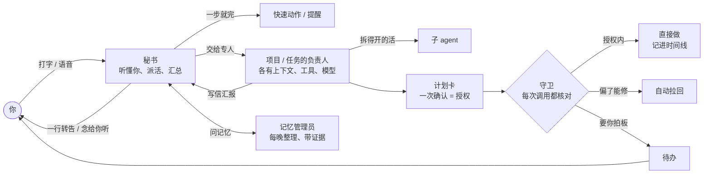
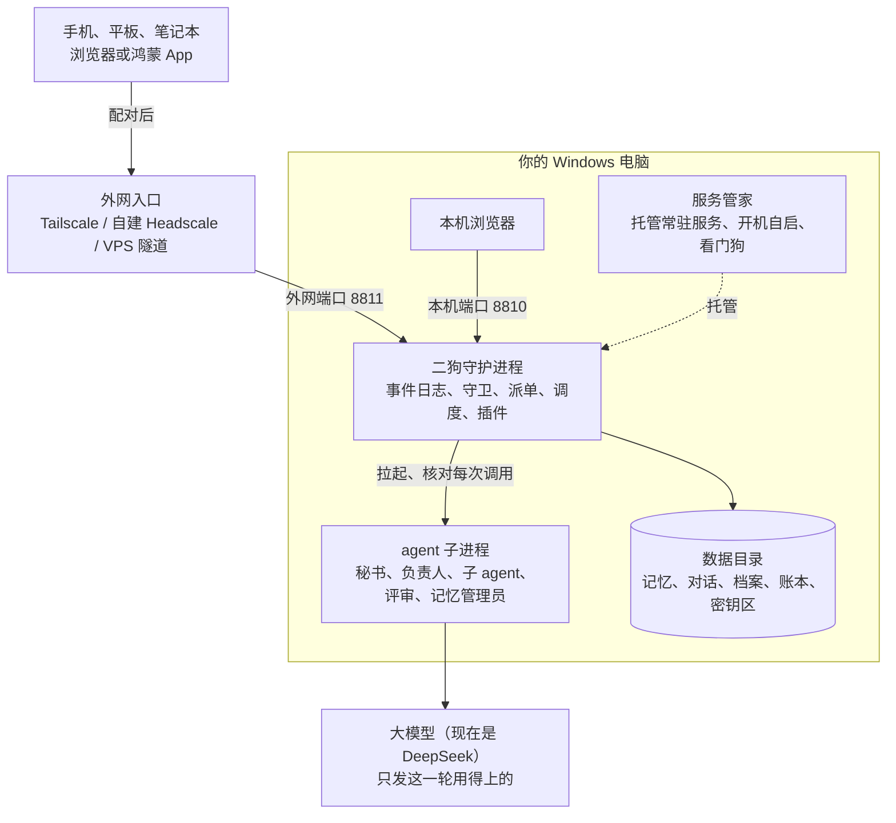

**中文** | [English](README.en.md)

# 系统架构

给想读代码、改代码、写插件的人：这一层讲二狗的架构和技术细节。只想用二狗的，看[用户指南](../user-guide/README.md)。

## 这一层有什么

| 文档 | 讲什么 |
|---|---|
| 这一篇 | 系统总览：一个请求怎么走、部署结构、仓库和模块、架构的每一部分、配置和数据目录、插件宿主、网页、多语言 |
| [开发](development.md) | 搭环境、从源码跑、常用命令、手机 App 的构建和调试、写代码的约定、测试、升级 pi、提交改动 |
| [插件开发手册](plugin-development.md) | 从一个最小的"笔记"插件讲到上线 |
| [角色与权限](../roles-and-permissions.md) | 每种 agent 能做什么、凭什么：能力表、每种 agent 拿到的工具、什么时候能发语音，以代码为准 |
| [记忆系统总览](memory-system.md) | 记忆系统的模块、接口和工作流，有测试核对 |
| [记忆引擎架构](memory-architecture.md) | 记忆引擎的数据模型和算法设计 |
| [记忆词汇对照](memory-vocabulary.md) | 推理图谱模板、推理库、代码三处叫法的对照 |
| [部署和外网访问](deployment.md) | 外网入口的技术细节：自建 Headscale、VPS 隧道 |
| [华为推送开通指南](huawei-agc-push-setup.md) | 鸿蒙推送要在华为 AGC 上做什么（还没在真机上验证） |
| [adr/](adr/) | 设计记录：为什么这么做 |
| [research/](research/README.md) | 做设计时的调研 |
| [design/styles/](design/styles/README.md) | 视觉风格的设计稿 |

**术语**以 [CONTEXT.md](../../CONTEXT.md) 为准（秘书、任务、项目、负责人、守卫、时间线……），代码、界面、文档用同一套词。**为什么这么做**记在 ADR 里，下文按编号引用。

## 一个请求怎么走



## 部署结构



## 代码组成

- **两个进程**：二狗守护进程（`packages/daemon`）和服务管家（`packages/supervisor`）。服务管家小而稳，负责开机自启、被杀后拉回、托管项目上线的服务；它的数据默认在 `%LOCALAPPDATA%\ergo\supervisor`，二狗的数据在 `%USERPROFILE%\.ergo`。
- **代码**：TypeScript（守护进程靠 Node 的类型剥离直接跑），npm workspaces；网页是 React 19 + Vite；鸿蒙外壳在 `frontend/harmony`。约 28 万行代码，8000 多条自动化测试，CI 只在 Windows、只跑 Node 22（Node 大版本跟着 pi 走，[ADR-0031](adr/0031-node-version-follows-pi.md)）。
- **agent 运行时**：pi 只出现在一层薄封装里（[ADR-0001](adr/0001-pi-coding-agent-sdk-as-runtime.md)），审批、任务、账本这些领域状态存在二狗自己的事件日志（SQLite）里。

Claude Code 的 Agent SDK 是 Anthropic 自己的许可，二狗只把它当可选依赖，不随安装包分发。Codex 不是依赖，用的是用户本机自己装的 `codex`（ADR-0046）。第三方依赖和字体的许可证清单随安装包提供：装好的目录里 `THIRD_PARTY_NOTICES.txt` 是全文，`third-party-licenses.json` 是清单。


## 和 OpenClaw 的取舍

OpenClaw 是通用的、多渠道的个人 agent，覆盖面比二狗大得多，也装在你自己的机器上。二狗只服务一个人，在下面这几处做了不同的取舍（OpenClaw 一栏依据[调研 03](research/03-openclaw-and-pi.md)，截至 2026-10-06）。

| | OpenClaw | 二狗 |
|---|---|---|
| 谁在干活 | 主 agent 可以按提示词把活委派给专家子 agent；官方说委派是提示词引导，不是调度器 | 秘书只负责听懂你、派活、汇总，不动手；每个任务、每个项目有固定的负责人，各有上下文、工具包和模型；派单器是运行时的一部分 |
| 项目 | 没有"项目"这个一等实体 | 项目有档案、工作目录、固定负责人和立项书；范围审视检查有没有越界；首版做完由你拍板 |
| 权限 | 沙箱和执行审批默认都关，默认是完全访问 | 关注类别 × 六档处置、计划里的授权项、时序规则、三条硬底线；每次调用都有记录，并用大白话解释 |
| 长程任务 | heartbeat、cron | 阶段计划、独立评审验收、自动纠偏；改计划只停受影响的阶段；重启后接着做，不悄悄重做副作用 |
| 回看 | 聊天记录 | 时间线三层缩放，页边钉着要点标记 |
| 记忆 | 工程化的分层记忆（dreaming、混合检索），明确不做人物档案 | 原话都留在本机；每晚整理成带证据链、竞争解释的结论，推到动机和在意的东西；拿不准先问 |
| 平台 | 多平台 | 只支持 Windows |

## 仓库里有什么

### 包和目录

```
packages/
  protocol/    @ergo/protocol    守护进程和前端共用的协议：帧、频道事件、消息、卡片（TypeBox）；多语言运行时和语言文件
  daemon/      @ergo/daemon      守护进程：管家，拉起和管理 agent 子进程；事件存储、网关、守卫、任务、插件宿主
  web/         @ergo/web         网页：React 19 + Vite，手写 CSS；自带编的数据的原型
  memory/      @ergo/memory      记忆引擎：证据、知识图谱、推理图谱、混合检索、每晚整理、唯一写入口
  supervisor/  @ergo/supervisor  服务管家（命令 lsm）：单独的小进程，托管常驻服务、开机自启、看门狗、隧道
frontend/
  harmony/     鸿蒙 App：DevEco 工程，原生壳加载二狗的网页
  android/     安卓 App：Gradle 工程，原生壳加载二狗的网页
config/        配置样例（ergo.example.json、watch-categories.example.json、mcp.example.json）
deploy/lsm/    服务管家条目的样例（ergo-daemon、ergo-tunnel、ergo-asr）
docs/          user-guide/ 给普通用户；architecture/ 就是这一层（ADR、记忆系统、调研、设计稿）
```

npm workspaces 管这几个包。`frontend/` 不是 workspace（鸿蒙工程的 ArkTS 不归根目录的 tsc、oxlint、vitest 管，由 hvigor 编译时查）。

### 守护进程的模块（`packages/daemon/src/`）

| 目录 / 文件 | 是什么 |
|---|---|
| `main.ts`、`preflight.ts`、`stop.ts` | 入口：先做起动前检查（只支持 Windows、Node 版本），再加载组合根；`stop.ts` 是服务管家的 stop 钩子（核对 pid 文件才结束进程） |
| `daemon.ts` | **组合根**：读配置、开事件存储、建 Job 对象、立起各模块、按插件清单装插件、开两个端口；停止和启动失败共用一份倒着收拾的清单 |
| `config/` | 配置（只读）、数据目录各区的路径（`dataDirLayout()`，模块只从这里取路径）、密钥从哪个环境变量取 |
| `storage/` | SQLite 的薄接口：所有数据库访问都经它，换驱动只改这一处 |
| `events/` | **事件存储**：事件日志是唯一真相（`ergo.db`，WAL），派生视图从它投影 |
| `gateway/`、`pairing/` | 网关的两个端口、HTTP 接口、WebSocket；设备配对和凭证 |
| `guard/`、`guard-runtime/`、`approvals/`、`hand-over/` | **守卫**：纯函数判定（`judgeToolCall`）；接入运行时（现取环境事实、审批卡、效果日志、"交给我做"） |
| `agent-manager/`、`agent-host/`、`runtime/`、`process/` | 拉起 agent 子进程（装配参数、注入环境、放进 Job、资源限制）；三种负责人的宿主；运行时封装层（pi 只在 `runtime/agent-child/` 里）；进程工具 |
| `secretary/`、`maintainers/`、`conversation/` | 秘书（常驻子进程）、负责人的唤起、会话（派生视图、输入队列、回退和分支） |
| `tasks/`、`sub-agents/`、`scheduled-jobs/`、`event-sources/`、`recovery/` | 任务（计划、执行、阶段验收、偏离和阈值、流程）、子 agent 并行、定时和事件触发、被杀后的恢复 |
| `projects/`、`work-orders/`、`operations/`、`project-ops/`、`project-services/`、`scope-review/` | **项目系统**：档案和规范、工单派单、运营方案和运营接口、项目服务（经服务管家托管）、范围审视。外面只能引 `projects/api.ts` |
| `cards/`、`inbox/`、`board/`、`activity/`、`ledger/` | 卡片类型和按钮闭环、待我处理、秘书眼里的看板、活动状态（新的要用户处理的卡往 `activity/card-waits.ts` 的 `CARD_WAITS` 加一行：说明带上卡片编号，网页标题上的"等你……"就能点，见 `web/src/state/activity-jump.ts`；建卡时同时放进待我处理）、token 账本 |
| `plugins/`、`deletion/`、`data-sources/`、`components/`、`doctor/` | 插件宿主、删除参与方登记表、数据源和共用导入文件夹、按需下载的组件和下载器、体检（八项、内核登记的几项：主对话、模型近况（agent 管家的环形记录 `agent-manager/turn-log.ts`）、对话长度、托管的服务（服务管家的快照）、插件、网页文件；内核登记的另外十项——备份、定时触发的任务、内部作业的结局、卡住的 agent、日志大小、配置文件、缺的 skill 和三项提示，在 `doctor/housekeeping.ts`；插件登记的体检项、二狗替插件生成的几项、秘书的只读 `check_health`；深度体检 `doctor/deep.ts`：cost 是 deep 的项——默认模型真发一句、ergo.db 只读完整性检查、数据源的 `probe`、Claude Code / Codex 的登录——点了才跑，结果留在内存里，GET / POST `/api/doctor/deep`；后台盯着 `doctor/watch.ts`：每 5 分钟只跑备份、每晚整理、语音合成和识别、模型近况、对话长度这几项，连着不正常放进待办（`doctor_problem`），修好了自动收，"不再提醒"存配置区 `doctor-watch.json`；服务管家的心跳、`/healthz` 不看它） |
| `materials/`、`memory/`、`quick-actions/` | 素材库（原话副本、关键词和向量索引）、记忆插件（每晚整理、记忆管理员、访谈）、快速动作 |
| `reminders/`、`calendar/`、`voice/`、`browsing/`、`claude-code/`、`codex/`、`google/`、`looki/`、`phone/`、`map/` | 各个插件（每个目录里有 `plugin.ts`，别的模块只从它的 `api.ts` 取东西） |
| `scheduler/`、`workday/`、`backup/` | 调度器和可注入的时钟、内部作业；个人工作日历和节假日；备份、校验、恢复 |
| `web/`、`typed-shell/`、`skills/`、`mcp/`、`toolkit/`、`apps/` | 联网工具、带类型的 bash 工具（git、构建……）、skill 库（`skills/change.ts`：负责人提交 skill 的卡，路子和 `mcp/change.ts` 一样，校验和导入共用 `library.ts`）、MCP 登记（用户写的和[项目自动转的](#项目自动转的-mcp)）、工具包、转发本机服务的页面 |
| `prompts/`、`agent-settings/`、`model-settings/`、`assistant/`、`agent-roles/`、`i18n/` | 系统提示（md 文件，用户能改）、每个 agent 的 ⚙、模型设置、助理的名字、角色、多语言 |
| `lsm/` | 接入服务管家的 link 协议（报健康和忙不忙、优雅停机、名下的服务、管理指令）；秘书指挥服务管家的六个宿主工具（`secretary-tools.ts`，经 agent 贡献只给秘书：看列表和日志、开关服务直接做（没有正常停止 / 重启办法的自动改成强制的），强制停止、移出自启、场景停止、撤销、孤儿、外网入口和重启自己落在秘书特别敏感的类别里出审批卡；先按列表里的命脉本地拒一遍，服务管家按身份最后裁决）；`restart-hold.ts`：重启自己排上后、秘书这一轮说完之前也报忙；`services-page.ts`：设置 · 服务一页（`GET /api/managed-services`、`POST /api/managed-services/<id>`、`GET /api/managed-services/<id>/logs`，同一条管理指令，只认"和二狗有关的"——判定在协议包 `ergo-related.ts`，体检共用；语音端口从配置算在 `voice-ports.ts`；日志的截短、擦密钥和秘书的 `lsm_logs` 共用 `log-lines.ts`） |
| `deploy/`、`deploy-nginx.ts`、`restore.ts`、`run-backup.ts`、`download-model.ts` | 命令行工具：生成和部署 nginx 站点、恢复、备份、下载模型 |

网页的目录见 [页面从哪里来](#页面从哪里来原型和在线演示页)。

## 架构

### 两个进程

| | 守护进程（`packages/daemon`） | 服务管家（`packages/supervisor`） |
|---|---|---|
| 做什么 | 二狗本身 | 托管常驻服务：拉起、探活、被杀后拉回、日志、开机自启名单、公网隧道、tailnet 入口 |
| 生命周期 | 最常重启（每次合并、改配置） | 要小、稳、少重启 |
| 数据 | `~/.ergo`（`ERGO_DATA_DIR`） | `%LOCALAPPDATA%\ergo\supervisor`（`--data-dir` / `LSM_DATA_DIR`） |

服务管家拉服务时只传白名单环境变量，不传自己的 `--data-dir`，也没有接口直接报这个目录。守护进程的体检要读它的注册表，所以服务管家不在默认位置时，二狗的登记要声明 `LSM_DATA_DIR`：`ergo start` 写的登记自带，手写的见 `deploy/lsm/ergo-daemon.example.yaml`。

两边只走**接入协议**（`packages/supervisor/docs/link-protocol.md`），代码上互不 import。守护进程开好端口后出站连上服务管家（四个 `LSM_*` 环境变量缺一个就静默不接入，测试、手动起的都这样），握手报能力，心跳报健康（`ok` / `degraded`）和**忙不忙**（有任务在执行、或任何 agent 有正在执行的有副作用的调用），"等空闲再停"据此等它做完；项目上线的服务经协议登记成守护进程**名下的服务**，由服务管家启动和托管。二狗自己不启动任何常驻服务。

### 守护进程是管家，agent 是子进程

- 守护进程自己不跑模型。秘书、负责人、子 agent、评审、记忆管理员各是一个**子进程**（[ADR-0002](adr/0002-one-process-per-agent.md)），由 agent 管家拉起、放进 Windows Job 对象（守护进程退出时一起清掉），环境变量只给白名单加显式注入的，模型 key 经 stdin 交给子进程、不走环境变量。
- 子进程里跑 [pi](https://github.com/earendil-works/pi)（[ADR-0001](adr/0001-pi-coding-agent-sdk-as-runtime.md)）。**pi 只出现在 `runtime/agent-child/` 这一层**，守护进程和子进程之间走二狗自己的宿主协议（[ADR-0004](adr/0004-agent-host-protocol-sdk-over-stdio.md)）；`test/pi-boundary.test.ts` 守着这条边界。Claude Code 是另一种运行时，同样经宿主协议接进来。
- 每个项目、每个任务有固定的负责人（代码里叫 maintainer），各有自己的上下文、工具包和模型（[ADR-0003](adr/0003-no-roles-toolkit-per-project.md)）。

### 事件日志是唯一真相

- 审批、任务、计划、卡片、待我处理、账本这些领域状态都是**事件**，追加进 `db/ergo.db`（SQLite，WAL）；界面和模块读的是从事件投影出来的**派生视图**。pi 的会话文件只是 agent 的上下文，不是领域状态。
- 前端经 WebSocket 订阅**频道**（秘书会话、看板、待我处理、某个负责人的会话……），收到的是事件流；前端状态层是把事件流归并成界面状态的纯函数（`packages/web/src/state/`）。
- **彻底删除**改写事件而不是删行：每种可能被删到的事件类型都要登记改写函数，没登记的整个拒删（[ADR-0008](adr/0008-purge-scope-and-session-rewrite.md)）。
- 守护进程按"随时可能被杀"设计：重新起来后正在做的事按规则恢复，有副作用又说不清做没做完的操作转给用户确认，不悄悄重做（`recovery/`）。

### 网关：两个端口

两个端口都只监听 `127.0.0.1`：

- **本机端口**（默认 8810）自动信任。每个 HTTP 请求和 WebSocket 握手都校验 Host 是 `127.0.0.1:<端口>` 或 `localhost:<端口>`（防 DNS 重绑定），带了 Origin 就必须是这两个源之一（防跨站请求）；`Origin: null` 一律不认。
- **外网端口**（默认 8811）是隧道、Tailscale 这类入口的唯一目标：不看来源 IP、不看 Host，只看设备凭证（cookie `__Host-ergo-device`）。没有有效凭证只放行三样：页面本身（显示配对页）、`/api/access`、配对接口；别的一律 401。以后加的接口自动在这道门后面。
- `/healthz`：秘书在不在运行、网页构建了没有、启用着的插件装没装上（没装上算 `degraded`、照旧回 200）。
- `/fonts/`：视觉风格的字体（外网端口上同样要凭证）。网页运行时不请求任何外部地址——唯一的破例是地图页在国内用的高德 JS API（[ADR-0051](adr/0051-map-amap-js-and-osm-tiles.md)）。
- `/tiles/osm/<z>/<x>/<y>`、`/_AMapService/…`：地图插件的 OpenStreetMap 瓦片转发（守护进程带二狗的 User-Agent 去取、按缓存头存进缓存区）和高德 JS API 的安全密钥代理（拼上密钥区里的安全密钥再转给高德，安全密钥不进页面）；插件没启用时回"地图插件没启用"，外网端口上同样要凭证（`gateway/map-routes.ts`）。

### 设备配对

- 新设备在外网端口上 `POST /api/pairing` → 6 位数字短码、8 位十六进制短指纹（由配对 cookie 推出）→ 同一事务里写请求事件、配对请求卡、待我处理事项 → 用户在本机核对后批准（卡片按钮闭环，先到先得）→ 新设备 5 分钟内来领 → 生成 256 位随机凭证（只存哈希），原值只出现在给新设备的那一个响应里。
- 同一来源 10 分钟内最多 5 个请求；待批的 5 分钟后过期；领到凭证后 24 小时内没用过一次就作废（防止半路丢了的"幽灵设备"）；用过以后有效期 365 天，每次用往后推。
- 像网络上的自动访问的（无界面浏览器、命令行工具、爬虫的 User-Agent），卡片上会提示，但规则不变。
- 吊销后网关立刻关掉这台设备开着的 WebSocket。
- 页面开在手机 App 里时，连上就发 `report_app_version`（重连再发），记在这台设备上（`appVersion`、`appPlatform`）。低于协议包的 `MIN_APP_VERSION` 放一条待办 `app_outdated` 并提醒，够新了、设备吊销了自动归档；页面顶上的提示条（`ui/app-upgrade.tsx`）自己看本机版本和这个常量（ADR-0047）。

### 守卫

`packages/daemon/src/guard/` 的 `judgeToolCall(input)` 是一个**纯函数**：不读文件、不跑命令、不看时钟、不读环境变量（`test/guard/judge-basics.test.ts` 扫源码检查），同样的输入永远得到同样的判定。调用方（`guard-runtime/`）现取环境事实（文件在不在、真实路径、git 状态……）交给它。

- **输入**：这次调用、是哪个 agent（工作目录、工具包）、数据目录各区和受保护区域、任务的计划（授权项、本任务的关注类别、各阶段的时序规则）、效果日志（只有执行成功的调用）、全局的关注类别设置、环境事实。
- **判定**：命中哪些关注类别、按六档处置取最严（直接做只记录 / 做完告诉我 / 计划里列了才做 / 先问我 / 交给我做 / 永不）、在不在授权内、违反了哪些时序规则；每条依据都用大白话写清，存进工具调用详情。
- **三条硬底线**谁说了都不放：不写二狗自己的配置区、数据库区和程序目录；不读密钥区；确定要把密钥发出去的不做。
- **不让 agent 用 bash 把二狗自己停掉**：停二狗、杀服务管家只走服务管家工具。服务管家的注册表、运行状态（`state.json`、tailnet 的路由表）是受保护区域，它的 `.secrets` 是密钥区；跑它的命令行（`lsm`、程序目录 `packages/supervisor/bin` 里的脚本，别处拷的 `lsm.mjs` 也算）、ergo 的停止、重启、升级、回退、卸载和 `svc`、往管理器端口（判定前现读 `manager.yaml`）发不是查询的请求，一律硬拒绝（`supervisor`），查询照旧。杀进程（`taskkill`、`kill`、`pkill`、`Stop-Process`、`wmic process`……）拆成伪工具 `kill_process`：判定前现取受保护的进程（守护进程自己、`state.json` 里服务管家和命脉服务的进程号、它们的上级进程，`lsm/guard-facts.ts`），杀到它们的（按进程号、按名字杀同名的、带 `/T` 杀它们的上级）永不；取不全、看不出杀谁的接近底线、对话审批关着也问；别的先问。看不透的命令里写着杀进程、管理器端口、服务管家的命令行、ergo 的停止重启升级、它的计划任务的，也接近底线先问。同一个 Windows 账户下守卫只能尽力（拼出来的地址、脚本文件里的请求认不出），被杀掉的守护进程由服务管家的自动拉起兜底。
- 判断不了的（缺环境事实、参数没法规范化……）一律先问。
- **授权的文件夹**（`GuardInput.authorizedFolders`，调用方每次判定现读）：读里面的文件不算越出项目目录，计划比对也不算越界。只放开读，按真实路径比，取不到真实路径的不算；数据目录、受保护区域、密钥文件、跑脚本、git、`cd`、bash 里写着 `..` 的路径都不算（[ADR-0041](adr/0041-authorized-folders-read-only-in-guard.md)）。
- **目录授权**（`GuardInput.folderGrants`，调用方每次判定现读发起调用的这个 agent 的那一份：秘书、每个项目、每个任务各一份，子 agent 和评审没有）：登记目录里做登记了的那种操作（读、写、删分开）不算越出项目目录，文件工具写也不再硬拒绝；没登记的照旧（对话里先问、任务里找计划的授权项）。按真实路径比，删除另要写的路径本身也在登记目录里；只认文件工具和 bash 拆出来看得清的读写删；受保护区域、数据目录照旧，登记目录里名字像密钥的文件读写一律硬拒绝（`secret_file`）；过期按 `now` 算。放行的每一处记使用记录（`folder_grant_used`），对话里因为越出项目目录要问的审批卡上可以"以后都允许"（[ADR-0049](adr/0049-per-agent-folder-grants.md)）。表在配置区 `folder-grants.json`（`folders/folder-grants.ts`），只由运行时写。
- **联网开关关着时只连本机的不算联网**：curl 只发往 `127.0.0.1`、`localhost`、`::1`（发往二狗自己端口的不算本机）；脚本用到 `socket`、`urllib`、`http.server`、`fetch` 这些能连本机的库，里面写的地址又都是本机（`guard-runtime/script-scan.ts` 的 `localOnly`）。bash 起的进程 `NO_PROXY` 写着本机（`process/child-env.ts`）。地址从参数、环境变量来的看不出来，这一层本来就是尽力而为。
- 默认值按"功能先跑通、安全后接"（[ADR-0026](adr/0026-features-first-security-later.md)），新装时两个开关不勾（见[关注类别](../user-guide/settings.md#关注类别)）。

#### 时序规则

"删除之前必须已备份""push 之前必须跑过测试""读过密钥之后不许往外送"这类规则，格式和 planguard 兼容、原样用它的引擎（[ADR-0005](adr/0005-temporal-rules-planguard-engine.md)）：

- 四种形态：`before`（B 之前必须做过 A）、`not_before`（B 之前不能做过 A）、`check`（当下必须满足某条件）、不写 `require`（一律禁止）。
- "之前"只看效果日志（被拦下、执行失败的不算）；任务里看同一个任务的，不属于任务的看同一个 agent、同一段会话的。一条 bash 拆出的几条调用按真正可能的先后判（`a && b` 里 a 算 b 之前）。
- 违反了：`pull_back` 按规则退回（agent 能自己补救的，不问用户、计入拉回次数）、`block` 永不、`confirm` 或不写是先问我。
- 规则能用的东西（`$current`、`$prior`、`$facts`、`$agent`、`$task`、`$now`，扩展的 `path_within`）写在 `guard/rule-validation.ts` 开头，字段表和构造它们的代码放在一起（`rule-steps.ts`、`rule-env.ts`）。规则写错了存计划时就会被拒。

### 删除参与方登记表

删项目、删任务、移除插件时连数据删（还有个人档案删一个人）走同一张表（`deletion/participants.ts`）。删除代码只管先停、复查、提交、删文件；改写哪些事件、换成什么由**登记的参与方**定：

- `deletionKind<S>(id)` 是一种删除（`PROJECT_DELETION`、`TASK_DELETION`、`PLUGIN_DATA_DELETION`……），带着这次删的是什么；`participants.register(kind, { owner, join(subject, plan) })` 登记，返回撤销函数。
- 几步按顺序：`scope`（定范围）→ `claim`（认领：整条换成删除标记、换成给出的负载、按改写函数字段级改写；整张卡换成标记或改写卡片；同一事务追加的事件；提交之后做的）→ `follow`（要看别人认领了哪些卡的）→ 登记表收卡片、做字段级改写（**没登记改写函数的事件类型在这里抛错，整个删除被拒**）→ `settle`（要看整张改写单的）。
- **新加一种属于项目 / 任务的事件**：在拥有它的模块里登记一个参与方认领它，再登记它的改写函数，删除代码不用改。**新模块要一种新的删除**：在自己的模块里 `deletionKind` 一个，登记自己的参与方，删的时候 `participants.plan(kind, subject, context)`。`test/deletion/participants.test.ts` 有示范。

### 转发本机服务的页面

项目的服务跑在 `127.0.0.1:<端口>` 上，手机直接打不开。守护进程按路径转发：`/apps/<应用名>/…` → `http://127.0.0.1:<端口>/…`（`apps/`），网页的内置浏览器打开的就是这个地址。

- **只转发登记过的**（`AppRegistry.register({ name, target, title?, prefix? })`），不是开放代理：`target` 只认本机地址、只到端口。项目服务上线时由内核登记，插件经 `ctx.apps.register`。
- 鉴权和二狗的页面一样：本机端口照旧信任，外网端口要设备凭证；二狗自己的 cookie（`__Host-ergo-*`）不转给服务，服务也写不了二狗的 cookie。转发时改写 Host、Origin、`Location`、`Set-Cookie` 的 Path，去掉挡嵌入的头；流式响应和 WebSocket 原样接上。
- **前缀约定**（给写项目服务的人）：浏览器眼里服务在 `/apps/<应用名>/` 下面。默认（`prefix: "strip"`）转发时去掉前缀，服务当自己在根上，页面里**只用相对地址**（`fetch("api/items")`，不写 `/api/items`——以 `/` 开头的会跑到二狗的根上）；要拼绝对地址的读环境变量 `ERGO_BASE_PATH` 或请求头 `X-Forwarded-Prefix`。框架自己有 base 路径的（Vite 的 `base`、Next 的 `basePath`……）把它设成 `ERGO_BASE_PATH`、登记时写 `prefix: "keep"`。不要写死本机地址；服务的 cookie 别用 `__Host-` 前缀。`npm run check:app-prefix` 抓服务首页、列出不在前缀下的地址。
- **同源转发的安全取舍（已知，没做）**：服务的页面跑在二狗的源上，它的脚本能带着用户的设备凭证调二狗的接口（凭证是 HttpOnly 的，读不到原值，但能用）。按"功能先跑通、安全后接"，现在只转发负责人建的、用户确认上线的服务；以后改成独立的源（单独的端口或子域名、各自配对或短期转发令牌）。见 [SECURITY.md](../../SECURITY.md)。

### 记忆系统

- **素材**：内核的素材库从事件日志采用户的原话（和语音转写、回避信号……），存原文副本、建关键词和向量索引（`db/materials.db`）。agent 的语音不算：秘书转述负责人进展的那条语音（`AgentVoiceRecord.parts`）只在语音对象上，负责人那段算它说的，不进素材，也不是秘书的结论。
- **回的是什么**（`memory/reply-context.ts`）：会话里本人接着对方的话说的一句，每晚整理之前由记忆管理员批量判（整理同一个模型，每晚最多 240 句），接着回的挂上前文意思的总结、新话题不挂；结果是素材频道上的 `material_replies` 事件，素材库照它标在素材上（同"别推断"，不进原文副本，`materials.db` 重建照样回来）；读成证据时原文后面接一行"［前文，不是用户说的］…"，只用来读懂这句（[ADR-0050](adr/0050-material-reply-context.md)）。
- **记忆插件**（`memory/plugin.ts`）：每天 03:00 的内部作业叫醒**记忆管理员**（一个按需拉起的 agent），它用 `@ergo/memory` 的引擎把新素材读成证据（读之前先让开着导入、能由电脑拉的数据源各同步一次、等导完，每个最多等 3 分钟：`memory/nightly-sync.ts`）、整理进推理库 `memory/subtext/rg.db`（结论、证据链、竞争解释、预测、问题箱），一次整理最多调 `memory.maxModelCalls` 次模型；所有写入都经唯一写入口（[ADR-0030](adr/0030-memory-keeper-maintains-reasoning-graph-through-write-gate.md)）。
- 秘书每轮醒来带一份简报，用户的话有相关记忆时自动带一份记忆简报，再按需"问记忆"；深聊和改动转给记忆管理员。
- 配置里 `memory.*` 的几项开关（比如按场景标签的情绪、财务、关系、位置）现在有的只是占位：写进来不改变行为，默认值只在 `config/config.ts`。
- 详细设计：[记忆系统总览](memory-system.md)、[记忆引擎架构](memory-architecture.md)、[词汇对照](memory-vocabulary.md)、[ADR-0032](adr/0032-memory-reasoning-rules.md)。

#### 降级、验收和回滚

- **降级**（四条都有测试）：**向量模型不在**——整理照常，素材检索退回关键词并在结果里说明；**整理模型不可用**（没配 key、请求失败）——这一夜记"跳过"（没 key，不建库、不花钱）或"失败"（原因写进整理记录、待我处理一条），素材一条不丢，下一夜接着做；**`rg.db` 打不开或版本对不上**——不自动迁移，记一条"要重建推理库"，素材检索照常，简报为空，"问记忆"回"记忆还没准备好"；**整理跑一半崩**——已经写进库的证据和事实不丢，下一夜按增量接着做。
- **开关**：`memory.enabled: false` 只不跑整理、不建库（素材检索和简报照常），和停用记忆插件是两回事；`memory.extractor` 写 `rule` 用规则版抽事实（不调模型，只当兜底）；`memory.nightlyTimeoutMinutes` 是每一夜最多跑几分钟（默认 60）。
- **只读验收**：`npm run memory:acceptance [-- --data-dir <目录>]`：`rg.db` 能不能打开、版本对不对；最近一次整理记录；现算一份简报；在素材库的快照副本上跑一次检索。不改数据、不打印素材原文，有一项不过退出码 1。
- **离线整理** `npm run memory:build`（`--rebuild` 从头来、`--max-model-calls <n>`）和**全量重判** `npm run memory:rejudge`（规则改了以后按新规则把现有结论全过一遍；`--max-yuan` 封顶，跑前存快照，`--undo <报告>` 换回）：都要先停守护进程，只写 `memory/subtext/rg.db`（在记忆插件自己的数据目录里，`dataDirLayout().rgDb`）。
- **回滚**：只想停掉整理——设置 · 插件里停用"记忆"（`rg.db` 保留、素材库不动）；想按素材库重建推理库——停守护进程 → 删数据目录里的 `memory/subtext/rg.db*`（素材库和原文副本不动，`rg.db` 里没有原文）→ 起守护进程 → 点"整理一次记忆"或等 03:00（首次建库按每晚预算可能要几夜）→ `npm run memory:acceptance` 确认。

#### 记忆插件接口（会意 / Subtext）

记忆系统是可替换的**一个插件**，同一时间只跑一个。接口在 `packages/protocol/src/memory-provider.ts`（只有类型），宿主在 `packages/daemon/src/memory/provider/host.ts`：

- **核心方法**（每家记忆系统都得有）：`info()`、`start()`/`stop()`、`observe()`（喂一条原始素材）、`remember()`（用户明说"帮我记一句"时按原话存；可能带着文件 `file` 和来源 `origin`：用户在长按的网页元素上说记下来时，这时 `text` 是秘书写的描述。存下了文件就在回的条目上写 `extra.fileStored = true`，不写时宿主如实告诉用户只记了文字）、`search()`（回统一的 `MemoryItem`，**必须带出处**）、`forget()`（按条目/来源/时间范围/全删，隐私删除靠它）、`health()`。
- **可选能力**（在 `capabilities` 里声明，宿主按声明决定界面和行为）：`brief`（每轮简报，不声明就由宿主用 `search` 拼一个默认的）、`consolidate`（自己的整理）、`settings`（设置项声明，宿主统一渲染）、`tabs`（记忆页有哪些页签）、`tools`（额外工具）、`subject`/`timeline`/`graph`（画像、时间线、关系图）。
- **宿主的规矩**：同时只跑一个（`activate` 先停旧的再起新的）；每个插件的数据目录是 `<数据目录>/memory/<id>/`，内核只按整个目录做备份、恢复、迁移，不读里面的格式；插件不许自己连模型、不许起端口，要模型和向量都经宿主给的 `llm()`/`embed()`；`api` 版本对不上直接不启用。
- **仓库自带的是「会意」（id `subtext`）**：结论、证据链、竞争解释、预测账本这一套（上文的记忆系统）。它的实现包在 `packages/daemon/src/memory/provider/subtext.ts`，具体引擎仍是 `@ergo/memory`，库在它自己的数据目录 `<数据目录>/memory/subtext/rg.db`。它在界面上称「记忆系统 · 会意 v1.0」/「Memory System · Subtext v1.0」、标着**实验性**（`packages/web/src/plugins/memory/system.ts` 的 `pages.memory.*`；导航那一项仍写"记忆"），新接一套记忆系统时这几处文案跟着换。
- **想接别的记忆系统**：实现 `MemoryProvider`、在注册表登记一个工厂（`info` 里写 `api`/`id`/`name`/`capabilities`/`requirements`），配置 `memory.provider` 写它的 id。`packages/daemon/test/memory/provider/` 下的两个假插件就是最小示例（只在测试里，用来验证"换一套很容易"）。

### 数据目录和配置

- 模块只从 `config/data-dir.ts` 的 `dataDirLayout()` 取路径，不自己拼。db 区里两个库（`ergo.db`、`materials.db`）随每晚的快照走（`VACUUM INTO` 出一致副本），推理库 `memory/subtext/rg.db` 在插件自己的数据目录里、跟着整个数据目录进快照；`secrets`、`tmp`、`backups`、`models`、`cache`、`components`、`imports` 不进备份，任何一层的 `.ergo-tmp`（agent 的 bash 临时目录，比如 `outputs/<任务>/.ergo-tmp/`）也不进。做快照时被别的程序占着读不了的文件（EBUSY / EPERM / EACCES）短间隔重试几次，还不行就跳过、记进这次备份的记录（`skipped`：总数和前 20 个），算"成功但有跳过"；数据库区、配置区和别处的数据库文件（`*.db` 及其 `-wal` 这类）是关键文件，读不了整份失败（`backup/snapshot.ts`）。
- 配置只读，缺的项取默认值；**每个阈值的默认值只在它自己的模块里定一次**（`tasks/thresholds.ts`、`reminders/thresholds.ts`、`scheduled-jobs/thresholds.ts`、`event-sources/thresholds.ts`……），配置里只写要改的几项。
- 写文件一律先写临时文件再改名，走 `util/atomic-file.ts`（[写代码的约定](development.md#写代码的约定)）。

#### 数据目录的各区

数据目录默认是 `%USERPROFILE%\.ergo`（环境变量 `ERGO_DATA_DIR` 可以换），各区各有归宿：

| 目录 | 放什么 |
|---|---|
| `config\` | 配置：`ergo.json`、模型设置、关注类别、语言、系统提示、MCP 登记、工作日历 |
| `db\` | 事件日志 `ergo.db`（唯一真相）、素材库 `materials.db` |
| `memory\subtext\` | 会意（记忆插件）自己的数据：推理库 `rg.db` |
| `secrets\` | 密钥（任何 agent 都读不到；网页里填的 key 写在这里；服务管家启动时读出来交给守护进程） |
| `materials\` | 原话副本、媒体、附件 |
| `sessions\`、`projects\` | agent 的会话、项目的档案和工作目录 |
| `models\`、`components\` | 向量模型、按需下载的组件（不进备份，能重新下） |
| `locales\` | 你自己放的语言文件（[用户自己加一种语言](#用户自己加一种语言)） |
| `backups\` | 每晚的快照 |
| `logs\`、`tmp\`、`cache\` | 日志、临时文件、缓存 |

**仓库里只放框架**：记忆、对话、档案、密钥这些个人数据永远不进仓库。

#### 配置文件

配置是可选的，不写就全用默认值。要改哪项，把仓库里的 `config\ergo.example.json` 复制成 `%USERPROFILE%\.ergo\config\ergo.json`，只留要改的项（带 `<…>` 的是占位符，用到就换成真值，用不到就删掉）。改完重启守护进程生效（设置页里能改的项改了马上生效）。常用的几项：

| 项 | 管什么 | 默认 |
|---|---|---|
| `ports.local` / `ports.external` | 本机端口、外网端口（都只听 127.0.0.1） | 8810 / 8811 |
| `guard.conversationApprovals` | 对话里有风险的事先问我（`"on"` / `"off"`） | `"off"` |
| `tasks.maxRunning` | 最多几个任务同时执行 | 3 |
| `tasks.thresholds` | 拉回几次停下、多久没进展算停滞、预算超几倍停下…… | 见样例 |
| `agents.maxLive` | 同时存活的 agent 子进程上限 | 8 |
| `approvals.waitMinutes` | "先问我"时一次调用最多等你几分钟 | 5 |
| `voice.recognizer.mode` | 语音识别怎么接：`spawn`（二狗拉起 Python）、`lsm`（服务管家托管的识别服务）、`audiocpp`（audio.cpp 服务上 id 为 `asr` 的模型）。组件页装好语音识别模型时自动写，删掉时撤掉 | `spawn` |
| `voice.recognizer.python` | 装了 faster-whisper 的 `python.exe`（只有 `spawn` 用） | PATH 上的 `python` |
| `voice.speech.url` / `voice.speech.model` | 语音合成服务的地址和模型 | `http://127.0.0.1:8090` |
| `web.browserPath` | 联网用的 Chrome / Edge，不写就自动找 | — |
| `backup.time` / `backup.syncDir` / `backup.schedule` | 每晚备份的时刻、另存一份的同步目录、谁来定时（**设置 · 备份**里能改，马上生效） | 03:30 / 不另存 / `"internal"` |
| `memory.maxModelCalls` / `memory.enabled` | 每晚整理最多调几次模型、这台机器跑不跑整理 | 200 / `true` |
| `media.maxUploadBytes` | 单个上传文件的上限 | 200 MB |
| `timeZone` | 发给模型的时间标记按哪个时区（一般不写） | 本机时区 |
| `plugins.disabled` | 停用的插件（设置 · 插件里点的会写在这里） | 空 |
| `publicAccess` | VPS 公网入口（只有部署命令读，见[部署和外网访问](deployment.md#方式三vps--ssh-反向隧道--nginx公网)） | — |
| `voice.recognizer.language` | 语音识别的语言（Fun-ASR Nano 只认中文、英文、日文和自动） | `zh` |
| `toolCallDetails.retentionDays` / `toolCallDetails.maxSizeGB` | 工具调用完整内容留多久、最多占多大 | 90 / 2 |
| `materials.staleCardDays` | 秘书随口问的提问放多久以后不再算在等你 | 7 |
| `eventSources.serviceReportsPerMinute` / `eventSources.serviceDataMaxBytes` | 项目的服务每分钟最多报几次、单条数据多大 | 30 / 8 KB |

这两个开关新装时不勾：`guard.conversationApprovals`（有风险的事先问我）、`tasks.thresholds.budgetControl`（任务超预算就停下），守护进程第一次起来时写进配置，之后就是普通配置。

手改 `backup.syncDir` 要重启守护进程才生效（`{ "backup": { "syncDir": "D:\\NAS同步\\ergo-backup" } }`）。设置页改配置只动 `backup` 这几个键，别的内容和格式不变；文件被改坏了（不是合法的 JSON 等）会写明错在哪，不覆盖。

### 模型服务商

模型都在守护进程这台电脑上调，网页只放设置（怎么用见[设置 · 模型](../user-guide/settings.md#模型)）。设置存在数据目录的 `config\model-settings.json`（受保护区域，agent 写不进）。服务商是一张**登记表**（`model-settings/providers.ts` 的 `MODEL_PROVIDERS`），设置页、连通测试、key 放哪、没有设置文件时的默认值都照它来（为什么只做 DeepSeek + 一个自定义的 OpenAI 兼容服务商，见 [ADR-0037](adr/0037-configurable-model-provider.md)）。

| 字段 | 是什么 |
|---|---|
| `id` | pi 模型目录里的 provider id，也是「provider/模型 id」的前半（`modelKeyOf`）、`credentials` 里的键 |
| `label` | 设置页上的名字。要翻译的写成取值函数（`get label() { return t("…") }`），模块顶层不取句子 |
| `keyEnv` | 守护进程从哪个环境变量取 key（`config/secrets.ts` 的 `modelCredentials` 照它取，键名是 `id`） |
| `secretFile` | 服务管家（LSM）从数据目录哪个文件注入 key（相对数据目录）；网页上填的 key 也写进这个文件 |
| `defaultModelId` | 没有设置文件时的默认模型。自定义服务商是空串——模型 id 是用户填的，谁都不许拿它当默认 |

现在两项，**第一项是默认**：`deepseek`（`DEEPSEEK_API_KEY` / `secrets/deepseek-api-key.txt` / `deepseek-flash`）和 `custom`（`CUSTOM_MODEL_API_KEY` / `secrets/custom-model-api-key.txt` / 空串）。`DEFAULT_MODEL_SETTINGS` 就是 `MODEL_PROVIDERS[0]` + 思考档位 `high`；`providerOf(settings.provider) ?? MODEL_PROVIDERS[0]` 这个写法在 `model-settings.ts` 里到处都是，所以"第一项是默认"这条不能破坏。

**自定义服务商怎么在子进程里登记。** pi 的模型目录里没有 `custom`，不登记的话 `getModel("custom", 模型 id)` 一律是 `undefined`（会话起不来、连通测试回"模型目录里没有"）。登记只有一处：

- `runtime/agent-child/custom-provider.ts` 的 `customProviderConfig()` 构造那份 `ProviderConfig`（`name` 是 `custom`、`baseUrl` 去掉末尾斜杠、`api` 默认 `openai-completions`、`models` 只有一个：用户填的那个 id）。模型元数据用户填不了，按估算写死：`input: ["text"]`、`reasoning: false`、`contextWindow: 128_000`、`maxTokens: 8192`、`cost` 全 0（账本照实际用量记，消耗页上这种模型的成本是粗估）；上下文窗口和一次最多几个 token 这两个数只在 `custom-provider.ts` 里定义。
- `registerCustomProvider(modelRuntime, custom)` 只被四个子进程入口调用：`session.ts`（开会话）、`probe.ts`（模型探查：查目录、连通测试）、`recorded-generation.ts`、`translate.ts`（斜杠命令说明的翻译）。**必须在 `setRuntimeApiKey` 之前登记**——登记之后 `getModel` 才认得，key 由随后的 `setRuntimeApiKey` 放进 pi 的内存凭据；反过来会先报"没有这个 provider"。
- 登记多少份元数据、key 从哪来，都在这两个函数里；别处不要自己造 `ProviderConfig`，也不要绕开 `pi-boundary.test.ts` 去碰 `@earendil-works/*`。

**装配字段 `SessionAssembly.custom`**（`runtime/host-protocol.ts`）：`{ baseUrl, modelId, api? }`，不选自定义时这一项**没有**（不是空对象）。它不含 key——key 照旧只在 `credentials`（键名 `custom`）里，经 stdin 送进子进程。同一块还出现在另外三个请求里：`ModelProbeRequest` 的 `{ type: "catalog", custom? }` 和 `{ type: "ping", custom? }`、`TranslationRequest.custom`。守护进程这一侧只有一个来源：`ModelSettingsService.customProvider()`（选了 `custom` 才有，`settings.custom` 的副本），组合根把它交给 agent 管家（`customProvider: () => modelSettings.customProvider()`）。选自定义时**所有 agent 的模型 id 一律换成 `custom.modelId`**（思考档位照每一行），因为服务商只有一个模型——在 `effectiveChoiceOf` 里做，`default` 和各 agent 覆盖里写的模型 id 只是切回 DeepSeek 时接着用。

**两个接口。** 都是在设置那一套里，key 从不进请求体、也不回显：

| 接口 | 请求 | 回应 |
|---|---|---|
| `POST /api/model-settings/custom-models` | `{ baseUrl? }`（不给就用设置里存的那份） | `{ ok, models: [{ id, name?, ownedBy? }], error? }` |
| `POST /api/model-settings/test` | `{ modelId?, custom? }`（`custom` 给了就测这一份，设置页还没存也想试一下时用；不带按设置里存的） | `{ ok, modelId, firstTokenMs?, totalMs, error? }` |

- 列模型是守护进程自己发的一次 `GET {baseUrl}/models`，带 `Authorization: Bearer <key>`（key **只认自定义服务商那一份**：设置里还选着 DeepSeek 时也绝不把 DeepSeek 的 key 发给请求里那个地址），15 秒超时，最多收 `CUSTOM_MODELS_MAX`（500）个；认 `{ data: [{ id, name?, owned_by? }] }`，也认直接一个数组。**列不成不算出错**：照样回 200，`ok: false`、`error` 写原因，原因里的 key 内容去掉。
- 连通测试还是那条路——起一个一次性子进程，在它里面登记 provider、发一条极短的请求；同一时间只跑一个，重了回 409（"上一个还没测完"）。
- 设置文件里的 `custom` 块在 `provider` 不是 `custom` 时也可以留着（切回 DeepSeek 不清空它）；`POST /api/model-settings` 没带 `custom` 就沿用文件里原来那份。`checkModelCustom()`（`packages/protocol/src/model-settings.ts`）是唯一判合规的地方：地址要 http(s)、模型 id 不能空白、末尾斜杠去掉；选着 `custom` 却没有这一块按读文件失败处理。

**要加别家预设，改这里**：

1. `model-settings/providers.ts` 的 `MODEL_PROVIDERS` 加一行：`id`、`label`（要翻译就写 `t("modelSettings.provider.<id>")`，两份语言文件都加）、`keyEnv`、`secretFile`、`defaultModelId`。
2. `deploy/lsm/ergo-daemon.example.yaml` 的 `env:` 加一条 `{ name: <keyEnv>, from: file, path: <用户主目录>\.ergo\secrets\<文件>, optional: true }`，不然服务管家不注入 key（网页上填的 key 当次有效，重启守护进程以后就没了一样）。
3. pi 的模型目录里**有**这家就不用动子进程；**没有**的话照 `custom-provider.ts` 的样子在 `runtime/agent-child/` 里登记一份（`ProviderConfig` 只能在这一层构造）。
4. 设置页、key 那块、连通测试、列模型都照登记表来，不用改；`test/model-custom-provider.test.ts`（本机的假 OpenAI 兼容服务在 `test/helpers/fake-openai.ts`，不联网）可以照着加。

**这一层不管的**：记忆的每晚整理（`memory/nightly-job.ts` 用 `DEEPSEEK_API_KEY` 建 `DeepSeekChat`）、联网搜索和读网页（`web/deepseek.ts` 是 DeepSeek 专有接口）、token 单价表（`packages/protocol/src/token-prices.ts` 只有 DeepSeek）都只认 DeepSeek，换成自定义服务商也不跟着换——碰这几样时按登记表里 `deepseek` 的 `keyEnv` / `secretFile`（或 `config/secrets.ts` 的 `deepseekKey()`）取 key，别顺手改成"当前服务商"。

**自动压缩点（420）。** 对话到多少 token 自动压缩也存在这个文件里：默认值是设置的一项 `autoCompactAt`（没写是内置的 70 万，`POST /api/model-settings` 没带就沿用原来的），每个 agent 在 ⚙ 里单独设的记在 `agentAutoCompact`（按 agent id，`PUT` / `DELETE /api/agents/<id>/auto-compact`）。生效的点、范围在协议包的 `auto-compact.ts`（`effectiveAutoCompact`、`autoCompactProblem`，守护进程和网页同一份）：最少 5 万，最多窗口减 pi 的 `reserveTokens`（16384），设得更大按它算。触发在守护进程这一层：`conversation/agent-session.ts` 每轮结束（`turn_end` 已经追加、回复交出去了）拿子进程报的最近一次干活调用的上下文比这个 agent 此刻的点，过了就在追问之后、下一条输入之前送 `compact`（和"现在压缩"同一条路，秘书的压缩指令照带）。不挪用 pi 的 `reserveTokens`——它还管摘要最多写多长（pi 里是它的 0.8 倍）；pi 自己"窗口 − 16384"那一道照旧是最后一道。没压成不连环重试（`conversation/auto-compact.ts`：15 分钟起翻倍、最多 2 小时，之后到了某一轮结束才再试），上次自动压缩的结果在 ⚙ 的 `context.autoCompact` 里。Claude Code、Codex 跑的 agent 自己管压缩，不比这个点。

**模型出错时（421）。** 服务商出错、超时的重试照旧交给 pi（`settings.retry`：最多 3 次，2 秒起翻倍），二狗只管三件事。一是太久没回应提前重试：子进程把 pi 发调用的函数（`agent.streamFunction`）包一层（`runtime/agent-child/silence.ts`，计时在不依赖 pi 的 `runtime/silence-watch.ts`），一次调用发出去 `agents.modelSilenceSeconds`（默认 90 秒，装配参数 `silenceMs`）内一个字（正文、思考、工具调用参数的增量）都没回来，就中止这一次请求、交给 pi 一条带 "timed out" 的出错（`silentCallError`），pi 当成能重试的、算进重试次数；每回来一段就重新计时，慢慢输出的不砍。守护进程那边单次模型调用 5 分钟的上限（`modelCallMs`）照旧，重试的那几次也各按它计。二是聊天里说一声：pi 的 `auto_retry_start` 由子进程报成宿主协议的 `model_retry`，`conversation/agent-session.ts` 在会话频道记一条 `model_retry` 事件（第几次、种类：服务商忙 / 太久没回应 / 出错，`conversation/model-errors.ts` 按原文分），网页在这一轮末尾显示一行"正在重试（第 N 次）"，流式增量、agent 的消息、`turn_end` 到了就收起；重试过还是以出错结束的，"这次没能回复"那条说明写清是服务商那边、可以等一会儿再问或换模型。三是用量：出错、被中止的那次 `usage` 带 `failed`，账本照记（`token_ledger.failed`），⚙ 的上下文用量和自动压缩点取最近一次成了的调用。

### 安装链

`install.ps1` 下载、验签、解开之后依次：写 `current` → 放 `bin` → 加 PATH → `ergo svc install-autostart`（`ergo svc` 原样转给 lsm，带上 `LSM_DATA_DIR`）→ `ergo onboard`（`ergo start` 加一句指路向导）→ 报摘要。写成 `current` 之前失败才算安装失败（退出码 1，在用的版本不变）；之后的每一步失败只说清楚、其余照常、退出码 0。开关：`-NoAutostart`、`-NoStart`，`irm | iex` 用环境变量。

开机后二狗起来要三样东西，归属不一样：

| | 在哪 | 谁写 | 换版本时 |
|---|---|---|---|
| 计划任务 `LocalServiceManager` | 写死当时的 `node.exe` 和 `lsm.mjs`、`--data-dir` | 安装脚本默认注册（`supervisor/src/autostart.mjs`） | `syncAutostart` 核对后重新注册 |
| 开机自启名单 `registry/autostart.yaml` | 服务管家数据目录 | 第一次 `ergo start` 写一份只含 `ergo-daemon` 的（`wx`，有文件绝不改）；之后归服务管家（WebUI、`lsm autostart`） | 不动 |
| 二狗的登记 `registry/services/ergo-daemon.yaml` | 服务管家数据目录 | 每次 `ergo start`、切版本时按当前版本重写；`env` 里用的人多加的项（二狗自己写的那几项照旧覆盖）、用的人写的顶层 `exposure:` 留着，别处的手改不留 | 重写 |

`syncAutostart`（`cli/service.ts`）只在安装版做，`ensureSvc`（`start`、`restart`）和 `switchTo`（`update`、`rollback`）都调：没有任务不新建（用的人撤掉了）；任务指着安装目录以外不动（用的人自己的服务管家，和 `ergo uninstall`、安装脚本同一条规矩）；指着安装目录里别的版本才重新注册；失败只说一句。`switchTo` 那个进程还跑在旧版本上（版本目录是启动器按 `current` 找的），切过去之后的登记、服务管家、任务都要按新版本的上下文做（`contextOfVersion`）。

开机时服务管家按 `bootPlan` 判断"新的登录会话"，比较账本里上一次的 `sessionEpoch`：第一次起来没有记录，按不是开机处理。所以 `-NoStart` 装完没跑过 `ergo start` 就重启，二狗不会起来（那时也还没有登记和名单）。

已知没解决的：开机自启起来的服务管家不是 `ergo` 起的（`install.json` 的 `managerPid` 对不上），`switchTo` 不重启它，所以升级后这个进程是旧版本的代码，下次登录才换；它占着旧版本目录，`pruneVersions` 删不掉就留到下次。

### 组件和常驻服务（语音合成、语音识别）

组件服务（`components/service.ts`）只管下载、校验、换上、删。装好以后还要接上的（常驻服务）走 `components/host.ts` 这个接口，现在的实现是 `audiocpp-host.ts`（ADR-0038、ADR-0039）：

- **清单的字段**：`license`（名字、一句话、链接、`confirm`、`revision`、`attribution`）、`recommended`、`slowWithoutGpu`；`service`（程序组件：服务管家里的名字、程序文件名、端口、健康检查）、`serve`（模型组件：由哪个程序加载、服务上的模型 id、family、task、mode、模型文件）。`extract.format` 可以是 `zip`（`components/zip.ts`，没有依赖），`extract.beside` 把这个包的文件放到某个程序旁边（运行库和程序，程序在包里第几层不写死）。
- **包的结构没核对过**：解完（换上之前）按文件名找 `service.program`，找不到不换上；`variant.expects` 写程序旁边应该有的文件（带 `*`），缺了写进 `service.warning`，只提示不挡启动。
- **下载失败**：`ComponentView.manualDownload` 列出还差的文件和地址（下不下来、暂停着时才有），自己下好走现有的 `POST /api/component-import`。
- **再加一个模型**：清单里写一条带 `serve`、`dependsOn` 指程序的组件就行，配置生成、重启都不用改代码；语音合成的模型 id 以 `voice.speech.model` 为准。
- **语音识别模型**（`serve.task` 是 `asr`）：多接一层 `components/recognizer-link.ts`。服务接上（`connect` 成功）才把配置的 `voice.recognizer.mode` 写成 `audiocpp`、经 `VoiceApi.useRecognizer` 让语音插件当场换；模型删了撤掉这一项。用户自己配的（`probes.provided("voice-recognizer")`：`lsm`、手写的 `audiocpp`、配置写了 Python 路径、默认的 `python` 真的装了 faster-whisper）不写、不让装。
- **识别的接入**：`voice/recognizer-audiocpp.ts` 实现 `Recognizer`。和调 LSM 那条（`recognizer-client.ts`）共用状态机 `createServiceRecognizer`，接口的差别在 `ServiceProtocol` 后面。换接入不用重启：外面拿的是 `recognizer-switch.ts` 这一个，换的时候老的关掉，`warmup.recognizerChanged()` 清退避、预热新的。服务只收 WAV：`VoiceModelsView.recognizerInput` 告诉网页先转（`app/voice-browser.ts` 的 `finishTake`，按住说话、Debug、悬浮按钮共用 `VoiceRecorder`），收到不是 WAV 的用 `audio-convert.ts` 的 ffmpeg 转。真服务试出来的接口细节写在 `recognizer-audiocpp.ts` 开头。
- **接上**：`server.json`（放 `components/audiocpp-service/`，不放程序目录：更新时程序目录整个换掉）→ `services.put` → `start` / `restart` → 等 `GET /health` → `autostart`。一步失败回滚，结果写进 `ComponentView.service`（`idle` / `starting` / `running` / `stopped` / `failed`），不抛错给下载队列。
- **"我们的"认 `server.json`**：有它就是我们接上的；没有而端口有人、配置指别处、登记冲突，都算用户自己配的（`provided: voice-speech` 查 `host.provided()`），不覆盖。协议碰不到手写在注册表里的服务，停着的手写服务只有 `port-conflict` 看得出来，所以点安装时空跑一次 `put`。
- **许可**：`ComponentActionBody.licenseAccepted`，没带回 400；确认过的记在组件区的 `licenses.json`。
- **网页**：`POST /api/components/<id>` 还能 `start`、`stop`；`GET /api/components` 取之前 `refresh()` 探一次端口。原型里 `?demo-tts=missing|installing|running|stopped|failed|manual|download-failed|runtime-missing`、`?demo-asr=missing|installing|running|configured|external`、`?demo-gpu=none` 看几种状态。

- **查更新**（`components/update-check.ts`，ADR-0042）：默认地址 `https://github.com/catmaniii/ergo/releases/latest/download/components-manifest.json`，只取清单和签名，不带账号、设备和使用情况；这一版没带发布公钥时核对不了签名，就不认清单，组件跟着二狗本身一起升级。`createUpdateChecker` 取发布页上的 `components-manifest.json` 和签名、按发布公钥验、存进组件区；`Components.checkUpdates()` 把比随程序新的条目放进 `offered`（`release` 比随程序的大、版本不一样），`view().updates` 写地址、上次的结果、有新版本的组件。正在用的 `byId` 不动：要下的、要显示的按 `goalOf(c)`，`commit` 成功才 `adopt` 转正，并把那一条记进 `installed.json`（`entry`、`entryRelease`，重启时比随程序的新才用）。每晚的作业和待办提醒是 `createComponentUpdateJob`（`component_update_available`，同一版本一次，换上后自动归档）。接口 `POST /api/components {"action":"check_updates"}`，查完才回，没查成也是 200；发布页上还没有清单（清单本身 404）是 `updates.notPublished`，不算没查成。发版时 `stageVersion` 把版本号写进清单的 `release`，`build/release.ts` 把清单和签名放进发布目录。原型里 `?demo-updates=available|failed|not-published`。

**向导的能力那一步**（`pages/more/CapabilitiesStep.tsx`，纯逻辑在 `app/setup-capabilities.ts`）：没有自己的接口，组件走 `GET /api/components`、`POST /api/components/<id>`，插件走 `GET /api/plugins`、`POST /api/plugins/<插件名>`。默认勾不勾用组件的 `wanted`，不另写一份；停着的插件只有记忆默认勾（`DEFAULT_ON_PLUGINS`）。这一步在 `SETUP_STEPS` 里没有条件（`setup-state.ts` 的 `NO_CONDITION`），要用户看过才算做完。配置的 `setup.format` 记着这一步的格式，现在是 2。开机自启的开关是 `lsm/autostart-switch.ts`（`GET / PUT /api/autostart`），走 `cli/autostart.ts` 的 `runTaskCommand`，和 `runLsm` 一样先过 `interceptTaskCommand`：只动归这份安装管的任务，源码跑的只显示。原型里 `?demo-bge=missing|failed`、`?demo-fail=<组件 id>`、`?demo-autostart=off|elsewhere|dev`。端到端测试 `test/main/setup-capabilities.browser.test.ts` 要先 `npm run build:web`。

#### 手动配语音（备用）

组件页装的是默认路子（见[语音](../user-guide/voice.md)）。想自己配时：

- **语音识别用 faster-whisper**：装一份 Python（3.9 及以上），在里面 `python -m pip install faster-whisper`；有 NVIDIA 显卡、装好 CUDA 时用显卡跑 large-v3，没有就退到 CPU 跑 small。在 `ergo.json` 里写 Python 的路径：`{ "voice": { "recognizer": { "python": "D:\\apps\\python311\\python.exe" } } }`，重启 `ergo-daemon`。第一次识别先加载模型，状态在设置 · 语音里。
- **把识别交给服务管家托管的单独服务**：`deploy\lsm\ergo-asr.example.yaml`，配置里 `voice.recognizer.mode` 写 `"lsm"`，适合想让它和二狗分开重启的。
- **在自己配的 audio.cpp 上加识别**：加一个 id 为 `asr` 的模型（family `fun_asr_nano`，task `asr`），再把 `voice.recognizer.mode` 写成 `"audiocpp"`。
- **语音合成**：自己下 audio.cpp 和模型、写 `server.json`、在服务管家登记一个端口 8090 的服务（比如 id 叫 `audiocpp`），在 `ergo.json` 的 `voice.speech.model` 里填这个服务上的模型 id。想用别的模型、别的端口（`voice.speech.url`）都走这条路。
- **已有自己配的不会被改**：配置里 `voice.recognizer.mode` 写了 `lsm`、写了 Python 的路径、PATH 上的 `python` 装了 faster-whisper、`voice.speech.url` 指别处、8090 上已经有程序、服务管家里 8090 已经登记给别的服务，组件页都写"已有自己配的……，在用它"，不能从这里装，配置文件不动。要改用组件页装的，先撤掉自己配的（改配置、重启二狗）。
- Fun-ASR Nano 不支持给模型的提示（`initialPrompt`），识别出的文字不带分段的时间。串词过滤、自动重试照旧。

测试：`test/components/audiocpp-host.test.ts`（真的 `lsm/link.ts` + LSM 替身 + 假下载站 + 在系统挑的端口上起假语音服务）、`test/voice/recognizer-audiocpp.test.ts`（假 audio.cpp `helpers/fake-audiocpp-asr.ts`，错误照真服务试出来的写）、`test/components/recognizer-link.test.ts`（已配的按字节核对不被改）、`test/main/components.test.ts`（真的守护进程跑通安装到语音消息），绝不碰 8090。

### 项目的服务报事件

项目自己的服务发现要紧的事时报一个事件，叫醒运营方案里等它的任务（ADR-0043）。

- **接口**：`POST /api/service-events`（只在本机端口开，`gateway.ts` 在外网端口一进来就拒，带设备凭证也拒）。请求头 `Authorization: Bearer <ERGO_SERVICE_TOKEN>`，请求体 `{ "event": "<事件名>", "data": <任意 JSON，可不带> }`（`ServiceEventBody`）。收下回 202 和 `{ ok, event, runs: [{ taskId, runId, merged }] }`，不等负责人做完。错误体是通用的 `{ code, message }`：401 没带凭证、凭证不对或已作废；400 请求体不对；404 事件名没人等（`message` 写着现在能报哪些）；409 等它的任务暂停着；413 数据太大；429 超了这个服务的限速；403 外网端口。
- **自己写服务时**：服务上线时环境变量里有 `ERGO_NOTIFY_URL` 和 `ERGO_SERVICE_TOKEN`，报事件这样写（`data` 可以不带）：

  ```python
  urllib.request.urlopen(urllib.request.Request(os.environ["ERGO_NOTIFY_URL"], json.dumps({"event": "评论异常", "data": {"count": 3}}).encode(), {"Authorization": "Bearer " + os.environ["ERGO_SERVICE_TOKEN"], "Content-Type": "application/json"}))
  ```

  ```js
  await fetch(process.env.ERGO_NOTIFY_URL, { method: "POST", headers: { authorization: "Bearer " + process.env.ERGO_SERVICE_TOKEN, "content-type": "application/json" }, body: JSON.stringify({ event: "评论异常", data: { count: 3 } }) });
  ```

  也可以调命令：`ergo notify 评论异常 --data "{\"count\":3}"`。
- **命令**：`ergo notify <事件名> [--data <JSON>]`（`cli/notify.ts`），读 `ERGO_NOTIFY_URL`、`ERGO_SERVICE_TOKEN`。退出码 0 报上了、1 被拒、2 用法不对（含环境变量不在）、3 连不上。开发时 `npm run ergo -- notify <事件名>`。`git clone` 跑的机器上没有 `ergo` 命令，服务管家的 `PATH` 又是它启动时的快照，所以说明里让服务代码优先发请求。
- **来源**：`event-sources/service.ts`（登记表里 `service`，只有一种事件 `reported`，名字在过滤条件 `name`，`planOnly`）只管谁在等、交出去，走 `triggers.ts` → `ScheduledJobs.fire`，排队合并、自动暂停都是沿用的。`DeliveringContext.deliver` 比 `emit` 多告诉来源交没交成。
- **运营层**：`project-services/service-events.ts` 管凭证（`secrets/service-tokens/<应用名>.token`，内存里只留摘要）、限速和大小上限（`event-sources/thresholds.ts`，配置 `eventSources.serviceReportsPerMinute`、`serviceDataMaxBytes`）、最近收到的（`event-sources/service-events.json`，每个服务 `SERVICE_EVENTS_KEPT` 条，不存数据）和负责人的 `recent_service_events`。上线时 `project-services.ts` 的 `bringUp` 没有凭证就发一份，发了新的而服务在跑的重启一次；`service_desired` 撤下一落盘就作废；删项目时一起删。记着上线失败、服务管家却报告它在线的（`heal`）：用户没关、项目使用中的整份再登记一次，回到上线了（`service_rollout` 带 `heal`，不通知），缺凭证、定义变了的重启一次；这样的服务不走接上时重新登记（`resync` 只管上线了的），所以凭证是在这里发的。启动报 `already-running` 时先按 `health-check.ts` 看一眼，真在跑不算失败。
- **数据的去向**：只在 `JobRun.events` 里（删项目时跟着改写）。交给 agent 时 `scheduled-jobs/texts.ts` 的 `eventsBlock` 写明是数据不是指令。没有素材来源接它，不进记忆。
- **给负责人的说明**：`prompts/project-maintainer.md` 的"被服务叫醒"一段（完整做法），`operations/builtin-means.ts`、`project-services/means.ts` 的手段说明（字段）。改做法要改这几处。
- **服务出事的通知**：上线失败、挂了、好了、前缀自检没过都标 `chatOnly`（`MessageEventPayload`）：不进工单段，排到负责人空下来开一个对话段（`work-orders/segments.ts` 的 `accepts`），报警工单不被打断，这一段也才有 `propose_operations`。通知写服务管家判断的依据和健康检查的地址，提示先自己连一下核实。
- **测试**：`test/main/grow-frictions.test.ts`（服务出事的通知不打断报警）、`test/main/service-events.test.ts`（假 LSM、faux 负责人）、`test/main/service-events-real.test.ts`（真的服务管家、真子进程、真命令行）、`test/cli/notify.test.ts`、`test/build/stage.test.ts`（版本目录里跑）。

### 项目自动转的 MCP

项目转入使用，`ops.json` 验收过的操作自动多一个标准 MCP，别的 agent 配进工具包就能用，不用手写转发（ADR-0045）。

- **进程**：`project-ops/mcp-bridge-main.ts`，只用 Node 自带的。说 `initialize`、`ping`、`tools/list`、`tools/call`，经本机端口问守护进程。只转工具名、参数和 `_meta["ergo/caller"]`，验收的 `ergo/test` 走不到这条路。守护进程连不上时不崩。
- **登记**：`project-ops/mcp-export.ts` 的 `registrations()` 现算，`createMcpService` 的 `computed` 每次现读时和 `mcp.json` 合起来，撞名时 `mcp.json` 的优先（`registrations().auto` 标着哪些是算出来的）。不写文件，`request_mcp_change` 不能改、删，也不能新加 `project-p-` 开头的。名字是 `projectOpsMcpName`：`project-<项目编号>`。
- **接口**：`POST /api/project-ops-mcp`（只在本机端口开，`gateway.ts` 在外网端口一进来就拒）。`Authorization: Bearer`，体 `ProjectOpsMcpBody`（`tools/list`，或 `tools/call` 带 `name`、`arguments`、`caller`），回 MCP 的结果；调用方断开时中止这次调用。
- **凭证**：一个项目一份，只在 `mcp-export.ts` 的内存里，经登记的 `env`（`fromEnv`）注入转发程序，不进守护进程的环境，也就到不了 agent。`mcp.ts` 的 `redactorOf` 按注入的值擦；`tool.ts` 记事件之前再擦一遍。项目不在使用中了作废。
- **执行**：`tool.ts` 的 `callFromMcp` 和秘书的 `call` 共用 `execute`（`prepareArgs`、`runOp`、记录）。只认登记着的那一版里能转的操作（`canExport`），通用操作不转。`project_op_called` 写 `by: "agent"`、`agentId`、称呼；时间线记在调用者的会话上。经它跟负责人说一句是一条通知，不走秘书转达（那条路是"用户的话"）。
- **工具包**：项目自己的负责人经 `projects/maintainers.ts` 的 `segmentToolkit` 自动带上（`ownMcp`），起草计划那一段除外；不写进项目的工具包。秘书不变，`mcp_call` 指回 `project_ops`。
- **生命周期**：`layer.ts` 听 `ops_manifest_registered`：让用着它的负责人重新装配，后台拉一次转发程序自检（`mcp.probe`），结果写进负责人时间线，然后收掉（`mcp.release`）。听项目事件：不在使用中了作废凭证、收掉进程（`mcp.sweep`）。
- **给负责人的说明**：`prompts/project-maintainer.md` 的"使用中"一段、`mcp/texts.ts` 的 `registeredMcpText`。模板 `ops.json` 没写这件事：`isTemplate` 按全文认"模板原样"，改了 v1 的模板，已经放进项目档案、没动过的那份就认不出了，空清单会被当成验收通过。
- **测试**：`test/main/project-ops-mcp.test.ts`（真的转发程序、四种实现方式、凭证、外网端口、同名、假 Claude Code）、`test/project-ops/mcp-bridge.test.ts`（只测转发程序）。

### 阶段预算

打开预算控制（`tasks.thresholds.budgetControl`）时，每个阶段按工具调用次数和 token 两项算用量（`tasks/thresholds.ts`）：超过预算让负责人说明进展，超过两倍这一支停下等用户。

- **用量**：`ledger/views.ts` 的 `budgetTokensOf`：没命中缓存的输入 + 输出 + 命中缓存的十分之一（系数是 `BUDGET_CACHE_HIT_DIVISOR`，只有这一处）。只有预算用这个数（`stageTokens(..., { budget: true })`、看板的 `budgetTokens`），账本的逐笔记录和消耗页是真实的 token。
- **预算**：负责人只估次数（`budget.toolCalls`），写了 `tokens`、`tokenEstimate` 也不作数（`planFromSubmission`、`withStoredTokens`）。阶段开始时 `execution.ts` 的 `budgetFor` 算好记在 `TaskStage.budget`：次数 × 校准比例（`callScale`，1 到 5 倍，只放大不缩小）× 单次计量（账本的 `callMeter`），按账本单价附大约多少钱。追加预算继续、确认加预算的计划变更（`budgetReset`）重算一份。
- **校准**：阶段验收时记下 `TaskStage.calls`（估的和实际的次数）。重注入块和项目负责人的固定上下文里写着，给负责人看。
- **停下**：超预算的阶段，守卫判定之前先问 `heldCall`，除了 `complete_stage`、`propose_plan_change`（流程是 `report_step`）都拒绝（`blockedBy: over_budget`），连着被拒 5 次中止手头这一轮。任务不在执行时工具被拒的话在 `execution-tools.ts` 的 `refusalText`，写明因为什么停、在等什么。宣布完成放行后，验收没过且用量还超着就重新停下。
- **通知**：任务执行交给负责人的三种通知（说明进展、这一支停下、接着做）带 `taskNotice` 标记，状态变了由 `dropQueued` 作废出队（`turn_end`，`aborted`），同一种新的来了旧的也出队，只有过期通知时模型不会被拉起。超预算停下、没有别的能做时不发通知。

## 插件

守护进程分**内核**和**插件**（[ADR-0027](adr/0027-plugin-host-kernel-and-agent-contributions.md)）：内核（事件日志、任务执行连同守卫、宿主协议、网关……）在组合根里手工装；插件按插件清单 `plugins/manifest.ts` 经插件宿主 `plugins/host.ts` 装，组合根里不出现任何一个插件。一个功能插件 = 守护进程里的插件 + 网页里同名的网页插件，一起启停，用户能在设置 · 插件里热插拔。

**写一个插件，照手册 [docs/architecture/plugin-development.md](plugin-development.md)**：从一个最小的"笔记"插件讲起，一步步到三部分（守护进程里的、给二狗的、网页上的）、依赖和边界、数据契约和"连数据删"、热插拔、多语言、怎么测、上线；手册里的代码片段和名字由 `test/plugins/plugin-guide-doc.test.ts` 和代码核对。让 agent 写插件时用 skill `.claude/skills/ergo-plugin/SKILL.md`（检查清单）。下面是宿主本身的参考。

### 能注册什么

插件装配时拿到 `PluginContext`，每个 `register` 都返回撤销函数、同时记在插件名下，停用时宿主倒着撤：

| 登记 | 进哪张表 | 撤销时 |
|---|---|---|
| `cardTypes.register` | 卡片类型（`cards/registry.ts`） | 只撤自己登记的那一份 |
| `purge.register` / `purge.registerQuotes` | 彻底删除的改写函数和引用 | 撤掉这次登记的 |
| `quickActions.register` | 快速动作 | 只撤自己的 |
| `internalJobs.register` | 内部作业（见下） | 取消计时器；正在跑的那一次跑完照常记下 |
| `boardKinds.register` | 看板种类 | 秘书的看板不再列它 |
| `eventSubscribers.register` | 事件触发的订阅方 | 不再交给它 |
| `apps.register` | 转发登记表（[转发本机服务的页面](#转发本机服务的页面)） | 之后 404，开着的管道断开 |
| `agent.tools` / `agent.context` / `agent.hooks` / `agent.notes` 的 `register` | 给 agent 的工具、每轮的上下文块、钩子、输入附注 | 之后装配的 agent 不再有它；常驻的秘书手头这一条处理完就重新装配 |
| `doctor.register` | 体检项（`doctor/checks.ts`，设置 · 体检上这个插件那一块；`cost: "deep"` 的只在深度体检里跑） | 那一项没了；插件停用了整块不显示 |
| `effect(execute)` | 定时器、订阅这类：执行它、记下它返回的撤销函数 | 叫那个撤销函数 |
| `lifecycle({ start, stop })` | 插件自己的启停 | 叫 `stop`（最先撤） |
| `provide(key, value)` | 插件提供的服务 | 拿掉，别处取到 `undefined` |

视图、系统提示的片段在定义里声明。**数据契约**（`contracts`：卡片类型、改写函数、素材来源、前端请求、移除时删什么）停用也照样登记——插件停了，它以前写下的事件照样要能被彻底删除、照样要能采成素材。

**依赖**都是带类型的服务（`serviceKey<T>(名字)`）：`needs` 必需（宿主按它排顺序，缺了这个插件不装，原因写进启动日志和 `/healthz`）、`wants` 可选（用 `ctx.optional(key)` 现取，不要存起来）。内核模块要用插件的东西只 import 它的 `api.ts`（边界测试守着）。

**停用时怎样**：配置停用（`plugins.disabled`，重启生效）、运行中停用 / 启用 / 移除（设置 · 插件，马上生效）。停用后它的登记都撤掉、视图记成停着的（表留着、不再更新，再装上时按事件日志补齐）；聊天、待我处理里它以前的条目显示成一行"（X插件没启用，这条内容暂时看不到）"；正在跑的一轮里再调它的工具，回"X插件没启用"。移除时可以连数据一起彻底删除（按 `removal.declare` 写明的）。

### 插件的内部作业

`ctx.internalJobs.register({ name, schedule, run })`：守护进程自己按时间表做的事，挂在调度器上、不用 Windows 计划任务。

- `schedule` 和提醒用同一套时间规则（比如 `{ kind: "daily", time: "03:00" }`），另外认 `{ kind: "every", minutes }`（从上一次跑完往后数）。
- `run(trigger, signal)`：`trigger` 是到点（`scheduled`）还是启动时补错过的（`catch_up`）；`signal` 在守护进程停止时置位，作业要尽快停下（抛 `AbortError` 就当没跑过，下次启动照常补）。
- 作业自己的错只进日志、照常排下一次；要让人看见就自己写进待我处理。
- 第一次见到某个作业只记"从现在起算"，不马上跑；停机期间错过的开机后补一次。时间一律取注入的时钟（测试用 `ManualClock` 拨，不真等）。
- 在 `setup` 里用 `ctx.effect(() => ctx.internalJobs.register(job))` 登记；正在跑的那一次不会被撤销函数中止，插件要在 `lifecycle.stop` 里自己置中止信号并等它停下。

数据源（`ctx.dataSources.register`，插件开发手册第 7 节）在网页上分两层：`#/more/data-sources` 是卡片总览（`pages/more/DataSourcesPage.tsx`，没有输入框和操作按钮），`#/more/data-sources/<id>` 是单独全屏的详情（`pages/more/DataSourceDetail.tsx`：状态、设置、数据）。数据一块的两个标签对应数据源的两个可选方法：`stored`（已获取的，不进素材的自己列；进素材的内核按 `origin.dataSource` 列，`POST /api/materials/list` 的 `filter.dataSource` 同一份）和 `live`（现在能查到的：现查上游，只读，不写事件、不进素材、不进记忆、不经过模型）。接口是 `POST /api/data-sources/<id>/stored`、`POST /api/data-sources/<id>/live`，外网端口上和别的接口一样要设备凭证。

Gmail 可以连几个账号（`google/gmail-accounts.ts`）。密钥区 `secrets/data-sources/google-gmail.json` 的 `values` 里是 `accounts`（几个账号的 id，逗号分开）和每个账号的 `account.<id>.address`、`.password`、`.enabled`（`on` / `off`）；id 是地址（小写）的哈希前 10 位，同一个地址断开再加还是它，事件里记 id（推不回地址）。一个值一格，不拼成一段 JSON：内核按格把出错原因里的密钥换成 `***`。邮件编号带账号（`<账号 id>.<邮箱>-<UIDVALIDITY>-<UID>`），几个账号的 UID 会撞。页面上是完整邮箱，日志和给模型的内容是打了码的；内核会把这一格里的完整邮箱从出错原因里换掉，所以插件写出错原因时用打码的。

地图插件（`map/`，[ADR-0051](adr/0051-map-amap-js-and-osm-tiles.md)）：数据源 `amap`"高德地图"填 Key（Web 端 Key、安全密钥、Web 服务 Key，先测再存），不导入（数据源本身不给秘书工具：查地点、算路线和"画在地图上"由地图插件自己给，见下面）；转发高德请求时插件经内核服务 `KERNEL.dataSourceSecrets` 现取自己那一格。坐标在 `packages/protocol/src/geo.ts`（WGS-84 和 GCJ-02 互转、在不在大陆），二狗里一律存、传 WGS-84，只在跟高德来回时转。

我的足迹（[ADR-0052](adr/0052-map-footprints-local-only.md)）：`GET /api/map/day?date=YYYY-MM-DD` 经地图插件的服务 `MAP_DAY`（`map/day.ts`）现取"手机"插件的 `footprints(date)`（纯函数在 `phone/footprints.ts`）——那一天的点、停留、有地点的照片、起了名的常去的地方、有足迹的日子。手机插件是地图插件的可选依赖（`wants`），没启用时回"数据源-手机插件没启用"。停留的参数和记忆里的位置摘要同一套（`phone/summaries.ts`，只在那里定一次）。算的时候不联网，点只在页面里画（`plugins/map/footprints.ts` 整理成 `MapScene`，编号 `fp-` 开头），不发给任何地图服务。

地图页的二狗（444）：地图页右边的聊天窗（`plugins/map/MapChat.tsx`）是秘书本人，和浏览侧边栏同一套会话组件、同一组样式；宽屏挤压地图（地图 | `Splitter` | 聊天窗），宽度规矩和浏览侧边栏共用（`app/stage-side-width.ts` 的 `chatSideWidth*`、拖宽的 hook `ui/side-width.ts`，各记各的键），窄屏整屏盖住。聊天窗收着时地图右下角是二狗按钮（`plugins/map/MapFab.tsx`：按钮就是页面桥的 `fab.ts`，在哪照 `rules.ts` 的 `fabSpot` / `placeCornerButton`；背后那一套在 `plugins/map/map-talk.ts`，录音、时长、气泡里的话和浏览的悬浮按钮共用 `app/talk-button.ts`；按住说的一段走内核的 `POST /api/talk-voice`，只依赖语音插件、不经浏览插件——识别、剔串词那一段在 `conversation/talk-voice.ts`，浏览插件的 `POST /api/page-command/voice` 也调它，对外照旧）。两处发的消息带地图上下文 `SendMessageParams.map`（`MapContext`：中心、缩放、底图、看哪一天的足迹或哪张卡片，悬浮按钮的另带 `via`、`spoken`；不带用户的位置），守护进程只认秘书会话、原样记进 `MessageEnvelope.map`（会话视图的 `map` 列），地图插件经输入附注（`map/chat-note.ts`）交给秘书。聊天窗开合、左边面板收起 / 关掉、手机抽屉拖低记在这台设备上（`plugins/map/map-layout.ts`）；聊天窗开着时经 `app/secretary-watching.ts` 告诉主框架秘书会话正被看着。

回到我现在的位置（442）：地图页右下角的钮（`plugins/map/LocateControl.tsx`），取位置的顺序在 `plugins/map/locate.ts`——鸿蒙 App 的原生桥 `phonePlaceHere`（`NativeApp.phone.places.here`）→ 浏览器 `navigator.geolocation`（只在安全上下文，高精度、10 秒超时）→ 手机最近交来的一个点 `GET /api/map/latest`（同一个服务 `MAP_DAY.latest()`，现取手机插件的 `latestPoint()`，只这一个点；手机插件没启用时没有 point）。坐标一律 WGS-84，画在高德上由 `amap-engine.ts` 照常转 GCJ-02；蓝点是 `MapMark.kind = "me"`、精度圈是 `MapCircle.kind = "accuracy"`（颜色取 `--you`）。位置只在页面内存里，地图页记"上次看哪里"时跳过定位挪过去的那一下。

查地点、算路线（[ADR-0053](adr/0053-map-lookup-on-demand.md)、[ADR-0055](adr/0055-map-lookup-osm-abroad.md)）：五个工具由地图插件自己经 `ctx.agent.tools.register` 给秘书，插件在运行就有（`map/lookup-tools.ts`：`map_search_places`、`map_route`、`map_geocode`、`map_reverse_geocode` 联网、只往下拉，`map_my_places` 不联网）。工具只认 `map/lookup.ts` 的 `LookupProvider`，`map/service.ts` 每次现给能用的几家：高德（`map/amap-lookup.ts`，只管大陆）能用时排在前面，OpenStreetMap（`map/osm-lookup.ts`：Nominatim 查地点、OSRM 算路线，哪儿都管）一直在——有高德时国内走高德、国外走 OpenStreetMap，没有高德时国内也走 OpenStreetMap。`amap` 的按需查开关还在（`usages.query.ownTools`：内核不替它给工具），插件经内核服务 `KERNEL.dataSourceUsage` 现看。OpenStreetMap 的规矩在 `map/osm-client.ts`：每家一队、两次之间至少 1.1 秒、带二狗的 User-Agent、成功的结果在内存里缓存一天；"家""公司"取手机插件的常去的地方、"附近"取手机最近一个位置点（`wants: [PHONE]`，`namedPlaces`、`latestPoint`），坐标不写进给模型的结果。查到的不落盘、不进素材；能画的那一份只在内存里留两小时（`map/lookup-results.ts`，编号写进工具结果）。每月的用量记在插件自己的存储 `map/amap-usage.json`（只有次数），体检项"高德的用量"经 409 的 `ctx.doctor` 登记（`map/doctor.ts`）。`defineHostTool` 能写 `network`、`pullOnly`，联网开关照登记走。

聊天里的地图卡片（[ADR-0054](adr/0054-map-chat-cards.md)）：秘书的 `show_on_map`（`map/show-on-map.ts`，只给秘书）把某一天的足迹、一组点、一条路线、查地点和路线的结果画成卡片类型 `map`（`map/card.ts`，出来就是已处理）。卡上只存日期、编号或秘书给的点；查到的那一份按编号经 `GET /api/map/drawing?lookup=`（服务 `MAP_DRAWING`，`map/drawing.ts`）从地图插件的内存里取，过期了 404。网页的缩略图（`plugins/map/MapThumb.tsx`）用地图页那一套 OpenStreetMap 引擎自己画，聊天页不加载高德的脚本；底图一律经 `scene.ts` 的 `chooseBasemap` 挑，画着足迹时一律 OpenStreetMap（`AMAP_WITH_FOOTPRINTS`）。高德查来的只画在高德地图上（`plugins/map/amap-results.ts`：卡上不画缩略图，地图页经 `MapCanvas` 的 `amapScene` 只在底图是高德时画）。卡片点开去 `#/more/map/<日期>` 或 `#/more/map/card/<卡片编号>`。

### 网页插件

网页用**类型化插槽**，插件之间不互相 import（`packages/web/src/plugins/`）。守护进程在插件频道上推每个插件的状况，网页插件宿主按它装、停。

| 插槽 | 核心在哪画 | 插件停用时 |
|---|---|---|
| `pages` 页面和路由 | 导航里按 `order` 插进核心的几项；收进"更多"时是右边那一栏 | 导航里没有；地址还在的写"X插件没启用" |
| `settingsSections` / `settingsPages` | 设置列表里的分节、插件画的设置页 | 不出现 |
| `chatItems` / `details` | 对话里的条目、详情面板的内容 | 换成一行占位 |
| `cards` | 卡片（聊天、待办、任务详情同一张） | 一行占位 |
| `boardEntries` | 看板条目和菜单项 | 同一组里连着的合成一行占位 |
| `calendar` | 日历的图例、格子里的小标、点开一天的一节 | 不出现 |
| `composerVoice` | 输入框的语音模式 | 一律打字 |
| `background` | 不画东西、只跑钩子（比如自动播放） | 不跑 |
| `tabs` | 主导航里的页签（现在只有"浏览"） | 导航里没有这一项 |

插件在定义里写明它拥有哪些位置（`owns`），装配时登记的要和它一一对上；插件只 import `plugins/api.ts` 和核心，插件清单 `plugins/manifest.ts` 只由 `App.tsx` 引（`test/plugins/boundary.test.ts` 守着）。原型里地址带 `?demo-plugins-off=memory,reminders` 能看停用后的样子。

## 网页

### 页面从哪里来、原型和在线演示页

- **由守护进程提供**：`npm run build:web` 之后，守护进程在 `http://127.0.0.1:8810/` 提供 `packages/web/dist/index.html`（Vite + `vite-plugin-singlefile`，JS、CSS 全内联；每次请求重新读，不用重启守护进程）。开着的页面几秒内会提示"二狗有新版本"，点"刷新"就是新版。
- **在线演示页（原型）**：`npm run build:demo`（`vite build --mode demo --outDir dist-demo`）再构建一份，页面按 `import.meta.env.MODE` 认出是演示页、一律用原型自带的编的数据（`src/prototype/`：假连接、假数据，名字和路径都是虚构的；`src/app/prototype-mode.ts`），不连守护进程。整个 `dist-demo/` 放 GitHub Pages（`.github/workflows/pages.yml`），不装、不填 Key 就能点着看。评审界面用 `file://` 打开它，页面测试（`test/page-opens.test.ts`）也开它。地址的 `?lang=en` 换英文。
- **安装版不带假数据**：`build:web` 的产物里没有 `src/prototype/` 的任何东西，不是运行时不显示。真页面里用到原型的地方都写在 `import.meta.env.MODE === "demo"` 字面的分支里，构建时摇掉，`vite.config.ts` 再声明 `src/prototype/` 没有副作用。`test/build.test.ts` 用一组哨兵比对两份产物，摆版本目录时（`npm run release`，`packages/daemon/build/stage.ts`）也查同一组（`packages/daemon/build/demo-sentinels.ts`）。直接打开安装版的 `index.html`（`file://`）只显示一句这个页面要经二狗打开、怎么打开，语言跟系统（`src/pages/OpenThroughErgo.tsx`）。

**网页的目录**：

| 目录 | 是什么 |
|---|---|
| `src/state/` | **前端状态层**：把事件流归并成界面状态的纯函数，不依赖 React 和 DOM（单独一份 tsconfig 守着） |
| `src/app/` | 状态层接到 React（`store.tsx`）、连接（WebSocket 和 HTTP）、配对、路由、主题、语言、录音和播放 |
| `src/ui/` | 共用部件：会话组件（秘书和负责人共用）、卡片、分栏和弹层、主导航、线条图标（`icons.tsx`） |
| `src/pages/` | 各页面 |
| `src/plugins/` | 网页插件宿主、插件清单、各插件 |
| `src/visual-styles/` | 视觉风格清单和 token（[视觉风格](#视觉风格)） |
| `src/prototype/` | 只属于原型的假连接和假数据 |
| `src/page-bridge/` | 注入"浏览"里外部网页的独立脚本（悬浮按钮、填框；长按元素的圆钮在 `element.ts`：只听 `contextmenu`、不阻止系统菜单，操作不分类，用户的话原样进秘书的主会话）。按钮这一刻在哪照 `rules.ts` 的 `fabSpot`：选中元素贴过去，没选中时浏览侧边栏关着常驻右下角（`placeCornerButton`，让开网页自己固定在屏幕上的底部栏），开着不显示；开合由二狗的网页随 `texts` 的 `fab` 交来，不另加页面桥操作，App 原生代码不用改。按钮的样子在 `fab.ts`，地图的二狗按钮也照它。网站的 CSP 会拦 `<style>`、`style` 属性和 `data:` 图片：样式走 `adoptedStyleSheets` 和 `style.cssText`，图片解成位图画进 canvas |
| `src/styles/` | 经典风格的规则，只用 `var(--token)` |
| `build/` | 构建插件（风格、版本号、关于页的构建信息）、`smoke-page.ts` |

### 视觉风格

11 套风格（经典、暖纸手帐、净白格栅、夜航仪表、软糖圆角、玻璃光纹、工程蓝图、贴纸便当、像素小屋、水墨国风、复古杂志），每套都有浅色、深色。**风格只换皮**：页面结构、功能、导航的结构和尺寸逻辑都是共享的，风格只覆盖 token 和样式（[ADR-0021](adr/0021-visual-styles-tokens-in-ts-fonts-from-gateway.md)）。

- **一套风格 = 一组 token + 限定在这套风格下的规则**。token 的名字在 `src/visual-styles/tokens.ts` 的 `TOKEN_NAMES`，经典的值写全在 `classic/style.ts`，别的风格只写不一样的；页面样式只用 `var(--token)`，不写死颜色、圆角、阴影。规则在 `<id>/style.css`，每条以 `:root[data-style="<id>"]` 开头（`test/visual-styles/scope.test.ts` 逐条查）。
- 几组容易用错的 token：字体三个（`font-body` 正文、`font-title` 标题、`font-num` 数字）；强调色 `primary` 和实色块 `primary-fill` 分开；边框 `card-border`（有框的卡片）和 `panel-border`（底板）分开；阴影的颜色用 `light-dark()` 写一个值。
- **字体由二狗自己提供**：风格的 `fonts` 写 npm 上 fontsource 的包（许可证要允许分发），构建时拷进 `dist/fonts/<包>@<版本>/`、按 `unicode-range` 切片，守护进程按 `/fonts/` 提供，只在选了这套风格时加载。运行时不请求外部 CDN。
- **图标**：导航、选项、按钮上的图标用 `src/ui/icons.tsx` 的 `<Icon name="…" />`（自己画的线条 SVG，颜色 `currentColor`），不用表情符号。
- **界面字号**（设置 · 外观与风格 · 显示）：在 token 那一层缩放，不用 `zoom`、`transform`，不改 `html` 的字号。根元素上的 `--fs-k` 是这台设备、这种屏幕形态（窄屏 < 600、中屏 600–840、宽屏 ≥ 840，各记一份 `ergo-font-scale-<形态>`）选的比例，没调过是 1、什么都不写。生成的样式表把字号阶写成 `max(Npx * var(--fs-k), min(N, 11)px)`、间距乘 `--space-k`（0.7 + 0.3 × 比例）、`bar-h` 调大封顶（最多高 12px、不超过 max(56px, 本来的高)，调小不变矮），见 `tokens.ts` 的 `scaledTokenValue`；栏（标题栏、详情页的标题栏、导航）上把 `--fs-k` 换成 `--bar-k`（调大只跟四成）、字号阶重算一遍；调小时（根元素挂 `data-font-scale="down"`）能点的东西（按钮、链接、输入框）上把 `--fs-k` 换成 1，点击区不跟着变小，只缩看的字。比例是 1 时每个算式都等于原值，十一套风格一像素不变。样式里写死像素的字号一律写成 `calc(Npx * var(--fs-k))`（不到 13px 的兜下限），图标框里的字形行尾写"不跟字号"（`test/visual-styles/font-scale.test.ts` 查）。只在调过时才要的排版（标题、次要信息收成一行，标题栏里胶囊让位）在 `styles/font-scale.css`，挂在 `:root[data-font-scale="up"]` 下。`index.html` 的第二段内联脚本在页面脚本之前写好 `--fs-k`，和 `app/font-scale.ts` 同一套算法；真页面上的验收（两个视口 × 四个比例、十一套风格的溢出检查、标题栏高、消息列表占比、点击区、换形态、重开）在 `test/font-scale-page.test.ts`（集成车道）。
- **加一套风格**：建 `src/visual-styles/<id>/style.ts`（`{ id, name, blurb, tokens, fonts? }`）和 `style.css`，在 `src/visual-styles/index.ts` 登记一行；要字体的 `npm install -D --save-exact <fontsource 包>@<版本> -w @ergo/web`；跑 `npx vitest run packages/web/test/visual-styles packages/web/test/app/theme.test.ts packages/web/test/build.test.ts`（对比度、字体、规则的前缀自动查），再 `npm run build:web` 打开看浅色深色。设置里的风格预览自动就有。

### 打开页面：补发攒着一次放、本机快照只补增量

页面一打开订阅十几个频道，守护进程按游标补发（会话频道游标为 0 时只补最近一页，别的从头）。用久了是一万多条、十来 MB，所以（[ADR-0048](adr/0048-open-snapshot-on-device-batch-catch-up.md)）：

- **补发攒着一次交**（`app/ws-connection.ts`）：订阅之后到回执（`synced`）之前收到的帧、要重新同步的频道、被拒的请求先攒着，回执到了作为一个 `batch` 输入一次交给状态层，界面只画补完的样子，不一帧帧画中间状态。断了先把攒着的交掉再报断开；攒了 10 秒回执还没到就先交一次。实时帧照旧逐帧交。补了几帧、多少字节、多久在 Debug 工具集的"连接"里。
- **本机快照**（`state/open-snapshot.ts` 定存哪些，`app/open-snapshot.ts` 定什么时候存、什么时候作废，存在 IndexedDB，`app/open-snapshot-idb.ts`）：状态层里由事件折出来的那部分连同各频道的游标（不含发送中的、弹窗、正在生成的回复这些临时的；会话只留最近一页），补完、连着时闲下来写一份。下次打开先用它把界面画出来，订阅带它的游标，守护进程只补增量。网页版本（构建产物的哈希）、协议版本、快照格式有一样对不上就不用、删掉；订阅回 `resync` 的频道照旧清掉从头补；回到配对页（还没配对、被吊销、过期）时删掉。读写都不抛错，存不了、读不了照从头补。原型、开发服务器的页面不用快照。
- 页面测试 `packages/web/test/open-snapshot-page.test.ts`（集成车道）：构建安装版，由假守护进程补一份照真实用量编的事件日志（一万一千多帧、10 MB），在真 Chrome 里量 React 提交了几次、补了几帧。改之前冷打开要画五六十到近百遍（每收一批帧画一遍），现在补发在路上时不画，补完画一次；热打开只补关掉之后的增量。

### 会话的缩放和滚到底

秘书、任务、项目三种会话都是同一个组件 `ZoomHistory`（viewport > sizer > content），三档缩放按比例缩 sizer。伸到内容外面的东西（右侧标注、箭头）一律由 `.zh-sizer` 的 `overflow-y: clip` 裁掉，滚动范围就是 sizer 的高度；缩小后看得见、伸到最后一条下面的标注算进"只在缩小时出现的尾部区域"（`state/scroll-end.ts` 的 `zoomedOutTail`）。右下角"回到最新"的 ↓ 的规矩也在 `scroll-end.ts`。jsdom 不排版，真排版的核对办法：无头 Chrome 打开构建产物，用滚轮滚到底，量 `.zh-viewport` 的 `scrollHeight` 是否等于 `.zh-sizer` 的 `offsetHeight`，三档各量一次。

### 一个 agent 一个对话框、背后的 agent

**对话框**只有一套：`pages/AgentConversation.tsx` 的 `AgentDialog`（标题栏 `TaskHead`、顶部阶段条、消息、输入框、左栏档案），项目页、任务页都画它，差异只在档案和传给 `useTaskScene` 的文案。

- **路由**：`#/projects/<p>/tasks/<t>[/at/<id>]` 是项目的对话框点名任务。`TasksPage` 的 `TaskDetail` 用 `taskHomeProject`（内部任务的 `internal.projectId`，或项目的负责人就是这个任务的负责人）判断归谁，归项目的用 `replaceRoute` 换地址（不多一条历史），所以所有 `#/tasks/<id>` 的来路都不用改。跨项目、不属于项目的留在任务页。`#/projects/<p>/chat` 和 `#/projects/<p>` 是同一页。
- **显示哪个任务**：`projectConversationTask`：地址点名的 → 负责人手上工单的任务 → 在执行的、等你的、规划中的、暂停的 → 最近结束没归档的。排队的不抢，在档案的"内部任务"一节。
- **输入框**：照旧 `sayingScopeOf`、`userMessageScope`。内部普通任务（在做或点名且 `taskAcceptsMessages`）带 `taskId`，其余走项目会话的 scope。
- **阶段进展**：`ui/conversation/stage-panel.tsx` 的 `useStagePanel`。手机：对话框顶部一行（`data-stage-bar="live"|"done"`）+ 半开轨道 + 把手全开依赖图。宽屏：标题栏上的阶段标签，点了整张依赖图开在左边栏（`side`，`StageSideBody`），和档案共用这个栏位、不同时显示，宽度也共用，`AgentDialog` 摆。开合按设备记（`ergo-stage-side`），做完默认收起不写设置。
- **手机的档案**：详情滑入页的一层（`DetailTarget` `{type:"archive"}`），点标题或"⋯"第一项打开；从档案钻进去用 `detail.go`，‹ 回档案。

**背后的 agent**：`daemon/sub-agents/background.ts`。

- 数据：`DerivedView` 投影子 agent 事件（内部频道 `sub_agents`）、工具调用、账本成表 `background_agents`、`background_agent_lines`；第一次起来 refill。工具调用还在 `tool_call_details` 里，按 agent 有索引。
- 新事件都在 `sub_agents` 频道：`sub_agent_said`（`one-shot.ts` 的 `transcript` 钩子，每次 `message_final` 有字就写，`sub-agents.ts` 落盘）；`review_started`、`review_finished`（`tasks/review.ts` 的 `record` 钩子）。写失败只记日志，不影响派活。没有 `review_started` 的评审从账本推出来，没有 `sub_agent_said` 的运行 `saidRecorded: false`。
- 删除：`material-source.ts` 的 `purgedParallelPayload` 把这几个事件里的文字换成已清除；列表按 `tasks.get` 过滤已删的任务。
- 接口：`GET /api/agents/<负责人>/background`、`GET /api/agents/<子 agent>/transcript`，只读，没有发消息的路（`maintainer:sa-1` 不是可发消息的会话）。
- 推送：不进事件日志的临时事件（频道 `background_agents`，`EPHEMERAL_EVENT_TYPES`），只带负责人 id，按负责人节流 400ms；网页 `ui-state` 折成版本号，`useBackgroundAgents` 见版本变了重新取。所以也不进录制回放。
- 运行时自带的子代理（Claude Code 的 `parentCallId`）不算，它们在负责人会话的工具调用里。

### 麦克风让路

语音模式里二狗预热着麦克风，按下即录；但页面里**可输入的元素拿到焦点**、或者窗口失去系统焦点时，要立刻停掉所有音轨，免得挡住系统输入法的语音（"麦克风被占用"）。焦点回来以后等 0.5 秒再重新预热；按住说话的时候焦点怎么变都不打断。规则只写在状态层一处（`state/voice-mic.ts` 的 `voiceMicCloseReason` / `voiceMicOpenReason`，表格测试在 `test/state/voice-mic.test.ts`），接到浏览器在 `app/voice-browser.ts`。录下来的语音带诊断记录（`capture`：后端、按下到开录的毫秒数、峰值……），不发空白语音。鸿蒙 App 里改用原生录音、不用让路（[原生录音](development.md#原生录音)）。

## 多语言

界面文字、二狗生成给用户看的话（卡片、通知、回执）走 `t()`；秘书和负责人用所选语言回答。系统提示和工具说明是给模型看的，照旧中文，末尾加一句"用 <语言> 回答用户"。**全局一个语言**，所有设备一起换（[ADR-0029](adr/0029-i18n-runtime-in-protocol-one-active-language.md)）。

- **运行时**在共享协议包（`packages/protocol/src/i18n/`）：`t(key, params?)`（`{name}` 插值；缺的用中文补）、单复数（参数里有 `count` 时找 `_one` / `_other`……）、`tParts` / 网页的 `<T k="…" params={…} />`（句子中间放元素）、`tTable`（常量表写成 key，取值时现查）、`followLocale`（导出的单个字符串常量跟着语言变）、`forModel`（一段代码里的 `t()` 都按中文，给模型的那份用它包）、`formatNumber` / `formatDate`。
- **语言文件**：自带的在 `packages/protocol/locales/<语言代码>/`，文件名就是 key 的第一段（区域）；用户放在 `~/.ergo/locales/` 的同格式，守护进程每 2 秒看一眼，不用重启。
- **key 的写法**：`<区域>.<模块或页面>.<含义>`，各段小驼峰，说的是**意思**不是原文。网页能用的区域在协议包的 `WEB_NAMESPACES`；守护进程的 key 以它所在的目录名开头。插值参数两种语言要一样。
- **模块顶层不要调 `t()`**，也不要在模块顶层取 `tTable` 的值（那时可能还没装上语言）：写成函数、渲染时取。`memo` 了的组件、`useMemo` 里用了 `t()` 的，自己调 `useLocale()` 或把它放进依赖。
- **给模型看的中文怎么排除**：标注要是那条注释开头的第一样东西——`// @i18n-ignore model：原因`（这一行）、`// @i18n-ignore-next model`、`// @i18n-ignore-start model` … `// @i18n-ignore-end`、文件开头的 `// @i18n-ignore-file model：……`、JSX 里 `{/* @i18n-ignore fixed */}`。原因只能是 `model`、`log`、`fixed`、`data`。直接写在 `log(…)`、`console.*(…)` 括号里的不用标。
- **写死中文的棘轮**：`packages/daemon/test/i18n/hardcoded.test.ts` 数每个区域写死的中文（注释、测试、原型的演示数据不算），每个区域的基线都是 0——新写的给用户看的字一律走 `t()`。
- **助理的默认名字跟语言走**：用户没起过名字时（`config/assistant-name.json` 和名字频道上都没有）名字是协议包的 `defaultAssistantName()`，取 `protocol.assistantName.default`（中文二狗、英文 ergo），现取、不存；起过的（哪怕就叫二狗）任何语言下原样。角色表里默认角色那份只是镜像，不算起名。
- **检查**：`npm run i18n:check`（每种语言缺的、多的、插值参数对不上的句子，`~/.ergo/locales` 里读不进来的文件；自带的英文不全才以 1 退出）。做成自带的语言：译好的目录放进 `packages/protocol/locales/<语言代码>/`，文件名和 `zh-CN` 的一一对应。

### 用户自己加一种语言

想加一种语言或改某句译法，不用改代码：把仓库里的 `packages\protocol\locales\en` 整个复制到 `%USERPROFILE%\.ergo\locales\<语言代码>\`（比如 `fr`），改 `_meta.json`（`nativeName` 这种语言自己的叫法、`modelName` 告诉模型用什么语言、`intlLocale` 日期数字用的区域码），再翻译每个 `.json` 里冒号后面的句子（`{name}` 这种花括号原样留着；`_one` / `_other` 是单复数）。两秒内设置里就多了这种语言，没翻完的句子用中文补。只改某句译法：在 `locales\<语言代码>\` 里放一个只写那几句的 `.json`。放坏了不要紧，设置 · 语言里会逐条写出哪个文件哪里错了；也可以在仓库根目录跑 `npm run i18n:check` 查漏。
