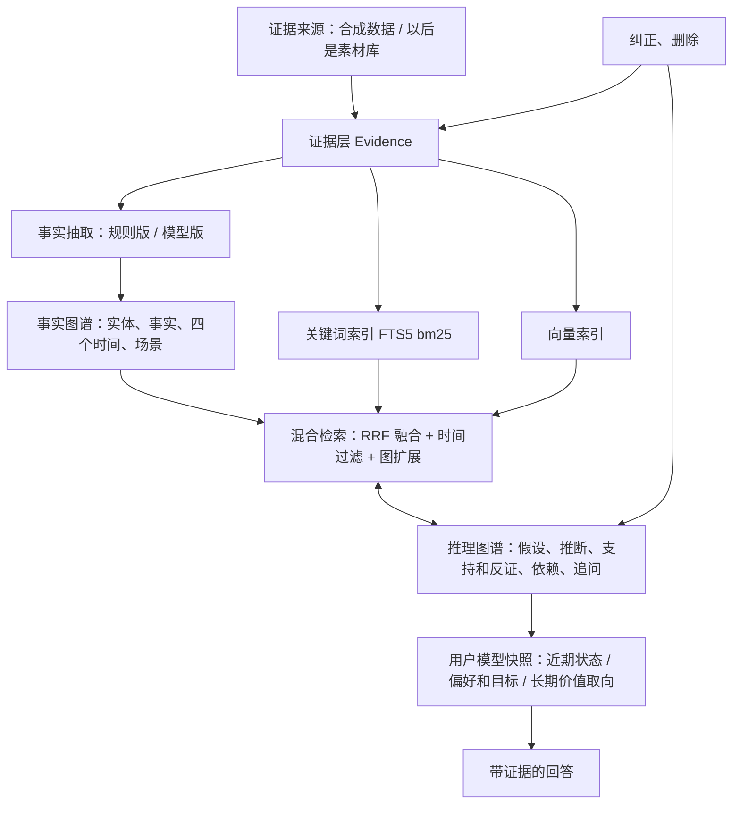

# 记忆 PoC 架构：证据、事实图谱、推理图谱、混合检索

状态：PoC 第一轮做完（2026-10-20）。
- ① 号票（188）：包骨架、证据层、事实图谱存储、时间和变化判定、`MemoryEngine` 的写入和查询；
- ③ 号票（190）、194：A、B、C 三组检索、两层开关、评测框架（第 6、8 节）；
- ④ 号票（191）、195：推理图谱（竞争假设、判别性追问、支持和反证、失效传播、explain、往上抽到需求和价值层）、用户模型快照、带证据的回答、`hybrid_kg_rg`，规则版和模型版；
- 196：为任务调出相关的用户模型（往上走、结论索引、领域三条路）和交互策略（第 7.4 节）；
- 201：模型版往上抽、模型版编交互策略（第 7.5 节）；
- 202：回答层——问题分流、相关门槛、D 组只在真命中假设时才加证据、检索和推理两条路都能说"不确定"、接上 196 的三条路（第 7.2 节的 `answer()`、第 7.6 节），结果在 23 号评测记录的"202"一节；
- 205：回答层三处修正——向量门槛按自带背景语料的第 95 百分位校准、任务的建议附了追问算有结论、组没分出来时以明说的话为准（第 7.6 节），结果在 23 号评测记录的"205"一节；
- 206：相关门槛加第二道（在这个人自己库里的记录里也排得靠前）、明说优先要求说的是同一件事（第 7.6 节），结果在 23 号评测记录的"206"一节；这是在旧数据（`events.json`）上最后一次改回答层，之后的效果由 204 号票在独立的新数据上判；
- 198：每日整理（每天 03:00，用户在用就推后、最晚 05:00）、了解你问题（整理时生成、在相关的对话里顺口问、回答回写）（第 7.7 节）；
- 199：知识图谱和推理图谱联动——实体关系更丰富（事件实体、人和人的关系、别名对齐）、对比模式找隐蔽的联系、矛盾追根溯源、结论写回知识图谱（第 7.8 节）；
- 216：大模型回答器（模拟秘书，读记忆简报回答）、记忆简报（A、B、C 是各组的记录，D 另加用户画像，有长度上限）、评测数据二建好的库存下来再读回、导出推理图谱的结论（第 7.9 节）；
- 221：模型版往上抽的提示词讲清每组自己也要跨两种以上互相不重叠的场景（标签互相包含的不算两种）、只落一种场景的不归组（第 7.5 节）；
- 220：模型版推断出来的下层断言带上模型给假设写的场景，往上抽才过得了"场景"那一条（第 7.5 节）；
- 218：模型版出假设、往上抽、编策略不能整个失败——按估算的输出长度分批、截断和解析不了时救回完整的条目、剩下的对半切小重试、往上抽没过门槛写明是哪一条、建库统计每一步的调用（第 7.5 节）；
- 219：记忆简报 D 的每条结论下面带上和问题最相关的支持、反对证据原话（已经写过的只写编号），放不下时原话最后砍；回答器提示词要求用到结论时说出具体事例（第 7.9 节）；
- 222：记忆简报 D 在同样的字数里按相关程度挑结论（先看支持证据在 C 组检索里的名次，direct 有加成但占不住名额，再按分数和层级把握），同一组、近乎同文的只留一条（第 7.9 节）；
- 228：记忆简报 D 的去重加极性保护——只差否定词的两条（喜欢 X / 不喜欢 X）算极性相反，不管在不在同一组、字面多像都不合并（第 7.9 节）；
- 237：建库偶发卡死（CPU 打满、不再调模型）的根子是宽松解析在"该是条目的地方是个 `}`"时原地打转，修掉；建库 CLI 每一步打带时间戳的进度、加 `--stall-minutes`（超时判这一段失败、退出码非零）；每晚整理加墙钟上限 `memory.nightlyTimeoutMinutes`（第 7.5、7.7 节）；
- 207：199 的问题接到 198 的问题箱、问题优先级按"回答能不能分出胜负"、规则版抽取不把问句当成说过的事、否定不丢（第 7.1、7.7、7.8 节）；
- 223、229：往上抽的"两种场合"先放宽成按维度判、再收窄成只看方面维度（第 5、7.5 节）；226：预测账本、227：对抗复核和复评水位、表象覆盖（第 4.3、7.7 节）；256：往上抽的门槛分成结构的和时间的两组，时间不够的先出临时结论（第 4.3 节）；
- 224–237、242、243：引擎接进在用的二狗（素材 → 证据适配器、推理库 `rg.db`、每晚 03:00 由记忆管理员整理、秘书的简报和问记忆、记忆页、删除登记、降级和验收），总览见 [记忆系统总览](memory-system.md)，实现说明见[开发者指南](developer-guide.md)的"记忆系统"；
- 263：线上每晚整理接上对抗复核和判预测（给 `reviewer`、`predictionJudge`）；用户对一条结论的直接表态（对 / 不对 / 拿不准）走引擎的 `recordClaimVerdict`，整理计分不改回（第 7.3 节）；删了没有调用方的 `questionVectorThreshold`；
- 264：顺口问接进线上：`pickQuestion` 加只看不记的 `peek`、秘书真的带上了才记问过的 `markQuestionAsked`、读用户下一句的 `readQuestionReply`（规则版 `classifyReply`：在答、跳过、别问这个、在说别的，宁可漏认）（第 7.7 节）；
- 270：模型版 `reflect()` 的预算按道花（`src/rg/nightly-lanes.ts`）：新证据先（没问过的追问、检索结果里有新证据的追问按时间先后），剩下的才重跑待复核、到期复评的组，别的旧追问不重判；整理完一条新证据记一条；报告带每一道的调用数和积压；`runNightly` 的第二次 `reflect` 只用第一次剩下的（第 4.3、7.5、7.7 节）；
- 272：整理里两处每夜重复花钱省掉——模型版问过一次、没进组、没变化的新观察不再拿去出假设，往上抽没被用上、没变化的下层断言不再问（账 `rg_asked`，有新证据才再问）；到期待复评不算用户明说的结论（第 7.5、7.7 节）；
- 271：顺口问的回答由记忆管理员在每晚整理时批量判（`src/rg/reply-judge.ts`）：`runNightly` 给了 `replyJudge` 时，问过、还在等回答的问题和用户之后的几句话交给模型判——答了经 `recordQuestionAnswer`（`reading`）回写、没答 `recordNightSkip` 算跳过一次、拿不准 `recordUnsure` 留到下一夜（最多两夜）；`reflect()` 的预算多一道判回答 `replies`（保底一小份，排在新证据之后、重跑旧追问之前）；`pickQuestion` 加 `settle: false`（线上白天不把问了没答的记跳过）；问题经过多一种 `unsure`（第 4.3、7.5、7.7 节）；
- 266：每条用户消息的记忆简报 `messageBrief`（`src/llm/brief.ts`，引擎上也有 `MemoryEngine.messageBrief`）：不调模型，`relevantForQuestion` 判相关，有过了门槛、直接对上的结论才带，只带 D 组用户画像里过了门槛的那部分（结论连原话、竞争解释、明说的要求和禁忌、交互策略），上限照 `BRIEF_LIMITS`；调用方给 `known`（带过的键和指纹），没变的不再带、末尾点名；交回带了的每一条为什么带、经哪条路对上（第 7.9 节）；
- 267：推理图谱的唯一写入口（检查、权限分档、留痕 `rg_writes`）、每晚校验（整理完把推理图谱查一遍，不合格的转待复核；326 号票起是记忆系统自己的图谱自检），顺手补齐整理里几处漏传的待复核（第 7.3、7.10 节，ADR-0030）；
- 329：照原始推理图谱的规矩改状态和传播（ADR-0032）：结论只有已验证、猜测、撤回、被取代，"待复核"改成复核标记；身份（kind）锁死；传播铁律（前提降成猜测，依赖它的已验证降回猜测、前提照挂）；猜测也能往上推；证实不靠前提（用户确认、独立证据达标的改挂依据）；推翻往上传（没有直接证实的下游撤）；复活；图谱自检补悬空、推论没前提，写入口查无环；老库迁移（`rg/migrate-rules.ts`，没接进守护进程）（第 7.3、7.10 节）；
- 330：ADR-0032 剩下的规矩：别人转述的能起猜测、永远到不了已验证（R3）；猜测照样给、标明是猜测（R5）；长期做法能建在猜测上、理由没了问还要不要（R6）；预测做成节点、落空往回打（R10）；已验证碰上有分量的反例先降回猜测、弄清了是例外 / 要收窄 / 撤回（R12）；两条打架都已验证都降回猜测、先试收窄（R13）；随口说的不再自动算决定性、说做对不上哪边都不自动赢（R14）；一次对话最多顺口问一个、访谈带上问题箱（R15）；矛盾根源不豁免铁律，琢磨出来的根源要用户确认才写回（用户选 A）（第 7.3、7.7、7.8 节）；
- ⑤ 号票（192）：周末社交演示（`npm run memory:demo`）、D 组接进评测、推理类指标、四组消融跑了假向量和 bge-m3 的规则版各一次、模型版（DeepSeek）三次（前两次输出被截断作废，第 3 次只有一个库出了模型的假设），结果和结论在 [23 号评测记录](research/23-memory-poc-eval.md) 的"192"一节。

下面第 4–9、11 节的字段名、接口名以实现为准（`packages/memory/src/`；评测、演示在 `packages/memory-eval/src/`，326 号票分出去的）。

这份文档是记忆 PoC 的 P0 交付件，后面拆的 5 张票都以它为准。每一条要么出自用户 2026-10-20 定的事（见 记忆地图 的"记忆 PoC"一节），要么出自现有代码，要么出自调研 [21](research/21-memory-oss-landscape.md) 和内部的记忆调研。

- 任务书原文：poc-brief-2026-10-20.md。
- 用词以 `CONTEXT.md` 的"记忆"一节为准：素材、事实、推理图谱、假设、有效期、观点变化、近期状态、用户模型、用户卡、做梦阶段、记忆管理员。

PoC 要回答一个问题：**推理图谱在"混合检索 + 事实图谱"之上，能不能在隐式偏好、反证、时间演化、纠错和适度个性化上带来可复现的增益？** 有增益才接进二狗（决策门槛，任务书第 14 节）。

---

## 1. 现有能力审计

这是 PoC 开工时（2026-10-20）的情况；接进二狗以后的样子见 [记忆系统总览](memory-system.md)。

| 任务书的层 | 二狗现在有的 | 缺的 |
|---|---|---|
| **证据库** | 素材库（`packages/daemon/src/materials/`）。<br>- materials.db 的 `materials` 表：信封里有类型（7 类加回避信号）、说或做、来源等级（本人、agent、外部不可信、系统）、情境标签（`context: string[]`）、切段（只有本人的段留原文）、指回原始事件的引用。<br>- 原文副本 `originals/<年-月>/<id>.json`：只建不改。<br>- 忘掉、彻底删除、"别推断"标记（`material_marks`），删除传播见 `purge.ts`、`rewriters.ts`（ADR-0006、0008、0020）。 | 只有一个 `time`，分不出"发生的时间"和"知道的时间"；没有有效期；"别推断"标记还没有任何推断代码读它。 |
| **事实图谱** | 没有。 | 全部。 |
| **推理图谱** | 没有代码。只有占位：记忆插件注释写着"二期在这里长"（`memory/plugin.ts`、`api.ts`），记忆页"动机挖掘""索引"两层写着"还没做"。 | 全部。 |
| **用户模型** | `CONTEXT.md` 有"用户卡"，没有实现。 | 全部。 |
| **决策层** | 秘书只在执行明确的记忆命令时检索素材（规格 §7）。 | 全部（PoC 只做"带证据的回答"，不做行动）。 |
| **检索** | 关键词：FTS5 trigram，3 个字以下的词退回子串扫描。向量：bge-m3 q8、1024 维，暴力点积。秘书工具里关键词结果在前，语义分 ≥0.5 的往后追加（`memory/search-tool.ts`）。 | 没有融合打分（RRF 之类）；检索接口没有时间过滤；没有图扩展。正式库的向量表是空的（模型一直没下载）。 |
| **基础设施** | `node:sqlite` 的 DatabaseSync（WAL、secure_delete，`storage/sqlite.ts`）；按概念组出向量的假向量（`test/helpers/embedder.ts`）；DeepSeek 服务商表；pi 的假模型。守护进程自己不跑模型，模型都在 agent 子进程里。 | 没有记忆和检索的评测脚手架。 |

另外还有两份可以直接借的现成材料：

- **推理图的节点模型**（用户自己做过的意图挖掘方法）：
  - 推理图是 YAML 写的有向无环图，节点有 `kind`、`layer`（L0–L4）、`deps`、`status`、`derivation`、`predicts`；
  - 撤回的结论留墓碑（`retracted_by`）；
  - L2 及以上不得标"已证实"；
  - 竞争假设配判别性追问：`discriminates`、`probes`，带 `if_yes`、`if_absent`，"搜不到不得判负"，证据权重按分贝记分。
- **05 号调研的分层模型**：L0 情节、L1 观察、L1' 事实与偏好（双时态、不覆盖）、L2 情境意图、L3 稳定需求、L4 内核、P 交互策略、M 元记忆（追问队列、预测账本）。

## 2. 已定的事（2026-10-20，用户定）

- **放在哪**：仓库里单独一个包（当时叫 `packages/memory-lab`；326 号票起运行时是 `packages/memory`，评测和数据在 `packages/memory-eval`），用合成数据跑通、跑评测，不碰在用的守护进程。证据经接口接入：PoC 读合成数据，接二狗时读素材库。
- **技术栈**：TypeScript，照二狗现有的套路。不引任何开源记忆库的代码或运行时，只借设计（第 10 节）。
- **模型**：
  - 测试和演示用规则加假模型，结果确定；
  - 评测有"真模型"开关（DeepSeek），只喂合成数据，跑之前先报预计费用；
  - 上线时用真模型。
- **向量**：要下载真模型，用哪个看调研 22（第 11 节）。
- **数据**：只用合成数据。合成事件和隐藏的标准答案单独一张票写；做推理图谱的看不到标准答案。
- **已定的不推翻**：
  - 记忆管理员是唯一写者；
  - 只有本人素材能用来推断用户；
  - 用户卡和做梦阶段照原定。
- **推理图谱主干**用上面那套推理图的节点模型，补 Honcho 的推断类型。
- **时间**按第 5 节。"为什么变了""新旧冲突时听哪个"不做。

## 3. 目标架构



**在线和离线怎么分**：

- **写入**（在线）：证据入库、建索引、抽简单的显式事实。
- **整理**（离线，对应做梦阶段）：`reflect()` 一次做完以下几步，幂等、增量（记着处理到哪一条证据），并有轮数和调用预算：
  1. 抽事实、对齐实体；
  2. 生成竞争假设；
  3. 跑判别性追问（第二轮检索找反证）；
  4. 调整假设状态；
  5. 用户模型不存，下次取快照时按新的断言现算（第 4.4 节）。
- 什么时候触发（198 号票，第 7.7 节）：每天 03:00（可配置）跑一次（`runNightly`），跑之前看用户是不是正在用，在用就往后推 30 分钟，最晚 05:00 照跑。PoC 里用模拟时钟，不真起定时器；接进二狗以后是记忆插件的内部作业（225 号票），242 号票起到点唤醒记忆管理员来跑。

**简单问题不进推理图谱**："去年哪天去了杭州"走关键词加时间检索就够了。"为什么最近总不想去聚会"才走"检索 → 竞争假设 → 找反证 → 谨慎回答"。

## 4. 数据模型

所有表都在 PoC 自己的一个 SQLite 文件里（`node:sqlite`，开 WAL；`src/store/schema.ts`）。下面是 TypeScript 里的字段名（`src/domain/types.ts`），表里是对应的蛇形列名，数组存 JSON。

- id 都是带前缀的字符串（`ev-`、`en-`、`fa-`、`cl-`、`in-`、`pr-`），存储分配的是 `<前缀>-NNNN`（同样的写入顺序得到同样的 id）；合成数据的证据沿用事件 id；用户本人固定是 `en-user`。
- 时间一律是带时区的 ISO 8601 字符串，比较先换成毫秒；"哪一天、上个月"按这个时间自己的时区算（`src/domain/time.ts`）。
- 写入前校验（`src/domain/validate.ts`），不合格的不写；每次新建、改动都追加一条修订（`Revision`），修订日志只追加，库里有触发器挡住改和删。证据原文的改动不记内容，只记改了、多长（被忘掉的原文不能留在日志里）。

### 4.1 证据（Evidence）

对应二狗的素材，PoC 先自己存一份。接二狗时换成读素材库的适配器，字段一一对应。

```text
Evidence:
  id, sourceLevel (self | agent | untrusted | system)   # 来源等级，同二狗（二狗的 external_untrusted 在这里写 untrusted）
  mode (say | do)                                       # 说还是做，同二狗
  kind (utterance | action | approval | reaction | correction | event)
                                                        # 合成数据用的几种；接二狗时素材类型对上来：发言、澄清回答、投喂、记忆命令 → utterance，
                                                        # 对产出的反应 → reaction，审批 → approval，任务结局、回避信号 → action
  text                                                  # 原文；被忘掉后是空串
  context: string[]                                     # 情境标签，如 weekend、workday、social、work
  eventTime                                             # 事情发生的时间（null：不知道）
  observedAt                                            # 二狗知道的时间
  sourceRef                                             # 出处：合成数据是 fixture:<事件 id>，接二狗时是素材 id
  contentHash                                           # 原文的 sha256（忘掉后保留）
  status (active | forgotten | corrected)               # forgotten：原文清空、关键词和向量索引删掉；corrected：原文留着当记录
```

- 证据来源接口 `EvidenceSource { name, now, read(): EvidenceDraft[] }`（`src/evidence/source.ts`）。合成数据适配器 `SyntheticEventsSource` 读 `fixtures/events.json`（格式见 188 号票：`{ version: 1, now, events: [{ id, source_level, mode, kind, text, context, event_time, observed_at }] }`，逐条校验，不读 `truth/`）。
- 规则：**只有 `sourceLevel = self` 的证据能用来支持或反驳关于用户的假设**（记忆边界已定），判定函数 `canSupportUserClaims(evidence)`（`src/evidence/boundary.ts`，本人且有效）。别的来源只能当背景。

### 4.2 事实图谱（实体、事实）

```text
Entity: id, type (person | place | activity | project | organization | topic | event), name, aliases[]
Fact:   id, subjectId, predicate
        object: { type: entity, id } | { type: value, value }
        negated                                       # 否定：不反感见朋友 = dislikes 见朋友 取反；不想升职 = prefers 升职 取反
        statement                                     # 精炼陈述，见下
        assertion (user_stated | observed | third_party_reported | model_extracted)
        context[], evidenceIds[]                      # 从哪几条证据来，至少一条
        eventTime, observedAt
        validFrom, validTo                            # validFrom 空 = 不知道从什么时候起（"一直""以前"）；validTo 空 = 现在仍成立
        status (active | contested | superseded | corrected | retracted)
        supersededBy                                  # 观点变化：取代它的事实
        retractedBy                                   # 纠正或撤回：导致它失效的那条证据
        contestedWith[]                               # 真冲突：和它互相排斥的事实
        extractedBy                                   # rule:<版本> | model:<名>
```

- 谓词先用一小组通用的：`participated_in`、`declined`、`initiated`、`said_about`、`prefers`、`dislikes`、`works_on`、`occurred_at`、`associated_with`。不建大本体。前五个是**事情类**（某天参加了、拒绝了，有效期从发生时起、不会结束，彼此不互相取代），其余是**状态类**（成立一段时间，会变、会被取代）。
- 199 号票加了实体之间的关系（主语不一定是用户）：
  - 事件的属性（事情类，主语是事件实体）：`organized_by`（组织者）、`involves`（参加的人）、`held_at`（地点）、`in_slot`（时间段，值是"工作日 / 周末 / 假期"加"上午 / 中午 / 下午 / 晚上"）、`of_type`（活动类型：聚餐、运动、文娱、工作机会、见面、会议）、`lead_time`（提前多久约的：当天才约、提前1到3天约、提前4天以上约）；
  - 用户的（事情类）：`went_with`（和谁一起）、`mentioned`（提到了谁）；
  - 人和用户的关系（状态类，主语是那个人、宾语是用户）：`colleague_of`、`family_of`、`friend_of`、`work_contact_of`（客户、供应商、面试官这类工作上的联系人，票上只写了三种，这条是加的）。
  - 别人来约用户的事当一个事件实体（名字"谁约的什么（活动那天）"），用户推掉还是去了照旧是 `declined` / `participated_in`，宾语换成这个事件。
- 实体对齐（199，`src/kg/align.ts`）：抽取器能交出别名（`AliasAware.aliasesOf`：括号里"都叫他 / 喊他"、"也就是"）时，引擎抽事实之前先对齐——两个叫法都还没有就建一个带别名的实体；一个已有，另一个记成它的别名；两个各自建过实体就合并（留先建的，事实改挂过去，被合并的那个的名字、别名并进来，修订里写"实体对齐"）。合并不随证据被忘掉撤销（记在 7.6 的限制里）。
- 出处按证据定：本人说的 `user_stated`，本人做的、系统观察到的 `observed`，别人转述的、agent 说的 `third_party_reported`；模型版抽取器可以自己标 `model_extracted`。
- 一张实体表，一张事实表，图扩展靠 SQL 查邻接，不上图数据库（`src/kg/graph.ts`：`factsAt`、`neighbors`）。实体对齐按名字和别名（大小写不敏感），词表里的词建实体时带上别名。
- **精炼陈述（`statement`，用户 2026-10-20 提，主会话定"两层都留"）**：每条事实有一句可以单独看懂的陈述句，带上时间和场景、去掉口语碎屑，比如"用户 2026-10-01 在周末、社交场合拒绝了聚会""用户从 2026-10-01 起在周末、社交场合偏好休息"。
  - 规则版抽取时按模板拼（`src/kg/statement.ts`），有效期变了（观点变化让旧的到期）时跟着重写；模型版（④ 号票）由模型写。
  - 存储上精炼陈述有自己的关键词表（`fact_fts`，trigram）和向量表（`fact_vectors`，每条记模型名），和证据的（`evidence_fts`、`evidence_vectors`）分开。撤回的事实从索引里删掉；陈述改了，关键词表跟着换、旧向量作废。
  - 检索时（③ 号票）既搜原话也搜精炼陈述，命中精炼陈述后经 `evidenceIds` 回到原话。原话照旧保留、照旧建索引，不用精炼陈述替换原话。
- **事实抽取**（`src/kg/extractor.ts`）：接口 `FactExtractor { id; extract(evidence, known: KgView): FactDraft[] }`；规则版 `RuleFactExtractor` 见第 7.1 节。

### 4.3 推理图谱

```text
Claim:      id, tier (state | preference | need | value)   # 近期状态 / 偏好和目标 / 稳定需求 / 长期价值取向
            statement, kind (hypothesis | conclusion)            # 329：只说从哪起的（推断 / 明说），建号定、不改
            epistemic (explicit | inferred | user_confirmed)
            method (explicit | deduction | induction | abduction | user_confirmation)
            status (active | contested | retracted | superseded)   # 329：已验证 / 猜测 / 撤回 / 被取代（ADR-0032）
            needs_review (0 | 1)                               # 329：复核标记，不改真值状态
            confidence (low | medium | high)                  # 不用小数，不冒充校准过的概率
            context[], valid_from, valid_to, inferred_at, reviewed_at
            retracted_by, superseded_by, competes_with[]      # 竞争假设互相登记
            predicts[]: { claim, outcome (pending | hit | miss), evidence_ids[] }
Link:       claimId, target (evidence id | fact id), polarity (supports | refutes | context), rationale,
            weight (weak | strong | decisive)                 # ④ 号票加的，见下
Inference:  id, conclusionClaimId, premiseIds[] (fact / claim / evidence), method, rationale, by (rule:<版本> | model:<名>),
            status (active | needs_review | retracted | history), createdAt   # needs_review：前提被删了、停用着等重推；history：被直接证实以后原来的推理链
Probe:      id, discriminates[] (claim ids；事实真冲突时是两条事实的 id), ask, queries[], ifFound (→ 其中一条，事前不知道是 null)
            outcome (open | found | not_found), foundEvidenceIds[], createdAt
            # if_absent 固定是 inconclusive（搜不到不判负），不存
Revision:   seq, objectType, objectId, op (create | update | delete), changes { 字段: { from, to } }, causeEvidenceId, reason, at
            # 追加式的修订日志；关联的修订记在断言 id 下面（objectType = link），delete 只用于拿掉关联
```

字段名照 TypeScript 写（`retractedBy`、`competesWith`……），Claim 的 `retractedBy` 可以指向证据、事实或断言。类型、校验和存储（含按前提反查推断 `inferencesByPremise`、按目标反查关联 `linksTo`）在 ① 号票建好，逻辑在 ④ 号票（`src/rg/`）。

**预测节点**（226 号票的预测账本，表 `predictions`；330 号票 R10 做成从结论推出来的节点，ADR-0032）：成立的结论（`need`、`value`）写下的预测（`Claim.predicts`）在整理时记成节点——来源（`premise_ids`）、推法（`derivation`：演绎 / 可废止）——到期判应验没有；落空了按推法往回打来源（演绎的撤错的那条前提、判不出就出问题，可废止的只挨一条反证），应验了只刷新这一条。规则见第 7.7 节末尾。

**关联的多重**（`weight`，④ 号票）：按证据权重记分（似然比取分贝，可加），三档有外部参照、不用小数：

| 档 | 分贝 | 什么时候用 |
|---|---|---|
| `weak` | 3 | 一条旁证（观察本身、"周末想休息"对"周末自主"） |
| `strong` | 6 | "冒烟的枪"的量级，还不算决定性（"不喜欢周末被提前排满"对"周末自主"、主动约人对"不喜欢社交"） |
| `decisive` | 10 | 用户自己明说、对手几乎不可能产生的（"我不反感见朋友"对"不喜欢社交"） |

"没有判别力"（0 分贝）那一档不建关联。纠正的证据多重升一档。别人转述的只能是 `context`（背景），不计分。330 号票（R3，ADR-0032）起别人转述的关于用户的偏好、不喜欢、近期状态可以起一条猜测（`rg/relayed.ts`，整理时和明说的结论同一步 `syncRelayed`）：推断出来的、溯因、把握 low，推断理由以"别人转述："开头，依据（那条转述的事实）只当背景；问题箱出一个"听别人说……是这样吗"（问题来源 `relayed`），答是走用户确认（已验证）、答不是撤回。转述的事实、别人转述的证据不算已验证的前提（`premiseVerified`），所以只有转述的永远是猜测。用户自己说了同样的，转述起的猜测被明说的那条取代；说了相反的撤回。转述和用户自己说过的（已验证的明说结论）对着干：不起猜测、不记反证，只出一个问题"现在还是你说的那样吗"。库从 1 版升到 2 版：`links` 加 `weight` 列（1 版的库打开时补上，默认 `weak`）。

**三种断言**：

- **明说的**（`kind = conclusion`、`epistemic = explicit`、`method = explicit`）：用户自己说的偏好（`prefers`、`dislikes`）和近期状态（`said_about` 忙、累、焦虑、不舒服），一条事实一条断言，推断是"结论 ← 这条事实"，关联是决定性的支持。说的是一阵子的事（状态词，或者那个分句里有"最近、这阵子、这几天……"）的是 `state`，到期时间照事实、没有就 14 天；别的是 `preference`。状态跟着事实走：事实被取代 → `superseded`（`supersededBy` 是新事实的断言）；真冲突 → `contested`（`competesWith` 互相登记）；被纠正、被撤回 → `retracted`（墓碑指向起因的证据）。
- **推断的假设**（`kind = hypothesis`、`epistemic = inferred`）：一个观察模式出一组竞争假设（至少两条，`competesWith` 互相登记），推断是"结论 ← 观察到的那几条事实"（`method = abduction`）。
- **往上抽的假设**（195 号票，`kind = hypothesis`、`method = induction`）：同一主题的偏好、状态断言跨场景、跨时期都成立时，出需求层的一组上位解释；需求也跨得够时再出价值层的一组。推断是"结论 ← 这几条断言"，条件见下面"往上抽"。

**状态和置信度怎么定**（`src/rg/scoring.ts`，规则版、模型版共用；推理实现只交关联）：

- 只算能当依据的关联（目标是本人的、有效的事实或证据）；`净分 = 支持的分贝 − 反证的分贝`；
- 330 号票（R14，ADR-0032 的"矛盾"）起决定性只算当面的（`effectiveWeight`、`rg/link-sources.ts`）：用户确认、否认、回答了解你问题、演绎预测落空撤错的前提、明说的结论自己那条、背后的证据是纠正；别的"决定性"（模板给用户随口明说的事实的、模型判的）计分时按强的算，关联照原样存；
- 有决定性反证、又没有决定性支持 → `retracted`，`retractedBy` 指向那条反证（留墓碑）；
- 一组里剩下的：领先的比第二名多 6 分贝以上、净分是正的、而且至少有一条判别性的支持（至少是强的，别的假设没有、或者在它那里更轻）→ `active`，其余 `contested`（还活着，没被排除）；分不出来就全部 `contested`；只剩一条的，净分是正的就 `active`。弱的旁证、大家共有的观察分不出胜负：对手被反驳了，剩下的也不会只靠共有的观察成立（195 号票收紧的）；
- 搜不到不扣分；
- 330 号票（R12）：证据够 `active` 的，要是有还没弄清的有分量的反例（落了地的强反证）→ `contested`、加复核标记。弄清了才回到 `active`：反例以后又来的支持合起来到 6 分贝（只是例外），或者用户当面确认过；支持和反例按场景标签分得开的结论层收窄（`rg/contradictions.ts` 的 `narrowClaim`，新结论"……（只在周末）"取代原结论）；用户当面否掉撤回。R13：别的组里和它互相竞争、场合对得上、单看自己那组也够 `active` 的——两条都 `contested`、加复核标记，各自的支持按场景分得开就各自收窄，分不开出问题。两种都出问题（第 7.7 节的表）；
- 置信度：净分 ≥ 12 且支持背后有 3 条以上证据是 high，≥ 6 且 2 条以上是 medium，其余 low；再按下面的上限封顶（`confidenceCap`）。

置信上限（按层和证据厚薄封顶：越往深层推，要的证据越多）：

- `state`、`preference` 由用户明说时可以是 `explicit` 加 `high`；推断的最多 `medium`。
- `need`、`value` 最多到 `medium`、状态 `active`。用户确认过的标 `user_confirmed`，显示为"你确认过"，但仍然是关于"为什么"的假设。用户的话在"怎么为他服务"上是权威，在"他为什么这样"上只是一条证据（05 号调研）。只有用户确认过才标 `user_confirmed`：`confirmClaim(claimId, byEvidenceId)`，`by` 得是本人有效的证据（比如他对追问的回答），记一条决定性的支持、重定它那组的状态，置信度照样按上限。
- 只有一两条证据、或者证据不到两个月份、两种场景的 `need`、`value`，最多 `low`。

**往上抽：需求层、价值层**（195 号票，`src/rg/lift.ts`，规则版；模型版见第 7.5 节）：

- **需求层**：同一主题的偏好或状态断言（推断的和用户明说的都算，`active`、至少 `medium`），在两种以上不同的场合（按第 5 节的维度比；229 号票起只看方面（domain）维度：方面标签集合不同才算两种，「家里、休闲」和「家里、工作」算两种，只差日型（周末/工作日/假期）或出行（出差/休假）不算；被别的场景包含的不单算；老口径要求所有共享维度都无交集，只留作统计）、两个以上月份都成立，支持背后至少 3 条证据 → 出一组上位解释，至少两条，互相登记，每条事先写好支持和反证的预期、配判别性追问。下层断言的支持事实对组里每条都是弱支持（观察），下层断言的反证只按预期配。场景：推断的取它那组的日子和方面（模型版出假设的组没有这两个参数，取模型给这条假设写的场景，220 号票），明说的取断言自己的场景。模型版由模型归纳主题，提示词明说每组自己也要跨两种以上互相不重叠的场景、只落一种场景的不要归组（第 7.5 节，221 号票）。
- **价值层**：成立的需求断言（`active`、至少 `medium`）自己也跨两种以上场景、三个以上月份时才出，"长期看重"对"只是现阶段的需要"；证据跨了 180 天以上，前者强支持、后者强反证；跨得不够两条都不动（"没看到长期的证据"不算反证）。置信度最多 `medium`。
- **门槛分两种**（256 号票，`rg/llm-lift.ts` 的 `liftThreshold`）：
  - **结构性的**（过不了就不出）：两种以上不同的场合、至少 2 条证据——一条证据推"长期需求"就是编；
  - **时期性的**（过不了也出，标成临时结论）：两个以上月份（价值层三个）、至少 3 条证据。"先推出来、但存疑"：
    `description` 和那条推断的 rationale 后面挂「（临时结论：月份不够…）」，组参数里 `provisional: true`；
    置信度不用另设——第 226 行那句 `confidenceCap` 本来就按"证据薄、不跨时期、不跨场景"把 `need`/`value` 压到 `low`。
    跨度长起来以后下一次重抽那句话就摘掉，`rescore` 把置信度提上去，那时才能当下层断言再往上抽价值层（`liftInputs` 只要
    至少 medium 的）。统计里这类记 `provisional` / `provisionalByReason`，不算进 `passed`（免得和 229 那次的口径混在一起）。
- 主题是通用的，三族：

  | 主题 | 下层断言 | 需求层的上位解释 |
  |---|---|---|
  | 回避被别人安排好的时间（`autonomy`） | "重视某类日子的自主安排"；明说不喜欢被安排、被排满 | 重视自主安排（`need`）/ 近期整体负荷高（`state`，观察分布超过 45 天是强反证）/ 对这几类活动本身没兴趣（`preference`） |
  | 反复说忙说累（`load`） | "近期忙累"；明说的忙、累 | 长期精力紧张、需要留出恢复时间（`need`，跨 60 天以上是强支持）/ 只是几阵子各自的忙（`state`） |
  | 不分场合都去某样活动（`interest:<活动>`） | "喜欢那几样活动本身"；明说喜欢某样活动 | 对它有稳定的兴趣（`need`）/ 各场合各自的原因（`preference`，主动发起是强反证） |

- 失效：329 号票起照传播铁律（ADR-0032）——下层断言降成猜测时，把它当前提的已验证需求、价值降回猜测（前提照挂、保留），猜测照样能往上抽；下层被推翻时，没有直接证实的需求、价值跟着撤（墓碑指那条前提）；同一次 reflect 里往上抽那一步重新判：条件还成立就按剩下的关联重定状态，不成立了组撤下，组里的结论没有推翻者、不撤，留成猜测、把握降一档（ADR-0032 的 Q2）。证据被忘掉、纠正时经传播钩子沿依赖传上来（第 7.3 节）。

**推理图谱的账本**（`rg_*` 表，`src/rg/registry.ts`）：竞争假设分组（`rg_groups`：观察模式、参数、说明、观察到的事实、还成立没有、谁建的）、组里的断言和模板（`rg_members`）、追问出自哪个模板（`rg_probes`）、明说的事实对应哪条断言（`rg_explicit`）、哪条证据被哪个推理实现整理过（`rg_reflected`，reflect 增量用）、模型版问过哪条观察和下层断言（`rg_asked`，272 号票：签名是当时的样子拼起来的散列，没变化就不再问）。它们是从断言、事实推出来的簿记，不进修订日志；断言、关联、推断、追问本身的每次改动都进。

**追问的 `ifFound`**：推理图谱出的追问是事先写下的"找到了算支持哪一条"（事先写下的 `if_yes`）；找到的证据偏向另一边（`if_no`）也算 `found`，偏向谁看关联。事实这一层真冲突的追问 `ifFound` 事先是空的，判过以后填上另一次说法和哪一边一致。

### 4.4 用户模型

用户模型不单独存，是从推理图谱算出来的快照：`getUserModel({ at, context })`（`src/user-model/snapshot.ts`）。

1. 取在时间 `at` 成立的 Claim：`valid_from ≤ at < valid_to`，状态是 `active`，或者是 `superseded` 而 `at` 还在它的有效期里（那时它是成立的，问"以前怎样"答得出）；置信度至少 `medium`（`state` 可以是 `low`，带 `lowConfidence` 标出来）。
2. 场景过滤：Claim 的场景和问的场景对得上（按维度比，同第 5 节），或者 Claim 不限场景、或者没问场景。一个场景的偏好不推广到另一个场景："周末自主"（`weekend`）问工作日时不出现，"不喜欢社交"（`social`，不分日子）照样出现。
3. 分三层输出：近期状态、偏好和目标、长期价值取向（`need` 和 `value` 合在这一层）。每条带"用户说的 / 推断的 / 你确认过的"标记（`label`）、置信度、场景、有效期和支持证据 id（只有本人的有效证据）。
4. 猜测和证据还不够的单列在 `uncertain` 里，每条写原因：`contested`（猜测：没验证，附上还活着的竞争者和它们的状态）、`thin`（`active` 但证据不够、置信度不到 `medium` 的 `preference`、`need`、`value`）。330 号票（R5）起每条带真值状态（`status`）、把握、谁说的（`label`）——猜测照样给、标明是猜测，用的人可以照着说、拿来推荐，把握低的留余地。
5. `retracted` 的不进快照。标着复核的照真值状态进、带 `needsReview`（330 号票起；以前整条拿掉，第 7.3 节第 5 条）。
6. 交互策略（196 号票）：`strategies` 是用户确认过（确认的证据还有效、确认在 `at` 之前）的策略（第 7.4 节）；330 号票起依据不成立了也不拿掉，每条标 `onGuess`（建在猜测上）、`basisGone`（依据都不在了，等用户说还要不要）。快照只读，按依据现算，不写库。

用户卡（压缩后常驻秘书上下文的那一份）是接二狗以后的事。

## 5. 时间和变化

- **四个时间分开记**：发生的时间、二狗知道的时间、有效期、推断和复核的时间。比如今天说"上个月开始不喜欢了"：`observed_at` 记今天，`valid_from` 记上个月。
- **新说法和旧的对不上时，先分是哪一种**（`src/kg/change.ts` 判定，`src/kg/graph.ts` 改状态）：

  | 判定（`ChangeKind`） | 条件 | 处理 |
  |---|---|---|
  | 场景不同 `context_differs` | 两条的场景不重叠 | 两条都 `active`，不算冲突 |
  | 纠正 `correction` | 用户说"其实一直、我从没、记错了、不是…是…"（整条证据里有纠正信号，或证据种类是 `correction`） | 旧的 `corrected`，`retractedBy` 指向这条纠正的证据；新的有效期从旧的开始时算；依赖它的推断传播（第 7 节） |
  | 有效期不重叠 `time_differs` | "去年喜欢、今年不喜欢"这类，两条说的本来就是不同的时间段 | 都不动；新的带变化信号、旧的已经到期时，旧的标 `superseded`、记上被哪条接上 |
  | 观点变化 `change_of_mind` | 场景、有效期重叠；有效期开始得晚的那条（后说的）**自己明说了变化**（334 号票：不再、不…了、改成、越来越、开始、从…起、以前…现在…、搬家、换工作这类，`explicitChangeSignals`；只说"现在、最近"的不算） | 有效期开始得早的那条到期（`validTo = 晚的那条的 validFrom`），状态 `superseded`，不删；问"以前怎样"仍然答得出。新来的说的是更早的事、后说的已有那条明说了变化时，是新的这条到期 |
  | 真冲突 `conflict` | 场景、有效期重叠、互相排斥，后说的那条没明说变化（334 号票起不在同一天说的也一样，不再按日子先后让后说的赢——原始推理图谱 §6b 不许"信后到的"）；或者说的是同一段时间 | 两条都标 `contested`（`contestedWith` 互相登记），生成一个判别性追问（`discriminates` 是两条事实）；明说的结论两条都是猜测，问题箱出"现在更接近后一种吗"（ADR-0032"前后两句对不上"） |

  实现上的几条细节：
  - **互相排斥**（`excludes`）：同一谓词、同一宾语，一条否定一条不否定；喜欢 X 和不喜欢 X；参加了 X 和拒绝了 X；都"喜欢"、宾语在词表的同一互斥组里（远程办公、混合办公、坐班）。事情类的还要是同一天的同一件事（周三的聚会和周六的聚会是两件事）；纠正时不看日子，只纠最近那一件。
  - **场景重不重叠**按维度比（`src/kg/context.ts`）：一天是哪种（周末、工作日、假期）、在哪方面（社交、工作、家里、旅行……）、出行是哪种（出差、度假）。一个维度上两边都写了、没有交集才算不重叠；不认得的标签合成一个维度比；没写场景的和谁都重叠。一句话里明说"周末""工作日"的，以分句为准。
  - **只有本人的事实参加判定**：别人转述的不取代、不纠正、不冲突，只当背景。
  - 状态类的一模一样的事实（同主语、谓词、宾语、否定、场景、出处）再说一次是并进去，多记一条证据。
  - **334 号票：一句话抽出来的状态类事实，开始不早于说这句话的那天**——抽取器给了 `null`（模型常把"有点想回去读博了"写成一直）或者更早的日子、原话又没说从什么时候起（没有时间说法，没说"以前""一直""从小"，`statesOwnStart`），写事实时按说话那天算开始。
  - 信号词表在 `src/kg/signals.ts`（变化信号看分句，纠正信号看整条证据；334 号票的"明说变化"`explicitChangeSignals` 只认上表那几种，"以前…现在…"在整条证据里看）。有效期的时间说法："上个月开始、三个月前开始、从 9 月起"从那时起仍成立；"去年、上个月、上周"（没说开始）只在那一段；"今年、这个月"从这一段的开头起；"以前"到说的时候为止；"一直"不知道从什么时候起；"最近"不挪时间。

- **各层变的门槛不一样**：
  - `state` 必须有 `valid_to`（不写就默认 14 天），到期自然不在快照里；
  - `preference` 有新证据就调；
  - `need`、`value` 要来自至少两个时间段、两种场景的证据才升到 `medium`，一两次反常不降，连续预测落空才降。
- **先后不等于原因**：观点变化只记"什么时候变的、前后各有哪些证据"，不生成"因为 A 所以变了"的推断。这一条留作遗留事项。

## 6. 检索

```ts
search(query: string, opts: {
  mode: "vector" | "hybrid" | "hybrid_kg" | "hybrid_kg_rg";
  at?: string;                   // 有效期时间点：只要在这个时间成立的事实（精炼陈述、图扩展两路）；原话没有有效期，不按它过滤。不填 = 不过滤
  eventRange?: [string, string]; // 发生时间 [起, 止)：原话按证据的、事实按事实的；不知道发生时间的不要
  context?: string[];            // 场景：重叠（contextsCompatible）或不限场景的算对得上
  contextMode?: "soft" | "strict"; // 对不上的：soft（默认）往后排，strict 不要（194 号票）
  contextPenalty?: number;       // soft 时对不上的命中这一路的票乘的系数，默认 0.5
  layers?: "evidence" | "statement" | "both"; // 只搜原话 / 只搜精炼陈述 / 两层（默认）
  statementWeight?: number;      // 两层都搜时精炼陈述两路的 RRF 权重，默认 0.5（原话两路 1.0，194 号票）
  sourceLevels?: SourceLevel[];  // 只要这些来源等级（默认都要）
  limit?: number;                // 默认 10
}): Promise<Hit[]>
// Hit：evidenceId、sourceLevel、status（active | corrected）、channels（每路的名次和分数，场景对不上打了折的标 offContext）、fused（融合分）、
//      via { factIds, probeIds, entityIds }（经过哪些事实、追问、问题里认出的实体）
```

实现在 `src/retrieval/`（190 号票），接口形状在 `types.ts`。每路是 `evidence_keyword`、`evidence_vector`、`fact_keyword`、`fact_vector`（原话和精炼陈述各有关键词、向量两路）、`graph`（图扩展）、`probe`（留给 ④ 号票的追问）。

| 模式 | 消融组 | 做什么 |
|---|---|---|
| `vector` | A | 只用向量两路，余弦取前 k；两层都搜时一条证据取两层里高的那个余弦，不做 RRF（不受精炼陈述权重影响；给了场景时对不上的余弦乘 0.5） |
| `hybrid` | B | 关键词加向量，四路（按 `layers` 选）用 RRF 融合（k = 60；两层都搜时原话两路权重 1.0、精炼陈述两路 0.5；每路最多取前 50 条）；时间过滤，场景对不上的往后排 |
| `hybrid_kg` | C | B 加图扩展：从问题里认出实体（名字和别名），沿事实图谱走一跳到两跳（`neighbors`，到用户本人就停），只走在 `at` 成立的事实（strict 时还要场景对得上；soft 时都走，带出来以后再看场景），事实的证据加入候选；照 Mem0 给实体命中加权（一跳的事实每条记 1，两跳记 0.5，加起来排这一路），再一起 RRF（这一路权重 1.0） |
| `hybrid_kg_rg` | D | C 加推理图谱（`src/rg/rg-search.ts`，第 7.2 节）：问题真的命中已有假设时（202 号票：过了相关门槛、直接说到这件事，第 7.6 节），把假设的支持证据、反证一起带上，没命中就是 C 组的结果；"为什么"类问题跑判别性追问做第二轮检索。最多两轮，没有新证据就停。推理图谱带来的命中记在 `probe` 这一路（RRF，k = 60，和 C 的结果合在一起）；这一路按场景是硬过滤（对不上的不要），没跟 194 的 `contextMode` 走。另接 `ReasoningRetrieval { search(query, opts, base) }`（`MemoryEngine.open({ reasoningRetrieval })` 或 `setReasoningRetrieval()`）时交给它，`base` 是 C 组的检索 |

- **两层都能搜**（用户 2026-10-20 提）：每种模式都有 `layers` 开关。命中精炼陈述的经事实的 `evidenceIds` 回到原话，按事实的名次依次排进来，结果按证据去重，`via.factIds` 记下经过的事实。
- **精炼陈述降权**（194 号票，按原则定，不对着评测题调）：两层都搜时，精炼陈述那两路在 RRF 里权重默认 **0.5**，原话两路 1.0（选项 `statementWeight`）。理由：精炼陈述是从原话派生的，可能漏、可能错，不能压过原话。只搜一层时不管；A 组不做 RRF，不管；图扩展那一路仍是 1.0（它是 C 组要量的东西）。规则版抽取下相关证据只有 0.61 抽出了事实，模型版抽取覆盖率上去以后再评一次。
- **关键词**（`terms.ts`、`keyword.ts`）：问题是一整句中文，先拆词——去掉问句词、代词、虚词，和相对的时间说法（去年、最近、11 月中旬……：意思随说话的时间变，按字面去配原话会配错，交给时间过滤）；节日、星期（五一、周六、周末）留着。剩下的每段：3 个字以上的拆成重叠的三字词走 FTS5 trigram，用 `bm25()` 打分，词之间是 OR；段里的两字词、两个字的段照二狗的做法退回子串扫描，用和 FTS5 `bm25()` 同一个公式打分（k1 = 1.2、b = 0.75），两部分加起来。一个字的不要，只有说人状态的单字例外（192 号票：忙、累、烦、困、闷、乏、倦、饿、病、疼、慌，`SINGLE_STATE_CHARS`）——问题里出现就单独走子串扫描，"最近累吗""那阵子忙吗"不至于什么都搜不到。
- **向量**（`vector.ts`）：查询用 `embedQueries`、文档用 `embedDocuments` 算好的向量（同一个模型名），余弦暴力扫。
- **过滤**（调用的人给了才过滤）：
  - 来源等级、证据状态（被忘掉的不出现；被纠正的照样能搜到，标 `corrected`）：所有路；
  - 发生时间范围、场景：原话两路按证据的，精炼陈述和图扩展按事实的（事实的场景按分句定，比证据的标签准）；
  - 有效期 `at`：只管事实那两路（`validFrom ≤ at < validTo`，状态是成立过的）。原话不过滤：问"现在还夜跑吗"时"以前盼着夜跑"那条原话照样找得到（答案要说以前和现在），只是没有事实那两路给它加分。
  - **场景默认往后排，不扔**（194 号票，`contextMode: "soft"`）：每一路照常排，场景对不上的命中这一路给它的票乘 **0.5**（`contextPenalty`；A 组是余弦乘 0.5），命中里标 `offContext`；不带场景标签的照常。谁对不上：原话两路看证据的标签，精炼陈述看给它名次的那条事实，图扩展看带出它的事实（都对不上才算）。打对折的意思是：一条对不上的要在两路里都排到前面，才抵得上一条对得上、只在一路排前面的。理由：场景标签常常不全，直接扔会把别的场景里的反证也扔掉，和推理图谱"主动找反证"的目标相反。190 的硬过滤（场景冲突的直接不要）留作 `contextMode: "strict"`。评测里看得到几种设置的得失（第 8 节"过滤和权重的影响"）。
- **问题里的时间**（`plan.ts` 的 `planQuery(question, now)`，规则版的查询规划）：问"那时的状态"（那会儿、那阵、还……吗）给 `at`（那一段的中间：月中、旬中）；问"那时的事"（去年去的、五一去的）给 `eventRange`；"现在、最近"给 `at = now`；说得松的（这一年）、以后的（这周六）不给。`search` 自己不调它，调用的人（评测、以后的秘书）先规划再交给检索。评测里 B、C 组没规划出 `at` 时用问的时间（"默认现在"）。
- 每条命中都记下来源等级、状态、各路名次和分数、融合分、经过的事实和实体，评测和演示都能看见"这条为什么被找出来"。
- 检索这一层不判"不知道"：总是给出最多 `limit` 条。"无关键信息时停止"、该说不知道，靠回答层（202 号票：前几条都和问题不挨着、记录互相矛盾时说"不确定"，第 7.6 节）。

## 7. 推理和失效传播

### 7.1 两种实现，一个接口

```ts
interface FactExtractor { readonly id: string; extract(e: Evidence, known: KgView): FactDraft[] }   // id 记在事实的 extractedBy
interface PreparableExtractor extends FactExtractor {                                             // 模型版：extract 是同步的，先异步 prepare
  prepare(evidence: Evidence[], known: KgView, { budget, dropped }): Promise<string[]>             // 返回准备好了的证据 id
}
interface Reasoner {                                                   // src/rg/types.ts，都是异步的（模型版要发请求）
  readonly id: string                                                  // rule:1 | model:<名>，记在推断的 by 上
  readonly exhaustive?: boolean                                        // 每次按全部观察重认模式（规则版）
  propose(observations: Fact[], ctx): Promise<HypothesisGroupDraft[]>  // 观察 → 竞争假设分组，每组至少两条，带观察和同批证据的关联
  probesFor(group: GroupView, ctx): Promise<ProbeDraft[]>              // 能区分它们的追问（两条一问，写清找到了算谁）
  judge(probe: Probe, group: GroupView, hits: JudgeHit[], ctx): Promise<ProbeJudgement>  // 找到没有、各条证据对各条假设的关联
  lift?(level: "need" | "value", inputs: LiftInput[], ctx): Promise<HypothesisGroupDraft[]>  // 往上抽（195 号票规则版、201 号票模型版）
  writeStrategies?(bases: StrategyBasisInput[], ctx): Promise<WrittenStrategy[]>  // 把成立的需求、价值写成交互策略（201 号票，模型版有）
}
// ctx = { view（只读：事实、证据、实体、能不能当依据，都按"现在"算）, budget（模型调用预算）, dropped（丢掉的模型输出）, existingGroups }
```

状态和置信度不归推理实现定，由 `scoring.ts` 按关联统一算（第 4.3 节）。

- **规则版**（`RuleReasoner`，`rule:1`，`src/rg/rule-reasoner.ts`、`templates.ts`）：确定性，测试和演示用。
  - 207 号票修了规则版的两个毛病（`rule:3` → `rule:3.1`，`rule:4` → `rule:4.1`；接进二狗以后每句话都是素材，不修会造出假事实）：
    - **问句不当成说过的事**（`clauseMoods`）：问号结尾的句子的最后一个分句、前面带疑问词或以"还是"开头的分句，不看问号也算的商量和正反问（要不要、该不该、是不是该、能不能、可不可以、会不会、去不去、累不累……；"不管是不是周末"这类让步不算）、句末是"吗"的、反问（难道、何必、哪有……），这样的分句不抽，只把它说到的那件事留给后面的分句当宾语（"小周问：'周六爬山去不去？'我回：'不去了'"照样是推掉了爬山）。"周日要不要约朋友去爬山？"不再抽成"主动约了爬山"，"我还在想要不要去"不再抽成"偏好不要去"；rule:4 里问句中的"跟阿杰去"不算和阿杰一起去了（只记提到了阿杰），问句不出"打算每天跑"；
    - **否定不能丢**：说自己的状态（忙、累……）时，紧挨在前面的"不、没、谈不上、算不上……"加上中间的"算、是、太、很、怎么、咋、那么、多、觉得、用……"都算否定："不算忙""不怎么累""没那么忙""一点都不累""不是很忙""没觉得累""这周不用加班"是说自己不忙、不累；"没想到这么累"（中间是"想到"）、"忙得不可开交"（否定在后面）照旧是忙、累。
    - 在 `events.json`、`events-kg.json` 上抽出的事实和整理后成立的断言和改之前一样。
  - 199 号票起引擎默认的规则版是 `RelationalFactExtractor`（`id = rule:4`，`src/kg/relations.ts`），在下面这个 `rule:3` 上加实体关系：认邀约（只认本人的证据；组织者是邀约动词前同一句里最后一个人；用户怎么回看回复里的说法，"不去了 / 不过去了"里的"去了"不算去了；活动那天看"这周六 / 今晚 / 明天"，活动的星期几加"的"算活动那天；时间段 = 日子类型 + 一天里的时段；地点取场所、"她家"这类，没有再取最早出现的城市；提前多久按发消息那天到活动那天算），认人（外号"老王 / 王哥 / 阿杰"、亲属称呼、工作上的角色、"上海一家公司"这类单位；"老毛病""小时候"不算），关系看称呼和旁边的说法（同组、部门群 → 同事；同学、发小 → 朋友；亲属称呼 → 家人；客户、供应商、HR → 工作上的联系人），和谁一起看"跟 / 和 / 陪 / 喊上 X 去"。认出邀约时不再出 188 那几条以用户为中心的事情类事实（"老王约吃饭"原来抽成用户主动约），当时说的理由（累、忙）照常抽；另补了几种 188 认不出的简单句式：没赶上某趟车（照字面记没坐上）、车票已检票（坐了，日子按票上写的）、"一条 X 记录也没有"（没做）、"最烦 X"、"在投简历"（在找工作）、"我要天天这么跑"（沿用前一样活动的偏好）、"跑了五公里，舒服"（做了、喜欢），问句、别人做主语的分句不抽。词表加了猫、打电话、高铁、找工作；
  - 事实抽取靠关键词和句式（`RuleFactExtractor`，`id = rule:3`；194 号票起冒号、引着一段话的引号也分句，星期词看前后字——"那周一点都不忙"不算周一，复述以前说过的话——"上回说……"不当成新说法；192 号票起"被临时安排、被别人安排、被（提前）排满"这类"被……安排"整个认成一个说法，词表里没有的统一记成"被安排"，不再把"安排"当后缀去掉）：按标点切分句，每个分句最多一条；按顺序试一组句式（不反感 → 不喜欢 → 拒绝 → 不想 → 喜欢 → 参加 → 主动约 → 在做），都配不上再看是不是在说自己忙、累；宾语去掉时间词和语气词、取"的"后面的中心词，对词表（`src/kg/lexicon.ts`）和已知实体名；"不是 X，是 Y"里 X 取反；别人做主语的分句不抽。抽不出来就不抽；
  - 假设靠一张"观察模式 → 候选解释"的模板表，模板是通用的，不对着哪条数据写：

    | 观察模式 | 条件 | 竞争假设（模板） |
    |---|---|---|
    | `repeated_decline` | 同一类日子（周末、工作日、假期；不标日子的另算）里至少两次拒绝活动 | 不喜欢这方面的活动（`preference`，不分日子）/ 重视这类日子的自主安排（`preference`，限这类日子）/ 近期太忙太累（`state`，到最后一次观察后 14 天）/ 不喜欢那几次活动本身（`preference`） |
    | `repeated_engage` | 同一类日子里至少两次参加、发起活动 | 喜欢那几样活动本身 / 喜欢这方面的场合 / 只是工作需要（观察里有标着工作的才出） |
    | `lift:need`、`lift:value`（195 号票） | 同一主题的断言跨场景、跨时期成立 | 见第 4.3 节"往上抽" |

    每条模板事先写下"看到什么算支持、看到什么算反证"（预期，各带多重）。比如"不喜欢社交"：用户明说不反感、喜欢某样社交活动是决定性反证，主动约人是强反证，参加了社交活动是弱反证，别的日子也拒绝是弱支持。"周末自主"：明说不喜欢被安排、被排满是强支持，周末自己主动约人是弱支持（任务书 4.5："周末主动约朋友"反驳"不喜欢社交"、不反驳"周末自主"）。"近期忙累"：说自己忙累是强支持，说不忙是强反证，同一段时间还去了别的活动是弱反证，观察分布超过 45 天是强反证。概念词（被安排、休息、状态词、各方面的活动）在 `src/rg/concepts.ts`；
  - 观察本身对组里每条都是弱支持；观察所在证据里的别的事实（"不去聚会，最近周末想好好休息"）按各条预期配一遍；用户的纠正直接按各条预期判，不靠检索碰运气；
  - 追问也来自模板：从两条假设预期不同的地方出（预期分离：两边预期一样的问题没有判别力），问具体的事、不问动机，带第二轮检索的短语。比如"周末以外的时候你会去参加或者自己约社交活动吗"（区分"不喜欢社交"和"周末自主"）、"上次推掉的周末活动，要是时间由你自己定你会去吗"、"这阵子是不是特别忙、特别累"。检索短语用两个字以上、不带虚词的说法（混合检索把单字和"很、太、了"这类当分隔，"忙""累"这种一个字的实体名也认不出，195 号票改的）；
  - judge：追问搜到的证据，抽出的事实按组里每条假设的预期配；能让被区分的两条此消彼长的算"找到了"，什么都没配上是 `not_found`（inconclusive，不判负）；别人转述的按"它声称的"配，只记成背景；
  - 规则版只证明机制跑得通，**不代表认知效果**，报告里要写明。
- **模型版**（`LlmFactExtractor`、`LlmReasoner`，`model:<名>`，`src/kg/llm-extractor.ts`、`src/rg/llm-reasoner.ts`）：DeepSeek，只在显式开关下用，只喂合成数据，跑前先报预计费用。
  - 提示词要求输出带证据 id（事实 id、证据 id、断言 id）的 JSON；伪造的 id（不在给它的那些里）、不合格的字段写入前丢掉，记进 `ReflectReport.dropped`（借 Honcho 的做法）；
  - 事实抽取由模型写精炼陈述 `statement`；出处仍按证据定（不标 `model_extracted`），这样模型版的事实照样参加变化判定和推理，谁抽的记在 `extractedBy`；
  - 199 号票起抽事实的输出另有 `relations`（实体之间的三元组，每条带证据 id，主语可以是事件、人）和 `aliases`（同一个人的两个叫法）：证据 id 不是这一批的、谓词不认得、时间段和提前多久的值不在说法表里、别名的两个叫法原文里没有的，写入前丢掉记进 `dropped`；事件名没写日子的补上证据那天；别名在引擎抽事实之前先对齐（`aliasesOf`）。对比模式、矛盾根源那几组由代码判，模型版不另发请求；
  - 只有本人的有效证据能当依据：模型交回的关联指向别人转述的，降成背景；决定性只给用户自己说的话，别的降成强；
  - 只给新的观察出假设（不是 exhaustive）；每次调用先扣预算（`reflect({ maxModelCalls })`，默认 40），用完就不再调，这次的证据留给下一次；
  - key 只从环境变量 `DEEPSEEK_API_KEY` 读（每次调用时现取），不打印、不写进文件，出错信息里出现也换成 `***`（`src/llm/deepseek.ts`）；
  - 默认关掉思考（`thinking: {type: "disabled"}`，192 号票）：`deepseek-flash` 是会推理的 V4.1 Flash，不关时思考的 token 也算进 `max_tokens`，192 号票第一、二次真跑 propose 大都写满上限被截断；关法照仓库里 pi-ai 发 DeepSeek 请求的做法。输出上限：抽事实 800 / 条、propose 8000（218 号票起一批最多 40 条新的观察、6 组）、追问和判定 2000、往上抽和编策略按条数估（218 号票）；回应 `finish_reason = length` 时标 `truncated`，解析不了的丢掉时写明"被截断"。出假设、往上抽、编策略截断、解析不了时能自己恢复（218 号票，第 7.5 节）；
  - 手动入口 `npm run memory:llm`（`src/llm/main.ts`）：默认 `--dry-run`，只打印预计 token 和费用、不调模型。做法：在内存库里用规则版把数据整理一遍拿到结构（几组、几条追问、每条搜到什么），照模型版真实会发的请求估输入 token（中文约 0.6 个 / 字，其余约 0.3 个 / 字符），输出按经验值，价格照二狗的自带价格表（`deepseek-flash` 高峰输入 2 元、输出 8 元 / 百万 token，空闲减半），追问按两轮算。真跑要显式加 `--run` 而且配了 key。2026-10-20 对 `fixtures/events.json`（48 条）的估算：26 次调用、输入约 2 万、输出约 1.3 万 token，高峰约 ¥0.15、空闲约 ¥0.07（192 号票改完再估一次还是这么多）；
  - 评测的"真模型"开关（192 号票）：`npm run memory:eval -- --model deepseek` 默认只估费用，加 `--run` 才真跑（第 8 节）。真模型外面套一层 `MeteredChat`（`src/llm/metered.ts`）：照回应里的 usage 记实际 token、按每次调用落在高峰还是空闲时段算钱（时段规则同 `packages/protocol/src/token-prices.ts`）、同样的请求只问一次、失败最多重试 2 次、连着 3 个请求都失败就停、总次数封顶、花费封顶（`maxYuan`：发之前按"输出写满 maxTokens"算这次最多花多少，加上已经花的超过上限就不发）；
  - 预计费用的输出 token 经验值（`OUTPUT_GUESS`）192 号票照第一次真跑的实际量改大了（抽事实 400 / 条、propose 至少 4000、追问 600、判定 500）；
  - 201 号票加上往上抽、编策略两步以后（第 7.5 节）：37 次调用、输入约 3 万、输出约 1.7 万 token，高峰约 ¥0.20、空闲约 ¥0.10；
  - 测试一律用假模型（`FakeChatModel`），DeepSeek 客户端用假的发送函数测，不联网。

### 7.2 关键操作

`MemoryEngine`（`src/engine.ts`）。推理图谱这一块由 `ReasoningGraph`（`src/rg/reasoning-graph.ts`）做，引擎上的方法转给它；它也是引擎默认的传播钩子（`MemoryEngine.open({ reasoner?, propagation? })`，不给就是规则版和它自己）。

| 操作 | 做什么 |
|---|---|
| `ingestEvidence(e)`、`ingestFrom(source)` | 入库、建关键词索引；`status = active` |
| `extractFacts({ evidenceIds? })` | 按发生时间抽事实、做第 5 节的变化判定；增量、幂等（记着哪条证据被哪个抽取器处理过）；返回新事实、合并、变化记录、追问、被纠正的事实 |
| `extractPending({ budget?, maxModelCalls?, dropped? })` | 抽事实的异步版（192 号票）：模型版的抽取器先按预算 `prepare`（发请求），再抽准备好的；规则版就是 `extractFacts()`。reflect 的第 1 步、评测建库都走它 |
| `indexVectors()` | 给还没有向量的证据原文、事实精炼陈述补算向量（文档角色）；没有向量函数、模型不在时跳过并说明 |
| `getEvidence` / `getFact` / `getEntity` | 按 id 取 |
| `factsAt({ at, context, subjectId?, predicate?, objectId? })` | 在 `at`（默认现在）成立的事实：`validFrom ≤ at < validTo`，状态是 active、contested、superseded；场景重叠或事实不限场景 |
| `neighbors(entityId, hops, { at?, context?, stopAt? })` | 一跳、两跳邻接（经过主语或宾语是它的事实）；`stopAt` 的实体（比如用户本人）不往外扩 |
| `reflect({ since?, maxRounds?, maxModelCalls? })` | 一次整理（见下）；返回新整理的证据、新断言、有变化的断言、跑过的追问、模型调用次数、几轮、预算用完没有、丢掉的模型输出 |
| `explainClaim(id)` | 结论、所在的那组和观察、推断（推法、谁推的）、前提链（一直到原话）、支持证据和反证（带多重和原文）、只当背景的、竞争假设、追问和结果、修订历史，外加拼好的一段说明 |
| `findCounterevidence(id)` | 假设：复用它那组里区分它的追问，跑第二轮检索、写关联、重定状态；明说的断言：按宾语找说法相反的本人事实，记成反证。返回检索到的 |
| `tracePremises(id)` | 断言 → 推断的前提（断言、事实）→ 事实的证据，一直追到原话；深度上限 8 |
| `correct(evidenceId, by, { actor, via })` | 纠正：`by` 是本人的那条纠正的证据；旧证据 `corrected`（原文留着），事实这一层按第 7.3 节第 1 条，然后调传播钩子；经写入口，按用户的话记 |
| `invalidateEvidence(id, reason, { actor, via })` | 删除或忘掉：证据 `forgotten`、原文清空、索引删掉，事实这一层按第 7.3 节第 1 条，然后调传播钩子；经写入口，只由用户发起（267） |
| `gate.write(intent, fn)` | 推理图谱的唯一写入口（267 号票，第 7.10 节）：证据、事实、结论、关联、推断、追问、预测只能在一次 `write` 里经 `gate` 写；写完检查、不合格整次回滚抛 `ReasoningWriteRefused`，合格的留痕（`gate.records`、`gate.history`） |
| `confirmClaim(claimId, byEvidenceId)` | 用户确认了一条断言（195 号票）：标 `user_confirmed`，记决定性支持，重定它那组的状态；只认本人有效的证据 |
| `rejectClaim(claimId, byEvidenceId)` | 用户说一条断言不对（263 号票）：记决定性反证，重定它那组（没有决定性支持就撤回，`retractedBy` 指向这句话）；不在活着的组里的直接撤回；明说的不改（跟着事实走） |
| `markClaimForReview(claimId, reason, byEvidenceId?)` | 加复核标记（263 号票；329 起不改真值状态、不往下传）：下一次 `reflect()` 按现有的关联重判 |
| `recordClaimVerdict(claimId, verdict, { at, via, note })` | 用户对一条结论直接表态（263 号票，`src/rg/verdicts.ts`）：`confirm` / `reject` / `doubt`，见第 7.3 节末尾 |
| `getUserModel({ at, context })` | 第 4.4 节 |
| `answer(question, { at, context, gate })` | 带证据的回答，见下（202 号票先分流，`gate` 是这一次的相关门槛） |
| `relevantUserModel(task, { at, context, k, routes })` | 为任务调出相关的用户模型：往上走、结论索引、领域三条路 RRF 合并，每层最相关的 k 条（默认 2），带来路（第 7.4 节） |
| `indexClaims()` | 同步结论的索引（关键词、领域），补算断言陈述的向量；`relevantUserModel` 自己也会做 |
| `compileStrategies()`、`listStrategies({ status })` | 成立的需求、价值编译成交互策略（新的 `proposed`）；已有的先跟着依据同步（第 7.4 节） |
| `confirmStrategy(strategyId, byEvidenceId)` | 用户确认一条策略：只认本人有效的证据，`proposed` → `active`，进用户模型快照 |
| `adviseTask(task, { at, context, k, requirements })` | 给任务出建议：明说的要求 > 硬约束 > 明确的偏好 > 相关的需求和价值观 > 能用的策略；拿不准时附一个能区分的追问（第 7.4 节） |
| `search(q, { mode: "hybrid_kg_rg" })` | 第 6 节 D 组，见下；别的模式是 ③ 号票 |
| `runNightly({ at, userActive, lastActiveAt, config })` | 每日整理（198 号票，第 7.7 节）：按时间规则决定跑还是推后；跑了就 `reflect`、判回答、编策略、出了解你问题，返回整理报告 |
| `pickQuestion(text, { at, context, urgent, awaitingDecision, peek, settle })` | 这一轮要不要顺口问一个了解你问题、问哪个，返回问题、那一句、对上在哪和理由；不问时写明为什么。`peek`（264）只看不记；`settle: false`（271）挑之前不把问了没答的记跳过（线上留给夜里判） |
| `markQuestionAsked(questionId, { at, how })` | 秘书真的问了（264；271 起是秘书标了）：记"问过"；只有还在问题箱里的能记 |
| `readQuestionReply(questionId, text)` | 用户在顺口问以后的下一句（264，`classifyReply`）：在答（读成什么）、跳过、别问这个、在说别的 |
| `recordQuestionAnswer(questionId, evidence)` | 回答记成本人证据；明确的马上标"你确认过"或撤回，不明确的下一夜按问题里写的判法判 |
| `recordQuestionSkipped(questionId)`、`declineQuestion(questionId, { evidence })`、`listQuestions({ status })` | 跳过（两次退下、记回避信号）；"别问这个"（这一类不再问）；问题箱和问过的问题（为什么问、经过） |
| `jointSummary({ at })` | 知识图谱联动的结果（199，第 7.8 节）：对比模式（属性、值和别名、推掉的、去了的、对照、状态）、矛盾（推理图谱定根源的、知识图谱自己判成观点变化和场景不同的）、写回、问题队列。评测按它算 |
| `knowYouQuestions({ all })`、`setQuestionSink(sink)` | 分不出的对比模式、矛盾根源进的问题；198 的问题队列合进来之前先留的钩子（199） |
| `factMarks(factId)` | 写回加在事实上的标记：`gap`（说的和做的不一样）、`explained_by`（更深的需求）（199） |
| `memoryBrief(question, { at, context, group, hits, limits })` | 给大模型回答器的记忆简报（216，第 7.9 节）：A、B、C 是这组检索出的记录，D 是 C 的记录加和问题相关的用户画像（结论、还没分出胜负的解释、明说的要求和禁忌）；有长度上限 |
| `messageBrief(text, { at, context, limits, known })` | 每条用户消息的记忆简报（266，第 7.9 节）：只有相关时才有正文；只带过了门槛的那部分用户画像；`known` 里指纹没变的不再带 |

**`reflect()`**（做梦阶段的一次整理）：

1. 抽事实（模型版的抽取器先按预算 `prepare`，只抽准备好的）；
2. 没有新证据（这个推理实现没整理过的）、也没有标着复核的断言 → 什么都不做（幂等）；给了 `since` 就把它之后的证据当新的再整理一遍；
3. 用户明说的偏好、状态 → 明说的断言；已有的跟着事实的状态走；
4. 推理实现在能当依据的本人事实里认观察模式、出竞争假设：新的组建断言和推断，已有的组更新观察、推断的前提和关联；观察不够两条的组（规则版：这次没再认出来的组）撤下，组里的断言没有推翻者、不撤，留成猜测、把握降一档（ADR-0032 的 Q2）；观察都还在、只是换成了另一组（场景变了）的，被新组里同一个模板的断言取代；
5. 第一次见到的组出判别性追问。跑追问：第一轮用追问自己的查询，第一轮有新证据时第二轮用找到的事实里的名字扩展查询，没有新证据就停（最多两轮）；judge 交回的关联校验后写入（断言得是组里的、目标得是这次检索到的、不能当依据的降成背景）。事实这一层真冲突的追问也在这里判。270 号票起模型版（`exhaustive: false`）不再每次全跑：先问没问过的（`outcome` 还是 open）、检索结果里有新证据的（按最早那条新证据的先后），剩下的预算才重跑标着复核、到期复评那几组的，别的检索结果里没新东西的不重判；要问模型而预算用完就停，没问到的不写结果（第 7.5 节）。271 号票：给了判回答那一道（`ReflectOptions.replies`）时，新证据那一道问完追问、重跑旧追问之前跑它；
6. 按关联给每组定状态和置信度（第 4.3 节；329 号票起推出来的还要前提都已验证或有直接证实才是已验证，见第 7.3 节），标着复核的在这里重判、摘掉标记；不在活着的组里的标着复核的，整理末尾 `rejudge`；
6b. 联动（199，第 7.8 节）：第 2 步之后先在知识图谱这边找对比模式、认矛盾，这里对比模式、矛盾根源各出一组（已有的更新、不在了的撤回），出追问、跑追问、定状态，全由代码判；
7. 往上抽（195 号票）：需求层、价值层各走一遍——成立的断言按主题归拢，够条件的出组或更新，不够了的组撤下（组里的结论留成猜测、把握降一档，Q2），第一次见到的组出追问、跑追问，再定状态；
7b. 矛盾根源那几组再对一遍这次往上抽成立的需求、价值（不再跑追问），定状态；照胜出的根源写回知识图谱（根源变了、分不出了的撤回），明说的断言跟着改了的事实走；分不出的进问题队列；
8. 记下整理过的证据：规则版预算用完的那次不记、下次接着做；270 号票起模型版整理完一条记一条——抽事实、出假设、出追问没被预算挡住，欠它的追问（检索结果里有它的、它是观察的组里没问过的）都问过了；
9. 推理实现会写策略时（模型版，201 号票）：引擎把还没有模型写的策略的成立的需求、价值交给它写，用这次剩下的预算（第 7.5 节）。

检索是异步的，每一步各自一个事务。追问的检索走 ③ 号票的 `search(mode = hybrid_kg)`；它还报"还没做"时，用 188 已有的关键词表和邻接查询顶上（`src/rg/fallback-search.ts`：原话关键词、精炼陈述关键词、认出的实体的事实三路，3 个字以下退回子串扫描，RRF 融合）。

**`answer()`**（规则版用模板拼句子；202 号票先分流，见第 7.6 节）：

- 事实回忆（什么时候、在哪、跟谁、做了什么）只走检索：前几条里和问题挨着的本人证据和它们的精炼陈述，每句后面带证据 id（"根据记录：用户 2026-10-03 在工作日、工作中参加了技术交流［ev-w02］"）；一条挨着的都没有、只有别人说的、说到的事实之间真冲突时明说"不确定"，并说缺什么证据（`Answer.missing`）；
- 关于自己的判断（"我是不是……"）、为什么：196 号票的三条路找断言，过了相关门槛的才拿来用。找到的那组竞争假设分出来了说"比较可能的解释"（带层、置信度和证据 id）、不太一致的证据、相关的需求和价值观（往上抽出来的）、"你说过"的明说断言、"已经排除"的（墓碑和撤回它的那句话）、"还没完全排除"的；没分出来、只有还拿不准的就明说"不确定"，列出几种可能各自的支持和反证，给出能区分的追问；什么都没过门槛（证据不够）也明说"不确定"，只列和问题挨着的事实，给一个问最近一次具体情况的追问，说缺什么；只是领域对上（同一方面）的断言当背景列出，不靠它下结论；
- 任务和建议（"帮我……"）走 `adviseTask`（第 7.4 节），回答带完整的建议（`Answer.advice`）；
- 只有本人的有效证据当依据，别人转述的单独说一句"不当依据"。
- 每条引用带角色（`Citation.role`，192 号票）：`conclusion`（比较可能的解释、相关的需求和价值观）、`stated`（你说过的）、`record`（检索到的事实、原话）、`open`（还没排除的、拿不准的、互相矛盾的记录、同一方面的背景）、`excluded`（已经排除的，证据是撤回它的那句话）、`counter`（不太一致的、某条解释的反证）。评测按角色分"断言了什么"。
- 事实回忆那条路单独导出成 `answerFromHits(rg, question, hits, view)`：只按给的检索结果拼（前 5 条），评测里没有推理图谱的 A、B、C 组用它出回答；"不确定"的判法四组一样，消融只拿掉推理图谱。

**`search(mode = "hybrid_kg_rg")`**（`src/rg/rg-search.ts`）：先跑 C 组；问题过了相关门槛、直接说到这件事的断言（202 号票，第 7.6 节；191 原来是"命中连着的、问题里的词对得上的"，没有门槛）取最相关的 4 条（成立的和还拿不准的），把它们的支持证据和反证一起带上，一条都没有就是 C 组的结果（同样的顺序）；"为什么"类再跑这些假设那几组的追问做第二轮检索（只检索、不写图谱）。推理图谱带来的命中记在 `probe` 这一路，`via.probeIds` 是经过的追问，`via.claimIds` 是经过的假设，按 RRF 和 C 组的结果融合。

### 7.3 传播规则（不准静默有效）

1. 证据失效后，只靠它的事实（`evidenceIds` 里没有别的有效证据）变成 `retracted`（被纠正时是 `corrected`），`retractedBy` 指向起因；还有别的证据的，去掉这条证据，保持原状。因此失去依据的派生状态恢复：被撤回的事实取代过、冲突过的旧事实，被这条证据纠正过的旧事实，按修订日志里改之前的样子恢复（照真值维护的做法）。① 号票做到这里（`KnowledgeGraph.dropEvidence`）。
   - 推理图谱这一层（第 2–6 条）经传播钩子接上：`ReasoningPropagation { onInvalidation(event, engine) }`，`event` 是 `InvalidationEvent { cause: evidence_forgotten | evidence_corrected | fact_corrected, evidenceId, byEvidenceId, reason, retractedFactIds, weakenedFactIds, restoredFactIds }`。纠正的话在抽事实时把旧事实纠正了也会调（`fact_corrected`）。钩子在引擎的同一个事务里调用，出错整个纠正或忘掉都不算。④ 号票的实现是 `ReasoningGraph.onInvalidation`：失效的是被撤回、被纠正的事实，加上失效的那条证据本身（`fact_corrected` 时纠正的话还有效，不算）。
2. 329 号票起照原始推理图谱的状态机走（ADR-0032）：结论只有已验证（`active`）、猜测（`contested`）、撤回（`retracted`）、被取代（`superseded`）；"待复核"不再是状态，是复核标记（`Claim.needsReview`），不改真值状态。状态怎么跟着走写在 `src/rg/status-keeper.ts`（`StatusKeeper`）。失效的分两种：
   - **被推翻**（事实被用户纠正 = 亲口否掉、决定性反证、用户说不对）：以它为前提的结论，有直接证实的（用户确认过，或不靠前提的独立证据达标）留下、依据改挂上去；没有的一律撤回，墓碑指向撤了的那条前提，往下照样传（R8）；
   - **来源失效**（证据被忘掉、彻底删除、别推断）：以它为前提的结论加复核标记，已验证的降回猜测（前提照挂、保留）；前提一条都不在了的撤回（墓碑指那条不在了的前提，不留悬空），往下照样传。彻底删除时前提不在库里了，推断停用（推断的 `needs_review`）、结论先当猜测标着复核，等整理重推。
   - 明说的断言跟着它那条事实走：事实拿不准 → 猜测；被纠正 → 撤回（墓碑指纠正的话）；证据被忘掉 → 撤回（墓碑指那条事实）；事实回来 → 复活。
3. 指向失效目标的支持、反证、背景都拿掉（修订日志记 `delete`），那几条加复核标记，它们所在的组当场按剩下的关联重定（真值状态当场跟着证据走，标记留到下一次整理）。被拿掉的正是推翻它的反证（墓碑指着它）的，推翻者不在了，复活成猜测（R11），因它被连带撤回的跟着回来。
4. 传播铁律（R4）：已验证的不能依赖没验证的（猜测、拿不准的事实、撤回的）。一条结论从已验证降下来，依赖它的已验证在同一次写里降回猜测，前提照挂、结论保留，不撤、不悄悄换依据；一路传到底，不设深度上限（ADR-0030 的"不悄悄留着"）。猜测也能当往上抽的前提，推出来的还是猜测。每一步写一条修订记录，起因证据记在 `causeEvidenceId`。
5. 标着复核的照真值状态进用户模型快照、简报、需求和价值的检索，标出来（330 号票；329 号票时先不进），交互策略不因此暂停；下一次 `reflect()` 重判、摘掉标记：组里的按剩下的关联重定（证据够就是已验证，不够是猜测，前提都不在了撤回）；不在活着的组里的在整理末尾 `rejudge`（有直接证实的改挂、已验证；悬空的撤回；前提没验证的降回猜测；别的照旧）。用户确认过的结论推理链塌了照样已验证，不会卡在复核上（R7）。
6. 纠正是"用户说的"，优先于原来的推断：纠正的证据（种类是 `correction`，或者事实这一层判定它纠正了旧事实）抽出的事实直接按各条假设的预期判（不靠检索），多重升一档（弱变强、强变决定性），理由里写明"这是用户的纠正"。

周末社交案例（`test/rg/weekend.test.ts`；`npm run memory:demo` 把这几步打印出来）的结果：

- 前三条进来后，一组四条竞争假设都 `contested`："不喜欢社交"有支持（两次拒绝）和反证（工作日主动参加技术交流），"周末自主"有"周末想休息"支持；
- 第 4 条进来后，"不喜欢社交"碰上"我不反感见朋友"——330 号票（R14）起随口说的按强的算，它降成把握 low 的猜测、回答里列在"还没完全排除"（330 号票以前是决定性反驳、撤回留墓碑；现在要用户再纠正一句才撤回）；"周末自主"被"不喜欢周末被提前排满"强支持、领先 9 分贝而 `active`（推断的，medium）；用户模型不再出现"不喜欢社交"；
- 第 4 条进来后，"周末自主"还有不靠那组观察的独立证据（"想好好休息""不喜欢周末被提前排满"）达标，依据改挂到这两条上，推掉活动那条推理链记作历史（R7）；
- 忘掉第 4 条后，明说的两条跟着事实撤回；"周末自主"的直接证实没了，退回推理链、当场重判成猜测；被"不反感见朋友"推翻的"不喜欢社交"推翻者不在了，复活成猜测（329 号票起，ADR-0032）；
- 忘掉第 1 条后观察只剩一条，组不成立了：组撤下，没有直接证实的留成猜测、把握降一档（没有推翻者不撤，Q2）；"周末自主"还有第 4 条那句直接证实，照样已验证。

**用户直接表态（263 号票，`src/rg/verdicts.ts` 的 `recordClaimVerdict`）**：用户说一条结论"对 / 不对 / 拿不准"（线上是记忆管理员的 `review_memory_claim` 转达）。结论的状态每次 `reflect()` 都按关联重算（第 6 步），直接改库下一次整理就改回去了（改成成立的回到 `contested`，撤回的恢复成立——`test/rg/verdicts.test.ts` 里有对照），所以表态要变成计分认的东西：

1. 先记一条本人的**表态证据**：`sourceLevel: self`、`mode: say`、`kind: approval`，原文是固定的一句"用户（经谁）说这条结论对：「陈述」"，出处 `verdict:<结论 id>`，场景照结论的。它**不抽事实**（`extractFacts` / `extractPending` 跳过 `isVerdictEvidence`，在 `src/evidence/boundary.ts`）：它不是用户原来的话，抽出来会和结论自己的依据重复计数；判到期预测时也不当新证据（不是观察到的事）。
2. 用户改主意：这条结论上**先前相反的表态证据**（说对时收回说不对的，说不对时收回说对的，拿不准时两样都收回）按"被这次纠正"处理（`correct`：不再当依据，原文留着当记录；传播照第 2–4 条）；收回了确认、又没有别的还算数的"用户确认"支持的，标回推断的（推法照确认之前的，把握最多 medium）。只收回表态证据，不碰用户别的原话。
3. 对 → `confirmClaim`；不对 → `rejectClaim`（决定性反证；在活着的组里重定那组，没有决定性支持就撤回、墓碑指向表态；不在的直接撤回）；拿不准 → `markClaimForReview`（不记支持也不记反证，下一次整理按证据重判）。
4. 拒绝（抛 `ClaimVerdictRefused`，什么都不写）：被取代了的；已经撤回的再说不对；撤回了的说对、拿不准——只有当初是表态撤的才行（第 2 步收回那句就恢复），因为依据不在了、被用户明说的话反驳才撤回的不能直接改回，等新证据；明说的断言说不对——它跟着事实走（`syncExplicit`），撤了下一次整理又恢复，要改得纠正或者忘掉那句话（错误里带上它背后的证据 id）。

周末社交案例上：前三条时"重视周末自主安排"还拿不准，用户说对 → 成立、"你确认过"，再整理一次还是成立；第 4 条以后它成立，用户说不对 → 撤回，再整理一次还是撤回；先说对后说拿不准 → 那句确认收回、标回推断的，下一次整理四种解释又分不出来。

### 7.4 为任务调出相关的用户模型和交互策略（196 号票）

用户 2026-10-20 问："我怎么调出一个话题相关的价值观？是不是对价值观也要有一些关键词或者 RAG 的检索？"D 组检索找假设只有两条路——命中的原话、事实直接挂着的断言；问题里的词出现在断言原文里。需求、价值层的断言（195 号票）挂在偏好断言上、字面又抽象，两条路都很难找到它们。这一节补三样东西：结论的索引、为任务调出相关的用户模型、交互策略，最后拼成给任务的建议。都是规则版。

**结论的索引**（`src/rg/claim-index.ts`、`src/rg/domains.ts`）：

- 断言的 `statement` 建关键词（`claim_fts`，FTS5 trigram）和向量（`claim_vectors`，每条记模型名）索引，照事实精炼陈述那一套；撤回的从索引里删掉，陈述变了关键词表换掉、旧向量作废。
- 每条断言有适用领域（`claim_index.domains`）。领域先定 8 个：时间安排（`schedule`）、社交、工作发展（`career`）、家庭、健康、消费（`spending`）、学习、出行。按一张通用的"场景和活动 → 领域"词表算：情境标签（周末、工作日、假期 → 时间安排；社交 → 社交；工作 → 工作发展；家里 → 家庭；旅行、出差、度假 → 出行……），加各领域的常见说法（含 `concepts.ts` 的"被安排、休息"和各方面的活动）。断言的领域来自它自己的场景、支持它的事实（场景、宾语的名字和别名）和证据（场景），加上推出它的下层断言的领域（往下递归）。比如"重视自主安排"跨了周末社交、工作日工作，领域是时间安排、社交、工作发展。
- 三张表都是从断言推出来的簿记，不进修订日志。不改存储写断言的路径：用的时候先同步（`sync()` 把现有断言和索引对一遍，幂等），断言只有几十到几百条，代价很小。领域不放进 `Claim` 的字段（那要改所有建断言的地方），放在 `claim_index` 里，`claimIndex.domainsOf(id)` 取；`relevantUserModel` 的每条结果带 `domains`。

**为任务调出相关的用户模型**（`relevantUserModel(task, { at, context, k, routes })`，`src/rg/value-retrieval.ts`）：

| 路 | 怎么找 | 这条路里怎么排 |
|---|---|---|
| 往上走 `upward` | 任务检索（`hybrid_kg`，前 20 条）→ 命中的原话、事实挂着的断言（关联反查，不要背景）→ 顺着推断往上（偏好 → 需求 → 价值，`inferencesByPremise`）。只从在 `at` 成立的断言往上走（标着复核、撤回的不当路），不要求场景对得上（周末的偏好照样是"重视自主安排"的依据）；`at` 之后才知道的原话不当起点 | 有几条命中、排得多靠前：每条命中 1/名次，同一条命中对一条断言只算一次 |
| 结论索引 `index` | 任务文字直接搜断言陈述：关键词（同第 6 节的拆词和打分）、向量（余弦 ≥ 0.5 才算，照二狗秘书工具的语义门槛；没有向量函数时只有关键词） | 两路先 RRF 成一个名次 |
| 领域 `domain` | 任务归到领域（任务文字里的场景词——周六 → 周末 → 时间安排——和说法，加给的场景），和断言的领域对上 | 对上的多的在前；一样多的，断言自己领域少的（更专一）在前，再看置信度 |

- 三条路等权 RRF 合并（k = 60）。只要在 `at` 成立的（有效期覆盖 `at`；`active`，或者 `superseded` 而有到期时间——同用户模型快照）、场景对得上的。调用的人没给场景时，任务里明说了周末、工作日、假期的按它算（"帮我安排下周六"不调出工作日的偏好），结果里 `contextFrom` 写明是给的、从任务认出来的还是没有。
- 分四层：近期状态、偏好、需求、价值观，每层最相关的 `k` 条（默认 2，05 号调研"每条指令只注入最相关的两条"）。`contested` 的（猜测）、`active` 但置信度 low 的偏好、需求、价值单列在 `uncertain`（每层也最多 `k` 条），带真值状态和竞争的那几条；`retracted`、过期的不返回；标着复核的照真值状态返回、带 `needsReview`（330 号票）。
- 每条带来路（`routes`）：哪条路、排第几、这条路的分数；往上走的还有命中的原话、经过的事实、经过的下层断言（`viaClaimIds`，从下往上）；结论索引的有关键词、向量各排第几；领域的有对上的领域。`routes` 选项可以只走某几条路（测试、消融）。结果里另有每条路自己找到了哪些（`model.routes`）。
- 例子（`test/rg/value-retrieval.test.ts`）："帮我安排下周六"命中"这周六的饭局我就不去了"→"用户重视周末的自主安排"→ 需求"用户重视自主安排"→ 价值"用户长期看重自主安排自己的时间"；"下周六帮我看看去哪玩"和需求的陈述没有共同的词，结论索引找不到，往上走找得到；"我是不是特别看重自主安排"只有结论索引找得到；"下个月的日程怎么排比较好"只有领域找得到。

**交互策略**（05 号调研 §6.2 的 P 层，`src/rg/strategies.ts`）：

- 把活着的（`active` 已验证或 `contested` 猜测，330 号票 R6 起猜测也行）、至少 `medium`、在有效期里的 `need`、`value` 断言编译成"什么场合 → 怎么做"。依据里在用的都是猜测的标"建在猜测上"（`onGuessAt`）。触发场合（`trigger`）是领域（模板的加依据断言的）、场景（往上抽那组的各场景）、活动；做法来自通用模板，按往上抽那组的主题选：

  | 主题 | 模板 | 触发场合 → 做法 |
  |---|---|---|
  | 回避被别人安排好的时间（`autonomy`） | `protect_autonomy` | 安排周末、工作日（那组的日子）的活动时 → 留出空白，不要排满；替用户约人、定时间之前先问他 |
  | 需要留出恢复时间（`load`） | `leave_recovery` | 安排日程、接新事情时 → 留出休息和恢复的时间，不要连着排；要加新事情时先问能不能推掉或挪后 |
  | 对某样活动有稳定兴趣（`interest:<活动>`） | `offer_interest` | 有空闲、要推荐活动时 → 可以优先提议它；只是提议，去不去由用户定 |
  | 没有主题的（模型版出的需求、价值） | `consider_motive` | 涉及它的领域的事时 → 考虑到这条；拿不准时先问 |

  同一个模板、同一个主题是同一条策略（`key`），需求和它往上抽出的价值挂在同一条上（`basisClaimIds`）。
- 新编出来是 `proposed`。只有用户确认（`confirmStrategy`，只认本人有效的证据）才 `active`，进用户模型快照的 `strategies`。用户确认的是"怎么为他服务"（权威），不是"他为什么这样"，所以不顺带确认依据的断言（05 号调研 §6.0）。
- 跟着依据走（330 号票 R6 起）：依据还活着（猜测不论把握）→ 照旧（老库里暂停着的恢复：确认过的回到 `active`，没确认过的回到 `proposed`）；依据变成猜测、把握掉到 low、标着复核都不再暂停。依据都不在了（撤回、被取代、删了）：没点头的提议收回（`retracted`，墓碑，不再恢复，以后同主题再成立就另建一条）；点过头的不自动暂停、不自动撤，照旧在用，问题箱出一条 `strategy_basis`"这条做法的理由没了，还要不要"——答还要记成重新确认、不再问，答不要了撤回（`StrategyBook.answerBasisGone`）。确认它的那句话被忘掉、纠正 → 回到 `proposed`、要重新确认。重新编译时做法、触发场合的说法变了的，确认过的也回到 `proposed`。每次改动写修订日志（对象种类 `strategy`，id 前缀 `st-`），起因是依据那条断言最近一次改状态的起因证据。
- 什么时候同步：用的时候（`listStrategies`、`compileStrategies`、`confirmStrategy`、`adviseTask` 之前），不改引擎的 `reflect` 和传播钩子。快照只读：按依据在 `at` 是否成立、确认是否在 `at` 之前现算。每日整理（`runNightly`，198 号票，第 7.7 节）在 `reflect()` 之后调 `compileStrategies()`；接二狗时由记忆管理员在做梦阶段跑它，确认走"了解你问题"。

**给任务出建议**（`adviseTask(task, { at, context, k, requirements })`，`src/rg/advice.ts`）：按权威从高到低（05 号调研 §5.4："当前的明确指令 > 用户确认过的偏好 > 已有佐证的推断动机 > 尚未佐证的假设"）：

1. 这次明说的要求：原样回显（给了 `requirements` 用它，不给就把任务按标点切开），提醒"下面的禁忌、偏好、需求、价值观和策略都不能推翻它"；
2. 硬约束：用户明说（或确认过）的禁忌——明说的"不喜欢、不吃"，原话里带过敏、忌口、绝对不、千万别这类说法；在 `at` 成立的都列（像用户卡一样常驻，不按相关性筛）；
3. 明确的偏好：用户说的、确认过的偏好和近期状态（从调出来的用户模型里取，硬约束单列以后每层 `k` 条）；
4. 相关的需求和价值观：推断的偏好、状态、需求、价值观，带置信度；猜测单列（330 号票 R5：可以参考、推荐，写明是猜测、把握多少，把握低的留余地；以前写"还拿不准的，不用来做决定"）；
5. 能用的策略：和任务对得上的（触发的领域和任务的领域有交集，或者任务里提到了它的活动），`active` 的直接用（依据都不在了也照用，等用户说还要不要），`proposed` 的标"待你确认"；建在猜测上、理由没了的标出来。

- 下面几层和第 1 层冲突时照第 1 层做：每条做法有一组"和它相反的说法"（"留出空白，不要排满"对"排满、从早到晚"，前面带"别、不要"的是同意；"约人之前先问"对"帮我约、直接定"），明说的要求里配上了，这条做法标"这次不用"，它依据的需求、价值和推出它们的下层断言标"这次以你说的为准"；明说的偏好按宾语和说法的正反对（"不喜欢被排满"对"帮我排满"）。和硬约束冲突时也照第 1 层做，但那条标出来、追问先确认。
- 拿不准时附一个追问：和硬约束冲突 → 确认；相关的有 `contested` 的 → 那组现成的判别性追问（问具体的事），没有就问"更接近哪一种"。
- 输出各层的结构化结果、调出来的用户模型（每层多取了一倍再截）和按 ①–⑤ 拼好的一段 `text`。

**限制**：规则版只证明机制跑得通。对 `fixtures/events.json` 规则版往上抽不出需求、价值（195 号票的条件没凑齐），所以那份数据上编不出策略，`adviseTask` 只有明说的偏好和推断的偏好；任务题的评测接线由主会话在 192 合并后另做。冲突说法、硬约束的说法、领域词表都是通用的小词表，认不出就不认。

### 7.5 模型版往上抽和编交互策略（201 号票）

196 号票在 `fixtures/events.json` 上看到：规则版往上抽一条需求、价值都抽不出（三类通用主题凑不齐），所以编不出策略。这张票把往上抽和编策略交给模型（`LlmReasoner.lift`、`LlmReasoner.writeStrategies`，`src/rg/llm-lift.ts`、`src/rg/llm-strategies.ts`），计分、置信上限、传播还是同一套。

**往上抽**：

- **门槛由代码判，不交给模型**（195 的条件，`lift.ts` 的常数）：两种以上不同的场合（229 号票起只看方面维度，见下一条）、需求层两个以上月份（价值层三个）、支持背后至少 3 条证据（`liftThreshold`）。主题由模型归纳，没法在问之前按主题分好组，所以判两次：问之前先判这一层全部能往上抽的断言合起来够不够，不够就不问；模型交回的每一组再按它挑的那几条下层断言判一次，不够的丢掉。
- **"两种场合"只看方面维度不同**（229 号票；223 号票先把"所有双方都写了标签的维度都无交集"放宽成"有一个维度不同"）：`scenesDiffer` 只比方面（domain）维度——两边都有方面标签、且集合不同才算两种（「家里、休闲」和「家里、工作」共享「家里」也算）；只差日型（周末/工作日/假期）或出行（出差/休假）不算两种；两边都没有方面标签、但都有不认得的标签、集合不同也算（沿用 223 号票对不认得标签的处理）；两边一样、有一边不限场合、被别的场景包含合并掉的不算。门槛只看新判定；老严格判定（所有双方都写了标签的维度都无交集）留着只做统计：过的组里老判定也过的记 `passedStrict`、只按新判定才过的记 `passedLoose`（`LiftGateStats`，两者加起来等于 `passed`）。月份、证据条数的门槛不改；221 的提示词不改（仍要求模型宁可少给组）。
- **提示词讲清每组自己也要跨场景**（221 号票）：`LIFT_SYSTEM_NEED`、`LIFT_SYSTEM_VALUE` 明说每一组的下层断言自己也要过门槛（两种以上互相不重叠的场景、够数的月份、至少 3 条证据）；两边的场景标签谁也包含不了谁才算两种（「出差」和「家里」算，「家里、周末」和「家里」不算）；只落一种场景的几条不要归组，即使说的是同一件事；场景不够宁可少给组，不要拉别的场景的断言来充数。门槛的代码和数不改。
- **请求**：每条下层断言一行，带 claim_id、陈述、用户说的还是推断的、场景、时间跨度、证据（id、时间、原话）、支持和反驳它的事实（fact_id），再给整体的场景数、月份数、证据数和前后时间，以及已有的组（不要重复）。
- **模型交回**：每组一个短主题名、下层断言 id、至少两条上位解释（需求层：一条 `need` 加别的解释，比如只是这阵子的 `state`、只是对这几样事本身的 `preference`；价值层：长期看重 `value` 加"只是现阶段的需要" `need`）。每条写：支持和反证的样子（`expects`）、支持和反驳它的事实（带多重）、适用领域（8 个里选）、一个能把它和另一条区分开的追问（`against` 写另一条的序号）。
- **下层断言的场景**：明说的取断言的场景；规则版推断的取它那组的日子和方面；模型版出假设的组没有日子、方面的参数，取模型给这条假设写的场景（`context`，220 号票；没写的为空）。218 号票真跑时这里一直是空的，往上抽没过门槛的 144 组里 130 组只差场景。
- **校验**：伪造的下层断言 id、事实 id、不认得的领域、不合格的字段写入前丢掉，记进 `dropped`（`stage = lift`）。事实只能是这几条下层断言的支持、反驳事实；决定性只给用户明说的，别的降成强；下层断言的支持事实对每条都是弱支持（观察）。留下不到两条的组丢掉；和已有的组同主题的丢掉。
- **写进图谱**：组的 key 是 `lift:<层>|model:<主题>`，推断是"结论 ← 这几条断言"（`induction`）。模型写的支持和反证的样子、适用领域、追问记在组的参数里（`ModelLiftParams.model`）；追问直接用模型写的（找到了算支持出这条追问的那一条），不再另问一次；适用领域并进结论的索引（`claimDomains`）。价值层的组沿用下层需求那组的主题，同一个主题的需求和价值编进同一条策略。
- **已有的组**：下次整理不重复问模型。它挑的下层断言还在、还够门槛的照存下来的样子原样交回（不然 `reflect` 会当它不成立而撤回）；不够了就不交，由 `reflect` 把组撤下（组里的结论留成猜测，Q2）。还有没被已有的组用上的下层断言、而且全体够门槛时才再问模型。要看已有的组，引擎打开时把推理图谱接给推理实现（`attachGraph`）。

**编交互策略**：

- 整理末尾（第 7.2 节 `reflect()` 第 9 步），引擎把还没有模型写的策略的依据（同一主题的成立的需求、价值）交给推理实现，一次请求写好几个（`StrategyBook.writeWithModel`）。
- 模型写"什么场合 → 怎么做"：触发场合具体到哪类事、哪类日子，做法 1 到 3 条，写清做什么、做到什么程度。代码再挡一道：伪造的 key、"注意他的感受""尊重他的需求""适当安排"这类空话、太短的做法丢掉，记进 `dropped`（`stage = strategies`）；做法全丢光的那条不要。
- 写出来的模板记 `model_written`，照旧 `proposed`，本人确认才 `active`。以后按模板编译（`compileStrategies`）不覆盖它写的做法，只更新依据；已经有模板编的（还没模型写的）换成模型写的，确认过的要重新确认。模型一条能用的都没写时不建，按需编译时用通用模板顶上。

**预算和费用**：往上抽（每层最多一次；218 号票起候选多了分批、截断了切小重试）、编策略（一次；218 号票起依据多了分批）都算进同一次 `reflect()` 的调用预算（`maxModelCalls`），218 号票起前面几步最多用到 3/4、留 1/4 给它们：往上抽在 `reflect` 里扣；编策略用 `reflect` 剩下的，不够没写成的报 `budgetExhausted`、下次整理再写。`memory:llm --dry-run` 加上这两步（`src/llm/plan-lift.ts`）：成立的偏好、状态合起来过了门槛才估，需求层、价值层各一次往上抽，每层按 2 条追问估判定，编策略一次；规则版抽得出需求、价值时用真实的请求，抽不出按经验值估。

**218 号票：出假设、往上抽、编策略不能整个失败**（`src/llm/robust.ts`）。217 号票第三轮建库时，每次都有一个人的 now 库几乎是空的（只剩 1–2 组）：出假设一次调用塞进全部观察，输出被 8000 token 截断或者整段解析不了，这一步什么都没留下；往上抽的输出被写死的 2000 截断。改法：

- **分批**：出假设只给还不在已有的组里的新观察，一批最多 `PROPOSE_BATCH_OBSERVATIONS` = 40 条（切成一样大的几批），按谓词、肯定还是否定、场景、宾语排，同一类现象挨在一起；一批最多 6 组，估的输出（`proposeOutputEstimate`，真跑量的约 460 token / 组）最多约 2800 token，离 8000 的上限有余量。批的大小不看输出（输出由组数封顶）、看组数：第一次真跑时一批 16 条，一个人一百九十来条观察切成 10 批、出了 43–57 组，追问和判证据把 reflect 的 200 次预算用光，往上抽、编策略一次都没问成，所以放到 40 条（约 5 批、最多 30 组）；每批的观察写全（带原话），别的能当依据的事实只写一行摘要（可以当支持、反驳，也可以并进组里），前面几批出的组列进"已经有的组"。提示词要求输出紧凑：一批最多 6 组、每组 2 到 4 条解释、支持和反证各最多 4 条、说法有字数上限、不缩进。往上抽：还没被已有的组用上的下层断言多于 `LIFT_BATCH_PREMISES` = 16 条时分批（按陈述排），这批的写全、别的只写摘要；输出上限按这批的条数估（每条约 250 token 的 1.8 倍，2000 到 8000，`liftMaxTokens`），不再写死 2000。编策略同样按依据个数估上限（每个约 250 token 的 1.8 倍，1500 到 8000）、多于 12 个分批。每批独立，一批坏了不连累别的批。
- **截断、解析不了能自己恢复**（`askInBatches`）：判截断看 `finish_reason = length` 或者 JSON 的括号、引号没收口；整段解析不了时宽松解析（`salvageList`）——从列表里把已经完整的条目一条条取出来，丢掉最后半条，中间坏了的那条也丢掉；这批里没被救回的条目用上的输入（出假设是观察、往上抽是下层断言、编策略是依据）对半切小再问，最多两层（`MAX_SPLIT_DEPTH`），切不动、两层还不行的那批放弃。空回答（调用失败、`MeteredChat` 封顶）不重试。每一步写进 `dropped`：截断（上限多少、救回几条、丢没丢半条、剩几条没着落）、解析不了、对半切小重试（第几层）、放弃（哪些输入）、预算用完没重试。救回的条目照旧走原来的校验。追问、判证据照旧整段解析（判证据已经很稳），只记数。**237 号票**：宽松解析原来有个原地打转的口子——模型把列表的 `]` 写成 `}`（"groups": [{…}} 这种）时 `scanValue` 在"该是条目的地方是个 `}`"上原样返回，取条目的位置不往前走，`while` 就原地转：229 号票 p2 建库时 propose 的回复一回来就卡住（CPU 打满、不再调模型、内存缓涨，22 分钟）。现在这一步必须往前走，遇到残破的列表记一条解析不了的停下，剩下的照旧切小重试。
- **没过门槛写明是哪一条**：`liftThreshold` 交回没过的是哪几条（场景不够、月份不够、证据条数不够）。模型交回的每一组没过门槛的按原因计数，带它挑了几条下层断言、几种场景、几个月、几条证据、跨几天（`LiftGateStats.failures`）；问之前这一层全体就没过（不问）的按"层：原因"计数；不是门槛、写入前丢掉的（领域不认得、上位解释不到两条、和已有的组重复……）另记。**门槛的数不改**。229 号票起过的组再分两笔记（上面那条的口径）：老严格判定也过的（`passedStrict`）、只按新判定才过的（`passedLoose`），两笔加起来是 `passed`。票里列的"跨度不够"不是现在的门槛条件（跨度只决定价值层"长期看重"给不给强支持），"领域不认得"是逐条丢掉、不会让一组没过门槛，所以分开记。
- **预算留一份给往上抽、编策略**（`LIFT_BUDGET_SHARE` = 1/4，`capBudget`）：一次 `reflect()` 里出假设、追问、判证据（第 3–6b 步）最多用到预算的 3/4，剩下的给往上抽（第 7 步）和编策略（第 9 步，用往上抽剩下的）。第一次真跑时组多了，追问和判证据把 200 次用光，往上抽、编策略一次都没问成。前一段被挡过也算预算用完（`budgetExhausted`；规则版这次的证据不记成整理过，下次接着做没跑完的追问）。
- **预算按道花，新证据先**（270 号票，`src/rg/nightly-lanes.ts`，只管 `exhaustive: false` 的模型版）：线上 10-22 到 10-25 连着四夜报"新证据 0 条"、积压 87 条。查下来三处叠在一起：每夜把全部活着的组的全部追问（两百五十来条）按建组先后重判一遍，判证据一夜 139–169 次，前段 150 次用光；新证据出的新组排在最后，轮不到，预算用完的追问还被写成"没找到"；记整理过是全有或全无，前段被挡过一回就一条都不记，下一夜从头再来。（到期待复评的 106 条全是明说的偏好，不花调用；对抗复核 0 条是因为需求、价值都还是低把握，没有够格的候选，不是预算。）现在分道：新证据 `newEvidence`（前段，排第一：抽事实按时间先后、给新的观察出假设、新组出追问、判证据先问没问过的再按最早那条新证据的先后问检索结果里有新证据的旧追问）→ 重跑旧追问 `rejudge`（前段剩下的：跑之前待复核的组、有到期复评结论的组，最久没复核的先；别的不重判）→ 往上抽 `lift`（后 1/4 + 剩下的，往上抽的组的追问同样按道选）→ 判预测、编策略（剩下的）；对抗复核另算。新证据前面没有别的道，前段就是它的保底。271 号票在新证据和重跑旧追问之间加了判回答 `replies`：保底 `min(10, 这一夜要问模型的问题数)`，从前段里划出来——新证据那几步（连抽事实）最多用到前段减掉它；新证据那一道问完追问就跑，给它的至少还有保底那么多、新证据没用完的前段也给它，剩下的才轮到重跑旧追问；没判到的问题留到下一夜，这一次记预算用完（不影响新证据算不算整理过）。总上限没变。整理完一条记一条（`settledEvidence`：没被预算挡住、欠它的追问都问过了），没轮到的下一次按时间先后接着做，没问过的追问留着 open 下一次最先问。报告带 `spend`（每一道几次，加起来等于 `modelCalls`）和 `backlog`。`runNightly` 判完回答再 `reflect` 的那一次只用第一次剩下的，一夜合起来不超过 `maxModelCalls`。在线上推理库的拷贝上用假模型试跑（每夜 200）：积压的 87 条三夜整理完（59、21、7），之后没有新东西的夜里跳过、不调模型。271 号票的夜里批量判回答就插在这里（`REFLECT_LANES` 的 `replies`）。
- **问过、没变化就不再问**（272 号票，`src/rg/nightly-lanes.ts` 的签名、`src/rg/registry.ts` 的 `rg_asked`）：270 以后还有两处每夜重复花钱——一直没进组的新观察每夜再拿去出一次假设（一批 1 次）、往上抽每夜把同一批没被用上的下层断言再问一遍（线上 10-25 一夜 9 次，试跑每夜 7 次），结果和前一夜一样。模型版（`LlmReasoner`，reflect 给它一份 `ReasonerContext.asked`）问过一次、模型回了话（`askInBatches` 交回 `settled`）的，这一步做完还没进组的记下签名（观察：陈述、肯定否定、状态、场景、背后的证据；下层断言：陈述、层、状态、把握、场景、支持的证据和事实、反驳的事实；存散列，不存原文和证据 id）；下一夜签名没变就不再当这一批问——它照样作为"别的事实""别的下层断言"给摘要，新的那条可以把它并进组；有了新证据（同一条观察多了证据、下层断言的支持变了）签名变了才再问。往上抽一层的下层断言都没变就这一层不问（`notAsked` 记"下层断言没有变化"）。进了组的不记：组撤了它又成了没进组的，会再问一次。报告的"预算"一行写"问过、没变化没再问：出假设 N 条观察、往上抽 M 条下层断言"，每一步的统计多一个 `unchanged`。估费用（`--dry-run`）不给账，照旧全估。
- **统计**：`reflect()` 的报告带 `stats`（`ReasoningStats`）：每一步（extract、propose、probes、judge、lift、strategies）的调用、一开始几批、截断、解析不了、空回答、救回几条、重试几次、恢复成功（截断、解析不了的那次最后都有着落）、放弃、预算用完没问的；往上抽门槛的结果。抽事实这一步只记数（`extractPending({ stats })`）。评测数据二建库时把抽事实、整理（扰动的库加上做完扰动再整理那次）合起来记进 `EngineStat.reasoning`，另记当前库的样子 `EngineStat.current`（`storeShape`：不算撤回、被取代的结论数、还成立的组数、各层几条、策略几条），存进 manifest，建库日志每个库打一行（`formatBuildStats`）。

**限制**（201 号票时）：测试全用假模型按剧本回；没真调过 DeepSeek（主会话决定；217 号票起真跑过）。模型版还没写"和明说的要求相反的说法"，所以 `adviseTask` 认不出模型写的做法被这次的要求推翻（明说的要求照样排第一）。

### 7.6 回答层：问题分流、相关门槛、能说不确定（202、205、206 号票）

192 号票的结论：推理图谱的机制都测得出来，卡在回答层和 D 组检索——"我是不是……"类问法不走推理图谱；没有相关门槛会挑错假设组、把无关证据塞进 D 组检索（规则版 D 的两层 R@5 从 0.61 掉到 0.48）；检索那条路从来不说"不确定"。这一节是规则版的改法，门槛按原则定，不对着评测题调。

**问题分流**（`classifyQuestion`，`src/rg/question.ts`）：先认任务，再认为什么，再认关于自己的判断，剩下的当事实回忆。

| 类 | 认法（句式、关键词） | 走哪 |
|---|---|---|
| 任务和建议 `task` | 帮我、替我、帮忙、麻烦你、给我安排/订/约/推荐……、以"请"开头 | `adviseTask` |
| 为什么 `why` | 为什么、为啥、怎么老/总/一直、原因、是不是因为、干嘛、图啥、动机 | 用户模型和推理图谱 |
| 关于自己的判断 `self` | 是不是、是否、到底、究竟、算不算、什么样的人、性格、喜欢、讨厌、偏好、愿不愿、适合、在乎、看重、习惯、更想、宁愿、共同点 | 用户模型和推理图谱 |
| 事实回忆 `recall` | 别的（什么时候、在哪、跟谁、做了什么） | 只走检索 |

**问法里的词不算话题**（`topicTerms`）：喜欢、是不是、为什么、看重、特别这类词只说明"怎么问"。拿它们去配原话和断言，会配上所有说过"喜欢"的话（"我喜欢夜跑吗"配上"我不喜欢周末被排满"）。判"命中"时先去掉这些词，剩下的照第 6 节的拆词拆成话题词。

**一条检索结果挨不挨着问题**（`hitSupported`，`src/rg/relevance.ts`）：检索总会给满 `limit` 条，排在前面不等于相关。算挨着的：原话或它在 `at` 成立的事实的精炼陈述里有话题词；或者是图扩展那一路带来的（问题里认出了实体）、推理图谱那一路带来的；或者向量那一路的余弦超过这个问题的向量门槛。

**向量门槛按背景语料校准**（205 号票，`src/rg/background.ts` 的 `backgroundThreshold`；205 时的包装 `questionVectorThreshold` 263 号票删了，没人调，现在算门槛都走 `questionVectorGate` 的背景那道）：不用固定的数（202 用二狗秘书工具的 0.5，bge-m3 上字面对不上的也在 0.46–0.54），改成"比随便一句闲聊更像才算挨着"。代码里自带一份背景语料 `BACKGROUND_SENTENCES`：205 条和任何人无关的日常短句（天气、交通、吃的、家务、花草动物、买东西、数码、城里的事、文体、常识），自己写的，不用评测的闲聊生成器、不看评测数据。每个问题先算它（查询角色）和背景每一句（文档角色）的余弦，取第 95 百分位（最近名次法，`RelevanceGate.vectorPercentile`，可配）当这个问题的门槛，超过的才算挨着。背景向量按向量函数和模型名缓存（`backgroundVectors`），换了模型自动重算；没有向量函数时没有门槛，向量那一路不算挨着。A、B、C 组的回答（评测的 `answerFor`）也按问题算好同一个门槛交给 `answerFromHits`。

**第二道：在这个人自己库里也排得靠前**（206 号票，`ownLibraryThreshold`、`questionVectorGate`、`vectorPasses`）：205 那道量出来的是"是不是在说自己"（背景是客观短句，本人记录天然更像，bge-m3 上门槛只有 0.43–0.47），所以再加一道——问题和这个人自己库里全部证据（没忘掉的、`at` 以前知道的、这个模型算过向量的）的余弦，取第 90 百分位（`RelevanceGate.ownPercentile`）；超过它，或者进了前 3（`ownTopK`；库小时第 90 百分位就是最高那一两条，进前 3 也算）。向量那一路两道都要过才算挨着（`VectorGate { background, own }`），结论索引的向量那一路也一样。两道都跟着模型和数据走，不对着答案调。

**相关门槛**（`gateClaims`、`relevantForQuestion`；`RelevanceGate`，默认 `DEFAULT_RELEVANCE_GATE`，可以在 `MemoryEngine.open({ relevanceGate })` 配，也能 `answer(q, { gate })` 一次一配）：196 号票的三条路（`relevantUserModel`，往上走的起点用回答自己那次检索的结果）里至少一条命中、名次在前几名：

| 路 | 命中 | 名次 |
|---|---|---|
| 往上走 | 挂着它的检索结果里有挨着问题的 | 那条检索结果排在前 `hitRank` 名（默认 5，检索那条路回答里会说的条数）。不按断言之间排：一组假设挂着好几条观察，分数总比只挂在第 1 条原话上的明说断言高 |
| 结论索引 | 断言陈述里有话题词，或者向量那一路的余弦过了这个问题的两道向量门槛（196 的结论索引本身只收余弦到 0.5 的，0.5 也得过） | 按两路 RRF 分排，同分并列，前 `topN` 名（默认 3） |
| 领域 | 领域对上 | 领域那条路自己的排法，前 `topN` 名 |

- 往上走、结论索引命中的是"直接说到这件事的"；只有领域对上的是"同一方面的"——领域那条路本来是给任务调出"这方面适用的"断言，同一方面不等于回答了这个问题。回答里同一方面的只当背景列出（角色 `open`），不靠它下结论；D 组检索不带它们的证据。
- 对不上就当没有，不硬挑一组。

**D 组检索收紧**：只有直接说到这件事、过了门槛的断言（按三条路合并的顺序，最多 4 条），才把它们的支持证据和反证加进候选；没命中就是 C 组的结果，条数、顺序、分数都一样。

**能说不确定**：

- 检索那条路（`answerFromHits`）：前几条一条挨着的都没有 → "不确定：没找到和这个问题直接相关的记录"，缺"直接说到这件事的原话或做过的记录"；只有别人说的 → 缺本人的记录；说到的事实之间真冲突（事实图谱判的"同时间同场景互相排斥"，`contestedWith`）→ "不确定：记录之间互相矛盾"，两边都列、带证据，附事实图谱出的那条判别性追问，缺"能分出哪个对的证据"。A、B、C 组也用它，四组判法一样。
- 推理那条路：那组还没分出来、用户也没明说过相关的话，或者只有还拿不准的（`contested`、证据不够的）→ 明说不确定，列几种可能和各自的反证，附能区分的追问（那组现成的判别性追问，没有就问"更接近哪一种"），缺"能区分这几种说法的具体情况"；什么都没过门槛 → "证据不够"，只列挨着问题的事实，追问问最近一次的具体情况，缺"几次同类的事"和"你自己说的原因 / 看法"。

**明说的话最权威**：任务走 `adviseTask`，这次明说的要求排第一，和它冲突的做法、需求、价值观标"这次以你说的为准"（第 7.4 节）。关于自己的判断、为什么里，被用户明说的话撤回的假设只当"已经排除"说，不当结论；挑到的组还没分出胜负、但用户明说过相关的话（过了门槛、直接说到的明说断言，并且和那组说的是同一件事——206 号票，`explicitSameMatter`：它的支持证据和那组的观察是同一批证据，或者它的陈述里有问题的话题词，或者它自己的陈述过了门槛（结论索引那条路命中），三条之一；只是往上走挂在一条命中的原话上进来的不算）时，以明说的为准、算有结论（205 号票）；对不上的只跟在后面当"你说过"——回答以"以你说的为准：……［证据］——原话「……」"开头，那组的几种解释接着列（"另外，……几种说得通的解释还没分出来"，角色 `open`），能区分的追问照样附上。

**任务的建议附了追问算有结论**（205 号票）：建议照常给了，追问只是补充（放在 `probes` 里），`certain = true`、不写缺什么。

**限制**：分流、问法里的词、领域词表都是通用的小词表，认不出的当事实回忆；背景语料是和谁都无关的客观短句，本人的记录（第一人称、说自己生活的）和问题天然比它们像——bge-m3 上校准出来的门槛只有 0.43–0.47，比 202 的 0.5 还低（23 号评测记录"205"一节）；假向量只靠字的散列时，没有概念词的句子彼此余弦虚高，门槛也跟着虚高；第二道是相对的（库里排前 10%），库里总有排前面的，它挑得出"更相关的几条"，但说不出"一条都不相关"——bge-m3、48 条的库上它和"检索前 5 条"差不多重合，每题只多挡掉一两条（23 号评测记录"206"一节）；规则版抽取覆盖不到的（192 的错误分析第 3、4 条），回答层改不了。

### 7.7 每日整理和了解你问题（198 号票）

用户 2026-10-20："我建议凌晨 2 点或者凌晨 3 点开始做每日记忆整理……识别价值观、挖掘动机的步骤里面还会附带产出一些对用户需求的推论，但是如果不是特别确信的话，还需要通过问用户什么问题来澄清，这些问题也是输出之一。有机会的话，在问其他问题的同时把这些问题潜移默化地集成进去，通过一种不明显打扰用户的方式来逐渐澄清你的假设是否正确。"后来说"每天半夜三点"。下面的规则和数字是主会话 2026-10-20 定的（198 号票），用户可以改。

**每日整理**（`runNightly({ at, userActive?, lastActiveAt?, config? })`，`src/nightly.ts`）：

- **什么时候跑**（`nightlyDecision`，纯函数）：每天 03:00（`config.time`）。
  - 没到点不跑（`not_due`，告诉下次几点）；同一夜跑过了不再跑（`already_ran`）。手动整理一次（235 号票）不看这两条，也不看用户在不在用——它现在就跑，省钱靠引擎的增量，而且不动那一夜的定时水位（`nightly_runs` 里用自己的键 `manualRunKey`；见 `docs/developer-guide.md` 的"记忆系统"）。
  - 跑之前看用户是不是正在用：给了 `userActive` 用它，给了 `lastActiveAt` 看它，都没给看最近一条本人证据。30 分钟里在用就往后推 30 分钟（`user_active`，记推了几次），最多推到 05:00——到 05:00 不再推，照跑（`late`）。
  - 错过了（机器关着）到了就补跑，也记 `late`。
  - 每一夜推了几次、什么时候跑的、整理报告存在 `nightly_runs` 表里。
- **模拟时钟**：PoC 不真起定时器。`at` 要和引擎的时钟一致（不一致抛错），演示和测试用 `SimClock` 拨时间（`MemoryEngine.open({ clock: clock.now })`）。接二狗时由调度器到点调，作为记忆插件的内部作业登记（225 号票，见本节末尾"接进二狗"）。
- **跑一次做什么**：
  1. 问了没答、已经过了一天的问题算跳过一次；过了过期时间的标过期；
  2. `reflect()`：处理前一天以来的新证据（增量），标着复核的重判；
  3. 上一夜以后答了、还没判的问题，按问题里写的"什么回答支持哪边"判（不明确的最多记强的），涉及的组重新定状态（`ReasoningGraph.redecideGroup`）。同一句回答抽出的事实已经按同样的方向关联过的不重复记。判完有断言因此标着复核的，再 `reflect()` 一次；
  4. 编交互策略（`compileStrategies`）；
  5. 出了解你问题（`generateQuestions`），交给问题箱（`QuestionBook.refresh`）；
  6. 整理报告（`NightlyReport`）：新的断言、变了的（之前 → 之后）、跑之前标着复核的、跑完还标着复核的、策略、问题队列的变化（新出、判了、不用问了、过期、算跳过、退下、没出的和原因、措辞不过关丢掉的、整理完的队列），外加拼好的一段 `text`。

**预测账本**（226 号票，`packages/memory/src/rg/predictions.ts`；在 `reflect()` 末尾跑，所以评测建库也跑得到，`runNightly` 只负责在报告里展示）：

- **记下来**：这次整理新出的、变了的结论里 `predicts` 非空、`tier` 是 `need` 或 `value`、把握不是 `low`、还成立（`active`）的，没有开着的预测就建一条（表 `predictions`）：`made_at` 是这一夜，`due_at` 需求层 +14 天、价值观层 +30 天；同一结论只留一条开着的（判完以后再改的结论算新的预测，另建一条）。
- **到期判**：`due_at <= 现在` 且开着的，每夜最多 10 条（`MAX_DUE_PREDICTIONS`），按到期先后。只喂给模型：结论陈述、它写的预测、`made_at` 之后本人有效的新证据原话（最多 10 条），要 JSON `{"outcome":"hit|miss|unclear","why":"...","evidence_id":"..."}`，写状态、判定时间、理由、凭的那条证据（不给按最新那条）。没有模型、调用次数用完、没有新证据、判不了（解析不了、出错、说不清）的一律留 `open`，下夜再判（263 号票起线上每晚整理给了 `LlmPredictionJudge`，用 `maxModelCalls` 剩下的那份）；每夜第二次 `reflect()`（判完回答以后那次）传 `predictionDueLimit: 0`，保证一夜总共最多 10 条。
- **330 号票起是节点、落空往回打**（R10，ADR-0032 的"预测落空往回打"）：每条记来源（`premise_ids`，第一条是 `claim_id`）和推法（`derivation`；规则版都是可废止，模型版只有结论陈述里有全称说法时才认演绎）。判的时候只喂本人有效的新证据（R3），模型还说凭的哪条（`evidence_id`）。落空 = 撤回这条预测（`miss`，墓碑指那条观察），再回头打来源（`rg/falsify.ts`）：可废止的每条来源挨一条弱反证、组当场重定；演绎的照"先怀疑前提"——只有一条没验证的就撤它（决定性反证，再按 R8 往上传），没验证的不止一条就不撤、每条嫌疑出一个问题，来源都已验证就各挨一条强反证（R12 接着管）、出问题；每晚判预测之前再看一遍判不出的（用户答了以后按排除法定下来）。应验只刷新这一条，来源不加支持。来源被撤回，开着的预测跟着作废（`void`），来源复活它跟着回来（写入口每次写的末尾做）。整理报告多一行：这一夜新记几条、判几条（应验 / 落空 / 还说不准）、还开着几条；有落空的再一行"落空往回打"。
- **预测从哪来**：模型版往上抽时每条上位解释多写一条（两周内、什么场合、预期看到什么，最多 30 字；缺了、太长、不像预测的留空，不因此丢解释，`rg/llm-lift.ts`）；规则版按模板拼一句（`rg/lift.ts` 的 `predicts`）；明说的偏好、状态不写。以前 `Claim.predicts` 一直是空数组，226 号票起往上抽的结论才真的写它。
**对抗复核、复评水位、表象覆盖（227 号票）**：

- **对抗复核**（`src/rg/adversarial.ts`，在 `reflect()` 末尾、编交互策略之前；独立复核员不看结论、只从证据重推）：整理出来的、`tier` 是 need/value、`confidence` 是 medium 或 high、`status` active、`epistemic` inferred 的结论，最多 5 条交给复核员。每条一次模型调用，**不告诉它系统得出了什么**：只给支持这条结论的证据原话（最多 8 条、带编号、打乱顺序），先让它写下"从这些观察能推出关于这个人的什么"（1 条），再给出候选结论让它判 `{"support":"yes|no|unclear","why":"..."}`——先写自己的推断再看候选，减少锚定。`no` 的加复核标记（329 起不改真值状态；记修订，原因"对抗复核不一致"），进整理报告的 `rejectedByReview`；`unclear` 只计数；`yes` 不动。这一步有**单独的 5 次调用预算**（不算进 `reflect` 的 `maxModelCalls`），用光记 `budgetExhausted`，剩下的下一次整理接着判；判过的记在 `claim_reviews` 表里（`store.claimReviewed`），不重复判。复核模型由 `MemoryEngine.open({ reviewer })` 给（评测的模型版建库会给；263 号票起线上每晚整理也给，和推理同一个模型），规则版不给就不做、不调模型。
- **复评水位**（`NightlyReport.reviewDue`，`nightly.ts`）：`status` active、`reviewed_at` 为空或早于 30 天前的结论条数，272 号票起用户明说的（`epistemic` explicit）不算——它跟着用户的那句话走（被纠正、忘掉、事实变了时"明说的结论跟着事实走"那一步动它），不需要按时间复评，线上那 106 条到期的全是明说的偏好；整理报告里打一行"到期待复评 N 条（30 天没复核过；用户明说的不算）"。用户确认过的（`user_confirmed`）照旧算。只记不改。270 号票起模型版整理有剩下的预算时重跑有到期结论的组的追问（`isReviewDue`，最久没复核的先），一组的追问这一夜全问过一遍，组里到期的结论记下复核时间；明说的结论不在组里，不重跑（它们每次整理跟着事实走）。
- **表象覆盖**（`NightlyReport.representation`）：这一夜处理的证据（两次 `reflect` 合起来）按来源级别和说的还是做的分桶计数：本人说的、本人做的、本人纠正（本人、`kind = correction`）、别人转述（`untrusted`）、助理记的（`agent`）、系统记的（`system`）；整理报告里打一行。

**了解你问题从哪来**（`generateQuestions(rg, at)`，`src/rg/question-sources.ts`，规则版，只读）：追问检索以后还分不清的竞争假设，另外照调研 11 的六个来源。

| 来源 | 什么时候出 | 问法 | 回答"是" / "不是" |
|---|---|---|---|
| `unresolved`（竞争假设分不清） | 一组里某条判别性追问检索过了（不是 `open`），它要区分的两条都还活着、谁也没以至少 medium 成立。199 联动的组（对比模式、矛盾根源）要整组分不出（没有一条成立）才出（207） | 追问的问法（问具体的事，不问动机）；联动的组用 `JointReasoner.questionFor` 给的能用"是 / 不是"回答的问法（见第 7.8 节） | 规则版追问模板各有一张表（"这阵子是不是特别忙、特别累"：是 → 支持"近期忙累"，不是 → 它站不住）；联动的组按 `questionFor` 的表；模型版的追问：是 → 支持 `ifFound`，不是 → 它站不住 |
| `contradiction`（矛盾） | 事实这一层真冲突、两条都还 `contested` | "关于 X：你说过 A，也说过 B。现在是 B 吗？"（B 是后说的） | 是 → 支持 B 的明说断言、反驳 A 的；明确时 B 定下来（`active`）、A 到期（`superseded`，被 B 接上），明说的断言跟着改 |
| `low_confidence_high_value`（低置信但高价值） | 推断的假设算成立、把握却还低（low），影响面（范围 × 常不常遇到）至少 0.5 | 能支持它的那条追问 | 只动它自己；竞争者还活着时并进 `unresolved` 那一个，来源多记一条 |
| `tension`（张力：说的和做的不一样） | 用户说过喜欢（不喜欢）某样东西，30 天里又推掉了（去了）它：本人做的、场景重叠、在说之后 | "下次再有 X 的机会，你想去吗？" | 和说过的一致 → 支持那条明说的断言；相反 → 反驳，明确时那条事实到期（观点变化） |
| `normative`（规范性判断） | 推断的假设里带"太忙、太累、应该、有害、不健康……"这类评判 | 评判不能说出口，只问要不要帮忙。近期状态、时间安排、健康："接下来安排事情的时候，要不要我多留几段空白、少排一些？"；社交、工作发展各一句；挑不出就不问 | 是 → 只算一条弱的支持（愿意少排不等于就是太累）；不是 → 不判 |
| `prediction_violation`（预测落空） | 推断的假设成立（至少 medium）以后，30 天里又来了反驳它的本人事实，时间在它成立之后（用"成立以后的新反证"近似）。330 号票起另有：演绎预测落空、判不出是哪条前提错了（没验证的不止一条），或者前提都已验证——每条嫌疑一个问题（key `falsified:<预测>|<结论>`） | "10 月 17 日你在周末、社交场合参加了郊游。以后遇到类似的情况，你还会这样吗？"；330 起："之前估计「……」，10 月 20 日没这样。「你……」这一条现在还对吗？" | 是 → 它站不住；不是（那次是例外）→ 支持它。330 起的那种：还对 → 支持它（嫌疑落到别的上）；不对了 → 它就是错的那条 |
| `out_of_character`（反常输入） | 用户 30 天里说了和以前相反的偏好，没有"现在、开始、不再"这类说法、也不是纠正（事实层已经按观点变化接上了） | "你 10 月 5 日说不喜欢看电影，之前说过喜欢看电影。现在是不喜欢看电影了吗？" | 是 → 支持新的明说断言；不是（明确时）→ 那句话当成说错了，走 `correct`，旧的恢复 |
| `counterexample`（已验证的碰上反例，330 号票 R12） | 证据够已验证、却碰上还没弄清的有分量的反例，降回猜测、标着复核（不在活着的组里的、矛盾根源的不出） | "「你……」平时还对吗？10 月 3 日那次（……）算例外？" | 是 → 当面确认，已验证（只是例外）；不是 → 撤回（真错） |
| `contradiction`（两条打架都已验证，330 号票 R13） | 不同组里互相竞争、场合对得上、单看各自那组都够已验证、按场景分不开（key `verified-conflict:<a>\|<b>`） | "「A」和「B」对不上，现在更接近前一个吗？" | 是 → A 当面确认、B 撤回；不是 → 反过来 |

- **每个问题**（`Question`，表 `questions`）：
  - 问法；为什么问（`why`：区分哪几个假设、它们现在的状态和分数差、追问检索的结果、什么回答支持哪边）；
  - 要弄清的（`targets`：断言；矛盾时没有明说的断言就是事实）；
  - 判法（`answers.yes`、`answers.no`：支持、反驳哪几条，最多记多重，明确时事实这一层怎么改）；
  - 领域（目标断言的适用领域，196 号票的 `claimDomains`）、场景（目标的场景，加上那组观察所在的那类日子）、和对话对上时另看的说法（追问的检索短语、活动名、近期状态的词）；
  - 优先级、过期时间、状态、经过（`question_log`，只追加）。
- **措辞检查**（`leadingPhrases`）：问法里有"因为你……所以""是不是因为""是因为……吗""为什么""难道""你不觉得""其实你""你应该""……对吧"、带评判的说法（太忙了、不健康……）的不出，记进报告里丢掉的。不通过诱导、隐蔽地影响用户的行为来验证假设（任务书第 12 节）。
- **优先级**（207 号票改了主项，主会话 2026-10-20 定）= 回答能不能直接分出胜负 × 分数接近的程度 × 常不常遇到 × 还没问过（`PriorityDetail`，每项都存着，记忆页看得到）：
  - 回答能不能直接分出胜负（`answerSeparation`）：要弄清的几条假设对这个回答的预期差得多不多。每种回答给每条目标一个预期（支持、事实这一层定下来 +1，反驳、到期 −1，不涉及 0）；两条以上的取（最大 − 最小）/ 2——一边支持、一边反驳是 1，只动一边是 0.5，都不动是 0；只有一条的另一边是"它不对"，支持或反驳它就是 1；最多只能记弱的（规范性判断）打对折；"是""不是"两种回答取平均。比如"上次推掉的周末活动，要是时间由你自己定，你会去吗"：会 → "周末自主"对、"不喜欢那几次活动本身"不对，不会 → 反过来，是 1；"这阵子是不是特别忙、特别累"只动"近期太累"一边，是 0.5；规范性判断那一问（"要"只算弱的支持、"不要"不判）是 0.25；
  - 接近程度：两条假设分数差 0 是 1、差 6 分贝是 0.5（`1 / (1 + 差 / 6)`）；单条的按把握（low 1、medium 0.6、high 0.3）；矛盾 1、反常 0.8、张力和预测落空 0.6；
  - 常不常遇到：近 30 天本人证据里落在这几个领域的占比，`0.5 + 0.5 × 占比`；
  - 还没问过：1，跳过一次减半；
  - 198 的"范围"（不限场景的影响的决定多）、"回答的分量"不再单独乘：前者主会话定不要，后者并进了"分不分得出胜负"的对折。"低置信但高价值"判"高价值"照旧看范围 × 常不常遇到（至少 0.5）。
- **问题箱**（`QuestionBook`，`src/rg/questions.ts`）：
  - 同一个 key（`probe:<追问>`、`contradiction:<事实>|<事实>`……）只有一个开着的，再整理一次只更新问法、判法和优先级；
  - 开着的这次没有草稿了（要弄清的已经有结果、依据变了）标"不用问了"（`obsolete`）；
  - "别问这个"挡住的那一类（`topic`：同一组假设、同一样东西、同一条断言）、跳过两次退下的不再生成；答过、过期的冷却 30 天；
  - 刚回答过关于某条假设的问题，30 天内不再就它发问，开着的关于它的别的问题也标不用问了；
  - 过期默认 30 天，目标里有近期状态的跟着它的有效期提前（199 联动的问题问的是以前的矛盾，不提前）；
  - 状态：`open`、`asked`、`answered`、`resolved`、`declined`、`retired`、`expired`、`obsolete`；
  - 也是 199 联动的 `QuestionSink`（207 号票，引擎默认接上）：`reflect()` 里对比模式、矛盾根源的组分不出时交来的问题经 `offer` 进箱（和 `refresh` 同一套去重、别问这个、退下、冷却、刚答过），那一组分出来了经 `onClosed` 标"不用问了"。每日整理照样从 `generateQuestions` 出同一个 key 的草稿，对得上就只是更新；整理报告的"新出"算上这一夜 `reflect()` 里进箱的。

**顺口问**（`pickQuestion(text, { at, context, urgent, awaitingDecision })`）：秘书每轮回话前看一眼。271 号票起线上不再要求秘书原样带下面那一句：守护进程把问题、为什么问、怎么问交给秘书，让它跟着当时的话题和语气用自己的话问，问了标一下才 `markQuestionAsked`（见[记忆系统总览](memory-system.md) 4.8）；这里返回的那一句留给演示和评测。

1. 急事（给了 `urgent`，或者文字里有"赶紧、马上、立刻、紧急、来不及……"）、在等用户做决定（`awaitingDecision`）不问；
2. 今天（`at` 那一天，按它的时区）已经问过一个就不问，每天最多 1 个；
3. 候选：开着的、没过期、那一类没被挡住、目标还在（没有标着复核、撤回的）；
4. 话题对上：问题的场景和这一轮的场景（文字里认出来的加上给的 `context`）按第 5 节的维度比要重叠，而且领域（196 号票的 `taskDomains`）有交集、或者提到了问题的说法；对不上的留在问题箱里；
5. 对上的挑优先级最高的，记下"问过"，返回问题、回话末尾带的那一句（"顺便问一句：……（想更了解你一点，不想答可以跳过。）"）、对上在哪（`matchedOn`）和理由。不问时 `reason` 是 `urgent`、`awaiting_decision`、`asked_today`、`no_match`、`empty`；`considered` 写明看过的每个问题为什么对上、对不上。`peek`（264）只挑不记：线上秘书回话前先挑，这一轮做完它的回话里真的带上了那一句，再 `markQuestionAsked` 记"问过"（"每天最多一个"按真的问出去的算，没带上的不会被当成"问了没答"）；
6. 永不推送：问题只从这里（用户来对话时）和 `listQuestions`（问题箱、记忆页）出去。

**跳过**：调用的人告诉 `recordQuestionSkipped`，或者问了以后到第二天还没回答，算跳过一次（回到问题箱，优先级减半）。271 号票起给了判回答的模型时，"到第二天还没回答"改由每晚整理时记忆管理员判过再记（`recordNightSkip`，见下面"夜里判回答"），白天挑问题传 `settle: false` 不抢先记。同一个问题跳过两次退下（`retired`），记一条回避信号：系统观察到的证据（`sourceLevel = system`、`kind = action`、场景 `avoidance`、`question`，同二狗"提问卡长期没处理"那一类），不当关于用户的依据。

**别问这个**（`declineQuestion(id, { evidence? })`）：这一类（`topic`）记进 `question_blocks`，开着的同一类问题一起关掉，以后不再生成；用户的原话可以一起记成证据。

**用户的下一句是不是在答**（264 号票，`classifyReply(question, reply)`，引擎的 `readQuestionReply`）：规则版，不调模型，只用来读秘书带上问题那一轮之后用户的下一句（守护进程保证）。

1. 有"别问这个、别问了、这个别问、以后别再问、不要再问……"是 `decline`（"别问为什么，反正……"不算）；有"跳过、不想说、不想回答、先不说这个、pass……"是 `skip`；
2. 逐个分句看是不是说到了问题里的事：接着问题的话头短短答（去掉语气字最多 4 个字，是"对、是的、没有、会、不会……"，或者去掉"不、没、别"以后剩下的字都在问题里，比如问"你会去吗"答"不去"），或者和问题有两个以上相同的两字词（"这个、什么、你会、要是、的话……"这类不算），或者说到了问题的说法（检索短语、活动名，两个字以上）；跟秘书提要求的分句（"帮我、提醒我、麻烦你……"）不算。说到了的那几个分句交给 `classifyAnswer` 读成是 / 不是 / 说不好、明不明确，是 `answer`；
3. 整句很短、只是"看情况、说不好"的也是 `answer`（说不好）；
4. 别的都是 `unrelated`：不动问题（271 起留给夜里判，没给判回答的模型时到第二天算跳过一次）。**宁可漏认**：漏认的回答照样存成素材、下一夜读成证据；错认会把"好的谢谢""帮我订票"这类话当成对问题的表态。

**夜里判回答**（271 号票，`src/rg/reply-judge.ts`；`runNightly` 给了 `replyJudge` 才做，没给照旧）：

1. `planReplies`：问过、还在等回答、不是当天才问的（到第二天才算"问了没答"）问题，按 `followUps`（守护进程按会话里的消息取：同一个会话、从秘书标了它的那一轮之后、`REPLY_WINDOW_HOURS` 24 小时内；不给按本人证据的时间取，`evidenceFollowUps`）取用户之后的话，每句对到能当依据的本人证据（对不上的不交给模型），最多 `REPLY_FOLLOW_UPS` 6 句。一句都没说的、拿不准过以后最后一句没变的（`unsureState` 记着上一夜看到哪一句为止），不问模型，直接当没答；
2. `judgeReplyCases`：一个问题问一次模型（`LlmReplyJudge`，`purpose: reply`）：交问题、为什么问、回答"是""不是"各说明什么、秘书当时那一轮的回话、用户之后的话（s1、s2…）；模型回 `answered`（`verdict`、点名在答的那几句）、`not_answered`、`unsure`。隐含的回答也算在答（问"是不是特别忙"答"最近在赶项目"读成"是"）。解析不了、点名的不是给过的句子当拿不准。每问一次 take 一次预算（`reflect()` 里判回答那一道给的），take 不到就停；
3. `applyReplyJudgments`：答了用点名的第一句的证据 `recordQuestionAnswer`（`reading` 交模型读出的是 / 不是 / 说不好；规则 `classifyAnswer` 也读成同一边、又有加重的才算明确、马上判，别的同一夜由 `applyPendingAnswers` 按判法记强的），写入口里记成用户的表态、经记忆管理员夜里判（`NIGHTLY_JUDGE_VIA`）；没答 `recordNightSkip` 算跳过一次（夜班）；拿不准 `recordUnsure` 在经过里记一笔 `unsure`（证据是看到的最后一句），下一夜再看，第 `REPLY_MAX_NIGHTS`（2）夜还拿不准当没答；预算没轮到的、写入口没让写的留到下一夜，不记什么。

过期挪到判完以后（问过的先判，答了的不会因为当夜到期就丢）。报告的 `questions.replies`（`RepliesReport`）和一行"顺口问的回答"写清答了、没答、拿不准、没轮到、当天才问的。

**回答回写**（`recordQuestionAnswer(questionId, evidence)`）：

- 回答记成一条本人证据（素材里"澄清问题的回答"那一类，`utterance`）；只认本人有效的。
- 规则版按"是 / 不是 / 说不好"读（`classifyAnswer`）：逐句找第一句表了态的（"还好，……"这种没表态的跳过），有"不、没、别"是"不是"，有"是、会、对、嗯……"是"是"；有"确实、一点都不、当然、根本"这类加重的算明确；有"可能、看情况、不知道"又没加重的算说不好。
- 明确的马上判：支持的走 `confirmClaim`（标"你确认过"，决定性的支持，重定那组的状态）；反驳的记决定性的反证、重定那组的状态（没有决定性的支持就撤回，墓碑指向这句回答）；矛盾、张力、反常输入另按判法改事实这一层。规范性判断的问题明确了也只记弱的。
- 不明确的等下一夜，按判法记强的；说不好的不判（回答照样是证据，规则版抽得出的事实照常进推理）。
- 判完记下"之前 → 之后"和谁胜出（`outcome`），经过在 `listQuestions` 里看得到。

**周末社交演示的"过了几夜"**（`npm run memory:demo` 的 ⑥，`src/demo/nights.ts`）：

- 第一夜：03:00 用户还在用，推到 03:30 跑；出了 5 个问题，207 号票起"上次推掉的周末活动，要是时间由你自己定，你会去吗？"（区分"周末自主"和"不喜欢那几次活动本身"，两种回答都分得出胜负，0.667）排第一，"这阵子工作或者身体上是不是特别忙、特别累？"（只动"近期太累"一边，0.334）排第四。
- 第二天：查天气不问（对不上）、改日程"赶紧"不问（急事）、聊到"这周六同学约我聚会，我还在想要不要去"时回话末尾顺口问了它。用户答"会啊，时间我自己定的话就去，就是不想周末被别人提前排满"，读成"是"、不明确；晚上又聊到周末，今天问过了不问。对话本身也存成素材（207 号票起问句、商量的话不再被抽成说过的事）。
- 第二夜按判法判："周末自主"成立（medium）、"不喜欢那几次活动本身"落后（low），定了"周末自主"胜出；关于这两条的别的问题不用问了。
- 第三夜用户一直在用，推了 4 次，05:00 照跑。最后用户对另一个问题说"别问这个"，这一类不再问。

**接进二狗（225 号票，代码在 `packages/daemon/src/memory/`）**：每晚整理在守护进程里是记忆插件登记的一个内部作业（`nightly-job.ts`：名字 `memory-nightly`、时间表 `{ kind: "daily", time: "03:00" }`），到点打开推理库、把素材库里的新素材读成证据、调这里写的 `runNightly`。

- **推理库**：`<数据目录>/db/rg.db`（`config/data-dir.ts` 的 `rgDb`），和 `materials.db`、`ergo.db` 放在一起，随每晚的备份快照一起走（备份对 db 区里的每个 `*.db` 用 VACUUM INTO，WAL 里的内容不会漏）。库里的 `rg_manifest` 表写着守护进程这边的格式版本、@ergo/memory 的表版本（`PRAGMA user_version`）、整理用的模型名、向量模型名、抽取器、建库时间；**版本对不上不自动迁移**：不打开引擎、不顺手升级，记一条"要重建推理库"（事件日志 + 待我处理一条，同一份提示只留一条），素材检索、记忆命令照常（`rg-db.ts`）。重建只要素材在，不丢原文。打开是每次整理打开一次、跑完关掉，不在守护进程里长期握着 SQLite 句柄。抽取器由每晚整理写成这一次实际用的（236 号票）；启动时只确认库、不覆盖上回记下的那个。
- **模型和预算**：推理实现是 @ergo/memory 的 `LlmReasoner`，模型是 `DeepSeekChat`（key 只从守护进程的环境变量 `DEEPSEEK_API_KEY` 读，没有就跳过这一夜、记下原因，不建库、不花一分钱）。**抽事实（236 号票）默认也用模型版**：@ergo/memory 的 `LlmFactExtractor`（评测时用的就是它，manifest 记 `model:<名>`），和推理共用同一个 `chat`；配置 `memory.extractor` 写 `"rule"` 就换回规则版（`RelationalFactExtractor`，不调模型，manifest 记 `rule:4.1`，只当兜底/省钱）。每次整理最多调几次模型由配置 `memory.maxModelCalls` 定（默认 200，`config/config.ts` 的 memory 一节），抽事实和整理合起来算这一份；`reflect()` 预算用完时没做完的证据不记成"整理过了"，下一夜接着做（抽过的事实不重抽；270 号票起整理完一条记一条、按时间先后接着做，新证据先、重跑旧追问用剩下的，见第 7.5 节）。单批抽取的输出被截断、解析不了时记进 `reflect.dropped`、这一夜照跑；模型整个坏掉时这一夜记失败、下一夜照常，不崩守护进程。
- **首次建库**：以前用规则版抽过的库切到模型版时，库里的证据要按新抽取器重抽一遍（`isExtracted` 按抽取器 id 记，规则版和模型版各算各的；已经抽出来的事实照旧留着）。本机实测现有素材 500+ 条：按每批 8 条约 67 次抽取调用，抽一遍约 ¥1–2（deepseek-flash 高峰价、每条证据按 300 个输出 token 估，往高里算；空闲价约一半），加上出假设、追问、复核的调用，首次合计和接入设计估的 ¥1–3 一档、模型来回十几到几十分钟；`maxModelCalls` 是 200 的一夜可能做不完，会连续几夜接着做，抽过的不再重抽，每一夜越来越省。整理记录里的 `processedEvidence`（这一夜整理了几条）和 `pendingEvidence`（跑完还剩几条）就是给这件事看的进度。
- **推后**：`runNightly` 说"用户在用、下次 03:30"时，作业按它的 `nextAt` 用守护进程的时钟睡过去再试（睡的时候守护进程停止、插件停用会马上醒，抛 `AbortError`，内部作业当没跑过、下次启动补）；到 05:00 `runNightly` 自己会 `late` 照跑。推了几次、跑没跑、是不是 late 都记在 `nightly_runs` 和整理记录里。
- **整理记录**：每一夜（跑了、推后、跳过、失败、要重建）往守护进程内部的事件日志（`internal` 频道、`memory_nightly` 事件）追加一条摘要：新增 / 变化 / 标着复核 / 问题箱的变化 / 调了几次模型 / 整理了几条证据、还剩几条 / 为什么没跑成；同一件事还有派生视图 `memory_nightly`（ergo.db，一夜一条）给网页和看板读（`nightly-record.ts`）。完整的 `NightlyReport`（含结论和问题的原文）在 rg.db 的 `nightly_runs` 表里。整理失败进"待我处理"一条（一夜一条），写明原因；整理成功不出声。
- **每一步的进度（237 号票）**：`reflect()` 的 `onStep` 回调（`ReflectStepEvent`：哪一步、开始还是做完、几条几组）在每一步边界报一次；评测建库 CLI（`eval/eval2/main.ts`）把它加上本地时间戳打一行，另外自己报"开始建库"和"写库"；卡住的时候最后一行就是停在哪一步（抽事实、出假设、出追问、判证据、对比模式和矛盾根源、往上抽、写回知识图谱、出问题、对抗复核、预测账本、编策略）。守护进程这一侧暂时只接在评测建库上（每晚整理的进度靠整理记录和模型账本看）。
- **墙钟上限（237 号票，`memory.nightlyTimeoutMinutes`，默认 60 分钟，0 = 不限）**：每一夜有自己的中止信号，到点 `abort`、记一条 `failed`（原因写"整理超时"）+ 待我处理一条，下一夜照常，`whenIdle()` 照样返回。**它只停得住能回到事件循环的点**（等模型、等 IO、等推后的 `sleepUntil`）；卡在本地同步死循环里时 abort 没用——229 号票 p2 建库那次就是同步死循环，根子是宽松解析原地打转，已经按上面 7.5 那条修掉，超时不是它的解药。
- **停用、移除**：作业随记忆插件的停用撤销（`ctx.internalJobs.register` 的撤销函数）；正在跑或正在等推后的那一次马上停。`rg.db` 保留在数据目录里（`ctx.removal.declare` 写明：推理库保留、素材原文不删，删的只有整理记录和失败事项）。素材库的写入路径和删除逻辑一行不动。
- **后来接上的**：顺口问和回写（264：秘书每条输入后面的上下文块，见[记忆系统总览](memory-system.md) 4.8）、wake 简报和 `ask_memory`（232）、网页上的结论 / 证据与推理 / 问题箱（233）、彻底删除登记进推理库、敏感类别、"别推断"（234）、降级、开关、验收脚本和立即整理一次（235）、记忆管理员（242、243：03:00 的内部作业唤醒它，由它调同一份整理，再写整理日记）。225 号票本身不改变秘书行为。263 号票起每晚整理打开引擎时给复核模型 `reviewer` 和判预测的 `LlmPredictionJudge`（同一个 `chat`）：对抗复核每次 `reflect` 另有 5 次调用（一夜最多两次 `reflect`，最多多 10 次，不占 `maxModelCalls`），判预测每夜最多 10 条、用 `maxModelCalls` 剩下的那份；结果进整理记录的 `review`、`predictions` 和管理员的整理日记。记忆管理员记下用户对结论的表态走 `recordClaimVerdict`（第 7.3 节）。各自怎么接的见 [记忆系统总览](memory-system.md)。

**限制**：

- 规则版只说明机制。回答只读"是 / 不是 / 说不好"。
- 规则版抽取原来把"不算忙""不怎么累"抽成"忙""累"、把问句（"周日要不要约朋友去爬山？"）抽成"主动约了爬山"，207 号票修了（第 7.1 节），演示里对话本身也灌进库了。
- 事实层真冲突的回答改事实时不经 `kg/` 的变化判定，直接改两条事实和它们的明说断言（结果和下一次 `reflect` 同步的一样）。
- 模型版的问题（模型写的追问）回答只按 `ifFound` 读。
- 超时（`--stall-minutes`、`memory.nightlyTimeoutMinutes`）只能打断"等模型、等 IO、等定时器"这类能回到事件循环的点；主线程卡在同步死循环里时，进程里的定时器和 abort 都轮不到执行。那种要靠根子上的修复（237 号票：宽松解析原地打转），或者在评测脚本外面套一层 `timeout`。
- 264 号票起线上的顺口问白天只读紧接着的下一句、规则版判是不是在答；271 号票起认不出的（换了说法、隐含地答）由记忆管理员每晚整理时判，代价是回答要到第二天凌晨才进推理库。夜里判只看问过以后 24 小时内同一会话里的话，隔天以后才答的认不出。

### 7.8 知识图谱和推理图谱联动（199 号票）

以前知识图谱只记以用户为中心的一句话，推理图谱只在这些话上认"周末多次推掉活动"这类模式，两张图互不影响。这张票让两张图一起动：知识图谱的结构（事件和它的属性、人和人的关系）喂给推理图谱找隐蔽的联系；知识图谱认出的矛盾交给推理图谱追根溯源；推理图谱定下的根源写回知识图谱。代码：`src/kg/motifs.ts`、`src/rg/conflict-roots.ts`、`src/rg/joint.ts`、`src/rg/writeback.ts`、`src/kg/marks.ts`；`MemoryEngine.open({ joint: false })` 能关掉。

**一次整理的顺序**：知识图谱（抽取、对齐、变化判定、对比模式、认矛盾）→ 推理图谱（原有的观察模式；对比模式和矛盾根源的竞争假设 → 追问 → 计分；往上抽；矛盾根源再对一遍成立的需求、价值）→ 写回知识图谱 → 明说的断言跟着事实走（用户模型快照照常从断言出）→ 问题队列。这几组是推理图谱里的普通组（`rg_groups`，pattern 是 `contrast`、`conflict_root`），计分、置信上限、explain、失效传播都用同一套；原有观察模式那几步（模型版 propose、撤回、追问、计分）不碰它们，往上抽不拿矛盾根源组的断言当下层。

**对比模式（找隐蔽的联系）**：

- 每次邀约一条记录：用户推掉了还是去了，属性取组织者、组织者和用户的关系、参加的人、地点、时间段、活动类型、提前多久约的（从事件实体的事实读，合并过的别名算同一个人）。
- 一个属性的一个值算"联系"要同时满足：推掉的里至少 2 次是它（`CONTRAST_MIN_DECLINES`）；有这个值的推掉率至少 2/3、比没有这个值的高；两边推掉率差至少 1/3，或者至少有一次**对照**——一次去了的邀约，和某次推掉的在别的具体属性上不冲突（都知道的那几项一样或者没写）、至少两项一样、只有这个属性不一样。没写这个属性的邀约不算进"没有这个值"那边（不知道不当成不是）。
- 每个联系出一组：`contrast:<属性>`（推掉和这个值有关）/ `alt:<属性>`（推掉的那几次共有的别的属性才是原因，每个共有的属性一条）/ `alt:coincidence`（各有各的原因，那几次当时说的理由写进陈述）。推掉的那几次对每条都是弱支持（观察）；对照对 `contrast` 是强支持、对 `alt` 和"各有各的原因"是强反证；有这个值、他却去了的是弱反证；图上和这个值连着的别的事实（比如在背后说过这个人的话）记成背景。
- 每条备择一个追问，问能用"会去 / 不会去"回答的具体的事（207 号票改的问法）：`alt:<属性>` 问"同样是工作日晚上的邀约，要是换成别人约，你会去吗"，"各有各的原因"问"下次王哥再约你，你会去吗"。检索到的不另判（对照、反证已经从全部邀约里算过），这些追问主要留给问题队列（见下）。
- 联系不在了（证据被忘掉、新的去了让它够不上门槛）就撤回这组，留墓碑。对比模式每次整理按现有的邀约重算（不另登记）。

**矛盾追根溯源**：

- 认三种矛盾（`detectConflicts`）：事实层的真冲突（`contested`，同一天同一场景互相排斥）；说的和做的不一样（说要 X——偏好、在做——之后至少两条不同证据是没做 X 或推掉 X）；观点来回变（喜欢 → 不喜欢 → 又喜欢，场景标签对得上；188 按日子先后判成了两次观点变化，常常是场景标签不全；334 号票起没明说变化的不再接上、直接是真冲突，来回变只剩每次都明说了变化的和老库里的）。认过的矛盾记在 `joint_conflicts`，写回以后那两条不再是 `contested` 也照样在（除非某一边的事实撤回）。
- 每个矛盾出一组五种根源（`ROOT_KINDS`）：`misrecorded`（有一条记错了：抽取或者听错）、`changed_over_time`（想法变了）、`scene_differs`（场景不同）、`say_do_gap`（说的和做的不一样：想做，但被现实约束挡住）、`deeper_need`（背后有一个更深的需求同时解释两边）。两边的事实对每条都是弱支持（观察），别的按 `assessRoots` 的规矩配，指向证据：
  - 记错：场景对得上的别的本人证据都和另一边一致（第一条强、再有的弱；说的和做的不一样不看"多数"，说的和做的不是一类证据）；原话里有"差点、好像、可能"（弱）。两边各有两条以上证据是强反证，原话说得清楚是弱反证；
  - 时间变了：两边隔了 30 天以上（弱）；后来那边的原话有"开始、现在、不再"（强）。后来又变回去是强反证，同一天是弱反证；说的和做的不一样时，后来说不想要了是强支持，做不到以后又说了一遍是强反证；
  - 场景不同：从图上的人和人的关系补出场景（家人 → 家里，同事、客户 → 工作）以后两边对不上（强）、部分对不上或者涉及的人不同（弱）；补完还对得上、涉及的人也一样是弱反证；
  - 说的和做的不一样：没做的那几次前两周到后三天里有本人说的约束（加班、出差、没钱、天气、身体……；"不用出差"这类否定的不算）强支持，最多两条；说的时候带着条件（"等……了"）强支持；做不到以后又说一遍弱支持。两边都是说的话是弱反证，后来说不想要了是强反证；
  - 更深的需求：成立的需求、价值断言，推出它的证据和这两边有交集、适用领域也对得上另一边时强支持，只对上一边弱支持；没有成立的需求、价值不算反证（搜不到不判负）。
- 追问：查原话、查时间、查场景和图上的属性、查约束证据、查需求和价值断言。代码判的只有两种，只认这次新检索到的、两边以外的本人证据：查原话找到和某一边说法一样的（真冲突、观点来回变才判，记错弱支持）；查约束找到没做的那几次前两周到后三天里的约束（说的和做的不一样强支持）。别的检索到的不另判，留给问题队列。
- 往上抽以后再对一遍（`reflect` 第 7b 步）：这次刚成立的需求、价值也拿来验证"更深的需求"。

**矛盾根源不豁免铁律**（330 号票，用户 10-27 选 A，ADR-0032 的"矛盾根源"）：

- 事实本身写清了能分开的场合或时间（两边自己的场景标签对不上，或者有效期不重叠）→ 联动这一步一开始就把两边的互相冲突摘掉（`separateByFacts`，修订写"事实本身写清了场合或时间"），不建根源猜测；
- 别的根源（记错了、观点变了、看场合——包括从图上的关系补出来的场景——说做不一、更深的需求）都是琢磨出来的：根源组照旧计分、出追问、进问题箱，但组里的结论只有用户亲口确认才 `active`，计分领先、独立证据达标都只是猜测，所以没确认就不写回；用户确认了某条根源，下一次整理照它写回；
- 说的和做的不一样（R14）：认出来的当下两边就互相记一笔 gap（`ref` 是矛盾的 key，`markSayDoGaps`），明说的那条断言先当猜测、加复核标记，用户确认这条明说的或者确认了某条根源才回到 `active`；根源确认以后写回的 gap（`ref` 是根源）另记一笔。

**写回知识图谱**（`KgWriteback`，`joint_writebacks` 一个根源组一行，记"改之前 / 改之后"；330 号票起只有用户确认过的根源才写回）：

| 胜出的根源 | 改什么 |
|---|---|
| 记错了 | 少数那一边的事实标 `corrected`（`retractedBy` 指向另一边的证据，`contestedWith` 留着），另一边恢复 `active`；靠记错那条的断言照 7.3 走（记错 = 纠正，没有直接证实的撤），定根源的这一组不跟着（`InvalidationEvent.sparedClaimIds`） |
| 时间变了 | 早的那一边补有效期（到晚的那一边开始时为止），标 `superseded`，`supersededBy` 是晚的那条；说的和做的不一样那种是说的那条到第一次没做到时为止 |
| 场景不同 | 两边补上从图上推出的场景（陈述跟着重写），被"观点变化"取代的恢复（`supersededBy`、`validTo` 清掉，按修订记录确认是变化判定设的） |
| 说的和做的不一样 | 两条都保留，互相标 `gap`（`kg_marks`，带对方的事实 id） |
| 更深的需求 | 两边标 `explained_by` 指向那条需求断言，需求断言加两边证据的背景关联 |

- 每一处改动写一条修订（"写回：……（cl-…）"），标记也写修订。明说的断言跟着事实的场景、陈述、状态走。
- 幂等：已经按这个胜出的根源写过的不再写；再整理（有无关的新证据、或者 `since` 从头再整理）写回、标记、组、断言都不多出来。
- 撤回：胜出的根源变了、组分不出了、组撤回了（矛盾不在了），按记下的"改之前"恢复（只恢复还等于"改之后"的字段，别的地方后来又改过的不动），标记、背景关联撤掉，靠那条事实的断言照 7.3 恢复。

**问题队列**（207 号票接到 198 的问题箱）：对比模式、矛盾根源的组分不出（没有一条成立）时，每条能区分的追问出一个了解你问题，照 198 的格式（`generateQuestions(rg, at, { groups })` 出草稿：为什么问、区分哪几个、回答各支持哪边、领域和场景、优先级、过期时间），经钩子 `QuestionSink.onQuestion` 交给问题箱（`QuestionBook`，引擎默认接上；`setQuestionSink` 能换），走第 7.7 节同一套顺口问、跳过、"别问这个"、回写；`joint_questions` 留作簿记（每个问题只交一次）。组分出来了、撤回了，或者这条追问区分的两条有一条不在了，关掉并经 `onClosed` 让问题箱标"不用问了"。

- 问法换成能用"是 / 不是""会去 / 不会去"回答的具体的事（`JointReasoner.questionFor`，追问的 `ask` 也一样）：

  | 组 | 追问 | 问法 | 回答"是" / "不是" |
  |---|---|---|---|
  | 对比模式 | 区分"和这个值有关"与"各有各的原因" | "下次王哥再约你，你会去吗？"（按属性换说法："下次约在工作日晚上""下次要是当天才约"……） | 会去 → 支持各有各的原因、反驳和这个值有关；不会去 → 反过来 |
  | 对比模式 | 区分"和这个值有关"与"和共有的别的属性有关" | "同样是工作日晚上的邀约，要是换成别人约，你会去吗？" | 会去 → 支持和这个值有关、反驳另一条；不会去 → 反过来 |
  | 矛盾根源 | 查原话 | "「A」和「B」，有一条是记错了（或者我听错了）吗？" | 是 → 支持记错、反驳时间变了；不是 → 记错站不住 |
  | 矛盾根源 | 查时间 | "你对「X」的想法，后来变过吗？" | 是 → 支持时间变了；不是 → 它站不住 |
  | 矛盾根源 | 查场景 | "「A」和「B」，是在不同的场合（和谁、在哪）吗？" | 是 → 支持场景不同、反驳记错；不是 → 场景不同站不住 |
  | 矛盾根源 | 查约束（只问说的和做的不一样） | "是想「X」，只是这阵子被别的事耽误了（忙、钱、别人、天气）吗？" | 是 → 支持说的和做的不一样、反驳时间变了；不是 → 它站不住 |
  | 矛盾根源 | 查需求（只在有成立的需求时问） | "「A」和「B」，都跟「你重视……」有关吗？" | 是 → 支持更深的需求、反驳说的和做的不一样；不是 → 更深的需求站不住 |

- "别问这个"挡的那一类：矛盾根源是同一样东西（`object:<实体>`，和 198 的矛盾、张力同一类），对比模式是那一组。来源记 `unresolved`，矛盾根源另记 `tension`（说的和做的不一样）或 `contradiction`（真冲突、观点来回变）；领域加上东西的名字和两边场景推出来的。
- 回答很明确时马上判（支持的标"你确认过"），那一组定了；下一次整理照第 7.8 节写回知识图谱，同一组别的问题标"不用问了"。

**限制**：

- 规则版：邀约、人、关系、根源的判法都是句式和词表，只证明机制；对比模式要数据里有"去了的"邀约才有对照。
- 根源的判断全由代码按规矩配关联，模型版这一块也是代码判（不另发请求）。
- 实体合并不随证据被忘掉撤销；矛盾的登记不随写回散掉，只随事实撤回散掉。
- 这两个指标（隐蔽联系找出率、矛盾根源判对率）的计算框架见第 8 节，数字等主会话接上 `fixtures/truth-kg/` 后跑。

### 7.9 大模型回答器和记忆简报（216、219、222、266 号票）

二狗上线时是秘书（大模型）读着记忆回答，不是规则模板拼句子。204 号票的实验里回答是模板拼的，模板的毛病（分流漏判、"还拿不准"被当成说不确定、决定题不出方案、反证只给编号）修了也上不了线，所以评测加一个模拟秘书的回答器，规则模板（`answerQuestion`、`answerFromHits`）保留，给不花钱的测试和对照用。

**记忆简报**（`memoryBrief(engine, question, { at, context, group, hits?, limits? })`，`src/llm/brief.ts`；引擎上也有 `MemoryEngine.memoryBrief`）：

- A、B、C：这一组检索出的记录（前 10 条，检索设置同评测：两层，B、C 按问题规划时间）。每条写原话、发生的时间、谁说的（本人说的、本人做的、本人纠正；别人转述、助理、系统的标"不当依据"）、场景、精炼陈述（本人有效的才带，每条最多 2 句）；被本人纠正过的标"已被本人纠正，以 ev-… 为准"。
- D：C 的记录（一字不差，所以 D 和 C 只差在用户画像上），加三节：
  - **对用户的理解**：196 号票三条路（`relevantForQuestion`，同模板回答的推理那条路：C 组前 20 条当往上走的起点）找到的结论。候选来源不变：过了相关门槛、直接说到这件事的（第 7.6 节）；任务题再加 `adviseTask` 调出的明确的偏好、推断的需求和价值观；再加三条路每层最相关的 2 条（需求、价值观在前，往上抽出来的需求、价值观字面抽象，常常过不了门槛）；最后是只有领域对上的。后两种标"同一方面，不一定直接说到这件事"。222 号票起结论之间不再按来源先来先得，改按和问题的相关程度排（`orderClaims`）：先看它的支持证据在 C 组检索里的最好名次（`BRIEF_RANK_DEPTH`，同下面挑原话的名次；一条都不在里面的算最差），direct 的往前挪 `BRIEF_DIRECT_BONUS` 名（相当于检索里往前 50 名：名次差得不多时压得过去，差得大时压不过，一长串 direct 占不满名额），名次相同再按三条路合并的分、层级（需求、价值观、偏好、状态）和把握；同一组里已经出现过、或者陈述几乎一样的两条只留一条（`dedupeClaims`：去掉标点后一条包含另一条、或字符二元组重合度到 0.8，留把握高、组里占上风的、支持证据多的那条）。228 号票起再多一道极性保护：只差否定词（不、没、没有、别、未、无、非）的两条算极性相反——去掉标点、否定词（"没有 / 无"里的"有"也算上，好和"有"对上）以后逐字相同，否定词的个数一个奇数一个偶数（双否定当肯定），"喜欢 X / 不喜欢 X""在意 / 不在意""有 / 没有"都算，含否定字却不是否定的词（非常、特别……）先护住；极性相反的两条不管在不在同一组、字面多像都不合并——同组里相反的两条正是竞争解释，并掉就少列一种。每条写层级、谁说的（用户说的、推断的、用户确认过）、状态（成立、还拿不准、证据还不够……；329 起标着复核的不进简报）、把握、支持和反对的证据各几条。组里占上风的那条（成立、把握不低，同模板回答的判法）写明"同组 n 种解释里占上风"，被排除的跟在后面（编号、陈述、推翻它的证据）。
    - **结论下面带原话**（219 号票）：217 号票第三轮实验里，说中了却没答对的题大多是回答器没用上——结论进了简报，可简报只给支持证据的编号、不给原话，回答说不出具体的例子。所以每条结论下面一行一条，带上和问题最相关的支持证据（最多 3 条）、反对证据（最多 2 条）：`· 支持 [编号] 时间 · 谁说的：「原话」`（原话超过 80 字截断）。"最相关"按检索：同记录那节的 C 组检索设置往深里搜（`BRIEF_RANK_DEPTH`，前 200 条）的名次，搜不到的排在后面、按原来的顺序。记录那节已经有的写"原话见记录"、上面的结论带过的写"原话见上"，只写编号，一条原话在简报里只写一次。只有这一节的结论带；竞争解释、禁忌照旧（竞争解释里反对的证据本来就带前 2 条原话）。A、B、C 的简报不变。
  - **还没分出胜负的解释**：上面这些结论所在的组里，没有占上风的那条的，单列：几种解释（各自的状态、支持、反对）、已经排除的、一个能区分的问题（还没找到结果的追问在前）。单列的结论不在上一节重复。
  - **明说过的要求和禁忌**：任务题的"这次明说的要求"（`adviseTask` 第 ① 层，原样，写明以它为准）、硬约束（第 ② 层，用户明说的禁忌，每题都带）、任务题能用的交互策略（第 ⑤ 层，写明确认过没有）。
- **长度上限**（`BRIEF_LIMITS`）：记录 10 条、那一节 2000 字（原话超过 80 字截断）；用户画像最多 10 条结论（每条带 3 条支持、2 条反对的原话）、3 组竞争解释（每组 4 种）、几节一共 4800 字（216 是 2400 字，219 带了原话放宽一倍）。按优先级整条整条地放（明说的要求和禁忌 > 结论连原话 > 竞争解释），放不下时先砍竞争解释、再砍结论的条数（整条连原话），原话最后砍——一条结论连原话都放不下时，才按优先级找第一条、原话一条条减到放得下（支持的比反对的多时先减支持的，各自先减不太相关的）。放不下的不截半条，记在 `omitted`；222 号票起同一组、近乎同文去掉的那几条也算在 `omitted.claims` 里（不另立一种）。合起来约 6800 字（约 4200 token）；216 时评测数据二四个人（规则版建的库）上平均约 1330 字、最长约 3130 字，217 模型版建的 r1 库上 D 组的简报 216 时平均约 3130 字、最长约 3990 字，219 带了原话以后平均约 4660 字、最长约 6190 字（A、B、C 约 1340 字，不变）。不把整个推理图谱塞进去。222 只换挑哪几条结论、去重，上限不动；10 条名额里的重复换成别的结论后，简报一般不会变长，最长仍受 4800 字压着（真跑重建库和评测由主会话统一做）。
- 回答器只认简报正文里出现的编号（`evidenceIds`、`claimIds`）。
- **接进二狗（232 号票）**：秘书的 `ask_memory` 工具内部就是这个 `memoryBrief`（D 组，问的时间是引擎的现在），交回记录 + 用户画像两节，总长截到 4000 字以内——给的是比 `BRIEF_LIMITS` 更紧的上限（记录 6 条 / 1200 字、结论 6 条 / 2400 字），让简报自己就在 4000 字以内（直接截尾会先砍掉排在最后的"明说过的要求和禁忌"）；每轮醒来的简报（`memory.context`）不调它：那个是同步的，只要用户卡摘要（需求、价值观各最多 3 条带把握、还拿不准的最多 2 组、问题箱里该问的 1 个，≤1200 字）。两个都只给秘书，引擎随用随开、缓存在记忆插件里、停用关掉；引擎用不了时工具回"记忆还没准备好"、简报是空串，素材检索照常。
- **每条用户消息的记忆简报（266 号票）**：`messageBrief(engine, text, { at, context, limits, known })`（引擎上也有 `MemoryEngine.messageBrief`）。CONTEXT.md 的"记忆简报"：用户每说一句都现查，相关才带，追加在这一轮输入的尾部（守护进程那一侧见[记忆系统总览](memory-system.md) 2.2）。和 D 组的不同：
  - **判相关不调模型**：同 D 组的用户画像走 `buildProfile`（C 组检索、`relevantForQuestion` 的三条路和两道向量门槛），但只看过了门槛的结论（`gated`）——**有一条经往上或索引那条路直接对上的才算相关**，只有领域对上的不算；不相关时正文是空串。
  - **只带用户画像里过了门槛的那部分**（`scope: "relevant"`）：过了门槛的结论（直接对上的和只是同一领域的，后者照旧标"同一方面"）连原话、它们所在组的竞争解释、硬约束（每次都带，用户明说的禁忌）、交互策略；不带 D 组的"记录"那一节，不带为凑名额加进来的三条路每层最相关的那几条和任务题的 `adviseTask` 推断（那些不是"和这句话相关"，量大，用户定的内容是"相关结论加支撑它的原话"）。上限照 `BRIEF_LIMITS`（实验 D 组那一档），挑法、去重、极性保护、原话怎么带都和 D 组一样。
  - **带过的不再带**：调用方给 `known`（键 → 指纹）。键是结论编号（`claim:<编号>`）、硬约束（`hard:<编号>`）、竞争组（`group:<组号>`）、策略（`strategy:<编号>`）；指纹是状态、把握、谁说的、陈述（组是成员和各自的状态、把握）的 sha1 前 12 位。指纹没变的不再带，正文末尾一句"（前面带过、没变的不再重复：…）"点名前 8 条（`MESSAGE_BRIEF_REPEATED_SHOWN`，多的写"等 N 条"）；全都带过了正文是空串（`repeated` 里写明）。指纹变了的重带。
  - **交回**：正文、相关不相关、带了的每一条（键、种类、为什么带：`direct` 直接对上 / `area` 同一领域 / `hard` 明说的禁忌 / `undecided` 还拿不准 / `strategy` 交互策略；结论编号；经哪条路对上：`upward`、`index`、`domain`）、这次带了的指纹（调用方并进 `known`）、引的证据和结论编号、没放下的条数。

**大模型回答器**（`LlmAnswerer`，`src/llm/answerer.ts`）：

- 输入问题、问的时间、场景和记忆简报；用户消息里只有这四样（`requestFor`），系统提示是固定的 `ANSWER_SYSTEM`（照秘书的口径，通用，不提哪个人、哪道题）：只依据简报；只有本人的话当依据，别人转述的最多提一句、不当依据，纠正过的旧记录以纠正后的为准；每个依据带证据编号；有反证要说出反证的内容；结论下面列着的原话是它的依据，用到结论时要说出具体的事例（什么时候、说了什么、做了什么，219 号票加的）；证据不够直说"不确定"、说缺什么，几种解释分不出来就说拿不准、给能区分的问题；推断的结论说明是推断、带把握；要做决定、出主意时给具体方案，这次明说的要求优先、不违背明说过的禁忌。
- 要求只输出一个 JSON：回答文字、`uncertain`、当依据的证据、提到的反证、提到但不当依据的转述、用到的结论、缺什么。DeepSeek 关思考（`deepseek.ts` 默认），经 `MeteredChat` 记用量（用途 `answer`），输出上限 1500 token。
- 交回和模板一样的 `Answer`（`route` 是 `llm`）：文字、`certain = !uncertain`、缺什么；引用按角色记——依据是 `record`、反证是 `counter`、用到的结论按谁说的记 `stated` / `conclusion`（还拿不准的记 `open`）。结论的引用不另带它的支持证据：模型没说出来的证据不算它考虑了（模板会带上，这里从严，免得 D 组白得"反证被考虑"）。转述只在文字里，不进"断言了"的引用；模型把转述放进依据的不改，交给评测判（那正是要量的错）。
- 简报以外的编号（模型编的）从列表和文字里剥掉，记在 `invalidIds`；输出解析不了、缺字段时 `error` 写原因，回答是空的、算没有结论，评测照常往下走。

**建好的库存下来、读回来**（`src/eval/eval2/stores.ts`）：每改一次回答都重建库（抽取、推理最贵）太费，所以评测数据二建一次、存下来，后面的实验在存下的库上反复做。

- 存（`--save-dir`）：每个人一个子目录，每个库（基准那一轮按问的时间；每个扰动做完 op、再整理以后）问问题之前用 `MemoryStore.saveCopy`（`VACUUM INTO`）存成一个 SQLite 文件，外加 `manifest.json`：建库的设置和版本（库的格式 `STORE_FORMAT`、表的版本 `SCHEMA_VERSION`、PoC 的版本、规则版还是模型版、抽取器和推理实现的 id、向量模型、调用预算、跑没跑扰动）、数据摘要（`events.json`、`truth.json` 的 sha256 前 12 位）、每个库的名字、阶段、时间、文件、建库时的统计和丢掉的模型输出。全部存完才写 manifest；这个人已经存过就不覆盖。
- 读（`--load-dir`）：先对设置，对不上就报错、不悄悄用旧库——格式、表的版本、PoC 的版本、向量模型、数据摘要；规则版还对抽取器、推理实现的版本（代码改了规则就对不上）；要跑扰动而存的时候没跑；调用方另外要求的（`expectBuild`）。读回的是临时目录里的一份拷贝（问问题时往库里写的结论索引、策略不改存下的文件）；模型版建的库读回时，抽取器和推理实现换成同名的、不会发请求的（回答、检索不调它们）。读回的库不抽取、不推理、不做扰动的 op，没有模型调用花在建库上；库的统计照存下时的（`loaded: true`）。规则版存了再读回，回答、判定、检索结果和建库那次一模一样（测试核对）。

**导出推理图谱的结论**（`dumpClaims`、`dumpClaimsFromDir`，`src/eval/eval2/claims.ts`；`npm run memory:dump-claims -- --load-dir <目录>`）：每个人一份 JSON（默认 now 那个库）——全部结论（陈述、层级、状态、把握、谁说的、支持和反对的关联条数和证据条数、所在的组和模板、推断它的推理实现、什么时候出的和复核的、有效期、竞争的、撤回和取代它的）、按层、按状态、按层和状态的条数、竞争假设组（观察模式、层、说明、还成立没有、成员、胜出的、追问和结果）。给 217 号票拿去和隐藏需求比对；这一步只读存下的库，不读答案。

**建库的统计**（218 号票，第 7.5 节）：manifest 里每个库的统计多了 `current`（当前的结论数、组数、各层几条、策略几条）和 `reasoning`（每一步的模型调用、截断、解析不了、救回、恢复、放弃，往上抽门槛的结果）；建库日志每个库打一行。

**建库的进度和卡死看门狗**（237 号票）：建库 CLI（`eval/eval2/main.ts`）边跑边打带本地时间戳的进度行——开始建库、`reflect()` 的每一步（开始 / 做完，带几条几组；`ReflectOptions.onStep` → `runEval2({ progress })`）、扰动开始、写库；卡住时最后一行就是停在哪一步。`--stall-minutes`（默认 10，0 关掉）：连续这么久没有模型调用、也没有进度就打出正在跑的那一步、判这一段失败、退出码非零（每次模型调用前后都算一次动静，等模型的时间也算）。注意定时器在同一个事件循环里，**主线程卡在同步死循环里时它轮不到执行**（229 号票那次就是，根子上的修复见 7.5 那条），要连这种也兜住得在外层脚本套 `timeout`。

### 7.10 唯一写入口和每晚校验（267 号票，ADR-0030）

`src/rg/write-gate.ts` 的 `ReasoningWriteGate`，引擎打开时建好（`engine.gate`）、挂到存储上（`store.writer`）。推理图谱和它底下的证据、事实层（证据、事实、结论、关联、推断、追问、预测）只有这一个写入口：

- **怎么写**：`engine.gate.write({ op, actor?, via?, reason }, () => { engine.gate.updateClaim(…); … })`。写操作和存储同样的签名，只能在 `write` 里调（不然报错）；拿着存储的模块（知识图谱、写回、问题箱、对抗复核、预测、删除）用 `rgWriter(store)` / `rgSession(store, intent, fn)`，引擎挂了写入口就自动经它，测试的裸存储退回存储和事务。`write` 可以套着开（保存点），各查各的、各自留痕；里层没给的 `actor` / `via` 沿用外层的，外层是用户这边的时候里层的原因前面带上外层的原因。存储上的写方法照旧在（测试搭数据还直接用），守住边界靠：静态检查（`test/rg/write-gate-boundary.test.ts`、守护进程的 `test/memory/write-gate.test.ts`：源码里除了存储和写入口没有别处调存储的写操作、没有改这几张表的 SQL）、写入口的方法离开 `write` 就报错、秘书和记忆页那几份引擎的写入口开成只读。
- **谁写的**（`WRITE_ACTORS`）：`nightly` 记忆管理员的夜班（每晚整理、每晚校验、规矩迁移）；`curator` 记忆管理员（夜班之外只能加复核标记）；`user_verdict` 用户的表态（经谁转达写在 `via`）；`user` 用户发起（忘掉、彻底删除、别推断、纠正）。
- **权限分档**（`OP_TIER`，ADR-0030 第 3 条）：直接做（入库、抽事实、提假设、挂关联、提追问、加复核标记、记表态、记预测、写回、每晚校验、规矩迁移）；要有证据（判成立或推翻 `decide`、往上抽 `lift`：成立要有一条能当依据的支持）；要用户确认（推翻用户说过或确认过的、敏感类别上的推断、忘掉和彻底删除——现在只能由用户发起，确认卡没做）；永远不做（改原话、删证据和事实——彻底删除、别推断除外——、编造证据——只有素材入库和用户的表态能添）。只读的写入口什么都不让写。
- **检查**（`WRITE_CHECKS`，只查这一次真改到的，没动的旧数据不翻旧账）：`premise` 活着的结论要有一条成立的推断，写明前提、推法（和结论的对得上）、理由；`exists` 这次写进去的引用（关联目标、推断前提、墓碑、取代者、竞争者、事实的证据、预测的证据、追问的对象）真实存在；`confidence_cap` 按推法封顶把握（溯因、归纳最多 medium，证据薄的需求、价值观最多 low，同 `confidenceCap`）；`lift_threshold` 往上抽过结构门槛（`liftThreshold`：两种以上场合、至少两条证据）；`dangling` 活着的结论至少有一条前提还在（标着复核的等重推，不算）；`dependents` 传播铁律（329 号票起，ADR-0032）：这次成了已验证、动了依据的结论，成立推断的前提都得已验证；一条结论、事实或证据在这次写里成了没验证（降成猜测、拿不准）、撤回或删了，依赖它的已验证要在同一次写里降回猜测或改挂到直接证实上，前提都不在了的要在同一次写里撤回或加复核标记（不管在链上第几层，不设深度上限；写回那一步自己改的事实，它那几组结论的 `spares` 不算）；`cycle` 这次写的推断不能让依赖绕圈；`evidence_backed`、`user_confirm`、`sensitive`（`writeGate.sensitiveTags` 里的场景标签上不出推断结论）、`never`（329 号票起还拦改结论的身份 `kind`，只有规矩迁移能改回建号时的）、`permission` 见上一条。
- **被拒**：整次回滚，抛 `ReasoningWriteRefused`（`problems`：哪条检查、哪个对象、为什么）。整理里每一组、每一条结论各开一次写，被拒的记进 `dropped`（`stage: gate`），别的照常；用户的表态、删除被拒就照抛给调用方（管理员的工具把原因逐条交回模型）。
- **问题箱**（264 号票的顺口问接进线上以后收进来）：问题箱的每一次改动也开一次写——出问题、过期、不用问了（`question`，夜班）、记"问过"（`ask`，记忆管理员）、跳过和回避信号（`skip`：用户说跳过是用户的表态，问了没答到第二天算跳过是挑问题的那一方或夜班）、"别问这个"（`decline`，只由用户发起）、回答回写（`verdict`，用户的表态，回答证据入库、明确时马上判的确认、重定那组、改事实都在这一次里）。问题箱自己的表不进修订日志，由它向写入口报改了哪个问题（`noteQuestion`），留痕记一行（`objectType: question`，依据是问题要弄清的结论、事实和回答的证据）；这几样只查权限。只读的引擎改不了问题箱，所以线上顺口问用随用随开的可写引擎。
- **留痕**：`rg_writes`（只追加，库里挡住改和删；新表，不升 `SCHEMA_VERSION`）——碰过的每个对象一行：谁写的、经谁转达、哪种写操作、推法、依据（前提、支持的 id）、原因、留下的修订序号。`explainClaim` 的修订带上 `by`（记忆页的修订列表显示是谁写的）。实体、交互策略不归写入口管。

**每晚校验**（`src/rg/nightly-validate.ts`）：`runNightly` 给了 `validator`，就在出完问题以后交给它查。守护进程给的是记忆系统自己的图谱自检 `graphSelfCheck`（326 号票，`src/rg/graph-check.ts`，TypeScript，跑在守护进程里，不起别的程序）：直接读库把整张图查一遍——读得出来、字段合格（`domain/validate.ts` 那一份），引用都在，结论 → 前提结论不绕圈，已验证的结论压着的前提都已验证（结论已验证、事实成立或被新值取代、证据有效；拿不准的事实算没验证），还活着的结论前提都还在、都有写了前提的成立推断（329 号票补的两样，标着复核的不查），开着的预测来源都还在（330 号票 R10），互相竞争、场合对得上的两条结论不能都已验证（330 号票 R13，`conflict`，跨组也查）；"引用存在、前提还在、前提已验证"的判断和写入口共用 `src/rg/graph-rules.ts`，写入口每次写只查这一次改到的，自检查整张图。326 号票的"拿不准降成假设、冲突解决升回结论"329 号票去掉了（身份锁死，ADR-0032）。违反传播铁律的经写入口降回猜测（`validate`，夜班，往下的已验证跟着降）；别的问题一行一条、行首是主语：是结论的加复核标记，是事实、证据的给以它为前提或支持的结论加复核标记，修订原因写"每晚校验不合格：<那一行>"。校验器自己出错按跳过记、写明原因，整理照常算跑成。结果进 `NightlyReport.validation`。`exportReasoningTemplate`（`src/rg/template-export.ts`）只给 `memory:dump-template` 导 YAML 看图用。

## 8. 评测

- **数据**：`packages/memory-eval/fixtures/`（189 号票；326 号票起在只留私有仓库的评测包里）。
  - `events.json`：48 条合成事件（本人 44、别人转述 4），时间、场景都有，正文里不写结论。
  - `truth/`：隐藏的标准答案，**只有评测代码（`src/eval/`）读**；`test/no-truth.test.ts` 检查 `src/` 里别的文件的代码不提 `truth`、不 import 评测模块。
    - `truth.json`：4 条隐藏需求、25 道题（任务书第 9.2 节 1–9 加"纠正还是变化""近期状态""周末社交案例""只有本人能当依据"）、6 个扰动；
    - `paraphrases.json`（190 号票写）：每道题 2 个别的问法（同义改写、口语化、错别字）；
    - `eval-cases.json`（190 号票写）：时间、场景准确率的判法，另加的 4 道题（只用来算这两项），时间切分的 6 个用例；
    - `reasoning-cases.json`（192 号票写，跑 D 组、看推理结果之前定好）：推理类指标的判法——每条隐藏需求"对上算对的说法"（几组词，每组至少出现一个）、要求的层、错误标签（带 `unless`：限定了场景的不算错），9 道有隐藏需求的题各要对上哪几个说法，"无依据"的规矩，扰动以后查什么（3 项通用的加每个扰动自己的几项，每项写明前提）。
- **命令**：`npm run memory:eval [-- --embedder fake|bge-m3] [--models-dir <目录>] [--out <文件>] [--no-write] [--json <文件>] [--from-json <文件>]`。默认假向量（确定、快）；`--embedder bge-m3` 用 `~/.ergo/models` 里的真模型（只读，不下载）。终端打印表，报告追加到 `docs/research/23-memory-poc-eval.md`（日期、数据的 sha256、向量是假的还是 bge-m3、抽取和推理是规则版还是模型版）。同一段文字的向量只算一次（`CachingEmbedder`），检索延迟不含算查询向量，算查询向量的耗时单列。`--json` 把整份结果另存一份，`--from-json` 不跑、读它照样打印和追加。
- **模型版**（192 号票，用户 2026-10-20 同意，只喂合成数据）：`--model deepseek` 默认只估费用——`plannedEngines()` 列出评测要建的每个库（和真跑时建的一一对应，测试核对），`planEvalModelRun()` 照规则版的结构估每个库要发的请求（证据和时间一样的库只算一次，抽事实按全部证据算一遍，扰动以后再整理一次按"每条追问再判一轮 + 出一次假设、一次追问"算）；加 `--run`、配了 `DEEPSEEK_API_KEY`、预计（按现在这个时段的价）不超过 `--max-yuan`（默认 ¥1）才真跑，`--max-spend-yuan`（默认同 `--max-yuan`）是实际花费的硬上限；`--no-perturbations` 不跑扰动。真跑时所有库共用一个抽取器和推理实现的实例（抽过的证据不再问），不跑干扰和时间切分（要另建一批库、只看检索），实际调用次数、token、费用和预计并排写进报告。
- **建库**：每道题按它问的时间建库，只喂 `observed_at ≤ at` 的事件（周末社交案例那题只喂 `evidence_subset` 的三条），抽事实、算向量；有 D 组时每个库再 `reflect()` 一次。
- **消融**（`src/eval/run.ts`）：A、B、C、D 四组，各自再分"原话 / 精炼陈述 / 两层"，同一份数据、同一个抽取和推理实现、同样的结果条数（10）。A 组只按余弦、不过滤；B、C、D 组用 `planQuery` 规划时间、用题目给的场景。
- **指标**（`src/eval/metrics.ts`）：
  - 检索：Recall@k、Precision@k、nDCG@k（k = 5、10，二值相关；没有相关证据的题不算这三项）；反证召回@10、难反证召回@10（检索阶段的基线）；
  - 时间准确率：问现在时新的排在旧的前面，问以前时当时成立的排在前面，被更正过的更正那条排在前面（`eval-cases.json` 的 `temporal`，"该排前面的在前 10 条里、且排在所有该排后面的之前"算对）；
  - 场景准确率：对的场景排在别的场景前面，或者两个场景都找到（`scene`）；
  - 只有本人能当依据：检索阶段只看排名——前 5 条里非本人证据的占比，有转述陷阱的题里转述进了前 5 的比例；
  - 成本：检索延迟 p50、p95，算查询向量的 p50、p95；模型调用次数和 token 等模型版（规则版为 0）；
  - **推理类**（`src/eval/reasoning.ts`，192 号票，判法在 `reasoning-cases.json`）：四组各出一份回答——A、B、C 没有推理图谱，只按各组自己的检索结果拼（`answerFromHits`，两层、前 5 条），不下推断，这正是消融拿掉的东西；D 是整个系统的 `answer()`（202 号票起先分流，第 7.6 节；检索那条路的"不确定"四组一样）。每项给分子、分母：
    - 隐式偏好准确率（回答）：9 道有隐藏需求的题，回答"断言了"（角色是结论、你说过的、记录）对上的说法、没把错误标签当结论说；`answer_basis` 是 inferred 的题要推断的结论对上；
    - 隐式偏好准确率（用户模型）：D 组 now 那个库的用户模型里推断的断言对上 4 条隐藏需求、层也对、没有错误标签；层低了、只在"拿不准"里的单独记；
    - 无依据推断率：回答里当结论说的推断，支持证据（本人、有效）不到 2 条、或对上任何错误标签、或题目本来不该推断（`answer_basis` 是 none）的比例；用户模型那层另列；
    - 反证召回率：有反证的题，回答里引用到的反证 / 全部反证；
    - 溯源覆盖率：回答里的断言带能当依据的证据 id、推断的还能沿 `tracePremises` 追到原话的比例；
    - 撤回正确率：扰动前后查推理图谱（G1 扰动一做完、还没 reflect 时依赖它的断言都不静默当已验证——降成猜测、标了复核或撤回；G2 reflect 以后不再引用失效的证据和事实；G3 复核完、没有还标着复核的；加每个扰动自己的几项），前提不成立的记"不适用"、不进分母；只有 D 组有；
    - 该说不确定时说了的比例（4 道题加 p-05 之后的 q-10），另记不该说时说了的比例（免得一律说不确定拿满分）。
    - 大模型来判的那种没做（任务书允许、不能当唯一依据）：要再发一批请求，这一轮只用事先写定的规则判。
- **过滤和权重的影响**：B、C、D 组（两层）换几种设置各跑一遍——场景硬过滤、不按场景、不按时间、精炼陈述等权、190 的融合（等权 + 硬过滤），看每种的得失（场景硬过滤、精炼陈述等权、190 的融合是 194 号票加的）。
- **扰动**：照 `truth.json` 的 `perturbations` 做（先不灌的证据到这一步才灌、`correct`、`invalidateEvidence`），做之前、做之后各问一遍；之后用 `expected_override`。另查两条硬规矩：忘掉的证据之后一次都不出现，被纠正的证据出现时标着 `corrected`。
- **额外测试**（用户要"自己设计一些测试方法"）：
  - 换说法：每题 2 个问法，看 Recall 掉多少，按改写方式分开看；
  - 干扰：混进 100 条和这个人无关的闲聊（`src/eval/noise.ts` 固定种子生成，只说事、不写结论），看精度掉多少、闲聊占前 5 多少；
  - 时间切分：只用切分日期以前的证据建库，问之后才成立的事——看前几条是不是当时的证据；那时还不知道的，看有没有看着像答案的旧证据排在前面（检索层不会说"不知道"）；未来的证据漏进来的次数必须是 0。
- **结果写进** `docs/research/23-memory-poc-eval.md`：每次跑追加一节，原始数字照录。假向量那几节只说明机制；规则版的结果只能说明机制，不能说明理解。推理类那一节另有每道题的判定、用户模型对隐藏需求、D 组无依据的推断、反证、不确定、扰动以后每一项和 D 组的回答原文。
- **知识图谱联动的两个指标**（199 号票，`src/eval/kg-joint.ts`）：给一份标准答案（`JointAnswerKey`：隐蔽联系的属性、值和别名、推掉的证据、计不计分；矛盾的证据和根源）和 `MemoryEngine.jointSummary()` 就能算。隐蔽联系找出率：属性一样、名字一样或互相包含（至少两个字）、给了推掉的证据时至少对上两条，算找出了；那组里它还是 `active` 的另记"判成立的比例"；没对上任何答案的对比模式记"多找的"。矛盾根源判对率：系统的矛盾和答案至少两条证据对得上算认出了，对得最多的那个胜出的根源和答案一样算判对（分不出算错），分母给全部答案和认出了的两种。`runJointEval({ key, eventsFile, engineOptions })` 建库、整理、算，`formatJointReport` 拼报告的一节。读 `fixtures/truth-kg/`、翻成标准答案、规则版和模型版各跑一次由主会话接（199 的实现者不读答案）。330 号票（矛盾根源选 A）起没经用户确认的根源都只是猜测、算"分不出"，评测里没有用户回答，规则版的根源判对率从 2/5 降到 0/5（认出了的 2/4 → 0/4），属于预期（ADR-0032）。
- **评测数据二**（204 号票，`src/eval/eval2/`，`npm run memory:eval2`）：在 203 号票的独立数据 `fixtures/eval2/`（4 个虚构的人、481 条事件、92 道题、16 个扰动）上做第二轮实验。
  - 判法照 `fixtures/eval2/judging.json` 写死的规矩（`judge.ts`）：要点（`must_mention`，每组词至少出现一个）、错误结论（`must_not_claim`，按句判、同一句有 `unless` 的词放过）、该拒答的有拒答的词、该说拿不准的有拒答或含糊的词、不要求时有拒答的词算"不该说时说了"、决定题的条件和禁止项；"全对"是这几条都过。反证被考虑：反证的 id 出现在回答引用或文字里。
  - 每个人单独建库：按题问的时间，只喂那时知道的事件，去掉所有扰动扣下的事件；抽事实、算向量、reflect 一次。四组用同一个库，回答同 23 号评测（A、B、C 按自己的检索结果拼，D 是 `answer()`）。扰动：每个扰动建一个库，灌扣下的、做 op（`correct`、`invalidate`、`add`）、再 reflect，`then_ask` 的题照 `expected_override` 再判。
  - 指标（`summary.ts` 的 `METRICS`，每项分子、分母）：主表是理解类——隐式偏好准确率、反证被考虑的比例、下了错误结论的比例（无依据推断率的代理）、竞争解释答对率、纠错题答对率、扰动后答对率、该说不确定时说了、不该说时说了、决定题方案分和违反率、理解题全对率；检索（Recall@5/10、nDCG@10、反证召回）只当辅助。按题型、按人另列。
  - 一次运行一份结果（`--out`），每人一个进程跑的用 `--merge` 合成一份；`--combine` 把几次运行合起来写 `docs/research/24-memory-poc-eval2.json`（给主会话做带图表的 HTML，字段见 24 号报告附录）和 `.md`：每组每项的均值和几次的范围、D − C、每道题每组的判定、扰动前后、费用和延迟。
  - 模型版：`--model deepseek` 默认只估费用（`plan.ts` 的 `planEval2ModelRun`，每人分开估，加上往上抽和编策略）；`--run --max-spend-yuan <上限>` 才真跑。抽取器每人一个，推理实现每个库一个（`attachGraph` 接的是自己的图）；每次 `reflect` 的调用预算默认用系统的 `DEFAULT_MAX_MODEL_CALLS`（40）。
  - 216 号票（第 7.9 节）：`--save-dir <目录>` 把建好的库（每个人、每个扰动）存下来，`--load-dir <目录>` 直接读回来回答、评测（不再抽取和推理；设置对不上就报错）；`--answerer llm` 换成大模型读记忆简报回答（默认 `template`，规则模板），默认只估费用——`plan.ts` 的 `planEval2Answers` 照真跑一样走一遍（读回存下的库，或者现建规则版的库），拿真会发的请求估输入、输出按每次 600 token 估，一模一样的请求只算一次（`MeteredChat` 会复用）；`--run --max-spend-yuan` 才真跑；`--groups A,B,C,D` 只跑哪几组。判法、指标不改；结果文件多一个 `answerer`，合起来时大模型回答的单算一种设置。`npm run memory:dump-claims -- --load-dir <目录>` 导出每个人的结论。
  - 模型裁判（`llm-judge.ts`，`--cross-check`）：同一批回答让模型再判一遍，交回每个要点、错误结论、说没说不确定、决定题的条件，"全对"由代码照同一个定义拼；只当第二种判法，和词表判法分开列、算一致率和 kappa，不当唯一标准。
  - 第三轮实验（217 号票）：
    - **说中几条**（`coverage.ts`，`--coverage <存下的库的目录> ...`）：每个基准库（now 和别的问的时间）导出全部结论（`claims.ts`），和这个人的隐藏需求一起交给模型裁判，一个库一次请求；裁判交回每条需求对得上哪几条结论（完全说中 / 说中一部分）、哪几条结论说成了错误解释。判法写在提示词里、跑之前定好：完全说中 = 说出了这条需求的核心意思（不要求同一层、不要求字面一样），只复述具体行为不算；撤回、被取代的结论不算。代码拼结果：说中 / 说中一部分 / 没有，层取对上的结论里最高的，记它的状态和把握。
    - 评测结果里大模型回答多记三样：简报里放了哪些结论（`briefClaimIds`）、回答用到了哪些（`usedClaimIds`）、简报因上限没放进来的条数（`briefOmitted`）。
    - **合起来**（`eval3.ts`，`--eval3 <配置.json>`）：配置列出建库三次的结果（顺带用规则模板回答的）、大模型回答三次、规则版对照、说中几条、模型裁判、各步的流水；写 `docs/research/25-memory-poc-eval3.json` 和 `.md`：说中几条（三次的范围、每条需求稳不稳）、大模型回答时四组的指标和 D − C（两种判法）、逐题四类（说中了没有 × D 答对没有，说中了没答对的再分"简报没挑到""回答器没用上"）、花费。
- **决策门槛的具体数字**，等第一次评测跑出来以后，由用户定。第一次四组消融的结果和"D 相对 C 哪些有增益、离门槛还差什么"见 23 号评测记录的"192"一节。
- **上线验收**（235 号票）：上面第 9 节的第 1–5 条看真实素材、真实使用，工程上先由 `npm run memory:acceptance` 守——只读检查，不改数据，默认 `$ERGO_DATA_DIR` 或 `~/.ergo`（`--data-dir <目录>` 换一个），逐条打印：
  - `rg.db` 能不能打开、manifest（格式版本、@ergo/memory 的表版本、模型、向量模型、抽取器）对不对得上；
  - 最近一次整理记录（哪一夜、跑了没有、新增/变化几条、失败原因）；
  - 现算一份 `memoryBrief` 不报错、长度在限内（和 `ask_memory` 同一份 4000 字上限）；
  - 素材检索（`search_materials` 的同一份代码）跑得通：`materials.db` 用 `VACUUM INTO` 快照到临时目录在副本上查，原库一个字节不动；验收不加载向量模型，所以走的是关键词那一路（和"向量模型不在"时同一条路）；
  - 插件停用后作业撤销：假时钟 + 假插件宿主在临时目录里把真的记忆插件装起来，到点跑一夜、停用、再拨到下一夜，确认不再跑（不碰真实守护进程和用户数据目录）。

  只读的口径：素材库只用快照副本、`ergo.db` 只读连接、`rg.db` 用 `openReasoningDb({ readOnly: true })`（不写 manifest）；不打印素材原文。有一项不过就逐条写清楚、退出码 1。降级四条（向量模型不在、整理模型不可用、`rg.db` 打不开或版本对不上、整理跑一半崩）和 `memory.enabled` 开关的语义见 `docs/developer-guide.md` 的"降级、验收和回滚"；回滚（停用插件、删 `rg.db` 按素材库重建）的做法也在那里。

## 9. 包、命令和接入路线

326 号票起分成两个包：运行时 `packages/memory`（`@ergo/memory`，守护进程依赖它）和评测 `packages/memory-eval`（`@ergo/memory-eval`，只留私有仓库，导出公开版时整个排除；下面的 `src/eval/`、`src/demo/`、`src/llm/main.ts`、`fixtures/` 在它里面）。

```text
packages/memory/
  src/domain/       类型、id、时间、校验（证据、实体、事实、断言、推断、追问、修订）
  src/store/        SQLite 薄接口、建表、按 id 读写、修订日志、两套关键词和向量索引（node:sqlite）
  src/evidence/     证据来源接口、合成数据适配器（以后加素材库适配器）、"只有本人能当依据"的判定
  src/kg/           事实抽取（规则版、模型版、带实体关系的规则版 relations）、词表、场景、信号词、变化判定、精炼陈述、
                    实体对齐（align）和图谱读写、对比模式（motifs）、事实上的标记（marks）
  src/embedding/    向量接口（查询、文档分开）、假向量、transformers.js 适配器（bge-m3）
  src/retrieval/    问题拆词（含说人状态的单字）、FTS5 加短词子串扫描、向量、RRF、时间和场景过滤、问题里的时间、图扩展
  src/rg/           推理图谱：接口和草稿（types）、规则版的模板和推理（templates、concepts、rule-reasoner）、模型版（llm-reasoner）、
                    状态和置信度（scoring）、账本（registry）、整理和传播（rg/reasoning-graph.ts）、explain、回答（answer）、
                    D 组检索（rg-search）、③ 号票的检索合进来之前顶上的检索（fallback-search）
                    为任务调出相关的用户模型（domains、claim-index、value-retrieval）、交互策略（strategies）、给任务的建议（advice）
                    了解你问题：从哪来（question-sources）、问题箱和顺口问、回答回写（questions）
                    和知识图谱联动（joint）、矛盾根源（conflict-roots）、写回知识图谱（writeback）
  src/user-model/   快照
  src/llm/          模型调用的接口和假模型（chat）、DeepSeek 客户端、记用量的那一层（metered）、预计费用（estimate、plan）、手动入口（main）、
                    大模型回答器（answerer，216）和给它看的记忆简报（brief）
  src/engine.ts     MemoryEngine：第 7.2 节的操作
  src/nightly.ts    每日整理：推后规则（nightlyDecision）、模拟时钟（SimClock）、runNightly、整理报告（198 号票）
  src/eval/         消融、指标、推理类指标的判法（reasoning）、扰动、换说法、干扰、时间切分、报告（只有它读 fixtures/truth/）；
                    eval2/ 评测数据二（204 号票）：数据、判法、一次运行、指标、合起来的报告、估费用、模型裁判；
                           说中几条（coverage）、第三轮实验的报告（eval3，217 号票）；
                    存下和读回建好的库（stores）、导出结论（claims、dump-claims）、参数（main-args）（216 号票）
  src/demo/         周末社交案例（weekend.ts、weekend-case.json，和 test/fixtures/weekend-events.json 一样）；过了几夜（nights.ts）
  fixtures/         合成数据和隐藏答案
  test/
```

- **命令**：
  - `npm run memory:demo`：周末社交案例（任务书第 11 节），规则版、假向量、结果每次一样。依次打印：① 证据（原话、发生和知道的时间、来源、说还是做、能不能当依据）；② 前三条进来抽出的事实和精炼陈述、竞争假设（支持、反证、追问）、用户模型快照；③ 第 4 条进来以后每条断言的变化（撤回的留墓碑）、别人转述的只当背景、带证据的回答、explain、用户模型快照；④ 忘掉第 4 条以后马上降成猜测、标着复核或撤回的结论和传播的修订记录、再整理一次后的状态和回答；⑤ 关掉重开库文件按 id 取证据、事实、断言、推断；⑥ 过了几夜（198 号票，第 7.7 节）：每天凌晨整理一次、整理时出了解你问题、在相关的对话里顺口问、回答以后下一夜定输赢；
  - `npm run memory:eval [-- --embedder bge-m3]`：跑四组消融、推理类指标和额外测试，写报告（第 8 节）；
  - `npm run memory:eval -- --model deepseek [--run]`：模型版，默认只估费用（第 8 节）；
  - `npm run memory:eval2 [-- --embedder bge-m3] [--model deepseek --run --max-spend-yuan <上限>]`：评测数据二（204 号票，第 8 节）；`--merge`、`--combine`、`--cross-check` 见第 8 节；216 号票加了 `--save-dir`、`--load-dir`、`--answerer template|llm`、`--groups A,B,C,D`（第 7.9、8 节）；217 号票加了 `--coverage`、`--eval3`（第 8 节）；
  - `npm run memory:dump-claims -- --load-dir <目录> [--out-dir <目录>] [--store now]`：导出存下的库里每个人的推理图谱结论（216 号票，第 7.9 节）；
  - `npm run memory:llm [-- --dry-run | --run]`：模型版的手动入口，默认只打印预计 token 和费用（第 7.1 节）；
  - `npm run memory:replay`：离线回放素材库（224 号票）：把 `materials.db` 复制到临时目录，打印素材/证据/来源级别/场景分布的摘要，源库只读；
  - `npm run memory:acceptance [-- --data-dir <目录>]`：接进二狗之后的上线验收（235 号票，第 8 节的"上线验收"）：`rg.db` 和 manifest、最近一次整理记录、现算一份简报、素材检索、插件停用后作业撤销，只读、不改数据；
  - 测试是 vitest 的两个 project（`--project memory`、`--project memory-eval`）。
- **依赖**：不加新的外部依赖。向量用二狗已经在用的 `@huggingface/transformers`（同一版本），测试用假向量。
- 引擎打开一个文件（`MemoryEngine.open({ file, clock?, extractor?, embedder?, propagation?, lexicon?, reasoningRetrieval?, reasoner?, predictionJudge?, reviewer?, relevanceGate?, joint? })`），测试用 `":memory:"` 或临时目录；包的入口是 `src/index.ts`（`@ergo/memory`）。
- **接入二狗**（过了门槛之后，另开票）。用户 2026-10-20 定：记忆要作为插件接进系统，守护进程、agent、网页三侧都是插件。照 ADR-0027：
  - 守护进程：功能在记忆插件里（`packages/daemon/src/memory/`）；
  - agent：记忆的工具、每轮的记忆简报、钩子都经 agent 贡献缝，由子进程里那一个通用桥接扩展交给 pi，不另写一个 pi 扩展；
  - 网页：记忆的页面、对话条目、详情、设置都是网页记忆插件，见 193 号票的网页插槽。

  具体要做的（224–243 号票做了第一、二、三、六条；第四条做了每轮醒来的简报、问记忆和每条输入的记忆简报（266），用户卡还没做；第五条由 233 号票的结论、证据与推理、问题箱接手）：
  - 加素材库适配器；
  - 推理图谱放进记忆插件，由记忆管理员在做梦阶段跑 `reflect()`；
  - 彻底删除登记推理图谱的改写函数（ADR-0008）；
  - 用户卡、记忆简报；
  - 记忆页"动机挖掘""索引"两层；
  - "别推断"标记由证据层读取。

  已经落地的（`packages/daemon/src/memory/`）：证据适配器和向量转接（224）、`rg.db` 和每天 03:00 的整理作业、预算和整理记录（225）、每轮简报和 `ask_memory`（232）、网页的四个只读接口（233）、彻底删除登记进推理库、别推断、敏感类别（234）、抽事实的模型版（236）、降级与开关、手动整理一次、验收脚本（235）、整理的墙钟上限（237）、记忆管理员（242、243）。"立即整理一次"是快速动作 `memory_nightly`：走同一份作业、同一份预算、同一条整理记录，`confirm: "always"`（模型只能提议，用户点了才跑），用户不用等到 03:00 就能看到第一次结果；连点是增量（没新素材就不重复调模型），也不吃掉当天 03:00 的那一次（手动记在 `nightly_runs` 自己的键上）。

- **第二阶段改造**（用户 2026-10-25 定，依据 `docs/research/30-memory-architecture-review.html`，完整计划是内部记录）：引擎不换；只单独分出个人档案 / 重要的人（放内核，281、283）；提醒加公历每年（282）；了解你访谈由记忆管理员做（284）；夜里整理的四项小改（低把握也预测和复核、记忆页对 / 不对 / 别记、审批降权和补场景、顺口问问深一层）等 10-31 观察完再开票；张力入口、简报记账、按独立的腿计把握、用户卡、阶段层放到 12 月前后。

## 10. 借鉴来源

| 借谁 | 借什么 | 许可证 | 用在哪 |
|---|---|---|---|
| 推理图的节点模型（用户自己的方法） | 分层、依赖、预测、墓碑、L2 以上不许标已证实、判别性追问（搜不到不判负） | — | 推理图谱主干 |
| Graphiti | 两条时间轴；新旧矛盾按事件时间判谁失效，失效的不删 | Apache-2.0 | 事实图谱 |
| Honcho | 推断分级、"结论 ← 前提"关联表、伪造的证据 id 写入前剥离、巩固触发条件 | AGPL-3.0（只借设计，不抄代码） | 推断和依赖、做梦阶段 |
| Hindsight | 事实、归纳结论、心智模型三层都能追到证据；删源时结论跟着动 | MIT | 传播、用户模型 |
| Mem0 | 实体加权检索 | Apache-2.0 | 图扩展 |
| HippoRAG 2 | 图上扩展检索（PageRank 留作以后可选） | MIT | 图扩展 |
| 真值维护系统（经典的 TMS） | 依赖网络上的撤回传播 | — | 传播 |

## 11. 向量模型

等调研 22（`docs/research/22-local-embedding-models.md`）出来，由用户定用哪个。PoC 的检索接口不绑模型。消融的 A 组和融合都要真向量；测试一律用假向量。

- 接口 `Embedder { model, available(), unavailableHint(), embedDocuments(texts), embedQueries(texts), close() }`（`src/embedding/embedder.ts`）：**查询和文档分开算**（调研 22：以后可能换 Qwen3-Embedding-0.6B，它的查询要加指令前缀、文档不加，池化也不是 CLS）。
- 真模型适配器 `TransformersEmbedder`（`src/embedding/transformers.ts`）照守护进程 `materials/embedding/` 的做法（只读本地文件、不联网、CPU、线程数取核数的四分之一），池化方式、查询和文档前缀、锁定的版本和文件清单是配置项（`TransformersModelSpec`）。现在只有 bge-m3 一份配置（两种角色一样、CLS 池化、归一化，模型名和守护进程一致：`Xenova/bge-m3:q8@4de13258`）；换模型只加一份配置，不下载别的模型。
- 模型目录：参数 > `ERGO_MODELS_DIR` > `ERGO_DATA_DIR/models` > `~/.ergo/models`（同守护进程的模型区）。transformers.js 第一次要算时才加载，测试里不加载。
- 假向量 `FakeEmbedder`（`src/embedding/fake.ts`）照守护进程测试里的思路按"概念组"出向量，结果归一化，查询可以加前缀。
- 向量表每条记模型名，换了模型（名字变了）整批重算。

## 12. 风险和限制

- 合成数据由 AI 写，推理代码也由 AI 写，有"自己出题自己答"的风险。所以拆成两张票，做推理的看不到答案，隐藏偏好由用户过目。
- 规则版推理只证明机制；认知效果要看模型版评测，模型版要花钱、结果有随机性（每组跑几遍取范围）。
- 合成数据只有几十条，指标的方差很大，只能当方向，不能当基准。
- 还没做："为什么变了"；新旧冲突时听哪个；用户卡。敏感类别的推断开关 234 号票做了（v1 只有健康生效），每日整理 225 号票接成了记忆插件的内部作业。
- 199 的联动（第 7.8 节）：邀约、人、关系、矛盾根源的规则是 199 的实现者照常见说法写的，没看隐藏答案；对比模式门槛、根源规矩的取舍记在 199 号票的 Comments。

## 13. 票

| 票 | 内容 | 依赖 |
|---|---|---|
| ①（188，已做） | 包骨架、证据层、事实图谱存储、时间和变化判定、`MemoryEngine` 的写入和查询 | 无 |
| ②（189，已做） | 合成数据和隐藏答案（单独的子 agent 写，用户过目隐藏偏好） | 无 |
| ③（190，已做；194 改检索的原则） | 混合检索（四种模式）和评测框架（指标、报告），先拿 A、B、C 三组跑 | ①（接口先定好的话可以并行） |
| ④（191，已做；195 往上抽） | 推理图谱：假设、追问、判定、传播、explain、用户模型快照；规则版和模型版 | ① |
| ⑤（192，已做） | 周末社交演示、D 组接进评测、四组消融跑一遍、报告、按任务书第 13 节验收 | ②③④ |
| 196（已做） | 为任务调出相关的用户模型（三条路）、交互策略、给任务出建议 | ④ |
| 202（已做） | 回答层：问题分流、相关门槛、D 组只在真命中假设时才加证据、两条路都能说不确定、接上 196 | 192、196 |
| 205（已做） | 回答层三处修正：向量门槛按背景语料校准、建议附追问算有结论、明说的话优先 | 202 |
| 206（已做） | 相关门槛加第二道（自己库里的第 90 百分位、库小时进前 3）、明说优先要求说的是同一件事；旧数据上最后一次改回答层 | 205 |
| 216（已做） | 大模型回答器（模拟秘书）、记忆简报、建好的库存下来再读回、导出推理图谱的结论 | 204 |
| 221（已做） | 往上抽的提示词讲清每组要跨两种以上互相不重叠的场景（标签互相包含的不算两种）、只落一种场景的不归组；门槛的数不改 | 220 |
| 220（已做） | 推断出来的下层断言带上模型写的场景（往上抽的输入） | 218 |
| 218（已做） | 出假设、往上抽、编策略不能整个失败：分批、截断和解析不了时救回完整的条目、剩下的对半切小重试、没过门槛写明原因、建库统计 | 216、217 |
| 219（已做） | 记忆简报 D 的每条结论下面带上和问题最相关的支持、反对证据原话；回答器提示词要求说出具体事例 | 216、217 |
| 222（已做） | 记忆简报 D 在同样的字数里按相关程度挑结论（支持证据在 C 组检索里的名次、direct 加成、分数、层级把握），同一组、近乎同文的只留一条 | 219 |
