# 二狗的记忆系统：架构总览

状态：2026-10-26 按代码刷新（197 号票第二版；263 号票接上线上的对抗复核、判预测，管理员改结论走引擎，"回忆了 N 条记忆"也画问记忆；264 号票把顺口问和回写接进线上；270 号票每晚整理的预算按道花、新证据先；271 号票顺口问改成秘书用自己的话问、标了才算问过，用户有没有在答由记忆管理员每晚整理时批量判；266 号票用户的每句话有相关记忆时自动给秘书带一份记忆简报，相关结论连原话，同一段对话里带过没变的不再带；272 号票补抹 265 以前漏抹的问记忆原话、问记忆管理员的回答也按证据编号抹、到期待复评不算明说的、整理里问过没变化的不再问；284 号票了解你访谈：记忆管理员每周约一次、用户随时能开，访谈里的话标"来自访谈"进素材，档案信息出核对卡；303 号票数据源素材的三种（观察到的本人行为、别人写给你的、本人写的）和证据性质，场景带进证据，敏感类别按出处生效、位置接上，多的合成一条、不挤掉用户说的话；285 号票记忆页重排：顶上"和记忆管理员聊"、记忆管理员整页对话里开访谈，个人档案成了"档案"一栏，证据与推理并进结论）。224–237、242、243 号票把记忆 PoC 接进了在用的二狗：推理库 `rg.db`、每晚 03:00 由记忆管理员整理、秘书的每轮简报和"问记忆"、记忆页的结论和问题箱、删除登记进推理库。所以三种标记按现在的实际情况重标：以前标 🧪 的 @ergo/memory 接口，守护进程真的走到的改成 ✅。223、226–229、253、256 号票（场景判定、预测账本、对抗复核、简报极性保护、导出成 YAML、往上抽先出临时结论）也写进来了。326 号票：包改名 `@ergo/memory`（`packages/memory`），评测、演示、评测数据分到只留私有仓库的 `packages/memory-eval`；每晚校验改成记忆系统自己的图谱自检（`rg/graph-check.ts`，规矩和写入口共用 `rg/graph-rules.ts`），不再起 Python、不再读本机的东西。第一版（2026-10-20）以后 198、199、216、218–222 号票改过的几节一并按代码核过。

这份文档讲整个记忆系统有哪些模块、怎么连、典型工作流怎么走、什么时候更新什么。它管三部分：在用的二狗（含已经接进来的那部分记忆引擎）、只在 PoC 里跑的、计划中的。

- **这里只写总览，细节链过去**：
  - 记忆引擎的数据模型、规则、阈值：[记忆 PoC 架构](memory-architecture.md)（@ergo/memory 的详细设计，接进二狗以后照样以它为准）；
  - 守护进程里素材、记忆插件、记忆管理员：[开发者指南](developer-guide.md)的"记忆系统""插件"（含"插件的内部作业"）"数据目录和配置"几节；
  - 用词：[CONTEXT.md](../CONTEXT.md) 的"记忆"一节；三套叫法（推理图谱模板、推理库、代码）的对照：[记忆系统的词汇对照](memory-vocabulary.md)；
  - 已定的、计划中的：记忆地图、接入设计。
- **名字以代码为准**。接口表、工具表里的名字，文档里写的文件路径，由 `packages/memory/test/architecture-doc.test.ts` 检查（第 7 节）。改了接口名、加了文件没改文档，这个测试会红。
- **叫法**：CONTEXT.md 和代码、界面一致，叫"记忆管理员"（`memory-curator`）和"每晚整理"（`memory-nightly`）（2026-10-24 用户定，旧叫法"记忆管理者""做梦阶段"不再用）。推理图谱的写权限见 [ADR-0030](adr/0030-memory-keeper-maintains-reasoning-graph-through-write-gate.md)。

## 状态标记

| 标记 | 意思 |
|---|---|
| ✅ | 在用的二狗里在跑：守护进程、网页的代码，以及守护进程会调到的 @ergo/memory 代码（每晚整理、问记忆、每轮简报、记忆页、删除登记）。@ergo/memory 文件里的接口标 ✅，是说线上有一条代码路径走到它；只在配置开关下才走的（比如 `memory.extractor` 写 `rule`）在"参数要点"里写明 |
| 🧪 | 只在评测、演示、测试里跑：评测包 `packages/memory-eval`（只留私有仓库）的评测、演示和 `packages/memory` 的测试调它，在用的二狗不调 |
| 📋 | 计划中，写明在哪张票或哪份地图；还没开票的写"没开票" |

## 目录

1. [全貌](#1-全貌)
2. [模块和连接](#2-模块和连接)
3. [接口表](#3-接口表)
4. [典型工作流](#4-典型工作流)
5. [什么时候更新什么](#5-什么时候更新什么)
6. [素材怎么翻成证据](#6-素材怎么翻成证据)
7. [文档和代码对得上的检查](#7-文档和代码对得上的检查)
8. [参考](#8-参考)

---

## 1. 全貌

一句话：**素材照旧由内核的素材库从事件日志采；每天 03:00 记忆管理员被叫起来，用 @ergo/memory 的引擎把新素材读成证据、整理进推理库 `rg.db`；秘书每轮醒来带一份醒来简报，用户的每句话有相关的记忆时自动带一份记忆简报（266），再按需"问记忆"，深聊和改动转给记忆管理员；网页的记忆页看结论、证据、问题箱和管理员；话题对上时秘书用自己的话顺口问一个"了解你问题"、问了标一下（264、271），用户紧接着的明显回答白天回写成本人证据，隐含的回答由记忆管理员在每晚整理时把问题和用户之后的几句话一起判（271）。@ergo/memory 里另有一批能力只在评测和演示里用（D 组检索、模板回答、模拟秘书的回答器）。**

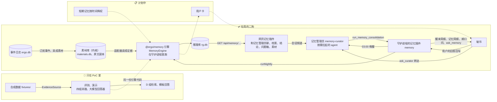

- 实线是现在就有的连接，虚线是计划中的；"同一份引擎代码"是说评测和线上用的是同一个包 `@ergo/memory`。
- 已定的不推翻（记忆地图"记忆 PoC"一节）：只有本人素材能用来推断用户（适配器照搬素材的来源等级，`canSupportUserClaims` 只认本人有效的）；用户卡和做梦阶段照原定。"记忆管理员是唯一写者"现在落成：**写推理库的只有记忆插件和记忆管理员这一侧**（每晚整理、删除登记、管理员记下用户对结论的表态、顺口问记问过和回写回答；离线的运维脚本 `memory:build` 除外），秘书和网页只读。
- 接进二狗的方式（ADR-0027、记忆地图）：守护进程侧在记忆插件里；agent 侧经 agent 贡献缝（工具、`wake` 上下文块）和那一个通用桥接扩展，不另做 pi 扩展；网页侧是网页记忆插件。记忆管理员的会话建在内核（组合根 `daemon.ts`），靠记忆插件提供的服务 `MEMORY_NIGHTLY` 跑整理，插件停用它就跟着停。

## 2. 模块和连接

在用的二狗分两半讲：素材这一半（2.1，08、129 号票起就有）和推理这一半（2.2，224–243 号票接进来的）。@ergo/memory 的内部见 2.3，计划中的见 2.4，模块之间怎么连见 2.5。

### 2.1 在用的二狗：素材这一半 ✅

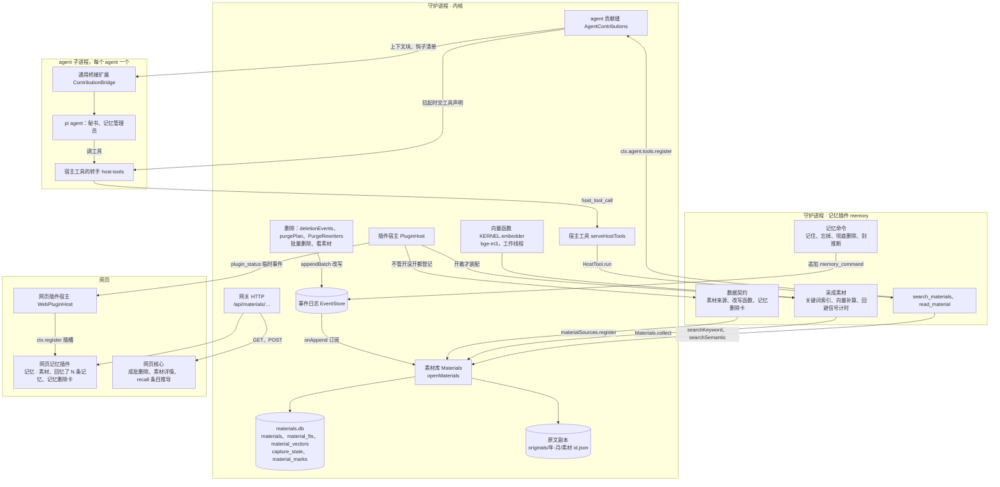

**内核的素材库**（129 号票起分两层，ADR-0006、ADR-0008）：

- 保管 `materials.db` 和原文副本：跟着事件日志照做记忆命令的删除和标记，给本人的话写原文副本，读和检索。
- 素材只从事件日志确定性地产生。agent 没有写素材、挑素材的工具。
- 数据源导入的素材（303 号票）：数据源插件在采集规则里用 `dataSourceMaterial`（`packages/daemon/src/data-sources/material.ts`）写成三种之一——观察到的本人行为（`observed_behavior`，本人、做）、别人写给你的（`received_writing`，外部、说，只留摘要，正文只进检索）、本人写的（`own_writing`，本人、说）；信封多一样出处 `origin`：哪个数据源、场景（结束时间、地点、和谁、场景标签）、这条落在哪些敏感类别（不写是数据源登记的全部）。`materials.db` 的 `materials` 多一列 `origin`（库版本 3），地点、和谁也进检索的索引文字。
- `materials.db` 是派生的，删了能重建：从事件日志采出的 ∪ 原文副本里事件日志已经没有的本人素材。
- 不随记忆插件停。理由是对用户的数据承诺：本人说过的每句话留一份不可修改的原文副本，删项目也不受影响；"彻底删除照常能删"。
- 删除（`memory/` 里的 `deletion.ts`、`purge.ts`、`rewriters.ts`、`bulk.ts`、`after-purge.ts`、265 号票的 `purged-evidence.ts`：问记忆的结果按证据编号引原话，彻底删除时按被删素材的证据编号抹掉；266 号票起秘书会话文件里跟在输入后面的那条上下文消息——记忆简报引的原话——也按同一规矩抹掉，覆盖了它的压缩摘要整段换掉；272 号票起问记忆管理员（`ask_curator`）的回答也照这样抹，删项目、删任务时连带彻底删除的系统记录也按证据编号找；272 号票的 `packages/daemon/src/memory/purge-backfill.ts`：守护进程启动时补抹一次 265 以前删过、事件日志里问记忆结果和记忆简报还留着的原话）、看素材（`browse.ts`）、项目内部的记录（`internal-records.ts`）也是内核的，代码在 `packages/daemon/src/memory/` 下，别处从 `packages/daemon/src/memory/index.ts` 取。

**守护进程的记忆插件，素材这一半**（`packages/daemon/src/memory/plugin.ts`，129、166、187 号票）：

- 数据契约（停用也登记）：显式记忆命令和长期没处理的卡这两类事件怎么变成素材、它们的改写函数、记忆删除卡；移除时"连数据删"删什么、留什么（225 号票起写明推理库保留）。
- 装配里素材这一半：开始采成素材、四个记忆命令（快速动作）、记忆插件的服务 `MEMORY`、秘书的 `search_materials` 和 `read_material`、系统提示里的条件"记忆"。推理这一半见 2.2。

**agent 贡献缝和通用桥接扩展**（128 号票，ADR-0027）：

- 插件经 `ctx.agent` 给 agent 三样：工具、每轮的上下文块（`input` 跟在每条输入后，`wake` 在唤起和压缩后）、钩子订阅。
- 工具由守护进程代为执行（`serveHostTools`），子进程里只转手；上下文块和钩子当数据经宿主协议下发，子进程里的 `ContributionBridge` 翻译给 pi。
- 记忆插件现在用了三样：工具（`search_materials`、`read_material`、`ask_memory`、`ask_curator`、`mark_woven_question`、`remember_memory`，只给秘书；最后一个 337 号票加，用户说"帮我记一句"时把原话交给记忆插件槽的宿主 `remember`，插件没在跑时没有）、`wake` 上下文块（醒来简报 `memory.brief`，只给秘书）和两块 `input` 上下文块（266 号票的记忆简报在前、264 号票的顺口问在后，都只给秘书、这一轮有内容才有）。钩子没用。266 号票起 `input` 块的文字可以异步算（会话等齐了再交这条输入，出错的那块当没有），还能给 `replyParts`：结构化的部分放进这一轮的第一条回话。

**网页，素材这一半**（167、187、193 号票）：

- 网页记忆插件 `packages/web/src/plugins/memory/`：记忆 · 素材（`MaterialsBrowse.tsx`）、"回忆了 N 条记忆 ›"那一行和它的详情、记忆删除卡。推理这一半的几层见 2.2。
- 这套记忆系统的名字「会意 / Subtext」和它的几处文案键只在 `packages/web/src/plugins/memory/system.ts` 一处定义（336 号票）；记忆页底部那块「会意 · 设置」的三个开关也画在这个插件里（`MemorySettingsSection.tsx`），不再出现在设置列表下面。
- 留在网页核心的：成批删除、素材详情（`packages/web/src/pages/more/`）、`recall` 条目怎么切段（`packages/web/src/state/memory-recall.ts`）。插件停用时核心照样切出条目，再换成占位。"回忆了 N 条记忆"画 `search_materials`、`read_material`、`ask_memory` 三种调用（`ask_memory` 是 263 号票加的：命中是简报里引用的证据背后的素材，详情写"问记忆：<问题>"），266 号票起还画每条消息自动带上的记忆简报（回话上的 `memory_brief` 部分当成一次"记忆简报"调用：命中照样是原话背后的素材，详情另列带了哪几条结论、为什么带——话题直接对上 / 同一领域 / 明说过的要求和禁忌 / 还拿不准 / 交互策略，经哪条路对上——点结论去它的证据与推理）；`ask_curator` 归在"调用了 N 个工具"里。

### 2.2 在用的二狗：推理这一半 ✅（224–237、242、243、263、264、266、270 号票）

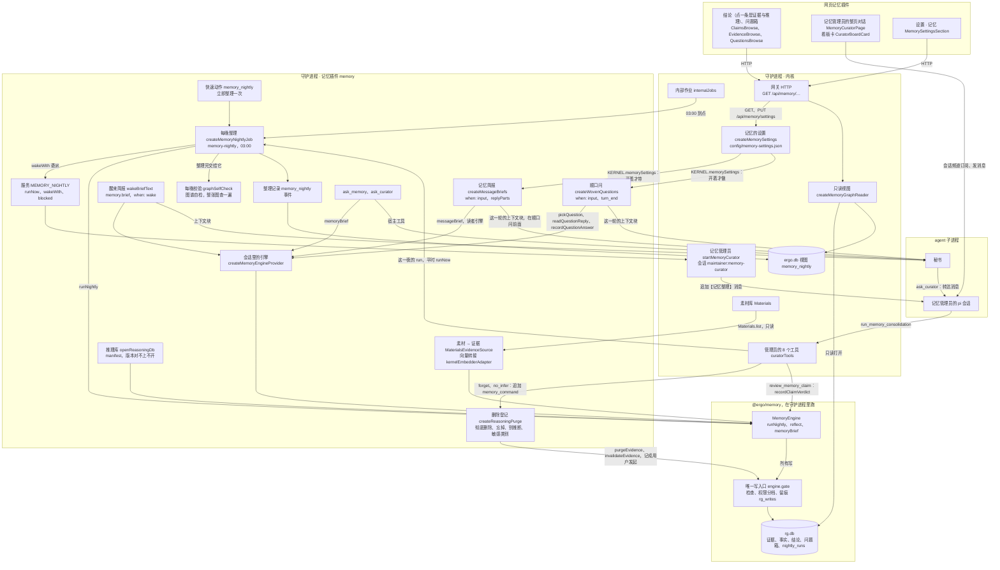

**推理库 `rg.db`**（225 号票，`packages/daemon/src/memory/rg-db.ts`）：

- 会意插件自己的数据目录里的一个 SQLite（`dataDirLayout` 的 `rgDb` = `<数据目录>/memory/subtext/rg.db`，由 `memoryProviderDir("subtext")` 算出来；338 号票之前是数据目录 db 区的 `db/rg.db`），随每晚备份快照走。表是 @ergo/memory 的（2.3），守护进程另加一张 manifest（`rg_manifest`）：格式版本、@ergo/memory 的表版本、整理模型名、向量模型名、抽取器、建库时间。
- **版本对不上不自动迁移**：不打开、记一条"要重建推理库"（待我处理一条，同一份提示只留一条）。重建只要素材在（删掉 `rg.db` 再整理，或 `npm run memory:build -- --rebuild`）。
- 谁打开：每晚整理、删除登记、管理员的改动工具、记忆页的只读视图都是"随用随开、用完关掉"；只有秘书的简报和"问记忆"共用一个懒打开、缓存着的连接（`engine-provider.ts`，232 号票；267 号票起它的写入口只读）。264 号票的顺口问要写问题箱和回答那条证据，267 号票起改用随用随开的可写引擎（`createWritableEngineUse`，库没建不顺手建），不在那份缓存的上面写。并发靠 WAL 和 `busy_timeout`。只读打开（`readOnly`）不写 manifest，库不在也不建。
- **唯一写入口**（267 号票，ADR-0030）：写推理库只有一个入口——@ergo/memory 的 `engine.gate`（`ReasoningWriteGate`，2.3、3.8）。每晚整理（记忆管理员的夜班）、管理员记下用户的表态、删除登记（忘掉、彻底删除、别推断、敏感类别）、顺口问（记问过、跳过和回避信号、"别问这个"、回答回写，都记"经秘书顺口问"）都经它：写之前按推理图谱的规矩检查（前提和推法写明、引用的证据真实存在、按推法封顶把握、往上抽过结构门槛、已验证的不压在没验证的前提上、依据变了依赖它的在同一次写里跟着降成猜测或撤回、不留悬空结论、依赖不绕圈、身份不改，329 号票起照 ADR-0032），权限分档（直接做 / 要有证据 / 要用户确认 / 永远不做），不合格的整次拒掉、原因交回调用方；每次写都留痕（`rg_writes`：谁写的、经谁转达、哪种写操作、推法、依据、原因），记忆页的修订列表标着是谁写的。秘书（`engine-provider.ts`，`reader`）和记忆页（`readOnly`）那几份引擎的写入口开成只读，写一律拒；维护者没有记忆工具。没打开的敏感类别（`lockedSensitiveTags`）交给写入口，不在上面推断。

**每晚整理**（225、235、236、237、242 号票，`packages/daemon/src/memory/nightly-job.ts`）：

- 记忆插件登记的内部作业 `memory-nightly`，每天 03:00。242 号票起到点不自己整理，先唤醒记忆管理员，由它调 `run_memory_consolidation` 跑同一份作业；它这一夜没跑成，作业自己补跑一次。开机补跑错过的那次（`catch_up`）赶在管理员挂上之前，走老路径。
- 跑一次：把素材库里的新素材读成证据（只读，按素材 id 跳过进过库的；303 号票起数据源的素材同一个数据源、同一种、同一天超过 3 条合成一条证据，当天的等这一天过完再读，一夜最多读进 12 条数据源的证据——见第 6 节）→ 补算向量 → @ergo/memory 的 `runNightly`（推后、最晚 05:00、判回答、编策略、出问题，见 4.4）→ 整理记录写进事件日志和 `memory_nightly` 视图，失败进待我处理。
- 模型：推理 `LlmReasoner`、抽事实默认 `LlmFactExtractor`（236 号票；`memory.extractor` 写 `rule` 换回规则版 `RelationalFactExtractor`），模型是 `DeepSeekChat`，key 只从环境变量 `DEEPSEEK_API_KEY` 读，没配就跳过这一夜。预算 `memory.maxModelCalls`（默认 200，抽事实、整理、判预测共用；270 号票起是一夜的总数，判完回答再整理的那一次只用剩下的），墙钟上限 `memory.nightlyTimeoutMinutes`（默认 60 分钟）。
- **预算按道花**（270 号票，@ergo/memory 的 `rg/nightly-lanes.ts`，见 4.3）：新证据排第一、用前 3/4——抽事实（按时间先后）、给新的观察出假设、新组出追问、判证据先问没问过的和检索结果里有新证据的；剩下的才重跑标着复核、到期复评那几组的旧追问，别的旧追问检索结果里没新东西不重判；往上抽留 1/4。整理完一条新证据记一条，没轮到的下一夜按时间先后接着做。整理记录多了 `spend`（每一道花了几次，加上对抗复核那份），`processedEvidence`、`pendingEvidence` 是整理完几条、还积压几条，整理报告和管理员的整理日记照实写。起因：10-22 到 10-25 连着四夜"新证据 0 条"、积压 87 条——每夜全部旧追问按建组先后重判，前段用光，新组的追问轮不到，记整理过又是全有或全无。
- **对抗复核、判预测**（263 号票接上，照 226、227 号票面）：打开引擎时给复核模型 `reviewer` 和判预测的 `LlmPredictionJudge`，都是同一个模型。对抗复核在 `reflect()` 末尾，还没复核过的 need/value 推断结论交给不看结论的复核员，判 no 的加复核标记；它有自己的预算（每次 `reflect` 最多 5 次，不占 `memory.maxModelCalls`；一夜最多两次 `reflect`，所以最多多 10 次）。判预测也在 `reflect()` 末尾，到期还开着的每夜最多 10 条，用 `memory.maxModelCalls` 剩下的那份；没有新证据的不问模型。结果进整理记录（`review`、`predictions`）和管理员的整理日记。
- **每晚校验**（267 号票；326 号票起是 @ergo/memory 的图谱自检 `graphSelfCheck`，插件在 `plugin.ts` 里交给作业）：整理完把整张推理图谱查一遍（读得出来、字段合格，引用都在，依赖不绕圈，已验证的结论压着的前提都已验证、还活着的前提都在、推论都有前提，见 2.3），已验证却压在没验证前提上的经写入口降回猜测，别的不合格加复核标记（每晚校验，夜班），写进整理报告和整理记录（`validation`）。记忆系统自己的 TypeScript，不起别的程序，本机缺什么都照样查；只有校验器自己出错才跳过并写明原因，整理照常算跑成。写入口这一夜拒了几处也记下（`refused`），原因在整理报告里。
- `memory.enabled` 写 `false`：这台机器上不排作业、不建库，别的照常（235 号票）。手动整理一次：快速动作 `memory_nightly`（用户点了才跑）、管理员的工具、运维脚本 `npm run memory:build`，都是同一份作业，不吃掉当天 03:00 的那一次。

**记忆管理员**（242、243 号票，`packages/daemon/src/memory/curator.ts`、`curator-tools.ts`、`curator-link.ts`，系统提示 `packages/daemon/prompts/memory-curator.md`）：

- 一个**按需拉起**的 agent（243 号票：守护进程起来时只建壳，不占 `agents.maxLive` 的名额；有人跟它说话、或者 03:00 唤醒时才拉起，闲置到 `agents.idleMinutes` 退出）。会话频道 `maintainer:memory-curator`，网页上记忆管理员的整页对话（285 号票起从记忆页顶上"和记忆管理员聊"那张卡进）直接订阅、发消息；⚙ 里能改它的提示词、清空、看上下文用量，模型先跟随秘书。
- 12 个工具：整理一次、看一条结论、记下用户对结论的表态（对 / 不对 / 拿不准）、忘掉、别推断、看问题箱，加复用的 `search_materials`、`read_material`；284 号票加了了解你访谈的四个（开一次、收尾、"这个别记"、档案信息出核对卡，见下面"了解你访谈"）（工具表见 3.4）。没有 bash、联网、改配置、删素材库的工具。语音插件开着时另有口语总结、发语音两个（284 号票接上语音回复，用户按住说话时回话合成语音）。
- **记下用户的表态**（263 号票）：`review_memory_claim` 不直接改库，走 @ergo/memory 引擎的 `recordClaimVerdict`——记一条本人的表态证据（原文是固定的一句"用户经记忆管理员说这条结论对：「……」"，出处 `verdict:<结论编号>`，不抽事实），说对的走 `confirmClaim`（标"你确认过"、决定性支持），说不对的走 `rejectClaim`（决定性反证，撤回、墓碑指向这句表态），说拿不准的走 `markClaimForReview`（加复核标记、真值状态不动，下一次整理按证据重判）。整理计分认决定性的支持和反证，所以下一次整理不会改回去；用户改主意时先前的表态按"被纠正"收回。用户自己明说的结论撤不掉（它跟着那句话走），工具交回那句话的素材编号，让管理员用别推断或忘掉；因为依据不在了才撤回的不能直接改回已验证。267 号票起这一路也经唯一写入口（记成"用户的表态 · 经记忆管理员"），写入口拒了时什么都没写，工具把原因逐条交回。
- 03:00 那一轮：会话里追加一条"【记忆整理】"消息（一夜一条）→ 它调 `run_memory_consolidation` → 照结果写一段**整理日记**。它自己每夜额外最多调 `memory.curator.maxModelCalls` 次模型（默认 8），次数记进同一条整理记录（`curatorModelCalls`）。
- 和秘书的分工写在两边的系统提示里：轻问题秘书自己 `ask_memory`；深聊来龙去脉、要改、要忘的，秘书用 `ask_curator` 转给管理员，等它答完（最多 90 秒）再转述。

**了解你访谈**（284 号票，`packages/daemon/src/memory/interview.ts`、`interview-tools.ts`、`interview-guide.ts`，网页 `packages/web/src/plugins/memory/InterviewCard.tsx`、`InterviewFilesCard.tsx`；CONTEXT.md"了解你访谈"，内部计划第 4 节第二批）：

- **记录**：记忆插件的服务 `MEMORY_INTERVIEWS`（`createMemoryInterviews`），事件在 internal 频道、类型 `memory_interview`（约了 `invited`、开始 `started`（带开场消息的编号）、结束 `ended`（带档案核对卡的编号）），现在的样子（开着的那次、聊过哪几个主题、上次约 / 聊的时间）每次从记录现算（`interviewSnapshot`）。开了 3 小时还没收尾的当它放下了。
- **五个主题，一次一个**：家里的人和基本情况、工作和一天怎么过、人生里几次重要的选择、在意什么和烦什么、想要什么样的帮忙（协议包 `memory-interview.ts` 的 `INTERVIEW_TOPICS`）；聊透了（`finish_interview` 的 covered）记成聊过，下次约下一个；五个都聊过改成每月一次"最近有什么变化"（`changes`）。
- **怎么发起**：每周六 10:00 的内部作业 `memory_interview_invite`（约访开着、没在聊、离上次约 / 聊满 6 天，每月的满 27 天）在待办里放一张不卡事的约访卡（卡片类型 `interview`，上一张没点的过期）：开始、下次再说、不想做了（关掉设置 · 记忆里的约访 `interviewInvites`，能重新打开）。用户随时能开：记忆管理员对话里输入框上面那一行的"开始访谈"（285 号票起；以前是记忆页的"找管理员聊聊"，`POST /api/memory/interview`）、管理员会话里的 `/interview` 斜杠命令、跟秘书说"我想做个访谈"（快速动作 `start_interview`，原话里有"访谈"算点明、直接开）、在管理员的会话里直接说（`begin_interview`）——都进同一次，已经开着不重开。从约访卡、记忆页、秘书那里开的往管理员的会话里放一条"【了解你访谈】"开场的系统消息（`interviewOpening`：只有一行"【了解你访谈】这次聊：<主题>"，会话里用户看得到；从哪开的、访谈编号这些内部的东西不写），把它叫起来问第一个问题。
- **问法**：写在管理员的系统提示（`memory-curator.md` 的"了解你访谈"），访谈开着时另外跟在它每一轮输入后面（会话的 `inputContext`，会话里看不到；`interviewInputContext`）：开场那一轮（按开始时记下的开场消息编号认）带从哪开的、访谈编号、这次的主题从哪几方面问起和问法要点，用户每回答一次带"第几个来回"和要点提醒（8 个来回起提醒准备收尾）——用户改过提示词也照样带到。要点：一次一个问题；往深一次只上一层（"当时主要图什么"）；"我注意到……是不是……"带两三个选项，不连追"为什么"；不把动机往高处拔；十来个来回、10–15 分钟；随时跳过、停下。
- **访谈里的话**：访谈开着时，用户在管理员会话里说的话（打的字、语音）归属里带着访谈编号和管理员问的那一句（`MessageScope.interviewId`、`interviewQuestion`：说话那一刻管理员这次访谈里最近的一段话，取末尾 200 字；组合根的 `userMessageScopeOf` 现取 `messageScope()`；排队的消息照排进来时的、语音对象跟着带），素材的采集规则据此给情境标签 `interview`（`INTERVIEW_CONTEXT`）——"来自访谈"，记忆页的素材上有标记、检索结果里写着；问的那一句作为上下文切段排在用户的话前面（`interviewQuestionSegments`：一段 `agent_output`，来源 agent，只记说明"记忆管理员问：……"，`locator.field` 是 `interviewQuestion`；本人的原文仍然只有用户说的话，摘录不算它），"是第二种"这种短答当晚整理时连着问的那句读（证据原文是"记忆管理员问：……\n是第二种"，场景照旧只留场景维度，`interview` 不当场景）。说"这个别记"：`forget_interview_answers` 按这次访谈的消息往前数几句，走现有的忘掉（`memory_command`，`from.kind` 是 `curator`），不留在素材里。
- **档案信息**（用户 2026-10-25 定）：聊的时候管理员听到了就调 `propose_personal_file` 记下（`collectFile`：按 281 号票的快速动作 `personal_file` 的执行器校验，拆成一人一项、同一个人的同一项以后记的为准，只记在访谈的服务的内存里，不出卡）；收尾时这次记下的合成**一张**档案核对卡（卡片类型 `interview_files`，进会话和待办），按人分组逐条"确认""不记"——"确认"那一刻再规范化一遍（前一条刚新建的人，后一条写进他那份），经 `personal_file` 的执行器写进档案（同一个写入口，操作记录按这一条的动作编号，留痕 `via: "curator"`、`basis: "confirmed"`），都定了卡片算处理完。不一项一张，283 号票的"每天一张"也不并进来（访谈刚聊完时核对最顺）。283 号票留的口子（`KERNEL.personalFiles.addCandidates("interview", …)` + `composeCandidates()`）没用上，原因：283 的候选按它的规矩不收号码类、住址和记下的事，还没档案的人要提到 3 次才提议建档（一次访谈里家人一般只介绍一次，卡上就没有他）；`composeCandidates()` 往还没处理的那张每天的卡里加，也会带上每晚攒的别的候选——都和"访谈收尾当场一张、只列这次听到的"对不上，要用就得改 283 这几条用户定的规矩。所以访谈照旧用自己的卡 `interview_files`，写进档案走同一个 `personal_file` 执行器（283 的每年提醒的勾也照样有：生日、纪念日那条默认勾着、提前 3 天，确认时一起建）。没在访谈里时 `propose_personal_file` 照 281 号票出一人一张的核对卡（`alwaysAsk`）。彻底删除档案里的值时，按留痕的动作编号、卡片编号找到这张卡（每个版本换成删除标记）和记下它的那次调用（`purge.ts` 按卡上这一条记着的调用编号找）。守护进程在访谈中途重启，之前记下的档案信息会丢（`finish_interview` 交回的条数看得出来）。
- **收尾**：管理员说"今天我记下了这些"、用户说对不对；`finish_interview` 记结束、会话里放一句给用户看的说明（记下了几段、主题算不算聊过），同一事务出档案核对卡（工具交回卡片编号，会话里放一条带卡片的消息）。管理员的总结只是它的回复：不进素材、不写成结论（它没有这样的工具，提示词也写明）。
- **用量**：访谈就在管理员的会话里，模型调用记在记忆管理员名下（账本角色 `curator`，消耗页"记忆管理员"那一行）。

**个人档案和记忆、提醒联动**（283 号票；记忆插件这一侧 `packages/daemon/src/memory/personal-files-link.ts`，内核这一侧 `packages/daemon/src/personal-files/memory-link.ts`、`annual.ts`、`candidates.ts`，@ergo/memory 的 `kg/person-info.ts`、`kg/profile.ts`、`llm/guarded-chat.ts`）。档案在内核（281），记忆插件只经内核服务 `KERNEL.personalFiles` 取，档案页经 `MEMORY.learnedAbout` 现取；插件停用时档案照常：

- **生日、纪念日 → 每年提醒**（内核，不经记忆）：生日和名字里带"生日""纪念日"的自定义字段（`isAnnualField`），值认得出公历的某月某日（`monthDayOf`，农历的不认）时一起开每年提醒（默认提前 3 天）：核对卡上一个勾（默认勾着，确认时一起建）；原话里明说了、直接写进档案的照默认直接建，回执写明"已建每年提醒（提前 3 天），档案页可改可关"（302 号票；283 时是跟着回执出一张候选核对卡问一句）；档案页上随时开、改天数、关。302 号票起档案有内置的"纪念日"字段（能有几个、各带名字，`anniversary:<名字>`），名字带"纪念日"的自定义字段照旧算。开了就在提醒插件里建一条每年的提醒（282 的 yearly，生日往前数 N 天的 09:00，`monthDayBefore`）；字段改了提醒跟着改（日子、称呼），删了（忘掉、彻底删除、删整个人）、撤销到没有值跟着删；值改成农历那条先删、设置留着；看板上取消了当用户关掉。设置记在档案的事件里（`reminder_set` / `reminder_cleared`），提醒插件停用期间开的守护进程下次起来补建。
- **二狗了解到的**（`learnedAbout`）：档案里的人按称呼、别名对到事实图谱的人物实体（@ergo/memory 的 `entitiesForPerson`，只认 `person` 实体，只读、不写别名），列和他有关的结论（支持、反驳、以那几条事实为前提的，陈述里提到他的）、现在还成立的事实、那几条事实背后的原话；本人那份列对用户的理解里成立的结论和最近的事实。记忆插件没启用写"记忆插件没启用"，推理库没建好、读出错也只写原因，不报错（接口照样 200）。
- **每晚攒候选、第二天一张核对卡**：每晚整理跑完以后（`linkNightly`），从这一夜新来的本人的话里认关于某个人的固定信息（称呼、别名、关系、生日、单位、过敏；号码、住址不收）：模型版 `LlmPersonInfoExtractor`（整理同一个模型、同一份预算里剩下的，最多 `PEOPLE_MAX_CALLS` 次，一次 20 条话；名字、关系、值都要在引的原话里，不在的丢掉），`memory.extractor` 写 `rule` 时用规则版；每条话只看一次（`person_info_log`）。认出来的交给档案攒成候选：已有档案的人（按称呼、别名对上）值和档案里一样的不收；还没档案的人提到够 3 次（`NEW_PERSON_MIN_MENTIONS`）才提议建档。攒完合成一张候选核对卡（卡片类型 `personal_file_suggest`，进待我处理，一天一张、同一天再有就往里加），按人分块、每条一个勾，卡上只写哪几天听到的、不放原话；勾了的写进档案（留痕：经记忆管理员 · 你在卡上确认），没勾的以后不再提。出处的话被忘掉、彻底删除时只靠它的候选作废（彻底删除连卡上的值一起改写）。推断出来的永远只当候选。
- **新值作废旧事实**（`createProfileFactExpiry`、@ergo/memory 的 `expireProfileFacts`）：档案的字段换了新值（第一次填的不算），事实图谱里这个人的、说的是旧值的状态类事实到期（`validTo` 写成换值那一刻，状态不变），以它为依据的结论加复核标记；经唯一写入口，写操作 `correct`、用户发起 · 经个人档案。换的时候马上做（随用随开的可写引擎）；每晚整理时再对一遍（插件停用期间换的、当晚才抽出来的旧值事实）。
- **档案摘要当整理的背景、号码不进提示**（`guardNightlyChat`、@ergo/memory 的 `withBackground`、`withRedaction`）：每晚整理推理那几步（出假设、追问、判证据、往上抽、复核）的系统提示末尾加一段【个人档案摘要】（只当情境、不是证据，≤1200 字），记忆管理员的系统提示末尾也加；号码类字段（证件号、护照号、驾照号、电话、自定义里 6 位以上的一串数字）和住址的值不列（最近换过只写"住址 某天换过"）。每晚整理发给模型的每个请求（系统提示和用户那段）里这些值连同以前的值都换成占位（"［号码已略去］""［住址已略去］"，号码中间夹着空格、短横也认）。

**秘书怎么用记忆**（232 号票，`context.ts`、`ask-tool.ts`；266 号票 `message-brief.ts`）：

- **醒来简报**（每轮简报）：秘书每次醒来（和压缩之后）多一块上下文 `memory.brief`，抬头【醒来简报】（266 号票前叫【记忆简报】，改名免得和下一条混）：需求、价值观各最多 3 条（带"用户说的 / 推断的 / 用户确认过"和把握）、还拿不准的竞争解释最多 2 组，≤1200 字；什么都没有就不出这块。同步现算，不调模型。264 号票起简报里不再放"问题箱里该问的 1 个"：顺口问改走后面那条。
- **每条消息的记忆简报**（266 号票，`packages/daemon/src/memory/message-brief.ts`、@ergo/memory 的 `messageBrief`；CONTEXT.md 的"记忆简报"）：用户在秘书会话里亲口说的每一句（文字和语音识别出的字；转达的、页面命令不算），先用本机检索和相关门槛判有没有相关的记忆（`relevantForQuestion` 的三条路和两道向量门槛，不调模型）；有直接对上的结论才带，在这一轮输入的尾部追加一块【记忆简报】（不进系统提示、不改前面的历史，前缀缓存不破）：对用户的理解里过了门槛的结论连支撑它的原话、明说过的要求和禁忌、还拿不准的竞争解释、交互策略，上限照 `BRIEF_LIMITS`（实验 D 组那一档；不带 D 组的"记录"那一节，也不带没过门槛、只是"相关"的结论）。同一段对话里（到压缩、清空、换模型、回退切换分支为止）带过、没变的不再带，只补新的，末尾一句点名"前面带过、没变的不再重复"；状态、把握、说法变了的重带。守护进程重启后从会话里这一段带过的 `memory_brief` 部分找回来。"好的""谢谢""嗯"这类短应答不带；超过 3 秒没算完这一轮就不带（守护进程起来 20 秒后先在后台算好相关门槛用的背景语料向量；查询向量按句子记住最近 16 句，一句话的几处检索只算一次）。结构化的部分（`memory_brief`：带了哪几条、为什么带、经哪条路对上、指纹、估的 token）放进这一轮的第一条回话，网页画进"回忆了 N 条记忆"；账本记一笔 `context_usage`（估的 token，钱按秘书最近一次用的模型的没命中缓存单价粗估），用量页单列"记忆简报"，这些 token 本来就算在秘书的输入里、不另加进合计。设置 · 记忆里能关（默认开）。醒来简报、问记忆照旧。线上近一周实测：每条用户消息平均多约 440 token、多约 0.35 秒（Comments 见 266 号票）。
- **顺口问**（264 号票接进线上，271 号票改成秘书用自己的话问；`packages/daemon/src/memory/woven-questions.ts`，照 198 号票的规矩，流程见 4.8）：秘书开始处理用户的每一句时，记忆插件的 `input` 上下文块先看上一轮——秘书紧挨着这句之前的那一轮标过某个"问过、等回答"的问题（会话里那次 `mark_woven_question` 的工具调用），就按那个问题读这句（规则版，不调模型，只认明显的）：在答就把这句话的素材读成证据草稿、`recordQuestionAnswer`；"跳过"记跳过一次；"别问这个"这一类不再问；认不出的（隐含的回答、在说别的）不动，问题还等着，留给每晚整理时记忆管理员判（下一条）。再用这句话挑这一轮要不要顺口问（`pickQuestion` 只看不记、`settle: false`：话题对上、不急、上一轮不在等用户做决定、今天还没问过），挑中了就交一块【顺口问】：问题的编号、要问的、为什么问（要弄清的那几种说法，写明是猜测、别说给用户听）、怎么问（跟着这一轮的话题和语气用自己的话带一句，不照抄、不说"顺便问一句"，只问具体的事、不带诱导，不合适就别问，用户问起为什么照实说）、问了先调 `mark_woven_question` 标一下。这一轮做完（`turn_end`）秘书标了、也真的回了话才记"问过"；没标的不算（回话里原样带了那一句也不算），标错编号的工具回错、也不算。秘书的工具只在内存里记个标记，写由记忆插件代记忆管理员写——秘书照旧没有写推理库的路。267 号票起这几样写都经唯一写入口、用随用随开的可写引擎，留痕写明谁写的、"经秘书顺口问"（`WOVEN_VIA`）：回答（连同回答证据入库、明确时马上判的确认和重定那组）、跳过是用户的表态，"别问这个"是用户发起（夜班、管理员自己下的写入口拒），记问过是记忆管理员。设置 · 记忆里能关（默认开，`createMemorySettings`，配置区的 `memory-settings.json`）。
- **夜里判回答**（271 号票，@ergo/memory 的 `rg/reply-judge.ts`，守护进程的 `packages/daemon/src/memory/reply-follow-ups.ts`，流程见 4.8）：每晚整理时，问过、还在等回答、不是当天才问的问题，记忆管理员（整理同一个模型 `LlmReplyJudge`、同一份预算）把问题、为什么问、秘书当时怎么问的、用户之后的几句话（同一个会话、从秘书标了它的那一轮之后、24 小时内、最多 6 句，每句对到能当依据的本人证据）一起看：答了 → 那句话当回答经 `recordQuestionAnswer` 回写（读成模型说的是 / 不是 / 说不好；规则也读成同一边、又有加重的才算明确，马上判，别的同一夜按判法记强的），留痕写明"用户的表态 · 经记忆管理员夜里判"；没答 → 算跳过一次（夜班）；拿不准 → 留到下一夜（经过里记一笔 `unsure`），下一夜用户又说了话再判一次、没再说什么就当没答，最多两夜。一句都没说的不问模型、直接当没答。预算：判回答那一道从前段里划一小份保底（`min(10, 这一夜要问模型的问题数)`），排在新证据之后、重跑旧追问之前（4.3）。白天挑问题不再把问了没答的记跳过（`settle: false`），统一夜里判过再记。
- **问记忆** `ask_memory`：按需深查推理图谱，交回 D 式的记忆简报（记录 + 对用户的理解 + 还没分出胜负的解释 + 明说过的要求和禁忌），≤4000 字。只读、不调模型。库用不了时回"记忆还没准备好"。263 号票起还交回结构化的调用记忆（`MemoryRecall`，`source` 是 `ask`），网页画进"回忆了 N 条记忆"那一行。
- 素材检索 `search_materials` / `read_material` 照旧。秘书的记忆工具依次是 `search_materials`、`read_material`、`ask_memory`、`ask_curator`、`mark_woven_question`（271：标一下这一轮顺口问了哪个问题）。
- 注意时间差：`search_materials` 查的是素材库（马上就有），`ask_memory` 和两种简报读的是推理库，只到上一次整理为止。

**记忆页的只读接口**（233 号票，`packages/daemon/src/memory/graph.ts`）：

- 内核这一侧（同 `browse.ts`）：组合根建一份交给网关，四个 `GET /api/memory/…`（概览、结论列表、一条结论的完整解释、问题箱），每次只读打开、读完关掉。库没建、版本对不上、正被整理占着、读的时候出错，一律 200 加 `ready: false` 和一句原因，不 500。
- 网页记忆插件的记忆页（285 号票重排，用户 2026-10-26 定的）：最上面一张卡**和记忆管理员聊**（每晚 03:00 整理、最近一次的结果，了解你访谈聊到哪了；点了是记忆管理员的整页对话，宽屏也不留栏目，输入框上面一行访谈的进度和"开始访谈"）；下面四栏**档案**（281 号票的个人档案，按"我 / 家人 / 重要的人 / 其他人"分组；记忆插件停用时回到"更多"里）、**结论**（按层分组、按状态筛；点一条是**证据与推理**，`#/more/memory/claims/<结论编号>`：证据链、支持和反证、竞争解释、推理、修订——233 号票时它自己是一栏，旧地址 `#/more/memory/evidence[/<编号>]` 换过来）、**问题箱**（264 号票起每个问题另写跳过几次、你的回答和读成什么、判的结果、经过：几点放进来、顺口问了、跳过、你答了……；271 号票起经过里多一种"夜里拿不准你答没答，等下一夜"）、**素材**；最下面一行数据源的链接；设置搬进了记忆页最下面的「会意 · 设置」折叠块（`MemorySettingsSection`：每条消息自动带上相关记忆、在对话里顺口问、每周约一次了解你访谈三个开关，拨哪个只存哪个；336 号票起不再挂在设置列表下面，用户定的）；素材上标着"来自访谈"；看板"运营中"一组多一张"记忆整理 · 每天 03:00"，点进去是记忆管理员的整页对话（只在记忆插件运行时出现）。守护进程重启那几秒回 502 时页面自动重试两次。

**删除和隐私**（234 号票，`purge-rg.ts`、`privacy.ts`）：

- 订阅素材频道上的 `memory_command`：彻底删除 → @ergo/memory 的 `purgeEvidence`（删证据和只靠它的事实，依赖的结论加复核标记、只靠它的推断停用等重推，相关问题过期，写一条只有 id 的审计 `rg_purges`，WAL 检查点）；忘掉 → `invalidateEvidence`（证据清原文、只靠它的事实撤回，依赖的结论照来源失效走：加复核标记、已验证的降回猜测、前提都不在了的撤回）；别推断 → 已进库的证据、事实撤掉，结论同忘掉，以后不读成证据。
- 敏感类别 `memory.sensitiveCategories`：健康、情绪、财务、关系、位置（295 号票为数据源加的）默认允许记录、不用于推断；对话里的素材只有健康按场景标签 `domain=health` 生效，其余四类是开关占位。303 号票起数据源的素材按出处 `origin.sensitive` 生效（`inferableByOrigin`：有一类没打开整条不读），场景里的地点算位置（`placeInferable`：位置没打开时证据原文里不带地点，也不拿它推场景）——位置这一类就这样接上了。
- 启动时 `reconcile` 把插件停用期间下的命令、以前进过库的健康证据补做一遍；303 号票起数据源素材的证据照现在的敏感类别重读一遍（`dataSourceDraftOf`），读不出来或原文变样的（关了位置要去掉地点、开了要带上）撤掉，下一夜照新设置重读。
- 267 号票：推理库这边一律经唯一写入口，记成"用户发起"（忘掉、彻底删除、别推断只由用户发起，夜班、管理员自己下的写入口直接拒），经谁转达写进留痕（`commandOrigin`：记忆删除卡、设置页成批删除、记忆管理员、删项目 / 删任务时连带、断开数据源时连带（295）；敏感类别是"敏感类别设置"）。

**数据搬家**（338 号票，`packages/daemon/src/memory/migrate-rg.ts`）：记忆变成可替换的插件以后（337），推理库要住在插件自己的数据目录里。布局由 `config/data-dir.ts` 的 `memoryProviderDir(id = "subtext")` 算（`<数据目录>/memory/<id>/`）：`rgDb` 指向它下面的 `rg.db`，老位置 `db/rg.db` 另叫 `legacyRgDb`，只有迁移读它、引擎不再打开。组合根在**任何引擎打开之前**（`plugins.start()` 之前——记忆插件一装配就会打开推理库）调 `migrateReasoningDb`：如果 `db/rg.db` 还在、而 `<数据目录>/memory/subtext/rg.db` 还没有，就先复制一份到 `<数据目录>/backup/pre-migration-<时间>/`、再把 `rg.db` 连同 `-wal`/`-shm` 移过去，并写一个 `memory/subtext/migrated.json` 记着从哪来、什么时候、备份在哪；目标已经有了就不再动（幂等，老文件还在的话只记一条日志、不覆盖），两边都没有就是新装、什么都不做，回滚就是把它们移回 `db/`。**搬不成（文件被占用、权限）不拦启动**：组合根接住异常、记一条写明"守护进程按还没搬继续、记忆插件会新建一个空库、以前的结论看不到"的日志，守护进程照常起来；处理完权限或占用之后重启会再试一次（失败的这一下不动老库）。素材库 `db/materials.db` 和事件日志不搬（那是内核的）；备份快照还是整个数据目录，`memory/<id>/` 自然跟着走，恢复也不用特判。

**素材库改名**（ADR-0035，`packages/daemon/src/materials/migrate-materials.ts`）：素材库是内核的（ADR-0006），文件以前叫 `db/memory.db`——和记忆插件的数据目录（`<数据目录>/memory/<插件 id>/`）撞了名字，容易以为是一个东西，所以改叫 `db/materials.db`。老位置 `db/memory.db` 在 `config/data-dir.ts` 里另叫 `legacyMemoryDb`（只有迁移读它），组合根在**打开素材库之前**（`openMaterials` 之前）调 `migrateMaterialsDb`：先备份到 `<数据目录>/backup/pre-migration-<时间>/`、再把库连同 `-wal`/`-shm` 搬到新名字，写 `db/materials-migrated.json`；目标已经有了就不动（幂等），两边都没有是新装，搬不成不拦启动——记一条"会用新的空库、以前的素材从事件日志重建、原文副本一条不动"的日志，素材库打开新的空库、从事件日志补采。两处搬家共用同一套文件操作（`packages/daemon/src/migrate/legacy-db.ts` 的 `migrateLegacyDb` / `rollbackLegacyDb`）。

**降级**（235 号票）：向量模型不在 → 整理照常、检索退回关键词；整理模型不可用 → 这一夜不跑、素材不丢、下一夜补；推理库打不开 → 素材检索照常，简报空、`ask_memory` 回"还没准备好"、记忆页 `ready: false`；整理跑一半崩 → 已写的不丢、下一夜接着做。

**运维脚本**（`packages/daemon/test/memory/` 下，都不进守护进程）：`npm run memory:replay`（`replay-materials.ts`，素材库副本读成证据打一行摘要，224）、`npm run memory:build`（`build.ts`，离线按素材库整理一遍，可重建、预算自定）、`npm run memory:acceptance`（`acceptance.ts`，只读的上线验收，235）、`npm run memory:dump-template`（`dump-template.ts`，推理库导出成推理图谱模板的 YAML，253、256；267 号票起导出规则在 @ergo/memory 的 `exportReasoningTemplate`，每晚校验用同一份）。见 4.12。

### 2.3 记忆引擎 @ergo/memory（✅ 线上走到的 / 🧪 只在 PoC 里的）

节点里标 🧪 的只在评测、演示、测试里跑；其余线上的每晚整理、问记忆、删除登记都走得到。

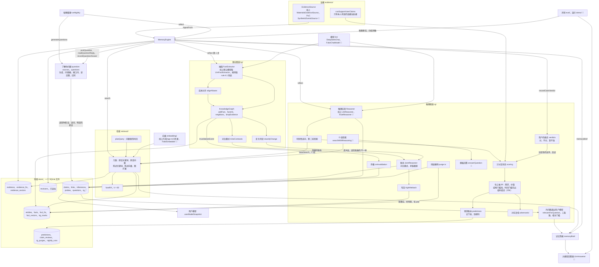

- **证据来源**：`EvidenceSource` 接口。线上是守护进程的 `MaterialsEvidenceSource`（224 号票，第 6 节），PoC 里是合成数据适配器 `SyntheticEventsSource`。
- **存储**：`MemoryStore`，一个 SQLite 文件。每次新建、改动都追加一条修订，修订日志库里挡住改和删。推理图谱的账本（`rg_*` 表，`RgRegistry`）是推出来的簿记，不进修订日志。226 号票加了预测账本 `predictions`，227 号票加了 `claim_reviews`，234 号票加了删除审计 `rg_purges`，267 号票加了写入口的留痕 `rg_writes`，272 号票加了问过的账 `rg_asked`（都是新表，不升版本）；表版本 `SCHEMA_VERSION` 是 2。
- **唯一写入口**（267 号票，`rg/write-gate.ts`，ADR-0030）：`engine.gate`。证据、事实、结论、关联、推断、追问、预测这几样只能经它写：`gate.write({ op, actor, via, reason }, fn)` 开一次写，fn 里调和存储同样签名的写操作（不开就报错）；写完按这一次留下的修订圈出碰过的对象，按推理图谱的规矩查一遍（329 号票起照 ADR-0032：这次成了已验证、动了依据的结论前提都得已验证；依据变了，依赖它的已验证要在同一次写里降回猜测或改挂到直接证实上，前提都不在了的要在同一次写里撤回或加复核标记；这次写的推断不能让依赖绕圈；结论的身份 kind 不改。引用存在、前提还在、前提已验证这几条和图谱自检共用 `rg/graph-rules.ts`；326 号票那套"自动降成假设"去掉了），不合格的整次回滚（保存点）、抛 `ReasoningWriteRefused` 把原因逐条交回；合格的留痕。拿着存储的模块用 `rgWriter` / `rgSession`。整理里每一组、每一条结论各开一次写，被拒的那组记进 `dropped`（`stage: gate`）、别的照常；用户的表态、删除被拒就照抛给调用方。权限分档、检查和"永远不做"的几样见架构文档第 7.10 节。引擎可以开成只读（`writeGate.readOnly`）、可以锁住几类敏感场景标签（`writeGate.sensitiveTags`）。
- **每晚校验**（267 号票，`rg/nightly-validate.ts`；326 号票起校验器是图谱自检 `rg/graph-check.ts`）：`runNightly` 给了 `validator` 就在整理完交给它查（守护进程给 `graphSelfCheck`，测试也有给假的）。图谱自检直接读库、整张图查一遍，六样：`readable` 每条证据、事实、结论、推断、关联读得出来、字段合格（`domain/validate.ts` 的 `problemsOfX`，和存储写入前同一份）；`exists` 还活着的结论的成立推断前提、关联目标、竞争的结论，还在的事实的证据都真实存在；`cycle` 结论 → 前提结论不绕圈；`dependents` 传播铁律：已验证的结论，成立推断写的前提都已验证（结论已验证、事实成立或被新值取代、证据有效；拿不准的事实算没验证——和写入口是同一条规矩，写入口在依据变的那一刻查，这里查整张图）；`dangling` 还活着的结论前提一条都不在了；`premise` 还活着的结论连一条写了前提的成立推断都没有（329 号票补的两样；标着复核的等整理重判，不查）。问题一行一条、行首是主语的 id。违反铁律的交回 `downgrade`，`validateNightly` 经写入口降回猜测（前提照挂、保留，往下的已验证跟着降，`NightlyValidation.downgraded`）；别的问题，是结论的这条加复核标记，是事实、证据的，以它为前提或支持的结论加复核标记，结果进整理报告（`NightlyReport.validation`）。坏数据读不出来的只报、不让整个检查停下。被新值取代的事实算还已验证：那是观点变了，旧值在它的有效期里是对的。导出 YAML（`exportReasoningTemplate`）只给 `memory:dump-template` 用，每晚校验不再用它。
- **事实图谱**：抽取（规则版 `RelationalFactExtractor`，`rule:4.1`；模型版 `LlmFactExtractor`，线上默认）、实体对齐、变化判定、四个时间、场景按维度比、精炼陈述。199 号票起别人来约用户的事当一个事件实体，记人和人的关系，同一个人的两个叫法对到一个实体上；207 号票起规则版不把问句、商量的话抽成说过的事。见架构文档第 4.2、5、7.8 节。
- **检索**：四种模式，几路 RRF 融合，时间过滤，场景默认往后排，精炼陈述降权。线上只有记忆简报用到 C 组（`hybrid_kg`）；A、B 两组和 D 组（`hybrid_kg_rg`）只在评测里用。见架构文档第 6 节。
- **推理图谱**：推理实现只交关联；状态和置信度由 `scoring.ts` 统一算；往上抽需求、价值（256 号票起时间跨度不够的先出、标成临时结论、置信度压成低）；失效传播；和知识图谱联动（对比模式、矛盾根源、写回）；为问题调出相关的用户模型（196 的三条路、202–206 的相关门槛）。见架构文档第 4.3、7 节。
- **用户模型**：不存，每次 `getUserModel` 从推理图谱现算，分近期状态、偏好和目标、长期价值取向三层，另列"还拿不准的"。线上每轮简报用它。
- **模型版**：DeepSeek。线上每晚整理用真模型（需要 key）；评测只喂合成数据，跑之前先报预计费用；测试全用假模型。
- **记忆简报和大模型回答器**（216、219、222、228 号票）：`memoryBrief` 交回 A–C 是各自检索出的记录，D 是 C 的记录加和问题相关的用户画像（结论下面带原话、按相关程度挑、同组近乎同文的只留一条、极性相反的不合并）。线上 `ask_memory` 用的就是 D 式简报；评测里由 `LlmAnswerer` 模拟秘书读着它回答（🧪），规则模板 `answerQuestion` 留给不花钱的测试（🧪）。见架构文档第 7.9 节。
- **每晚整理、了解你问题**（198、207、264 号票）：`runNightly` 和问题的生成线上在跑；264 号票起顺口问和回写也接进了线上——`pickQuestion`（线上用只看不记的 `peek`）、`markQuestionAsked`（271 起秘书标了才记问过）、`readQuestionReply`（规则版 `classifyReply`：用户的下一句是在答、跳过、别问这个，还是在说别的）、`recordQuestionAnswer`、`recordQuestionSkipped`、`declineQuestion`（4.8）；271 号票起规则认不出的回答由每晚整理的 `runNightly`（给了 `replyJudge`）判：`planReplies`、`judgeReplyCases`、`applyReplyJudgments`（4.8）。
- **预测账本、对抗复核**（226、227 号票）：都在 `reflect()` 末尾。到期判要 `predictionJudge`、对抗复核要 `reviewer`，263 号票起线上每晚整理都给了（2.2），评测的模型版建库也给。
- **用户的表态**（263 号票，`rg/verdicts.ts`）：`recordClaimVerdict` 把用户对一条结论的"对 / 不对 / 拿不准"变成计分认的东西（表态证据 + `confirmClaim` / `rejectClaim` / `markClaimForReview`），先前相反的表态按纠正收回；线上记忆管理员的 `review_memory_claim` 调它。见架构文档第 7.3 节。
- **彻底删除**（234 号票，`purge.ts`）：`purgeEvidence` 守护进程的删除登记调它；`purgeFacts`（事实不经素材直接删）只在测试里用（守护进程那层的包装 263 号票删了：一直没有调用方）。
- **评测、演示**：见 4.13；演示（`npm run memory:demo`）是周末社交案例。

### 2.4 计划中 📋

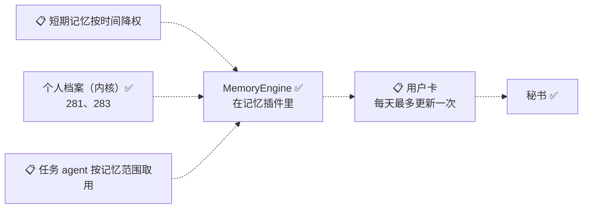

| 计划中的 | 是什么、现在到哪了 | 在哪 |
|---|---|---|
| 用户卡 | 常驻秘书上下文的精简画像：硬约束、已确认的偏好、交互策略；不含假设原文；每天最多更新一次。现在的每轮简报（2.2）每轮现算、带推断和拿不准的，不是用户卡 | CONTEXT.md；03 号票 §(a)；接入设计第 5 节 |
| 记忆简报的相关门槛再收紧 | 266 号票上线时在线上近一周的数据上量：相关门槛（向量那一路"本库前三"的规矩，库小、大半是二狗自己的话）几乎每句都放行"直接对上"，管住量的是"同一段对话里带过的不再带"。要更挑可以收紧门槛或只带过了两条路的 | 266 号票 Comments |
| 判"是不是在答"用模型 | 264 号票线上用规则版（`classifyReply`），宁可漏认：用户换了说法、隐含地答（"最近在赶项目"）认不出，问题到第二天算跳过一次（回答照样是素材，下一夜读成证据）。要更准可以交给记忆管理员或模型判，要多调模型 | 没开票（264 号票 Comments） |
| 问题去重、问题钩子接多个 | 198 的"矛盾、张力"问题和 199 的矛盾根源问题同一件事可能各问一个；`setQuestionSink` 只能接一个接收方 | 记忆地图"接进二狗之前要收拾的" |
| 任务 agent 按记忆范围取用 | 落地时默认只秘书用；任务按授权取用照 `adviseTask` 的接口 | 接入设计第 5、11 节 |
| 个人档案、重要的人 | ✅ 281 号票已上线（`packages/daemon/src/personal-files/`、档案页 `#/more/files`）；✅ 283 号票接上记忆和提醒（2.2 的"个人档案和记忆、提醒联动"）。用户 2026-10-25 定：放内核，本人一份、重要的人每人一份；固定信息（一字不差、以新为准、旧值留历史）、记下的事、二狗了解到的（从统一记忆关联，只读）；写入经核对卡，推断只当候选；秘书按字段读、填表用。取代 10-20 提议的"重要信息"层 | 281（档案）、283（和记忆、提醒联动）；内部计划 |
| 提醒加"每年" | ✅ 282 号票已上线（`reminder-schedule.ts` 的 yearly、`monthDayBefore`）；✅ 283 号票给档案里的生日、纪念日用上了；农历用户定先不做 | 282、283 |
| 了解你访谈 | ✅ 284 号票做完（2.2"了解你访谈"）：记忆管理员每周约一次、用户也能随时开，五个主题一次一个，按住说话、回话念出来；回答作为本人的话进素材（标"来自访谈"，管理员问的那句当上下文），档案信息收尾时合成一张核对卡逐条确认（不并进 283 的"每天一张"） | 284 |
| 夜里整理的四项小改 | 低把握也预测和复核（只记账不改分）、记忆页对 / 不对 / 别记和每月"你眼中的我"、工具审批降权和补场景、顺口问问深一层；等 10-31 观察完积压消化再开票 | 没开票（第二阶段计划第三批） |
| 张力入口、简报用了就记账、按独立的腿计把握、阶段层、按时间切分的预测检验 | 12 月前后，需求层的临时结论陆续摘帽以后 | 没开票（第二阶段计划第四批） |
| 短期记忆按时间降权 | 半衰期 1 个月，自动检索只看最近 3 个月；越旧越往后排，表示越不适用于现在，不是越不可信 | 记忆地图"Not yet specified" |
| 敏感类别：情绪、财务、关系、位置 | 开关占位，现在没有对应的场景标签（位置是 295 号票为数据源加的） | 234、295 号票 |
| 取消"别推断" | 现在没有取消的入口；取消以后也不自动恢复，下一夜重推 | 234 号票 |
| 规则版往上抽也先出临时结论 | 256 只改了模型版（`llm-lift.ts`），规则版 `liftGroups` 还是老门槛 | 256 号票 |
| 每晚整理的每一步进度进日志 | `onStep` 只接在评测建库上；线上靠整理记录和模型账本看 | 237 号票 |
| 结论列表、问题箱分页 | 现在只有 `limit`，最多 200 条 | 233 号票 |
| 03:00 给管理员留名额 | 名额被维护者占满时唤醒消息排队，等到超时才走兜底补跑，那一夜会晚 | 243 号票 |
| 推理图谱模板导回推理库 | 253 只做了单向导出 | 253 号票 |
| 写入口"要用户确认"的确认卡 | 267 号票：推翻用户说过或确认过的、敏感类别上的推断、忘掉和彻底删除现在只能由用户发起（用户的表态、记忆删除卡、设置页、经管理员转达），别的写入口直接拒；给管理员出确认卡、让它代问用户的那条路还没做。管理员的 `forget_material` 照 242 号票是"用户说了才调"、直接下命令，没有卡 | 267 号票；ADR-0030 |
| 交互策略进写入口 | 策略（`strategies`）是从结论编出来的、另有用户确认，267 号票没收进写入口（不留痕、不查） | 267 号票 |
| 用户模型和策略编进用户卡、动机随时间变化 | "为什么变了""新旧冲突时听哪个"不做 | 记忆地图 Out of scope |

### 2.5 模块之间怎么连

| 从 | 到 | 怎么连 | 状态 |
|---|---|---|---|
| 事件日志 | 素材库 | 事件订阅（`EventStore.onAppend`）；采集位置和素材写在同一事务 | ✅ |
| 拥有事件的模块 | 素材库 | 登记素材来源：内核的在组合根 `materials.register`，插件的在数据契约 `ctx.materialSources.register` | ✅ |
| 记忆插件 | 插件宿主 | 插件注册：数据契约 `contracts`、装配 `setup`；每次登记返回撤销函数，记在插件名下 | ✅ |
| 记忆插件 | 素材库 | 函数调用：`Materials.collect`、`searchKeyword`、`searchSemantic`；适配器只用 `Materials.list` | ✅ |
| 记忆插件 | 秘书 | agent 贡献缝：`ctx.agent.tools.register`（五个工具）、`ctx.agent.context.register`（`wake` 块）；工具调用走宿主协议 `host_tool_call` / `host_tool_result` | ✅ |
| 记忆命令、批量删除、管理员 | 素材库 | 事件：素材频道的 `memory_command`，素材库当采集规则处理；管理员的命令 `from.kind` 是 `curator` | ✅ |
| 记忆插件 | 秘书（顺口问） | agent 贡献缝的 `input` 上下文块（264）：开始处理用户的每一句时现算；这一轮做完靠事件日志的 `turn_end`（`store.onAppend`）看秘书标没标（宿主工具 `mark_woven_question`，271） | ✅ |
| 设置 | 记忆插件 | 内核服务 `KERNEL.memorySettings`（264，组合根建、网关的 `GET`、`PUT /api/memory/settings` 写）；每条输入现取 | ✅ |
| 记忆命令 | 推理库 | 事件订阅：`createReasoningPurge` 订阅同一条 `memory_command`，函数调用 @ergo/memory 的 `purgeEvidence`、`invalidateEvidence`（267 号票起经唯一写入口，记成用户发起） | ✅ |
| 彻底删除 | 事件日志 | 事件改写：`EventStore.appendBatch` 的 `purge`；另追加 `messages_purged` | ✅ |
| 彻底删除 | agent 的会话文件 | 宿主协议：一次性子进程改写（`SessionRewriteRequest`，ADR-0008） | ✅ |
| 内部作业 | 每晚整理 | 插件注册 `ctx.internalJobs.register`，到点调 `run(trigger, signal)`；停用时撤销 | ✅ |
| 每晚整理 | 记忆管理员 | 服务 `MEMORY_NIGHTLY` 的 `wakeWith`（组合根挂上委派）：作业往管理员会话追加一条唤醒消息，等这一轮 `turn_end` | ✅ |
| 记忆管理员 | 每晚整理 | 宿主工具 `run_memory_consolidation` → 这一夜的 `run`，平时是 `MemoryNightlyService.runNow` | ✅ |
| 每晚整理 | @ergo/memory 引擎 | 函数调用：`openReasoningDb`（给推理、抽事实、复核、判预测的模型）、`ingestFrom`、`indexVectors`、`runNightly` | ✅ |
| 记忆管理员 | @ergo/memory 引擎 | 宿主工具 `review_memory_claim` → 随用随开引擎，函数调用 `recordClaimVerdict`（263 号票） | ✅ |
| 每晚整理 | 网页、看板 | 事件：内部频道的 `memory_nightly`，派生视图 `memory_nightly`，网关读出来放进概览 | ✅ |
| 每晚整理 | 图谱自检 | 函数调用：`runNightly` 整理完调 `graphSelfCheck.validate(engine)`，直接读库查整张图（267 号票；326 号票起不再起子进程） | ✅ |
| @ergo/memory 各层 | 推理库 | 唯一写入口 `engine.gate`：每次写开一次 `write`，检查、留痕（267 号票） | ✅ |
| 秘书 | 记忆管理员 | 宿主工具 `ask_curator`：往管理员会话频道追加一条"秘书转达"的消息（103 号票的转达），等它那一轮 `turn_end`，最多 90 秒 | ✅ |
| 网页 | 记忆管理员 | 会话频道 `maintainer:memory-curator`：订阅、发消息（和维护者会话同一套） | ✅ |
| 网页 | 推理库 | HTTP：`GET /api/memory/summary` 等四个（内核的 `MemoryGraphReader`，只读） | ✅ |
| 记忆工具 | 网页 | 事件：工具调用记录上的 `ToolCallPart.recall`（`search_materials`、`read_material`、`ask_memory`） | ✅ |
| 网页 | 素材 | HTTP：`POST /api/materials/list`、`GET /api/materials/<素材 id>` 等（内核的，插件停用照样能用） | ✅ |
| 守护进程的插件宿主 | 网页插件宿主 | 事件：插件频道的临时事件 `plugin_status`，订阅时补推 | ✅ |
| 网页插件 | 网页核心 | 插件注册：`WebPluginContext.register` 往类型化插槽里放（页面、会话条目、详情、卡片、看板条目） | ✅ |
| @ergo/memory 各层 | 引擎 | 函数调用；可替换的接口 `EvidenceSource`、`FactExtractor`、`Embedder`、`Reasoner`、`ReasoningRetrieval` | ✅；`ReasoningRetrieval` 🧪 |
| 事实层 | 推理图谱 | 钩子：`ReasoningPropagation.onInvalidation`，在引擎同一个事务里调 | ✅ |
| 联动 | 问题箱 | 钩子：`QuestionSink`（引擎默认接问题箱），`reflect()` 里分不出的组交问题 | ✅ |
| 评测 | 引擎 | 函数调用：每道题按它问的时间建一个库；评测数据二存下的库读回 | 🧪 |
| 问题箱 | 秘书 | 函数调用（264；267 起随用随开可写引擎、经唯一写入口，记"经秘书顺口问"）：记忆插件在秘书每轮回话前调 `pickQuestion`（只看不记），秘书标了调 `markQuestionAsked`（271）；用户紧接着的一句经 `readQuestionReply` 判、`recordQuestionAnswer` / `recordQuestionSkipped` / `declineQuestion` 回写 | ✅ |
| 每晚整理 | 问题箱 | 函数调用（271）：`runNightly` 给了 `replyJudge` 时判问过的问题——`planReplies` 按 `conversationFollowUps` 取用户之后的几句话，判回答那一道里 `judgeReplyCases` 问模型，`applyReplyJudgments` 回写（用户的表态 · 经记忆管理员夜里判）、记跳过或拿不准 | ✅ |
| 用户卡 | 秘书 | 📋 agent 贡献缝的上下文块 | 📋 |

## 3. 接口表

格式写死一种（第 7 节的测试按它解析）：每张表前面一行 `<!-- 接口表 -->`，五列"状态、接口、文件、参数要点、返回"。接口格里是反引号括起来的名字，`名字` 或 `名字.成员`；文件格是仓库根开始的路径。agent 能调的工具另有一种工具表（3.4），前面一行 `<!-- 工具表 -->`。

### 3.1 素材库（内核）✅

<!-- 接口表 -->
| 状态 | 接口 | 文件 | 参数要点 | 返回 |
|---|---|---|---|---|
| ✅ | `openMaterials` | `packages/daemon/src/materials/materials.ts` | `store`、`dbDir`、`materialsDir`、`log`；组合根在项目模块之前打开 | `Materials` |
| ✅ | `Materials.register` | `packages/daemon/src/materials/materials.ts` | 一种素材来源 `MaterialSource`；要在 `start()` 之前 | 撤销函数 |
| ✅ | `Materials.collect` | `packages/daemon/src/materials/materials.ts` | `CollectOptions`：`embedder`、`scheduler`、`clock`、`inbox`、`staleCardDays` | 撤销函数；撤了以后只保管 |
| ✅ | `Materials.start` | `packages/daemon/src/materials/materials.ts` | 无；补采停着时追加的事件，之后跟着事件日志 | 无 |
| ✅ | `Materials.get` | `packages/daemon/src/materials/materials.ts` | 素材 id | `Material`，没有是 undefined |
| ✅ | `Materials.list` | `packages/daemon/src/materials/materials.ts` | `MaterialFilter`；证据适配器只用它 | `Material[]`，按原始事件的先后 |
| ✅ | `Materials.searchKeyword` | `packages/daemon/src/materials/materials.ts` | `query`、`limit`；FTS5 trigram，3 个字以下的词退回子串扫描 | `Material[]` |
| ✅ | `Materials.searchSemantic` | `packages/daemon/src/materials/materials.ts` | `query`、`limit`；暴力扫向量 | `MaterialHit[]`（余弦）；模型不在、只保管时抛 `EmbeddingUnavailable` |
| ✅ | `Materials.readOriginal` | `packages/daemon/src/materials/materials.ts` | 一条素材 | 原文副本里的信封，没有是 undefined |
| ✅ | `Materials.vectorStatus` | `packages/daemon/src/materials/materials.ts` | 无 | `VectorStatus`：模型、已算、待算、`state` |
| ✅ | `Materials.collecting` | `packages/daemon/src/materials/materials.ts` | 无 | 在不在采成素材 |
| ✅ | `MaterialSource` | `packages/daemon/src/materials/capture.ts` | `name`（定了别改）、`eventType`、`capture(event)` 确定性的 | `MaterialDraft[]` |
| ✅ | `MaterialDraft.indexText` | `packages/daemon/src/materials/capture.ts` | 只有用户存的网页给；只进索引，不进信封和原文副本 | 无 |
| ✅ | `materialId` | `packages/daemon/src/materials/capture.ts` | 事件、采集规则名、第几条 | `mat-` 加 24 位哈希 |
| ✅ | `Embedder` | `packages/daemon/src/materials/embedding/embedder.ts` | `model`、`available()`、`embed(texts)`、`close()`；查询和文档不分 | 向量 |
| ✅ | `createBgeM3Embedder` | `packages/daemon/src/materials/embedding/bge-m3.ts` | 数据目录；模型在模型区，懒加载，工作线程 | `Embedder` |
| ✅ | `EVENT_TYPES.memoryCommand` | `packages/protocol/src/constants.ts` | 素材频道上的记忆命令事件 | `memory_command` |
| ✅ | `MEMORY_COMMANDS` | `packages/protocol/src/constants.ts` | `remember`、`forget`、`purge`、`no_infer` | 常量 |
| ✅ | `DataDirLayout.rgDb` | `packages/daemon/src/config/data-dir.ts` | 推理库的路径：`<数据目录>/memory/subtext/rg.db`（338 号票起在会意插件自己的数据目录里；之前是 db 区的 `rg.db`，225） | 路径 |
| ✅ | `DataDirLayout.legacyRgDb` | `packages/daemon/src/config/data-dir.ts` | 推理库的老位置 `<数据目录>/db/rg.db`：只有启动时的迁移读它，引擎不再打开（338） | 路径 |
| ✅ | `memoryProviderDir` | `packages/daemon/src/config/data-dir.ts` | 一个记忆插件自己的数据目录 `<数据目录>/memory/<id>/`（默认 `subtext`）；宿主、迁移、工具都按它算，不各自拼（337、338） | 路径 |

### 3.2 记忆插件、记忆命令和删除 ✅

<!-- 接口表 -->
| 状态 | 接口 | 文件 | 参数要点 | 返回 |
|---|---|---|---|---|
| ✅ | `memoryPlugin` | `packages/daemon/src/memory/plugin.ts` | 插件名 `memory`；`needs` 内核的素材库、改写函数表、向量函数、数据目录布局、环境等，`wants` 整理用的模型（测试注入假的）、记忆的设置（264）；`provides` `MEMORY`、`MEMORY_NIGHTLY`；视图 `memory_nightly` | `PluginDefinition` |
| ✅ | `memoryPlugin.contracts` | `packages/daemon/src/memory/plugin.ts` | `ContractContext`；停用也登记 | 登记素材来源、改写函数、记忆删除卡、移除时删什么留什么 |
| ✅ | `memoryPlugin.setup` | `packages/daemon/src/memory/plugin.ts` | `PluginContext`；停用就不跑 | 采成素材、记忆命令、`MEMORY`、五个工具（271 加了 `mark_woven_question`）、醒来简报块、每条消息的记忆简报（`input` 上下文块、回话带的部分、账本记一笔，266）、顺口问（`input` 上下文块和 `turn_end` 订阅，264）、每晚整理（271 起给它会话，判顺口问的回答）、`MEMORY_NIGHTLY`、删除登记、立即整理一次 |
| ✅ | `MEMORY` | `packages/daemon/src/memory/api.ts` | 服务名；插件没启用时取到 undefined | `MemoryService` |
| ✅ | `MemoryService.confirmDeletion` | `packages/daemon/src/memory/api.ts` | 删法、素材 id、快速动作的情境、标题 | `QuickActionOutcome` |
| ✅ | `MemoryService.learnedAbout` | `packages/daemon/src/memory/api.ts` | 档案的种类（本人 / 别人）、称呼和别名（283）；用秘书那份缓存的只读引擎 | `PersonalFileLearnedView`：对到的实体、结论、事实、原话；读不了是 `ready: false` 和原因 |
| ✅ | `MEMORY_NIGHTLY` | `packages/daemon/src/memory/api.ts` | 服务名（242）；只有记忆管理员用；整理关着、推理库用不了也提供 | `MemoryNightlyService` |
| ✅ | `MemoryNightlyService.blocked` | `packages/daemon/src/memory/api.ts` | 无 | 现在为什么跑不了（已经翻成用户的语言），能跑是 undefined |
| ✅ | `MemoryNightlyService.runNow` | `packages/daemon/src/memory/api.ts` | 无；立即整理一次，`trigger` 记 `manual`，不吃那一夜的定时水位 | 整理记录 |
| ✅ | `MemoryNightlyService.wakeWith` | `packages/daemon/src/memory/api.ts` | 03:00 的委派（组合根给管理员挂上）；同一时间只挂一个 | 取消挂上的函数 |
| ✅ | `searchMaterialsTool` | `packages/daemon/src/memory/search-tool.ts` | 素材库；`hidden`（项目内部的记录）、`abandoned`（废弃分支）、`savedPage`（存的网页正文） | `HostTool`：`search_materials` |
| ✅ | `readMaterialTool` | `packages/daemon/src/memory/search-tool.ts` | 同上 | `HostTool`：`read_material` |
| ✅ | `SEMANTIC_MIN_SCORE` | `packages/daemon/src/memory/search-tool.ts` | 语义检索的门槛，0.5 | 数 |
| ✅ | `SEARCH_MATERIALS` | `packages/daemon/src/memory/tool-names.ts` | 工具名；参数 `query`、`why`（必填，187 号票）、`limit` | `"search_materials"` |
| ✅ | `READ_MATERIAL` | `packages/daemon/src/memory/tool-names.ts` | 工具名；参数 `materialId` | `"read_material"` |
| ✅ | `ASK_MEMORY` | `packages/daemon/src/memory/tool-names.ts` | 工具名（232）；参数 `question` | `"ask_memory"` |
| ✅ | `ASK_CURATOR` | `packages/daemon/src/memory/tool-names.ts` | 工具名（242）；参数是要转达的话 | `"ask_curator"` |
| ✅ | `MARK_WOVEN_QUESTION` | `packages/daemon/src/memory/tool-names.ts` | 工具名（271）；参数 `id`（【顺口问】里的问题编号） | `"mark_woven_question"` |
| ✅ | `memoryPrompts` | `packages/daemon/src/memory/prompt.ts` | 条件"记忆"、几个工具名占位符 | `PluginPrompts` |
| ✅ | `memoryCommandExecutors` | `packages/daemon/src/memory/memory-commands.ts` | 事件存储、卡片、改写函数表、素材库 | 四个快速动作：记住、忘掉、彻底删除、别推断 |
| ✅ | `memoryDeleteCardType` | `packages/daemon/src/memory/memory-commands.ts` | 现取 `MEMORY` 的函数 | 卡片类型 `memory_delete` |
| ✅ | `memoryNightlyAction` | `packages/daemon/src/memory/nightly-action.ts` | 跑法、为什么跑不了（235）；`confirm: "always"`，模型只能提议 | 快速动作 `memory_nightly`：立即整理一次 |
| ✅ | `memoryCommandSource` | `packages/daemon/src/materials/commands.ts` | `memory_command` 事件 | 显式记忆命令素材；删除、标记已有素材 |
| ✅ | `cardStaleSource` | `packages/daemon/src/materials/sources.ts` | `card_stale` 事件 | 回避信号素材 |
| ✅ | `deletionEvents` | `packages/daemon/src/memory/deletion.ts` | `PurgeDeps`、删除请求 | 要追加的事件和彻底删除的改写 |
| ✅ | `registerMaterialsDeletion` | `packages/daemon/src/memory/deletion-participants.ts` | "删除参与方"登记表、`MaterialsDeletionDeps`（279） | 素材库在登记表里的那一份：删项目、删任务时彻底删掉由系统记下的素材（用户本人的话不删）；断开数据源时连已导入的一起删（295），由它导入的记录采成的素材不分种类全删；同一事务记一条彻底删除的记忆命令 |
| ✅ | `purgePlan` | `packages/daemon/src/memory/purge.ts` | `PurgeDeps`、要删的素材 | `PurgePlan`：改写哪些事件；被删素材背后有证据时秘书会话上总有一条 `messages_purged`（272：每条消息的记忆简报只在会话文件里引原话） |
| ✅ | `purgedEvidenceIds` | `packages/daemon/src/memory/purged-evidence.ts` | 推理库路径、素材 id（265：问记忆的结果按证据编号引原话） | 这些素材在推理库里的证据编号：还在的按出处、已经删掉的按彻底删除的审计；查不了是空的 |
| ✅ | `lookupPurgedEvidence` | `packages/daemon/src/memory/purged-evidence.ts` | 同上（272：一次性补抹要分得清查不了） | 证据编号；库没建是空的，打不开、版本对不上、读出错是 undefined |
| ✅ | `backfillPurgedQuotes` | `packages/daemon/src/memory/purge-backfill.ts` | 事件存储、查证据编号的函数（272：守护进程启动时跑一次） | 已登记的彻底删除里被删素材的证据编号，问记忆、问记忆管理员的调用记录和完整内容里提到它们的行连同续行换成删除标记（别的不动），秘书会话上追加 `messages_purged`（会话文件里问记忆、问记忆管理员的结果和每条消息的记忆简报据此按编号换）；内部频道记一笔（`PURGE_BACKFILL_KEY`），以后不再跑；查不了时不记、下次启动再补 |
| ✅ | `PurgeRewriters.register` | `packages/daemon/src/memory/rewriters.ts` | 按事件类型的改写函数；没登记的类型彻底删除时整个被拒 | 撤销函数 |
| ✅ | `EventStore.appendBatch` | `packages/daemon/src/events/event-store.ts` | 事件、`purge` 改写；同一事务 | `AppendResult[]` |
| ✅ | `createBulkMaterialDeletion` | `packages/daemon/src/memory/bulk.ts` | 删除的依赖、素材库 | `BulkMaterialDeletion` |
| ✅ | `BulkMaterialDeletion.delete` | `packages/daemon/src/memory/bulk.ts` | 范围、删法、幂等键 | 处理了几条 |
| ✅ | `createMaterialBrowser` | `packages/daemon/src/memory/browse.ts` | 事件存储、素材库、废弃分支、项目内部 | `MaterialBrowser` |
| ✅ | `MaterialBrowser.list` | `packages/daemon/src/memory/browse.ts` | 范围、分页、`filter`（时间段、种类、会话、关键词） | `MaterialListPage` |
| ✅ | `MaterialBrowser.detail` | `packages/daemon/src/memory/browse.ts` | 素材 id | `MaterialDetailView`，没有是 undefined |
| ✅ | `sessionRewriteFor` | `packages/daemon/src/memory/after-purge.ts` | 若干 `messages_purged`；可选的 `evidenceOf`（265：问记忆的结果按证据编号换行；266：跟在输入后面的上下文消息里记忆简报引的原话也按证据编号换行，`contextLines`；272：问记忆管理员的回答按证据编号和素材 id 换行） | 会话文件要改写什么 |
| ✅ | `AgentManager.rewriteSessions` | `packages/daemon/src/agent-manager/agent-manager.ts` | agent id、改写请求；子进程还活着时拒绝 | `SessionRewriteResult` |
| ✅ | `rewriteSessionDir` | `packages/daemon/src/runtime/agent-child/session-rewrite.ts` | `SessionRewriteRequest`；用 pi 的类型 | `SessionRewriteResult` |
| ✅ | `startPurgedMediaCleanup` | `packages/daemon/src/memory/after-purge.ts` | 事件存储、媒体库、素材库 | 撤销函数 |
| ✅ | `internalRecordOf` | `packages/daemon/src/memory/internal-records.ts` | 素材、`MaterialOwners` | 项目内部的记录属于哪个项目，不是的为 undefined |
| ✅ | `createReasoningPurge` | `packages/daemon/src/memory/purge-rg.ts` | 推理库路径、事件存储、时钟、`memory` 配置、向量函数（234） | `ReasoningPurge` |
| ✅ | `ReasoningPurge.start` | `packages/daemon/src/memory/purge-rg.ts` | 无；订阅素材频道的 `memory_command` | 取消订阅的函数 |
| ✅ | `ReasoningPurge.reconcile` | `packages/daemon/src/memory/purge-rg.ts` | 无；启动时补做停用期间下的命令、撤掉没打开的敏感类别的证据，幂等 | 无 |
| ✅ | `ReasoningPurge.purgeMaterials` | `packages/daemon/src/memory/purge-rg.ts` | 素材 id、原因；彻底删除 | `PurgeReport`；库用不了是 undefined |
| ✅ | `ReasoningPurge.forgetMaterials` | `packages/daemon/src/memory/purge-rg.ts` | 素材 id；忘掉，走引擎的 `invalidateEvidence` | 无 |
| ✅ | `ReasoningPurge.disableMaterials` | `packages/daemon/src/memory/purge-rg.ts` | 素材 id、原因；别推断、敏感类别 | `PurgeReport` |
| ✅ | `commandOrigin` | `packages/daemon/src/memory/purge-rg.ts` | 一条 `memory_command`（267）；推理库这边经唯一写入口时记成用户发起、经谁转达（记忆删除卡、设置页成批删除、记忆管理员、删项目 / 删任务时连带、断开数据源时连带） | `UserActionOptions`：`actor`、`via` |
| ✅ | `SENSITIVE_SCENE_TAGS` | `packages/daemon/src/memory/privacy.ts` | 敏感类别 → 场景标签；v1 只有健康是 `health`，其余四类（情绪、财务、关系、位置）是空的占位 | 常量 |
| ✅ | `sensitiveCategoryOfScene` | `packages/daemon/src/memory/privacy.ts` | 一组场景标签 | 落在哪个敏感类别上 |
| ✅ | `inferableBySensitivity` | `packages/daemon/src/memory/privacy.ts` | 场景标签、允许推断的类别；适配器读素材时用 | 能不能用来推断 |
| ✅ | `lockedSensitiveTags` | `packages/daemon/src/memory/privacy.ts` | 允许推断的类别（267）；交给唯一写入口，没打开的类别上不出推断结论 | 锁住的场景标签 |
| ✅ | `HTTP_PATHS.materialsList` | `packages/protocol/src/http.ts` | `POST`，范围、分页、筛选 | `MaterialListPage` |
| ✅ | `HTTP_PATHS.material` | `packages/protocol/src/http.ts` | `GET`，素材 id；删了是 404 | `MaterialDetailView` |
| ✅ | `HTTP_PATHS.materialsScope` | `packages/protocol/src/http.ts` | `POST`，范围 | 有几条、有素材的会话 |
| ✅ | `HTTP_PATHS.materialsDelete` | `packages/protocol/src/http.ts` | `POST`，范围、删法、幂等键 | 处理了几条 |

### 3.3 推理库和每晚整理（守护进程）✅

<!-- 接口表 -->
| 状态 | 接口 | 文件 | 参数要点 | 返回 |
|---|---|---|---|---|
| ✅ | `MaterialsEvidenceSource` | `packages/daemon/src/memory/evidence-source.ts` | 素材库、时钟、允许推断的敏感类别（224、234）；`name = "materials"` | `EvidenceSource` 的实现 |
| ✅ | `MaterialsEvidenceSource.read` | `packages/daemon/src/memory/evidence-source.ts` | 无；每次照素材库现在的样子读一遍，只读；别推断的、没打开的敏感类别、没有原文的跳过 | `EvidenceDraft[]`（第 6 节） |
| ✅ | `evidenceDraftOf` | `packages/daemon/src/memory/evidence-source.ts` | 一条素材、允许推断的敏感类别；`read` 逐条用它，264 号票的顺口问把用户的回答马上读成证据也用它（出处是素材 id，整理时按出处跳过） | `EvidenceDraft`；不进证据的是 undefined |
| ✅ | `MaterialFilter.messageId` | `packages/daemon/src/materials/memory-db.ts` | 从哪条消息采来的（素材信封的 `ref.messageId`，264）；顺口问找回答那句话的素材 | 素材筛选条件 |
| ✅ | `kernelEmbedderAdapter` | `packages/daemon/src/memory/embedder-adapter.ts` | 内核的 `Embedder`；`closeKernel` 才把关闭转给内核 | @ergo/memory 的 `Embedder`：`embedDocuments`、`embedQueries` 都走 `embed` |
| ✅ | `openReasoningDb` | `packages/daemon/src/memory/rg-db.ts` | `ReasoningDbOptions`：路径、时钟、模型名、向量函数、抽取器、推理实现、复核模型、判预测的模型 | 打开的引擎和 manifest；或者 `ReasoningDbIssue`（manifest 没有、版本对不上、打不开） |
| ✅ | `ReasoningDbOptions.reviewer`、`ReasoningDbOptions.predictionJudge` | `packages/daemon/src/memory/rg-db.ts` | 对抗复核的模型、判到期预测的模型（263）；每晚整理给，别的打开不给 | 无 |
| ✅ | `ReasoningDbOptions.readOnly` | `packages/daemon/src/memory/rg-db.ts` | 只读地打开（233）：不写 manifest，库不在也不建；267 起写入口也开成只读 | 无 |
| ✅ | `ReasoningDbOptions.reader`、`ReasoningDbOptions.sensitiveTags` | `packages/daemon/src/memory/rg-db.ts` | 267：`reader` 是读者打开（秘书的简报、问记忆），库照常建、manifest 照写，但写入口只读、写一律拒；`sensitiveTags` 交给写入口的锁住的敏感场景标签 | 无 |
| ✅ | `ReasoningManifest` | `packages/daemon/src/memory/rg-db.ts` | 格式版本、表版本、引擎、模型、向量模型、抽取器、建库和更新时间 | 类型 |
| ✅ | `RG_DB_SCHEMA_VERSION` | `packages/daemon/src/memory/rg-db.ts` | 守护进程这一侧的 manifest 版本，现在是 1 | 常量 |
| ✅ | `createMemoryNightlyJob` | `packages/daemon/src/memory/nightly-job.ts` | 推理库路径、素材库、时钟、事件存储、待我处理、`memory` 配置、向量函数、环境、模型工厂（测试给假的）、会话（271，`conversations`：判顺口问的回答时按会话取用户之后的话；不给按本人证据的时间取） | `MemoryNightlyJob` |
| ✅ | `MemoryNightlyJob.job` | `packages/daemon/src/memory/nightly-job.ts` | 名字 `memory-nightly`、时间表每天 03:00；挂了委派先唤醒管理员，没跑成补跑 | `InternalJob` |
| ✅ | `MemoryNightlyJob.run` | `packages/daemon/src/memory/nightly-job.ts` | `trigger`、`signal`；读新素材、补向量、`runNightly`、写整理记录；墙钟上限到点记失败 | 整理记录；被中止抛 `AbortError` |
| ✅ | `MemoryNightlyJob.runNow` | `packages/daemon/src/memory/nightly-job.ts` | 无；立即整理一次（235），正在跑时不叠着开 | 整理记录 |
| ✅ | `MemoryNightlyJob.wakeWith` | `packages/daemon/src/memory/nightly-job.ts` | 03:00 交给谁来跑（242） | 取消挂上的函数 |
| ✅ | `MemoryNightlyJob.abort`、`MemoryNightlyJob.whenIdle` | `packages/daemon/src/memory/nightly-job.ts` | 插件停用、守护进程停止时调 | 无；等正在跑的那一次停下 |
| ✅ | `MemoryNightlyWake` | `packages/daemon/src/memory/nightly-job.ts` | 交给管理员的：`trigger`、`signal`、`run` | 类型 |
| ✅ | `MemoryNightlyWakeResult` | `packages/daemon/src/memory/nightly-job.ts` | 管理员交回的：这一夜自己调了几次模型、跑成的记录、预算跑满了没有 | 类型 |
| ✅ | `MEMORY_NIGHTLY_JOB`、`MEMORY_NIGHTLY_SCHEDULE` | `packages/daemon/src/memory/nightly-job.ts` | `memory-nightly`；`{ kind: "daily", time: "03:00" }` | 常量 |
| ✅ | `MEMORY_NIGHTLY_FAILED_NOTICE`、`MEMORY_NIGHTLY_REBUILD_NOTICE` | `packages/daemon/src/memory/nightly-job.ts` | 待我处理的两种事项：整理失败（一夜一条）、要重建推理库（同一份提示一条） | 常量 |
| ✅ | `reportUnusableReasoningDb` | `packages/daemon/src/memory/nightly-job.ts` | 事件存储、待我处理、时钟、为什么用不了；插件装配时库打不开调 | 一条 `rebuild_needed` 的整理记录 |
| ✅ | `MemoryNightlyRecord` | `packages/daemon/src/memory/nightly-record.ts` | 哪一夜、`state`（跑了、推后、跳过、失败、要重建）、`trigger`、新出、变了、标着复核（`needsReview`，329 号票前叫待复核）、问题箱、调用次数、预算用完没有 | 类型；一夜一条 |
| ✅ | `MemoryNightlyRecord.processedEvidence`、`MemoryNightlyRecord.pendingEvidence` | `packages/daemon/src/memory/nightly-record.ts` | 这一夜整理完几条证据、跑完还剩几条（236：首次建库看几夜做完；270：整理完一条算一条，积压的按时间先后接着做） | 数 |
| ✅ | `MemoryNightlyRecord.spend` | `packages/daemon/src/memory/nightly-record.ts` | 这一夜的调用按道分（270）：新证据、重跑旧追问、往上抽、判预测、编策略、对抗复核，加上限；以前的记录没有 | `MemoryNightlySpend` |
| ✅ | `MemoryNightlyRecord.curatorModelCalls` | `packages/daemon/src/memory/nightly-record.ts` | 记忆管理员这一夜额外调了几次模型（242） | 数 |
| ✅ | `MemoryNightlyRecord.people` | `packages/daemon/src/memory/nightly-record.ts` | 283：认人物信息问了几次模型、看了几条话、认出几个人、攒了几条候选、候选核对卡、旧值到期的事实几条；没接档案的记录没有 | `MemoryNightlyPeople` |
| ✅ | `linkNightly` | `packages/daemon/src/memory/personal-files-link.ts` | 引擎、档案的服务、模型、配置、预算剩下几次、哪一夜（283）；整理跑完以后调：档案里换过的值对一遍（旧值事实到期）、新来的本人的话里认人物信息、攒候选、合成候选核对卡 | `NightlyPeopleRecord` |
| ✅ | `PEOPLE_MAX_CALLS` | `packages/daemon/src/memory/personal-files-link.ts` | 每晚认人物信息最多问几次模型（5，一次 20 条话），从这一夜的预算里剩下的出 | 常量 |
| ✅ | `guardNightlyChat` | `packages/daemon/src/memory/personal-files-link.ts` | 整理用的模型、档案的服务（283）；没接档案原样交回 | 推理那几步的提示末尾加档案摘要、每个请求里号码类和住址的值换成占位的 `ChatModel` |
| ✅ | `learnedAbout` | `packages/daemon/src/memory/personal-files-link.ts` | 引擎（没有是插件读不了）、档案的种类和称呼、别名（283） | `PersonalFileLearnedView` |
| ✅ | `createProfileFactExpiry` | `packages/daemon/src/memory/personal-files-link.ts` | 随用随开的可写引擎、日志（283）；记忆插件订阅档案的 `onFieldReplaced` | 字段换了新值时让旧值的事实到期的函数 |
| ✅ | `MemoryNightlyRecord.review`、`MemoryNightlyRecord.predictions` | `packages/daemon/src/memory/nightly-record.ts` | 对抗复核（复核了几条、不认的、拿不准的）和预测账本（新记、到期判了几条、应验、落空、说不清、还开着）这一夜的结果（263）；以前的记录没有 | `MemoryNightlyReview`、`MemoryNightlyPredictions` |
| ✅ | `MemoryNightlyRecord.validation`、`MemoryNightlyRecord.refused` | `packages/daemon/src/memory/nightly-record.ts` | 每晚校验的结果（通过、不合格、跳过和原因，报了几个问题、加了复核标记的结论，329 起 `downgraded` 是照铁律降回猜测的）、写入口这一夜拒了几处（267）；以前的记录没有 | `MemoryNightlyValidation`、数 |
| ✅ | `MemoryNightlyRecord.hypotheses`、`MemoryNightlyHypotheses` | `packages/daemon/src/memory/nightly-record.ts` | 326 号票的老记录才有：那一夜结论 ↔ 假设换了的；329 号票起身份锁死，不再写（ADR-0032），管理员的整理日记读到老记录照实说 | 降了的、升回的结论 id |
| ✅ | `MEMORY_NIGHTLY_EVENT` | `packages/daemon/src/memory/nightly-record.ts` | 内部频道上的整理记录事件 | `memory_nightly` |
| ✅ | `memoryNightlyView` | `packages/daemon/src/memory/nightly-record.ts` | 派生视图（ergo.db），一夜一条 | `DerivedView` |
| ✅ | `latestNightlyRecord` | `packages/daemon/src/memory/nightly-record.ts` | 只读连接 | 最近一夜的整理记录 |
| ✅ | `createMemoryEngineProvider` | `packages/daemon/src/memory/engine-provider.ts` | 推理库路径、时钟、模型名、向量函数（232） | `MemoryEngineProvider` |
| ✅ | `MemoryEngineProvider.get`、`MemoryEngineProvider.close` | `packages/daemon/src/memory/engine-provider.ts` | 第一次用时打开、缓存一个；打不开就降级、不顺手建库；插件停用时关；267 起写入口只读 | 能用的引擎，没有是 undefined |
| ✅ | `createWritableEngineUse` | `packages/daemon/src/memory/engine-provider.ts` | 推理库路径、时钟、模型名、向量函数（267）；顺口问要写时随用随开一份可写的、用完关掉，库没建不顺手建，打不开的原因变了才记一行日志 | `MemoryEngineUse`：做一件事，库用不了是 undefined |
| ✅ | `MemoryConfig.maxModelCalls` | `packages/daemon/src/config/config.ts` | 每次整理最多调几次模型，默认 200（抽事实、整理、判预测共用；对抗复核另有每次 5 次） | 数 |
| ✅ | `MemoryConfig.extractor` | `packages/daemon/src/config/config.ts` | `model`（默认，236）或 `rule` | 抽事实用哪个 |
| ✅ | `MemoryConfig.enabled` | `packages/daemon/src/config/config.ts` | 默认 true；false 是这台机器上不整理（不排作业、不建库），和插件停用是两回事（235） | 布尔 |
| ✅ | `MemoryConfig.sensitiveCategories` | `packages/daemon/src/config/config.ts` | 允许用来推断的敏感类别，默认空（234） | 类别 |
| ✅ | `MemoryConfig.nightlyTimeoutMinutes` | `packages/daemon/src/config/config.ts` | 一次整理的墙钟上限，默认 60，0 = 不限（237） | 分钟 |
| ✅ | `MemoryConfig.curator` | `packages/daemon/src/config/config.ts` | `MemoryCuratorConfig`（242） | 记忆管理员的预算 |
| ✅ | `MemoryCuratorConfig.maxModelCalls` | `packages/daemon/src/config/config.ts` | 管理员每夜额外最多调几次模型，默认 8 | 数 |
| ✅ | `DEFAULT_MEMORY_CONFIG` | `packages/daemon/src/config/config.ts` | 200、模型版、不推断敏感类别、开着、60 分钟、管理员 8 | 常量 |
| ✅ | `runAcceptance` | `packages/daemon/test/memory/acceptance.ts` | 数据目录；只读（`npm run memory:acceptance`，235） | 逐条的检查结果 |
| ✅ | `replayMaterialsDb` | `packages/daemon/test/memory/replay-materials.ts` | `materials.db` 的路径；先做快照副本再读（`npm run memory:replay`，224） | 素材、证据、来源级别、场景分布的摘要 |

### 3.4 秘书和记忆管理员 ✅

<!-- 工具表 -->
| 状态 | 工具 | 给谁 | 文件 | 做什么 |
|---|---|---|---|---|
| ✅ | `search_materials` | 秘书、记忆管理员 | `packages/daemon/src/memory/tool-names.ts` | 检索素材：关键词在前、语义追加；必填 `why`，网页画成"回忆了 N 条记忆" |
| ✅ | `read_material` | 秘书、记忆管理员 | `packages/daemon/src/memory/tool-names.ts` | 读一条素材的全文 |
| ✅ | `ask_memory` | 秘书 | `packages/daemon/src/memory/tool-names.ts` | 问记忆：D 式记忆简报，≤4000 字，只读、不调模型；网页画成"回忆了 N 条记忆"（263） |
| ✅ | `ask_curator` | 秘书 | `packages/daemon/src/memory/tool-names.ts` | 把用户的话转给记忆管理员，等它答完（最多 90 秒）带回来 |
| ✅ | `mark_woven_question` | 秘书 | `packages/daemon/src/memory/tool-names.ts` | 标一下这一轮用自己的话问了【顺口问】交给它的那个问题（271）：编号对得上才记下，这一轮做完由记忆插件记"问过"；只在内存里记个标记，不改记忆 |
| 🧪 | `remember_memory` | 秘书 | `packages/daemon/src/memory/tool-names.ts` | 用户明确让"帮我记一句"时把用户的原话交给记忆插件槽（宿主的 `remember`）：按原话存成一条记忆（337），说明里写明只有用户让你记时才用；记忆插件没在跑时没有这个工具 |
| ✅ | `run_memory_consolidation` | 记忆管理员 | `packages/daemon/src/memory/curator-tools.ts` | 现在整理一次：03:00 是这一夜的 `run`，平时是 `runNow` |
| ✅ | `inspect_memory` | 记忆管理员 | `packages/daemon/src/memory/curator-tools.ts` | 看一条结论的来龙去脉（记忆页同一份只读视图） |
| ✅ | `review_memory_claim` | 记忆管理员 | `packages/daemon/src/memory/curator-tools.ts` | 记下用户对一条结论的表态：对（确认，已验证）、不对（撤回）、拿不准（加复核标记，329 起不改真值状态）；走引擎的 `recordClaimVerdict`，整理不改回（263） |
| ✅ | `forget_material` | 记忆管理员 | `packages/daemon/src/memory/curator-tools.ts` | 忘掉几条素材：追加一条 `memory_command`，删除登记照常处理推理库 |
| ✅ | `no_infer_material` | 记忆管理员 | `packages/daemon/src/memory/curator-tools.ts` | 别推断几条素材：同上 |
| ✅ | `memory_questions` | 记忆管理员 | `packages/daemon/src/memory/curator-tools.ts` | 看问题箱（只读） |
| ✅ | `begin_interview` | 记忆管理员 | `packages/daemon/src/memory/interview-tools.ts` | 用户在它的会话里直接说想做访谈时开一次了解你访谈（284）：交回主题和问法；已经开着就接着问 |
| ✅ | `finish_interview` | 记忆管理员 | `packages/daemon/src/memory/interview-tools.ts` | 收尾：记下这个主题聊透了没有（聊透了下次换下一个），会话里放一句给用户看的说明；这次记下的档案信息合成一张核对卡（284） |
| ✅ | `forget_interview_answers` | 记忆管理员 | `packages/daemon/src/memory/interview-tools.ts` | 用户说"这个别记"：把这次访谈里用户最近说的几句忘掉（追加 `memory_command`，素材库删掉）（284） |
| ✅ | `propose_personal_file` | 记忆管理员 | `packages/daemon/src/memory/interview-tools.ts` | 访谈里听到的档案信息记下（不出卡，收尾时合成一张核对卡逐条确认）；不在访谈里时出 281 的一人一张核对卡（284） |
| ✅ | `remember`、`forget`、`purge`、`no_infer` | 秘书提议，用户在卡上确认 | `packages/protocol/src/constants.ts` | 四个记忆命令（快速动作）；删除类的总要用户核对 |
| ✅ | `memory_nightly` | 秘书提议，用户点了才跑 | `packages/daemon/src/memory/nightly-action.ts` | 立即整理一次（快速动作，不是工具） |
| ✅ | `start_interview` | 秘书提议（用户原话里有"访谈"直接开） | `packages/daemon/src/memory/interview.ts` | 开一次了解你访谈（快速动作，不是工具，284）：管理员在它的会话里开场；已经开着进那一次 |

<!-- 接口表 -->
| 状态 | 接口 | 文件 | 参数要点 | 返回 |
|---|---|---|---|---|
| ✅ | `wakeBriefText` | `packages/daemon/src/memory/context.ts` | 引擎（没有就空串）；同步现算：需求、价值观各最多 3 条，330 号票起需求和价值观里的猜测最多 3 条（标"猜测"），拿不准的最多 2 组；264 号票起不放问题箱里的问题（顺口问走 `createWovenQuestions`） | 简报文字，≤1200 字；什么都没有是空串 |
| ✅ | `createWovenQuestions` | `packages/daemon/src/memory/woven-questions.ts` | 随用随开的可写引擎（267 起 `withEngine`，`createWritableEngineUse`）、事件存储（330 起还往回读这一次对话里问过没有）、素材库、开没开（现取设置）、允许推断的敏感类别（264）；一次对话最多顺口问一个（330，`CONVERSATION_IDLE_MS`） | `WovenQuestions` |
| ✅ | `WOVEN_VIA` | `packages/daemon/src/memory/woven-questions.ts` | 顺口问这条路的写在留痕里记的"经谁转达"："经秘书顺口问"（267） | 常量 |
| ✅ | `WovenQuestions.inputText` | `packages/daemon/src/memory/woven-questions.ts` | 秘书主会话里用户本人发的一句；先判上一轮标过的那个这句是不是在答（`readQuestionReply`，在答就 `recordQuestionAnswer`、跳过 `recordQuestionSkipped`、别问这个 `declineQuestion`，认不出的不动、留给夜里判），再挑这一轮要不要顺口问（`pickQuestion` 的 `peek`、`settle: false`）；按消息 id 记住，不重复记 | 跟在这条输入后面的【顺口问】上下文块（271：编号、要问的、为什么问、怎么问、问了先标）；没有是 undefined |
| ✅ | `WovenQuestions.markTool` | `packages/daemon/src/memory/woven-questions.ts` | 无（271）；秘书调时编号要对得上这一轮交给它的那个，设置关着、这一轮没交、编号不对都回错 | `HostTool`：`mark_woven_question` |
| ✅ | `WovenQuestions.onEvent` | `packages/daemon/src/memory/woven-questions.ts` | 事件日志的一条（`store.onAppend`）；只看秘书会话的 `turn_end` | 秘书标了（271）、也真的回了话才 `markQuestionAsked` |
| ✅ | `markedQuestionOf` | `packages/daemon/src/memory/woven-questions.ts` | 几条 agent 回话（271，264 的 `mentionsQuestion` 比对句子删了）；认做成了的那次 `mark_woven_question` | 标的问题编号；没标是 undefined |
| ✅ | `conversationFollowUps` | `packages/daemon/src/memory/reply-follow-ups.ts` | 会话的只读连接、素材库（271）；从秘书标了这个问题的那一轮之后取同一个会话里用户本人说的话（24 小时内），找不到那一轮按问过的时间取 | `ReplyFollowUpSource`：秘书那一轮的回话、用户之后的话（素材 id） |
| ✅ | `lastToolCallMessage`、`userMessagesAfter`、`userMessagesSince`、`agentRepliesAround` | `packages/daemon/src/conversation/views.ts` | 会话（271）：最近一条带着某次工具调用的 agent 消息；某个全局序号、某个时间之后用户说的话；某个全局序号所在那一轮 agent 说的话 | 消息 |
| ✅ | `WOVEN_QUESTION_HEAD` | `packages/daemon/src/memory/woven-questions.ts` | 上下文块的抬头"【顺口问】" | 常量 |
| ✅ | `agentRepliesAfter`、`agentRepliesBefore` | `packages/daemon/src/conversation/views.ts` | 会话、一条消息（264）；之后到下一条用户消息、之前到上一条用户消息 agent 说的话 | `MessageEnvelope[]` |
| ✅ | `MEMORY_BRIEF_BLOCK_ID`、`MEMORY_BRIEF_MAX_CHARS` | `packages/daemon/src/memory/context.ts` | 上下文块 id `memory.brief`（宿主加 `memory:` 前缀）；1200 | 常量 |
| ✅ | `createMessageBriefs` | `packages/daemon/src/memory/message-brief.ts` | 读者引擎（醒来简报、问记忆那一份）、事件存储、素材库、开没开（现取设置）、记账（可选，插件里接 `KERNEL.usage`）、上限毫秒数（默认 3000）（266） | `MessageBriefs` |
| ✅ | `MessageBriefs.inputText` | `packages/daemon/src/memory/message-brief.ts` | 秘书主会话里用户本人发的一句、给谁；短应答、关着、没有引擎不带；第一次用时从会话里找回这一段带过的；按消息 id 记住 | 跟在这条输入后面的【记忆简报】块（Promise）；不带是 undefined |
| ✅ | `MessageBriefs.replyParts` | `packages/daemon/src/memory/message-brief.ts` | 这条输入；取一次就没了 | `[MemoryBriefPart]`；没带是 undefined |
| ✅ | `MessageBriefs.onEvent` | `packages/daemon/src/memory/message-brief.ts` | 事件日志的一条（`store.onAppend`）；秘书会话的分界（压缩、清空、换模型、回退切换分支）清掉"带过的" | 无 |
| ✅ | `isShortReply` | `packages/daemon/src/memory/message-brief.ts` | 一句话；"好的""谢谢""嗯"这类（可带语气词、标点、表情），带了正事的不算 | 是不是短应答 |
| ✅ | `queryMemoEmbedder` | `packages/daemon/src/memory/message-brief.ts` | 向量函数、记几句（默认 16）；查询向量按句子记住，文档向量照算（266：一句话的几处检索、相关门槛只算一次） | 包了一层的向量函数 |
| ✅ | `MESSAGE_BRIEF_HEAD`、`MESSAGE_BRIEF_TIMEOUT_MS` | `packages/daemon/src/memory/message-brief.ts` | 上下文块的抬头"【记忆简报】"；3000 | 常量 |
| ✅ | `askMemoryTool` | `packages/daemon/src/memory/ask-tool.ts` | 引擎的 provider、素材库（263：把简报引用的证据对回素材）；内部调 `memoryBrief`（D 组，`at` 是现在；证据只到上一次整理） | `HostTool`：`ask_memory`；结果带 `MemoryRecall`（`source` 是 `ask`） |
| ✅ | `briefRecallHits` | `packages/daemon/src/memory/ask-tool.ts` | 引擎、简报、素材库（263）；正文里出现的证据背后的素材，去重，素材库里没有的不列 | `MemoryRecallHit[]` |
| ✅ | `ASK_MEMORY_LIMITS` | `packages/daemon/src/memory/ask-tool.ts` | 记录 6 条、1200 字；结论 6 条、2400 字；2 组竞争解释；其余照 `BRIEF_LIMITS` | 常量 |
| ✅ | `ASK_MEMORY_MAX_CHARS`、`ASK_MEMORY_NOT_READY` | `packages/daemon/src/memory/ask-tool.ts` | 4000；"记忆还没准备好"那一句 | 常量 |
| ✅ | `clipBriefText` | `packages/daemon/src/memory/ask-tool.ts` | 简报正文、上限；兜底截断 | 截好的文字 |
| ✅ | `askCuratorTool` | `packages/daemon/src/memory/curator-link.ts` | 事件存储、管理员的会话频道（242） | `HostTool`：`ask_curator` |
| ✅ | `ASK_CURATOR_WAIT_MS`、`ASK_CURATOR_MAX_CHARS` | `packages/daemon/src/memory/curator-link.ts` | 最多等 90 秒；带回的话最多 4000 字 | 常量 |
| ✅ | `startMemoryCurator` | `packages/daemon/src/memory/curator.ts` | agent 管家、事件存储、守卫、提示库、token 账本、推理库路径、素材库、`MEMORY_NIGHTLY` 服务、`memory` 配置、模型（先跟随秘书）；组合根在插件启动之后建（242、243） | `MemoryCurator` |
| ✅ | `MemoryCurator.agentHandle` | `packages/daemon/src/memory/curator.ts` | 无 | 它的 ⚙（提示词、清空、上下文用量） |
| ✅ | `MemoryCurator.stop` | `packages/daemon/src/memory/curator.ts` | 无；插件停用、守护进程停止时调：摘掉 03:00 的委派、停会话 | 无 |
| ✅ | `CURATOR_WAKE_TAG`、`CURATOR_WAKE_KEY_PREFIX` | `packages/daemon/src/memory/curator.ts` | 唤醒消息的开头"【记忆整理】"；幂等键前缀，一夜一条 | 常量 |
| ✅ | `curatorTools` | `packages/daemon/src/memory/curator-tools.ts` | `CuratorToolDeps`：推理库、事件存储、会话、只读视图、素材库、整理一次的函数、为什么整理不了 | 8 个 `HostTool` |
| ✅ | `CURATOR_TOOL_NAMES` | `packages/daemon/src/memory/curator-tools.ts` | 守卫看到的工具包（语音插件开着时另加口语总结、发语音，284） | 12 个工具名（284 号票加了访谈的四个） |
| ✅ | `CURATOR_CLAIM_STATUSES` | `packages/daemon/src/memory/curator-tools.ts` | 管理员能记下的表态（263 起：对、拿不准、不对；329 起拿不准是加复核标记，参数沿用 `needs_review` 这个词） | `active`、`needs_review`、`retracted` |
| ✅ | `consolidationText` | `packages/daemon/src/memory/curator-tools.ts` | 一条整理记录 | 交回给管理员的那段话 |
| ✅ | `MEMORY_CURATOR_AGENT_ID`、`MEMORY_CURATOR_CONVERSATION` | `packages/protocol/src/memory.ts` | `memory-curator`；会话频道 `maintainer:memory-curator` | 常量 |
| ✅ | `AGENT_SETTINGS_KINDS` | `packages/protocol/src/agent-settings.ts` | ⚙ 面板的 agent 种类，242 号票起有 `curator` | 常量 |
| ✅ | `LEDGER_ROLES` | `packages/protocol/src/usage.ts` | token 账本的角色，242 号票起有 `curator`（算系统开销） | 常量 |
| ✅ | `createMemoryInterviews` | `packages/daemon/src/memory/interview.ts` | 事件存储、卡片、待我处理、时钟、素材库（数记了几段）、记忆的设置（现取）、快速动作（`personal_file` 的执行器）（284） | `MemoryInterviews`：`status`、`active`、`latest`、`prepareStart`、`start`、`finish`、`answersOf`、`messageScope`、`collectFile`、`confirmFile`、`invite`、`stopInvites`、每周约访的内部作业 `job` |
| ✅ | `MemoryInterviews.messageScope` | `packages/daemon/src/memory/interview.ts` | 无（现取） | 用户此刻在管理员会话里说话的归属：访谈编号、管理员问的那一句（末尾 200 字）；没在聊是空的 |
| ✅ | `MemoryInterviews.collectFile` | `packages/daemon/src/memory/interview.ts` | `propose_personal_file` 的参数、这次调用（用户消息、调用编号） | 给管理员的话（记下了哪几条、没记下的为什么）；没在聊是 undefined（调用方出一人一张的卡） |
| ✅ | `MemoryInterviews.confirmFile` | `packages/daemon/src/memory/interview.ts` | 核对卡、负载、哪一条 | 卡片动作的效果：这一条经 `personal_file` 的执行器写进档案（档案里已经是这个值的记成 unchanged） |
| ✅ | `interviewFilesCardType` | `packages/daemon/src/memory/interview.ts` | 访谈的服务（现取） | 档案核对卡 `interview_files`：`confirm`（输入 `{ item, remind? }`，283 的每年提醒勾了没有）、`reject`（输入 `{ item }`），都定了才处理完；彻底删除换掉名字、值、原样参数，去掉每年提醒的勾 |
| ✅ | `MemoryInterviews.prepareStart` | `packages/daemon/src/memory/interview.ts` | 从哪开的（card、page、secretary、curator）、主题（不给是下一个没聊过的）、约访卡 | 访谈编号、主题、是不是已经开着、要追加的事件（记开始；不是管理员自己开的另有一条开场的系统消息） |
| ✅ | `MemoryInterviews.finish` | `packages/daemon/src/memory/interview.ts` | 这个主题聊透了没有 | 编号、主题、算不算聊过、记了几段、还没聊的主题、档案核对卡（编号、几条）；没在聊是 undefined |
| ✅ | `interviewSnapshot` | `packages/daemon/src/memory/interview.ts` | 访谈的记录、现在 | 开着的那次（3 小时没收尾当放下了）、最近一次、聊过的主题、上次约 / 聊的时间 |
| ✅ | `interviewCardType` | `packages/daemon/src/memory/interview.ts` | 访谈的服务（现取） | 约访卡 `interview`：`start`、`later`、`decline`，都记成已处理（不算回避信号） |
| ✅ | `startInterviewAction` | `packages/daemon/src/memory/interview.ts` | 访谈的服务（现取） | 快速动作 `start_interview`：原话里有"访谈"算点明 |
| ✅ | `INTERVIEW_EVENT`、`INTERVIEW_JOB`、`INTERVIEW_INVITE_SCHEDULE`、`INTERVIEW_EXPIRE_MS` | `packages/daemon/src/memory/interview.ts` | internal 频道上的 `memory_interview`；内部作业 `memory_interview_invite`；每周六 10:00；3 小时 | 常量 |
| ✅ | `MEMORY_INTERVIEWS` | `packages/daemon/src/memory/api.ts` | 记忆插件提供的访谈服务（组合根、网关经插件宿主现取，284） | 服务名 |
| ✅ | `interviewTools` | `packages/daemon/src/memory/interview-tools.ts` | 访谈的服务、事件存储、管理员的会话、素材库、不在访谈里时提议档案的函数（组合根给：`quickActions.propose` 的 `personal_file`，`alwaysAsk`） | 四个 `HostTool`（工具表） |
| ✅ | `interviewInputContext` | `packages/daemon/src/memory/interview-tools.ts` | 访谈的服务、管理员这一轮的输入、问题箱里还开着的（330，`openBoxQuestions`） | 跟在输入后面的访谈上下文：开场那一轮是从哪开的、访谈编号、问法要点、问题箱里攒着的最多 3 个（330，`interviewBoxLines`），用户的回答是"第几个来回"和提醒；没在访谈里是 undefined |
| ✅ | `interviewOpening`、`interviewOpeningContext`、`interviewTurnContext`、`interviewBeginText`、`interviewFinishedText`、`interviewFileCollectedText`、`INTERVIEW_TAG` | `packages/daemon/src/memory/interview-guide.ts` | 访谈编号、主题、从哪开的、第几个来回、记下的档案信息（给模型看的话） | 开场的系统消息（一行"【了解你访谈】这次聊：<主题>"，给人看）、跟在输入后面的问法和提醒、begin / finish / propose 交回的提示 |
| ✅ | `interviewQuestionSegments` | `packages/daemon/src/materials/sources.ts` | 管理员问的那一句 | 素材的上下文切段（`agent_output`，只有说明"记忆管理员问：……"）；用户发言、语音转写两条采集规则用 |
| ✅ | `INTERVIEW_TOPICS`、`nextInterviewTopic`、`interviewCadence`、`INTERVIEW_CONTEXT`、`INTERVIEW_QUESTION_FIELD`、`INTERVIEW_QUESTION_MAX`、`INTERVIEW_FILE_STATES` | `packages/protocol/src/memory-interview.ts` | 五个主题的先后、下一个、每周还是每月；素材"来自访谈"的情境标签 `interview`；问的那句的切段位置和长度；核对卡上一条的状态 | 常量、纯函数 |
| ✅ | `InterviewCardPayload`、`InterviewStatusView`、`InterviewStartResult`、`InterviewFilesCardPayload`、`InterviewFileItem`、`InterviewFileItemInput` | `packages/protocol/src/memory-interview-schema.ts` | 约访卡的负载；`GET` / `POST /api/memory/interview` 的形状；档案核对卡的负载和"确认""不记"的输入 | schema |

### 3.5 记忆页的只读接口和网页 ✅

<!-- 接口表 -->
| 状态 | 接口 | 文件 | 参数要点 | 返回 |
|---|---|---|---|---|
| ✅ | `createMemoryGraphReader` | `packages/daemon/src/memory/graph.ts` | 推理库路径、时钟、最近一夜的整理记录（组合根现转）；内核这一侧，插件停用也能读（233） | `MemoryGraphReader` |
| ✅ | `MemoryGraphReader.summary` | `packages/daemon/src/memory/graph.ts` | 无 | `MemorySummaryView`：各层、各状态各几条、问题箱开着几个、最近一次整理 |
| ✅ | `MemoryGraphReader.claims` | `packages/daemon/src/memory/graph.ts` | `tier`、`status`、`limit`（默认 50、最多 200） | `MemoryClaimListPage` |
| ✅ | `MemoryGraphReader.claim` | `packages/daemon/src/memory/graph.ts` | 结论编号；ready 着但没有这条是 undefined（接口回 404） | `MemoryClaimDetailView` |
| ✅ | `MemoryGraphReader.questions` | `packages/daemon/src/memory/graph.ts` | `limit` | `MemoryQuestionsView` |
| ✅ | `HTTP_PATHS.memorySummary` | `packages/protocol/src/http.ts` | `GET /api/memory/summary` | `MemorySummaryView` |
| ✅ | `HTTP_PATHS.memoryClaims` | `packages/protocol/src/http.ts` | `GET /api/memory/claims?tier=&status=&limit=`；不认得的 `tier`、`status` 回 400 | `MemoryClaimListPage` |
| ✅ | `HTTP_PATHS.memoryClaim` | `packages/protocol/src/http.ts` | `GET /api/memory/claims/<编号>` | `MemoryClaimDetailView` |
| ✅ | `HTTP_PATHS.memoryQuestions` | `packages/protocol/src/http.ts` | `GET /api/memory/questions?limit=` | `MemoryQuestionsView` |
| ✅ | `HTTP_PATHS.memoryStrategies` | `packages/protocol/src/http.ts` | `GET /api/memory/strategies`（330） | `MemoryStrategiesView`：做法，带建在猜测上、理由没了 |
| ✅ | `MemoryQuestionItem.history`、`MemoryQuestionItem.answerText`、`MemoryQuestionItem.verdict` | `packages/protocol/src/memory.ts` | 264：经过（问过、跳过、答了……）、回答的原话（证据还能当依据时）、读成什么；另有 `clear`、`lastAskedAt`、`answeredAt` | 协议的形状 |
| ✅ | `MEMORY_QUESTION_EVENTS`、`MEMORY_ANSWER_VERDICTS` | `packages/protocol/src/memory.ts` | 经过里的一笔、回答读成什么的取值表（264） | 常量 |
| ✅ | `createMemorySettings` | `packages/daemon/src/memory/settings.ts` | 配置区的 `memory-settings.json`、日志（264）；内核这一侧，组合根建一份交给网关和记忆插件 | `MemorySettingsService` |
| ✅ | `MemorySettingsService.current`、`MemorySettingsService.change` | `packages/daemon/src/memory/settings.ts` | 无；整份（请求体按 schema 查过），有变化才写 | 现在的设置（没有文件、读坏了是默认：顺口问开着） |
| ✅ | `HTTP_PATHS.memorySettings` | `packages/protocol/src/http.ts` | `GET`、`PUT /api/memory/settings`（264；284 号票起多一项 `interviewInvites`：约访开不开） | `MemorySettingsView` |
| ✅ | `HTTP_PATHS.memoryInterview` | `packages/protocol/src/http.ts` | `GET /api/memory/interview`；`POST` 开一次（请求体可选 `topic`，已经开着就是那一次）；记忆插件没启用时 404（284） | `InterviewStatusView`；`InterviewStartResult` |
| ✅ | `MemorySettingsView`、`MemorySettingsBody`、`DEFAULT_MEMORY_SETTINGS` | `packages/protocol/src/memory-settings-schema.ts` | `wovenQuestions`：秘书顺口问开不开，默认 true | 协议的形状 |
| ✅ | `MemorySummaryView` | `packages/protocol/src/memory.ts` | `ready`、`reason`、`total`、`tiers`、`statuses`、`openQuestions`、`lastNight` | 协议的形状 |
| ✅ | `MemoryClaimDetailView` | `packages/protocol/src/memory.ts` | 结论、组、支持、反证、背景、竞争解释、推断、前提链、原话、修订 | 协议的形状 |
| ✅ | `MemoryLastNight.curatorModelCalls` | `packages/protocol/src/memory.ts` | 最近一次整理里管理员额外调了几次模型（242） | 数 |
| ✅ | `MEMORY_CLAIM_TIERS`、`MEMORY_CLAIM_STATUSES`、`MEMORY_NIGHTLY_STATES` | `packages/protocol/src/memory.ts` | 层、结论状态、整理记录状态的取值表（网页按它查当前语言的说法） | 常量 |
| ✅ | `MEMORY_CLAIMS_MAX` | `packages/protocol/src/memory.ts` | 结论列表一页最多 200 条 | 常量 |
| ✅ | `MemoryRevisionView.by` | `packages/protocol/src/memory.ts` | 这条修订是哪一次写留下的：谁写的、哪种写操作、经谁转达（267，唯一写入口的留痕）；写入口以前的老修订没有 | `{ actor, op, via? }` |
| ✅ | `MEMORY_WRITE_ACTORS`、`MEMORY_WRITE_OPS` | `packages/protocol/src/memory.ts` | 写的人（夜班、记忆管理员、用户的表态、用户发起）、写操作的取值表（267；网页按它查当前语言的说法） | 常量 |
| ✅ | `memoryWebPlugin` | `packages/web/src/plugins/memory/plugin.tsx` | 插件名 `memory`；`owns` 页面 `memory`、条目 `recall`、详情 `recall`、卡片 `memory_delete`、看板条目 `memory_curator`、设置分节 `memory`（264） | `WebPluginDefinition` |
| ✅ | `MemorySettingsSection` | `packages/web/src/plugins/memory/MemorySettingsSection.tsx` | 无；现取、拨一下整份存（264） | 设置 · 记忆：在对话里顺口问开不开、每条消息带记忆简报、每周约一次了解你访谈（284） |
| ✅ | `MEMORY_LAYERS`、`MEMORY_ITEMS` | `packages/web/src/plugins/memory/route.ts` | 首页四栏：档案、结论、问题箱、素材（285）；认的地址另有记忆管理员、成批删除 | 常量 |
| ✅ | `memoryRedirect`、`memoryCoverRoute` | `packages/web/src/plugins/memory/route.ts` | 旧地址：证据与推理换到结论；"更多"里的个人档案换到记忆 · 档案（285） | 新地址或 undefined |
| ✅ | `MemorySection`、`MemoryColumn` | `packages/web/src/plugins/memory/MemoryPage.tsx` | 宽屏、栏、下一级；记忆管理员整页（285） | 记忆页 |
| ✅ | `memoryKeeperNightLine`、`memoryKeeperInterviewLine`、`memoryInterviewBar` | `packages/web/src/state/memory-page.ts` | 概览、访谈的样子（285） | "和记忆管理员聊"卡上的两行、对话里输入框上面那一行 |
| ✅ | `MaterialsBrowse` | `packages/web/src/plugins/memory/MaterialsBrowse.tsx` | 按时间翻、搜、筛 | 记忆 · 素材 |
| ✅ | `ClaimsBrowse` | `packages/web/src/plugins/memory/ClaimsBrowse.tsx` | 按层分组、按状态筛（233） | 记忆 · 结论 |
| ✅ | `EvidenceBrowse` | `packages/web/src/plugins/memory/EvidenceBrowse.tsx` | 结论编号 | 记忆 · 结论里点开的一条（证据与推理）：一条结论的完整解释 |
| ✅ | `QuestionsBrowse` | `packages/web/src/plugins/memory/QuestionsBrowse.tsx` | 无 | 记忆 · 问题箱 |
| ✅ | `MemoryCuratorPage` | `packages/web/src/plugins/memory/CuratorPage.tsx` | 宽屏（242）；订阅管理员的会话频道、读概览、访谈的样子（285） | 记忆管理员的整页对话：会话、最近一次整理、⚙、输入框上面一行访谈和"开始访谈" |
| ✅ | `CuratorBoardCard` | `packages/web/src/plugins/memory/CuratorBoardCard.tsx` | 看板条目 | "记忆整理 · 每天 03:00"，点了按条目上的 route 跳到记忆管理员的整页对话 |
| ✅ | `boardGroups` | `packages/web/src/state/board.ts` | 状态层；记忆插件在运行才在"运营中"一组放 `memory_curator` | 看板分组 |
| ✅ | `MemoryCuratorSummary` | `packages/web/src/model/types.ts` | 看板上那一张的形状 | 类型 |
| ✅ | `memoryClaimGroups`、`memoryClaimRow` | `packages/web/src/state/memory-graph.ts` | 结论列表 | 按层分组、列表里一行 |
| ✅ | `memoryPremiseRows`、`memoryQuestionRow` | `packages/web/src/state/memory-graph.ts` | 前提链、一个问题 | 摊平的证据链、问题箱里一行（264 起另有跳过几次、你的回答、判的结果、经过） |
| ✅ | `memoryLastNightLine`、`memoryCuratorNightLine` | `packages/web/src/state/memory-graph.ts` | 最近一次整理 | 结论页顶上、管理员页顶上那一行 |
| ✅ | `HttpDaemonClient.memorySummary`、`HttpDaemonClient.memoryClaims` | `packages/web/src/app/daemon-http.ts` | 每次现取，不缓存 | 概览、结论列表 |
| ✅ | `HttpDaemonClient.memoryClaim`、`HttpDaemonClient.memoryQuestions` | `packages/web/src/app/daemon-http.ts` | 结论编号；`limit` | 一条结论（404 是 undefined）、问题箱 |
| ✅ | `HttpDaemonClient.memorySettings`、`HttpDaemonClient.saveMemorySettings` | `packages/web/src/app/daemon-http.ts` | 无；`wovenQuestions`（264） | `MemorySettingsView` |
| ✅ | `WEB_PLUGIN_MANIFEST` | `packages/web/src/plugins/manifest.ts` | 只由 `App.tsx` 引 | `WebPluginDefinition[]` |
| ✅ | `createWebPluginHost` | `packages/web/src/plugins/host.ts` | 插件清单 | `WebPluginHost` |
| ✅ | `WebPluginHost.apply` | `packages/web/src/plugins/host.ts` | 守护进程报的状况；还没收到当作全开 | 无 |
| ✅ | `WebPluginHost.unavailable` | `packages/web/src/plugins/host.ts` | 插槽、键 | 停用的插件的名字，用来画占位 |
| ✅ | `WebPluginContext.register` | `packages/web/src/plugins/host.ts` | 插槽、条目 | 撤销函数 |
| ✅ | `PluginStatusSync` | `packages/web/src/plugins/react.tsx` | 状态层里的插件状况 | 装、停网页插件 |
| ✅ | `maskUnavailable` | `packages/web/src/state/chat-items.ts` | 会话条目、谁停用了 | 停用的插件拥有的条目换成占位 |
| ✅ | `isRecallCall` | `packages/web/src/state/memory-recall.ts` | 工具调用 part | 算不算调用记忆：执行了的检索、读素材、问记忆（263） |
| ✅ | `recallSummary` | `packages/web/src/state/memory-recall.ts` | 一段里的记忆调用 | N（去重后的素材条数）等 |
| ✅ | `recallMaterial` | `packages/web/src/state/memory-recall.ts` | 状态、素材详情、现在 | 原话或说明、时间、在哪 |
| ✅ | `RecallItem` | `packages/web/src/plugins/memory/RecallLine.tsx` | 会话条目 `recall` | "回忆了 N 条记忆 ›"那一行 |
| ✅ | `RecallDetailBody` | `packages/web/src/plugins/memory/RecallDetail.tsx` | 详情内容 | "这次用到的记忆" |
| ✅ | `MemoryDeleteCard` | `packages/web/src/plugins/memory/MemoryDeleteCard.tsx` | 卡片负载 | 记忆删除卡 |
| ✅ | `InterviewCard` | `packages/web/src/plugins/memory/InterviewCard.tsx` | 卡片负载（284） | 约访卡：开始（顺手跳到记忆管理员的整页对话）、下次再说、不想做了；开始了的留"去和记忆管理员聊" |
| ✅ | `InterviewFilesCard` | `packages/web/src/plugins/memory/InterviewFilesCard.tsx` | 卡片负载（284） | 访谈的档案核对卡：按人分组，号码一位一位列出，每条"不记""确认"；定了的写结果，都定了有"去档案里看" |
| ✅ | `MaterialsBulkDelete` | `packages/web/src/pages/more/MaterialsBulkDelete.tsx` | 核心的页面；插件停用时在设置里列出 | 成批删除 |
| ✅ | `HttpDaemonClient.materialList` | `packages/web/src/app/daemon-http.ts` | 范围、分页、筛选 | `MaterialListPage` |
| ✅ | `HttpDaemonClient.material` | `packages/web/src/app/daemon-http.ts` | 素材 id；每次现取，不缓存 | `MaterialDetailView`，删了是 undefined |

### 3.6 插件宿主、agent 贡献缝和桥接 ✅

<!-- 接口表 -->
| 状态 | 接口 | 文件 | 参数要点 | 返回 |
|---|---|---|---|---|
| ✅ | `PLUGIN_MANIFEST` | `packages/daemon/src/plugins/manifest.ts` | 插件清单；记忆插件排在提醒后面（决定秘书的工具先后） | `PluginDefinition[]` |
| ✅ | `KERNEL.materials` | `packages/daemon/src/plugins/kernel.ts` | 内核给插件的服务：素材库 | 服务名 |
| ✅ | `KERNEL.embedder` | `packages/daemon/src/plugins/kernel.ts` | 内核给插件的服务：向量函数 | 服务名 |
| ✅ | `KERNEL.purgeRewriters` | `packages/daemon/src/plugins/kernel.ts` | 内核给插件的服务：改写函数表 | 服务名 |
| ✅ | `KERNEL.memoryModel` | `packages/daemon/src/plugins/kernel.ts` | 整理用的模型工厂（可选）；正式运行不给，按 `DEEPSEEK_API_KEY` 建；测试注入假的 | 服务名 |
| ✅ | `KERNEL.memorySettings` | `packages/daemon/src/plugins/kernel.ts` | 记忆的设置（264，可选）：顺口问、每条消息的记忆简报（266）开不开；没给按默认（都开着） | 服务名 |
| ✅ | `KERNEL.usage` | `packages/daemon/src/plugins/kernel.ts` | 用量记账（266，可选）：`recordContextUsage` 记一笔插件塞进上下文的估的 token（记忆简报） | 服务名 |
| ✅ | `TokenLedger.recordContextUsage` | `packages/daemon/src/ledger/ledger.ts` | 哪个 agent、角色、种类（`memory_brief`）、字数、估的 token（266）；模型取这个 agent 最近一次干活用的 | 无；追加 `context_usage` 事件，用量汇总的 `memoryBrief` 按它算 |
| ✅ | `contextUsageView` | `packages/daemon/src/ledger/views.ts` | 派生视图 `context_usage_ledger`（266） | 用量页"记忆简报"那一项的次数、token |
| ✅ | `createPluginHost` | `packages/daemon/src/plugins/host.ts` | 插件清单、`disabled`、内核服务 | `PluginHost` |
| ✅ | `PluginHost.status` | `packages/daemon/src/plugins/host.ts` | 无 | 每个插件 `running`、`disabled`、`skipped` |
| ✅ | `PluginHost.onChange` | `packages/daemon/src/plugins/host.ts` | 回调；运行中停用、启用时通知（组合根据此停、建记忆管理员） | 取消函数 |
| ✅ | `ContractContext.materialSources` | `packages/daemon/src/plugins/host.ts` | 声明素材来源，停用不撤 | 无 |
| ✅ | `PluginContext.agent` | `packages/daemon/src/plugins/host.ts` | `tools`、`context`、`hooks` 三种贡献 | 每次登记返回撤销函数 |
| ✅ | `PluginContext.internalJobs` | `packages/daemon/src/plugins/host.ts` | 内部作业；记忆插件的 `memory-nightly` 是第一个（225） | 撤销函数 |
| ✅ | `AgentContributions.toolsFor` | `packages/daemon/src/agent-host/contributions.ts` | 给谁：哪种 agent、哪种会话、工具包 | `HostTool[]` |
| ✅ | `AgentContributions.inputContextFor` | `packages/daemon/src/agent-host/contributions.ts` | 给谁、这条输入；顺口问（264）、每条消息的记忆简报（266）走这里；有一块是异步的就整个等齐了再拼，出错的那块当没有 | 上下文文字（有异步的块时是 Promise） |
| ✅ | `AgentContributions.replyPartsFor` | `packages/daemon/src/agent-host/contributions.ts` | 给谁、这条输入（266）；文字算好之后取 | 这一轮第一条回话要带的 part（记忆简报的 `memory_brief`） |
| ✅ | `AgentContributions.manifestFor` | `packages/daemon/src/agent-host/contributions.ts` | 给谁 | 上下文块、钩子订阅的清单 |
| ✅ | `ContextContribution` | `packages/daemon/src/agent-host/contributions.ts` | `when: "input"` 或 `when: "wake"`；醒来简报用 `wake`，顺口问（264）、记忆简报（266）用 `input`；`input` 的文字可以是 Promise，可以给 `replyParts` | 类型 |
| ✅ | `ContributionBridge` | `packages/daemon/src/runtime/agent-child/bridge.ts` | 子进程里唯一挂给 pi 的二狗扩展 | 把清单翻译成 pi 的事件 |
| ✅ | `serveHostTools` | `packages/daemon/src/agent-manager/host-tools.ts` | 子进程、工具、`onRecall` | 撤销函数 |
| ✅ | `HostToolOutput.recall` | `packages/daemon/src/agent-manager/host-tools.ts` | 记忆工具交回的结构化部分 | `MemoryRecall` |
| ✅ | `ServeHostToolsOptions.onRecall` | `packages/daemon/src/agent-manager/host-tools.ts` | 工具调用 id、`MemoryRecall` | 无 |
| ✅ | `GuardedSession.takeRecall` | `packages/daemon/src/guard-runtime/guard-runtime.ts` | 工具调用 id；取了就不再记着 | `MemoryRecall` |
| ✅ | `MemoryRecall` | `packages/protocol/src/schema.ts` | `source`、`why`、`query`、`hits`（素材 id、种类、时间、会话、关键词、语义分） | 协议的形状 |
| ✅ | `ToolCallPart.recall` | `packages/protocol/src/schema.ts` | 工具调用 part 上的可选字段 | `MemoryRecall` |
| ✅ | `MEMORY_RECALL_SOURCES` | `packages/protocol/src/constants.ts` | `search`、`read`、`ask`（263：`ask_memory`）、`brief`（266：每条消息的记忆简报） | 常量 |
| ✅ | `MemoryBriefPart` | `packages/protocol/src/schema.ts` | 回话上的 `memory_brief` 部分（266）：`recall`（`source` 是 `brief`）、带了的每一条（键、种类、为什么带、结论编号、经哪条路对上）、带过的指纹、估的 token 和字数；不带原话 | 协议的形状 |
| ✅ | `MEMORY_BRIEF_REASONS`、`MEMORY_BRIEF_ROUTES` | `packages/protocol/src/constants.ts` | 为什么带：直接对上、同一领域、明说的要求和禁忌、还拿不准、交互策略；经哪条路：往上、索引、领域（266） | 常量 |

### 3.7 记忆引擎 MemoryEngine

`MemoryEngine` 是 @ergo/memory 对外的入口（`@ergo/memory`）。推理图谱那几个方法转给 `ReasoningGraph`。✅ 的是守护进程的某条路径会调到的（每晚整理、问记忆、简报、记忆页、删除登记）。

<!-- 接口表 -->
| 状态 | 接口 | 文件 | 参数要点 | 返回 |
|---|---|---|---|---|
| ✅ | `MemoryEngine.open` | `packages/memory/src/engine.ts` | `MemoryEngineOptions`：`file`（`":memory:"` 是内存库）、`clock`、`extractor`（默认 `rule:4.1`）、`embedder`、`propagation`、`reasoner`、`reasoningRetrieval`、`lexicon`、`relevanceGate`、`joint`（默认开）、`predictionJudge`、`reviewer`；守护进程经 `openReasoningDb` 打开 | `MemoryEngine` |
| ✅ | `MemoryEngineOptions.predictionJudge` | `packages/memory/src/engine.ts` | 判到期预测的模型（226）；线上每晚整理给 `LlmPredictionJudge`（263） | 不给就只记账本、到期的留 open |
| ✅ | `MemoryEngineOptions.reviewer` | `packages/memory/src/engine.ts` | 对抗复核的模型（227）；线上每晚整理给和推理同一个模型（263），评测的模型版建库也给 | 不给就不复核 |
| ✅ | `MemoryEngineOptions.writeGate` | `packages/memory/src/engine.ts` | `WriteGateOptions`（267）：`readOnly`（写一律拒）、`sensitiveTags`（这些场景标签上不出推断结论） | 无 |
| ✅ | `MemoryEngine.gate` | `packages/memory/src/engine.ts` | 推理图谱的唯一写入口（267，3.8 的 `ReasoningWriteGate`）；打开引擎时建好、挂到存储上 | `ReasoningWriteGate` |
| ✅ | `MemoryEngine.close` | `packages/memory/src/engine.ts` | 无 | 无 |
| ✅ | `MemoryEngine.ingestEvidence` | `packages/memory/src/engine.ts` | `EvidenceDraft`；`ingestFrom` 逐条调它 | `Evidence`；同一事务建关键词索引 |
| ✅ | `MemoryEngine.ingestFrom` | `packages/memory/src/engine.ts` | `EvidenceSource`；守护进程给的是先去掉进过库的素材的来源 | `Evidence[]` |
| ✅ | `MemoryEngine.extractFacts` | `packages/memory/src/engine.ts` | `evidenceIds` 可选；增量、幂等；`reflect()` 第 1 步经 `extractPending` 调 | `ExtractionReport`：新事实、合并、变化、追问、被纠正的 |
| ✅ | `MemoryEngine.extractPending` | `packages/memory/src/engine.ts` | 预算、丢掉的输出、统计；模型版的抽取器先按预算 `prepare` 再抽 | `ExtractionReport` |
| ✅ | `MemoryEngine.indexVectors` | `packages/memory/src/engine.ts` | 无；给原话和精炼陈述补算向量 | `VectorIndexReport`；没有向量函数时跳过 |
| ✅ | `MemoryEngine.getEvidence` | `packages/memory/src/engine.ts` | id | `Evidence` |
| 🧪 | `MemoryEngine.getFact` | `packages/memory/src/engine.ts` | id；线上的只读视图直接读存储 | `Fact` |
| 🧪 | `MemoryEngine.factsAt` | `packages/memory/src/engine.ts` | `at`、`context`、主语、谓词、宾语 | 那时成立的 `Fact[]` |
| 🧪 | `MemoryEngine.neighbors` | `packages/memory/src/engine.ts` | 实体、一跳或两跳、`stopAt` | `Neighborhood` |
| ✅ | `MemoryEngine.correct` | `packages/memory/src/engine.ts` | 被纠正的证据、纠正它的本人证据；线上只在用户改主意时收回先前的表态证据用（263，`recordClaimVerdict`）；用户纠正自己说过的话没有入口，由抽事实时的变化判定认（4.7） | `InvalidationEvent` |
| ✅ | `MemoryEngine.invalidateEvidence` | `packages/memory/src/engine.ts` | 证据、原因、`UserActionOptions`（谁发起、经谁转达，267）；忘掉（删除登记调），经写入口，只由用户发起 | `InvalidationEvent` |
| ✅ | `MemoryEngine.search` | `packages/memory/src/engine.ts` | 问题、`SearchOptions`；线上只有记忆简报用 C 组 | `Hit[]` |
| ✅ | `MemoryEngine.reflect` | `packages/memory/src/engine.ts` | `ReflectOptions`：`since`、`maxRounds`、`maxModelCalls`、`predictionJudge`、`predictionDueLimit`、`onStep` | `ReflectReport` |
| ✅ | `MemoryEngine.explainClaim` | `packages/memory/src/engine.ts` | 断言 id；记忆页的结论详情用 | `ClaimExplanation`：推断、前提链、支持和反证、竞争者、追问、修订 |
| 🧪 | `MemoryEngine.findCounterevidence` | `packages/memory/src/engine.ts` | 断言 id；跑区分它的追问 | 检索到的 `Hit[]` |
| 🧪 | `MemoryEngine.tracePremises` | `packages/memory/src/engine.ts` | 断言 id；最深 8 层 | `PremiseTrace` |
| ✅ | `MemoryEngine.confirmClaim` | `packages/memory/src/engine.ts` | 断言 id、本人有效的证据；标 `user_confirmed`、记决定性支持、重定那组；线上经 `recordClaimVerdict`（管理员记下用户说对，263） | 更新后的 `Claim` |
| ✅ | `MemoryEngine.rejectClaim` | `packages/memory/src/engine.ts` | 断言 id、本人有效的证据（263）；记决定性反证、重定那组（没有决定性支持就撤回，墓碑指向这句话），不在活着的组里的直接撤回；明说的不改 | 更新后的 `Claim` |
| ✅ | `MemoryEngine.markClaimForReview` | `packages/memory/src/engine.ts` | 断言 id、原因、起因证据（263）；加复核标记（329 起不改真值状态、不往下传）；撤回、取代的不改 | 更新后的 `Claim` |
| ✅ | `MemoryEngine.recordClaimVerdict` | `packages/memory/src/engine.ts` | 断言 id、表态（`confirm`、`reject`、`doubt`）、`at`、`via`、`note`（263）；见 3.8 的 `recordClaimVerdict` | `ClaimVerdictResult` |
| ✅ | `MemoryEngine.getUserModel` | `packages/memory/src/engine.ts` | `at`、`context`；每轮简报用 | `UserModel`：三层加 `uncertain` |
| 🧪 | `MemoryEngine.answer` | `packages/memory/src/engine.ts` | 问题、`at`、`context`、`gate`；线上由秘书读简报自己回答 | `Answer`：分流（`kind`）、走哪条路、文字、`certain`、缺什么、追问、引用；任务的带 `advice` |
| 🧪 | `MemoryEngine.setReasoningRetrieval` | `packages/memory/src/engine.ts` | 另一个 D 组实现 | 无 |
| ✅ | `MemoryEngine.getEmbedder` | `packages/memory/src/engine.ts` | 无（205：回答层、简报校准向量门槛用） | 打开时给的向量函数 |
| 🧪 | `MemoryEngine.setPropagation` | `packages/memory/src/engine.ts` | 另一个传播钩子 | 无 |
| 🧪 | `MemoryEngine.relevantUserModel` | `packages/memory/src/engine.ts` | 任务、`at`、`context`、`k`、`routes`（196）；线上的简报走 `relevantForQuestion` | `RelevantUserModel` |
| ✅ | `MemoryEngine.adviseTask` | `packages/memory/src/engine.ts` | 任务、`at`、`context`、`k`、`requirements`（196）；记忆简报遇到任务题调 | `TaskAdvice`：按权威排好的五层、追问、拼好的一段 |
| 🧪 | `MemoryEngine.indexClaims` | `packages/memory/src/engine.ts` | 无；同步结论的索引、补算断言陈述的向量（196） | `ClaimIndexReport` |
| ✅ | `MemoryEngine.compileStrategies` | `packages/memory/src/engine.ts` | 成立的需求、价值按模板编成交互策略；每晚整理第 4 步 | `CompileReport` |
| 🧪 | `MemoryEngine.listStrategies`、`MemoryEngine.confirmStrategy` | `packages/memory/src/engine.ts` | 状态；策略、本人有效的证据（196） | `Strategy[]`、`active` 的 `Strategy` |
| 🧪 | `MemoryEngine.runNightly` | `packages/memory/src/engine.ts` | 同 `runNightly`（3.8）；守护进程直接调那个函数 | `NightlyResult` |
| ✅ | `MemoryEngine.pickQuestion` | `packages/memory/src/engine.ts` | 对话文字、`at`、`context`、`urgent`、`awaitingDecision`（198）、`peek`（264：只看不记，线上用它） | `PickResult`：问哪个、回话末尾那一句、对上在哪（`matchedOn`）和理由，或者为什么不问 |
| ✅ | `MemoryEngine.markQuestionAsked` | `packages/memory/src/engine.ts` | 问题 id、`at`、`how`（264）、`actor`、`via`（267，不给是记忆管理员）；只有还在问题箱里的能记 | `QuestionView`：问过 |
| ✅ | `QuestionWriteBy` | `packages/memory/src/rg/questions.ts` | 问题箱的写经唯一写入口时谁写的、经谁转达（267）；`pickQuestion`、`markQuestionAsked`、`recordQuestionAnswer`、`recordQuestionSkipped`、`declineQuestion` 都收 | 类型 |
| ✅ | `ReasoningWriteGate.noteQuestion` | `packages/memory/src/rg/write-gate.ts` | 问题 id、依据（267）；问题箱改了一个问题时报给写入口（要在一次写里），留痕记一行（`objectType: question`） | 无 |
| ✅ | `MemoryEngine.readQuestionReply` | `packages/memory/src/engine.ts` | 问题 id、用户的下一句（264）；规则版 `classifyReply` | `ReplyReading`：在答（读成什么）、跳过、别问这个、在说别的 |
| ✅ | `MemoryEngine.recordQuestionAnswer` | `packages/memory/src/engine.ts` | 问题 id、回答（本人的证据草稿或 id）；线上是回答那句话的素材读成的草稿（264）；`reading`、`note`（271：夜里判出来的读法和经过里的一句） | `AnswerRecord`：读成什么、马上判还是等下一夜 |
| ✅ | `MemoryEngine.recordQuestionSkipped`、`MemoryEngine.declineQuestion` | `packages/memory/src/engine.ts` | 问题 id；"别问这个"可以带用户的原话（198）；线上用户说"跳过""别问这个"时调（264） | 跳过两次退下记回避信号；这一类不再问 |
| ✅ | `MemoryEngine.listQuestions` | `packages/memory/src/engine.ts` | `status`（198）；线上的顺口问找"问过、等回答"的（264），简报和记忆页直接读问题箱 | `QuestionView[]` |
| 🧪 | `MemoryEngine.jointSummary` | `packages/memory/src/engine.ts` | `at` 可选；只读（199） | `JointSummary`：对比模式、矛盾和胜出的根源、写回、问题队列 |
| 🧪 | `MemoryEngine.knowYouQuestions`、`MemoryEngine.setQuestionSink` | `packages/memory/src/engine.ts` | 联动交出的问题；换交问题的钩子（默认是问题箱，线上用默认的） | `KnowYouQuestion[]` |
| 🧪 | `MemoryEngine.factMarks` | `packages/memory/src/engine.ts` | 事实 id；写回加的标记（199） | `FactMark[]`：`gap`、`explained_by` |
| ✅ | `MemoryEngine.memoryBrief` | `packages/memory/src/engine.ts` | 问题、`at`、`context`、`group`（A–D）、`hits`、`limits`；`ask_memory` 调 | `MemoryBrief`：记录、D 组的用户画像、拼好的正文、能引用的编号、没放下的条数 |
| ✅ | `MemoryEngine.messageBrief` | `packages/memory/src/engine.ts` | 用户的一句话、`at`、`context`、`limits`、`known`（带过的键和指纹）（266）；每条消息的记忆简报调 | `MessageBrief` |

### 3.8 记忆引擎各层的接口

<!-- 接口表 -->
| 状态 | 接口 | 文件 | 参数要点 | 返回 |
|---|---|---|---|---|
| ✅ | `EvidenceSource` | `packages/memory/src/evidence/source.ts` | `name`、`now`、`read()`；线上由 `MaterialsEvidenceSource` 实现 | `EvidenceDraft[]` |
| 🧪 | `SyntheticEventsSource.fromFile` | `packages/memory/src/evidence/synthetic.ts` | `fixtures/events.json`；逐条校验，不读 `truth/` | `SyntheticEventsSource` |
| ✅ | `canSupportUserClaims` | `packages/memory/src/evidence/boundary.ts` | 证据的来源等级和状态 | 本人且有效才是 true |
| ✅ | `isKnownContextTag`、`clauseContext` | `packages/memory/src/kg/context.ts` | 一个标签；证据的场景和一段话。适配器只留场景维度的标签，一个都没有才从原文推 | 是不是场景维度的标签；推出来的场景 |
| ✅ | `CONTEXT_DIMENSIONS` | `packages/memory/src/kg/context.ts` | 场景的三个维度：哪天（`daytype`）、方面（`domain`）、出行（`trip`） | 常量 |
| ✅ | `MemoryStore.open` | `packages/memory/src/store/store.ts` | 文件、时钟；库比代码新时抛错 | `MemoryStore` |
| ✅ | `MemoryStore.revisions` | `packages/memory/src/store/store.ts` | 对象 id、种类 | 修订日志 |
| ✅ | `MemoryStore.updateClaim` | `packages/memory/src/store/store.ts` | 断言 id、改什么、原因；写修订（267 起只有写入口调；测试搭数据可以直接调） | 更新后的 `Claim` |
| ✅ | `ReasoningWriteGate` | `packages/memory/src/rg/write-gate.ts` | 引擎、`WriteGateOptions`（267，ADR-0030）；证据、事实、结论、关联、推断、追问、预测的唯一写入口，签名和存储的写操作一样，只能在一次 `write` 里调 | 写入口 |
| ✅ | `ReasoningWriteGate.write` | `packages/memory/src/rg/write-gate.ts` | `WriteIntent`（写操作、谁写的、经谁转达、原因）、要做的写；可以套着开（保存点），里层不写谁就沿用外层的；写完检查，不合格整次回滚 | fn 的返回；被拒抛 `ReasoningWriteRefused` |
| ✅ | `ReasoningWriteGate.records`、`ReasoningWriteGate.history` | `packages/memory/src/rg/write-gate.ts` | 按对象、谁写的、写操作筛；一个对象的全部写 | `WriteRecord[]`（留痕 `rg_writes`） |
| ✅ | `ReasoningWriteGate.isReadOnly` | `packages/memory/src/rg/write-gate.ts` | 无 | 是不是只读的写入口 |
| ✅ | `ReasoningWriteRefused` | `packages/memory/src/rg/write-gate.ts` | 写入口拒了：写操作、谁写的、逐条原因（`WriteProblem`：哪条检查、哪个对象、为什么） | 错误 |
| ✅ | `WRITE_CHECKS`、`OP_TIER`、`METHOD_CONFIDENCE_CAP` | `packages/memory/src/rg/write-gate.ts` | 检查的名字；每种写操作的权限档（直接做 / 要有证据 / 要用户确认）；按推法封顶的把握 | 常量 |
| ✅ | `WRITE_ACTORS`、`WRITE_OPS`、`WriteIntent`、`WriteRecord` | `packages/memory/src/domain/types.ts` | 谁写的、哪种写操作的取值表；一次写的意图；一条留痕 | 常量、类型 |
| ✅ | `rgWriter`、`rgSession` | `packages/memory/src/store/store.ts` | 存储；拿着存储（没拿引擎）的模块经它写：有写入口走写入口，没有（测试的裸存储）走存储和事务 | `RgWriter`；fn 的返回 |
| ✅ | `MemoryStore.putPrediction`、`MemoryStore.listPredictions` | `packages/memory/src/store/store.ts` | 新预测（330 起来源、推法、墓碑可以不给，按默认补）；`status`、`claimId`、`dueBefore`（226），`premiseId`、`retractedBy`（330）；都写修订 | `PredictionRecord` |
| ✅ | `MemoryStore.updatePrediction` | `packages/memory/src/store/store.ts` | 判了以后写状态、理由（226；263 起线上也判） | `PredictionRecord` |
| ✅ | `MemoryStore.claimReviewed`、`MemoryStore.recordClaimReview` | `packages/memory/src/store/store.ts` | 对抗复核判过哪条（`claim_reviews`，227）；同一条只判一次 | 判过没有；无 |
| 🧪 | `MemoryStore.saveCopy` | `packages/memory/src/store/store.ts` | 文件；VACUUM INTO，内存库也能存（216） | 无；一个完整的 SQLite 文件 |
| ✅ | `SCHEMA_VERSION` | `packages/memory/src/store/store.ts` | @ergo/memory 的表版本，现在是 2；守护进程比对它决定开不开推理库 | 常量 |
| ✅ | `FactExtractor` | `packages/memory/src/kg/extractor.ts` | `id`、`extract(evidence, known)` | `FactDraft[]` |
| ✅ | `RuleFactExtractor` | `packages/memory/src/kg/extractor.ts` | 词表；`id = rule:3.1`；是 `RelationalFactExtractor` 的底子 | `FactExtractor` |
| ✅ | `clauseMoods`、`inQuestionClause` | `packages/memory/src/kg/extractor.ts` | 一段话；分句和它是不是问句、商量的话，这样的分句不抽成说过的事（207）；规则版用 | `ClauseMood[]`、是不是落在问句里 |
| ✅ | `RelationalFactExtractor` | `packages/memory/src/kg/relations.ts` | 词表；`id = rule:4.1`，引擎默认；线上在 `memory.extractor` 写 `rule` 时整理用 | `FactExtractor`、`AliasAware` |
| ✅ | `detectInvitation`、`detectPersons`、`detectAliases` | `packages/memory/src/kg/relations.ts` | 一条证据、一段话；认邀约、人和称呼、别名（199）；规则版用 | `EventFrame`、认出的人、`AliasDraft[]` |
| ✅ | `alignAliases`、`mergeEntities` | `packages/memory/src/kg/align.ts` | 别名草稿、证据；两个叫法都已是实体时合并，留先建的（199） | `AlignReport` |
| ✅ | `eventRecords`、`mineContrasts` | `packages/memory/src/kg/motifs.ts` | 存储、`at`；推掉的和去了的邀约按属性比，带对照（199） | `ContrastMotif[]` |
| ✅ | `FactMarks` | `packages/memory/src/kg/marks.ts` | 事实上的标记 `gap`、`explained_by`，每次改动记一条修订（199） | 标记 |
| ✅ | `PreparableExtractor` | `packages/memory/src/kg/llm-extractor.ts` | 先异步 `prepare`，再同步 `extract` | 准备好了的证据 id |
| ✅ | `LlmFactExtractor` | `packages/memory/src/kg/llm-extractor.ts` | 模型；每批 8 条证据；伪造的 id 写入前丢掉；另交关系三元组和别名；线上每晚整理默认用它（236） | `PreparableExtractor` |
| ✅ | `KnowledgeGraph.addFact` | `packages/memory/src/kg/graph.ts` | 草稿、证据、抽取器 id；做变化判定 | `AddFactResult` |
| ✅ | `PersonInfoExtractor`、`PersonMention`、`KnownPerson` | `packages/memory/src/kg/person-info.ts` | 283：从本人的话里认关于某个人的固定信息（个人档案的候选）；已知的人（档案里的称呼、别名、关系）；`PERSON_INFO_FIELDS` 只有称呼以外的关系、别名、生日、单位、过敏 | 认出来的人：名字、别名、关系、引的证据、字段和值 |
| ✅ | `LlmPersonInfoExtractor`、`RulePersonInfoExtractor` | `packages/memory/src/kg/person-info.ts` | 模型（每批 20 条，`purpose: "people"`）、预算；名字、关系、值都要在引的原话里，证据 id 只认这一批的，不在的丢掉；规则版认"我表弟小张""小张在某公司上班""我的生日是 3 月 2 日" | `PersonInfoResult`：认出来的、看过的、问了几次、丢掉的和原因 |
| ✅ | `personInfoPending`、`markPersonInfoScanned` | `packages/memory/src/kg/person-info.ts` | 存储、从哪一刻起；本人说的、有效的、还没看过的话；看过的记进 `person_info_log`（不是推理图谱的对象，不经写入口） | 证据；无 |
| ✅ | `entitiesForPerson` | `packages/memory/src/kg/profile.ts` | 存储、档案里的人（本人对用户自己；别人按称呼、别名对 `person` 实体） | `Entity[]` |
| ✅ | `factsMatchingValue` | `packages/memory/src/kg/profile.ts` | 存储、实体、旧值、换值那一刻；状态类、那一刻还成立、宾语是旧值或陈述里有够长的旧值 | `Fact[]` |
| ✅ | `expireProfileFacts` | `packages/memory/src/kg/profile.ts` | 引擎、档案里的人、字段名、旧值、换值那一刻（283）；经唯一写入口（`correct`，用户发起 · 经个人档案）：事实写 `validTo`，依据它的结论加复核标记 | `ProfileExpiry`：到期的事实、加了复核标记的结论 |
| ✅ | `withBackground`、`withRedaction`、`redactText` | `packages/memory/src/llm/guarded-chat.ts` | 283：推理那几步（`BACKGROUND_PURPOSES`）的系统提示末尾加一段背景；每个请求里这些值换成占位（号码中间夹着空格、短横也认，短于 4 个字的不藏） | 包了一层的 `ChatModel`；换过的文字 |
| ✅ | `KnowledgeGraph.dropEvidence` | `packages/memory/src/kg/graph.ts` | 证据、`forgotten`、`corrected` 或 `purged`、起因 | `FactInvalidation`：撤回、减弱、恢复的事实 |
| ✅ | `classifyChange` | `packages/memory/src/kg/change.ts` | 旧事实、新事实、变化和纠正信号 | `ChangeVerdict`（`ChangeKind`） |
| ✅ | `contextsCompatible` | `packages/memory/src/kg/context.ts` | 两组场景标签；按维度比 | 重不重叠 |
| ✅ | `factStatement` | `packages/memory/src/kg/statement.ts` | 主语、谓词、宾语、时间、场景 | 精炼陈述 |
| ✅ | `Embedder` | `packages/memory/src/embedding/embedder.ts` | `embedDocuments`、`embedQueries` 分开；线上由内核的 bge-m3 转接 | 向量 |
| 🧪 | `FakeEmbedder` | `packages/memory/src/embedding/fake.ts` | 按概念组出向量 | `Embedder` |
| 🧪 | `TransformersEmbedder` | `packages/memory/src/embedding/transformers.ts` | `TransformersModelSpec`；只读本地文件；线上不用它（用内核的那个） | `Embedder` |
| ✅ | `Retriever.search` | `packages/memory/src/retrieval/search.ts` | 问题、`SearchOptions`；A、B、C 组 | `Hit[]` |
| ✅ | `SearchOptions` | `packages/memory/src/retrieval/types.ts` | `mode`、`at`、`eventRange`、`context`、`contextMode`、`contextPenalty`、`statementWeight`、`layers`、`sourceLevels`、`limit` | 类型 |
| ✅ | `Hit` | `packages/memory/src/retrieval/types.ts` | `evidenceId`、`channels`、`fused`、`via` | 类型 |
| 🧪 | `ReasoningRetrieval` | `packages/memory/src/retrieval/types.ts` | `search(query, options, base)`，`base` 是 C 组；没接时 D 组退回引擎自带的推理图谱 | `Hit[]` |
| ✅ | `planQuery` | `packages/memory/src/retrieval/plan.ts` | 问题、现在 | `QueryPlan`：`at` 或 `eventRange` |
| ✅ | `fuseRrf` | `packages/memory/src/retrieval/rrf.ts` | 几路名次、权重、场景系数 | 融合后的名次 |
| ✅ | `graphRank` | `packages/memory/src/retrieval/expand.ts` | 认出的实体、一跳两跳 | 图扩展那一路 |
| ✅ | `Reasoner` | `packages/memory/src/rg/types.ts` | `propose`、`probesFor`、`judge`、可选的 `lift`、可选的 `writeStrategies`（201） | 分组草稿、追问、关联、写好的策略 |
| 🧪 | `ReflectOptions.onStep` | `packages/memory/src/rg/types.ts` | 每一步的开始、做完（237）；只有评测建库接了，线上没接（📋） | 无 |
| 🧪 | `ReflectStepEvent` | `packages/memory/src/rg/types.ts` | 哪一步（抽事实、出假设、出追问、判证据、联动、往上抽、写回、出问题、复核、预测、编策略）、开始还是做完、几条几组；评测建库 CLI 打进度用 | 类型 |
| ✅ | `ReflectReport.predictions`、`ReflectReport.review` | `packages/memory/src/rg/types.ts` | 这次整理的预测账本统计（226）；对抗复核的结果（227，没给复核模型时没有；263 起线上有） | 统计 |
| 🧪 | `RuleReasoner` | `packages/memory/src/rg/rule-reasoner.ts` | 模板表；`rule:1`；线上整理用模型版 | `Reasoner` |
| ✅ | `LlmReasoner` | `packages/memory/src/rg/llm-reasoner.ts` | 模型、预算；有 `lift`、`writeStrategies`（201）；线上每晚整理用它 | `Reasoner` |
| ✅ | `LlmReasoner.lift` | `packages/memory/src/rg/llm-reasoner.ts` | 层、输入断言；门槛由代码判，已有的组照旧交回，有新的下层断言才问模型（201） | 上一层的分组草稿 |
| ✅ | `LlmReasoner.writeStrategies` | `packages/memory/src/rg/llm-reasoner.ts` | 依据（同一主题的成立的需求、价值）；一次请求写好几个（201） | `WrittenStrategy[]` |
| ✅ | `liftThreshold` | `packages/memory/src/rg/llm-lift.ts` | 层、几条下层断言；结构门槛（两种以上不同场合、至少 2 条证据）和时间门槛（月份、至少 3 条证据）分开判（256） | `LiftThreshold`：过没过、是不是临时结论、差在哪 |
| ✅ | `LiftThreshold.provisional` | `packages/memory/src/rg/llm-lift.ts` | 结构过了、时间门槛没过：先出结论、置信度压成低（256） | 布尔 |
| ✅ | `provisionalNote` | `packages/memory/src/rg/llm-lift.ts` | 组的说明、门槛结果；重复整理先摘掉旧的再挂 | 后面挂着"（临时结论：…）"的说明 |
| ✅ | `LIFT_MIN_EVIDENCE_HARD`、`LIFT_MIN_EVIDENCE` | `packages/memory/src/rg/lift.ts` | 硬下限 2 条证据；3 条以下是临时结论（256） | 常量 |
| ✅ | `LiftGateStats.provisional` | `packages/memory/src/rg/types.ts` | 先出了几组临时结论（256；不算进过门槛的） | 数 |
| ✅ | `HypothesisGroupDraft.provisional` | `packages/memory/src/rg/types.ts` | 这组是临时结论（256） | 布尔 |
| ✅ | `liftBatches`、`liftMaxTokens` | `packages/memory/src/rg/llm-lift.ts` | 下层断言、已有的组用上的；一批最多 16 条，输出上限按条数估（218） | 几批；输出上限 |
| ✅ | `LlmReasoner.proposeBatches` | `packages/memory/src/rg/llm-reasoner.ts` | 观察、已有的组；新观察按估算的输出长度切，同一类挨在一起（218） | 几批观察 |
| ✅ | `askInBatches` | `packages/memory/src/llm/robust.ts` | 模型、怎么拼请求和认条目、几批、预算；截断、解析不了救回完整的条目，剩下的对半切小重试，最多两层（218） | 各批的条目、发了几次；`dropped`、每一步的统计 |
| ✅ | `inspectOutput`、`salvageList` | `packages/memory/src/llm/robust.ts` | 一次回应、列表名；判截断、解析不了、空回答，宽松解析；237 号票起每轮必须往前走，不再原地打转 | 结果和救回的条目 |
| ✅ | `capBudget`、`LIFT_BUDGET_SHARE` | `packages/memory/src/rg/reasoning-graph.ts` | 一份预算、前一段的上限；reflect 留 1/4 给往上抽、编策略（218） | 共用计数的前一段预算，被挡过 `capped` |
| ✅ | `REFLECT_LANES`、`newEvidenceQueue`、`rejudgeOrder`、`owedProbes`、`settledEvidence` | `packages/memory/src/rg/nightly-lanes.ts` | 270：预算的几道（按先后；271 在新证据后面加了判回答 `replies`）；这一夜的追问（没问过、检索结果里的新证据、组的观察证据）、新证据的先后；组有没有标着复核、到期复评 | 新证据那一道的追问先后；重跑旧追问那一道的组先后；每条新证据欠哪几条追问；这一夜整理完的新证据 |
| ✅ | `spendMeter`、`addSpend`、`emptySpend` | `packages/memory/src/rg/nightly-lanes.ts` | 270：同一份预算、按道记的账；两次整理合起来 | `ReflectSpend` |
| ✅ | `ReflectReport.spend`、`ReflectReport.backlog` | `packages/memory/src/rg/types.ts` | 270：一次整理按道花了几次（`ReflectSpend`，对抗复核另算）、还剩几条新证据没整理完 | 报告的字段 |
| ✅ | `isReviewDue`、`REVIEW_DUE_DAYS` | `packages/memory/src/rg/nightly-lanes.ts` | 结论、时间（227 定的水位，270 挪到这里）：成立、从没复核过或者 30 天以前复核的；272 起用户明说的不算（跟着那句话走，不按时间复评） | 是不是到期复评 |
| ✅ | `observationSignature`、`premiseSignature`、`askSignature` | `packages/memory/src/rg/nightly-lanes.ts` | 272：出假设的一条观察、往上抽的一条下层断言现在的样子（陈述、状态、证据……） | 签名（散列，账上不存原文、证据 id）：变了才再问 |
| ✅ | `RgRegistry.askedSignature`、`RgRegistry.markAsked` | `packages/memory/src/rg/registry.ts` | 272：哪一步（`propose`、`lift:need`、`lift:value`）、推理实现、观察或下层断言的 id | 上次问到时的签名；记下这次的 |
| 🧪 | `storeShape`、`formatBuildStats` | `packages/memory/src/rg/build-stats.ts` | 引擎；`ReasoningStats`（218）；评测建库的统计 | 当前的结论数、组数、各层条数、策略条数；建库日志的一行 |
| ✅ | `parseLiftOutput` | `packages/memory/src/rg/llm-lift.ts` | 模型交回的组；伪造的 id、不认得的领域丢掉，每组再判门槛、至少两条 | 分组草稿 |
| ✅ | `parseStrategies` | `packages/memory/src/rg/llm-strategies.ts` | 模型写的策略；伪造的 key、空话丢掉 | `WrittenStrategy[]` |
| ✅ | `ReasoningGraph.reflect` | `packages/memory/src/rg/reasoning-graph.ts` | 同 `MemoryEngine.reflect` | `ReflectReport` |
| ✅ | `ReasoningGraph.baseSearch` | `packages/memory/src/rg/reasoning-graph.ts` | 追问和回答用的底层检索：C 组，报还没做时用 `fallbackSearch` | `Hit[]` |
| ✅ | `ReasoningGraph.onInvalidation` | `packages/memory/src/rg/reasoning-graph.ts` | `InvalidationEvent` | 无；写修订 |
| 🧪 | `ReasoningGraph.redecideGroup` | `packages/memory/src/rg/reasoning-graph.ts` | 组的 key；回答写了关联以后重新定这一组（198）；线上没有回答进来 | 无 |
| ✅ | `ReasoningPropagation` | `packages/memory/src/engine.ts` | `onInvalidation(event, engine)`，同一个事务 | 无 |
| ✅ | `InvalidationEvent` | `packages/memory/src/engine.ts` | `cause`、`evidenceId`、`byEvidenceId`、撤回、减弱、恢复的事实；`sparedClaimIds`（199） | 类型 |
| ✅ | `decideGroup` | `packages/memory/src/rg/scoring.ts` | 一组的计分；330 起证据够已验证却有没弄清的有分量的反例的判成猜测（R12，`unresolvedCounterexamples`） | 每条的状态；碰上反例的带 `counterexample` |
| ✅ | `effectiveWeight` | `packages/memory/src/rg/scoring.ts` | 一条关联、视图（330，R14）：决定性只算当面的（`rg/link-sources.ts` 的 `faceToFaceRationale`：确认、否认、回答、证伪、明说结论自己那条；或者证据是纠正），别的按强的算 | 计分时的多重 |
| ✅ | `separatingTags`、`narrowClaim` | `packages/memory/src/rg/contradictions.ts` | 两拨目标、结论的场景（330，R12、R13）：按场景标签分不分得开；收窄成"只在……"的新结论（取代原结论、抄推断和关联、场合外的只当背景、同组接替） | 里面那拨的标签；新结论 id |
| ✅ | `ReasoningGraph.openCounterexample`、`ReasoningGraph.verifiedConflicts` | `packages/memory/src/rg/reasoning-graph.ts` | 结论 id；视图（330，R12、R13）：还没弄清的有分量的反例；跨组互相矛盾、单看各自那组都够已验证、场合对得上的几对 | 反例；成对的结论 |
| ✅ | `confidenceOf` | `packages/memory/src/rg/scoring.ts` | 断言、计分 | 置信度 |
| ✅ | `confidenceCap` | `packages/memory/src/domain/validate.ts` | 层、怎么知道的、证据条数、时期、场景；需求、价值证据薄、跨时期不够一律 low | 上限 |
| 🧪 | `detectPatterns` | `packages/memory/src/rg/templates.ts` | 观察；规则版推理用 | 观察模式 |
| 🧪 | `liftGroups` | `packages/memory/src/rg/lift.ts` | `need` 或 `value`、输入断言；规则版往上抽，还是老门槛（📋 见 2.4） | 上一层的分组草稿 |
| ✅ | `relevantUserModel` | `packages/memory/src/rg/value-retrieval.ts` | 推理图谱、结论的索引、向量函数、任务、`at`、`context`、`k`、`routes`、`hits`；三条路 RRF（196、202） | 每层相关的断言和来路、还拿不准的、合并后的全部 |
| ✅ | `ClaimIndex.sync`、`ClaimIndex.domainsOf` | `packages/memory/src/rg/claim-index.ts` | 断言陈述的关键词、向量索引；断言 id 的适用领域（不放进 `Claim` 的字段，196） | 同步报告、领域 |
| ✅ | `taskDomains` | `packages/memory/src/rg/domains.ts` | 任务、场景；8 个领域的词表（196） | 领域 |
| ✅ | `StrategyBook.compile`、`StrategyBook.writeWithModel` | `packages/memory/src/rg/strategies.ts` | 按模板编（196）；模型版交给推理实现写（201）；330 起猜测也能编（把握不是 low 的），依据变成猜测不暂停 | 策略 |
| ✅ | `StrategyBook.answerBasisGone` | `packages/memory/src/rg/strategies.ts` | 做法、还要不要、用户那句话（本人有效的证据）（330，R6） | 还要：记成重新确认；不要了：撤回 |
| ✅ | `onGuessAt`、`basisGone`、`basisQuestionDue` | `packages/memory/src/rg/strategies.ts` | 存储、做法、`at`（330，R6） | 建在猜测上；依据都不在了；该不该问"理由没了，还要不要" |
| ✅ | `adviseTask` | `packages/memory/src/rg/advice.ts` | 推理图谱、策略、任务（196） | `TaskAdvice` |
| 🧪 | `searchWithReasoning` | `packages/memory/src/rg/rg-search.ts` | 问题、`SearchOptions`；D 组：过了相关门槛、直接说到这件事的断言才带证据（202），没命中就是 C 组的结果 | `RgHit[]` |
| 🧪 | `expandWithClaims` | `packages/memory/src/rg/rg-search.ts` | 问题、`SearchOptions`、C 组的结果、要带证据的断言 | `RgHit[]` |
| ✅ | `classifyQuestion` | `packages/memory/src/rg/question.ts` | 问题；规则版靠句式和关键词（202）；记忆简报据此决定要不要 `adviseTask` | `QuestionKind`：事实回忆、关于自己的判断、为什么、任务和建议 |
| ✅ | `topicTerms` | `packages/memory/src/rg/question.ts` | 问题；去掉问法里的词再拆词 | 话题词 |
| ✅ | `relevantForQuestion` | `packages/memory/src/rg/relevance.ts` | 推理图谱、问题、`at`、`context`、`gate`、C 组的结果；记忆简报 D 组用 | 用户模型、话题词、过了门槛的断言、命中的检索结果 |
| ✅ | `gateClaims` | `packages/memory/src/rg/relevance.ts` | `relevantUserModel` 的结果、检索结果、`RelevanceGate` | `GatedClaim[]`：经过哪几条路、是不是直接说到 |
| ✅ | `hitSupported` | `packages/memory/src/rg/relevance.ts` | 检索结果、话题词、这个问题的向量门槛（206 起是两道） | 挨不挨着问题 |
| ✅ | `DEFAULT_RELEVANCE_GATE` | `packages/memory/src/rg/relevance.ts` | 三条路、前 3 名、往上走看检索前 5 条、背景语料第 95 百分位、自己库第 90 百分位、库小时进前 3 | 常量 |
| ✅ | `questionVectorGate` | `packages/memory/src/rg/relevance.ts` | 推理图谱、问题、`at`、门槛配置（206） | `VectorGate`：背景那道、自己库那道 |
| ✅ | `ownLibraryThreshold` | `packages/memory/src/rg/relevance.ts` | 推理图谱、问题、`at`、百分位、前几（206） | 第 90 百分位、第 3 高的、条数 |
| ✅ | `vectorPasses` | `packages/memory/src/rg/relevance.ts` | 门槛、余弦；两道都要过（206） | 过没过 |
| 🧪 | `explicitSameMatter` | `packages/memory/src/rg/relevance.ts` | 明说断言、挑到的那组、话题词、过门槛的路（206）；模板回答用 | 是不是同一件事、凭哪条 |
| ✅ | `backgroundThreshold` | `packages/memory/src/rg/background.ts` | 向量函数、问题、百分位；问题和背景语料的余弦分布（205） | 第 p 百分位 |
| ✅ | `BACKGROUND_SENTENCES` | `packages/memory/src/rg/background.ts` | 205 条和任何人无关的日常短句，自己写的 | 常量 |
| ✅ | `backgroundVectors` | `packages/memory/src/rg/background.ts` | 向量函数；按向量函数和模型名缓存，换模型重算 | 背景向量 |
| ✅ | `runNightly` | `packages/memory/src/nightly.ts` | 引擎、`NightlyOptions`：`at`、`userActive`、`lastActiveAt`、`config`、`maxModelCalls`、`manual`（198、235）；守护进程的作业调它 | `NightlyResult` |
| ✅ | `NightlyOptions.manual` | `packages/memory/src/nightly.ts` | 手动整理一次（235）：不看 03:00、不看用户在不在用、不看这一夜跑过没有 | 无 |
| ✅ | `NightlyOptions.validator`、`NightlyReport.validation` | `packages/memory/src/nightly.ts` | 每晚校验的校验器（267；守护进程给 `graphSelfCheck`，326）；这一夜的校验结果 | `NightlyValidation` |
| ✅ | `NightlyReport.reviewedClaims`、`NightlyReport.needsReview` | `packages/memory/src/nightly.ts` | 跑之前标着复核（这一夜重判）的、跑完还标着复核的（329：复核标记，不再是状态；326 的"结论 ↔ 假设"去掉了） | `ClaimBrief[]` |
| ✅ | `NightlyOptions.replyJudge`、`NightlyOptions.followUps`、`NightlyOptions.replyReserve`、`repliesLine` | `packages/memory/src/nightly.ts` | 271：判顺口问的回答的模型（给了才判，不给照旧"问了没答算跳过"）、取用户之后的话、保底最多几次；整理报告里那一行 | `NightlyReport.questions.replies`（`RepliesReport`） |
| ✅ | `ReflectOptions.replies` | `packages/memory/src/rg/types.ts` | 271：判回答那一道（`reserve` 保底几次、`run`）；reflect 在新证据那一道问完追问、重跑旧追问之前调一次 | `ReflectRepliesLane` |
| ✅ | `validateNightly` | `packages/memory/src/rg/nightly-validate.ts` | 引擎、校验器（不给是 `graphSelfCheck`；267、326、329）；违反传播铁律的（`downgrade`）降回猜测、往下跟着降；别的不合格一行的主语（行首的 id）是结论的加复核标记，是事实、证据的给以它为依据的结论加复核标记，经写入口；校验器出错按跳过；坏数据改不了的跳过 | `NightlyValidation`（`claimIds` 加了标记的、`downgraded` 降回猜测的） |
| ✅ | `GraphValidator`、`GraphValidation`、`graphSelfCheck` | `packages/memory/src/rg/nightly-validate.ts` | 校验器的接口：`validate(engine)`；`graphSelfCheck` 是记忆系统自己的图谱自检（326）；不合格时可以带要照铁律降回猜测的结论（`downgrade`） | 通过、不合格（一行一个问题，行首是主语的 id）、跳过（原因） |
| ✅ | `checkReasoningGraph`、`GRAPH_CHECKS` | `packages/memory/src/rg/graph-check.ts` | 存储；整张图查 `readable`、`exists`、`cycle`、`dependents`（传播铁律）、`dangling`、`premise` 六样（329 补后两样；标着复核的不查后两样），330 补 `prediction`（开着的预测来源都还在）、`conflict`（互相竞争、场合对得上的两条都已验证，跨组也查），只读（326） | `GraphCheckResult`：查了几个节点、`GraphProblem[]`（哪样、主语、怎么不合格）、`downgrade`（违反铁律、要降回猜测的） |
| ✅ | `findCycles` | `packages/memory/src/rg/graph-check.ts` | 节点、往下走的函数；迭代的深度优先，不设深度上限（326） | 每个环一次，从 id 最小的起头 |
| ✅ | `refExists`、`premiseHolds`、`premiseVerified`、`storeLookup`、`GraphLookup`、`LIVE_CLAIM_STATUSES` | `packages/memory/src/rg/graph-rules.ts` | 写入口和图谱自检共用的判断（326；329 照 ADR-0032 改）：引用在不在、前提还在吗（不留悬空）、前提已验证吗（事实成立或被新值取代、证据有效、结论已验证；拿不准的事实不算；330 起别人转述的事实、证据也不算）；lookup 带复核标记、是不是转述 | 布尔；按存储现查的 lookup |
| ✅ | `RELAYED_BASIS`、`isRelayedGuess`、`relayedGuessOf`、`isRelayedSource`、`relayedEligible`、`selfCounterparts` | `packages/memory/src/rg/relayed.ts` | 存储、结论或事实（330，R3）：别人转述起的猜测怎么认、哪些转述能起猜测、和用户自己说过的同一件事是一样还是相反 | 布尔；起过的猜测；本人那边一样的、相反的事实 |
| ✅ | `unverifiedPremises`、`ironLawViolation`、`ironLawReason`、`isDangling`、`lacksPremises` | `packages/memory/src/rg/graph-rules.ts` | 一条结论、lookup（329）：成立推断写的前提里没验证的；已验证的才算违反传播铁律；降回猜测的说法；悬空（还活着、前提一条都不在了）；推论没前提（还活着、没有写了前提的成立推断）——标着复核的后两样不算 | 前提 id；一句原因；布尔 |
| ✅ | `StatusKeeper`、`DIRECT_BASIS`、`isDirectInference` | `packages/memory/src/rg/status-keeper.ts` | 329：结论的状态怎么跟着前提和证据走（`engine.rg.keeper`）：`downgradeDependents`（传播铁律，降回猜测、前提照挂）、`retractDependents`（推翻往上传，有直接证实的留下）、`sourceLost`（忘掉、删除、别推断 = 来源失效）、`reinstateDependents`（复活）、`directBasis` / `attachDirect` / `restoreChain`（证实不靠前提，依据改挂、原来的推理链记作历史）、`rejudge`（整理末尾重判标着复核、不在组里的）、`flag`（复核标记）；写都在调用方开的那一次写里 | 动过的结论 id |
| ✅ | `migrateToRules`、`RulesMigrationReport` | `packages/memory/src/rg/migrate-rules.ts` | 引擎、`at`（329，R16 ①）：老库照新规矩迁移一次——待复核改成复核标记、恢复 326 改过的身份、用户确认过的改挂依据、照铁律降回猜测、悬空的加复核标记；写操作 `migrate`，一条一次写；跑两遍结果一样。没接进守护进程，333 号票先在副本上跑 | 每一步动了哪几条、被拒的、改没改 |
| ✅ | `exportReasoningTemplate` | `packages/memory/src/rg/template-export.ts` | 只读的库连接、层、条数、全部事实、问题、证据层、`now`（267 从 `dump-template.ts` 挪来，253、256 的映射不变；326 起只给 `memory:dump-template` 用） | 节点和依赖的 YAML 和各类条数 |
| ✅ | `manualRunKey` | `packages/memory/src/nightly.ts` | 哪一夜、时间；手动整理在 `nightly_runs` 里自己的键，不动那一夜的定时水位 | 键 |
| ✅ | `nightlyDecision` | `packages/memory/src/nightly.ts` | 时间、这一夜跑过没有和推了几次、配置、用户在不在用；纯函数（198） | 跑、不跑（没到点、跑过了、推后）和下次几点 |
| 🧪 | `SimClock` | `packages/memory/src/nightly.ts` | 起始时间；`set`、`advanceMinutes`（198） | 模拟时钟 |
| ✅ | `formatNightlyReport` | `packages/memory/src/nightly.ts` | 整理报告（198） | 拼好的一段 |
| ✅ | `NightlyReport.predictions`、`NightlyReport.reviewDue`、`NightlyReport.representation` | `packages/memory/src/nightly.ts` | 预测账本（226）；到期待复评几条、这一夜的证据按来源和说做分桶（227） | 统计 |
| ✅ | `NightlyReport.spend`、`NightlyReport.backlog`、`spendLine` | `packages/memory/src/nightly.ts` | 270：这一夜按道花了几次（两次整理合起来）、还积压几条新证据；报告里"预算：……"那一行 | 统计；一行字 |
| ✅ | `reviewDueCount`、`representationOf` | `packages/memory/src/nightly.ts` | 存储、时间；存储、这一夜处理的证据（227） | 到期待复评的条数（272 起明说的不算）；分桶计数 |
| ✅ | `runPredictions` | `packages/memory/src/rg/predictions.ts` | 存储、`at`、这次新出和变了的结论、`judge`、预算、`dueLimit`；`reflect()` 末尾调（226） | `PredictionStats` |
| ✅ | `recordPredictions` | `packages/memory/src/rg/predictions.ts` | 成立的、把握不低的需求、价值，`predicts` 不空、没有开着的预测；需求 +14 天、价值观 +30 天到期；330 起记成预测节点（来源、推法） | 新建的预测 id |
| ✅ | `judgeDuePredictions` | `packages/memory/src/rg/predictions.ts` | 到期的、最多 10 条；只喂结论、预测、之后本人有效的新证据原话（330 起别人转述的不喂）；没有 `judge`、没有新证据、预算用完、判不了的留 open（263 起线上给了 `judge`）；330 起落空的经 `onMiss` 往回打来源 | 判了几条、应验、落空、说不准；有落空的另有 `backprop` |
| ✅ | `PredictionBackprop` | `packages/memory/src/rg/falsify.ts` | 330 号票（R10）：`missed` 落空的预测往回打来源（演绎撤错的那条前提 / 判不出出问题 / 前提都已验证挨反例；可废止挨一条弱反证）；`reassess` 每晚再看一遍判不出的 | 往回打的结果 `PredictionBlame` |
| ✅ | `predictionsFollowSources` | `packages/memory/src/rg/predictions.ts` | 330 号票：写入口每次写的末尾调，来源撤回了开着的预测作废、来源复活了跟着回来 | 无 |
| ✅ | `LlmPredictionJudge` | `packages/memory/src/rg/predictions.ts` | 模型；线上每晚整理给的就是它（263） | `PredictionJudge` |
| ✅ | `PREDICTION_DUE_DAYS` | `packages/memory/src/rg/predictions.ts` | 需求 14 天、价值观 30 天 | 常量 |
| ✅ | `adversarialReview` | `packages/memory/src/rg/adversarial.ts` | 存储、`at`、复核模型；还没复核过的推断的需求、价值，最多 5 条；不告诉它结论，只给支持原话（227；263 起线上跑） | 复核了几条、不一致的加复核标记 |
| ✅ | `REVIEW_MAX_CALLS` | `packages/memory/src/rg/adversarial.ts` | 对抗复核单独的预算，每次 `reflect` 5 次，不占 `maxModelCalls` | 常量 |
| ✅ | `recordClaimVerdict` | `packages/memory/src/rg/verdicts.ts` | 引擎、断言 id、表态 `confirm` / `reject` / `doubt`、`at`、`via`（经谁转达，写进原文）、`note`（写进修订）（263）；记一条本人的表态证据（出处 `verdict:<断言 id>`，不抽事实），先前相反的表态按纠正收回，再走 `confirmClaim` / `rejectClaim` / `markClaimForReview`；记忆管理员的 `review_memory_claim` 调 | `ClaimVerdictResult`：表态后的结论、表态证据、收回了的；被拒抛 `ClaimVerdictRefused` |
| ✅ | `ClaimVerdictRefused` | `packages/memory/src/rg/verdicts.ts` | `code`：`superseded`（被取代了）、`retracted`（已经撤回、或者不是表态撤的不能改回）、`explicit`（明说的撤不掉，`evidenceIds` 是它背后的证据）；什么都没写 | 错误 |
| ✅ | `isVerdictEvidence`、`VERDICT_SOURCE_PREFIX` | `packages/memory/src/evidence/boundary.ts` | 出处 `verdict:` 开头的是表态证据（263）；能当依据，但抽事实时跳过、判预测时不当新证据 | 是不是；`"verdict:"` |
| ✅ | `USER_CONFIRMATION`、`USER_DENIAL` | `packages/memory/src/rg/status-keeper.ts` | `confirmClaim`、`rejectClaim` 记的那条决定性关联的说法开头（"用户确认："、"用户否认："）；收回确认时按它认；329 号票起直接证实（R7）也按"用户确认"认（从 `reasoning-graph.ts` 挪过来） | 常量 |
| ✅ | `purgeEvidence` | `packages/memory/src/purge.ts` | 引擎、证据 id、原因（234）；删证据和只靠它的事实，依赖的结论加复核标记（只靠它的推断停用、先当猜测、等整理重推，329），相关问题过期，写审计；267 起经写入口（`PurgeOptions.op`：彻底删除或别推断，只由用户发起） | `PurgeReport`：素材、证据、事实、结论、问题 id |
| ✅ | `PurgeOptions.op`、`PurgeOptions.actor`、`PurgeOptions.via` | `packages/memory/src/purge.ts` | 267：写操作（`purge` / `no_infer`）、谁发起、经谁转达 | 无 |
| 🧪 | `purgeFacts` | `packages/memory/src/purge.ts` | 引擎、事实 id、原因（234）；守护进程那层的包装没有调用方，263 号票删了，这里只剩测试用 | `PurgeReport` |
| ✅ | `purgeRecords` | `packages/memory/src/purge.ts` | 引擎；读审计 `rg_purges` | `PurgeRecord[]` |
| ✅ | `generateQuestions` | `packages/memory/src/rg/question-sources.ts` | 推理图谱、`at`、`groups`；分不清的竞争假设加调研 11 的六个来源，只读（198、207）；330 起还有"做法的理由没了，还要不要"（`strategy_basis`，目标是做法）、"别人转述的"（`relayed`：转述起的猜测问是不是这样；转述和你说过的对着干问现在还是不是你说的那样）、"已验证的碰上反例"（`counterexample`，R12：是不是例外）、两条打架都已验证（`contradiction`，key `verified-conflict:`，R13：更接近哪一个） | 问题草稿、丢掉的和原因 |
| ✅ | `answerSeparation` | `packages/memory/src/rg/question-sources.ts` | 回答"是""不是"各支持哪边、要弄清的目标（207） | 0 到 1 |
| ✅ | `leadingPhrases` | `packages/memory/src/rg/question-sources.ts` | 问法；诱导、问动机、带评判的说法（198） | 命中的说明，空的是过关 |
| ✅ | `QuestionBook.refresh`、`QuestionBook.applyPendingAnswers` | `packages/memory/src/rg/questions.ts` | 问题箱：去重、别问这个、冷却、过期、优先级；判上一夜以后的回答（264 起线上有回答进来：不明确的在这里判）（198） | 更新报告、判了的问题 |
| ✅ | `QuestionBook.pick`、`QuestionBook.recordAnswer` | `packages/memory/src/rg/questions.ts` | 顺口问（`peek` 只看不记；271 `settle: false` 不把问了没答的记跳过）；回答回写（198、264；271 `reading` 交来夜里判的读法） | `PickResult`、`AnswerRecord` |
| ✅ | `QuestionBook.recordNightSkip`、`QuestionBook.recordUnsure`、`QuestionBook.unsureState` | `packages/memory/src/rg/questions.ts` | 271：夜里判成没在答（夜班，算跳过一次）；拿不准（经过记一笔 `unsure`，带看到的最后一句）；这一次问过以后拿不准过几夜、看到哪一句为止 | `SkipRecord`、`QuestionView`、夜数和证据 |
| ✅ | `planReplies`、`judgeReplyCases`、`applyReplyJudgments` | `packages/memory/src/rg/reply-judge.ts` | 271：问过、等回答、不是当天才问的问题和用户之后的几句话（对到本人证据）；一个问题问一次模型（每次 take 预算）；按判的结果回写、记跳过、记拿不准 | `ReplyPlan`、判的结果、`RepliesReport` |
| ✅ | `LlmReplyJudge`、`evidenceFollowUps`、`REPLY_JUDGE_RESERVE`、`REPLY_WINDOW_HOURS`、`REPLY_FOLLOW_UPS`、`REPLY_MAX_NIGHTS`、`NIGHTLY_JUDGE_VIA` | `packages/memory/src/rg/reply-judge.ts` | 271：判回答的模型（`purpose: reply`，判不了回 null 当拿不准）；默认按本人证据的时间取用户之后的话；保底 10 次、24 小时、6 句、最多两夜、留痕的"经记忆管理员夜里判" | `ReplyJudgment`、`ReplyFollowUpSource`、常量 |
| ✅ | `QuestionBook.markAsked`、`QuestionBook.readReply` | `packages/memory/src/rg/questions.ts` | 秘书带上了才记问过；按问题读用户的下一句（264） | `QuestionView`、`ReplyReading` |
| ✅ | `classifyReply` | `packages/memory/src/rg/questions.ts` | 问题（问法、说法）、用户的下一句；规则版，不调模型：别问这个、跳过的说法，分句说到了问题里的事（接话头的短答、两个以上相同的两字词、问题的说法）才算回答，跟秘书提要求的分句不算，宁可漏认（264） | `ReplyReading` |
| ✅ | `QuestionBook.offer`、`QuestionBook.onQuestion`、`QuestionBook.onClosed` | `packages/memory/src/rg/questions.ts` | 问题箱也是 `QuestionSink`：联动交来的一个草稿进箱，那一组分出来了标"不用问了"（207） | 问题或没建的原因 |
| ✅ | `classifyAnswer` | `packages/memory/src/rg/questions.ts` | 回答的文字；规则版（198）；线上读回答用它（264） | 是、不是、说不好，明不明确 |
| ✅ | `questionPriority` | `packages/memory/src/rg/questions.ts` | 回答能不能分出胜负、分数接近的程度、常不常遇到、还没问过（198、207） | 优先级 |
| 🧪 | `fallbackSearch` | `packages/memory/src/rg/fallback-search.ts` | 188 的关键词表和邻接；C 组报还没做时才用 | `Hit[]` |
| 🧪 | `answerQuestion` | `packages/memory/src/rg/answer.ts` | 推理图谱、问题；先分流（202） | `Answer` |
| 🧪 | `answerFromHits` | `packages/memory/src/rg/answer.ts` | 推理图谱、问题、检索结果、这个问题的向量门槛（205、206） | `Answer` |
| ✅ | `userModelSnapshot` | `packages/memory/src/user-model/snapshot.ts` | 存储、视图、`at`、`context` | `UserModel` |
| ✅ | `RgRegistry` | `packages/memory/src/rg/registry.ts` | 竞争假设分组、组员、追问出处、整理记录 | 账本 |
| ✅ | `detectConflicts`、`assessRoots` | `packages/memory/src/rg/conflict-roots.ts` | 真冲突、说的和做的不一样、观点来回变；五种根源各配支持和反证（199） | `ConflictRecord[]`、`RootAssessment` |
| ✅ | `JointReasoner` | `packages/memory/src/rg/joint.ts` | 引擎、推理图谱；对比模式、矛盾、出组、追问、判定、问题队列（199）；330 起事实本身分得开的（场景标签对不上、有效期不重叠）直接摘掉冲突、不建根源组（`separateByFacts`），说做对不上的当下两边互相记 gap（`markSayDoGaps`，R14）；根源组的结论只有用户亲口确认才已验证（用户选 A） | 对比模式、矛盾根源的分组 |
| ✅ | `KgWriteback.sync` | `packages/memory/src/rg/writeback.ts` | `at`；根源定了照结论写回知识图谱，根源变了、分不出了撤回（199）；330 起根源要用户确认过才算定了 | `WritebackReport` |
| ✅ | `QuestionSink`、`KnowYouQuestion` | `packages/memory/src/rg/joint.ts` | 交问题的钩子和问题的形状，照 198 的格式（199、207） | 类型 |
| ✅ | `JointReasoner.questionFor` | `packages/memory/src/rg/joint.ts` | 联动的组、追问模板；能用"是 / 不是"回答的问法（207） | `JointQuestion` |
| ✅ | `ChatModel` | `packages/memory/src/llm/chat.ts` | 一次请求 | 一次回答 |
| ✅ | `DeepSeekChat` | `packages/memory/src/llm/deepseek.ts` | key 只从环境变量现取（`DEEPSEEK_KEY_ENV`）；守护进程的作业每夜建一个 | `ChatModel` |
| ✅ | `DEEPSEEK_DEFAULT_MODEL` | `packages/memory/src/llm/deepseek.ts` | `deepseek-flash`；写进推理库的 manifest | 常量 |
| 🧪 | `planModelRun` | `packages/memory/src/llm/plan.ts` | 证据来源；`--dry-run` 用 | 预计调用次数和费用 |
| 🧪 | `planLiftCalls` | `packages/memory/src/llm/plan-lift.ts` | 规则版整理出的结构；往上抽两层、编策略一次（201） | 预计的调用 |
| ✅ | `memoryBrief` | `packages/memory/src/llm/brief.ts` | 引擎、问题、`at`、`context`、`group`、`hits`、`limits`（216、219、222、228） | `MemoryBrief`：A–C 只有记录；D 另有结论（带原话）、还没分出胜负的解释、明说的要求和禁忌 |
| ✅ | `BRIEF_LIMITS` | `packages/memory/src/llm/brief.ts` | 记录 10 条、2000 字；用户画像 10 条结论、3 组、4800 字（`ask_memory` 另给更紧的；每条消息的记忆简报照它） | 常量 |
| ✅ | `messageBrief` | `packages/memory/src/llm/brief.ts` | 引擎、用户的一句话、`at`、`context`、`limits`（默认 `BRIEF_LIMITS`）、`known`（266）；不调模型：`relevantForQuestion` 判相关，有过了门槛直接对上的结论才带；只带"对用户的理解"那一节里过了门槛的（不带记录、不带没过门槛的相关结论）；`known` 里指纹没变的不再带 | `MessageBrief`：正文（没有是空串）、相关不相关、带了的每一条（为什么带、经哪条路）、带了的指纹、带过没变的键、引的证据和结论编号 |
| ✅ | `MESSAGE_BRIEF_REPEATED_SHOWN` | `packages/memory/src/llm/brief.ts` | 末尾"前面带过、没变的不再重复"那句最多点名几条（8，多的写"等 N 条"）（266） | 常量 |
| ✅ | `briefSearchOptions` | `packages/memory/src/llm/brief.ts` | 组、问题、问的时间、场景；同评测的检索设置（216） | `SearchOptions` |
| 🧪 | `LlmAnswerer.answer` | `packages/memory/src/llm/answerer.ts` | 问题、问的时间、场景、记忆简报；经 `MeteredChat` 记用量（216） | `LlmAnswer`：同 `Answer`（`route` 是 `llm`），另有用到的编号、剥掉的编号 |
| 🧪 | `LlmAnswerer.requestFor` | `packages/memory/src/llm/answerer.ts` | 同上；估费用、测试看提示词用 | `ChatRequest` |

### 3.9 记忆引擎的评测 🧪

评测模块不从包的入口导出（只有它读 `fixtures/truth/`），检查时看它自己文件的导出。

<!-- 接口表 -->
| 状态 | 接口 | 文件 | 参数要点 | 返回 |
|---|---|---|---|---|
| 🧪 | `runEval` | `packages/memory-eval/src/eval/run.ts` | `EvalOptions` | `EvalReport` |
| 🧪 | `EvalOptions.attach` | `packages/memory-eval/src/eval/run.ts` | 给每个新建的库接上推理图谱 | 无 |
| 🧪 | `EvalOptions.reasoning` | `packages/memory-eval/src/eval/run.ts` | 推理类指标的打分器 | 无 |
| 🧪 | `DEFAULT_GROUPS` | `packages/memory-eval/src/eval/run.ts` | A、B、C、D 四组 | 常量 |
| 🧪 | `ReasoningJudge` | `packages/memory-eval/src/eval/reasoning.ts` | 判法（`judgeAnswer`、`judgeUserModel`、`beforePerturbation` / `afterOp` / `afterReflect`）；192 号票实现 | 推理类指标 |
| 🧪 | `appendReport` | `packages/memory-eval/src/eval/report.ts` | 报告；追加到 `docs/research/23-memory-poc-eval.md` | 无 |
| 🧪 | `generateNoise` | `packages/memory-eval/src/eval/noise.ts` | 条数、种子 | 无关的闲聊证据 |
| 🧪 | `recallAt` | `packages/memory-eval/src/eval/metrics.ts` | 排名、相关的、k | Recall@k |
| 🧪 | `JointAnswerKey` | `packages/memory-eval/src/eval/kg-joint.ts` | 标准答案：隐蔽联系、矛盾（199） | 类型 |
| 🧪 | `hiddenLinkRecall`、`conflictRootAccuracy` | `packages/memory-eval/src/eval/kg-joint.ts` | 标准答案、`JointSummary`（199） | 隐蔽联系找出率；矛盾根源判对率 |
| 🧪 | `runJointEval`、`formatJointReport` | `packages/memory-eval/src/eval/kg-joint.ts` | `key`、`eventsFile`、`engineOptions`（199） | 结果、报告的一节 |
| 🧪 | `runEval2` | `packages/memory-eval/src/eval/eval2/run.ts` | `Eval2Options`：人、组、扰动、模型版的抽取和推理（204）；`answerer`、`saveDir`、`loadDir`、`expectBuild`（216）；`progress`（237） | `Eval2Result` |
| 🧪 | `StoreWriter`、`openSavedStore` | `packages/memory-eval/src/eval/eval2/stores.ts` | 每人一个目录、每个库一个 SQLite 文件、一份 manifest；读回的是拷贝（216） | 存下的库；打开的引擎 |
| 🧪 | `readManifest`、`storeSettingsMismatch` | `packages/memory-eval/src/eval/eval2/stores.ts` | 目录、人；存下的设置和这次要的（216） | `StoreManifest`；对不上的字段 |
| 🧪 | `planEval2Answers` | `packages/memory-eval/src/eval/eval2/plan.ts` | 人、组、扰动、`loadDir`；照真会发的请求估，不调模型（216） | 大模型回答一轮的调用数、token、费用 |
| 🧪 | `dumpClaims`、`dumpClaimsFromDir` | `packages/memory-eval/src/eval/eval2/claims.ts` | 引擎或存下的库的目录、`store`（默认 now）；不读答案（216） | `ClaimsDump`：全部结论、各层条数、竞争假设组和胜负 |
| 🧪 | `parseGroups`、`parseAnswerer` | `packages/memory-eval/src/eval/eval2/main-args.ts` | `--groups A,B,C,D`、`--answerer`（template 或 llm）（216） | 检索模式、回答器 |
| 🧪 | `StallWatchdog`、`watchedChat` | `packages/memory-eval/src/eval/stall.ts` | 多少分钟没动静算卡住（`--stall-minutes`，默认 10）；每次模型调用前后都 touch（237） | 卡住时报正在做哪一步、退出码非零 |
| 🧪 | `stallProgress`、`stampLocal` | `packages/memory-eval/src/eval/stall.ts` | 建库 CLI 的进度行带本地时间戳，顺带喂看门狗（237） | 拼好的一行 |

### 3.10 计划中

名字照票面或设计稿。这些行不检查名字，做了以后改成 ✅ 或 🧪 并写上文件。

<!-- 接口表 -->
| 状态 | 接口 | 文件 | 参数要点 | 返回 |
|---|---|---|---|---|
| 📋 | 用户卡（名字未定） | — | 推理图谱里成立的、确认过的；每天最多更新一次 | 秘书的上下文块 |

## 4. 典型工作流

| # | 工作流 | 触发 | 在线还是离线 | 状态 |
|---|---|---|---|---|
| 4.1 | 保存素材 | 事件日志追加一条事件 | 在线，不调模型 | ✅ |
| 4.2 | 检索并回答 | 秘书调 `search_materials`、`ask_memory`，每轮醒来；PoC 调 `search`、`answer` | 在线 | ✅；PoC 的四组和回答器 🧪 |
| 4.3 | 整理 `reflect()` | 每晚整理、立即整理一次、`memory:build`；PoC 里评测、演示 | 离线 | ✅（263 起含对抗复核、判预测） |
| 4.4 | 每晚整理 | 每天 03:00 内部作业唤醒记忆管理员；或手动 | 离线 | ✅ |
| 4.5 | 新事实到来时更新图谱 | 整理时抽事实 | 离线（整理时） | ✅ |
| 4.6 | 修复矛盾 | 事实层真冲突、说的和做的不一样；竞争假设分不出 | 离线 | ✅；向用户求证的回写 📋 |
| 4.7 | 纠正、忘掉、彻底删除、别推断的传播 | 用户在卡上确认、管理员的工具、设置里成批删除 | 推理库马上登记，重判等整理 | ✅；用户纠正自己的话 `correct()` 没有入口（只收回表态时用） |
| 4.8 | 了解你问题：生成 → 问 → 回写 | 整理时出问题；秘书每轮回话前挑一个、用户紧接着的一句判回答 | 生成离线，问在线 | ✅（264 号票接上顺口问和回写） |
| 4.9 | 为任务调出需求和价值观、出建议 | `ask_memory` 问到任务题；PoC 的 `adviseTask`、`answer()` | 在线 | ✅（经记忆简报）；任务 agent 取用 📋 |
| 4.10 | 插件启停、整理开关 | `plugins.disabled`、`memory.enabled` | 启动时、运行中 | ✅ |
| 4.11 | 找记忆管理员：说话、记下对结论的表态、忘掉 | 记忆页发消息、秘书 `ask_curator` | 在线 | ✅ |
| 4.12 | 运维：重建、验收、导出、全量重判 | `npm run memory:build`、`memory:rejudge` 等 | 离线 | ✅ |
| 4.13 | 评测 | `npm run memory:eval`、`memory:eval2` | 离线 | 🧪 |

### 4.1 保存素材 ✅

**触发**：事件日志追加一条事件（用户发消息、批审批、关卡片、下记忆命令、存网页……）。**在线**，不调模型。

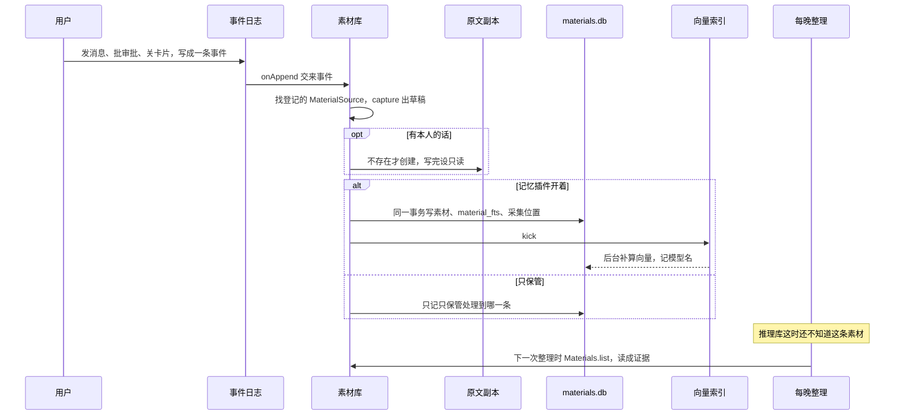

- **关键词索引**和素材同一事务写好：索引文字是本人切段的文字加引用的说明；存的网页另加正文（`MaterialDraft.indexText`，166 号票）。
- **向量异步补算**：新素材马上 `kick`；启动后等 30 秒再补算缺的；一批最多 16 条、"条数 × 最长字数"不超过 2000 字；模型不在就往待我处理里放一条提示，每 5 分钟看一次。
- **重启**：从记下的采集位置补采；原文副本里有、`materials.db` 里没有的补回。
- **进推理库**：不是马上，是下一次整理（4.4）。适配器把还没进过库的素材读成证据（第 6 节），引擎同一事务写证据和关键词索引，再补算向量。PoC 里测试和评测直接调 `ingestEvidence` / `extractFacts`，证据和事实是马上的。

### 4.2 检索并回答 ✅ / 🧪

**在用的二狗**有四条路，都**在线**：

- **素材检索**：秘书在执行记忆命令、用户问起以前说过存过的东西时调 `search_materials`，查素材库（马上就有的那一份）。
- **醒来简报**：秘书每次醒来、压缩之后，`wake` 块自动带上（不调工具）。
- **每条消息的记忆简报**（266）：用户每说一句，记忆插件先用本机检索和相关门槛判有没有相关的记忆，有就在这一轮输入的尾部带上相关结论连原话（不调工具、不调模型；同一段对话里带过没变的不再带）。
- **问记忆**：问"我是不是……""为什么……""我最看重什么"这类关于用户本人的，调 `ask_memory`，查推理库（只到上一次整理）。深聊、要改要忘的转给记忆管理员（4.11）。

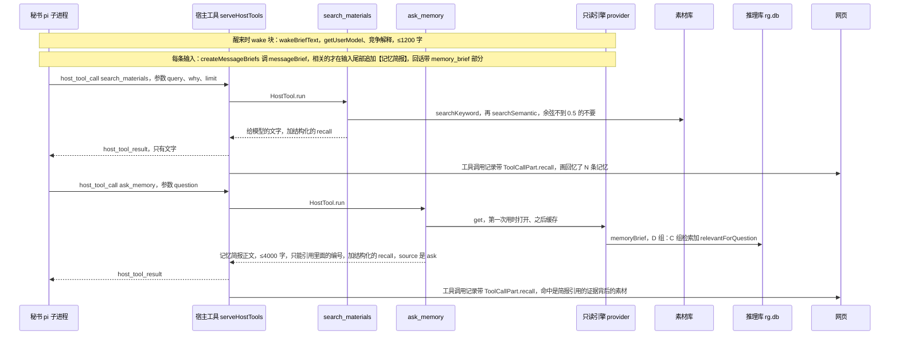

- 素材检索：项目内部的记录秘书检索不到（ADR-0023）；正在处理的那条命令本身不列；废弃分支里的排在后面；关键词命中的在前，语义命中的往后追加；要看全文用 `read_material`，存的网页正文夹在外部数据标记之间；网页按素材 id 现取原文，删了的写"这条记忆已删除"。
- 问记忆：简报里是记录（原话、时间、谁说的、场景）、对用户的理解（结论下面带原话）、还没分出胜负的解释（带能区分的问题）、明说过的要求和禁忌；问到"帮我……"这类任务题还会调 `adviseTask`（4.9）。只读、不调模型；库用不了回"记忆还没准备好"。263 号票起它也进"回忆了 N 条记忆"那一行：结构化的 `recall` 里 `source` 是 `ask`、查了什么是问题，命中是简报正文里出现的证据背后的素材（`briefRecallHits`，表态证据这类不是素材的不算）；N 只数素材，不数结论。
- 记忆简报：内容是对用户的理解里过了相关门槛的结论（下面带原话）、明说过的要求和禁忌、还拿不准的竞争解释、交互策略，上限照 `BRIEF_LIMITS`；短应答、关着、超过 3 秒没算完、相关的都带过了就不带。它也进"回忆了 N 条记忆"那一行（`source` 是 `brief`，命中是原话背后的素材），详情里每条结论写为什么带、经哪条路对上。
- 秘书怎么组织回答是秘书自己的事：推断的要说明是推断的，别人转述的不当依据（写在工具说明和系统提示里）。

**PoC** 🧪：四种检索模式（消融的 A、B、C、D 组），细节见架构文档第 6 节。

| 模式 | 组 | 做什么 | 线上 |
|---|---|---|---|
| `vector` | A | 只用向量，余弦取前 k | 🧪 |
| `hybrid` | B | 原话、精炼陈述各有关键词和向量两路，RRF 融合（k = 60）；精炼陈述两路权重 0.5；场景对不上往后排 | 🧪 |
| `hybrid_kg` | C | B 加图扩展：认出实体，沿事实图谱走一两跳，只走在 `at` 成立的事实 | ✅ 记忆简报的记录、追问的底层检索 |
| `hybrid_kg_rg` | D | C 加推理图谱：带上命中的假设的支持和反证；"为什么"类问题跑判别性追问做第二轮检索（只检索，不写图谱） | 🧪 |

- 调用的人先用 `planQuery` 从问题里认出时间，再交给检索。
- 模板回答 `answer()` 🧪：先分流（202，`classifyQuestion`）；事实回忆只走检索、能说不确定；关于自己的判断、为什么查用户模型和推理图谱，过了相关门槛（`gateClaims`）的才拿来用；任务走 `adviseTask`。检索结果算不算"挨着问题"：有话题词、图扩展带来的，或者余弦过了两道门槛（205、206，`questionVectorGate`）。
- 大模型回答器 `LlmAnswerer` 🧪：评测里模拟秘书读着记忆简报回答（216），线上由秘书本人做这件事。

### 4.3 整理：`reflect()` ✅

**触发**：线上由每晚整理（4.4）、立即整理一次、`memory:build` 调；PoC 里由测试、评测、演示调。**离线**。幂等、增量（记着每个推理实现整理过哪些证据），有轮数和模型调用预算。线上用的是模型版（`LlmReasoner` + `LlmFactExtractor`）。

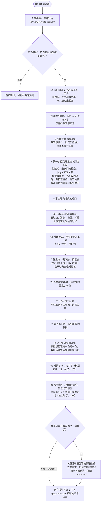

- 第 3 步：观察是在 `at` 成立的、关于用户的、能当依据的事实。
- 第 4 步：追问的检索走 `ReasoningGraph.baseSearch`（C 组）；judge 交回的关联校验后才写（断言得是组里的、目标得是这次检索到的、不能当依据的降成背景）。
- 第 6 步：净分 = 支持的分贝 − 反证的分贝（弱 3、强 6、决定性 10）。有决定性反证又没有决定性支持就撤回留墓碑；领先第二名 6 分贝以上、净分为正、有强的判别性支持才 `active`；分不出都 `contested`。
- 第 7 步（256 号票起分两种门槛）：
  - **结构门槛**（过不了不出）：两种以上不同场合（229 号票起只看"方面"维度不同，只差周末 / 工作日、出差 / 休假的不算两种）、至少 2 条证据；
  - **时间门槛**（过不了先出、标临时）：需求层两个以上月份、价值层需求也跨得够（3 个月）、至少 3 条证据。没过的组照样出，说明后面挂"（临时结论：月份不够……）"，置信度按 `confidenceCap` 压成低；跨度够了的那次重抽不再带"临时"，置信度升上来，才拿它再往价值层抽。需求、价值最多 `medium`。
  - 模型版（201，`LlmReasoner.lift`）：门槛由代码判，不交给模型；交回的每组再判一次门槛；提示词讲清每组自己也要跨两种以上互不重叠的场景（221）；伪造的 id、不认得的领域写入前丢掉；已有的组下次不重复问模型。规则版 `liftGroups` 还是老门槛（只在 PoC 里用）。
  - 下层断言的场景：明说的取断言的场景，规则版推断的取组的日子和方面，模型版推断的取模型给这条假设写的场景（220）。
- 第 1b、6b、7b–7d 步（199）：对比模式出一组（和这个属性有关 / 和推掉的那几次共有的别的属性有关 / 各有各的原因）；矛盾出一组五种根源（记错 / 时间变了 / 场景不同 / 说的和做的不一样 / 更深的需求）；根源定了写回知识图谱、根源变了撤回；分不出的经 `QuestionSink` 进问题箱（207）。这几组由代码判，模型版也不另发请求。细节见架构文档第 7.8 节。
- 第 8b 步（227）：还没复核过的、推断的、把握不低的需求和价值，最多 5 条交给不知道结论的复核员，只给支持原话、先让它自己推再判；不一致的加复核标记。单独 5 次调用预算（不占 `maxModelCalls`），同一条只复核一次。263 号票起线上每晚整理也做。
- 第 8c 步（226）：记下来不调模型（需求 +14 天、价值观 +30 天到期）；判要模型，每夜最多 10 条，用 `maxModelCalls` 剩下的那份，判不了、没有新证据的留 open。只记账，不改结论的分。263 号票起线上也判。
- 第 9 步（201，只有模型版）：写出来的照旧 `proposed`，本人确认才 `active`。
- 模型版第 3、7、9 步不能整个失败（218）：分批、截断和解析不了时救回完整的条目、剩下的对半切小重试，还不行的那批放弃，写进 `dropped`；预算留 1/4 给往上抽、编策略。237 号票修掉了宽松解析在"该是条目的地方是 `}`"时原地打转的死循环。
- **预算按道花**（270 号票，`rg/nightly-lanes.ts`，只管明确写了 `exhaustive: false` 的推理实现——模型版；规则版每次全部重来，照旧）：

  | 道 | 用哪份预算 | 做什么 |
  |---|---|---|
  | 新证据 `newEvidence` | 前段（总数 × 3/4）减掉判回答的保底，排第一 | 第 1 步抽事实（按时间先后）、第 3 步给新的观察出假设、第 4 步新组出追问；判证据先问没问过的追问（`outcome` 还是 open：新组的、上一次没轮到的），再按检索结果里最早那条新证据的先后问旧追问 |
  | 判回答 `replies`（271） | 保底一小份：`min(10, 这一夜要问模型的问题数)`，从前段里划出来；新证据没用完的前段也先给它 | 每晚整理时判顺口问以后用户有没有在答（4.8），一个问题一次调用；新证据那一道问完追问就跑，新证据（含抽事实）抢不走保底，积压几夜也轮得到；没判到的留到下一夜 |
  | 重跑旧追问 `rejudge` | 前段里新证据、判回答剩下的 | 跑之前标着复核的组、有到期复评结论（成立、30 天没复核过）的组，最久没复核的先；别的旧追问检索结果里没有新东西，不重判 |
  | 往上抽 `lift` | 后 1/4 + 前段剩下的 | 第 7 步往上抽，往上抽的组的追问同样按道选 |
  | 判预测 `predictions`、编策略 `strategies` | 剩下的 | 第 8c、9 步 |

  272 号票：两处每夜重复花钱也省掉了——一直没进组的新观察每夜再拿去出一次假设、往上抽每夜把同一批没被用上的下层断言再问一遍（线上一夜 9 次）。模型版问过一次、模型回了话、又没进组的，记进账 `rg_asked`（签名是当时的陈述、状态、证据拼起来的散列）；下一夜签名没变就不再当这一批问，照样作为别的观察、别的下层断言给摘要，可以和新的一起归组；有了新证据（同一条观察多了证据、下层断言的支持变了）才再问；一层的下层断言都没变就这一层不问（`notAsked` 记"下层断言没有变化"），报告的"预算"一行写"问过、没变化没再问：出假设 N 条观察、往上抽 M 条下层断言"。进了组的不记，组撤了还会再问。

  新证据没有别的道排在它前面，前段（减掉判回答那份保底）就是它的保底；总上限没变。要问模型而预算用完就停，没问到的追问不写结果（以前写成"没找到"），没问过的留着下一夜最先问。第 8 步一条新证据算整理完：抽事实、出假设、出追问没被预算挡住，欠它的追问（检索结果里有它的、它是观察的组里没问过的）都问过了；整理完一条记一条。一组的追问这一夜全问过一遍，组里到期复评的结论记下复核时间。报告带 `spend`（每一道几次，加起来等于 `modelCalls`；对抗复核另算）和 `backlog`（还剩几条新证据没整理完）。
- 细节见架构文档第 4.3、7.2、7.5 节。

### 4.4 每晚整理 ✅

**触发**：每天 03:00（记忆插件的内部作业 `memory-nightly`）。**离线**。242 号票起由记忆管理员来跑，整理本身还是同一条确定性路径。

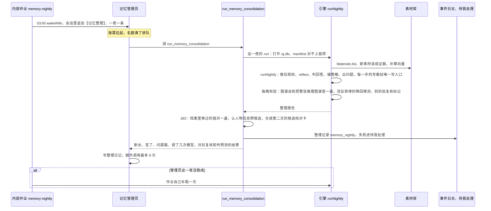

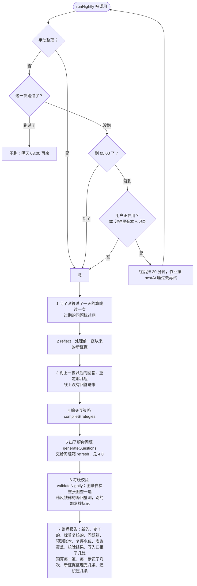

- **推后规则**（`nightlyDecision`）：到点前不跑；同一夜不跑第二次；用户正在用就往后推 30 分钟（守护进程按 `nextAt` 用自己的时钟睡过去，守护进程停止、插件停用会马上醒）；推到 05:00 不再推，照跑（`late`）；错过了（机器关着）开机就补跑（`catch_up`，这一次走老路径、没有日记）。
- **手动整理一次**（235）：快速动作 `memory_nightly`（秘书提议、用户点了才跑）、管理员的 `run_memory_consolidation`、`npm run memory:build`。同一份作业、同一份预算；不看 03:00、不看用户在不在用、不看这一夜跑过没有；运行状态记在 `nightly_runs` 里手动自己的键（`manualRunKey`），所以不吃掉当天 03:00 的那一次。增量靠引擎的簿记：素材按 id 跳过、抽事实每条证据每个抽取器一次、假设和追问有流水，连点两次第二次几乎不调模型。
- **预算和超时**：引擎一夜最多 `memory.maxModelCalls` 次（默认 200，抽事实每 8 条证据一次，和整理、判预测共用；270 号票起判完回答再整理的那一次只用第一次剩下的，一夜合起来不超过它）；对抗复核另有每次 `reflect` 5 次（263 号票接上以后一夜最多多 10 次，平常是还没复核过的新结论有几条就几次）。270 号票起 `reflect` 里按道花（4.3）：新证据排第一，重跑旧追问用新证据剩下的，往上抽留 1/4；整理完一条新证据记一条，没轮到的下一夜按时间先后接着做（报告写"新证据整理完几条、还积压几条"和"预算：……"那一行）。墙钟上限 `memory.nightlyTimeoutMinutes`（默认 60）：到点中止、记一条失败（"整理超时"）和待我处理一条；只停得住能回到事件循环的点（等模型、等 IO、等推后），同步死循环要靠根子修复。管理员自己另有 `memory.curator.maxModelCalls`（默认 8），跑满停下这一轮。
- **唯一写入口和每晚校验**（267）：整理里每一组、每一条结论各开一次写（`engine.gate.write`，写的人是夜班），不合规矩的那一组被拒、回滚，原因记进报告的 `dropped`（`stage: gate`）和整理记录的 `refused`，别的组照常；整理完由图谱自检（`graphSelfCheck`）把整张推理图谱查一遍，违反铁律的降回猜测、别的点名结论加复核标记，结果进整理记录的 `validation` 和管理员的整理日记。只有校验器自己出错才跳过、写明原因。
- **首次建库**：现有素材按模型版要重抽一遍，一夜的预算装不下就连续几夜做完（270 号票起按时间先后，整理完几条记几条）；整理记录的 `processedEvidence`、`pendingEvidence` 看进度。也可以用 `npm run memory:build` 离线一次做完（预算自定，默认 2000）。
- **整理记录**：每一夜（跑了、推后、跳过、失败、要重建）往守护进程内部的事件日志追加一条 `memory_nightly`，派生视图一夜一条（后写的覆盖先写的），记忆页概览和管理员页顶上读它；完整的 `NightlyReport` 在 `rg.db` 的 `nightly_runs`。整理成功不出声，失败进待我处理（一夜一条）。
- **没配 key**：跳过这一夜、记原因，不建库、不花钱。**`memory.enabled` 是 false**：不排作业、不建库。
- PoC 里用模拟时钟（`SimClock`），演示 `npm run memory:demo` 的 ⑥"过了几夜"。细节见架构文档第 7.7 节、[开发者指南](developer-guide.md)的"记忆系统"。

### 4.5 新事实到来时更新图谱 ✅

**触发**：整理时抽事实（`reflect()` 第 1 步）。线上素材要等整理才读成证据、抽事实，所以"事实层马上变"指的是**抽到它的那次整理里马上变**，推理层的大部分在同一次整理的后面几步变。

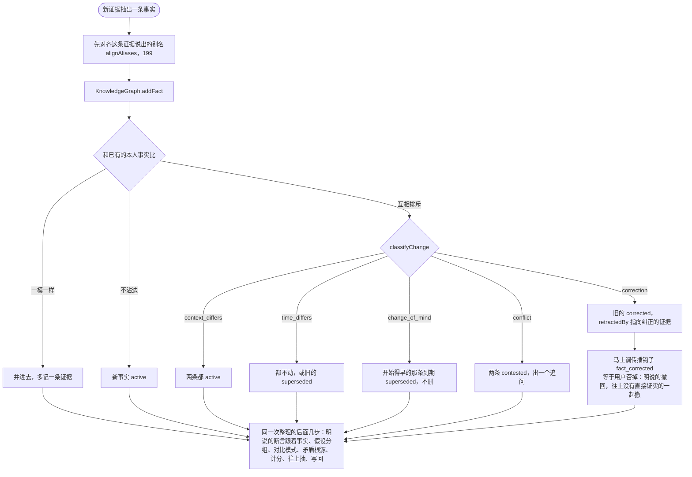

| 抽到的那一刻（同一个事务） | 同一次整理的后面几步 |
|---|---|
| 事实的状态：取代、纠正、冲突、合并 | 明说的断言跟着事实走（取代、冲突、撤回） |
| 有效期：观点变化让旧的到期 | 竞争假设：出组、更新观察、撤回不成立的组 |
| 精炼陈述跟着有效期重写，关键词索引换掉、旧向量作废 | 追问、第二轮检索、关联 |
| 事实层真冲突的追问 | 假设的输赢、置信度 |
| 纠正时：明说的断言撤回、往上没有直接证实的一起撤（329，ADR-0032），用户模型马上不出现它 | 需求、价值（往上抽，可能先是临时结论） |
| 别名对齐、合并实体（199） | 对比模式、矛盾根源的竞争假设（199） |
| 事件实体和它的属性、人和人的关系（199） | 根源定了写回知识图谱，明说的断言跟着走（199） |

- 只有本人的事实参加判定；别人转述的只当背景，不取代、不纠正、不冲突。
- "先后不等于原因"：观点变化只记什么时候变的，不生成"因为 A 所以变了"。
- 变化判定的"观点变化"要后说的那句自己明说了变化（334 号票，ADR-0032"前后两句对不上"：只是意思相反、没说变了的是真冲突，两条都是猜测、问用户"现在更接近哪个"，不再按日子先后让后说的赢）；要是后来又变回去（喜欢 → 不喜欢 → 又喜欢），整理时当矛盾追根溯源（4.6）。
- 一句话抽出来的状态，开始不早于说这句话的那天（334 号票：模型给 `valid_from: null`、原话没说从什么时候起的，按说话那天算）。

### 4.6 修复矛盾 ✅ / 📋

两层的矛盾分开处理，都在整理里（离线）。

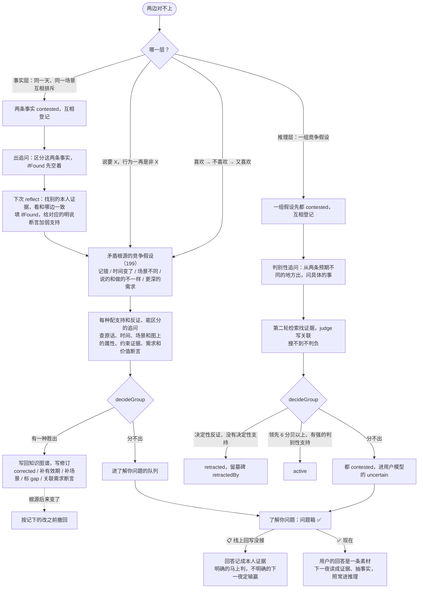

- 墓碑不删：撤回的断言留着，`retractedBy` 指向起因，问"为什么排除了"答得出（记忆页的证据与推理、管理员的 `inspect_memory` 都看得到）。
- 矛盾根源（199，`rg/conflict-roots.ts`、`rg/joint.ts`、`rg/writeback.ts`）：定了照结论改知识图谱（两张图保持一致），分不出的进问题箱。规则见架构文档第 7.8 节。
- 用户的话在"怎么为他服务"上是权威，在"他为什么这样"上只是一条证据；用户确认过也只标 `user_confirmed`，置信度照样按上限。
- 线上"向用户求证"走问题箱：话题对上时秘书在回话末尾顺口问（264），用户紧接着的回答回写成本人证据；记忆页、管理员看得到。见 4.8。

### 4.7 纠正、忘掉、彻底删除、别推断的传播 ✅ / 🧪

**引擎里的传播**（✅ 线上忘掉、彻底删除、别推断都走到；`correct()` 只在 PoC 里调）：

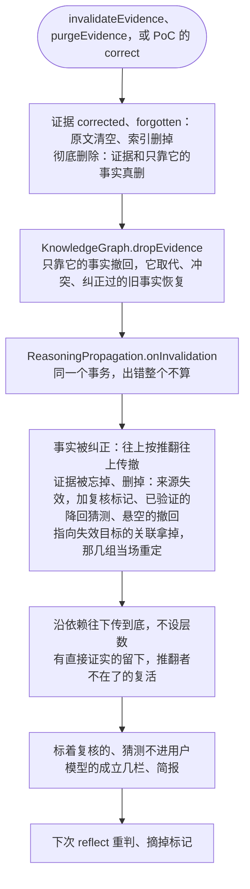

- 每一步写一条修订，原因写"传播：前提 X 失效（证据 Y 被忘掉）"这类；彻底删除另写一条只有 id 的审计 `rg_purges`。
- **纠正**：线上没有 `correct(被纠正的, 纠正它的)` 的入口。用户说"我记错了""不是…是…"的话照常存成素材，下一次整理抽事实时由变化判定认出纠正（4.5 的 `correction`）；PoC 里 `correct()` 让纠正的证据抽出的事实直接按各条假设的预期判、多重升一档。

**在用的二狗**（✅）：秘书只能提议，删除总要用户在卡上核对（规格第 15 节，ADR-0008）；记忆管理员的 `forget_material`、`no_infer_material` 是用户跟它说了才调，追加同一种 `memory_command`。

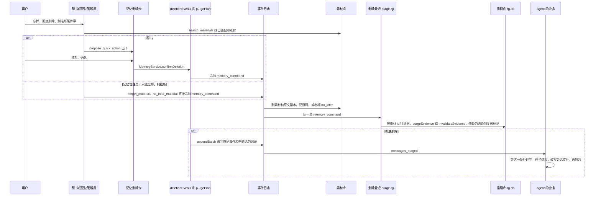

| 删法 | 素材库 | 推理库（234 号票，马上） | 下一次整理 |
|---|---|---|---|
| 忘掉 | 素材和原文副本删除，`material_marks` 记墓碑；聊天里原话还在 | `invalidateEvidence`：证据清原文、只靠它的事实撤回、依赖的结论照来源失效走（加复核标记、已验证的降回猜测、悬空的撤回；证据留墓碑） | 标着复核的重判 |
| 彻底删除 | 再按改写函数表改写事件日志、卡片、工具调用记录，会话文件在子进程那一层改；媒体清理；WAL 检查点 | `purgeEvidence`：证据和只靠它的事实真删（索引、向量、精炼陈述一起），依赖的结论加复核标记（只靠它的推断停用等重推），相关问题过期，审计 `rg_purges`，WAL 检查点；删完在 `rg.db` 里搜不到原文 | 标着复核的重判 |
| 别推断 | 素材标 `no_infer`，检索结果标"不参与推断" | 已进库的证据、事实撤掉，依赖的结论同忘掉；以后适配器不读它 | 重判；取消标记不自动恢复（也还没有取消入口，📋） |
| 敏感类别没打开 | 照常记录、检索 | 启动时撤掉已进库的那类证据；适配器不读（v1 只有健康） | 打开以后下一夜读那边的素材 |

设置里按会话、按时间段批量删除走 `createBulkMaterialDeletion`，同一个 `deletionEvents`，不过秘书、不出卡片，推理库那边同样跟着 `memory_command` 登记。记忆插件停用期间下的删除，再启用时 `reconcile` 补做。

### 4.8 了解你问题：生成 → 问 → 回写 ✅

**触发**：每晚整理时生成；`reflect()` 里联动分不出的组也经 `QuestionSink` 交来（207）。**生成离线，问在线。** 了解你问题是非阻塞的，只进问题箱或在相关对话里顺口问，**永不推送**（CONTEXT.md）。264 号票起顺口问和回写接进了线上（`packages/daemon/src/memory/woven-questions.ts`），设置 · 记忆里能关（默认开）。271 号票起秘书用自己的话问（问了标一下才算问过），规则认不出的回答由记忆管理员在每晚整理时批量判（`rg/reply-judge.ts`）。

| 步骤 | 接口 | 在用的二狗 |
|---|---|---|
| 生成、进问题箱 | `generateQuestions`、`QuestionBook.refresh`、`offer` | ✅ 每晚整理在跑 |
| 给谁看 | `listQuestions`、记忆页 | ✅ 记忆 · 问题箱（问过几次、跳过几次、你的回答、判的结果、经过）、管理员的 `memory_questions`；醒来简报里不再放（264） |
| 顺口问 | `pickQuestion`（`peek`、`settle: false`）、`mark_woven_question`、`markQuestionAsked` | ✅ 秘书开始处理用户的每一句时挑，挑中了交一块【顺口问】（要问的、为什么问、怎么问）；秘书用自己的话问、问了标一下，这一轮做完标了才记问过（271） |
| 读回答（白天） | `readQuestionReply`（`classifyReply`） | ✅ 只读紧接着那一轮的下一句、只认明显的：在答、跳过、别问这个；认不出的不动（留给夜里）；规则版，不调模型 |
| 读回答（夜里） | `runNightly` 的 `replyJudge`：`planReplies`、`judgeReplyCases`、`applyReplyJudgments` | ✅ 271：问过、还等着的问题和用户之后的几句话交给记忆管理员判——答了回写、没答算跳过一次、拿不准留到下一夜（最多两夜）；花整理预算（判回答那一道） |
| 回写 | `recordQuestionAnswer` | ✅ 回答那句话的素材读成证据草稿（`evidenceDraftOf`，出处是素材 id，整理时不再重复读）；明确的马上判，不明确的下一夜判 |
| 跳过、别问这个 | `recordQuestionSkipped`、`declineQuestion`、`recordNightSkip` | ✅ 用户说"跳过、不想说"记跳过一次；"别问这个"这一类不再问（带上那句话）；夜里判成没在答也算跳过一次（271 起白天不再把问了没答的记跳过） |

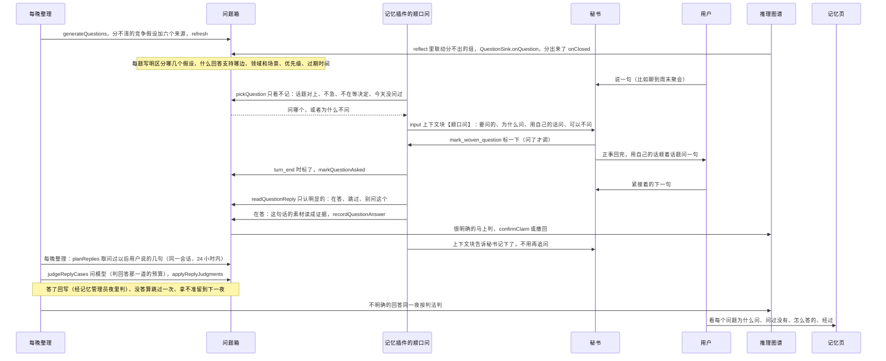

- **从哪来**（`generateQuestions`）：追问检索以后还分不清的竞争假设，另外照调研 11 的六个来源——矛盾、低置信但高价值、张力（说的和做的不一样）、规范性判断（只能问"要不要我帮你……"）、预测落空（用"成立以后的新反证"近似；330 号票起演绎预测落空、判不出是哪条前提错了的，每条嫌疑也出一个）、反常输入；330 号票起还有一种：用户点过头的做法依据都被推翻了，问"这条做法的理由没了，还要不要"（R6）。各自什么时候出、怎么问、回答"是""不是"各支持哪边，见架构文档第 7.7 节的表。
- **199 联动的组**（207）：分不出（没有一条成立）时，每条能区分的追问一个问题，问法换成能用"是 / 不是""会去 / 不会去"回答的具体的事（`JointReasoner.questionFor`）。
- **措辞**：中性、问具体的事、不问动机；`leadingPhrases` 挡住"因为你……所以""你是不是因为""为什么"、带评判的说法，不过关的不出。
- **优先级**（207）= 回答能不能直接分出胜负（`answerSeparation`）× 分数接近的程度 × 常不常遇到（近 30 天这几个领域的记录占比）× 还没问过。过期默认 30 天，目标里有近期状态的跟着它的有效期提前。
- **问题箱**：同一个问题只有一个开着的；要弄清的有结果了标"不用问了"；"别问这个"的那一类、跳过两次的不再生成；答过、过期的冷却 30 天。
- **顺口问、回写、跳过**（198 的规则，264 号票照它接进秘书）：话题怎么对上——场景按维度比要重叠、领域有交集或者提到了问题的说法；每天最多 1 个（按真的问出去的算：271 起秘书标了才算）；急事（"赶紧、马上……"）、上一轮在等用户做决定（秘书的回话里出了卡）不问；271 号票起不再要求原样带 198 那一句，秘书跟着当时的话题和语气用自己的话问（只问具体的事、不带诱导、不合适就别问，用户问起为什么照实说想更了解他、可以不答），@ergo/memory 的演示和评测里照旧是"顺便问一句：……（想更了解你一点，不想答可以跳过。）"。回答规则版读成是、不是、说不好：很明确的马上标"你确认过"或撤回；不明确的下一夜按判法定输赢；说不好的不判。问了没答算跳过一次（271 起线上由夜里判过再记），跳过两次退下、记一条回避信号（系统观察到的，不当依据）。
- **是不是在答**（264，`classifyReply`）：只看秘书带上问题那一轮之后用户的下一句。有"别问这个、这个别问了、以后别再问"是别问这个，有"跳过、不想说、先不说这个"是跳过；分句说到了问题里的事才算回答——接着问题的话头短短答（会 / 不去 / 是的 / 对 / 没有），或者和问题有两个以上相同的两字词，或者说到了问题的说法；跟秘书提要求的分句（帮我……、提醒我……）不算；整句很短、只是"看情况、说不好"也算回答（说不好）。别的都当在说别的，不动问题。**宁可漏认**：漏认的回答照样是素材，271 号票起留给夜里判；错认会把别的话记成对问题的表态。
- **夜里判**（271，`rg/reply-judge.ts`）：交给模型的是问题、为什么问、回答"是""不是"各说明什么、秘书当时那一轮的回话（问在里面）、用户之后的几句话（s1、s2…）。模型回 `answered`（`verdict` 是 / 不是 / 说不好，`answer` 点名在答的那几句）、`not_answered`、`unsure`；解析不了、点名的不是给过的句子当拿不准。隐含的回答也算在答（问"是不是特别忙"答"最近在赶项目"读成"是"）。答了用点名的第一句的证据回写；说得明不明确再拿规则核一遍（同一边、有加重的才明确）。当天才问的不判（到第二天才算"问了没答"）；问过以后一句都没说的、拿不准以后没再说什么的不问模型。
- **回写写了推理库的什么**（264；267 号票收写入口时看这里）：一条本人证据（`evidence`，出处是那句话的素材 id，和每晚整理读出来的同一条）；问题箱的那一行和经过（`questions`、`question_log`）；回答得很明确的另按问题里写的判法写（`confirmClaim` 或决定性反证的 `links` 加 `redecideGroup`，矛盾、张力、反常输入另改事实这一层）；"别问这个"另写 `question_blocks`，带上的那句话也入证据；跳过两次退下另记一条系统的回避信号证据。
- **透明，不套话**：每个问题看得到为什么问、为了弄清哪几个假设、什么回答支持哪边；不通过隐蔽地影响用户的行为来验证假设。

### 4.9 为任务调出需求和价值观、出建议 ✅ / 🧪

**触发**：交来一个任务，比如"帮我安排下周六"。**在线**。196 号票的三条路找相关的断言，202 号票接进 `answer()` 和 D 组检索；线上经 `ask_memory` 的记忆简报用到（`relevantForQuestion` 走三条路；问题是任务题时另调 `adviseTask`，结果放进"对用户的理解"和"明说过的要求和禁忌"两节）。

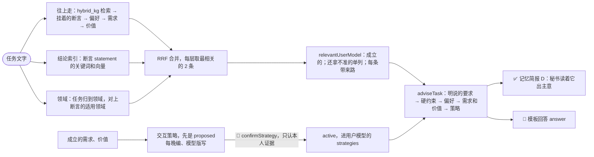

- 权威顺序里，价值观推翻不了这次明说的要求；"还拿不准的"不用来做决定。
- 依据的断言降成猜测、标着复核或被撤回时，策略跟着暂停或撤回（329 起"待复核"是复核标记）。
- 交互策略线上每晚在编（`compileStrategies`，模型版另写），但线上没有确认的入口，都停在 `proposed`。
- 任务 agent 按用户授权的记忆范围取用（接入设计第 5 节）、交互策略编进用户卡（05 号调研 §6.2）：📋。

### 4.10 插件启停、整理开关 ✅

**触发**：配置 `plugins.disabled` 里写 `memory`（重启生效），或设置 · 插件里运行中停用、启用（211 号票，马上生效）；配置 `memory.enabled`（235）。

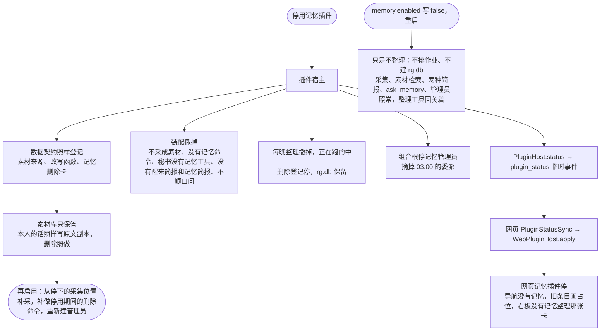

- 停用期间旧的记忆删除卡回"记忆插件没启用"；设置里的删除照常（内核的）。
- 记忆页的只读接口在内核，插件停用照样能读已有的结论（只是网页上记忆页随插件收起）。
- 移除时"连数据删"只删记忆插件自己的："记住"命令里的内容、长期没处理的卡的记录、记忆删除卡、整理记录和两种失败事项；素材库、推理库、原文副本都不删。
- 网页插件跟网页一起构建，守护进程报的状况只决定装不装。

### 4.11 找记忆管理员：说话、改结论、忘掉 ✅

**触发**：用户在「记忆 · 管理员」那一层发消息，或者秘书用 `ask_curator` 转达；03:00 的唤醒见 4.4。**在线**。

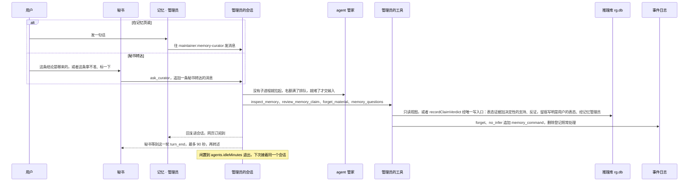

- 它只管记忆：改配置、删素材库、改别人会话的事它没有工具，明确说"这个我不做"。
- `review_memory_claim`（263 号票起）记的是用户的表态，不直接改状态：对 → `confirmClaim`（"你确认过"、决定性支持），不对 → `rejectClaim`（决定性反证、撤回），拿不准 → `markClaimForReview`（加复核标记，下一次整理按证据重判）。计分认决定性的关联，所以整理不会把确认、撤回改回去；用户改主意再调一次，先前相反的表态按纠正收回、收回了确认的标回推断的。用户自己明说的结论撤不掉、因为依据不在了才撤回的改不回已验证，工具照实说（明说的交回素材编号，让它用 `no_infer_material` 或 `forget_material`）。以前直接 `store.updateClaim` 的写法：改成成立、撤回下一次整理会被计分改回去，撤回还因为没写墓碑被库的校验拒掉。267 号票起这一路经唯一写入口，写入口拒了时工具回"没改：推理图谱的写入口没让写——……"，逐条写明原因，库里什么都没动。
- 它没有自己改推理图谱的路：它的写都经唯一写入口，记成"用户的表态 · 经记忆管理员"（`review_memory_claim`）或"用户发起 · 经记忆管理员"（`forget_material`、`no_infer_material`，照 242 号票是用户说了才调）。夜班之外，它自己（`curator`）只能加复核标记。
- 它平时的调用不记进整理记录（那份预算是 03:00 的）；token 账本里角色是 `curator`，算系统开销。

### 4.12 运维：重建、验收、导出、全量重判 ✅

**触发**：手动跑 npm 脚本。**离线**，都不进守护进程，脚本在 `packages/daemon/test/memory/` 下。

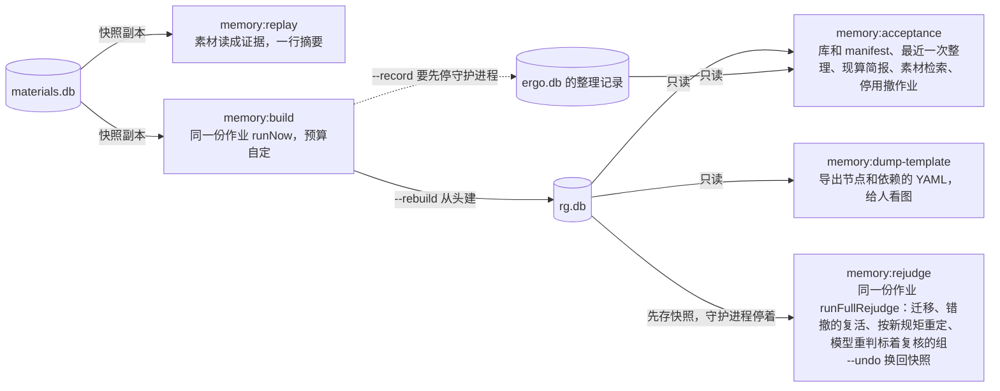

| 命令 | 文件 | 做什么 |
|---|---|---|
| `npm run memory:replay` | `packages/daemon/test/memory/replay-materials.ts` | 把 `materials.db` 做一份快照副本，读成证据，打印素材数、证据数、来源级别、场景分布（224） |
| `npm run memory:build` | `packages/daemon/test/memory/build.ts` | 离线按素材库整理一遍：走 `nightly-job.ts` 的 `runNow`，`--rebuild` 从头建、`--max-model-calls` 自定预算（默认 2000）；只写 `rg.db`，`--record` 才记一条整理记录（要先经 LSM 停掉守护进程）；不算向量 |
| `npm run memory:acceptance` | `packages/daemon/test/memory/acceptance.ts` | 上线验收，只读：`rg.db` 和 manifest、最近一次整理记录、现算一份简报、素材检索、插件停用后作业撤销（假宿主）（235） |
| `npm run memory:dump-template` | `packages/daemon/test/memory/dump-template.ts` | 只读导出推理库成节点和依赖的 YAML（通用的有向无环图格式）：事实、结论、问题，`--with-evidence` 连证据一层，结论 ← 结论的边保留（253、256）；给人看图、拿别的工具查，每晚校验不用它（326） |
| `npm run memory:rejudge` | `packages/daemon/test/memory/rejudge.ts` | 全量重判一次（333，ADR-0032）：规矩改了以后把现有结论按新规矩全过一遍，走 `nightly-job.ts` 的 `runFullRejudge`（同一个模型、写入口），不读新素材；先存快照、报告写进数据目录的 `tmp/`，一步一行打进度和花费，`--max-yuan` 封顶，`--undo` 换回快照；要先经 LSM 停掉守护进程 |

### 4.13 评测 🧪

**触发**：`npm run memory:eval [-- --embedder fake|bge-m3]`、`npm run memory:eval2`。**离线**。只喂合成数据。

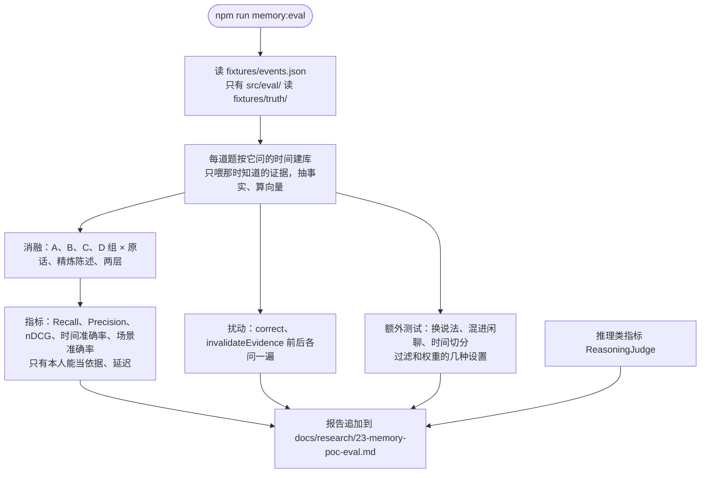

- 推理类指标六项：隐式偏好准确率、无依据推断率、反证召回率、溯源覆盖率、撤回正确率、该说不确定时说了的比例。
- 硬规矩：忘掉的证据之后一次都不出现；被纠正的出现时标 `corrected`；时间切分里未来的证据漏进来 0 次。规则版的结果只能说明机制，不能说明理解。
- `test/no-truth.test.ts` 检查 `src/` 里别的代码不提 `truth`、不 import 评测模块。
- 199 号票：知识图谱联动的两个指标（隐蔽联系找出率、矛盾根源判对率）在 `src/eval/kg-joint.ts`。
- 评测数据二（204 号票起，`npm run memory:eval2`）在 4 个虚构的人上跑：

```mermaid
flowchart LR
  BUILD["建库一次<br/>抽事实、算向量、reflect，扰动做完 op 再整理<br/>模型版给复核员，--stall-minutes 看门狗"] -->|"--save-dir"| SAVED[("每人一个目录<br/>每个库一个 SQLite 文件、manifest.json")]
  SAVED -->|"--load-dir，设置对不上就报错"| ASK["每道题每组问一遍"]
  ASK -->|"--answerer template"| TPL["规则模板<br/>A、B、C 按检索结果拼，D 是 answer()"]
  ASK -->|"--answerer llm"| BRIEF["记忆简报 memoryBrief<br/>A、B、C 记录，D 记录加用户画像"]
  BRIEF --> LLM["LlmAnswerer<br/>DeepSeek 关思考，MeteredChat 记用量"]
  TPL --> JUDGE["判法和大模型裁判"]
  LLM --> JUDGE
  SAVED -->|"--coverage"| COVER["说中几条隐藏需求"]
  SAVED -->|"npm run memory:dump-claims"| DUMP["每人一份结论 JSON"]
```

- 216 号票：存下的库带建库的设置和版本，读回时对不上就报错；`--answerer llm` 默认只估费用，`--run --max-spend-yuan` 才真跑。
- 主表、决策门槛看大模型裁判的数（用户 2026-10-21 定），词表判法照样列出来当参考。
- 几轮实验的结果在 23–28 号评测记录（[26 号](research/26-memory-poc-eval4.md)过了接入门槛；[28 号](research/28-memory-poc-eval6.md)是 229 号票"只看方面维度"的单变量对照）。
- 237 号票：建库 CLI 每一步打带时间戳的进度，`--stall-minutes`（默认 10）连续这么久既没模型调用也没进度就判卡住、退出码非零。

## 5. 什么时候更新什么

"马上"是写入的同一个事务里；"下一次整理"是下一次 `reflect()`：线上每晚 03:00，或立即整理一次、`memory:build`。线上素材要等整理才读成证据，所以凡是"抽事实时"做的事，线上都发生在下一次整理里。用户模型不存，每次取快照按断言现算：断言一变，下次取（每轮简报、问记忆、记忆页）就变。

| 变化 | 马上生效 | 下一次整理才生效 | 只在 PoC 里、📋 |
|---|---|---|---|
| **新证据**：用户说偏好、状态 | 素材、原文副本、关键词索引马上写，向量后台补算；推理库还不知道 | 读成证据、抽事实、变化判定；明说的断言；需求、价值往上抽（时间不够先出临时结论） | PoC 里 `ingestEvidence`、`extractFacts` 是马上的 |
| **新证据**：行为、观察（拒绝、参加） | 同上 | 认观察模式，出或更新竞争假设，跑追问，计分（270 号票起模型版先问新组的、检索结果里有它的追问；一夜做不完的按时间先后下一夜接着做；272 号票起问过、没进组、没变化的观察不再拿去出假设，有新证据才再问） | 同上 |
| **纠正**（"我记错了""不是…是…"） | 只存成素材 | 抽事实时认出纠正：旧事实 `corrected`，等于用户否掉——明说的断言撤回留墓碑、往上没有直接证实的一起撤、退出用户模型 | `correct()` 马上做，纠正当证据按预期判、多重升一档（线上没有入口） |
| **观点变化**（"现在不喜欢了"） | 只存成素材 | 早的那条到期 `superseded`，不删；明说的断言跟着；偏好有新证据就调 | — |
| **场景不同** | 只存成素材 | 两条都 `active`，不算冲突 | — |
| **真冲突** | 只存成素材 | 两条 `contested` 出追问；建矛盾根源的竞争假设（199），定了写回，分不出进问题箱 | — |
| **说的和做的不一样**、别人来约（199） | 只存成素材 | 事件实体、人和人的关系、别名对齐；对比模式、矛盾根源的竞争假设；"说的和做的不一样"胜出时两条都保留、标 `gap` | — |
| **忘掉** | 素材和原文副本删除、记墓碑；推理库：证据清原文、只靠它的事实撤回、依赖的结论照来源失效走（加复核标记、已验证的降回猜测、悬空的撤回）、退出用户模型 | 重判、摘掉标记 | — |
| **彻底删除** | 另改写事件日志、卡片、工具调用记录（问记忆、问记忆管理员的按证据编号找，272 起删项目、删任务连带的也是）、会话文件；265 以前删过的，272 号票的补抹在守护进程启动时把问记忆结果里还留着的原话换成删除标记（一次）；清媒体；推理库：证据和只靠它的事实真删、结论加复核标记、问题过期、审计；两个库都做 WAL 检查点 | 重判 | — |
| **别推断** | 素材标 `no_infer`；推理库撤掉已进库的证据、事实，结论同忘掉 | 以后不读成证据；重判 | 取消标记的入口 📋 |
| **敏感类别**（配置改了要重启） | 启动时撤掉已进库的、没打开的类别的证据；303 起数据源素材的证据照新设置重读、变样的撤掉 | 打开以后读那一类的素材；数据源的按出处里写的类别，位置管地点 | 对话里的情绪、财务、关系、位置 📋 |
| **用户经管理员表态**（`review_memory_claim` → `recordClaimVerdict`，263） | 记一条表态证据；对：标 `user_confirmed`、记决定性支持、重定那组；不对：记决定性反证、重定那组（撤回、墓碑指向表态）；拿不准：加复核标记；先前相反的表态收回；修订写明是管理员 | 计分认决定性的关联：确认、撤回不被改回；拿不准的按证据重判；确认过的推理链塌了照样已验证（329，证实不靠前提） | — |
| **用户确认**（`confirmClaim`） | 回答了解你问题回答得很明确时也走它（264 起线上也走） | — | — |
| **回答了解你问题**（264、271） | 回答存成素材；用户紧接着顺口问的那一句被规则认成在答时，这句话的素材马上读成本人证据（出处是素材 id）、问题记"答了"；回答得很明确的按问题里写的判法马上判（标"你确认过"或撤回） | 271：规则认不出的由记忆管理员判（问题和用户之后的几句话）：答了用那句话的证据回写，没答算跳过一次，拿不准留到下一夜；不明确的回答按判法判（最多记强的；这句话抽出的事实已经同方向关联的不重复记）；这条证据照常抽事实 | 回答那句话不能当依据（别推断、敏感类别）的不回写，当没答 |
| **跳过、别问这个**（264） | 用户说"跳过"：跳过一次、回到问题箱（优先级减半），两次退下记回避信号；"别问这个"：这一类都关掉、以后不再生成 | 问了没答的算跳过一次；过期的标过期 | — |
| **预测到期** | — | 新出、变了的需求和价值记下预测节点（来源、推法）；到期的判应验、落空、说不清（每夜最多 10 条，263 号票起线上判）；330 号票起落空的往回打来源（演绎撤错的那条前提、判不出出问题，可废止的挨一条反证），应验的只刷新那一条 | — |
| **对抗复核** | — | 还没复核过的推断的需求、价值交给复核员，不一致的加复核标记（每次整理最多 5 条，263 号票起线上做） | — |
| **时间跨度够了**（256） | — | 重抽的组不再带"临时结论"，置信度升上来，才拿它往价值层抽 | 规则版 `liftGroups` 还是老门槛 🧪 |
| **时间到期** | 不改库：取快照按 `at` 算；近期状态到 `validTo`（默认 14 天）就不在 | — | 短期记忆按时间降权 📋 |
| **换向量模型** | 素材库：新模型名的向量整批重算 | 推理库同样按模型名重算，manifest 记向量模型名 | — |
| **每晚整理到点** | — | 唤醒管理员、跑一次、写日记；用户在用推后 30 分钟、最晚 05:00；超时 60 分钟放弃 | PoC 里是模拟时钟 |
| **推理库版本对不上** | 不开、不迁移，待我处理一条；简报空、`ask_memory` 回还没准备好、记忆页 `ready: false` | 不整理，等重建（删掉 `rg.db` 或 `memory:build -- --rebuild`） | — |

各层变的门槛不一样（架构文档第 5 节）：

- 近期状态必须有有效期，到期自然不在快照里；
- 偏好和目标有新证据就调；
- 需求、长期价值取向要跨好几个时期、好几种场景的证据才站得住；256 号票起时间不够的先出、标临时、把握压成低，一两次反常不降。

## 6. 素材怎么翻成证据

线上由守护进程的 `MaterialsEvidenceSource`（224 号票，`packages/daemon/src/memory/evidence-source.ts`）翻，每晚整理时读一遍、只读，按素材 id 跳过已经进过库的。✅

| 在用的二狗（素材） | 证据（@ergo/memory） | 说明 |
|---|---|---|
| 一条素材 | 一条证据 | 证据 id 由存储分配成 `ev-NNNN`，素材 id 记在 `sourceRef` |
| 来源等级 `self`、`agent`、`external_untrusted`、`system` | `self`、`agent`、`untrusted`、`system` | 只有 `self` 的能当关于用户的依据（`canSupportUserClaims`） |
| 说或做 `say`、`do` | `say`、`do` | 一样 |
| 发言、澄清回答、投喂、记忆命令 | `utterance` | 见架构文档第 4.1 节 |
| 对产出的反应 | `reaction` | |
| 审批决定 | `approval` | |
| 任务结局、回避信号 | `action` | |
| 本人的话切段的文字；别的取引用的说明（附件名、网址、卡片标题） | `text` | 一个字都没有的跳过 |
| 素材的时间 | `eventTime`、`observedAt` | 素材库只记这一个时间，两个都填它 |
| 情境标签 `context` | `context` | 素材的标签多是管线标签（`secretary`、`tool:bash`、`decision:approved`），只留场景维度的（`isKnownContextTag`：哪天、方面、出行）；一个都没有才 `clauseContext` 从原文推，推不出来是空 |
| 标了"别推断"的素材 | 不读 | 234 号票起已进库的也撤掉 |
| 落在没打开的敏感类别里的素材 | 不读 | `inferableBySensitivity`；对话里的只有健康；数据源的另看出处 `origin.sensitive`（`inferableByOrigin`） |
| 数据源的三种素材（303 号票）：观察到的本人行为、别人写给你的、本人写的 | `action`（本人、做）、`utterance`（`untrusted`、说）、`utterance`（本人、说） | 证据性质跟着来源等级和说或做走（@ergo/memory 的 `assertionFor`）：本人做的是 observed、能撑结论；别人写的是 third_party_reported、`canSupportUserClaims` 不认、只当背景；本人写的是 user_stated。别人写的原文是插件整理的摘要（正文不进推理库） |
| 数据源素材的场景（时间段、地点、和谁） | 原文后面一行"［场景］时间 14:00–17:00 · 地点 … · 和 …" | `sceneParts`、`withSceneLine`（`packages/daemon/src/memory/data-source-evidence.ts`）：证据没有放地点和人的字段，给抽事实的模型读；位置没打开时不带地点 |
| 数据源素材的场景标签 | `context` | `sceneTags`：插件给的、认得的场景维度标签；没给一天是哪种的按日子补工作日 / 周末（节假日、调休不认）；没给方面的从原文按关键词推 |
| 同一个数据源、同一种、同一天超过 3 条（`DIGEST_OVER`） | 合成一条证据，出处 `digest:<素材 id,…>` | `groupDataSourceItems`、`digestText`：一条一行、太长截断；发生时间是第一条的、知道时间是最后一条的；删其中一条（彻底删除、别推断）撤整条、剩下的下一夜重新读，忘掉一条时那条合成的证据清原文、别的素材放回来（`ingestedMaterialIds`）；删除、"回忆了 N 条记忆"、档案候选按 `materialIdsOfRef` 拆回素材 id |
| 数据源素材的读法（每晚整理的预算） | 当天的先不读；一夜最多 `DATA_SOURCE_EVIDENCE_PER_NIGHT`（12）条 | 按时间先后，多的留到下一夜；用户说的话照旧全读，不被数据源挤掉。顺口问那条路（`evidenceDraftOf`）一条一条读、不看是不是当天 |
| 忘掉、彻底删除的素材 | 不读（素材库里已经没有） | 推理库那边由删除登记处理（4.7） |
| 精炼陈述 | 不在证据上 | 由抽事实生成事实的 `statement` |
| 秘书的 `search_materials`（关键词在前、语义追加） | `search` 的四种模式 | 线上推理库那边只用 C 组（记忆简报） |
| 做梦阶段 | 每晚整理：`runNightly`（里面跑 `reflect()`） | 见 4.3、4.4 |
| 澄清问题的回答 | 一条 `utterance` 证据 | 264 起用户紧接着顺口问的那一句被认成在答时，马上经 `evidenceDraftOf` 读成证据交给 `recordQuestionAnswer`（4.8），整理时按出处不再读；认不出的照常在整理时读进来，271 起同一夜由记忆管理员判是不是在答、是就拿这条证据回写 |
| 回避信号（提问长期没处理） | `action` 证据 | PoC 里跳过两次退下时另记一条系统证据（场景 `avoidance`） |
| 用户模型 | `getUserModel` | 每轮简报用它；用户卡是它的精简版（📋） |

## 7. 文档和代码对得上的检查

测试：`packages/memory/test/architecture-doc.test.ts`，跟着 `npx vitest run --project memory` 跑。

它查五样：

1. **接口表里的名字**：
   - 解析每张前面写着 `<!-- 接口表 -->` 的表，表头必须是"状态、接口、文件、参数要点、返回"；
   - 状态是 ✅ 或 🧪 的行，文件必须存在，接口格里每个反引号名字都要在文件里找得到：
     - `packages/memory/src/` 下、包入口转出的文件：名字要是这个文件的导出，也要是包入口 `@ergo/memory` 的导出；
     - @ergo/memory 别的文件、评测包 `packages/memory-eval/src/` 的文件（评测这类）：名字要是这个文件的导出；
     - 守护进程、网页、协议包的文件（含 `packages/daemon/test/memory/` 下的运维脚本）：名字要在文件里声明（`function`、`class`、`const`、`interface`、`type`……）；
     - `名字.成员`：成员要在这个名字的声明块里（方法、字段、属性）。
   - 状态是 📋 或"进行中"的行不查名字。
2. **工具表里的工具名**：前面写着 `<!-- 工具表 -->` 的表，表头是"状态、工具、给谁、文件、做什么"；✅、🧪 行的每个工具名都要以字符串字面量（`"名字"`）出现在写明的文件里。反过来，守护进程里记忆的工具名（`packages/daemon/src/memory/tool-names.ts` 的常量、`CURATOR_TOOL_NAMES`）每一个都要在工具表里有一行——加了工具没写进文档就红。
3. **守护进程和网页的记忆文件都写进了文档**：`packages/daemon/src/memory/`、`packages/web/src/plugins/memory/` 下的每个源文件，完整路径都要在文档里出现（接口表的文件格，或者正文里反引号括起来）。
4. **文件路径**：文档里反引号括起来的、以 `packages/`、`docs/` 开头的路径都要存在；相对链接指向的文件也要存在。
5. **mermaid**：流程图的节点名、连线上的字都要用引号括起来（括号、冒号不会弄坏语法）；时序图的消息里不出现分号和井号。

**改代码时**：改了接口名、挪了文件，跟着改这份文档的接口表；新加一个对外的接口、一个记忆的工具、守护进程 `memory/` 或网页记忆插件下的一个文件，在对应的表里加一行或在正文里写上。PoC 里的能力接进二狗以后，把那几行的 🧪 改成 ✅；计划中的做了以后从 📋 挪进对应的表。

## 8. 参考

- 决策记录：
  - [ADR-0006](adr/0006-materials-two-sources-of-truth.md)：素材的两份真相；
  - [ADR-0008](adr/0008-purge-scope-and-session-rewrite.md)：彻底删除改写哪些东西；
  - [ADR-0020](adr/0020-tool-call-detail-saved-at-call-end.md)：工具调用的完整参数和返回（彻底删除时一起改）；
  - [ADR-0023](adr/0023-project-internal-tasks-are-flagged-single-project-tasks.md)：项目内部的记录秘书检索不到；
  - [ADR-0027](adr/0027-plugin-host-kernel-and-agent-contributions.md)：插件宿主、agent 贡献缝、网页插槽。
- 在用的二狗的票：
  - 129 记忆插件；
  - 166 存的网页能搜能读；
  - 167 记忆页；
  - 187 回忆了 N 条记忆；
  - 193 网页插件插槽。
- 接进二狗的票：
  - 224 素材 → 证据适配器；
  - 225 推理库和每晚 03:00 的整理作业；
  - 232 每轮简报和 `ask_memory`；
  - 233 记忆页的结论、证据、问题箱；
  - 234 删除与隐私；
  - 235 降级、开关、验收、立即整理一次；
  - 236 每晚整理用模型版抽事实；
  - 237 建库卡死、整理超时；
  - 242 记忆管理员；
  - 243 记忆管理员按需拉起；
  - 253 导出成推理图谱模板；
  - 263 线上接上对抗复核和判预测、管理员记下表态走引擎、"回忆了 N 条记忆"画问记忆。
  - 264 顺口问接进线上：秘书回话末尾顺口问、用户的回答回写成本人证据、设置 · 记忆里能关。
  - 270 每晚整理的预算按道花：新证据先、重跑旧追问用剩下的，整理完一条新证据记一条，报告写每一道的调用和还积压几条。
  - 271 顺口问由秘书按语气自己改写、标了才算问过；用户有没有在答由记忆管理员在每晚整理时批量判（判回答那一道有保底预算）。
  - 303 数据源素材的三种和证据性质：场景带进证据、敏感类别按出处生效（位置接上）、多的合成一条、当天的等过完、每晚有上限。
- PoC 的票：
  - 188 骨架和事实图谱；
  - 190 检索和评测；
  - 191 推理图谱；
  - 192 演示和四组消融；
  - 194 检索按原则改、抽取修毛病；
  - 195 需求、价值层；
  - 196 为任务调出用户模型和策略；
  - 198 每日整理和了解你问题；
  - 199 知识图谱和推理图谱联动，200 它用的合成数据；
  - 201 模型版往上抽和编策略；
  - 226 预测账本；
  - 227 对抗复核、复评水位、表象覆盖；
  - 228 简报去重的极性保护；
  - 229 场景判定只看方面维度；
  - 256 往上抽先出临时结论、导出器补证据层。
- 调研和评测：[05](research/05-memory-and-motive-mining.md) 分层和动机挖掘、[11](research/11-user-modeling-systems.md) 澄清问题的六个来源、[19](research/19-plugin-architecture-cordis-pi.md) 插件架构、[21](research/21-memory-oss-landscape.md) 开源记忆库、[22](research/22-local-embedding-models.md) 向量模型、[23](research/23-memory-poc-eval.md) 评测报告；评测数据二的几轮在 [24](research/24-memory-poc-eval2.md) 到 [28](research/28-memory-poc-eval6.md)。
- 计划：记忆地图、接入设计、记忆边界、记忆子地图里还开着的票（03 用户模型的分层、05 做梦阶段、06 记忆的使用与防讨好、07 记忆 Web UI）。
