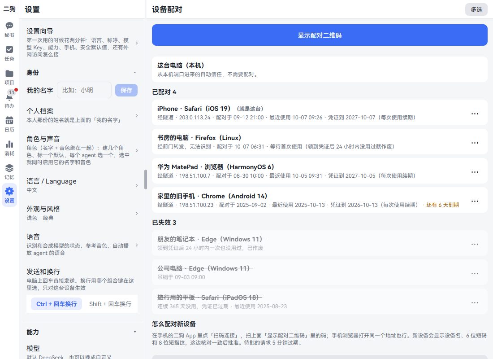
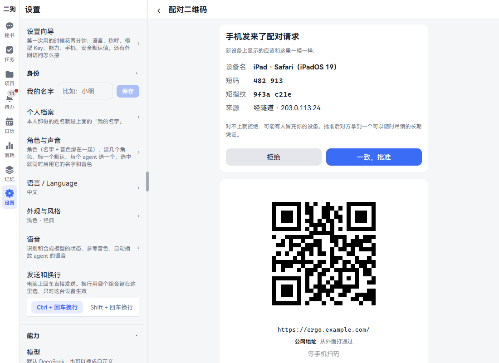
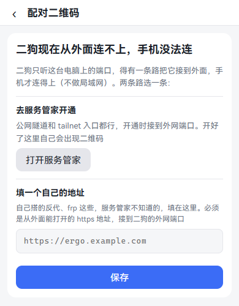
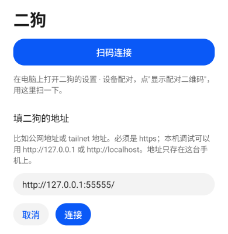
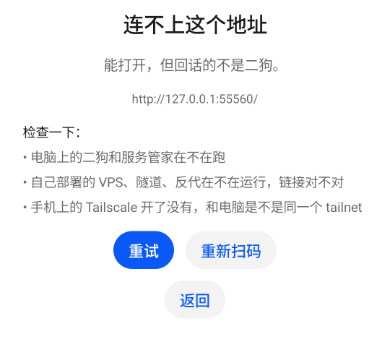
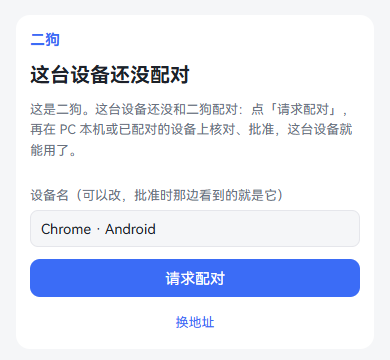
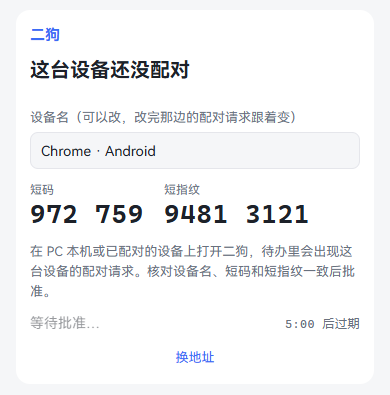
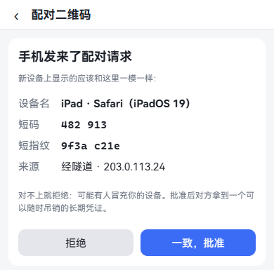
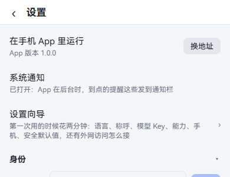
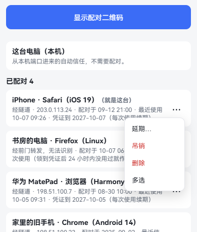

# 手机上用

二狗跑在你的电脑上。手机连回这台电脑，就能用完整的二狗。有三种用法：手机浏览器、鸿蒙 App、安卓 App。

不管用哪种，都是三步：让手机连得到电脑 → 电脑上显示配对二维码 → 手机连上、在电脑上批准。

## 三种用法有什么不同

| | 手机浏览器 | 鸿蒙 App | 安卓 App |
|---|---|---|---|
| 怎么装 | 不用装 | 自己构建、签名 | 自己构建 |
| 二狗的全部页面 | 有 | 有 | 有 |
| [内置浏览器](browser.md)（「浏览」页签） | 没有 | 有 | 有 |
| 按住说话 | 有，用浏览器录音 | 有，原生录音 | 有，原生录音 |
| 到点通知 | 浏览器通知，要先允许 | 系统通知 | 系统通知 |
| 下载文件 | 浏览器下载 | 系统的"保存到" | 系统的"保存到" |
| [手机数据](data-sources.md#手机上的数据)（通讯录、日历、照片、位置） | 没有 | 有 | 还没有 |

**App 不在应用市场里，现在要自己构建再装到手机上。** 步骤见下面的[装 App](#装-app)。

## 让手机连得到电脑：外网访问怎么选

**这是什么：** 二狗只听这台电脑上的端口。要有一条路把它接到外面，手机才连得上。**局域网不算**：同一个 Wi-Fi 下也要走下面的路。

三种方式选一种：

| | Tailscale 官方（推荐） | 自建 Headscale（进阶） | VPS + 隧道 + nginx（公网） |
|---|---|---|---|
| 要什么 | 电脑、手机装 Tailscale，登同一个账号 | 一台 VPS | 一台 VPS、域名证书 |
| 谁能打开 | 只有你 tailnet 里的设备 | 只有你 tailnet 里的设备 | 任何浏览器，全靠配对把关 |
| 难度 | 最简单 | 中等 | 最难 |
| 适合 | 第一次接，不想折腾 | 想自己掌握，或者要国内快 | 手机不想装 Tailscale |
| 注意 | 登录要 Google、微软、GitHub 等账号；中转在海外，国内可能慢 | VPS 那头还没在真 Debian 上验过，照文档一步步来 | 暴露在公网上，陌生人能看到配对页；一条命令搭的 VPS 那头还没在真 Debian 上验过 |

拿不准就选第一种。怎么接见[部署和外网访问](../deployment.md)：[方式一](../deployment.md#方式一tailscale-官方推荐)、[方式二](../deployment.md#方式二自建-headscale进阶)、[方式三](../deployment.md#方式三vps--ssh-反向隧道--nginx公网)。

**要知道的：** 三种方式都只能接二狗的外网端口 8811。本机端口 8810 绝不能接到外面，从那里进来的请求自动信任，接出去等于谁都能进你的二狗。

## 电脑上显示配对二维码

**这是什么：** 手机扫这个码，就知道二狗的地址。码里只有地址，不放口令。扫了之后还要你在这里批准。

**在哪里打开：** 设置 · 数据与设备 · 设备配对。设置向导的"手机配对"那一步也跳到这里。

**一步一步：**

1. 在电脑上打开二狗，进这一页。最上面是大按钮「显示配对二维码」。

   

2. 点「显示配对二维码」。看到大二维码，下面写着地址、这是什么地址、"等手机扫码"。

   

3. 地址有好几个时，下面列着「换一个地址」，点一个，二维码跟着换。公网在前，tailnet 其次，从外面打通过的排前面。
4. 让这一页开着，到手机上连。

**地址旁边的小字：**

| 写的是 | 意思 |
|---|---|
| 从外面打通过 | 服务管家从外面测通了 |
| 还没从外面测过 | 没测过，可以扫了试试 |
| 服务管家这边打不通 | 也可能只是它那边的问题，可以扫了试试 |
| 手机要先连上同一个 tailnet | Tailnet 地址才有，手机上的 Tailscale 要开着 |

**没有二维码，写着"二狗现在从外面连不上，手机没法连"：** 还没接好外面的路。页面给两条路：

- 去服务管家开通。公网隧道和 tailnet 入口都行，开通时接到外网端口。开好了这里自己出现二维码。
- 填一个自己的地址，见下面。



**用自己的地址：** 手动跑的 `tailscale serve`、自己搭的反代、frp，服务管家不知道。

1. 点二维码下面的「用自己的地址」。
2. 填从外面能打开的 https 地址，要接到二狗的外网端口。占位提示写着 `https://ergo.example.com`。
3. 点「保存」。不要了点「去掉」。

局域网地址、这台电脑的地址不收，页面会写明原因。

## 手机浏览器

**这是什么：** 不想装 App，或者想先试试。

**一步一步：**

1. 手机浏览器打开你的地址。普通相机扫电脑上的二维码也行，它就是一个普通网址。
2. 看到配对页，照下面的[配对：核对和批准](#配对核对和批准)做。
3. 想像 App 一样打开，用浏览器的"添加到主屏幕"。

**要知道的：** 服务端更新以后，开着的页面最上面出现"二狗有新版本"，点「刷新」，或者点「等会儿」先收起。

## 装 App

**鸿蒙和安卓 App 是同一个产品**：原生外壳里跑同一套网页，多了原生录音、系统通知、文件下载和内置浏览器。两种都要自己构建。下面的命令都在二狗目录里跑。详细的见手册 [7.2](../user-guide.md#72-鸿蒙-app)、[7.3](../user-guide.md#73-安卓-app)。

### 鸿蒙 App

1. 装 [DevEco Studio](https://developer.huawei.com/consumer/cn/deveco-studio/)。手机打开开发者模式和 USB 调试，用 USB 连上电脑。
2. 跑一次 `npm run build:harmony`，生成本机的工程配置。
3. 用 DevEco Studio 打开 `frontend\harmony`，点 File → Project Structure → Project → Signing Configs，登录华为账号，勾上 Automatically generate signature。
4. 再跑 `npm run build:harmony`，得到 `frontend\harmony\entry\build\default\outputs\default\entry-default-signed.hap`。
5. 用 DevEco 自带的 hdc（`<DevEco>\sdk\default\openharmony\toolchains\hdc.exe`）装上并打开：

   ```powershell
   hdc list targets
   hdc -t <设备号> install -r frontend\harmony\entry\build\default\outputs\default\entry-default-signed.hap
   hdc -t <设备号> shell aa start -a EntryAbility -b com.catmaniii.ergo
   ```

### 安卓 App

支持安卓 8 及以上。

1. 装 [Android Studio](https://developer.android.com/studio)，带 Android SDK 和 JDK。手机打开开发者选项和 USB 调试，用 USB 连上电脑。
2. 跑 `npm run build:android`，得到 `frontend\android\app\build\outputs\apk\debug\app-debug.apk`。第一次要联网取构建工具。
3. 用 Android SDK 里的 adb 装上：

   ```powershell
   adb devices
   adb -s <设备号> install -r frontend\android\app\build\outputs\apk\debug\app-debug.apk
   ```

   也可以把 APK 发到手机上点开装，系统会问是否允许安装未知来源的应用。

**要知道的：**

- 调试版和正式版签名不同，不能直接覆盖安装。换着装要先卸载，卸载后要重新配对。
- 打开时提示"系统的 WebView 版本太旧"，到应用商店升级「Android System WebView」。

## App 上扫码连接

**这是什么：** 第一次打开 App 时告诉它二狗在哪。扫一下最省事，不用打字。

**在哪里打开：** 第一次打开 App 就是这一页。以后从[换地址](#换地址)回来。

**一步一步：**

1. 先让电脑上的二维码显示着，见上面。
2. 手机上打开二狗 App，点「扫码连接」。

   

3. 打开扫码界面：
   - 鸿蒙用系统的扫码界面，不用给 App 相机权限。
   - 安卓点了才要相机权限。写着"扫电脑上的配对二维码"，把二维码放进框里。拒绝了照样能手填地址。
4. 扫到以后，App 先真的连一次，屏幕写"正在连接…"。
5. 连得上就进配对页，接着看[配对：核对和批准](#配对核对和批准)。连不上就报错，不进配对页。

## 连不上怎么办

扫完连不上时，App 写"连不上这个地址"，写明原因、扫到的地址和要检查什么。下面有「重试」「重新扫码」「返回」。



| App 写的原因 | 多半是 | 怎么办 |
|---|---|---|
| 解析不了这个域名，手机找不到它。 | 手机没连上 tailnet，或者域名写错了 | 开手机上的 Tailscale，确认和电脑是同一个 tailnet。检查地址 |
| 连接超时：等了 10 秒没有回应。 | 手机到不了这个地址 | 电脑开着吗？隧道、VPS 在不在运行？换个网络试试 |
| 证书不对：这个地址的 HTTPS 证书验证不过。 | 证书过期、域名对不上，或者网络在拦截 | 检查 VPS 或反代上的证书 |
| 连不上：对方拒绝了连接，或者网络不通。 | 反代、隧道、二狗没在跑 | 看电脑上的二狗和服务管家 |
| 能打开，但回话的不是二狗。 | 地址指到了别的网站，或者接错了端口 | 确认接的是外网端口 8811 |
| 连不上（……）。 | 别的原因，括号里是原话 | 照原话查 |

**"检查一下"里的三条：**

- 手机上的 Tailscale 开了没有，和电脑是不是同一个 tailnet。
- 电脑上的二狗和服务管家在不在跑。
- 自己部署的 VPS、隧道、反代在不在运行，链接对不对。

看得出是 tailnet 的地址，Tailscale 那条排最前。

**扫到别的码：** 写"扫到的不是二狗地址"，还写着扫到的内容。下面有「重新扫码」「返回」。

**扫不了码：** 写"现在用不了扫码"或者"没有相机权限，扫不了码"。回到地址页手填。

## 手填地址

**一步一步：**

1. 在地址页"填二狗的地址"下面的框里填，比如 `https://ergo.example.com`。
2. 点「连接」。

**要知道的：**

- 必须是 https。写错了框下面写明原因，比如"地址的写法不对"。地址里不要带用户名和密码。
- 地址只存在这台手机上。
- 手填不先测，直接打开。打不开时写"打不开二狗"和原因，比如"连不上"或"服务器回了 502"，下面有「重试」「改地址」。
- 地址跳到了别的地址时，写明跳到了哪，把地址改成那个。
- 页面打开了但不像二狗，底部出现"这不是二狗？"，右边有「换地址」「关闭」。

## 配对：核对和批准

**这是什么：** 新设备第一次连上，要你在电脑上批准。只有批准过的设备才能进二狗。手机浏览器和 App 走同一个页面。

**一步一步：**

1. 手机上看到"这台设备还没配对"。设备名能改，批准时那边看到的就是它。
2. 点「请求配对」。

   

3. 手机上出现 6 位短码和 8 位短指纹，写着"等待批准…"和倒计时。

   

4. 回到电脑。开着的二维码页上直接出现"手机发来了配对请求"，写着设备名、短码、短指纹、来源。没开这一页的，到**待办**里找这条配对请求。已经配对的设备也能批准。

   

5. 核对手机和电脑上显示的一模一样，点「一致，批准」。**对不上就点「拒绝」**，可能有人冒充你的设备。
6. 电脑上写"连好了"。手机上写"已配对"，点「进入二狗」。

**要知道的：**

- 待批的请求 5 分钟过期。过期或者被拒，回到配对页再点一次「请求配对」。
- 同一来源 10 分钟内最多 5 个请求。连着失败就等 10 分钟再试。
- 等批准时也能改设备名，电脑那边跟着变。
- 这台电脑自己不用配对，从本机端口进来的自动信任。

## 换地址

**这是什么：** 换了接法、地址变了，或者想重新扫码。只有 App 里有。

**在哪里打开，两处都行：**

- **进得了二狗时：** 更多 · 设置，最上面一行"在手机 App 里运行"，点右边的「换地址」。

  

- **进不了二狗时：** 还没配对、这台设备被吊销了、请求一直没人批准，配对页最下面有「换地址」。

**一步一步：**

1. 点「换地址」，回到 App 的地址页，框里是现在的地址。
2. 点「扫码连接」重新扫，或者改地址点「连接」。
3. 不换了点「取消」。

## 管理已配对的设备

**在哪里打开：** 设置 · 数据与设备 · 设备配对。

**一步一步：**

1. 每台设备一行，写着来源、配对时间、最近使用、凭证到哪天。还剩 30 天以内的标"还有 N 天到期"。
2. 点行尾的 ⋯，或者长按、右键这一行，弹出菜单。

   

3. 选一项：

| 菜单项 | 做什么 |
|---|---|
| 延期… | 选 30 天、90 天或 1 年，再点框里的确认按钮。已经失效的延期后重新能用，吊销了的不能延期 |
| 吊销 | 凭证立刻失效，开着的页面马上断开，下次打开要重新配对 |
| 删除 | 从列表里去掉，凭证不再认 |
| 多选 | 勾好几台一起做，下面的操作栏写着能对几台做 |

**要知道的：**

- 凭证有效期一年，每次使用都续期。连续一年没用就过期。
- 领到凭证后 24 小时内一次都没用过，自动作废。
- 手机丢了，在电脑上吊销它。
- 吊销了的手机上写"此设备已被吊销"，点「请求配对」能重新申请，也要你再批准。

## 系统通知

**这是什么：** App 在后台时，到点的提醒这些发到手机通知栏。

**在哪里打开：** 更多 · 设置，最上面"在手机 App 里运行"下面一行「系统通知」。

**一步一步：**

1. 写"已打开"的就不用管。
2. 写"没打开：只有页面里的提醒"的，点「去打开」。没问过就弹系统的授权框，拒绝过就打开系统的通知设置。

安卓 App 配对完会主动问要不要发通知，点允许。

**要知道的：**

- 通知是 App 自己发的，没有接手机厂商或 Google 的推送服务。App 被系统杀掉后收不到，要重新打开才有。
- 想尽量不漏，在系统设置里把二狗的电池策略设成"不限制"。
- App 在前台时不发通知，页面顶上已经有了。

## 出问题怎么办

| 现象 | 怎么办 |
|---|---|
| 扫码后连不上 | 看[连不上怎么办](#连不上怎么办) |
| 手机一直停在配对页 | 确认电脑上批准了。请求过期了就重新请求 |
| 手机上写"此设备已被吊销" | 点「请求配对」重新申请。不想再连了就不用管 |
| 手机上写凭证过期了 | 太久没用。点「请求配对」重新配对 |
| 不确定外面的路通不通 | 电脑上看 设置 · 数据与设备 · 体检 的「外网入口」 |

更多情况见[用户手册第 11 节](../user-guide.md#11-出问题怎么办)。

## 接着看

- [内置浏览器](browser.md)：App 里的「浏览」。
- [数据源](data-sources.md#手机上的数据)：手机上的通讯录、日历、照片、位置。
- [语音](voice.md)：按住说话。
- [部署和外网访问](../deployment.md)、[用户手册第 6 节](../user-guide.md#6-从外网访问手机平板)、[第 7 节](../user-guide.md#7-手机上用)。
