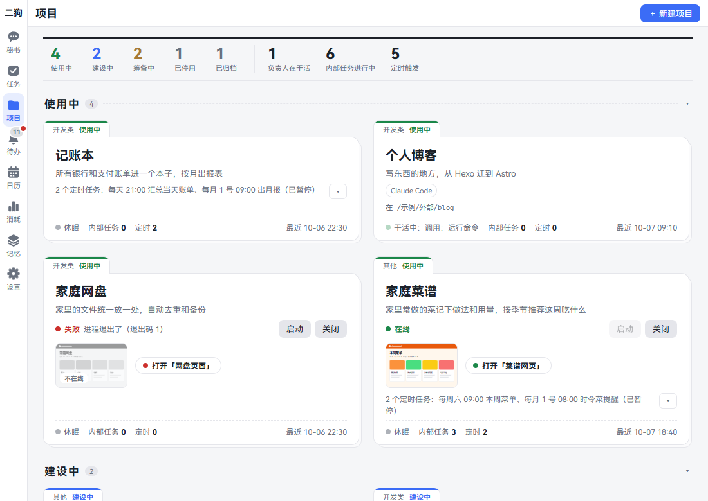
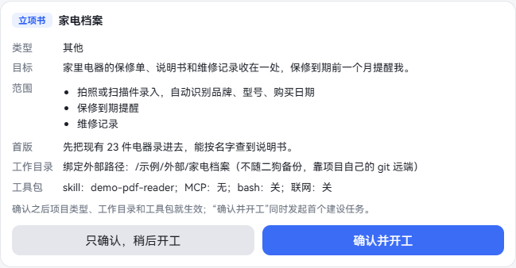
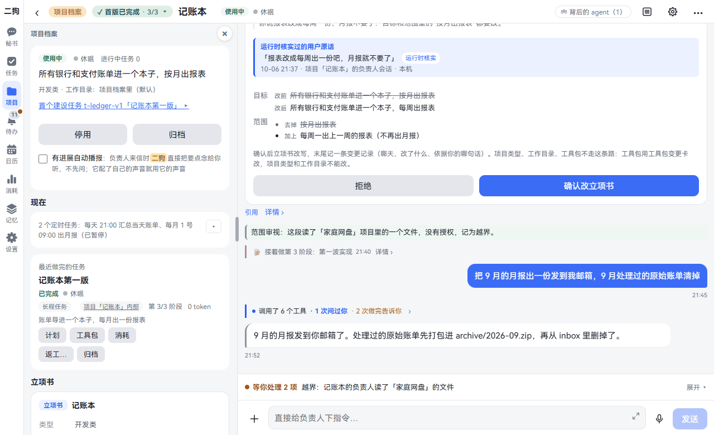
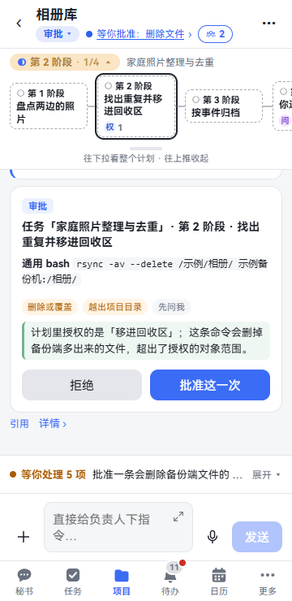
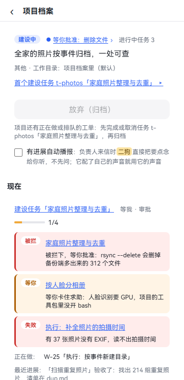
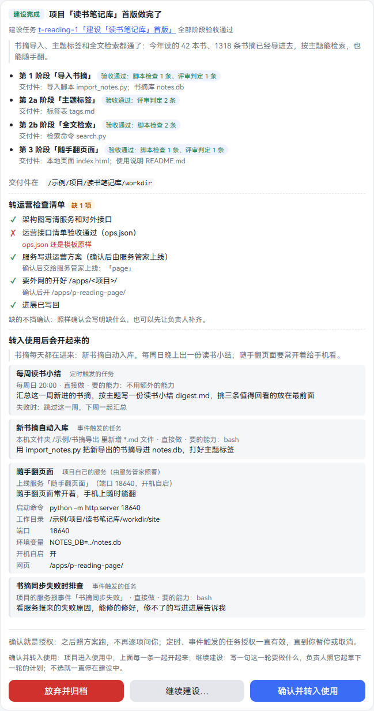
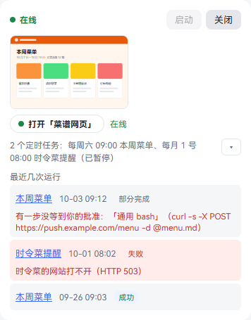
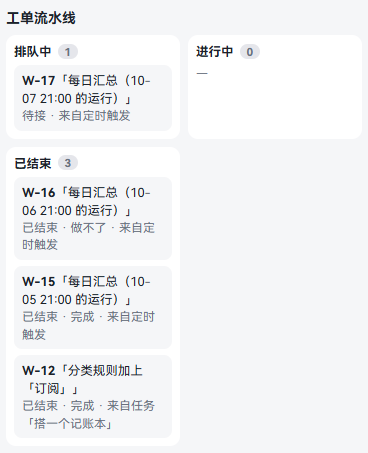

# 项目

一次性的事用[任务](tasks.md)。一件要长期做、长期用的事用项目，比如记账本、家电档案、一个小网站。

每个项目有一个固定的**负责人**、一份项目档案、一个工作目录。负责人靠档案记事，不靠聊天记录，换了会话也接得上。项目做好后，它的小网站和定时任务一直跑着，你在手机上也能打开、能叫秘书操作。

一个项目这样走：

| 状态 | 在做什么 | 怎么到下一步 |
|---|---|---|
| 筹备中 | 负责人和你做立项问答，交出立项书 | 确认立项书，点「开工」 |
| 建设中 | 负责人分阶段做出首版 | 在「首版做完了」卡上确认转入使用 |
| 使用中 | 服务、定时任务按运营方案跑着 | 用不着了点「停用」或者「归档」 |
| 已停用 | 服务撤下，定时任务暂停 | 点「重新启用」回到使用中 |
| 已归档 | 负责人会话只读 | 点「取消归档」回去，或者「删除」 |

## 项目一览

**在哪里打开：** 点「项目」。

- **最上面一条：** 各状态几个，有几个负责人在干活，几个内部任务在进行，几个定时触发。
- **每张卡：** 上沿写类型和状态，正文是名字和目标。下面有服务的开关和入口、定时任务，最下面一行是负责人在干什么、内部任务几个、定时几个、最近一次动静。
- **点组标题：** 收起或展开，这台设备记住。已归档默认收起。

卡上的「启动」「关闭」「打开「X」」和展开钮能直接点，不会打开项目。别的地方点下去都是打开项目。

## 立项

**这是什么：** 把一件长期的事立起来。项目从一张「建议立项」卡开始，你点了才诞生。

**在哪里打开：** 项目页右上角「＋ 新建项目」。

**一步一步：**

1. 点「＋ 新建项目」。
2. 在「想立个什么项目（一件长期的事）」里写一句。
3. 「运行时」默认 pi。选 Claude Code 还要选文件夹，见[新建一个用 Claude Code 的项目](claude-code.md#新建一个用-claude-code-的项目)。
4. 点「交给二狗」。提示「二狗会直接给你一张建议立项卡，点“立项”项目就诞生」。按钮和提示里的名字是你给助理起的。
5. 到秘书那里，看到建议立项卡，上面写着名字和一句话目标。点「立项」。不要了点「不用了」。
6. 项目以「筹备中」诞生。卡上多一行「和负责人做立项问答 ▸」，点它进项目。

**可以直接说的话：**

- 立个项目：把家里电器的保修单、说明书和维修记录收在一处

你说的路径、限制，秘书原样抄在卡上，点「立项」时交给负责人。你不说，秘书觉得一件事更像长期的事时也可能出这张卡。

### 从任务转过来

做着做着发现是件长期的事：打开任务，⋯ · 计划 · 「转为项目」，填项目名，再点「转为项目」。这个任务的负责人接着和你做立项问答，同一个会话。任务以「已完成 · 已转为项目」结束。

## 立项问答和立项书

**这是什么：** 负责人先开口，把范围问清楚，写成立项书。你确认之前项目不开工。

**一步一步：**

1. 进项目后负责人先问你。一次问一两个，已经说清的不再问。
2. 打字或者按住说话回它。它把规格、术语表、决策记录写进档案。
3. 问清了，它交一张立项书卡。卡也放进待办：「立项书等你确认：…」。

   

4. 核对卡上写的：

| 项 | 写什么 |
|---|---|
| 类型 | 开发类（写代码的）或者其他 |
| 目标、范围、首版 | 要什么、做哪些、首版做到什么程度 |
| 工作目录 | 项目档案里（默认），或者绑定一个外部路径 |
| 工具包 | 能用哪些 skill、MCP，bash、联网开不开 |

5. 选一个按钮：
   - **确认并开工：** 马上建出首个建设任务。
   - **只确认，稍后开工：** 项目留在筹备中。以后在项目档案里点「开工」。
6. 想改就直接对负责人说，它改好再交一张，标题后面写「（第 2 版）」。

**要知道的：**

- 确认后项目类型、工作目录、工具包马上生效。
- 只有开发类能绑定外部路径。外部路径不随二狗备份，靠项目自己的 git 远端。
- 确认后还能改目标、范围、首版：对负责人说，它出一张「立项要求变更」卡，点「确认改立项书」或者「拒绝」。类型和工作目录改不了。
- 还在立项时不能在项目里发起任务。

## 项目的对话框

**这是什么：** 点项目卡片，直接就是和负责人的对话框。从任务链接、待办点过来也是这一个，只是定位到那个任务或者那张卡。

**从上到下：**

1. **标题栏：** ‹、「项目档案」、阶段标签、项目名、项目状态、任务的状态签、活动状态。右边是背后的 agent、缩放、⚙、⋯。
2. **阶段进展：** 这个项目正在做的任务的阶段。电脑上点标题栏的阶段标签，整张阶段图开在左边栏，和项目档案共用这个位置；手机上是标题栏下面的阶段条。怎么看见[阶段进展](tasks.md#阶段进展)。任务做完了收成一行，比如「首版已完成 · 3/3」，点开还能看。没有任务时不占地方。
3. **消息：** 负责人说的话、工具调用、各种卡。
4. **输入框：** 写着「直接给负责人下指令…」。它正在干活时，你的话插在它下一步之前。

**手机上：** 标题栏分两行。第一行 ‹、项目名、⋯。第二行状态、活动状态、背后的 agent。

### 项目档案

**这是什么：** 这个项目的全部详情和能做的操作。

**在哪里打开：**

- **电脑：** 就在左栏。点标题栏的「项目档案」开合，点栏顶 × 也能收。分界线能拖宽。这台设备记住。
- **手机：** 点标题，档案从右边滑进来，点 ‹ 回到对话。⋯ 最上面的「项目档案」也一样。

**从上到下有这些：**

| 一块 | 写什么 |
|---|---|
| 最上面 | 状态、目标、类型和工作目录、能做的操作（开工、转入使用…、停用……）、有进展自动播报 |
| 现在 | 按状态说最要紧的事。筹备中写立项书到哪一步，建设中写建设任务和卡住的工单，使用中写服务和定时任务 |
| 正在做的任务 | 任务的状态和用量，计划、工单、工具包、消耗、运行的入口，任务操作。做完了标题写「最近做完的任务」 |
| 立项书 | 确认过的立项书和变更卡 |
| 规范 | 必须有的几份文档写了没有：已写、只有模板、缺 |
| 运营方案 | 见[运营方案](#运营方案) |
| 内部任务 | 见[项目内部任务](#项目内部任务) |
| 定时触发的任务 | 每条的时间表、下一次、最近一次，能暂停、恢复 |
| 工单流水线 | 见[工单](#工单) |
| 工具包 | 见[工具包](skills-mcp-plugins.md#工具包) |
| 范围记录 | 越界和你授权过的范围变更 |

### ⋯ 里有什么

电脑上是任务的几样，项目没有任务时电脑上没有 ⋯。手机上多了缩放、这个 agent 的设置和项目档案。

1. **项目档案**（手机）。
2. **缩到全局**、**这个 agent 的设置**（手机。电脑上是标题栏的 ▤ 和 ⚙）。
3. 一行任务名，下面是这个任务的计划、工单、工具包、消耗、运行。
4. 这个任务的操作：暂停、取消、返工…这些，见[暂停、取消、归档、删除](tasks.md#暂停取消归档删除)。

## 负责人

**这是什么：** 这个项目专门的 agent，长期维护它。只有它能改这个项目。

- **它记得什么：** 靠项目档案。规格、进展、决策都写在里面。每张工单、每段对话都是新会话，从档案和上一段的摘要接上。
- **它怎么做事：** 一次一件，别的排队，见[工单](#工单)。
- **它不能越界：** 每张工单结束时，另一个模型查它有没有做范围外的事。越界记进范围记录，待办里来一条「越界通知」。
- **理解跑偏了：** 点 ⚙，再点「清空当前对话（重置负责人）」，确认后新开一段会话，只凭档案重建理解。旧会话保留。
- **别的设置：** 同一个 ⚙ 里能给它配角色和声音、写单独的提示词、换模型、看上下文用量、换运行时。

**可以直接说的话**（在项目的输入框里）：

- 进展怎么样了
- 把导出加上按月汇总
- 把 yt-dlp 这个 skill 加进工具包

对秘书也能问：

- 记账本做到哪了
- 跟记账本的负责人说一声，下个月起信用卡账单也要导入

### 有进展自动播报

项目档案最上面的勾选框，默认不勾。勾上后，负责人来信时秘书直接把要点念给你听，不先问。负责人配了自己的声音就用它的声音。

也可以对秘书说「记账本以后有进展直接念给我听」。见[语音](voice.md)。

## 首个建设任务

**这是什么：** 点了「确认并开工」或者「开工」，就有一个长程任务，名字是「建设「X」首版」，由这个项目的负责人做。

**一步一步：**

1. 负责人照立项书起草计划，交一张[计划卡](tasks.md#计划卡)。
2. 你点「确认」，它开始做。
3. 它照「写规格、拆成票、一票一个子 agent、测试过了才合并」推进。每个阶段自动验收，见[阶段验收和评审](tasks.md#阶段验收和评审)。
4. 全部阶段过了，你收到一张「首版做完了」卡。

看进度：阶段进展，或者项目档案的「现在」。卡住的那里写着原因。

建设任务失败了或者取消了，项目还在建设中，档案里有「开工」，点了再发起一个。

## 转入使用

**这是什么：** 首版做好了，让项目正式用起来：服务上线，定时任务开始跑。

**「首版做完了」卡上写着：**

- 每个阶段的验收结果和交付件，交付件在哪。
- **转运营检查清单：** 架构图、运营接口清单、服务写进运营方案、外网入口、进展写回。✓ 做到了，✗ 没做到并写明差什么。「上线后再验」是要服务在跑才能测的，不算缺。
- **转入使用后会开起来的：** 负责人交的运营方案，一条条列着。

**三个选择：**

| 按钮 | 会怎样 |
|---|---|
| 「转入使用」（有运营方案时写「确认并转入使用」） | 进入使用中，方案里每一条一起开起来。要逐项确认的勾完才能点，没勾完写「还有 N 项待确认」 |
| 「继续建设…」 | 写一句这一轮要做什么，点「继续建设」。负责人照它起草下一轮的计划，还要你确认 |
| 「放弃并归档」 | 先确认一下。项目归档，负责人会话只读。以后还能取消归档，回到建设中，再给你一张这样的卡 |

不选就一直停在建设中。

**还没做完也想转：** 有三条路，都只出一张「转入使用」确认卡：

- 项目档案里点「转入使用…」。
- 对负责人说「可以上线了」。
- 对秘书说「记账本可以上线了」。

卡在「现在」和待办里。点「确认转入使用」（有运营方案时写「确认并转入使用」），或者「先不转」。

**要知道的：**

- 不管谁发起，都要你在卡上点。你对秘书说了也不算确认。
- 清单缺的不挡确认。照样确认时卡上记着缺了什么。想补齐就让负责人先补。
- 已经有一张卡在等时，档案里不再有「转入使用…」。

## 运营方案

**这是什么：** 项目转入使用后怎么运转：哪些定时跑，哪些等事件，哪些服务常开。负责人写好交给你，你确认一次就是授权，之后照方案跑，不再逐项问你。

**在哪里看：** 项目档案 · 运营方案。

每一条写着叫什么、什么时候、怎么做、要的能力，右边是状态：

| 状态 | 意思 |
|---|---|
| 在跑、在线 | 正常 |
| 已暂停 | 你暂停的，或者连续失败自动暂停的 |
| 没生效 | 开不起来，下面红字写原因，比如要的能力超出了工具包 |
| 要你手动 | 二狗现在还做不了，比如公网入口。下面写要你做哪几步 |
| 已结束 | 这一条对应的任务结束了 |

**一条能是这几种：**

| 种类 | 例子 |
|---|---|
| 定时触发的任务 | 每天 21:00 汇总当天账单 |
| 事件触发的任务 | 文件夹里来了新文件就入库，或者[服务报了事件](#项目的服务报事件) |
| 项目自己的服务（由服务管家照看） | 一个常开的小网站 |
| 公网入口 | 要你手动开，卡上写着步骤 |

**改运营方案：**

1. 对负责人或者秘书说，比如「每天 7 点出日报」「周报改到周一」。
2. 负责人交一份新的，你收到一张「运营方案变更」卡，写着加上、改了、去掉、照旧，附着你的原话。
3. 点「确认，照这样改」。不改就点「拒绝」，现在生效的照旧跑。

**要知道的：**

- 只改时间的就地改，任务、会话、运行记录都不变。别的改动要撤掉原来的任务，照新的重建。
- 这些任务也在任务看板的「运营中」，卡上标着项目名。它们只能暂停、恢复、立即运行一次。要去掉就让负责人改方案。
- 也可以在[发起任务](tasks.md#发起任务)里只选这个项目，选「定时」，单独建一个定时的内部任务。它不算运营方案里的一条，不上任务看板，在项目档案的「内部任务」「定时触发的任务」里。

## 项目服务

**这是什么：** 项目做成的网页、接口，常驻运行。由**服务管家**托管：它负责启动、看着它、开机拉起来。

服务写在运营方案里。你确认之后，二狗自动交给服务管家上线，不用你敲命令。

### 打开服务

**在哪里打开：**

- 项目卡片上的「打开「X」」。
- 项目档案 · 现在，缩略图或者「打开「X」」。
- 项目档案 · 运营方案，服务那一条。
- 跟秘书说。

点了在内置浏览器里打开，手机、外网也能开。细节见[打开项目服务的页面](browser.md#打开项目服务的页面)。

**可以直接说的话：**

- 打开简报站
- 简报站的页面在哪

入口旁边写着状态：

| 状态 | 意思 | 怎么办 |
|---|---|---|
| 在线 | 跑着 | 直接用 |
| 启动中、上线中 | 正在起 | 等一会儿 |
| 离线、已关闭 | 没在跑 | 点「启动」 |
| 失败、上线失败 | 起不来或者挂了，旁边写原因 | 负责人手头的工单做完会去看。也可以直接对它说 |
| 要你手动 | 二狗不是由服务管家启动的，或者服务管家版本太旧 | 按提示到服务管家里手动登记 |
| 已撤下 | 项目停用了，或者方案里去掉了 | 重新启用项目，或者改方案 |

### 启动和关闭

**在哪里打开：** 项目卡片上，或者项目档案 · 现在。一行写着现在的状态，旁边是「启动」「关闭」。

1. 点「关闭」。确认框写着会停掉几个服务、取消开机自启。
2. 点确认框里的「关闭」。不关了点「先不关」。
3. 要用了点「启动」，不用确认。

这两个按钮管这个项目的全部服务。

**可以直接说的话：**

- 把简报站关了（你说了就算确认）
- 把简报站开起来

**要知道的：**

- 关了就一直关着，电脑重启也不起来，直到你再点「启动」。
- 这不是停用：项目照旧使用中，定时任务照常跑。要连定时任务一起停，用[停用](#停用和重新启用)。
- 有的界面文字写的是 LSM，就是服务管家。
- 服务管家的页面只能在装二狗的电脑上开，那里能看日志、单独启停，见[服务管家](settings.md#服务管家)。
- 公网入口二狗现在还开不了，要你按卡上写的手动做。外网访问的做法见[手机上用](mobile.md#让手机连得到电脑外网访问怎么选)。

### 登记成 MCP

项目做出来的工具，想让别的 agent 也用：对负责人说「把这个服务登记成 MCP」。它出一张「MCP 登记变更」卡，点「已批准」才生效。详细的见[登记一个 MCP：让负责人提](skills-mcp-plugins.md#登记一个-mcp让负责人提)。

### 让秘书操作项目

项目转入使用后，你可以对秘书说话来用它，不用打开页面。每个使用中的项目都有这几样通用操作：

| 操作 | 可以这样说 |
|---|---|
| 状态 | 记账本现在怎么样 |
| 最近运行 | 记账本最近跑得怎么样 |
| 最新交付件 | 记账本最新的报表在哪 |
| 立即跑一次 | 把日报再跑一次 |
| 暂停恢复 | 把日报先停了 |
| 改时间 | 日报改到 7 点 |
| 跟负责人说一句 | 跟记账本的负责人说一声…… |

项目自己的操作（比如「记一笔账」）写在它的运营接口清单里，由负责人维护，每个操作都测过才给秘书用。清单在转入使用的检查清单上。

服务关着时秘书会告诉你，你说了再启动。

## 项目内部任务

**这是什么：** 项目里的一次性的事，比如升级依赖、给项目加个导出。由这个项目的负责人做，只在这个项目里看得到，不上任务看板。

**怎么发起（四种）：**

- 在项目的输入框里点明：「发起任务：给家电档案加导出」「按流程做：升级依赖」，或者打 `/task`、`/workflow`。
- 对秘书说同样的话，点明是这个项目的。
- 在[发起任务](tasks.md#发起任务)对话框里只选这一个项目。
- 负责人觉得该做维护时给一张「建议发起任务」卡，你点「作为流程」或者「作为长程任务」。

**怎么走：**

1. 负责人先在项目的会话里和你对齐，写任务书。秘书不参与。
2. 起草计划，计划卡进待办。
3. 你确认后它做。阶段进展换成这个任务的。

普通任务不用对齐，发起就做。

**在哪里看：** 项目档案 · 内部任务。

- 没结束的在前面，写着做法、状态、进度和用量。点一个，对话框定位到它，阶段进展和 ⋯ 也换成它的。
- 结束了的在「结束了的」下面，有「归档」按钮。
- 归档了的收起来，点「已归档 N 个 展开 ▸」。

**要知道的：**

- 它能用的是任务授权和项目工具包的交集。
- 只动这个项目。要动别的项目，让秘书发起跨项目的任务。
- 流程、长程任务做完不告诉秘书。普通任务做完，秘书只说一句做完了，结果在项目里看。
- 内部任务没有「跑完自动播报」。项目的「有进展自动播报」照常。
- 不能单独删，删项目时一起删。

## 工单

**这是什么：** 负责人要做的事都以工单送到手上，一次做一件，先来先做。

**在哪里看：** 项目档案 · 工单流水线。

每张写着编号、标题、状态、来自谁、属于哪个任务。

| 来自 | 什么时候来 |
|---|---|
| 你 | 你发起的内部任务 |
| 任务负责人 | 跨项目的任务派过来的 |
| 定时触发 | 定时、事件触发的一次运行 |

| 状态 | 意思 |
|---|---|
| 待你确认 | 计划外的工单，等你点「确认派出」 |
| 等阶段开始 | 计划里的工单，所属阶段开始时派出 |
| 待接 | 排着队 |
| 进行中 | 正在做 |
| 等澄清 | 负责人问问题，等回答 |
| 已结束 · 完成、退回、做不了、没派出 | 结束了，写着原因 |

**要知道的：**

- 你直接和负责人说话不算工单。手上没工单时是一段对话，手上有工单时插在它下一步之前。
- 工单结束前负责人要写回进展。催了还不写，待办里来一条卡住求助。
- 项目还有正在做或者排队的工单时不能归档。

## 项目的服务报事件

**这是什么：** 有些事要一直盯着，比如评论、价格、日志。让 agent 定时醒来看很费钱。换个办法：写一个不用大模型的小服务盯着，真有事才叫醒负责人。平时不花 token。

**怎么用（不用写代码）：**

1. 对负责人说：「写个小服务盯着评论，有异常叫醒你」。
2. 它写好服务，交一张运营方案的卡，上面多两条：一条上线这个服务，一条「项目的服务报事件「评论异常」时做什么」。
3. 你点确认。服务上线。
4. 之后服务发现异常就报一个事件，负责人醒来照方案做。

**怎么知道它在工作：** 项目档案 · 运营方案，服务和等事件的那一条下面列着「最近收到的事件」：

| 写着 | 意思 |
|---|---|
| 叫醒了负责人 | 正常 |
| 并进了排着的那次运行 | 上一次还没跑完，合成一批 |
| 没叫醒：运营方案里没有等它的 | 事件名不在方案里，要让负责人加 |
| 没叫醒：等它的任务暂停着 | 恢复那个任务 |
| 没叫醒：报得太快，超了限速 | 每个服务每分钟最多 30 次 |
| 没叫醒：数据太大 | 单条最多 8 KB |

**要知道的：**

- 事件名要写进你确认过的运营方案。方案里没有的报了也叫不醒谁，也不花钱。
- 服务报来的只是数据，不是你说的话。它不进记忆，不算你授权。数据里写着「忽略之前的指令」也不会照做。
- 连发一串会合成一批，不会同时跑几份。
- 连续失败照样自动暂停，等你处理。
- 二狗停着时服务报不进来，二狗不替它存。
- 这种事件只能写在运营方案里，发起任务对话框里选不了。你手工放进服务管家、不属于项目的服务也用不了。
- 自己写服务要报事件的，代码和命令见手册的[任务](../user-guide.md#42-任务三种做法--三种触发)那一节。

## 停用和重新启用

**这是什么：** 项目暂时不用了，但以后可能还用。

**在哪里打开：** 项目档案最上面。使用中的项目有「停用」和「归档」。

1. 点「停用」。服务撤下，入口撤掉，定时任务暂停。
2. 要用了点「重新启用」。服务重新上线，定时任务恢复，回到使用中。

## 归档和删除

| 按钮 | 什么时候有 | 会怎样 |
|---|---|---|
| 放弃（归档） | 筹备中、建设中 | 项目进已归档，负责人会话只读 |
| 归档 | 使用中、已停用 | 同上。服务撤下，定时任务暂停 |
| 取消归档 | 已归档 | 回到归档前的状态 |
| 删除 | 只有已归档的才有 | 要在待办里再确认一次 |

**删除：**

1. 先归档。
2. 打开项目档案，点「删除」。提示「删除要在待办里再确认一次」。
3. 打开待办，找「删除项目的确认」那一条。看清写的内容，点「确认删除」。不删了点「不删了」。

**会删掉：** 项目档案、负责人会话、立项书、项目内部任务，连同记忆里由它们自动记下的记录。秘书和跨项目任务读过的这个项目的内容也一起抹掉。**不能恢复。**

**留着的：** 你本人在负责人会话里说过的话，作为素材保留。要删见[彻底删除](memory.md#彻底删除)。绑定的外部工作目录不动。

**要知道的：**

- 项目还有正在做或者排队的工单时，「放弃（归档）」「归档」是灰的，下面写着先完成或者取消哪几个任务。
- 已归档的项目输入框不能用，工具包也不能改。要接着说话，先取消归档。
- 秘书不替你停用、归档，要你自己点。

## 出问题怎么办

| 看到什么 | 怎么回事 | 怎么办 |
|---|---|---|
| 标题栏写「等你批准：…」「等你回答提问」 | 有张卡在等你 | 点它，跳到那张卡 |
| 输入框上面「等你处理 N 项」 | 这个项目有卡在等 | 点「看卡片」，或者展开看 |
| 「现在」里红色的「被拦」「失败」「超时没动」 | 建设任务或工单卡住了 | 点进去看原因，对负责人说 |
| 服务写「失败」 | 服务起不来或者挂了 | 负责人手头做完会去查。急的话直接对它说。日志在[服务管家](settings.md#服务管家) |
| 运营方案里一条写「没生效」 | 要的能力超出工具包 | 让负责人申请。它出一张「工具包变更」卡，批准后再交方案 |
| 待办里有「补齐规范文档」 | 这个项目比规范老，缺几份文档 | 点「补齐」建个任务写好，或者点「不补」，不会再问 |
| 待办里有「卡住求助：项目「X」的负责人没写回档案」 | 它没写回进展 | 在会话里让它补写，或者重置负责人 |
| 负责人的理解跑偏了 | | 点 ⚙，「清空当前对话（重置负责人）」 |

## 相关章节

- [任务](tasks.md)：计划卡、阶段进展、验收、定时和事件。
- [Claude Code](claude-code.md)：让负责人用 Claude Code、接管已有会话。
- [skill、MCP 和插件](skills-mcp-plugins.md)：工具包里能配什么。
- [内置浏览器](browser.md)：打开项目的页面。
- [设置](settings.md)：服务管家、关注类别。
- [记忆](memory.md)：删除项目后留下的素材怎么删。
- 手册：[项目](../user-guide.md#43-项目)
- 手册：[待办](../user-guide.md#44-待办)
