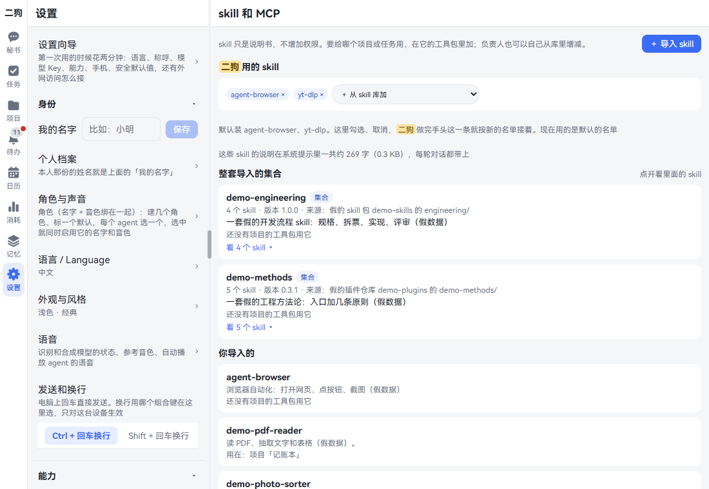
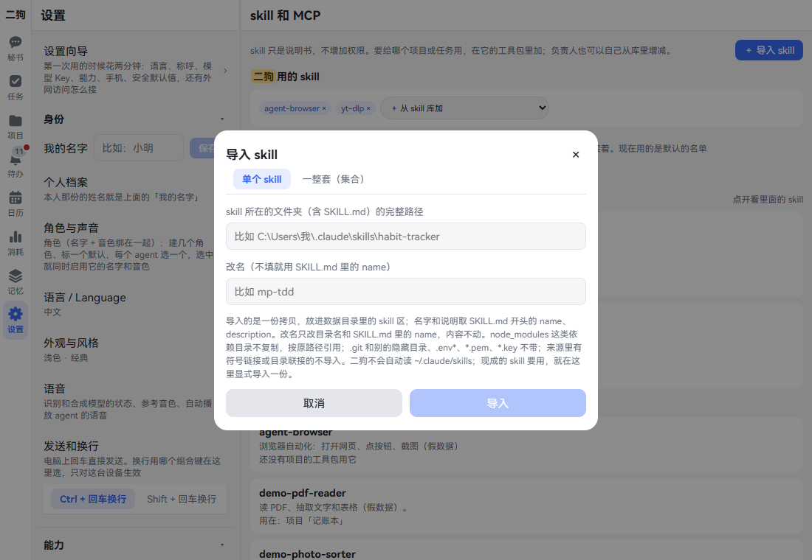
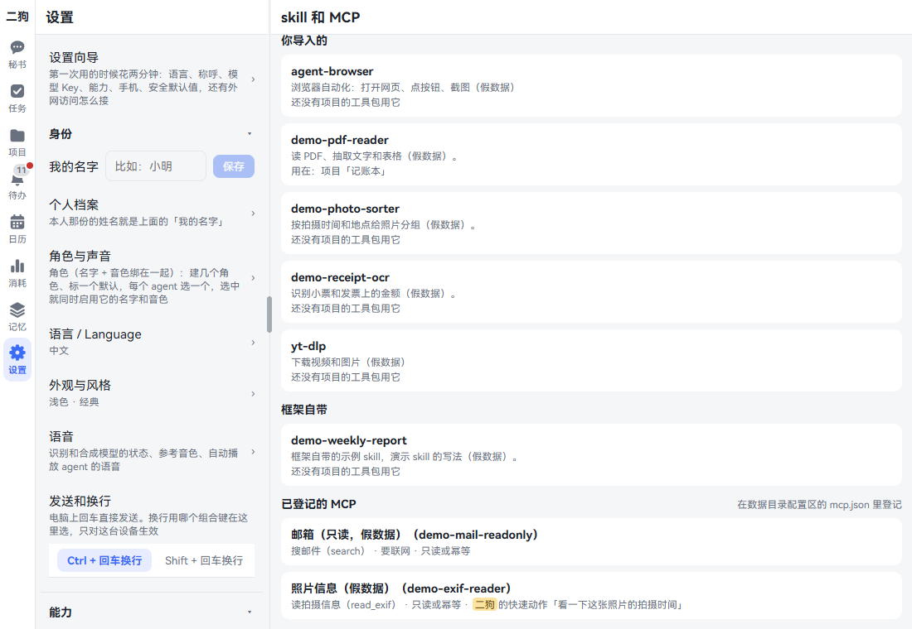
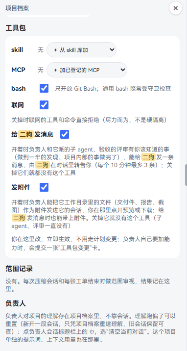
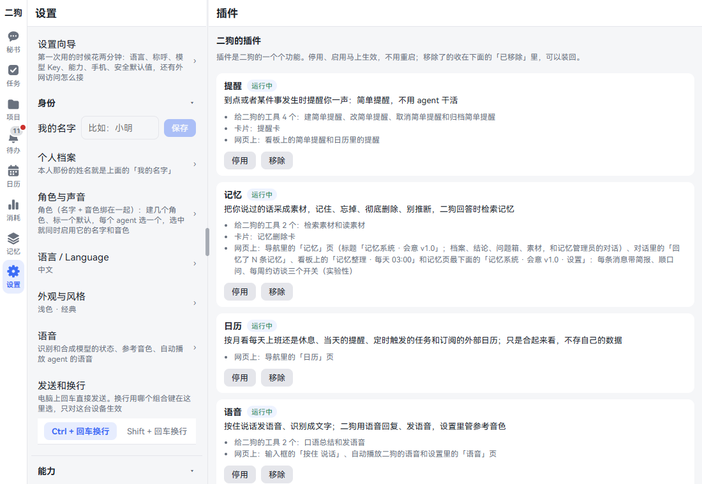
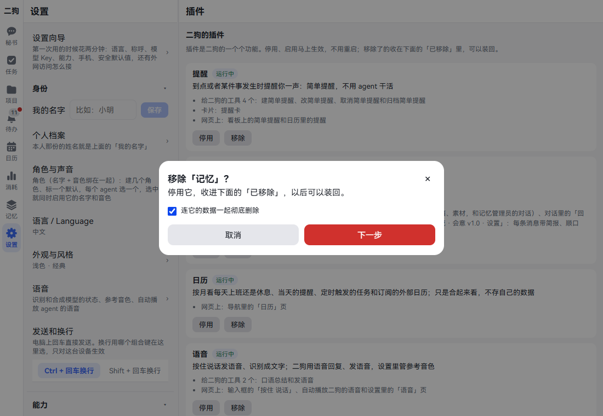

# skill、MCP、工具包和插件

这四样容易混，先分清：

| 是什么 | 比如 | 在哪里管 |
|---|---|---|
| **skill**：一份说明书，告诉 agent 某件事怎么做。不增加权限 | 怎么写周报、怎么下载视频 | 设置 · 能力 · skill 和 MCP |
| **MCP**：一个外面的工具服务，agent 能调它 | 搜笔记、读邮件 | 配置文件，页面上只能看 |
| **工具包**：某个项目或任务能用哪些 skill、MCP，能不能跑 bash、联网 | 记账本项目开联网，不开 bash | 项目页、任务详情 |
| **插件**：二狗自己的一块功能，能整块停用 | 记忆、日历、语音 | 设置 · 能力 · 插件 |

skill 和 MCP 进了库，agent 还用不上。要配进工具包才行。秘书的 skill 单独配。

## skill

### 导入一个 skill

**什么时候用：** 你手上有一份现成的 skill，比如 Claude Code 里用过的，想让二狗的 agent 也用。二狗不会自己去读 `~/.claude/skills`，要导入一份。

**在哪里打开：** 设置 · 能力 · skill 和 MCP · 右上角「＋ 导入 skill」。





1. 点「＋ 导入 skill」，停在「单个 skill」。
2. 在「skill 所在的文件夹（含 SKILL.md）的完整路径」里填路径，是二狗那台电脑上的路径。
3. 想改名就填「改名（不填就用 SKILL.md 里的 name）」，只能用小写字母、数字和短横线。
4. 点「导入」。提示「已导入 skill「X」」，页面上出一段报告，看完点「知道了」。

它出现在页面的「你导入的」里，下面写「还没有项目的工具包用它」。

### 整套导入

**什么时候用：** 一个文件夹里有一批 skill，它们互相引用，要一起带上。

1. 在导入对话框里点「一整套（集合）」。
2. 填「集合的根目录的完整路径」，再填「集合名」「版本」「来源」「一句说明」。这四项必填。
3. 成员不直接在根目录下时，填「成员在根目录下的哪个子目录」。
4. 和库里重名时，在「成员改名」里每行写一条 `原名=新名`。
5. 点「导入」。

集合在「整套导入的集合」里占一行。点「看 N 个 skill」列出成员。

**要知道的**

- 导入的是一份拷贝。原来的文件夹以后改了，这里不跟着变。
- `.git` 和别的隐藏目录、`.env*`、`*.pem`、`*.key` 不带进来，报告里列着。
- `node_modules` 这类依赖目录不复制，按原路径引用。
- 来源里有符号链接或目录联接的不导入。
- 和库里重名的不导入，提示和谁重名。改个名再导。
- 太大的不收。skill 是说明书，不该很大。

### 配给秘书

**在哪里打开：** 同一页最上面的「二狗用的 skill」。这里的名字是你给助理起的。

1. 点「＋ 从 skill 库加」的下拉，选一个 skill。
2. 集合有两个选法：「整套：X」全要，「从 X 里挑几个…」点开勾选。
3. 不要了点小签上的 ×。

提示「改好了：二狗做完手头这一条，就按新的 skill 名单接着」。

**要知道的**

- 默认是 agent-browser 和 yt-dlp。还没导入的先留着名字，导入之后自动装上。
- 下面写着这些 skill 的说明一共多少字。每轮对话都带上，太长会提醒你去掉用不上的。
- 普通任务（不属于项目的）用的也是这份名单。

### 在对话里点名用

在输入框打 `/`，候选里有「二狗工具包里的 skill」这一组。命令就是 skill 的目录名，比如 `/weekly-report 写本周的`。

### 负责人提交的 skill

负责人做事时沉淀下来的经验，能提交成 skill。你的待办里多一张「skill 变更」卡。

卡上写着名字、说明、谁提的、文件清单和大小。有脚本的醒目写「里面有 N 个脚本，用它的 agent 可能会运行」。「SKILL.md 全文」能展开看。

- 点「确认」：进库，配进提交人的工具包，它的会话接着就能用。别的项目要用，到它的工具包里加。
- 点「拒绝」：什么都不变。两种都能附一句话给负责人。
- 提交之后来源又变了的，确认时不进库，卡上写明要重新提交。

### 删掉一个 skill

页面上没有删除按钮。有两条路：

- **让负责人提：** 跟负责人说「把 X 这个 skill 从库里删掉」。它出一张「skill 变更」卡，写着现在哪些工具包在用，点「确认」才删，留一份旧版。只能删你自己导入的单个 skill 和负责人提交的。
- **自己删文件夹：** 删掉数据目录 `skills\` 下面它那个文件夹，默认在 `%USERPROFILE%\.ergo\skills\`。整个集合就是一个文件夹。框架自带的不在这里，删不了。

删掉后，工具包里的名字留着，用的时候跳过，不报错。同名的再进库又能用了。

## MCP

### 看登记了哪些

**在哪里打开：** 设置 · 能力 · skill 和 MCP，往下翻到「已登记的 MCP」。



每个 MCP 列出名字和登记的工具。工具后面写「要联网」「只读或幂等」，授权给秘书快速动作的也写着。这一块只能看，不能在页面上改。

### 登记一个 MCP：自己写配置

**什么时候用：** 你有一个 MCP 服务，想让 agent 用。

1. 打开 `%USERPROFILE%\.ergo\config\mcp.json`，没有就新建。
2. 照这个样子写：

   ```json
   {
     "servers": {
       "notes": {
         "title": "笔记服务",
         "command": "node",
         "args": ["D:\\tools\\notes-mcp\\server.js"],
         "env": { "NOTES_API_TOKEN": { "fromEnv": "ERGO_NOTES_API_TOKEN" } },
         "tools": {
           "search": { "title": "搜笔记", "readOnlyOrIdempotent": true, "network": true }
         }
       }
     }
   }
   ```

3. 存好。不用重启，回到页面刷新就看得到。写错了页面上写「MCP 登记读不了：…」。

| 项 | 意思 |
|---|---|
| `notes` | MCP 的名字，字母、数字、`-`、`_` |
| `command`、`args` | 怎么启动它 |
| `env` | 给它的环境变量。写字符串是原样的值，写 `{ "fromEnv": "名字" }` 是从二狗的环境里取 |
| `tools` | 用到的工具。**没写在这里的工具 agent 用不了** |
| `network` | 要不要联网。不写按要联网算，工具包联网关着时用不了 |

完整的例子在仓库的 `config\mcp.example.json`。

**密钥不要写明文。** 配置文件不是密钥区，agent 写不进去，但有可能读到。写成 `fromEnv`，再把变量加进服务管家里 `ergo-daemon` 那一条，让二狗启动时拿到它。

`ergo start`、`ergo restart` 和升级时这一条会按新版本重写，你在 `env` 里多加的项、自己写的 `exposure:` 留着。二狗自己写的 `ERGO_DATA_DIR`、`LSM_DATA_DIR`、`DEEPSEEK_API_KEY`、`CUSTOM_MODEL_API_KEY` 会被写回去，别用这几个名字。

### 登记一个 MCP：让负责人提

**什么时候用：** 项目做出了一个 MCP，或者负责人觉得要接一个。

跟负责人说「把这个服务登记成 MCP」。它出一张「MCP 登记变更」卡进待办，写着启动命令、环境变量和工具。

- 点「已批准」：写进登记，真拉起来试一次。卡上写「拉起来了，它报了…」或者「没拉起来：…」。没拉起来的登记也留着，要撤就让负责人再提一张删的卡。
- 点「已拒绝」：什么都不变。

看着像密钥的环境变量写明文时，这张卡提不出来，要改成 `fromEnv`。

### 让 agent 用上

- **负责人：** 配进工具包，见下面。工具包里没有的，它用不了。
- **秘书：** 登记过就能调，不用配。

**可以直接说的话**

- 用笔记服务搜一下上周的会议记录
- 看一下笔记同步状态

秘书调用时，时间线上记一条谁调的、调了什么。守卫照常判。

### 撤掉一个 MCP

在 `mcp.json` 里删掉那一段，或者让负责人提一张删的卡。

## 工具包

**这是什么：** 一个项目或任务能用什么。你在这里改马上生效，不用走计划变更。

**在哪里打开：**

- **项目：** 项目页的项目档案里，往下翻到「工具包」。电脑上项目档案在左栏，标题栏的「项目档案」能开关它。
- **流程、长程任务：** 任务详情右上角的「⋯」·「工具包」。
- **普通任务：** 没有这一项。不属于项目的用秘书那份 skill，不带 MCP，能跑 bash、能联网。属于项目的用项目的工具包。



| 这一行 | 怎么改 | 效果 |
|---|---|---|
| skill | 「＋ 从 skill 库加」，小签上的 × 去掉 | 它能照哪些说明书做 |
| MCP | 「＋ 加已登记的 MCP」，小签上的 × 去掉 | 它能调哪些外面的工具 |
| bash | 勾选框 | 只开放 Git Bash，命令照常受守卫检查 |
| 联网 | 勾选框 | 关掉时联网的工具和命令直接拒绝，尽力而为，不是硬隔离。开着时只读的 GET 不打扰你，别的请求算「以我的名义对外发送」 |
| 给二狗发消息 | 勾选框 | 负责人、子 agent、评审能给秘书发消息，由秘书转告你。每个 10 分钟最多 3 条 |
| 发附件 | 勾选框 | 负责人能把工作目录里的文件作为附件发进会话，你在那里预览或下载 |

改完提示「工具包改了：负责人正在干活的话，等它做完手头这一步，按新工具包接着干」。Claude Code 的负责人当场换。

**负责人自己能改吗**

- 增减 skill：能，自己改，记进时间线。
- 减少能力：能。
- 开 bash、加 MCP、开联网：要你批准。不在任务里的项目负责人出一张「工具包变更」卡，在任务里的提计划变更。

**可以直接说的话**（对负责人说）

- 把 yt-dlp 这个 skill 加进工具包
- 这个项目要联网查汇率，你申请一下

**要知道的**

- 项目的工具包要立项书确认后才有。任务的要计划确认后才有。
- 项目归档、任务结束后，工具包只能看。
- 涉及项目的任务：bash、联网、MCP、给秘书发消息、发附件要任务和项目都开着才算。skill 两边合起来都能用。

## 插件

**这是什么：** 二狗的一块块功能。不想要的能停用，不用重启。

**在哪里打开：** 设置 · 能力 · 插件。



每个插件一块：名字、状况、一句话，下面列着它带来了什么，要用谁，谁要用它。状况有：运行中、已停用、没装上、已移除，要外部组件没装的写「没装」和怎么装。

| 插件 | 停用后 |
|---|---|
| 提醒 | 秘书建不了提醒，看板和日历上不再显示提醒 |
| 记忆 | 记忆页没了，不再采集新素材。已有的还能在 设置 · 删除素材 里看和删，个人档案回到「更多」里 |
| 日历 | 日历页没了。设置里的工作日规则还在 |
| 语音 | 按住说话和 设置 · 语音 没了，回复只有文字 |
| 内置浏览器 | App 里的「浏览」、侧边栏和悬浮按钮没了 |
| Claude Code | 设置 · Claude Code 没了，用它的负责人不再启动，正在做的任务转「等我」 |
| 数据源-手机、数据源-Google、数据源-Looki穿戴式相机 | 这个数据源不再同步，二狗也查不了它 |

### 停用和启用

1. 点那一块的「停用」。确认框写「停用「X」？」和会发生什么。要用它的插件也列出来，会一起停。
2. 点确认框里的「停用」。提示「已停用：X」。
3. 要用回来，点「启用」。它要用的插件没开时先确认，一起开。

马上生效：它的页面和栏目马上收起，给二狗的工具从下一轮起没有，定时作业和事件订阅停下。数据都在，启用回来还在。

### 移除



1. 点「移除」。确认框写「停用它，收进下面的「已移除」，以后可以装回」。
2. 只想收起来，直接点「移除」。
3. 连数据一起删，勾上「连它的数据一起彻底删除」，点「下一步」。
4. 第二步写明「会删掉：」和「删不掉的：」，看完点「移除并彻底删除」。**删了不能恢复。**

移除了的收在页面下面的「已移除（N）」里，点开能「装回」。

**要知道的**

- 没有自己数据的插件（比如日历、Claude Code）没有那个勾。
- 移除记忆时勾了删数据，素材库里的素材也不会删。要删去 记忆 · 素材 的成批删除。
- 备份快照里还留着一份，随快照轮换消失。
- 这些操作秘书做不了，要你在页面上点。

## 相关

- [Claude Code](claude-code.md)：工具包里的 skill 在 Claude Code 里怎么用。
- [设置](settings.md)：组件、数据源这些别的设置项。
- [项目](projects.md)、[任务](tasks.md)：工具包配给谁用。
- [记忆](memory.md)：停用记忆插件之前看一眼。
- 手册：[skill、MCP 和数据源](../user-guide.md#85-skillmcp-和数据源)、[插件](../user-guide.md#49-插件)。
