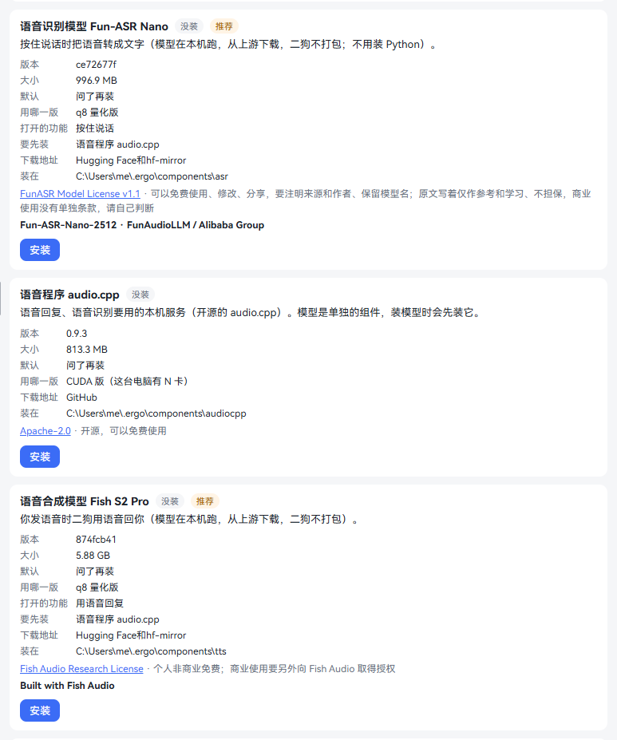
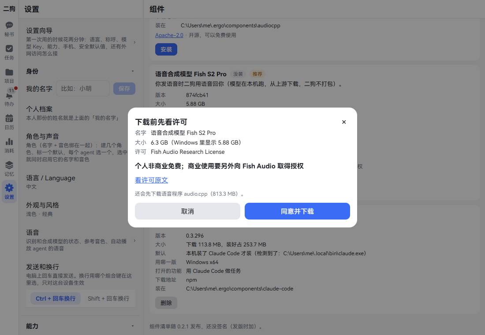
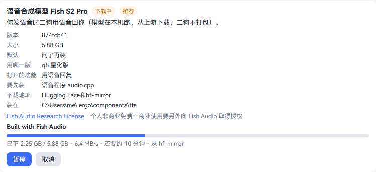
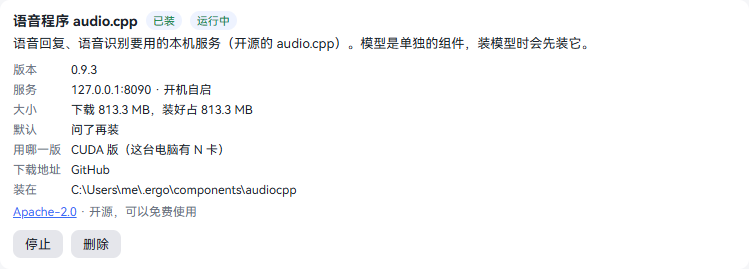
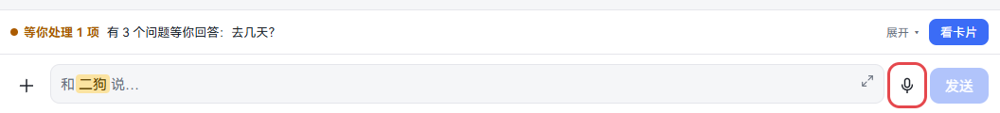
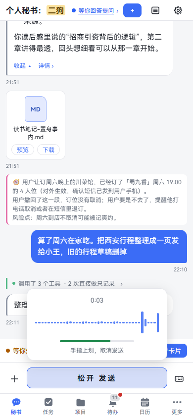
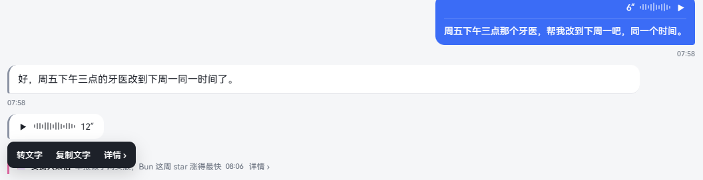
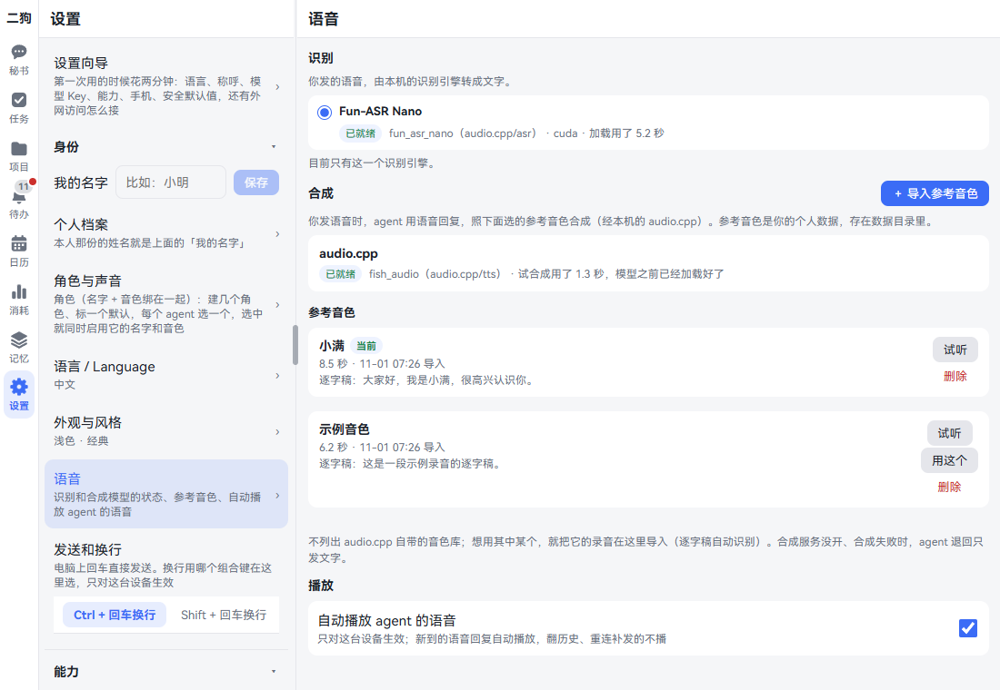
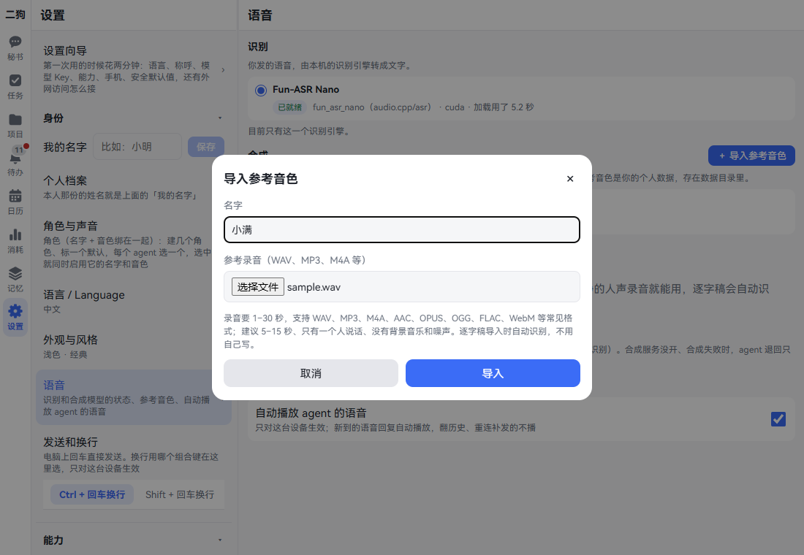
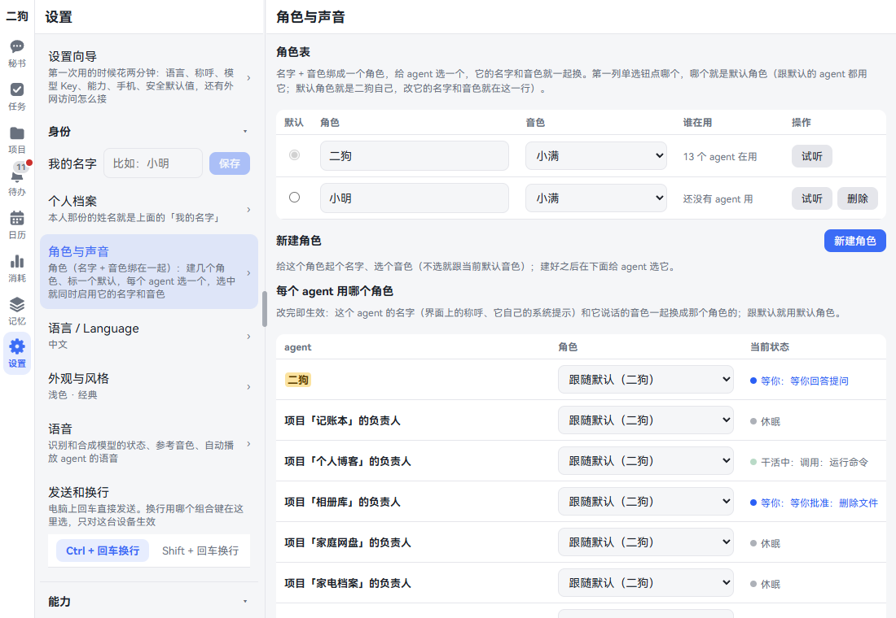

# 语音

你可以按住说话，二狗也能用语音回你。识别和合成都在你自己的电脑上跑。这一章讲怎么装、怎么说、怎么听，怎么给不同的 agent 配不同的声音。

## 先认识这几样东西

| 叫什么 | 是什么 | 对应的组件 |
|---|---|---|
| 语音识别 | 把你说的话转成文字 | 语音识别模型 Fun-ASR Nano |
| 语音合成 | 把二狗的话念出来 | 语音合成模型 Fish S2 Pro |
| 语音程序 | 这两个模型都跑在它上面 | 语音程序 audio.cpp |
| 参考音色 | 一段录音，二狗照这个声音说话 | 自带一条「小满」 |
| 角色 | 名字 + 音色，给每个 agent 选一个 | 不用装 |

这些都不在安装包里，要用时再装。只想按住说话，装语音识别就够了。想听二狗说话，再装语音合成。

## 装语音组件

**在哪里打开：** 设置 · 能力 · 组件。

这些地方也能到这一页：

- 输入框旁边灰掉的话筒，点一下。
- 设置 · 身份 · 语音 里写着「要先装……」的那一行，点「去装 ›」。

设置向导的「能力」那一步也能勾选，见[第一次使用](getting-started.md)。

**一步一步：**

1. 找到「语音识别模型 Fun-ASR Nano」这一块，点「安装」。
2. 弹出「下载前先看许可」，写着名字、大小、许可。想看全文，点「看许可原文」。语音程序还没装时，下面写「还会先下载语音程序 audio.cpp」。
3. 点「同意并下载」。同一个许可确认过就不再问。

   

4. 这一块出现进度条，写着已下多少、速度、还要多久、从哪个地址下。中途能点「暂停」「继续」「取消」。关掉这一页，下载照样继续。

   

5. 下完自动接上：生成配置、在服务管家登记、启动、查健康、加入开机自启。不用重启二狗。
6. 看「语音程序 audio.cpp」那一块：写着「已装」「运行中」，「服务」那一行写着端口和「开机自启」，就好了。

   

7. 想让二狗用语音回话，再装「语音合成模型 Fish S2 Pro」，步骤一样。
8. 到 设置 · 身份 · 语音 看一眼：识别和合成都写「已就绪」。

**要装多大：**

| 组件 | 页面上写的大小 | 要知道的 |
|---|---|---|
| Fun-ASR Nano | 996.9 MB | 显存约 2 GB。没有显卡也能用，CPU 上一句话一两秒 |
| audio.cpp | 有 NVIDIA 显卡 813.3 MB，没有 29.1 MB | 装模型时自动先装。显卡版要驱动 580 或更新，GTX 10 系这类老卡用不了 |
| Fish S2 Pro | 5.88 GB | 显存约 7.3 GB。没有显卡也能用，但很慢。个人非商业免费，商业使用要另外向 Fish Audio 取得授权 |

两个模型都装，显卡要放得下 9 GB 多。放不下的那个加载时报错，组件页和语音页写明原因。

**下载不下来怎么办：**

1. 下载失败或者暂停着时，这一块写着原因，列出还差的文件和下载地址。
2. 点「重试」接着下。下好的部分留着。
3. 还是不行，用浏览器或者下载工具自己下好，放到运行二狗的这台电脑上。
4. 点「从文件导入…」，填文件、文件夹或者包的路径，点「导入」。校验对得上就装上。

**要知道的：**

- **启动和停止：** 语音程序那一块有「启动」「停止」。语音识别、语音合成都靠它，停了两个都用不了。
- **删除：** 先删模型，再删程序。还有模型在用时，程序删不掉，页面写明谁在用。
- **更新：** 点页面上方的「检查更新」，二狗每晚也自己查一次。有新版本时这一块写「有新版本」，点「更新」才换。详见手册的[组件的更新](../user-guide.md#87-组件的更新)。
- **要由服务管家启动二狗：** 否则页面写「语音合成要交给服务管家托管，现在接不上」。用 `ergo start` 启动就对了。
- **数据目录的路径不能有中文：** 否则页面写「audio.cpp 读不了这个路径」。把数据目录换到全英文的路径再装。
- **已经自己配过：** 这一块写「已有」和「已有自己配的语音识别，在用它」，不能从这里装，二狗也不改你的配置。怎么手动配，见手册的[按住说话](../user-guide.md#81-按住说话本机语音识别)和[语音回话](../user-guide.md#82-二狗用语音回话本机语音合成)。

## 按住说话

**这是什么：** 像发微信语音。开车、走路、不想打字时用。说完自动转成文字交给二狗。

**在哪里用：** 秘书、任务和项目的负责人、记忆管理员，这些会话的输入框旁边都有话筒。内置浏览器的悬浮按钮上也能按住说话，见[内置浏览器](browser.md)。

**一步一步：**

1. 点输入框旁边的话筒。输入框变成「按住 说话」。下次打开还是这样，记在这个浏览器里。
2. 第一次用，浏览器会问能不能用麦克风，点允许。
3. 按住「按住 说话」。手机上用手指，电脑上按住鼠标左键。弹出录音面板，写着时长，有波形和音量，按钮变成「松开 发送」。
4. 说话。
5. 松开就发送。
6. 不想发了，按着往上滑一段（电脑上往上移鼠标）。提示变成「松开手指，取消发送」，按钮变成「松开 取消」，这时松开。
7. 想打字，点输入框旁边的键盘图标。

**发出去以后：** 气泡里上面是播放条和时长，下面是识别出的文字。还没识别完写「识别中…」。这段文字就是二狗看到的内容。

长按气泡（电脑上右键）弹出菜单：

- **复制文字**
- **重新识别：** 识别失败的才有。
- **详情 ›**

点一下气泡是播放，再点暂停。

**要知道的：**

- **长度：** 不到 1 秒不发，提示「说话时间太短」。最长 60 秒，最后 10 秒写「还可以说 N 秒」，到时间自动发送。
- **带附件：** 先点 ＋ 选好附件，输入框上方写「按住说话，说完连同附件一起发」，说完一起发。
- **麦克风什么时候开：** 切到语音输入后麦克风就开着等你，但没按住时不录。切回打字、切到后台时马上放开。
- **按着的时候：** 正在播的语音暂停，新到的语音等你松手再播。
- **语言：** Fun-ASR Nano 只认中文、英文、日文和自动。
- **存进记忆：** 语音转成的文字和打的字一样存进素材，能在 记忆 · 素材 里筛「语音」看到。要删见[记忆](memory.md#让二狗忘掉一件事)。
- **手机：** 手机浏览器要从 HTTPS 地址打开才能用麦克风，见[手机](mobile.md)。手机 App 用自己的录音，不受这个限制。

## 二狗用语音回话

**这是什么：** 你发语音，二狗这一轮就用语音回。你打字时，也可以让它念给你听。

要先装好语音合成。自带的音色是「小满」，要换声音见[参考音色](#参考音色)。

**一步一步：**

1. 按住说话，松开。
2. 界面显示「正在回复…」，接着「正在合成语音…」。这一轮不会一边回一边出文字。
3. 语音气泡出现。分段合成时，第一段到了就能听，时长后面标「合成中」。
4. 开着自动播放的话，它自己开始念。
5. 想看文字：长按气泡（电脑上右键），点「转文字」，气泡里展开原文，再点「收起文字」收起。

**回复长的时候：**

- 估计 60 秒内念得完、没有念不出来的内容：整段念，文字收在气泡里。
- 太长，或者有代码、表格、链接：念一段口语总结，详细内容照常发在聊天里。

**让它念给你听：**

| 想要 | 怎么做 |
|---|---|
| 打字聊天时听一段 | 说「把刚才那段念给我听」 |
| 任务做完时听 | 任务做完，秘书用文字说一声，再问「要我念给你听吗？」，你说要就念 |
| 任务做完直接念 | 发起任务时勾「跑完自动播报」。发起以后，点任务详情标题栏上的 ⋯，在菜单里开关（写着「跑完自动播报：关」） |
| 项目有进展直接念 | 在项目页顶上勾「有进展自动播报」，默认关 |

开关关着时，负责人的进展是文字，秘书问你要不要念。项目内部的任务没有自动播报。

**可以直接说的话：**

- 把刚才那段念给我听
- 以后这个任务做完直接念给我听
- 记账本以后有进展直接念给我听
- 不用再念了
- 记账本进展怎么样了

**要知道的：**

- **看的是你最后一句：** 这一轮最后一句是语音就念，是打字就发文字。
- **你的语音才算：** 任务阶段通知这类系统消息引起的回复不念，除非开了自动播报。
- **一次合成一条：** 显卡可能还在忙别的，后面的排队。
- **没念成不会丢内容：** 合成服务没开、合成失败时只发文字，聊天里写一句「语音没合成出来（原因），这次只发文字。」只合成了一部分时，回复的文字照常显示。

## 自动播放

**这是什么：** 新到的语音回复自动念出来。在不方便出声的地方可以关掉。

**在哪里打开：** 设置 · 身份 · 语音，最下面「播放」里的「自动播放 agent 的语音」。默认开，只对这台设备生效。

**什么时候自动放：**

- 开关开着，页面在前台，开着那个会话。
- 你正按着说话时不放，松手再放。
- 翻历史、断线重连补发的不放。

**要知道的：**

- 浏览器有时拦下自动播放，气泡里写「点一下播放」，点一下就好。手机上按住说话一次之后，一般就能自动放了。
- 你不在时秘书念的语音不会自己放。回来后，秘书输入框上方有一行「你不在时二狗念了 1 段语音」，点「▶ 播放」或者「定位」。
- 同一时间只放一条。

## 参考音色

**这是什么：** 一段录音，二狗照这个声音说话。自带一条「小满」，是合成出来的，不含真人的声音。

**在哪里打开：** 设置 · 身份 · 语音，「合成」那一块。

**导入一条：**

1. 点「＋ 导入参考音色」。
2. 填「名字」，选「参考录音」文件。
3. 点「导入」。按钮变成「正在转换并识别逐字稿…」，等一下。
4. 成了就列在下面，写着时长和识别出的逐字稿。

**怎么录得好：** 录音要 1–30 秒，建议 5–15 秒，只有一个人说话，没有背景音乐和噪声。WAV、MP3、M4A、AAC、OPUS、OGG、FLAC、WebM 都行，最大 20 MB。逐字稿自动识别，不用自己写。

**管理：**

- **试听：** 放录音本身。
- **用这个：** 换成这一条，它旁边写「当前」。
- **删除：** 点「删除」，再点「确认删除」。

**要知道的：**

- 导入要这台电脑上有 ffmpeg，还要语音识别能用。缺了会写明。
- 删掉「小满」后，它不会自己回来。一条音色都没有时，语音回复退回文字，待办里提醒你去导入。
- 不列出 audio.cpp 自带的音色库。想用其中一个，把它的录音导入。
- 录音路径里不能有中文，否则写「audio.cpp 读不了」。把数据目录放到全英文的路径下。

## 角色与声音

**这是什么：** 角色就是名字 + 音色。比如让记账本的负责人叫「小林」，用另一个声音。它汇报进展时，你一听就知道是谁。

**在哪里打开：** 设置 · 身份 · 角色与声音。

**改二狗自己的名字和声音：**

1. 看「角色表」。第一列单选钮选中的是默认角色，它就是二狗自己。
2. 改名字：在「角色」那一格改，点出现的「保存名字」。
3. 改声音：在「音色」下拉框里选。点「试听」听一下。

**建一个角色：**

1. 点「新建角色」。
2. 填「名字」，选「音色」。不选就跟默认音色。
3. 点「新建角色」，表里多一行。

**给 agent 选角色：**

1. 看「每个 agent 用哪个角色」这张表。
2. 找到那个负责人，在「角色」下拉框里选。改完就生效。
3. 想换回来，选「跟随默认（二狗）」。

也可以在会话里点标题栏的 ⚙，在「角色」那一块选。这里改的，从它的下一轮起生效，音色下一次合成就用新的。

**负责人用自己的声音汇报：** 配了和秘书不一样的音色后，它的进展这样念：秘书先开场，再接负责人的声音，合成一条语音。长按「转文字」看得到每段是谁说的。

什么时候这样念：

- 开了「跑完自动播报」的任务做完。
- 开着自动播报的任务、项目有进展来信。
- 你打字或者说话问某个任务、项目的进展，而它给秘书来过信。

没配音色、音色和秘书的一样、音色被删了，就是一条秘书的语音。

**要知道的：**

- 默认角色不能删。还有 agent 在用的角色也删不掉，页面写明谁在用：还能改的先给它换个角色；结束了的任务改不了，先删掉任务；归档了的项目先取消归档再换，或者删掉项目。
- 删除要点两下：「删除」「确认删除」。
- 改名字以后，界面上的称呼和这个 agent 自己的系统提示都跟着换。
- 项目、任务的负责人建出来以后才出现在表里。已归档的项目只能看，不能改。

## 怎么看语音好不好

**在哪里看：** 设置 · 身份 · 语音。

识别和合成各有一个小签：

| 小签 | 意思 |
|---|---|
| 等待加载、加载中 | 模型正在准备 |
| 已就绪 | 能用 |
| 没开 | 服务没开 |
| 忙 | 服务正忙，稍后再试 |
| 出错 | 后面写着原因 |
| 已卸载 | 闲置退出了，下一条语音来了再加载 |

**想单独试一下：** 到 设置 · 数据与设备 · 关于二狗，连点版本号 8 次，点「Debug 工具集已打开」，进「语音」那一块。能「录 3 秒再回放」「录 3 秒送识别」「合成念一句」。1 小时后自己收起。

## 出问题怎么办

| 看到什么 | 怎么回事 | 怎么办 |
|---|---|---|
| 话筒是灰的 | 语音识别没装 | 点话筒，去组件页装 |
| 输入框旁边没有话筒 | 语音插件停用了 | 到 设置 · 能力 · 插件，启用「语音」 |
| 这个地址不能用麦克风 | 浏览器只让 HTTPS 或本机地址用麦克风 | 手机上换 HTTPS 地址或者 App，见[手机](mobile.md) |
| 没有麦克风权限 | 浏览器或系统拒绝了 | 浏览器：点地址栏左边的网站设置，把麦克风改成允许。手机 App：到系统设置里给二狗打开麦克风 |
| 麦克风被别的程序占着，录不了 | 别的程序在用 | 关掉那个程序再按 |
| 没录到声音，再按一次试试 | 录到的是一段静音 | 查一下麦克风有没有静音、选对没有 |
| 气泡写「识别失败」，待办里有「语音识别不可用」 | 识别服务出了问题。录音还在 | 按待办里写的原因修好，再长按气泡点「重新识别」 |
| 重新识别时写「要转码但这台电脑上没有 ffmpeg」 | 这段是换到 Fun-ASR Nano 之前录的 | 装上 ffmpeg，放到 PATH 上，再点重新识别 |
| 聊天里写「语音没合成出来（语音合成服务没开……）」 | 语音程序没在运行 | 到组件页点「启动」，看语音页是不是「已就绪」 |
| 待办里有「要合成语音，得先导入参考音色」 | 一条音色都没有 | 到语音页导入一条。导入后这条自动归档 |
| 组件页写「语音服务没接上」，后面写着哪一步、什么原因 | 接服务时有一步失败。这次的登记和配置都撤掉了，程序和模型留着 | 按原因处理，点「重试」，不用重新下载 |
| 组件页写「CUDA 运行库不全」 | 显卡版的运行库包没装全 | 删掉这个组件重新装，或者按提示把运行库包解到那个目录 |
| 念得很慢 | 没有显卡，或者显卡在忙 | 这是正常的。有 NVIDIA 显卡会快很多 |

## 停用语音

**在哪里打开：** 设置 · 能力 · 插件，找到「语音」。

- **停用：** 输入框里没有话筒，一律打字；新到的语音不自动播放；设置里没有「语音」这一页。以前的语音气泡照样能点着听。启用回来就恢复。
- **移除：** 点「移除」，勾「连它的数据一起彻底删除」，点「下一步」，对话框列出会删掉什么、删不掉什么，再点「移除并彻底删除」。

一起删掉的有：你发过的录音、二狗合成的语音、语音记录里的文字、参考音色、待办里那两种语音说明。

删不掉的有：会话里转写成文字交给过二狗的内容、素材库里语音转成的素材（要删去 记忆 · 素材 成批删除）、备份里的一份。

## 相关章节

- [第一次使用](getting-started.md)：设置向导里勾选语音。
- [和秘书说话](chat.md)
- [任务](tasks.md)：发起任务时勾「跑完自动播报」。
- [项目](projects.md)：项目页上的「有进展自动播报」。
- [记忆](memory.md)：语音转成的文字怎么存、怎么删。
- [手机](mobile.md)：手机浏览器和 App 里怎么用麦克风。
- [内置浏览器](browser.md)：在网页上按住说话。
- 手册：[按住说话](../user-guide.md#81-按住说话本机语音识别)
- 手册：[语音回话](../user-guide.md#82-二狗用语音回话本机语音合成)
- 手册：[组件的更新](../user-guide.md#87-组件的更新)
