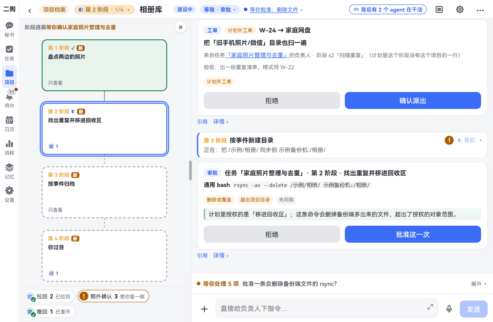
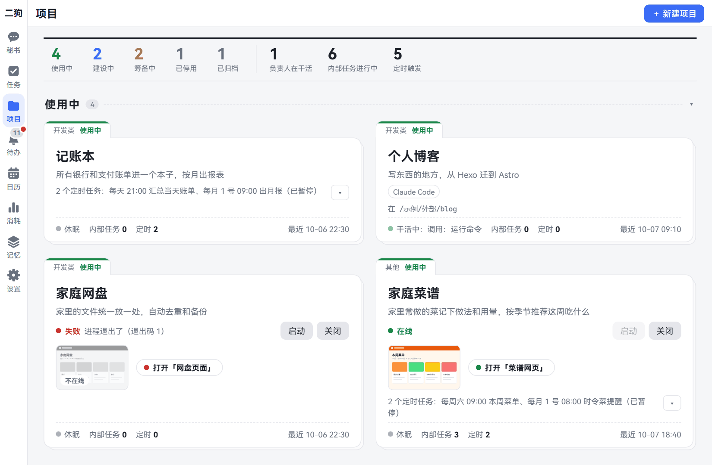

[中文](README.md) | **English**

# What is ergo

Screenshots show the Chinese interface; the labels in the text are the English ones.

> **Your memory, back to you.** The more it knows you, the more at ease you feel.

ergo is an AI assistant that lives on your own computer. Say something to it and it keeps notes for you, looks things up, sorts things out, and finishes the jobs that take time. You can type at your computer, or talk to your phone when you're out.

This page covers why it's designed this way, what it can do for you, and how to start.

To see what it looks like first, open the [online demo](https://catmaniii.github.io/ergo/?lang=en): nothing to install, just click around. All the data in it is made up.

## Why we built it

This section makes two things clear: where your private matters are kept, and when they get sent out.

A good assistant has to know you. To know you, it has to know a lot of private things: your family's birthdays, where your kid goes to school, your medical report, your payslip, and the questions you want to ask in the middle of the night but feel too shy to ask anyone.

Would you hand all of that over for someone else to keep? But if you don't, it can't know you.

ergo's answer: **all of it is kept on your own computer.** Your chat history, what you've said, what it knows about you: all of it stays on this computer.

One thing we should be straight about. The large models that do the actual thinking still come from outside companies today. When you ask something, your question and the material this turn needs still go to the model company, which handles them under its own rules.

What ergo can do is send only the small part this turn needs, each time, and let you decide which company gets it. Your ID number and address, for example, sit in your personal files and stay untouched. They're read only when you ask about them or have ergo fill in a form for you, and only what's read goes out. The whole you isn't with anyone else.

## Five design ideas

The images on this page all come from the demo; the people and events in them are made up.

### 1. Your memory stays with you; swap models freely

**What's in it for you:** The longer it's with you, the better it knows you. When you switch models, you don't have to teach it from scratch.

Say once that you don't eat spicy food, and next time you ask it to pick a restaurant, it remembers. Later, if another company's model seems better, just switch. What it knows about you is on your computer, not at the model company, so it's still there after you switch.

It doesn't jump to conclusions either. If you've turned down a few weekend get-togethers, it might infer "wants to plan weekends on their own", or guess "has been too tired lately". Anything it isn't sure of is marked **Guess**, and you can open each item to see why it thinks so. Sensitive things like health are only noted by default, not used to infer anything.

If it guesses wrong, tell it, and it corrects this when it consolidates each night. To make it forget something, say "Forget what I said about changing jobs." It lists what it found for you to check first, and deletes only after you tap.

Image: the Memory page. On the right is what it has worked out from what you've said, each item marked **Verified** or **Guess**.

**Current limits:**

- This memory system is still experimental. How it works and what it stores may change.
- You can swap the model used for chatting, but the nightly memory consolidation still needs DeepSeek (a model company) for now. If you switch to another company, keep your DeepSeek key too (a key is like the key to your account; more on that below).
- ergo makes a backup every night, but by default it stays only on this computer. To be able to recover if the computer dies, pick a sync folder from a cloud drive or home storage in Settings.

### 2. Talk to one secretary; each job has its own worker

**What's in it for you:** You don't have to remember who to ask, and several jobs don't get tangled together.

With an ordinary AI chat, give it several jobs in one conversation and by the end it loses track.

In ergo you talk only to the secretary. Small things it handles itself: setting a reminder, noting something down, checking the weather. Anything that takes time it hands to an owner in the background, and you can keep chatting about something else. An owner is an AI assistant dedicated to that one job.

Each job has its own owner, working separately with no crossed wires. An owner sees only the job handed to it, not what you and the secretary have talked about. When there's progress or it's done, the secretary passes it on. If you want details, you can open that job and talk to its owner directly.

Image: the Secretary page. You ask for a song to be downloaded, and the secretary hands it to the background. The owner sends an update midway, and the secretary passes it on. When the download is done, you're told.

**Current limit:** By default at most 3 tasks run at once; the rest wait in a queue.

### 3. Big jobs run as projects, so you don't have to keep watching

**What's in it for you:** Hand off a big job without babysitting it. It only comes to you for big things, and when you return you can see at a glance how far it's got.

Say, sorting and de-duplicating the whole family's photos, or making a ledger you'll use for the long term. Done in one go, work like this easily drifts off course; asking you at every step gets annoying. ergo manages it the way you'd manage a project:

- **Agree first, then start.** What to do, how many stages, what each stage delivers, what it's allowed to touch: all of it is written on a plan card. It starts only after you tap confirm.
- **One stage at a time.** Each stage has something to deliver. When a stage is done, its own word doesn't count: another assistant checks it against criteria set in advance, and if it fails, it goes back to be fixed.
- **It only interrupts you for big things.** For big things you haven't approved in advance, such as sending things out in your name, touching accounts and passwords, or changing or deleting files outside its working area, it stops and asks you. Everything that needs your decision is gathered on one page, **Inbox**.

To check progress when you return, you don't need to scroll through the chat. The stage graph shows which stage it's on, and the whole conversation can zoom out like a map so you can see the full picture.

Image: the photo-sorting project. On the left are four stages: stage 1 is done and stage 2 is under way. The card at the bottom right: the plan only approved moving duplicate photos to the recycle area, but this command would delete files in the backup, so it stopped to ask you.

The first version of one real project took 247 operations and needed a person to confirm only 7 times. It drifted off course 5 times along the way, and was pulled back automatically each time.

**Current limits:**

- A new install gives ergo a fairly free hand: apart from the kinds above, it mostly just does things and logs them as usual. To be more careful, tick **Ask me before risky things** in the setup wizard.
- If you don't tick **Stop tasks that go over budget**, a task that drifts off course keeps spending money.
- If you're not happy, you can have it redo from a given stage, but what has already been sent out can't be taken back.

### 4. No need to sit at the computer: just say it on your phone

**What's in it for you:** When you're out, the computer at home keeps working for you.

Something comes to mind while you're walking. Take out your phone, hold the mic and say: "Find out roughly what flights and hotels to Xi'an cost in November, put it together and tell me." The computer at home gets to work, and you carry on with your day.

When it's done it tells you, and it can read it out to you too. Different owners can have different voices, so you can tell who's reporting with your eyes closed.

Speech recognition and read-aloud both run on your own computer, with no need to go through someone else's voice service.

Image: the Secretary page on a phone. Under your voice message is the recognized text, and ergo can answer you by voice too. At the very bottom is **Hold to talk**.

**Current limits:**

- ergo runs on your computer. The computer has to be on and online for your phone to connect.
- Your phone needs a route back to the computer, even on the same Wi-Fi. The simplest way is to install a connection app called Tailscale on both and sign in with the same account. It signs in with an account such as Google or Microsoft, and may be slow in mainland China. For how to connect, see [On your phone](mobile.en.md).
- A phone browser works with nothing to install. The built-in browser, which lets it operate web pages for you, is only in the app. The apps aren't in the app stores: on Android you download the package and install it, no coding needed; on HarmonyOS you have to sign it with your own Huawei account using developer tools, which isn't easy if you've never written code.
- Voice isn't in the install package and is downloaded separately. Speech recognition alone is a 1 to 2 GB download. Read-aloud takes nearly 6 GB more, and it reads slowly without a good graphics card.

### 5. The small tools you make keep running and become ergo's skills

**What's in it for you:** What you've made once doesn't sit gathering dust. From then on, one sentence puts it to work.

Say you have ergo make a ledger. Once the first version is done and you confirm it once on a card, it's put into use: its web page stays up, you can open it on your phone too, and every night at 9 it totals the day's bills automatically. From then on, say "Log 32 yuan for lunch" and the secretary logs it for you.

These always-running small programs are watched over by the service manager, a helper that comes with ergo: it starts them at boot, brings them back if they crash, and shows all their status on one page.

The more of these you build up, the more one sentence can get done.

Image: the Projects page. The ledger totals the bills at 21:00 every day, and the family recipes web page is online. The family cloud drive says **Failed**: when something's wrong, you can see it on the card.

**Current limits:**

- A project's own operations, like "log an expense", go to the secretary only after the owner has written and tested them.
- For now these skills are mainly used by the secretary. For other owners to use them, you have to get the project's owner to register them; it isn't automatic yet.
- For people outside to open your web page, you currently have to turn it on by hand, following the steps on the card.

## What it can do for you

Each row below is something it can do for you. Click the text on the left to see how.

| You want to | For example |
|---|---|
| [Talk to it and send it things](chat.en.md) | Type or hold to talk; send it images and files; if the chat goes off track, you can roll back and start over |
| [Hand off jobs that take time](tasks.en.md) | Look things up, sort the Downloads folder; do it automatically every Monday morning |
| [Build something for the long term](projects.en.md) | A ledger, records of your home appliances, a small website |
| [Have it remember you, and forget](memory.en.md) | "Remember: I'm allergic to mango"; "Forget what I said about changing jobs" |
| [Speak to it and listen to it](voice.en.md) | Hold to talk; "Read that last part to me"; give it a different voice |
| [Use it on your phone](mobile.en.md) | Connect back to the computer at home from a phone browser or the app |
| [Have it operate web pages](browser.en.md) | "Summarize this page"; "Post the photos I took in Hangzhou at the weekend". Only in the phone app |
| [See your calendar, set reminders](calendar-reminders.en.md) | "Remind me to pay the rent at 9 am on the 8th of every month"; see which days are workdays and which are days off (by Chinese and Singaporean public holidays) |
| [Maps](map.en.md) | AMap inside mainland China, OpenStreetMap abroad, switching as you look around; an AMap key makes the map inside China clearer |
| [Bring in outside data](data-sources.en.md) | Connect Google Calendar, Gmail or a wearable camera, then ask "What did that flight email last month say?" For now, contacts and photos on a phone can only be connected through the HarmonyOS app |
| [Have Claude Code write code](claude-code.en.md) | Claude Code is an AI tool for writing code. If it's installed on your computer, owners can work through it, using your own subscription quota |
| [Have Codex write code](codex.en.md) | Codex is a similar tool. If it's installed on your computer, owners can work through it too; what the guard covers is spelled out |
| [Teach it new skills](skills-mcp-plugins.en.md) | Write a guide telling it how to do your weekly report; switch off whole features you don't want |
| [Have ergo switch services in the service manager on and off](install.en.md#have-ergo-switch-services-for-you) | "Stop audiocpp for now"; "Why won't comfyui start?"; "Restart yourself". Serious ones show an approval card; what ergo depends on can't be stopped |
| [Change settings, see what you've spent](settings.en.md) | Switch models, change the interface style and language, set up backups; see usage by day |

## What you need

After this section you'll know whether what you have is enough.

**You must have:**

- **A Windows 10 or 11 PC.** Only Windows is supported for now; it won't start on a Mac or Linux.
- **A key for a model.** A key is a string of characters a model company gives you, like the key to your account. The default is DeepSeek: register on its website to get one. You can also use another company's, as long as it supports the common "OpenAI-compatible" way of connecting.

**Can wait until later:**

- A phone, and a route back to the computer.
- Voice. Speech recognition and read-aloud are both downloaded separately.

**What it costs:** ergo itself is open source and free. You pay the model company for what you use, and ergo's **Usage** page shows roughly what you've spent.

**Two more things to know:**

- ergo is still at an early stage; its features and interface will keep changing.
- ergo works on your computer under your Windows account, and can read and change your files, run programs and go online. It has rules that keep watch, and a few hard lines it won't cross no matter who says so, such as not reading where keys are stored. But it isn't isolated from everything else on your computer. Please keep your own backups of important files.

## How to start

Three steps and you're up and running.

1. **Install it.** Paste one line into a command window that comes with Windows; nothing else needs installing first. See [Install, update and uninstall](install.en.md).
2. **Go through the setup wizard.** Open ergo, and there's a bar at the top of the page; click it and go through five steps. The most important one is filling in the model key; everything else can be skipped for now. See [Getting started](getting-started.en.md).
3. **Say your first sentence.** On the Secretary page, type "Remind me to drink water in two minutes". When it reminds you two minutes later, everything's connected.

Next, read [Talking to the secretary](chat.en.md).
