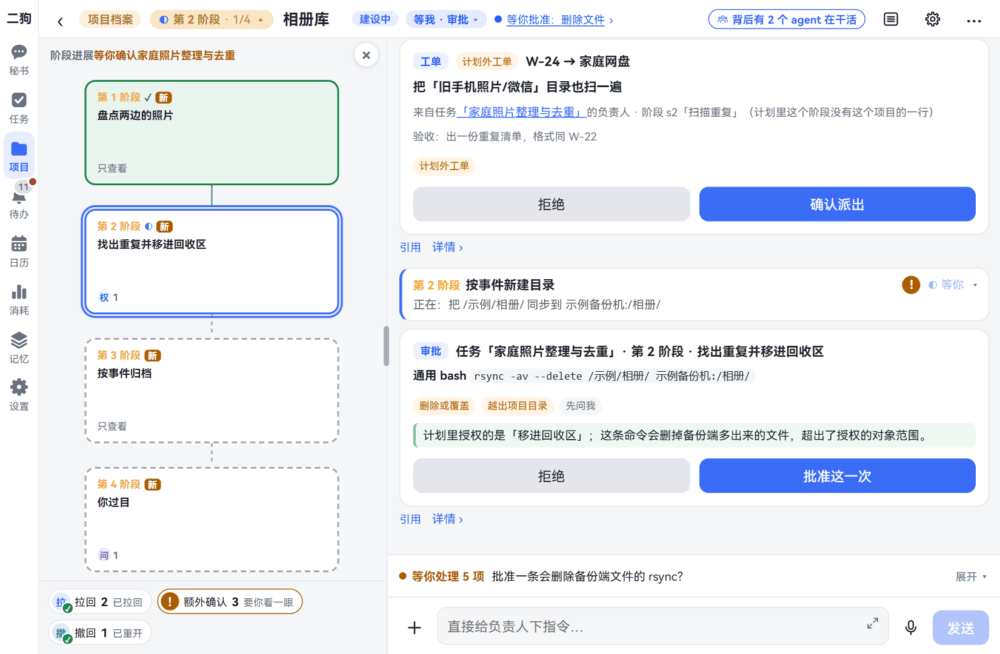
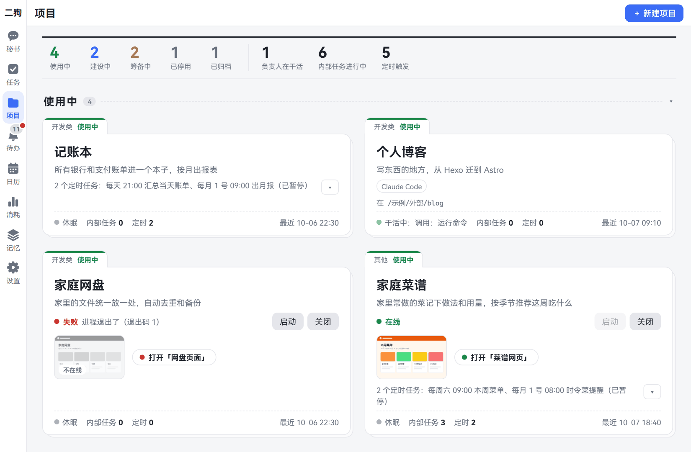

# 二狗是什么

> **把记忆还给你。** 越懂你，越放心。

二狗是一个装在你自己电脑上的 AI 助理。你跟它说句话，它帮你记事、查资料、整理东西，把要花时间的活做完。坐在电脑前打字可以，出门在外用手机说话也可以。

这一页讲它为什么这样设计、能帮你做什么、怎么开始。

想先看看长什么样，打开[在线演示](https://catmaniii.github.io/ergo/)就行：不用装，点着看，里面的数据都是编的。

## 为什么要做它

这一节说清楚：你的私事放在哪，什么时候会发出去。

一个好助理，得懂你。想懂你，它就要知道很多私事：家人的生日，孩子在哪上学，体检报告，工资条，还有你半夜想问、又不好意思问别人的问题。

这些东西，你愿意全交给别人保管吗？不交，它又没法懂你。

二狗的办法是：**这些都记在你自己的电脑上。** 聊天记录、你说过的话、它对你的了解，都放在这台电脑里。

有一件事要说实话。真正"想事情"的大模型，今天还得靠外面的公司。你问一句话，这句话和这一轮用得上的资料，还是要发给模型公司，由那家公司按它的规矩处理。

二狗能做到的是：每次只发这一轮用得上的那一小部分，发给哪家由你定。比如证件号、住址放在你的档案里，平时不动，你问起或者让它替你填表时才读，读到的才发出去。完整的你，不在别人那里。

## 五个设计理念

本页的图都来自演示版，里面的人和事都是编的。

### 1. 记忆在你手里，模型随便换

**对你有什么用：** 它跟你越久越懂你。换模型，也不用从头教。

你说过一次不吃辣，下回让它挑餐馆，它会记得。过一阵子你觉得别家的模型更好，换过去就是了。它对你的了解放在你电脑上，不在模型公司那里，换了也还在。

它也不乱下结论。你推掉了几次周末聚会，它可能推出"周末想自己安排"，也可能猜"最近太累"。拿不准的标着「猜测」，每一条都能点开，看它凭什么这么想。健康这类敏感的事，默认只记下，不拿来推断。

猜错了就告诉它，它每晚整理时会改过来。想让它忘掉，就说"忘掉我说过要换工作的事"。它先把找到的内容列给你核对，你点了才删。

图：记忆页。右边是它从你的话里整理出来的理解，每条标着「已验证」或「猜测」。

**现在的限制：**

- 这套记忆还是实验性的，它的做法和存的东西都可能变。
- 聊天用的模型能换，但每晚整理记忆这一步现在还要用 DeepSeek（一家模型公司）。换了别家，DeepSeek 的 Key（相当于账号钥匙，后面会讲）也要留着。
- 二狗每晚备份一份，但默认只留在这台电脑上。到设置里再选一个网盘或家庭存储的同步文件夹，电脑坏了才恢复得回来。

### 2. 只跟一个秘书说话，干活的各司其职

**对你有什么用：** 不用记该找谁，几件事也不会搅在一起。

普通的 AI 聊天，一个对话里交代好几件事，说到后面它自己就乱了。

在二狗里，你只跟秘书说话。小事它自己办：定个提醒，记句话，查个天气。要花时间的事，它交给后台的负责人去做，你可以接着聊别的。负责人就是专门做这一件事的 AI 助手。

每件事一个负责人，各做各的，互不串线。负责人只看得到交给它的那件事，看不到你和秘书聊过什么。有进展、做完了，秘书转告你。想细问，也能打开那件事，直接跟负责人说。

图：秘书页。你说要下一首歌，秘书交给后台。负责人中途来信，秘书转告你。下好了，再告诉你一声。

**现在的限制：** 默认同时最多 3 个任务在做，多的排队。

### 3. 大活按项目来，你不用一直盯着

**对你有什么用：** 大事交出去，不用守着。有大事它才来找你，回来一眼看懂做到哪了。

比如把全家的照片整理去重，或者做一个长期用的记账本。这种活一口气做容易跑偏，一步一问你又烦。二狗用管项目的办法来管：

- **先说好再开工。** 要做什么、分几段、每段交什么、允许它动什么，都写在一张计划卡上。你点了确认，它才动手。
- **一段一段做。** 每段都有要交的东西。做完了不听它自己说，由另一个助手按事先定好的标准检查，没过就退回去改。
- **有大事才打扰你。** 事先没批准过的大事，比如以你的名义往外发东西、动账号和密码、删改它工作范围以外的文件，它会停下来问你。要你拍板的事都集中在「待办」一页。

回来看进展，也不用翻聊天记录。阶段图上看得到做到哪一段，整段对话还能像地图一样缩小，看全貌。

图：相册整理这个项目。左边四个阶段，第 1 段做完了，正在做第 2 段。右边下面这张卡：计划里只批准把重复的照片移进回收区，这条命令却会删掉备份里的文件，所以它停下来问你。

一个真实项目做第一版，前后 247 次操作，只需要人确认 7 次；中间跑偏 5 次，都自动拉了回来。

**现在的限制：**

- 新装时二狗比较放手：上面说的那几类以外，大多直接做，照常记下来。想稳一点，在设置向导里勾上「有风险的事先问我」。
- 不勾「任务超预算就停下」的话，跑偏的任务会一直花钱。
- 不满意可以让它从某一段重做，但已经发出去的东西收不回来。

### 4. 不用守在电脑前，手机上说句话就行

**对你有什么用：** 人在外面，家里的电脑照样给你干活。

走在路上想起一件事，掏出手机，按住话筒说一句："帮我查一下十一月去西安的机票和酒店大概多少钱，整理好告诉我。"家里的电脑就开工了，你接着忙你的。

做完它告诉你，也可以念给你听。不同的负责人还能配不同的声音，闭着眼也知道是谁在汇报。

听写和朗读都在你自己的电脑上跑，不用交给别家的语音服务。

图：手机上的秘书页。你发的语音下面是认出来的字，二狗也能用语音回你。最下面就是「按住 说话」。

**现在的限制：**

- 二狗跑在你的电脑上。电脑要开着、连着网，手机才连得上。
- 手机要有一条路连回电脑，同一个 Wi-Fi 下也一样。最简单的办法是电脑和手机都装一个叫 Tailscale 的连接软件，登同一个账号。它要用 Google、微软这类账号登录，国内可能慢。怎么接见[手机上用](mobile.md)。
- 手机浏览器不用装东西就能用。让它帮你操作网页的内置浏览器只有 App 里才有。App 不在应用市场：安卓下载安装包就能装，没写过代码也能弄；鸿蒙要用你自己的华为账号签名、用开发工具，没写过代码的人不容易弄。
- 语音不在安装包里，要另外下载。只听写要下 1 到 2 GB。想让它朗读，还要再下将近 6 GB，没有好显卡时念得很慢。

### 5. 你做的小工具能一直跑下去，变成二狗的本事

**对你有什么用：** 做过一次的东西不会放着落灰，以后说一句就能用。

比如让二狗做一个记账本。第一版做好，你在卡片上确认一次，它就转入使用：网页一直开着，手机上也能打开，每天晚上 9 点自动汇总当天的账单。以后你说一句"记一笔午饭三十二块"，秘书就帮你记上。

这些一直跑着的小程序，由服务管家看着。服务管家是二狗带的一个帮手：开机把它们启动，挂了再拉起来，一个页面看全部状态。

这样的东西攒得越多，你一句话能办的事就越大。

图：项目页。记账本每天 21:00 汇总账单，家庭菜谱的网页在线。家庭网盘写着「失败」，出了问题卡上看得到。

**现在的限制：**

- "记一笔"这种项目自己的操作，要负责人写好、测过，才给秘书用。
- 这些本事现在主要是秘书在用。想让别的负责人也能用，要让项目的负责人去登记一下，还不是自动的。
- 想让外面的人也能打开你的网页，现在要你按卡上写的步骤手动开。

## 它能帮你做什么

下面每一行是一件它能帮你做的事，点左边的字看怎么用。

| 你想 | 比如 |
|---|---|
| [跟它说话、发东西给它](chat.md) | 打字或者按住说，发图片和文件给它；聊偏了能退回去重来 |
| [把要花时间的事交出去](tasks.md) | 查资料，整理下载文件夹；每周一早上自动做一次 |
| [做一个长期用的东西](projects.md) | 记账本、家电档案、一个小网站 |
| [让它记住你，也让它忘掉](memory.md) | "记住，我对芒果过敏"；"忘掉我说过要换工作的事" |
| [用语音说，用语音听](voice.md) | 按住说话；"把刚才那段念给我听"；给它换个声音 |
| [在手机上用](mobile.md) | 用手机浏览器或 App 连回家里的电脑 |
| [让它帮你操作网页](browser.md) | "总结一下这一页"；"把我周末在杭州拍的照片贴上来"。只在手机 App 里有 |
| [看日历、定提醒](calendar-reminders.md) | "每个月 8 号早上九点提醒我交房租"；看哪天上班哪天休息（按中国和新加坡的节假日算） |
| [把外面的数据接进来](data-sources.md) | 接 Google 日历、Gmail、穿戴式相机，问"上个月那封机票邮件说了什么"。手机上的通讯录和照片现在只有鸿蒙 App 能接 |
| [让 Claude Code 写代码](claude-code.md) | Claude Code 是一个写代码的 AI 工具。电脑上装了它的，可以让负责人用它干活，花你自己的订阅额度。同类的 Codex 还没接上 |
| [教它新本事](skills-mcp-plugins.md) | 写一份说明书，告诉它周报怎么写；不想要的功能整块关掉 |
| [改设置、看花了多少钱](settings.md) | 换模型，换界面风格和语言，设备份；按天看用了多少 |

## 你需要准备什么

看完这一节，就知道你手上的东西够不够用。

**一定要有：**

- **一台 Windows 10 或 11 的电脑。** 现在只支持 Windows，苹果电脑和 Linux 上启动不了。
- **一个模型的 Key。** Key 是模型公司给你的一串字符，像账号的钥匙。默认用 DeepSeek，到它的网站注册就能拿到。别家的也能填，要对方支持「OpenAI 兼容」这种通用接法。

**可以以后再说：**

- 手机，和一条连回电脑的路。
- 语音。听写和朗读都要另外下载。

**花多少钱：** 二狗本身开源免费。模型的费用你按用量付给模型公司，二狗的「消耗」页能看到大概花了多少。

**还要知道两件事：**

- 二狗还在早期，功能和界面都还会变。
- 二狗用你的 Windows 账号在你电脑上干活，能看和改你的文件、运行程序、上网。它有规则把关，有几条底线谁说了都不放，比如不读存放 Key 的地方。但它没有和电脑上别的东西隔开。重要的文件请自己留好备份。

## 怎么开始

三步就能用上。

1. **装好。** 在 Windows 自带的命令窗口里粘贴一行命令，不用事先装别的。见[安装、升级和卸载](install.md)。
2. **走设置向导。** 打开二狗，页面顶上有一条提示，点进去走五步。最要紧的是填模型 Key，别的都能先跳过。见[开始使用](getting-started.md)。
3. **说第一句话。** 在秘书页打一句"两分钟后提醒我喝水"。两分钟后它提醒你，就算通了。

接着看[和秘书说话](chat.md)。
