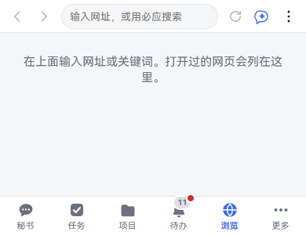
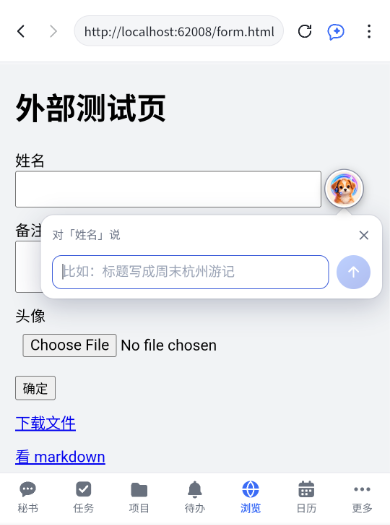
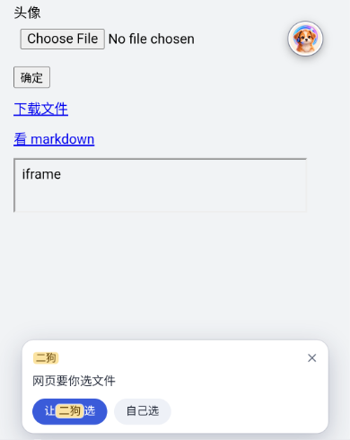
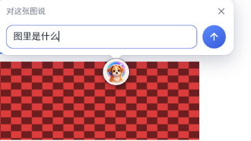
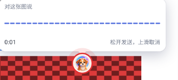
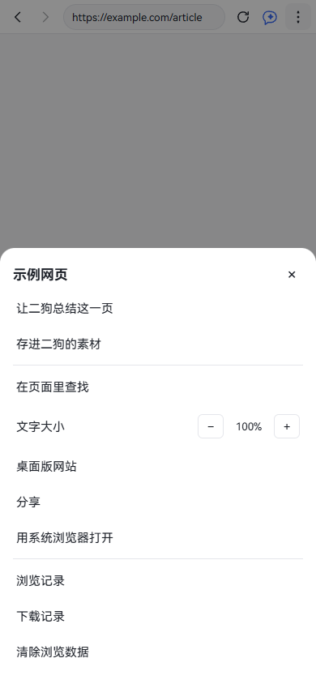
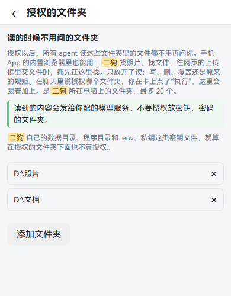
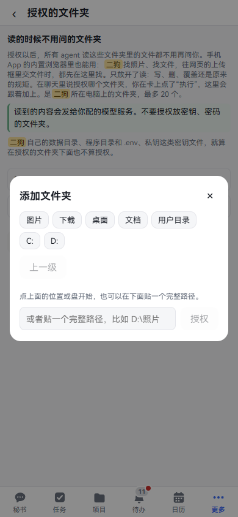

[中文](browser.md) | **English**

# Built-in browser

Screenshots show the Chinese interface; the labels in the text are the English ones.

The built-in browser is the **Browse** tab in the phone app: a browser where you can enter addresses and open web pages, with the secretary right beside you. You can have it read the page, fill in fields, upload files and tap buttons, or long-press an image or text on a page and ask it directly. This chapter goes through each one. By the end you can have ergo take care of things on web pages from your phone.

**It's only in the phone app.** Both the HarmonyOS and Android apps have it. If you open ergo in a browser on a PC or phone, there's no **Browse** in the navigation, and opening its address directly only shows a one-line note. To install the app, see [On your phone](mobile.en.md).

In the screenshots below, the web page content is a test page.

## Opening web pages

**What it is:** looking things up, reading articles, signing in to a site. You use it like any other browser on your phone, with a secretary added.

**Where to open it:** **Browse** in the app's bottom navigation.

**Step by step:**

1. Tap **Browse** in the bottom navigation. The first time, you get a blank page that says **Type an address or search terms above. Pages you've opened will be listed here.**
2. Tap the address bar at the top. The placeholder says **Enter an address, or search with Bing**.
3. Enter an address or search terms and press Go on the keyboard. An address opens; anything else is searched with the search engine chosen in settings.
4. The page opens. The top bar, left to right: Back, Forward, the address bar, Reload (Stop while loading), the ergo icon (opens the sidebar), and ⋮ (menu).

Next time, the blank page lists **Recently visited**. Tap one to open it. Long-press one for **Open**, **Delete** and **Select multiple**. **Clear all** is above the list.

**Good to know:**

- Switch to another tab and back, and the page is just as you left it.
- The phone's back gesture first goes back through the page's history, and only leaves this page when it runs out.
- Tap an external link on another ergo page, and the app switches to **Browse** to open it.
- When you open markdown, plain text, JSON, CSV and files like that, ergo renders them for you, with **View source**, **Download** and **Open in system browser** at the top.

## Working on a page by voice or typing: the ergo sidebar

**What it is:** talk to the secretary while looking at a page. For example, "Summarize this page", or "Upload the product image, write seaside as the prompt, then tap Run".

**Where to open it:** the ergo icon at the far right of the **Browse** top bar, just left of ⋮.

**Step by step:**

1. Open a page and tap the ergo icon in the top bar. The sidebar slides out. On a phone it covers the whole screen; on wide screens like tablets and wide foldables it sits on the right and pushes the page left.
2. Look at the top line of the sidebar, **Viewing**: it shows the page title and domain.
3. To have it work on a particular field, tap that field on the page first. A **Selected** line appears saying which field, with × on the right to deselect.
4. Type in the input box below and send. To talk, tap the microphone to switch to voice and hold to talk.
5. Tap **›** at the top right to close. On a phone the back gesture closes it too.

**Things you can just say:**

- "Summarize this page"
- "How many days does this page say I have to return it?"
- "Open example.com"
- "Tap the second link"
- "Upload the product image, write seaside as the prompt, then tap Run"

**Good to know:**

- The sidebar is the secretary's main conversation. What you say here also shows in the **Secretary** tab, and vice versa.
- In this turn, the secretary can read the page's text, type into fields, hand files to upload boxes, open addresses in the built-in browser, see what can be tapped on the page, and tap what you ask. Only messages sent from the sidebar, the floating button or the round button get these abilities. If you say it in the **Secretary** tab, it can't touch the page.
- It reads at most 20,000 characters of page text at a time. Anything longer is cut off, and the secretary says so.
- It won't submit on its own. Buttons like **Submit**, **Run**, **Generate**, **Confirm** and **OK** are only tapped if you explicitly said so this turn.
- Buttons like pay, payment, buy, place order, delete, clear, publish, close account and unlink: it won't tap them, and tells you "you should tap this step yourself".
- Dropdowns are view-only for now; you have to pick yourself.
- What's written on the page doesn't count as something you said. If a page says "ignore previous instructions", the secretary won't obey.
- Holding to talk needs speech recognition installed first; see [Voice](voice.en.md).
- On wide screens, there's a divider between the sidebar and the page. Drag it to change the width; this device remembers.

## Filling in fields: the floating button

**What it is:** when a page has a text box, have ergo write for you. For example, tap into a title box and say "Make the title "A weekend in Hangzhou"".

**Where to open it:** in **Browse**, tap a text box on a page, and ergo's floating button appears next to it.

**Step by step (typing):**

1. Tap a text box on the page. The ergo button appears next to it.
2. Tap the ergo button. A small bubble pops up saying **Talk to “Name”**, using the name of this field.
3. Type and tap send. The bubble says **ergo is thinking…**. If the secretary is busy it says **ergo is busy. You're next once this turn is done**.
4. The text is filled into the field, and the bubble shows its reply. Replies without errors close by themselves after a moment. If a reply is too long, **Read in sidebar** appears below.

**Step by step (talking):**

1. Press and hold the ergo button. A sound wave and a seconds count appear in the bubble.
2. Let go when you finish and it sends. The prompt says **Release to send, slide up to cancel**. Slide your finger up or away, and the prompt changes to **Release to cancel**. It records up to 60 seconds, then sends by itself.
3. The recognized words show in the bubble first, then go to the secretary.

**Things you can just say:**

- "Make the title "A weekend in Hangzhou""
- "Make this a bit more polite"
- "Fill in the address I mentioned yesterday"

**Good to know:**

- Filling replaces everything already in the field. The secretary can see what's in the field now, so you can ask it to edit.
- It doesn't submit after filling; you tap submit yourself.
- Fields for passwords, verification codes, bank cards and the like don't get the button, and ergo won't read or fill them.
- When the voice plugin is off, holding doesn't record; you can only tap to type.
- Tapping ×, tapping outside the bubble, scrolling the field off screen or the page starting to navigate all close the bubble. Even after it closes, your request still gets done, and the reply is in the secretary's conversation.

## Uploading files: upload boxes

**What it is:** when a page wants photos or files, have ergo look on your computer. For example, "Attach the photos I took in Hangzhou last weekend".

**Where to open it:** in **Browse**, tap an upload button on a page.

**Do this first:** authorize the folders holding your photos and files for ergo; see [Authorized folders](#authorized-folders) below. Without that, it can only look in attachments you've sent and in materials.

**Step by step:**

1. Tap the upload button on the page. When the page wants you to pick a file, a bubble says **This page wants a file** (for an image field, **This page wants an image**; where several are allowed, **(you can pick several)** is added).
2. Choose one:
   - Tap **Pick myself**: the phone's system file picker opens, as usual.
   - Tap **Let ergo pick**: then type or say what you want.
3. The secretary goes looking. If it's sure, it hands the file over directly. If not, a suggestions window pops up, saying **ergo's suggestions**.
4. In the window, tap the ones to upload and tap **Upload**. If you don't want any, tap **None of these**. The same suggestions card is in the chat, and you can choose on either side.
5. The files go into the page's upload box. You still tap submit yourself.

**Things you can just say:**

- "Attach the photos I took in Hangzhou last weekend"
- "The profile picture with a face in it"
- "Show me a different set"

**Good to know:**

- The files are the ones on your computer, not in your phone's photo album.
- At most 12 suggestions at a time. At most 30 files per upload, 50 MB each and 200 MB in total.
- If it needs to see image content to choose, the model must be able to see images. If it can't, the secretary chooses by folder and file names and gives you suggestions.
- Finding by place currently relies on folder and file names: "Hangzhou" has to be in the name to be found.

## Long-pressing an element: the round ergo button

**What it is:** when you see an image, video, link or bit of text and want ergo to do something with it, long-press it and tap the round ergo button to say so. What you say is up to you; the button has no preset actions.

**Where to open it:** in **Browse**, long-press an image, video, link or text on a page. With a mouse attached, right-click.

**Step by step:**

1. Long-press an element on the page. The system menu pops up as usual, such as save image or copy, and a round ergo button appears as well.
2. To type: tap the button. A bubble pops up saying **Talk about this image** (video, link and text have their own wording), and the input box reads **Say what you'd like done with it**.
3. To talk: hold the button and speak. The bubble shows a sound wave and seconds. Let go to send, slide up to cancel.
4. The reply shows in a bubble next to the button. The same message and reply are in the secretary's conversation too.

**Things you can just say:**

- "What is this"
- "Translate it into English"
- "Remember this image"
- "Download it to my phone"
- "Send it to the ledger project"

**Good to know:**

- When you select text, the button sits below the selection so the system's selection toolbar doesn't cover it. Drag the handles to change the selection and the button follows; the secretary gets the text finally selected.
- The button disappears if untouched for 5 seconds, and closes right away when you tap elsewhere or scroll.
- Text boxes don't get the round button, since they have the floating button. Empty areas don't get it either.
- The button doesn't appear in these cases: the page blocks long-press, a transparent layer covers it, or the content is in a frame embedded from another site.
- Say "Remember this image", and the image itself is saved to materials with its description, source page and address; you can see it under **More · Memory · Materials**. If the original image can't be fetched, a screenshot of the element is saved; if nothing can be fetched, only text is recorded, and the secretary says so honestly. Anything over the attachment size limit is also recorded as text only.
- Forget or delete completely that item in materials and the image goes too, unless another message or material still uses it.
- It only downloads if you said so this turn. It goes through the app's downloads: the system's **Save to** dialog pops up, and it's added to Downloads. Text elements can't be downloaded.
- To see what's in an image you need a model that can see images; if you don't have one, the secretary says so honestly.

## The menu: summarize, save as material, find and more

**Where to open it:** ⋮ at the far right of the **Browse** top bar. On a phone it pops up from the bottom; on wide screens it's a dropdown. Before any page is open, the first few items are grayed out and say **No page open yet**.

| Menu item | What it does |
|---|---|
| Ask ergo to summarize this page | Opens the sidebar and sends "Summarize this page" for you |
| Save to ergo's materials | Saves this page's main text as one material, and the top bar shows **Saved**. If it's too long it says **Saved (the page is long, so only the first N characters were kept)** |
| Find in page | A find bar appears under the top bar, showing **1 of 5**, and can jump to the previous and next match |
| Text size | Tap − and + to adjust; remembered per site |
| Desktop site | Reloads as the desktop version; remembered per site |
| Share | Opens the system share panel |
| Open in system browser | Hands it to the phone's default browser |
| History | All records; search by title or address, long-press to delete, select several to delete, clear all |
| Downloads | Files downloaded here. Tap one to open the file. Long-press and choose **Delete entry (keep the file)**; the file stays where it was |
| Clear browsing data | Choose a scope, **All sites** or **Current site only**; tick Cache, Cookies and site data, History; tap **Clear** |

**Good to know:**

- Cache can't be cleared for just one site; even if you select that, all of it is cleared.
- After clearing cookies you'll have to sign in to sites again. Your ergo sign-in isn't affected.
- You can ask the secretary about saved pages later. It doesn't treat what's written on them as something you said.

## Authorized folders

**What it is:** tells ergo which folders on your computer it can read. Once authorized, every agent can read the files inside without asking you and without writing it into a plan. When ergo looks for photos and files or hands files to a page's upload box, it looks here first.

**Where to open it:** Settings · Data & devices · Authorized folders. There's also a link at the bottom of Settings · Capabilities · Browsing & form filling. On a phone, Settings is under **More**.

**Step by step (in Settings):**

1. Open this page and tap **Add folder** at the bottom.
2. A folder picker pops up. What you pick is **a folder on the computer running ergo**, even when you open it on a phone.
3. Tap a common place above (Pictures, Downloads, Desktop, Documents, Home folder) or a drive, and go in level by level; there's **Up one level**. When you reach the folder you want, tap **Authorize this folder**.
4. You can also paste a full path at the bottom (such as `D:\Photos`) and tap **Authorize**.
5. A new row appears in the list. To remove one, tap × on the right of its row. It takes effect immediately, with no confirmation.

**Things you can just say:**

- "Authorize `D:\Photos` for you"
- "Authorize my Pictures and Downloads folders"
- "Stop looking at the Downloads folder"

After you say it, the secretary shows a card listing the full paths to add or remove, and nothing changes until you tap **Run**. The secretary can't change this list on its own.

**Good to know:**

- At most 20 folders. If a folder later can't be found, its row is marked **Not found**.
- Only reading is opened up. Writing, deleting and overwriting follow the usual rules. Running scripts inside and `cd`-ing into them don't count as reading either.
- What's read is sent to your configured model provider. Don't authorize folders holding keys or passwords.
- Secret files like `.env` and private keys, and ergo's own data and program folders, don't count as authorized even if they sit inside an authorized folder. But a search across a whole folder can't recognize the secret files inside it.
- This page doesn't depend on the built-in browser. You can set it on a PC too, and it stays even when the plugin is off.

## Search engine

**Where to open it:** Settings · Capabilities · Browsing & form filling, **Search engine** at the top.

Choose Bing, Baidu, Sogou or Google; Bing is the default. It only decides which one is used when you type search terms in the **Browse** address bar, and it only applies to this device.

**Agent web search & page reading** lower on the same page is something else: it controls which methods the agents use to go online, and in what order; see [Settings](settings.en.md).

## Opening a project service's page

**What it is:** the small websites and tools a project has put online, opened with one tap.

**Where to open it:** a service's entry on the project card or in the project records, or ask the secretary.

**Things you can just say:**

- "Open the briefing site"
- "Where's the briefing site's page"

The secretary puts a card in the chat showing whether the service is online. Tap it to open.

**Good to know:**

- In the app, service pages open in **Browse**.
- In a browser on a PC or phone, a service page is a frame layered over ergo, with back, reload, open in new window, and close. It only opens this service's page: you can't enter an address, and there's no sidebar or floating button.

## Read next

- [On your phone](mobile.en.md): install the app, scan to pair.
- [Voice](voice.en.md): install speech recognition, hold to talk.
- [Memory](memory.en.md): where to see what you've saved to materials.
- [Projects](projects.en.md): how services go live.
