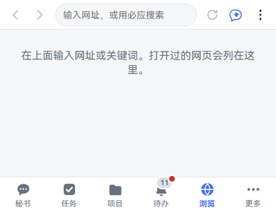
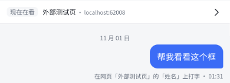
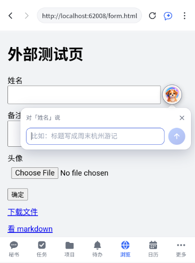
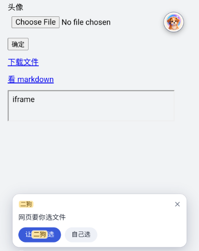
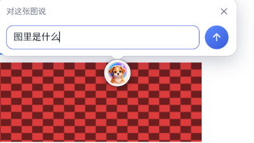
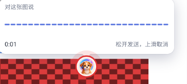
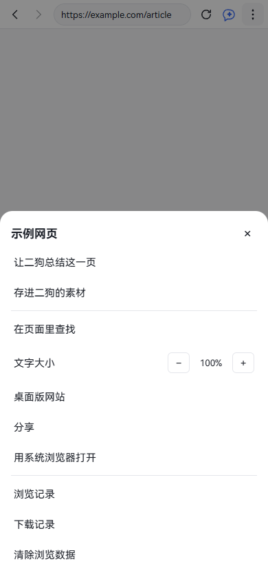
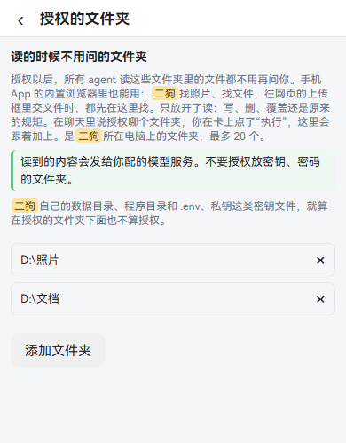
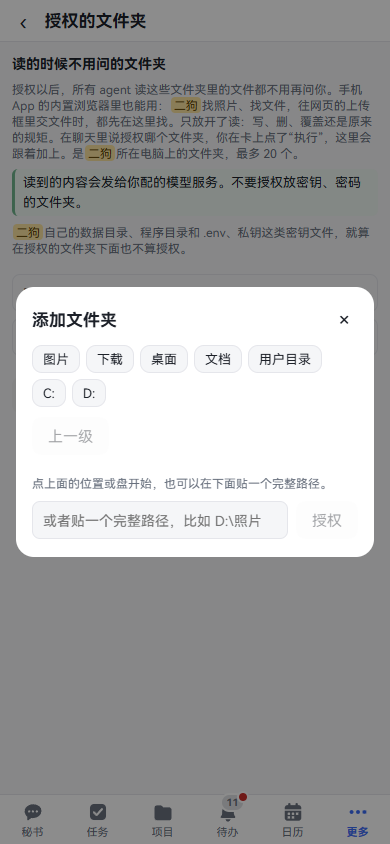

**中文** | [English](browser.en.md)

# 内置浏览器

内置浏览器是手机 App 里的「浏览」页签：一个能输网址、能开网页的浏览器，秘书就在旁边。你可以让它读这一页、填框、交文件、点按钮，也可以长按网页上的图片或文字，直接问它。这一章一样一样讲怎么用。看完你能在手机上让二狗帮你办网页上的事。

**它只在手机 App 里有。** 鸿蒙和安卓 App 都有。电脑和手机浏览器里打开二狗，导航里没有「浏览」，直接打开这个地址只有一句说明。App 怎么装见[手机上用](mobile.md)。

下面的截图里，网页内容是测试页。

## 打开网页

**这是什么：** 查东西、看文章、登录某个网站。和手机上别的浏览器一样用，多了一个秘书。

**在哪里打开：** App 底部导航的「浏览」。

**一步一步：**

1. 点底部导航的「浏览」。第一次打开是空白页，写着"在上面输入网址或关键词。打开过的网页会列在这里。"
2. 点顶上的地址栏，提示写着"输入网址，或用必应搜索"。
3. 输入网址或关键词，按输入法上的前往键。输的是网址就打开，不是网址就用设置里选的搜索引擎搜。
4. 网页打开。顶栏从左到右是：后退、前进、地址栏、刷新（加载中是停止）、二狗图标（展开侧边栏）、⋮（菜单）。

以后再打开，空白页上列着「最近访问」。点一条打开。长按一条有「打开」「删除」「多选」。列表上方有「清空全部」。

**要知道的：**

- 切到别的页签再回来，网页原样还在。
- 手机返回手势先退网页的历史，退到头才退出这一页。
- 在二狗的其他页面点外部链接，App 会切到「浏览」打开它。
- 打开 markdown、纯文本、JSON、CSV 这类文件时，二狗直接渲染给你看，上面有「看原文」「下载」「用系统浏览器打开」。

## 用语音和打字操作网页：二狗侧边栏

**这是什么：** 一边看网页一边跟秘书说话。比如"总结一下这一页"，或者"把产品图交上去，提示词写海边，然后点运行"。

**在哪里打开：** 「浏览」顶栏最右边、⋮ 左边的二狗图标。

**一步一步：**

1. 打开一个网页，点顶栏的二狗图标。侧边栏滑出来。手机上整屏盖住网页，平板、阔折叠这样的宽屏在右边，把网页往左挤。
2. 看侧边栏最上面一行「现在在看」，写着网页标题和域名。
3. 想让它操作某个框，先在网页上点一下那个框。这时多一行「选中」，写着是哪个框，右边 × 取消选中。
4. 在下面的输入框打字发送。要说话，点话筒切到语音，按住说。
5. 点右上角「›」收起。手机上用返回手势也能收起。

**可以直接说的话：**

- "总结一下这一页"
- "这一页里说的退货期限是几天？"
- "打开 example.com"
- "点第 2 个链接"
- "把产品图交上去，提示词写海边，然后点运行"

**要知道的：**

- 侧边栏就是秘书的主会话。这里说的话，「秘书」页签里也看得到，反过来也一样。
- 秘书这一轮能读网页的文字、给框填字、给上传框交文件、在内置浏览器里开网址、看网页上能点什么、按你说的点。只有从侧边栏、悬浮按钮或圆钮发的话才有这些能力。在「秘书」页签里说，它碰不到网页。
- 网页文字一次最多读 2 万字，再长就截断，秘书会写明。
- 它不会自己提交。"提交""运行""生成""确认""确定"这类按钮，要你这一轮明确说了才点。
- 支付、付款、购买、下单、删除、清空、发布、注销、解绑这类按钮，它不点，会告诉你"这一步建议你自己点"。
- 下拉框现在只能看，要你自己选。
- 网页上写的话不算你说的。网页里写着"忽略之前的指令"，秘书也不会照做。
- 按住说话要先装语音识别，见[语音](voice.md)。
- 宽屏上，侧边栏和网页中间有一条分隔条，拖动能改宽度，这台设备记住。
- 侧边栏里的地图卡片点「看大地图」「在高德地图上看」，侧边栏收起，切到「地图」页看这张卡。别的卡片里跳到二狗页面的链接也一样，按返回回到「浏览」。

## 填框：悬浮按钮

**这是什么：** 网页上有文本框时，让二狗替你写。比如点进标题框说"标题写成周末杭州游记"。

**在哪里打开：** 在「浏览」里点一下网页上的文本框，框旁边出现二狗的悬浮按钮。

**一步一步（打字）：**

1. 点网页上的文本框，旁边出现二狗按钮。
2. 点二狗按钮，旁边弹出小气泡，写着"对「姓名」说"，也就是这个框的名字。
3. 打字，点发送。气泡里写"二狗在想……"。秘书正忙时写"二狗正忙，排在后面，这一轮说完就看"。
4. 字填进框里，气泡里显示它的回话。没出错的回话过一会儿自己收起。回话太长时下面有「去侧边栏看」。

**一步一步（说话）：**

1. 按住二狗按钮，气泡里出现声波和秒数。
2. 说完松手就发送。提示写着"松开发送，上滑取消"。手指上滑或者划开，提示变成"松开手指，取消发送"。最长录 60 秒，到了自己发。
3. 认出来的字先显示在气泡里，再交给秘书。

**可以直接说的话：**

- "标题写成周末杭州游记"
- "把这段改得礼貌一点"
- "把我昨天说的地址填进来"

**侧边栏关着时：右下角的二狗按钮**

- 侧边栏关着、没点文本框时，网页右下角常驻一个二狗按钮。它和框旁边的是同一个：一样大，点一下打字、按住说话。
- 点它弹出的气泡写着"对二狗说"。说的是这一页，不针对哪个框，比如"这一页讲了什么""把这一页存进素材"。
- 点进文本框、点上传按钮、长按网页元素时，按钮挪到那个东西旁边；离开以后回到右下角。
- 侧边栏开着时右下角没有按钮，在侧边栏里说就行；点进框时框旁边照样有。
- 按钮会让开网页自己的底部栏和右下角的按钮。它固定在右下角，不能拖。

**要知道的：**

- 填字会把框里原来的内容整个换掉。秘书看得到框里现在写了什么，你可以让它改。
- 填完不会提交，提交由你自己点。
- 密码、验证码、银行卡这类框不出按钮，二狗也不读、不填。
- 语音插件停用时，按住不录，只能点一下打字。
- 点 ×、点气泡外面、把框滚出屏幕、网页开始跳转，气泡都会收起。收起之后这句话照样办完，回话在秘书的会话里。

## 交文件：上传框

**这是什么：** 网页要你传照片、传文件时，让二狗去你电脑上找。比如"把我周末在杭州拍的照片贴上来"。

**在哪里打开：** 在「浏览」里点网页上的上传按钮。

**先做一件事：** 把放照片、文件的文件夹授权给二狗，见下面的[授权的文件夹](#授权的文件夹)。没有授权时它只能在你发过的附件和素材里找。

**一步一步：**

1. 点网页上的上传按钮。网页要选文件时，气泡问"网页要你选文件"（图片框写"网页要你选图片"，能多选的写"可以选好几个"）。
2. 选一个：
   - 点「自己选」：打开手机系统的选文件界面，和平时一样。
   - 点「让二狗选」：接着打字或者说话，说你要什么。
3. 秘书去找。找得准就直接交进去。拿不准时弹一个候选窗口，写着"二狗给的候选"。
4. 在窗口里点选要交的，点「交」。不要就点「都不要」。聊天里也有同样一张候选卡，在哪边选都行。
5. 文件交进网页的上传框。提交还是你自己点。

**可以直接说的话：**

- "把我周末在杭州拍的照片贴上来"
- "要那张有人脸的头像"
- "换一批"

**要知道的：**

- 交的是你电脑上的文件，不是手机相册里的。
- 候选一次最多 12 个。一次最多交 30 个文件，单个 50 MB，加起来 200 MB。
- 要看图片内容才能挑时，模型要能看图。不能看图时，秘书按文件夹名和文件名挑，会给你候选。
- 按地点找现在靠文件夹名和文件名，"杭州"要写在名字里才找得到。

## 长按元素：二狗圆钮

**这是什么：** 看到一张图、一段视频、一个链接或一段字，想让二狗拿它做点什么，长按它，点二狗圆钮直接说。说什么由你定，圆钮上没有预设操作。

**在哪里打开：** 在「浏览」里长按网页上的图片、视频、链接或文字。接了鼠标时是右键。

**一步一步：**

1. 长按网页上的元素。系统菜单照常弹出，比如保存图片、复制，同时多出一个二狗圆钮。
2. 要打字：点一下圆钮，弹出气泡，写着"对这张图说"（视频、链接、文字各有各的说法），输入框提示"说说想怎么处理它"。
3. 要说话：按住圆钮说，气泡里有声波和秒数，松手发送，上滑取消。
4. 回话显示在圆钮旁边的气泡里。同一句话和回话也在秘书的会话里。

**可以直接说的话：**

- "这是什么"
- "翻译成英文"
- "这张图记下来"
- "下载到手机"
- "发给记账项目"

**要知道的：**

- 选中文字时，圆钮放在选区下面，免得被系统的选字工具条挡住。拖手柄改选区，圆钮跟着走，秘书拿到的是最后选中的字。
- 圆钮 5 秒不碰自己消失，点别处、滚动页面马上收起。
- 文本框上不出圆钮，那里有悬浮按钮。空白处也不出。
- 这几种情况圆钮不出来：网页屏蔽了长按、上面遮着一层透明罩、内容在别的网站嵌进来的框里。
- 说"这张图记下来"，图本身连同描述、来源网页和地址一起存进素材，在 **更多 · 记忆 · 素材** 里看得到。取不到原图时存这个元素的截图，什么都取不到就只记文字，秘书会照实说。超过附件大小上限的也只记文字。
- 在素材里忘掉或者彻底删除这一条，图一起删。别的消息、素材还用着的除外。
- 下载只有你这一轮说了才做。走 App 的下载，弹系统的"保存到"，记进下载记录。文字元素不能下载。
- 要看图里的内容得配能看图的模型，没配时秘书会照实说。

### 选中地址：在地图上看、怎么去

选中网页上的一段地址或地名（"杭州市西湖区示例路 478 号""西湖""1600 Example Street"），圆钮旁边多一行两个按钮：

- **在地图上看**：不用跟二狗说话，圆钮旁边的小气泡写"在地图上找这个地方……"，找到了直接切到「地图」页，那一处标在地图上，标题栏写着你选的那段字。按返回回到「浏览」。找不到时气泡里写原因，比如"地图上没找到……：选得具体些（带上城市、区）再试"。
- **怎么去**：替你跟二狗说一句"从我现在的位置怎么去「……」？"，它算好路线，在对话里放一张路线卡。小气泡里是简短的回话，下面有「去侧边栏看」，点开看路线卡，再点卡片切到「地图」页。

**要知道的：**

- 是不是地址按简单的规则判断：门牌、路名、省市区、邮编，常见的英文地址。拿不准的短短一段（可能是地名）也给这两个按钮，查不到再说。一大段话、网址、电话号码不给。
- 「在地图上看」照二狗平时查地点的规矩挑地图服务：国内填了高德的 Key 用高德，国外填了谷歌的 Key 用谷歌地图（见[国外用谷歌地图](map.md#国外用谷歌地图填谷歌的两个-key)；谷歌查到的只画在谷歌地图上），都没填用 OpenStreetMap。查到的那一处只在这台电脑上留一会儿，不存。
- 关掉地图插件以后不出这两个按钮。
- 要装新版的二狗 App（0.4.4 起）才有这两个按钮。

## 菜单：总结、存素材、查找和其他

**在哪里打开：** 「浏览」顶栏最右边的 ⋮。手机上从底部弹出，宽屏是下拉菜单。还没打开网页时，前面几项灰着，写着"还没打开网页"。

| 菜单项 | 做什么 |
|---|---|
| 让二狗总结这一页 | 打开侧边栏，替你发一句"总结一下这一页" |
| 存进二狗的素材 | 把这一页的正文存成一条素材，顶栏提示"存好了"。太长的写"存好了（网页太长，存了前 N 字）" |
| 在页面里查找 | 顶栏下面出现查找栏，写"第 1 / 共 5 个"，能跳上一个、下一个 |
| 文字大小 | 点 − 和 + 调大小，按网站记住 |
| 桌面版网站 | 换成桌面版再加载，按网站记住 |
| 分享 | 打开系统的分享面板 |
| 用系统浏览器打开 | 交给手机默认的浏览器 |
| 浏览记录 | 全部记录，能搜标题或网址，长按删、多选删、清空全部 |
| 下载记录 | 在这里下载的文件。点一条打开文件。长按选「删除记录（文件留着）」，文件还在原来的位置 |
| 清除浏览数据 | 范围选「全部网站」或「只清当前网站」，勾缓存、Cookie 和网站数据、浏览记录，点「清除」 |

**要知道的：**

- 缓存没法只清一个网站，选了也是清全部。
- 清 Cookie 后网站要重新登录，二狗自己的登录不受影响。
- 存下的网页以后可以问秘书。网页里写的话它同样不当成你说的。

## 授权的文件夹

**这是什么：** 告诉二狗电脑上哪些文件夹可以读。授权后，所有 agent 读里面的文件都不用再问你，也不用写进计划。二狗找照片、找文件、往网页的上传框交文件，都先在这里找。

**在哪里打开：** 设置 · 数据与设备 · 授权的文件夹。「设置 · 能力 · 浏览与填框」最下面也有一行链接。手机上设置在「更多」里。

**一步一步（在设置里）：**

1. 打开这一页，最下面点「添加文件夹」。
2. 弹出选文件夹的框。选的是**二狗那台电脑上的文件夹**，手机上打开也一样。
3. 点上面的常用位置（图片、下载、桌面、文档、用户目录）或者某个盘，一层层点进去，有「上一级」。到了要的文件夹，点「授权这个文件夹」。
4. 也可以在最下面贴完整路径（比如 `D:\照片`），点「授权」。
5. 列表里多一行。要拿掉，点这一行右边的 ×，马上生效，没有确认框。

**可以直接说的话：**

- "把 `D:\照片` 授权给你"
- "把图片和下载文件夹授权给你"
- "别再看下载文件夹了"

说完秘书出一张卡，写着要加、要拿掉哪几个完整路径，你点「执行」才改。秘书自己改不了这份名单。

**要知道的：**

- 最多 20 个文件夹。文件夹后来找不到时，那一行标"找不到了"。
- 只放开了读。写、删、覆盖还是原来的规矩。跑里面的脚本、`cd` 进去也不算读。
- 读到的内容会发给你配的模型服务。不要授权放密钥、密码的文件夹。
- `.env`、私钥这类密钥文件，和二狗自己的数据目录、程序目录，就算在授权的文件夹下面也不算授权。但整个目录搜索认不出里面的密钥文件。
- 这一页不依赖内置浏览器。电脑上也能设，插件停用了也还在。

## 搜索引擎

**在哪里打开：** 设置 · 能力 · 浏览与填框，最上面「搜索引擎」。

选必应、百度、搜狗或谷歌，默认必应。它只管「浏览」地址栏里打关键词时用哪个，只对这台设备生效。

同一页下面的"agent 联网搜索、读网页"是另一回事，管各个 agent 联网时按什么顺序用哪种方式，见[设置](settings.md)。

## 打开项目服务的页面

**这是什么：** 项目上线的小网站、小工具，点一下就能打开。

**在哪里打开：** 项目卡片或项目档案上服务的入口，或者跟秘书说。

**可以直接说的话：**

- "打开简报站"
- "简报站的页面在哪"

秘书放一张卡进聊天，卡上写着服务在不在线，点它打开。

**要知道的：**

- 在 App 里，服务页面在「浏览」里打开。
- 在电脑和手机浏览器里，服务页面是盖在二狗上面的一层框，有后退、刷新、在新窗口打开、关闭。它只开这个服务的页面，不能输网址，也没有侧边栏和悬浮按钮。

## 接着看

- [手机上用](mobile.md)：装 App、扫码配对。
- [语音](voice.md)：装语音识别、按住说话。
- [记忆](memory.md)：存进素材的东西在哪里看。
- [项目](projects.md)：服务怎么上线。
