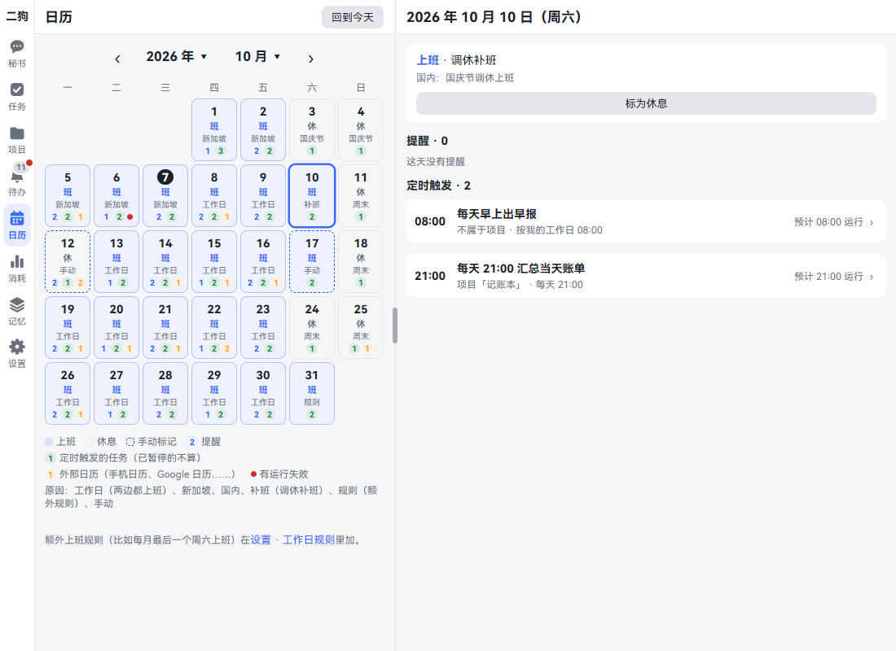
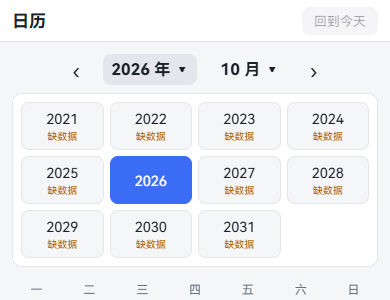
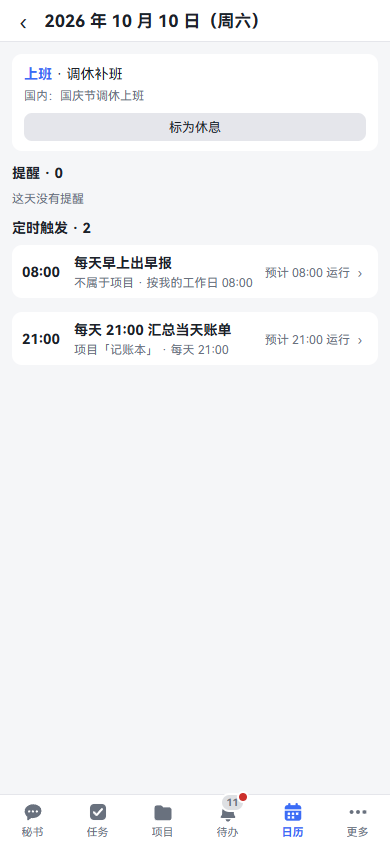
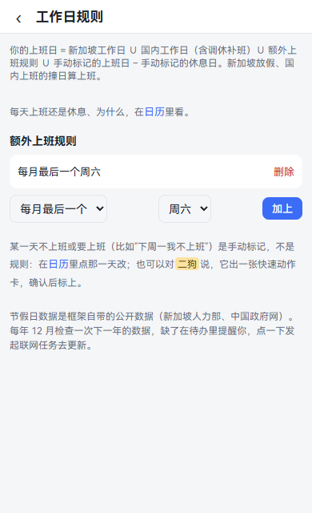
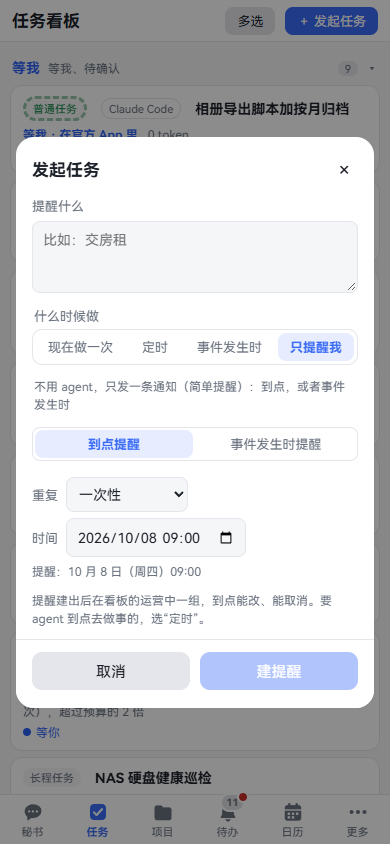
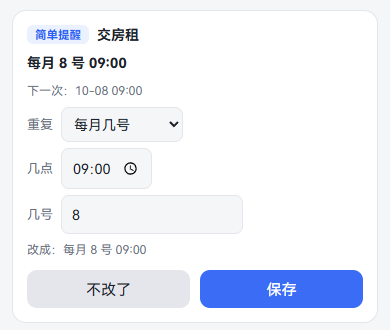
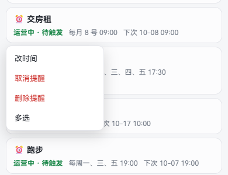
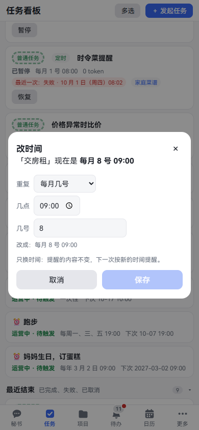
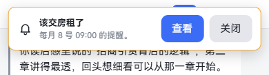
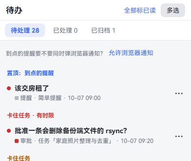

[中文](calendar-reminders.md) | **English**

# Calendar and reminders

Screenshots show the Chinese interface; the labels in the text are the English ones.

The calendar shows, month by month, whether each day is a workday or a day off, and that day's reminders and scheduled tasks. A reminder tells you something at a set time or when something happens; no agent does any work. This chapter covers reading the calendar, setting your workdays, and creating and changing reminders. By the end you can have ergo remind you and do work around your working schedule.

## Reading the calendar

**What it is:** Want to know whether you work next Friday, which days this month have reminders, or which day the morning report didn't run? Open the calendar.

**Where to open it:** "Calendar" in the navigation. On a phone screen without room for it, it's under "More"; with enough room it sits right on the bottom navigation.

**Step by step:**

1. Tap "Calendar" to see this month. Weeks start on Monday, and today's date is white on black.
2. Each cell shows the date, "Work" or "Off", and a short word for the reason, with a line of small marks underneath.
3. Tap ‹ and › on either side of the title to change month. Tap the year or the month to pop up a list and jump straight there.
4. Tap a day to see its details. On a computer they appear to the right of the calendar; on a phone, on a separate page.
5. Tap "Today" to come back.

**What the cells say:**

| It says | Meaning |
|---|---|
| Workday | Both regions work |
| SG | Singapore works, China is on holiday |
| CN | China works, Singapore is on holiday |
| Make-up | A make-up workday in China |
| Rule | An extra workday rule you added |
| Manual | You marked it by hand; the cell has a dashed border |
| Weekend, holiday name | Why the day is off |

**Small marks (the numbers on the bottom line of a cell):** Blue is how many reminders that day, green is how many scheduled task runs (paused ones not counted), orange is how many events from other calendars (shown in the legend only if there are any this month). A red dot means a run failed.

**Years marked "No data":** Holiday data for that year isn't there yet. For the region concerned, Monday to Friday count as workdays for now, with no make-up workdays.

## Looking at one day

**Step by step:**

1. Tap the day on the calendar.
2. At the top it says "Workday" or "Day off" and the reason. Below that are the day's holidays, such as "China: National Day make-up workday".
3. Further down, in order:
   - **Reminders**: time, content, repeat rule, and whether it's upcoming or has fired.
   - **Other calendars**: events synced from Google Calendar or your phone's calendar, shown only when there are any. Read-only.
   - **Scheduled**: the time, which project it belongs to, and this run's result or expected run time.
4. Tap a scheduled item to jump to its task or project page.

To connect other calendars, see [Data sources](data-sources.en.md). To create scheduled tasks, see [Tasks](tasks.en.md).

## Workdays and holidays

**What it is:** ergo works out which days you work from the holidays in two regions. Reminders and scheduled tasks set to "On my workdays" all go by it.

The rule is written at the top of **Settings · Rules · Workday rules**:

> Your workdays = Singapore workdays ∪ China workdays (including make-up workdays) ∪ extra workday rules ∪ days you marked as workdays − days you marked as off. A day that's a holiday in Singapore but a workday in China counts as a workday.

### Marking one day by hand

**What it is:** You're taking next Monday off, or working this Saturday. That day is different from usual, so mark it.

**Step by step:**

1. Tap the day on the calendar.
2. If it's a workday, tap "Mark as day off". If it's a day off, tap "Mark as workday".
3. The cell gets a dashed border, and the reason says "Manual".
4. Marked the wrong one? Open it again and tap "Clear manual mark".

**You can just say:**

- "I'm not working next Monday"
- "I'm working this Saturday"

The secretary works out the actual date and shows a quick action card. Check the date, and the mark goes on only when you tap "Run".

### Adding an extra workday rule

**What it is:** Workdays with a regular pattern, such as working the last Saturday of each month.

**Where to open it:** Settings · Rules · Workday rules. There's also a link at the very bottom of the Calendar page. On a phone, Settings is under "More".

**Step by step:**

1. Under "Extra workday rules", pick the type: "Every week", "Nth of each month" or "Last of each month".
2. Pick the day of the week. For "Nth of each month", also pick which one.
3. Tap "Add". The rule appears in the list and the calendar changes right away.
4. Don't need it any more? Tap "Delete" on that row.

**You can just say:** "I work the last Saturday of every month". Again a card appears for you to confirm.

### Holiday data

- The data ships with ergo and comes from Singapore's Ministry of Manpower and the Chinese government's website.
- Every December it checks the next year's data. If any is missing you get a notice in the Inbox; tap "Start an update task" to start an online task that fetches it.
- The regions are fixed as Singapore and China. For now you can't pick just one, or change regions.

## Creating reminders

### Telling the secretary

**What it is:** The quickest way. It reminds you to do something at a set time; no agent does any work.

**Where to open it:** The "Secretary" tab. Type, or press and hold to talk.

**Step by step:**

1. Say what to remind you about and when.
2. The secretary replies with the date, weekday and time it landed on, and a reminder card appears in the chat.
3. Check the time on the card. If it's wrong, tap "Edit".

**You can just say:**

- "Remind me to drink water in two minutes"
- "Remind me to hand in the report at 9 tomorrow morning"
- "Remind me to pay the rent at 9 a.m. on the 8th of every month"
- "On my workdays, remind me to write my daily report at 17:30 every day"
- "Remind me to order a cake on March 2 every year"

### Creating one in the dialog

**Where to open it:** "New task" at the top right of the "Tasks" page, or the same button at the top of the Secretary page.

**Step by step:**

1. Tap "New task".
2. Under "When", tap "Just remind me". The form changes to suit a reminder.
3. Write the content under "What to remind you about", such as "Pay the rent".
4. Pick "At a set time": under "Repeat", pick Once, Daily, Weekly, Monthly, Yearly or On my workdays, then fill in the time. The line below says when it will remind you.
5. Tap "Create reminder".

### Reminding you when something happens

**What it is:** Not by the clock: it waits for something to happen and then reminds you. For example, a new file arriving in a folder.

**Step by step:**

1. In the dialog above, under "Just remind me", pick "When something happens".
2. Pick the event category: "Ergo internal events" or "Local folder changes".
3. Fill in the conditions on the form. For "Local folder changes", tick "File added", "File changed" or "File deleted", fill in the full path of the folder to watch, and optionally add a file name pattern (such as `*.pdf`).
4. Tap "Create reminder".

You get one notification per event. It keeps waiting and never ends by itself; when you don't want it any more, cancel it. This kind of reminder has no time, so you can't change its time, and it isn't listed on the calendar. To be reminded at a time instead, cancel it and create another.

If you want an agent to do something at a set time or when something happens, rather than just reminding you, pick "On a schedule" or "When something happens"; see [Tasks](tasks.en.md).

## Changing, cancelling, archiving, deleting

**You can just say:**

- "Move the rent reminder to the 10th of every month"
- "Cancel the running reminder"
- "Archive the phone call reminder"
- "Delete the phone call reminder"

Deleting always needs you to tap "Run" on the card. Everything else is done as soon as you say it.

### Changing it on the reminder card

**Where to open it:** The reminder card in the chat.

**Step by step:**

1. A card that hasn't gone off yet has "Cancel reminder", "Delete" and "Edit".
2. Tap "Edit" to expand "Repeat" and the time.
3. Make the change; the line below says "Change to: …". Tap "Save", or "Never mind" to drop it.

A one-time reminder that has gone off says "Fired" and the time, with "Archive" and "Delete" below. A repeating reminder can still be changed after it goes off; the card shows when the next and the last ones are.

### Managing it on the task board

**Where to open it:** The "Tasks" page. Upcoming reminders are in the "Operating" group, ones that have fired or been cancelled are in "Recently ended", and archived ones are in "Archived".

**Step by step:**

1. Long-press a reminder card, or right-click it on a computer.
2. A menu pops up with "Change time", "Cancel reminder", "Archive", "Delete reminder" and "Select". It only shows what this one can do now: upcoming ones can change time or cancel; ended ones can archive.
3. Tap "Change time" to open a dialog. Only the time changes; the content stays, and the next reminder follows the new time. Tap "Save". If the time hasn't changed or has already passed, "Save" can't be tapped.
4. Tap "Select", then tap other cards to tick them too. You can mix them with tasks, and handle them together with the action bar below.

**Good to know:**

- Once cancelled it won't go off again, and you can't undo that. If you just don't want to see it, use "Archive".
- There's no un-archive.
- Deleting asks first: "Keep it" closes the box, and only "Delete" deletes. Once deleted it's gone from the board, calendar and Inbox, the card in the chat says "Deleted", and you can't undo it.

## What happens when it's due

1. A notice pops up at the top of the page with the reminder's content and time, and "View" and "Close" on the right.

   

2. A new item appears at the very top of the Inbox, under "Pinned: reminders that are due". Only one item per reminder is pinned: when a newer one comes due, the old one is no longer pinned.

   

3. When the phone app is in the background, one also arrives in the system notification bar. On computer and phone browsers, tap "Allow browser notifications" at the top of the Inbox first; then a browser notification pops up as well.

**Good to know:**

- ergo has to be running to remind you on time. If you miss one because the computer was off or asleep: up to 60 minutes late, it's still sent after startup and says how late it is. Any later, no notice pops up, and a "Missed reminder" goes in the Inbox instead. A repeating reminder that was missed several times counts only the latest one.
- "On my workdays" reminders work out the next time from the workday calendar each time. Mark tomorrow as a day off and it skips automatically, with no change to the reminder.
- A monthly reminder whose day doesn't exist in a given month goes off at the end of that month. A yearly February 29 reminder goes off on February 28 in non-leap years.
- After the system kills the app you won't get notifications; see [On your phone](mobile.en.md#system-notifications).
- The calendar and reminders are both plugins, and can be turned off in **Settings · Capabilities · Plugins**. Turn off Reminders, and reminders on the board and calendar and the secretary's ability to create them all go away; the data stays.

## Read next

- [Tasks](tasks.en.md): scheduled and event-triggered tasks.
- [Data sources](data-sources.en.md): bring Google Calendar and your phone's calendar into the calendar.
- [On your phone](mobile.en.md): system notifications.
