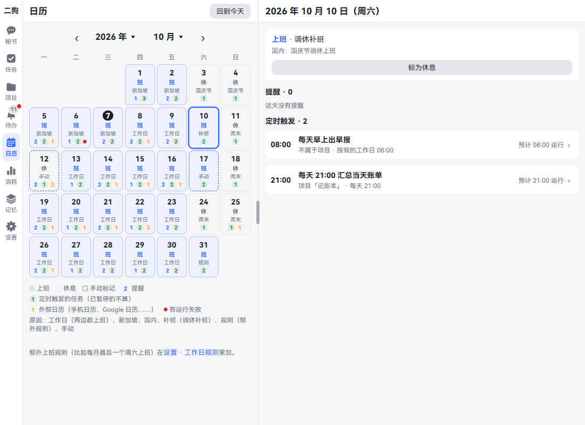
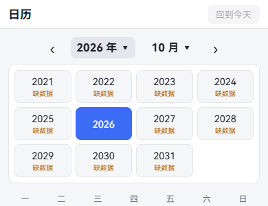
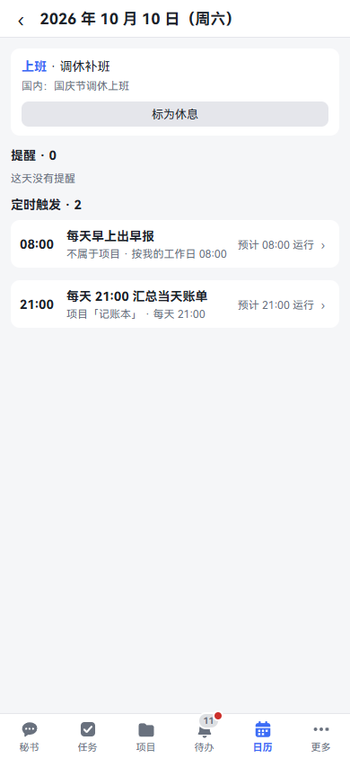
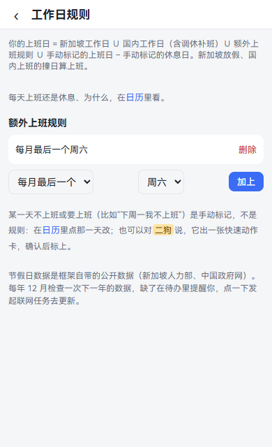
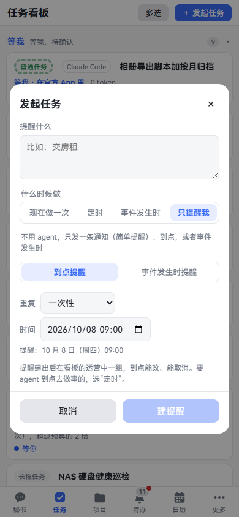
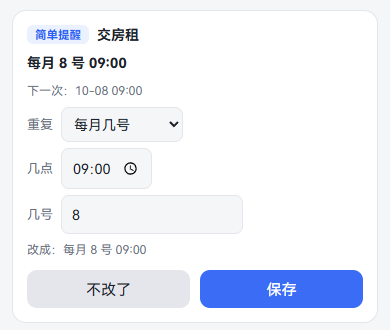
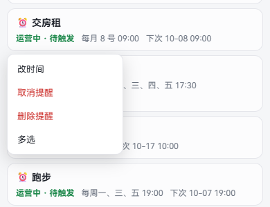
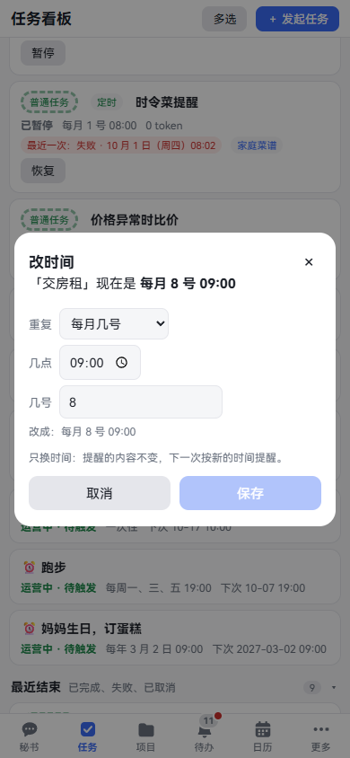
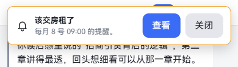

**中文** | [English](calendar-reminders.en.md)

# 日历和提醒

日历按月显示每天上班还是休息、当天有哪些提醒和定时任务。提醒是到点或者某件事发生时通知你一声，不用 agent 干活。这一章讲怎么看日历、怎么定工作日、怎么建和改提醒。看完你能让二狗按你的上班安排提醒你、干活。

## 看日历

**这是什么：** 想知道下周五上不上班、这个月哪天有提醒、早报哪天没跑成，打开日历看。

**在哪里打开：** 导航里的「日历」。手机屏幕放不下时，它收在「更多」里，地方够时直接在底部导航上。

**一步一步：**

1. 点「日历」，看到这个月。一周从周一开始，今天的日子数字是黑底白字。
2. 每一格写着：几号、「班」或「休」、原因的短词，下面一行是小标记。
3. 点标题两边的 ‹ 和 › 换月。点年份或者月份，弹出列表直接跳过去。
4. 点某一天看详情。电脑上在日历右边，手机上是单独一页。
5. 点「回到今天」回来。

**格子里的字：**

| 写的是 | 意思 |
|---|---|
| 工作日 | 两边都上班 |
| 新加坡 | 新加坡上班，国内放假 |
| 国内 | 国内上班，新加坡放假 |
| 补班 | 国内调休补班 |
| 规则 | 你加的额外上班规则 |
| 手动 | 你手动标过，格子是虚线边框 |
| 周末、节日名 | 休息的原因 |

**小标记（格子下面一行的数字）：** 蓝色是当天几条提醒，绿色是几次定时触发的任务（已暂停的不算），橙色是几条外部日程（这个月有才出现在图例里）。红点是有运行失败。

**年份下面写"缺数据"的：** 这一年的节假日数据还没有，那边先按周一到周五算，没有调休补班。

## 看某一天

**一步一步：**

1. 在日历上点那一天。
2. 最上面写「上班」或「休息」和原因，下面是当天的节假日，比如"国内：国庆节调休上班"。
3. 往下依次是：
   - **提醒**：时间、内容、重复规则、待触发还是已触发。
   - **外部日历**：Google 日历、手机日历同步来的日程，有的时候才有。只读。
   - **定时触发**：几点、属于哪个项目、这一次的结果或预计几点运行。
4. 点一条定时触发，跳到它的任务或项目页。

外部日历怎么接见[数据源](data-sources.md)。定时任务怎么建见[任务](tasks.md)。

## 工作日和节假日

**这是什么：** 二狗按两地的节假日算你哪天上班。"按我的工作日"的提醒和定时任务都看它。

算法写在 **设置 · 规则 · 工作日规则** 最上面：

> 你的上班日 = 新加坡工作日 ∪ 国内工作日（含调休补班）∪ 额外上班规则 ∪ 手动标记的上班日 − 手动标记的休息日。新加坡放假、国内上班的撞日算上班。

### 手动标记某一天

**这是什么：** 下周一请假，或者这周六要加班。这一天和平时不一样，标一下。

**一步一步：**

1. 在日历上点那一天。
2. 这天是上班的，点「标为休息」。这天是休息的，点「标为上班」。
3. 格子变成虚线边框，原因写「手动」。
4. 标错了，再点进去点「清除手动标记」。

**可以直接说的话：**

- "下周一我不上班"
- "这周六我要上班"

秘书换算出具体日期，出一张快速动作卡。你核对日期，点「执行」才标上。

### 加额外上班规则

**这是什么：** 有固定规律的上班日。比如每月最后一个周六上班。

**在哪里打开：** 设置 · 规则 · 工作日规则。日历页最下面也有链接。手机上设置在「更多」里。

**一步一步：**

1. 在「额外上班规则」下面选写法：「每周」「每月第几个」或「每月最后一个」。
2. 选周几。选「每月第几个」时再选第几个。
3. 点「加上」。规则出现在列表里，日历马上跟着变。
4. 不要了，点这一行的「删除」。

**可以直接说的话：** "每月最后一个周六要上班"。同样出卡，你确认。

### 节假日数据

- 数据随二狗自带，来自新加坡人力部和中国政府网。
- 每年 12 月检查一次下一年的数据。缺了在待办里提醒你，点「发起更新任务」发起一个联网任务去取。
- 地区固定是新加坡和国内两边，现在不能只选一边，也不能换地区。

## 建提醒

### 跟秘书说

**这是什么：** 最快的办法。到点提醒你做一件事，不用 agent 干活。

**在哪里打开：** 「秘书」页签，打字或者按住说话。

**一步一步：**

1. 说要提醒什么、什么时候。
2. 秘书回一句落到了哪天、星期几、几点，聊天里出一张提醒卡。
3. 核对卡上的时间。不对就点「改」。

**可以直接说的话：**

- "两分钟后提醒我喝水"
- "明早 9 点提醒我交报告"
- "每月 8 号早上 9 点提醒我交房租"
- "按我的工作日，每天 17:30 提醒我写日报"
- "每年 3 月 2 日提醒我订蛋糕"
- "从明天起，隔一天晚上 8 点提醒我吃降脂药"（每 N 天：隔一天是每 2 天）

### 在对话框里建

**在哪里打开：** 「任务」页右上角的「发起任务」，或者秘书页顶上的同一个按钮。

**一步一步：**

1. 点「发起任务」。
2. 在"什么时候做"里点「只提醒我」。表单变成提醒的样子。
3. 在"提醒什么"里写内容，比如"交房租"。
4. 选「到点提醒」：在"重复"里选一次性、每天、每 N 天、每周几、每月几号、每年或按我的工作日，再填时间。选每 N 天还要填"每几天"（2–365）和"从哪天起"，那天响第一次。下面一行写着会在什么时候提醒，比如"每 2 天 20:00，从 11 月 3 日起"。
5. 点「建提醒」。

### 事件发生时提醒

**这是什么：** 不按时间，等某件事发生了提醒你。比如某个文件夹来了新文件。

**一步一步：**

1. 在上面的对话框里，「只提醒我」下面选「事件发生时提醒」。
2. 选事件的类别：「二狗内部事件」或者「本机文件夹变化」。
3. 按表单填条件。选本机文件夹变化时，勾新增文件、修改文件、删除文件，填要监视的文件夹的完整路径，可以再写文件名模式（比如 `*.pdf`）。
4. 点「建提醒」。

每来一次事件发一条通知。它一直在等，不会自己结束，不要了就取消。这种提醒没有时间，不能改时间，也不列在日历上。要按时间提醒，取消了另建一条。

要 agent 到点或者事件发生时去做事，不是只提醒一声，选「定时」或「事件发生时」，见[任务](tasks.md)。

## 改、取消、归档、删除

**可以直接说的话：**

- "把交房租改到每月 10 号"
- "取消跑步那条提醒"
- "把打电话那条提醒归档"
- "把打电话那条提醒删了"

删除总要你在卡上点「执行」。别的说了就做。

### 在提醒卡上改

**在哪里打开：** 聊天里的提醒卡。

**一步一步：**

1. 还没响的卡上有「取消提醒」「删除」「改」。
2. 点「改」，展开"重复"和时间。
3. 改好，下面一行写着"改成：……"。点「保存」，不改了点「不改了」。

响过的一次性提醒，卡上写"已触发"和时间，下面有「归档」「删除」。重复的提醒响过之后还能改，卡上写着下一次、上一次是什么时候。

### 在任务看板上管

**在哪里打开：** 「任务」页。待触发的提醒在「运营中」一组，响过的、取消的在「最近结束」，归档了的在「已归档」。

**一步一步：**

1. 长按一张提醒卡，电脑上右键。
2. 弹出菜单，有「改时间」「取消提醒」「归档」「删除提醒」「多选」。只显示这一条现在能做的：待触发的能改时间、取消，结束了的能归档。
3. 点「改时间」，弹出对话框。只换时间，内容不变，下一次按新的时间提醒。点「保存」。时间没改或者已经过了，「保存」点不了。
4. 点「多选」，再点别的卡一起勾上，能和任务混着选，下面的操作栏批量处理。

**要知道的：**

- 取消了不再响，收不回。只是不想看到，用「归档」。
- 归档了没有取消归档。
- 删除先弹确认，「留着」关掉，「删除」才删。删了看板、日历、待办里都没有它，聊天里那张卡写"已删除"，收不回。

## 到点会怎样

1. 页面顶上弹一条提示，写着提醒的内容和时间，右边有「查看」「关闭」。

   

2. 待办最上面多一条，在「置顶：到点的提醒」下面。同一条提醒只置顶一条，新的一次到点时，旧的不再置顶。

   

3. 手机 App 退到后台时，系统通知栏也来一条。电脑和手机浏览器要先在待办顶上点「允许浏览器通知」，才会同时弹浏览器通知。

**要知道的：**

- 二狗要开着才能到点提醒。电脑关着、睡着时错过了：晚了 60 分钟以内，开机后照发，写明晚了多久。更晚的不弹提示，待办里放一条"错过的提醒"。重复的提醒错过多次，只算最近一次。
- "按我的工作日"的提醒，下一次按工作日历现算。你把明天标成休息，它自动跳过，不用改提醒。
- 每月几号遇到没有这天的月份，在月底响。每年 2 月 29 日的，平年在 2 月 28 日响。
- 每 N 天的从"从哪天起"那天数日子，跨月、跨年、闰年都照日历数，不会慢慢错开。改"从哪天起"，后面每一次跟着挪。秘书建的没说从哪天起，就是从今天起：今天这个钟点已经过了，第一次在 N 天后。
- App 被系统杀掉后收不到通知，见[手机上用](mobile.md#系统通知)。
- 日历和提醒都是插件，能在 **设置 · 能力 · 插件** 里停用。停用提醒后，看板、日历上的提醒和秘书建提醒的能力都没有了，数据还在。

## 接着看

- [任务](tasks.md)：定时和事件触发的任务。
- [数据源](data-sources.md)：把 Google 日历、手机日历接进日历。
- [手机上用](mobile.md)：系统通知。
