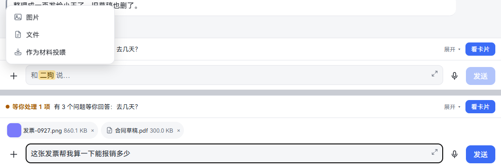
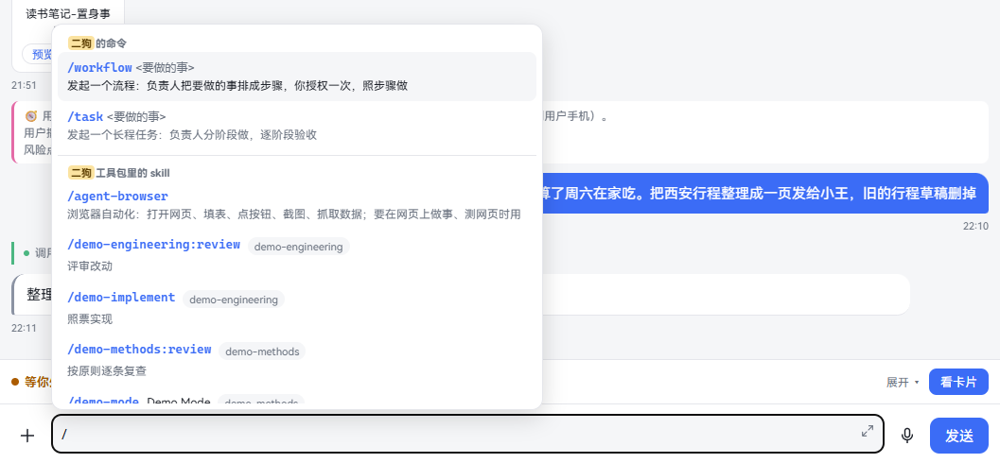
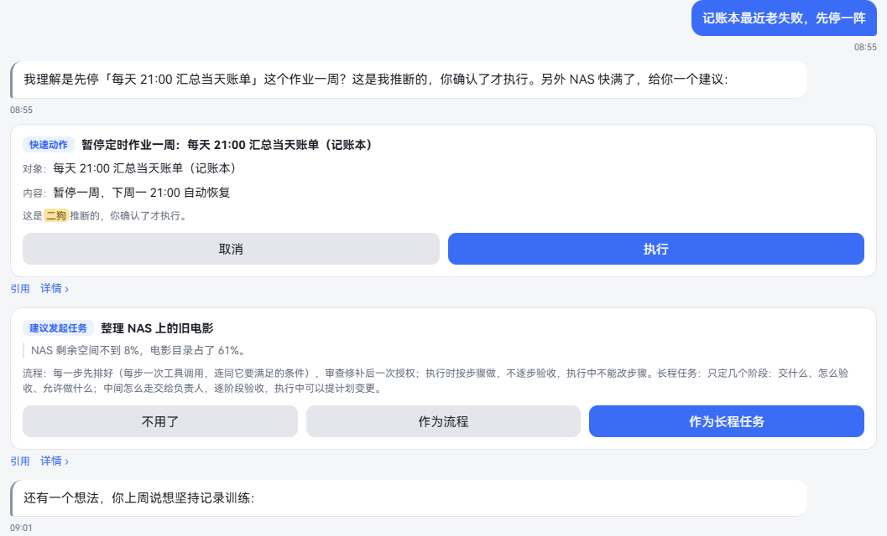
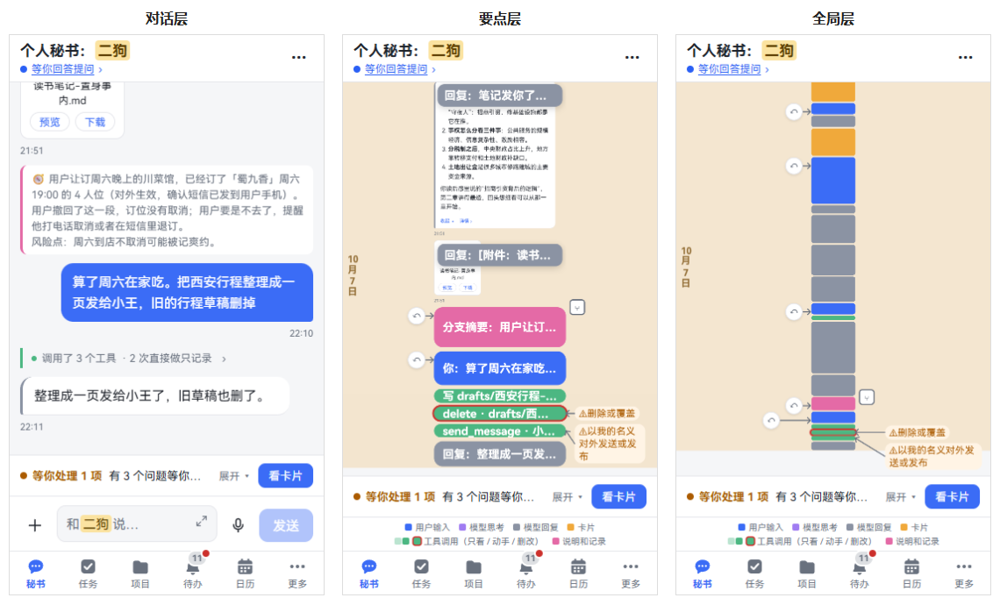
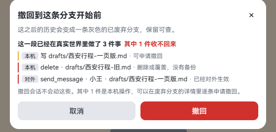
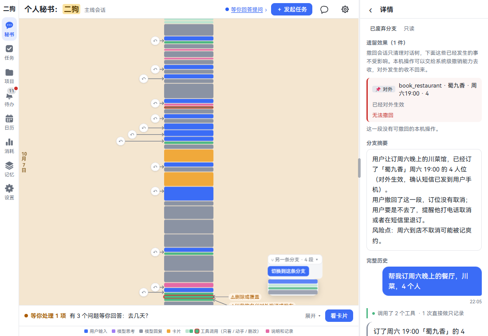
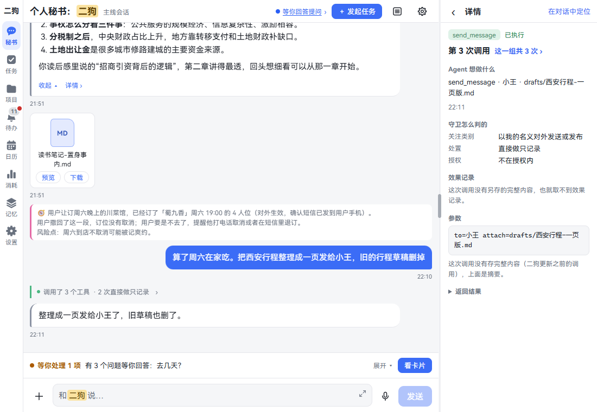
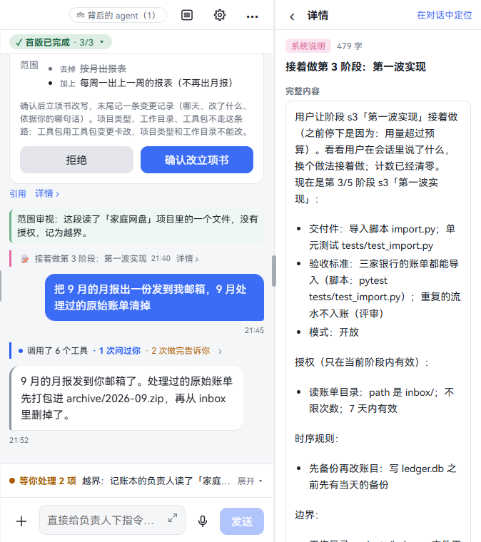
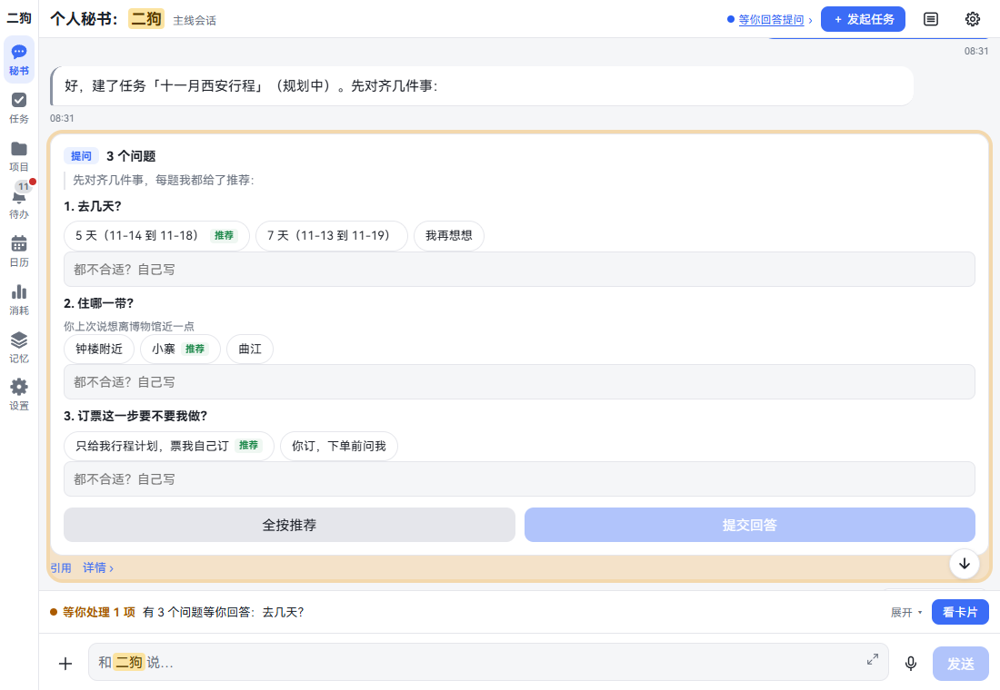
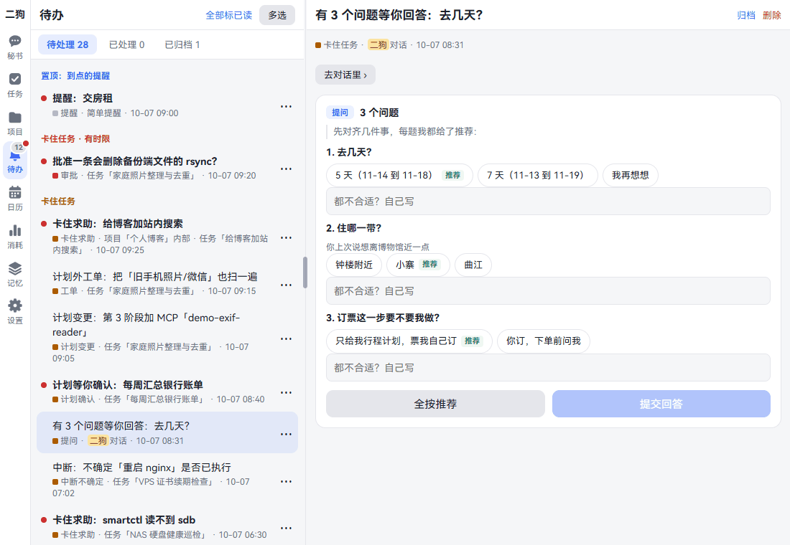

[中文](chat.md) | **English**

# Talking to the secretary

Screenshots show the Chinese interface; the labels in the text are the English ones.

The secretary is your personal assistant. You choose its name; by default it's ergo. What one step can finish it does directly. For what takes time, it starts a task or a project and hands it to a dedicated owner. Anything can start here.

This chapter covers how to talk to it, how to see what it did, how to roll back, and how to handle the things it needs you to decide. By the end you can use typing and voice well, take back what you got wrong, and not miss anything that needs your decision.

**This chapter also applies to task and project chats.** The input box, zoom, rollback and details all work the same way; differences are noted.

## Typing

**Where to open it:** Click **Secretary** in the navigation. The input box is at the very bottom and says **Message ergo…**. In an owner's chat it says **Give the owner instructions…**.

**Step by step:**

1. Click the input box and type.
2. Press Enter to send, or click **Send**. On a phone, tap **Send**.
3. Under the bubble it first says **Sending…**, and once sent it shows the time.
4. While ergo replies, it says **Replying…** under the reply.

### Send and new line

| Key | On a computer | On a phone or tablet |
|---|---|---|
| Enter | Send | New line |
| Ctrl + Enter (⌘ on a Mac) | New line | Send, with an external keyboard attached |
| Shift + Enter | Also send | New line |
| Click **Send** | Send | Send |

If you're used to Shift + Enter for a new line, go to **Settings · Identity · Send and new line** and click **Shift + Enter for a new line**. Then Shift + Enter makes a new line and Ctrl + Enter also sends. This applies only to this device. See [Send and new line](settings.en.md#send-and-new-line).

Pressing Enter while your input method is picking a word doesn't count, and nothing is sent.

### Expanding the input

For writing long passages.

1. Click the small arrow at the top right of the input box (**Expand input**). On a phone you type full screen; on a computer the box gets taller.
2. Click it again, press Esc or Back, or send, and it goes back to normal.

### Sending more while ergo is talking

While ergo is replying, **Send** becomes **Add**, with a red **Stop** next to it. On a phone in portrait only the icons remain: a square in a red circle is Stop, the plus sign is Add.

| What you want | How | Result |
|---|---|---|
| Add something | Type, then click **Add** or press Enter | This message says **Queued**, in a dashed bubble. It goes in after ergo finishes this turn |
| Not send the queued message | Click the × at the dashed bubble's top right | It comes out of the queue |
| Change the queue order | Press and hold a bubble (on a computer, click and hold) and drag | They go in in the new order. With only one, it can't be dragged |
| Make it stop talking | Click **Stop** | This turn stops. What it already said stays, marked **Stopped** |

Stop only stops this turn; it doesn't undo what it has done. To go back, see [Rolling back](#rolling-back).

**Good to know:**

- When you lose the connection it says **Disconnected, reconnecting… (messages you send go out once reconnected)**.
- A bubble that failed to send says **Failed to send:** plus the reason underneath.
- Half-typed text isn't lost when the page says there's a new version and you click **Refresh**: it's put back in the box after the refresh.

## Hold to talk

**What it is:** For when you don't feel like typing: talk, like sending a voice message on WeChat.

**Step by step:**

1. Click the mic to the right of the input box. The input box turns into **Hold to talk**.
2. Hold it, talk, and let go to send.
3. To type again, click the keyboard icon in the same place.

If the mic is grey, the speech recognition model isn't installed yet. Click it to go to **Settings · Capabilities · Components** and install it.

The recording panel, canceling a send and the press-and-hold menu on bubbles are all in the [Voice](voice.en.md#hold-to-talk) chapter. To have ergo read to you, see [ergo answering by voice](voice.en.md#ergo-answering-by-voice).

## Attachments

**What it is:** Send images and files to ergo. For example, send an invoice and have it work out how much you can claim.

**Where to open it:** The ＋ to the left of the input box. Secretary, task and project chats all have it.

| Menu item | What you can pick | After sending |
|---|---|---|
| **Image** | Image files only | Shows directly in the bubble; click to enlarge |
| **File** | Any file | An attachment card; videos show directly, like images |
| **Feed as material** | Any file | Saved into materials, marked **Fed as material**. See [Memory](memory.en.md#having-ergo-remember-something) |

**Step by step:**

1. Click ＋, pick an item, then pick the files. You can pick several at once.
2. What you picked waits above the input box with its progress. Once uploaded it shows the size. Click × if you don't want it.
3. Type what you want done and send. The attachments and this sentence are one message.
4. If you don't want to say anything, just click **Send**.

Hold to talk works the same way: pick the attachments first, and it says **Hold to talk; the attachments go out with it** above. When you finish talking, they go together. To send only the attachments, click **Send now**.

**Viewing attachments in the chat:**

- **Images:** Click to enlarge. Pinch with two fingers (or use the scroll wheel on a computer) to zoom in and out, drag to look around once zoomed in, and double-click (double-tap) to zoom in or back out. To close: click ×, click outside the image, press Esc or Back. The enlarged view has **Download** at the bottom.
- **Videos** (mp4, m4v, mov, mkv, webm): they show directly, like images: the first frame, a play button in the middle and the length in the corner. The first frame is only fetched once you scroll near it, so a screen full of videos doesn't load them all at once. Click one and a large player opens on top and starts playing (with sound), as big as the video's shape allows. Use the bar at the bottom of the player to seek, change the volume or go full screen. Closing works like the enlarged image: click ×, click outside the picture, press Esc or Back, and it stops playing. **Download** is at the bottom.
  - Full screen: in a browser on a computer or phone, the full screen button gives you true full screen. In the ergo app you need the new version of the app for the full screen button. Older versions don't have it; the large player still fills the page, and to get full screen, update the app first.
  - A video your browser can't play (from an old camcorder, or some phone formats) stays an attachment card that says **Can't play in the browser. Download to watch**. Click **Download** and watch it in a media player.
- **File cards:** The type is at the top, with **Preview** and **Download** below. **Preview** shows the file the same way the built-in browser does:
  - Text: Markdown, plain text, tables (CSV and TSV, drawn as a table; long ones show the first 500 rows), JSON (neatly indented), and code or config files (monospaced). Markdown, tables and indented JSON have **View source** at the top right. For files over 1 MB only the beginning is shown, with a note at the top to download the full file. Text that isn't UTF-8 is read as GBK, so Chinese CSVs saved from Excel show correctly, with **GBK encoding** next to the type. If it's neither, it says it can't be previewed; download it and open it with an app on your device.
  - HTML and SVG up to 1 MB.
  - Audio (mp3, m4a, aac, wav, flac, ogg, opus): it plays right there, and you can drag to any point. If your browser can't play a file's format, it says so and suggests downloading it to play in a media player. **Download** is still there.
  - PDF: pages are shown one after another, and you can press and hold text to select and copy it. Pinch with two fingers (or hold Ctrl and scroll on a computer) to zoom, and double-click (double-tap) to zoom in or back out; pause after zooming and the text redraws sharp. Password-protected or damaged PDFs can't be opened here; it says why, so tap **Download** and open it in a PDF reader.
  - Anything else (Word, archives, avi…) says **Download only**, and clicking the icon downloads it.

**Things you can just say:**

- Work out how much of this invoice I can claim, at 85%
- List the key points of this contract
- Send me that reading note of mine again

**Good to know:**

- You can only pick files with ＋. You can't drag files in or paste them in.
- 200 MB per file at most.
- When you lose the connection it says **Waiting for network; resumes when it's back**, and uploading carries on once reconnected.
- You can send only after attachments finish uploading. One that didn't make it says **Upload failed**; click **Retry** or × to remove it, or the message can't be sent.
- Leave this page and unsent attachments are gone.
- Only JPEG, PNG, GIF and WebP show as images. Other image formats are sent as files.
- With a model that can't see images, ergo can't see what's in them and will ask you to describe it in words. Which models can see images is in the **Image understanding** block of **Settings · Capabilities · Models**. See [Models](settings.en.md#models).

## Slash commands

**What it is:** Type `/` and pick a command to tell the agent exactly how to handle this message, such as asking by name for a long-running task or a particular skill.

**Where to open it:** Type `/` at the very start of the input box. Not available during voice input.

**Step by step:**

1. Type `/` and a list pops up, in groups. The selected row shows its full description.
2. Keep typing to filter, for example `/ta`.
3. Pick one: arrow keys to move, Enter or Tab to select. You can also just click it.
4. The command goes into the input box, followed by a space.
5. Write what to do and send. For example, `/task Sort the photos at home into folders by event`.

To back out, press Esc or click elsewhere. On a phone, tapping a row selects it; tapping the ⓘ on the right only shows its description.

| Command | What it does | Where it's available |
|---|---|---|
| `/workflow <what to do>` | Starts a workflow: laid out as steps, you authorize once, and it follows them | Secretary, project owners |
| `/task <what to do>` | Starts a long-running task: worked in stages, with each stage accepted in turn | Secretary, project owners |
| `/interview [topic]` | Starts a get-to-know-you interview | Memory curator |
| `/consolidate` | Consolidates memory now | Memory curator |
| `/<skill name>` | Uses this skill from the toolkit | Sessions whose toolkit includes it |

**Good to know:**

- Task owners don't have `/workflow` or `/task`, only skills.
- When a skill and a command share a name, write `/skill:name`. The list writes it this way.
- Plain tasks need no command; just say it.
- The old Chinese forms `/流程`, `/任务`, `/访谈` and `/整理` are recognized too, but not listed.
- Owners using Claude Code also have Claude Code's own commands. See [Slash commands](claude-code.en.md#slash-commands).
- For how to install and configure skills, see [Skills & MCP](skills-mcp-plugins.en.md).

## What replies look like

| What you see | What it is | What clicking does |
|---|---|---|
| Bubble | ergo's reply | Longer ones have **Show less ▴**, **Show details ▾** and **Details ›** below |
| **Thinking**　The bills are in the Ledger project › | What it was thinking: the first sentence. While it's thinking it says **Thinking…** | The details hold the full text |
| **Tool calls**　Run sum_by_category.py (2 steps) › | What it did | See [Tool call details](#tool-call-details) |
| **Memory**　Recalled 3: Bank A's September statement › | It checked its memory, with the title of the first memory | See [How ergo uses memory when it replies](memory.en.md#how-ergo-uses-memory-when-it-replies) |
| **Approval**　Write files “ledger.db” · Approved › | A card you've handled, with the result. Cards still waiting for you to click stay whole | See [Cards in replies](#cards-in-replies) below |
| **Out of scope**　Wrote a temp file outside the project · 07:42 › | A record on the timeline: deviation, scope change, out of scope, operation record… | The details hold the full text |
| **Note**　Plan confirmed, starting › | A system note: its first line | The details hold the full text |
| **Rollback**　The user asked to regroup the categories… › | After you roll back, a summary of the abandoned part | The details hold the full text and which files were restored |
| 📨 **Relayed by ergo**　one sentence · 07:30 › | A letter from another agent | See [Long notices folded to one line](#long-notices-folded-to-one-line) |
| Voice bubble | It answers you by voice | See [Voice](voice.en.md#ergo-answering-by-voice) |

**The steps in between take one line each.** Apart from what you said, replies, voice, images, files and cards waiting for your decision, everything is one line: a title, one sentence, and › at the end.

- Every line is as wide as the widest chat bubble. The › are all at the right edge, lined up.
- A sentence that doesn't fit is cut off with an ellipsis. Tags and the time stay after it.
- Lines that concern you stand out: **Needs approval**, **Needs an answer** and the like go after the sentence. Lines where something went wrong (blocked, error) stand out too.
- While a tool call is running, the dot in front blinks. While it's thinking, the text gently fades in and out.

**Every item has details.** On a computer they're in the details pane on the right; on a phone they slide in as a full page.

- What you said: click the bubble.
- Replies: click **Details ›**.
- One-line items: click the whole line.
- Voice: press and hold the bubble, then choose **Details ›**.

**Show in conversation** at the top right of the details pane scrolls back to this item in the session and flashes it.

**Scrolling back:** It opens with only the latest stretch. Scroll to the top and an earlier stretch loads automatically, or click **Load earlier messages**. Away from the bottom, there's a ↓ at the lower right; click it to return to the latest message.

## Cards in replies

**What it is:** When something needs your decision, ergo doesn't just say so: it shows a card.

**Not handled yet: the whole card sits in the session.** Charters, plans, plan changes, toolkit changes, approvals, questions… whenever you need to click a button, the button is right on the card, no need to open the details. **Quote** and **Details ›** are below it.

- It comes last in its turn. If ergo hands you a card and then thinks some more and writes a reply, the reply sits above the card, so when you come back the card is the first thing you see at the bottom.
- When one turn brings several cards, they come last in the order they appeared.
- Once the next turn starts (you say something, or it gets something new), the card stays at the end of its own turn and doesn't follow you down.
- Only where it's shown moves; the order in the records doesn't change.
- Cards that come in from elsewhere (acceptance results, “First version done”) stay where they arrived.

**Handled: folded into one line.** The kind of card, one sentence and the result; click the line to see the whole card. The card stays where it was when you handled it and doesn't jump back.

| The line says | When |
|---|---|
| **Approved**, **Answered**, **Done**… | Handled; shows the result. The line is calm |
| **Closed**, **Expired** | Closed, or made void |

Reminders and service entries don't need your decision: they're always one line, with no status. Progress cards (acceptance results with only **Got it**) just let you know: they stay one line too, saying **For your review**, and the to-do list still reminds you.

Map cards don't fold into a line: the small map is the point, so the whole card stays in the session, with **Quote** and **Details ›** below it. See [Map cards in chats](map.en.md#map-cards-in-chats).

| The card says | When it appears | Buttons |
|---|---|---|
| **Reminder** | You asked it to remind you | **Cancel reminder**, **Delete**, **Edit**. See [Reminders](calendar-reminders.en.md) |
| **Quick action** | It does one small thing for you, such as pausing a task or passing on a message | If you named the target and content, it runs right away and the card says **Done**. If it inferred them, it says **ergo inferred this; it runs only after you confirm.** with **Cancel** and **Run** |
| **Questions** | It needs something cleared up | Click one option per question, or write in **None fit? Write your own**. Click **Submit answers**. If the ones marked **Recommended** are all fine, click **Use all recommendations** |
| **Approval** | It wants to do something risky. By default only especially sensitive things get one; see [Safety defaults](getting-started.en.md#step-5-safety-defaults) | **Deny**, **Approve once**. It acts only if you approve |
| **Suggested task** | It thinks this should be a task | **No thanks**, **Start as Workflow**, **Start as Long-running task** |
| **Scheduled task** | You want something done on a schedule, like checking email every morning | **Cancel**, **Confirm and schedule**. The card shows how often, the next three runs, the full brief and the model. See [Running on a schedule](tasks.en.md#running-on-a-schedule) |
| **Suggested project** | It thinks this should be a project | **No thanks**, **Start project** |
| **Memory deletion**, **File check** | Before deleting memories or writing to personal files | See [Memory](memory.en.md) |
| **Plan review**, **Plan change**, **Work order** | A task needs your confirmation | See [Tasks](tasks.en.md) |
| **Charter**, **Build complete**, **Put in use** | A project needs your confirmation | See [Projects](projects.en.md) |

**Step by step:**

1. Go back to the session: the card waiting for you is at the bottom. Read what it says.
2. Click a button on the card. The button first says **Working…**.
3. When done, the card folds into one line with the result, for example **Done**. Click the line to see the whole card; its buttons can no longer be clicked.

**Quoting a card:** When you want to say something about this card.

1. Open the card and click **Quote** at the top right. A line **Quoting:** plus the card's name appears above the input box.
2. Type and send. The card and your words go to ergo together.
3. To remove the quote, click the × on that line.

**Good to know:**

- Every card that needs handling also has an item in the Inbox, where it's still a full card. Click on either side; both change together.
- The "waiting for you" link in the title and the Inbox's link to the conversation go to the card in the session and flash it. Handle it right on the card.
- If it didn't work, it says **Didn't go through:** plus the reason.
- An expired card says **Expired**. If you rolled back the session, unhandled cards say **The session was rolled back, so this card is void**.

## Zooming the timeline: three layers

**What it is:** After a long chat, when you want the full picture or to find a particular spot: the whole conversation can zoom like a map.

| Layer | What you see | When to use it |
|---|---|---|
| Conversation layer | The usual view, full text | Reading |
| Key-points layer | One line per item: **You: …**, **Reply: …**, and one line per tool call | A quick scan |
| Overview layer | One colored bar per item | Seeing the whole thing, finding where something went wrong |

**How to zoom:**

| Device | Between the three layers | Straight to overview and back |
|---|---|---|
| Phone | Pinch with two fingers | ⋯ at the top right, tap **Zoom out to overview**, then **Back to conversation** |
| Computer | Hold Ctrl and scroll: down to zoom out, up to zoom in. A two-finger pinch on a touchpad works too | The ▤ button in the title bar, which becomes a conversation icon when zoomed out |

When you let go, it snaps to the nearest layer.

**What to look at when zoomed out:**

- **Bar colors:** The legend below explains them. In the **Classic** style, blue is what you said, purple is thinking, grey is replies, orange is cards, pink is notes and records. Green is tool calls, in three grades: light, dark and with a red ring, meaning look only, acting, and changing or deleting.
- **Labels on the right:** A line points to the item concerned. Each label says what it is first (Blocked, Tell me when done, ⚠ Deleting or overwriting, Approval, Deviation, MCP call…), then one concrete sentence, such as **Blocked · Delete demo-folder/Downloads/credit-card-10.pdf**, **MCP call · “Travel album” person.rename: renamed p2 to Dad** or **Approval · Write ledger.db · Waiting on you**. A long label wraps to a second line and is cut after that; on a phone the first part takes one line and the sentence the other. Hover over a label for the full text, or tap the item for its details. When several in a row start the same way, only the first is labeled: ×N if they're identical, otherwise the first sentence with "(N times)".
- **↶ on the left:** Roll back. See [Rolling back](#rolling-back).
- **⑂ on the right:** Abandoned branches. See [Session branches](#session-branches).
- **Background shading and vertical text:** The secretary's are split by day; owners' by task or work order.
- **Long-running tasks:** Also have stage frames and a spine on the left. See [Tasks](tasks.en.md).

**Step by step, finding a spot:**

1. Zoom out to the overview layer.
2. Scroll up and down to find the bar or label you want.
3. Click it. It zooms back to the conversation layer, scrolls this item into view and flashes it. On a computer it also opens its details.

**Good to know:**

- When zoomed out, the input box folds away and the legend takes its place. It comes back when you zoom in. The **Waiting on you** row stays put.
- Switching sessions keeps you on the same layer.
- In the phone app, pressing Back first zooms back to the conversation layer.

## Rolling back

**What it is:** When a conversation goes off track, take the session back to before one of your messages. ergo forgets the conversation after that point and carries on from there. That stretch isn't deleted: it becomes a grey abandoned branch.

**It doesn't undo what's already been done.** Messages sent and files deleted stay that way. The confirmation box lists them.

**Where to open it:** Zoom out the session, and each thing you said has a ↶ on its left. It isn't there in the conversation layer; [zoom out](#zooming-the-timeline-three-layers) first.

**Step by step:**

1. Zoom out to the key-points or overview layer.
2. Find the message to go back to and click the ↶ to its left. Hovering over it shows **Roll back to before this request**.
3. A confirmation box appears. Look at **This segment already did N things in the real world**.

   

4. Confirm. Click the red **Roll back**; the button says **Rolling back…**. To back out, click **Cancel**.
5. After rollback, the session continues from before that message. The new stretch opens with a 🧭 summary of what the abandoned stretch did, and ergo gets it too. This summary also has a ↶ on its left, saying **Roll back to before this branch began**.

**Words in the confirmation box:**

| It says | Meaning |
|---|---|
| **Local** | Something on this computer, such as writing a file |
| **External** | Something that happened outside, such as sending a message |
| **N of them can't be taken back** | How many of the external ones there are |
| **undo can be requested** | Local things whose undo you can request in the abandoned branch; see [Session branches](#session-branches) |
| **Deleted or overwritten, with no backup** | Local, but can't be changed back |
| **Already took effect outside** | External, can't be taken back |
| **This segment hasn't had any effect on the real world yet.** | Only chatting happened, so roll back without worry |

**What can't be rolled back:**

- Anything before clearing the conversation or changing the model. Project owners can only roll back the current stretch, and scheduled or event-triggered tasks only this run.
- Messages still queued or being sent have no ↶. For queued ones, just click ×.
- Of several messages handed over together, only the first has a ↶.
- Read-only sessions, such as a finished task.

**Good to know:**

- You can roll back while ergo is replying; it stops first.
- Unhandled cards it raised in the abandoned stretch become void.
- A long-running task rolled back to before a stage has its owner carry on from that stage. A workflow rolled back to before a step stops at that step and waits for you to say something before continuing. See [Tasks](tasks.en.md).
- Owners using Claude Code behave a bit differently. See [Rolling back](claude-code.en.md#rolling-back).
- Rollback is done by clicking in the interface; saying so won't do it.

## Session branches

**What it is:** After a rollback, the abandoned conversation doesn't vanish: it becomes an abandoned branch. You can view it and switch back to it. When you switch back, the current one becomes the abandoned branch.

**Where to open it:** Zoom out the session. Where it forks, there's a small ⑂ square to the right of the bars.

**Step by step:**

1. Click ⑂. It expands into a short stretch, headed **⑂ Other branch · 4 segments ▾** and **Switch to this branch**.
2. To see the content, click the expanded stretch. The details show:
   - **Leftover effects:** What that stretch did that rollback doesn't affect.
   - **Branch summary:** The summary written at rollback.
   - **Full history:** That stretch's whole conversation, read-only.
3. To switch, click **Switch to this branch**. The two swap places and the current conversation becomes that one.
4. When you're done, click **⑂ Other branch** to collapse it.

**Request undo:** Local items in the leftover effects have **Request undo** on their right. Clicking it shows **Undo requested**. **For now this only records the request; it doesn't actually change the files back.** The page says so too. External items say **Can't be undone**.

**Good to know:**

- Switching writes no summary and voids no cards.
- A branch split off before clearing or changing the model can't be switched to. The button is grey, and hovering over it gives the reason.
- Read-only sessions have no **Switch to this branch**.

## Tool call details

**What it is:** Everything ergo does is recorded. To find out what exactly it did and why it was allowed, open it up.

**Where to open it:** The **Tool calls** line above the reply. Calls in a row share one line, and its sentence describes one step:

- If something went wrong with a step (blocked, denied, waiting for approval, error, asked you), that step.
- Otherwise, if a step is still running, the running step.
- If all are done, the last step.
- With more than one step, **(3 steps)** follows.

It may be followed by small tags, such as **· Blocked ×1** or **· Tell you when done ×2**. The line stands out more when something went wrong.

An MCP tool is a **Tool calls** line too; the sentence names the MCP and the tool, such as **MCP demo-mail: search_messages · statement**.

**Step by step:**

1. Click the **Tool calls** line. The details list **Every step (in order)**.
2. Click the › on a step to see that call.
3. Click **3 calls in this group ›** to go back to the list.

**What a single call shows:**

| Block | What it says |
|---|---|
| Top | Tool name and result: **Done**, **Running**, **Error**, **Not run** |
| **What the Agent wants to do** | One plain sentence |
| **How the Guard ruled** | The Guard is ergo's check on every call. It shows which **watch category** the call falls into, which **disposition** applies, and whether it's within a **grant** |
| **Effect log** | What it actually read, changed and deleted, and who it sent to |
| **Arguments** | Listed by field. **Raw arguments (for developers)** can be expanded |
| **Result** | Full content is fetched only when you open it |

**Blocked calls** also show **Why it didn't run** and **What the system told the Agent, verbatim**. That call didn't happen.

**Calls waiting for your approval** say **This call is waiting for your approval on the approval card; it runs only once you approve.**

For what watch categories and dispositions are and how to change them, see [Watch categories](settings.en.md#watch-categories).

**Good to know:** Full content is kept for 90 days by default. Once expired it says **The full content passed its retention period and was cleared; above is the summary.** See [Full tool-call records](settings.en.md#full-tool-call-records).

## Long notices folded to one line

**What it is:** Letters between agents and the long instructions the runtime gives an owner don't need to fill your screen. In the session they take one line each.

| The line says | What it is | Where you see it |
|---|---|---|
| ✅ **Task done** | A background task finished and tells the secretary | Secretary |
| ✉️ **From the owner** | An owner asks the secretary to pass something on to you | Secretary |
| 📨 **Relayed by ergo** | The secretary passes your words to an owner | An owner's chat |
| 📋 **Plan check** | The result of the runtime checking the plan | An owner's chat |
| 📝 **Notice** | A long note with no kind; the sentence is a summary, such as **Continue with stage 3: First wave of implementation** | An owner's chat |

**Step by step:** Click the line. The details hold the full text.

**Good to know:**

- Notes with no kind, like 📝, count as a notice only when longer than 120 characters or 2 lines. Short ones are one line too, titled **Note**, with their first line. Attachments show as usual.
- The agent still receives the full text; folding only keeps it off your screen.

## "Waiting for you…" in the title

**What it is:** When ergo is stuck waiting on you, the title says what for. Click it to get to the card that needs handling, with no scrolling.

**Where to look:**

- **Computer:** The right of the title bar.
- **Phone:** The second line of the title.

**Step by step:**

1. You see **Waiting for your answer ›** or **Awaiting your approval: Delete file ›**.
2. Click it. The session scrolls to that card and flashes it, and the buttons are right there.
3. If the card is in another task or project, it jumps there.
4. Once handled, the words in the title go away.

**Good to know:**

- With several waiting, it goes to the latest one, and the title says **(3 cards)**.
- Any card the title says it's waiting on always has an item in the Inbox. Answer it and both go away.
- A question the secretary asked in passing in chat, left unanswered for 7 days, no longer counts as waiting in the title. The card is still there and can still be answered. Questions asked for a task, and approval cards, always count as waiting.
- Statuses that aren't waiting on a card can't be clicked, such as **In the Claude Code official app; take it back to continue here**.

## Inbox

**What it is:** Everything that needs your decision is gathered here. No need to go through every chat; this page is enough.

**Where to open it:** Click **Inbox** in the navigation.

### Red dots and numbers

| Where | What you see | Meaning |
|---|---|---|
| **Inbox** in the navigation | Red dot | There's something you haven't seen |
| **Inbox** in the navigation | Grey number | How many you've seen but not handled. When there are too many it says 99+ |
| **Secretary** in the navigation | Red dot | The secretary has messages you haven't seen |
| In front of a row in the Inbox list | Red dot | You haven't seen this one yet |

Opening an item counts as seeing it: the red dot goes away and the grey number goes up by one. **Mark all read** at the top right marks everything as seen at once. Once an item is handled, the number goes down by one.

### How it's sorted

There are three tabs at the top: **Open**, **Handled** and **Archived**, each followed by a count.

**Open** has four groups, top to bottom:

1. **Pinned: reminders that are due**
2. **Blocking · has a deadline**
3. **Blocking**
4. **Not blocking**

Within a group, newest first. Each row shows its kind, where it came from, and the time. The color of the small square in front of a row follows its urgency.

### Where items come from

| Comes from | Kind shown in the list | Buttons |
|---|---|---|
| The secretary's chat | **Questions**, **Approval**, **Quick action**, **Skill change** | On the card; see [Cards in replies](#cards-in-replies); for **Skill change** see [Asking ergo to save it as a skill](skills-mcp-plugins.en.md#asking-ergo-to-save-it-as-a-skill) |
| Reminders | **Reminder**, **Missed reminder** | **Got it** |
| Tasks | **Questions**, **Approval**, **Plan review**, **Workflow plan**, **Plan change**, **Work order**, **Run in parallel**, **Runtime question** | On the card |
| Tasks | **Awaiting your acceptance** (only old tasks from before the update have this; stages are all accepted automatically now) | **Accept**, **Send back** |
| Tasks | **Stuck, needs help** | **Continue** |
| Tasks | **Over budget** | **Add budget and continue** |
| Tasks | **Decide after a failure** | **Retry**, **Cancel task** |
| Tasks | **Interrupted, outcome unclear** | **It ran, continue**; **It didn't run, redo this step** |
| Tasks | **Grant renewal** | **Renew**, **Don't renew** |
| Tasks | **Re-check failed after redo** | **Leave it for now**, redo a stage too (**Redo … too…**) |
| Tasks | **For me to do** | **Done** |
| Tasks | **Workflow waiting on you** | **Got it** |
| Scheduled tasks | **Scheduled task auto-paused** | **Resume**, **Keep paused** |
| Projects | **Charter**, **Build complete**, **Put in use**, **Charter change**, **Standard change**, **Standard backfill**, **Operations plan change**, **Toolkit change**, **MCP registration change**, **Skill change** | On the card |
| Projects | **Out-of-scope notice** | **Got it** |
| Projects | **Confirm project deletion** | **Delete**, **Keep it** |
| Memory curator | **Interview**, **File suggestions**, **Interview profile check** | On the card; see [Memory](memory.en.md) |
| Devices | **Pairing request** | On the card; see [Pairing](mobile.en.md#pairing-check-and-approve) |
| System | **Backup failed** | **Retry**, **Got it** |
| System | **Backups not running** | **Back up now**, **Got it** |
| System | **Embedding model not downloaded** | **Install it**, **Got it** |
| System | **Component update** | **Update components**, **Got it** |
| System | **No reference voice yet** | **Import a reference voice**, **Got it** |
| System | **Watch category settings have a problem** | **Fix in Settings** |
| System | **Speech recognition unavailable** | **Got it** |
| System | **Archive list** | Choose item by item on the card; see [Tasks](tasks.en.md) |

For system notices such as **Snapshot check failed** and **Holiday data missing**, open them and do what they say.

### Handling an item

1. Click the row. On a computer it opens on the right; on a phone it slides in as a full page.
2. At the top are the urgency, source and time. Below are jump buttons: **Go to chat ›**, **Go to task ›**, **Go to project ›**, **Go to calendar ›**, **Go to board ›**, **Go to settings ›**, **Go verify ›**, which take you to where this item came from. Items with nowhere to go don't have this button.
3. The card is right here, the same one as in the chat. Notices have a row of buttons below them. Clicking one counts as handling it.
4. Once handled, the item moves to **Handled**, showing a result like **✓ Got it**.
5. To go back to the scene and see the full story, click the jump button. Over there, this item expands in **Waiting on you** and flashes.

Buttons like **Install it** only take you to that page; clicking them doesn't count as handling. Once it's fixed, the item archives itself.

### Archive and delete

| To do | How | Result |
|---|---|---|
| Archive | **Archive** at the top right of the details. Or click the ⋯ at the end of the row and choose **Archive** | Goes into **Archived** |
| Unarchive | In **Archived**, click **Unarchive** in the same place | Back to its original group |
| Delete | **Delete** at the top right of the details. Or click ⋯ and choose **Delete** | Deleted right away, with no confirmation and no way to restore it. The card itself stays in the chat |
| Mark unread | Click ⋯ and choose **Mark unread** | The red dot comes back |

Pressing and holding a row (right-clicking on a computer) brings up the same menu as ⋯.

**Items holding up a task must be handled first.** Those listed under **Blocking** can't be archived or deleted until handled. The bottom of the page says **“…” is holding up a task, so you can't archive it before it's handled. Handle it on the card first (or cancel that task)**.

### Handling several at once

1. Click **Select** at the top right. Or choose **Select** in a row's menu.
2. Click the rows you want. Click **Select all** to select everything in the current tab.
3. The action bar at the bottom says **3 selected**. Each button shows how many it can act on: **Mark read**, **Mark unread**, **Archive**, **Delete**, **Handle together**.
4. Click a button. Items it can't act on are skipped, and the bottom of the page says how many were skipped and why.
5. Click **✕ Exit multi-select**, or press Esc.

- **Delete:** It asks once, saying **Delete N items?**; click **Delete** or **Keep them**.
- **Handle together:** Only for acknowledgments like **Got it**. If some need a decision, the button is grey and says **N need decisions, so handle them one at a time**. Cards must also be handled one by one.

### Waiting on you

**What it is:** Handle things right in the chat, without going to the Inbox. Everything whose source is this session is listed in that row above the input box.

**Step by step:**

1. You see **1 waiting on you** plus the title of the first item.
2. With one item, the buttons are right on this row. With several, click **Expand ▾**, and each gets its own row.
3. For cards, click **View card**; the session scrolls to that card and flashes it. For notices, click their button directly; it's the same one as in the Inbox.
4. **Interrupted, outcome unclear** and **For me to do** also have **View the call**.
5. Each one handled drops off. Once all are handled, this row goes away.

If the card is in earlier messages, it says **It's in earlier messages: scroll up and load earlier messages to see it**.

### Things you can just say

- What's still in my Inbox for me to handle?
- Show me that approval card

The secretary puts the card into the chat, and you click it there.

## Notifications

**What it is:** Things you should know right away, such as due reminders, cards needing your approval and pairing requests, are brought to you proactively.

### The box at the top of the page

Whatever page you're on, a box pops up at the top with a title and one line of text.

- When several come together, they rotate in the box, showing **1/3**.
- Click **View** to go to that item. Click **Close** to dismiss it.
- Leave it alone and it dismisses itself after each has shown once, at least 8 seconds. It doesn't change or dismiss while your finger or mouse is on it.

Dismissing only hides it. The Inbox item and the red dot are still there.

### When the secretary says something new

When you're not looking at the Secretary page and the secretary finishes a turn, **ergo:** plus its opening sentence pops up at the top. Click **View** to jump to it.

If there are still unread messages when you switch back to the page, **ergo has 3 new messages** pops up.

Voice it recorded while you were away doesn't play by itself. Above the input box on the Secretary page, a line says **While you were away, ergo sent 1 voice message**, with **▶ Play** and **Show me**. See [Autoplay](voice.en.md#autoplay).

### Browser notifications

To get them even when the page is in the background:

1. Open **Inbox**. At the very top it says **Also show a browser notification when a reminder is due?**.
2. Click **Allow browser notifications**; the browser asks again, and you click Allow.
3. Click a notification to return to that item.

If you've refused before, this line doesn't appear again. You have to turn it on in the browser's own site settings.

### On a phone

The phone app sends system notifications, which you have to turn on first. See [System notifications](mobile.en.md#system-notifications). A phone browser uses the browser notifications above.

### What doesn't pop up

- Missed reminders don't pop up; they go straight into the Inbox. This happens if ergo wasn't running when they were due, for example.
- A refused action gets a short note at the bottom of the page: **That didn't go through:** plus the reason.

## Settings for this agent

**What it is:** Settings for this one agent: what to call it, how it talks, whether to start the conversation over.

**Where to open it:**

- **Computer:** ⚙ in the title bar.
- **Phone:** ⋯ at the top right, then **Settings for this agent**.

| Block | What it does |
|---|---|
| **Role** | Pick a role, and the name and voice change together. See [Roles & voices](voice.en.md#roles--voices) |
| **Own prompt** | Add a few sentences just for it, such as "Keep answers short and to the point." They can follow the general template, or you can write the whole thing yourself. See [System prompts](settings.en.md#system-prompts) |
| **Model**, **Runtime** | Owners only. Pick a model just for it, or switch runtime |
| **Clear conversation** | Start the conversation over |
| **Context usage** | How much is used. Click **Compact now** to write earlier parts into a summary; **Auto-compact point** sets how many tokens trigger automatic compaction |

**Clearing the conversation:**

1. Click **Clear chat**.
2. A confirmation appears; click **Clear**.
3. From the next message on it's a new conversation. Old messages aren't deleted: they sit above the **New conversation below** line.

ergo no longer remembers what was said before. It doesn't forget work in progress: a task's plan and progress are still given to it. For project owners this is called **Reset owner**, and the owner rebuilds its understanding from the project records.

**Compaction:** Happens automatically when a conversation gets too long; you can also click **Compact now**. The session notes **Conversation compacted here**, and the records can still be viewed.

**Auto-compact point:** In the **Context usage** block. By default it follows **Auto-compaction** in [Settings · Models](settings.en.md#models) (700K).

1. Enter a number of tokens and click **Save**. It applies only to this agent and is marked as set just for it.
2. Click **Restore default** to follow the default in settings again.

A change applies without waiting for a new session: it's checked as soon as this turn ends. A number above what this model allows (the window minus 16384) can't be saved; if a switch to a smaller model puts it over, that limit is used and a line says why. When the last auto-compaction failed, this block says why and when it will try again. For agents run by Claude Code or Codex it's greyed out, since they handle compaction themselves.

**Which call the usage comes from:** the most recent model call that succeeded. Calls that hit a provider error, were stopped for not responding, or that you stopped don't count, so it never shows 0 because of them.

## Troubleshooting

| What you see | What's going on | What to do |
|---|---|---|
| **No model set up yet: ergo can't reply** | No key filled in | Click **Set it up**; see [Getting started](getting-started.en.md#step-2-model-key) |
| **Disconnected, reconnecting…** | Lost the connection to ergo | Wait for it to reconnect; what you send will go out then. If it never reconnects, check whether ergo is still running |
| **This page is out of date. Please refresh it.** | ergo was updated | Refresh the page |
| The send button is grey | Nothing typed, or attachments not finished or failed | Check the attachments above the input box |
| The mic is grey | Speech recognition model not installed | Click it and install the component |
| Typing `/` shows no list | This session has no commands, or you're in voice input | Switch back to typing and type `/`. If there's still nothing, this session has no commands |
| Can't find ↶ in the conversation layer | It only appears when zoomed out | See [Rolling back](#rolling-back) |
| Rollback says **… didn't stop this turn, so the rollback didn't happen** | ergo hasn't stopped yet | Try again in a moment |
| Can't delete or archive in the Inbox | It's holding up a task | Handle it on the card first, or cancel that task |
| Browser notifications don't arrive | Not allowed, or refused earlier | See [Browser notifications](#browser-notifications) |
| A line at the end of the chat: **The model service is busy. Retrying (attempt 2)…** | The model provider is busy or returned an error, and ergo is retrying automatically, up to 3 times. A call that gets nothing back for 90 seconds is retried early instead of waiting | Wait a moment. The line goes away once it gets through |
| **… couldn't reply this time: The model provider is busy; retried 3 times and it still failed …** | The retries ran out | Wait a bit and ask again, or switch to another model in [Settings · Models](settings.en.md#models) |

## Related chapters

- [Getting started](getting-started.en.md): the setup wizard and the interface.
- [Voice](voice.en.md): hold to talk, voice replies.
- [Tasks](tasks.en.md), [Projects](projects.en.md): handing work to owners.
- [Memory](memory.en.md): remembering and forgetting.
- [Settings](settings.en.md): send and new line, watch categories, system prompts.
- [Claude Code](claude-code.en.md): owners that use Claude Code.
