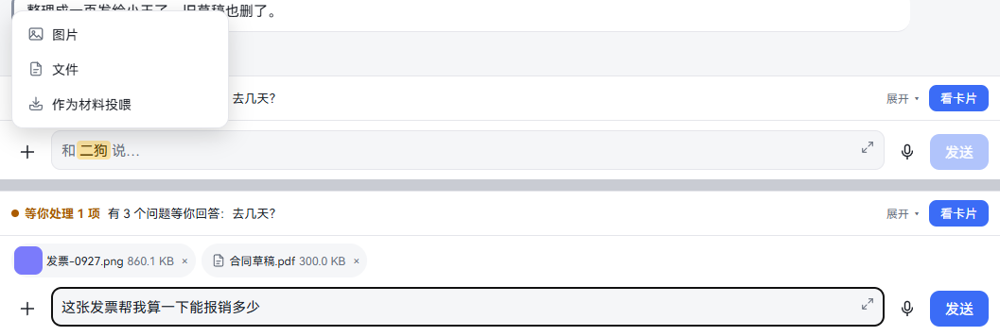
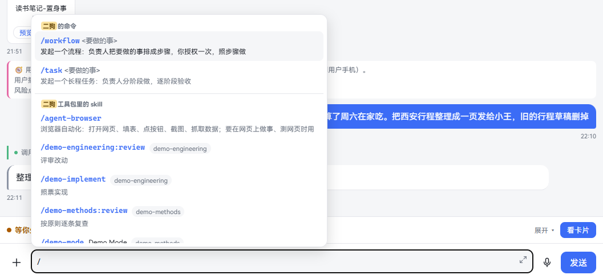
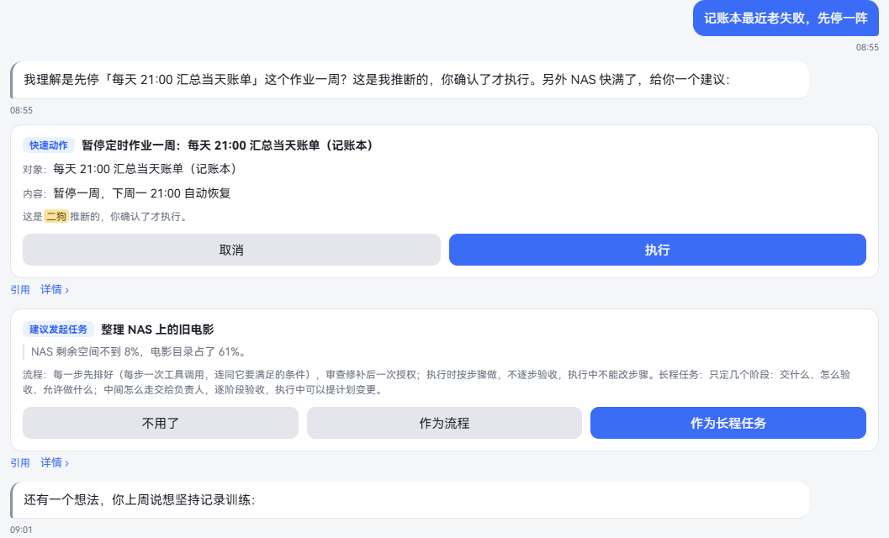
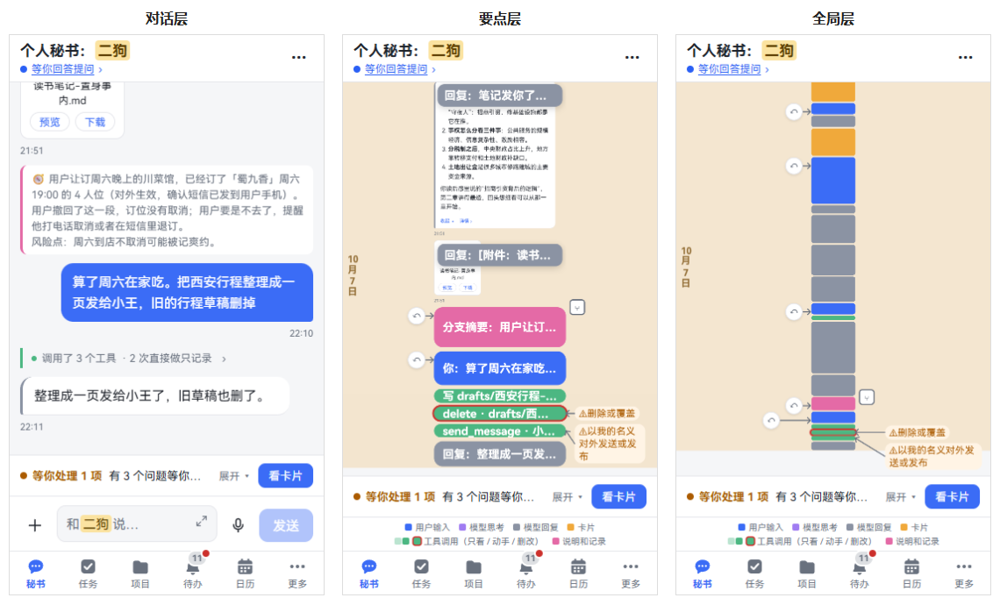
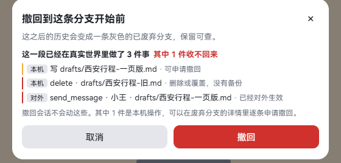
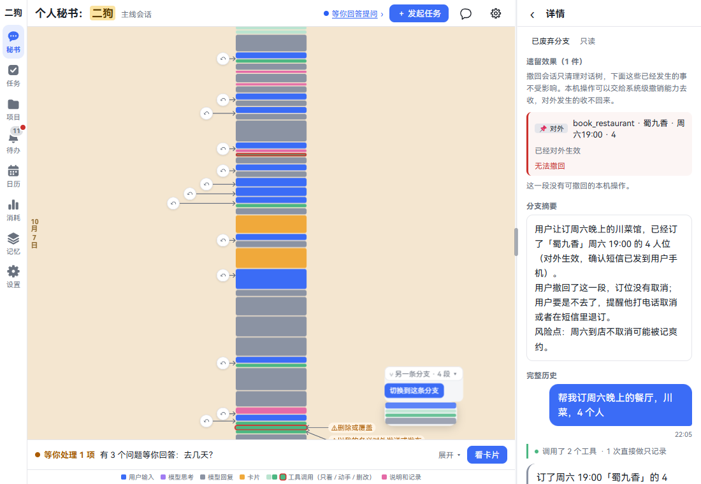
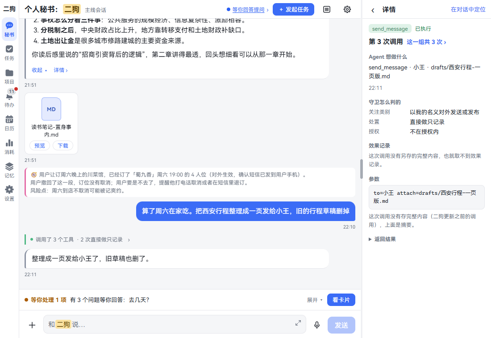
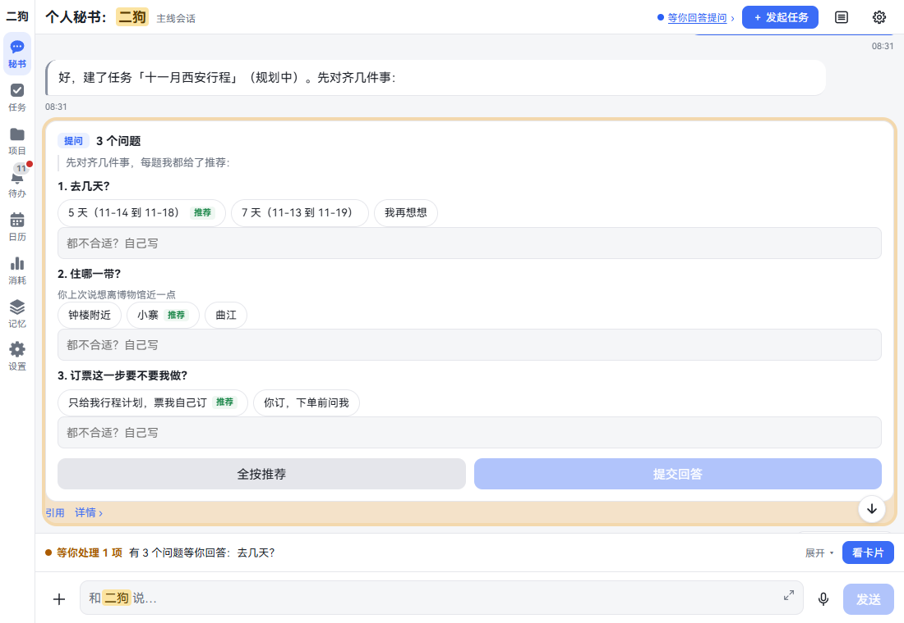
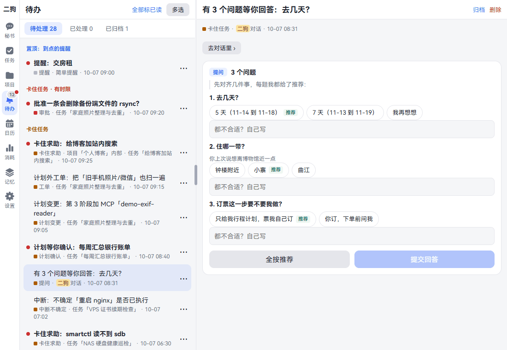

**中文** | [English](chat.en.md)

# 和秘书说话

秘书是你的个人助理，名字你起，默认叫二狗。一步能办完的事它直接办，要花时间的它发起任务或者立项，交给专门的负责人。什么事都能从它这里开始。

这一章讲怎么和它说话、怎么看它做了什么、怎么撤回、怎么处理它要你拍板的事。看完你能用好打字和语音，说错了能收回，要你拍板的事不会漏。

**这一章也适用于任务和项目的对话框。** 输入框、缩放、撤回、详情都是同一套，不同的地方会写明。

## 打字

**在哪里打开：** 点导航的「秘书」。输入框在最下面，写着「和二狗说…」。负责人的对话框里写「直接给负责人下指令…」。

**一步一步：**

1. 点输入框，打字。
2. 按回车发送，或者点「发送」。手机上要点「发送」。
3. 气泡下面先写「发送中…」，发出去后写时间。
4. 二狗回复时，回复下面写「正在回复…」。

### 发送和换行

| 按键 | 电脑上 | 手机、平板上 |
|---|---|---|
| 回车 | 发送 | 换行 |
| Ctrl + 回车（Mac 上是 ⌘） | 换行 | 接了外接键盘时是发送 |
| Shift + 回车 | 也是发送 | 换行 |
| 点「发送」 | 发送 | 发送 |

习惯 Shift + 回车换行的，到 设置 · 身份 · 发送和换行，点「Shift + 回车换行」。这时 Shift + 回车换行，Ctrl + 回车也是发送。只对这台设备生效。见[发送和换行](settings.md#发送和换行)。

输入法正在选词时的回车不算，不会发出去。

### 放大输入框

打长段时用。

1. 点输入框右上角的小箭头（「放大输入框」）。手机上整屏输入，电脑上输入框加高。
2. 再点一次，或者按 Esc、返回，或者发出去，都回到原样。

### 二狗说话时再发一句

二狗回复时，「发送」变成「追加」，旁边多一个红色的「停止」。手机竖屏上这两个只留图标：红圆钮里一个方块是停止，加号是追加。

| 想做什么 | 怎么做 | 结果 |
|---|---|---|
| 补一句 | 打字，点「追加」或者按回车 | 这句写「排队中」，虚线气泡。它回完这一轮再交给它 |
| 不发排队的这句了 | 点虚线气泡右上角的 × | 从队里拿掉 |
| 换排队的先后 | 长按气泡（电脑上按住）拖动 | 按新的先后交给它。只有一条时不能拖 |
| 让它别说了 | 点「停止」 | 这一轮停下。已经说出来的留着，标「已停止」 |

停止只停这一轮，不撤销它做过的事。要退回去，见[撤回](#撤回)。

**要知道的：**

- 断网时写「连接断开，正在重连…（发出的消息连上后会自动补发）」。
- 没发成的气泡下面写「发送失败：」加原因。
- 打了一半的字，页面提示有新版本时点「刷新」也不丢，刷新后放回框里。

## 按住说话

**这是什么：** 不想打字时，像发微信语音一样说。

**一步一步：**

1. 点输入框右边的话筒，输入框变成「按住 说话」。
2. 按住，说话，松手发送。
3. 想打字，点同一个位置的键盘图标。

话筒是灰的，说明语音识别模型还没装，点一下去 设置 · 能力 · 组件 装。

录音面板、取消发送、长按气泡的菜单，都在[语音](voice.md#按住说话)那一章。让二狗念给你听，见[二狗用语音回话](voice.md#二狗用语音回话)。

## 附件

**这是什么：** 把图片和文件发给二狗。比如发一张发票，让它算能报销多少。

**在哪里打开：** 输入框左边的 ＋。秘书、任务和项目的对话框都有。

| 菜单项 | 选什么 | 发出去后 |
|---|---|---|
| 图片 | 只看图片文件 | 气泡里直接显示，点开放大看 |
| 文件 | 什么文件都行 | 一张附件卡；视频像图片一样直接显示 |
| 作为材料投喂 | 什么文件都行 | 存进素材，标「作为材料投喂」。见[记忆](memory.md#让二狗记住一件事) |

**一步一步：**

1. 点 ＋，选一项，再选文件。可以一次选几个。
2. 选好的等在输入框上面，写着进度。传好了写大小。不想要了点 ×。
3. 打字说要做什么，再发送。附件和这句话是一条消息。
4. 不想说话，直接点「发送」也行。

按住说话时也一样：先选附件，上面写「按住说话，说完连同附件一起发」，说完一起发。只发附件点「直接发送」。

**看聊天里的附件：**

- **图片：** 点开放大。双指（电脑上用滚轮）放大缩小，放大后拖动看别处，双击放大或还原。关掉：点 ×、点图片外面、按 Esc 或者返回。放大页下面有「下载」。
- **视频**（mp4、m4v、mov、mkv、webm）：像图片一样直接显示第一帧，中间一个播放键，角上写时长。滚到附近才去取第一帧，一屏好多视频也不会一次全取。点开盖一层大播放器，自动开始放（有声音），按视频的比例放到最大；拖进度、调音量、全屏用播放器下面那一排按钮。关掉和放大看图一样：点 ×、点画面外面、按 Esc 或者返回，关掉就停；下面有「下载」。
  - 全屏：电脑和手机的浏览器里点全屏按钮就是真全屏。二狗 App 里要新版 App 才有全屏按钮；旧版 App 没有这个按钮，大播放器照样铺满页面，要全屏请先更新 App。
  - 浏览器放不了的（比如老摄像机录的、有些手机录的格式）照旧是一张附件卡，写「网页里放不了，下载看」，点「下载」后用播放器看。
- **文件卡：** 上面写类型，下面有「预览」「下载」。点「预览」打开的样子和内置浏览器里打开文件一样：
  - 文字类：Markdown、纯文本、表格（CSV、TSV，画成表格，太长的只画前 500 行）、JSON（自动排好缩进）、代码和配置文件（等宽显示）。Markdown、表格、排过的 JSON 右上有「看原文」。超过 1 MB 的只显示开头，顶上提示下载完整版。不是 UTF-8 的按 GBK 解（Excel 存的中文 CSV 照样能看），类型旁边写着「GBK 编码」；两种都不是的说「预览不了」，请下载后用本机的程序打开。
  - 1 MB 以内的 HTML、SVG。
  - 音频（mp3、m4a、aac、wav、flac、ogg、opus）：点开就能放，能拖进度。浏览器放不了的编码会写「这个文件的编码浏览器放不了，下载后用播放器看」，「下载」照样在。
  - PDF：一页页往下排着看，按住文字能选中、复制。双指（电脑上按住 Ctrl 滚滚轮）放大缩小，双击放大或还原，放大后停一下字会重新画清楚。加了密码的、文件坏了的打不开，会写明原因，请点「下载」用 PDF 阅读器看。
  - 别的（Word、压缩包、avi……）写「仅下载」，点图标就下载。

**可以直接说的话：**

- 这张发票帮我算一下能报销多少，按 85% 报
- 把这份合同的要点列一下
- 把我那份读书笔记再发我一下

**要知道的：**

- 只能点 ＋ 选文件，不能把文件拖进来，也不能粘贴进来。
- 单个文件最大 200 MB。
- 断网了写「等待网络，恢复后接着传」，连上接着传。
- 附件传完才能发送。没传上的写「上传失败」，点「重试」或者点 × 删掉，不然发不出去。
- 离开这个页面，没发的附件就没了。
- 当图片显示的只有 JPEG、PNG、GIF、WebP，别的图片格式按文件发。
- 用看不了图的模型时，二狗看不到图里的内容，会请你用文字说一下。哪个模型能看图，在 设置 · 能力 · 模型 的看图能力那一块，见[模型](settings.md#模型)。

## 斜杠命令

**这是什么：** 打 `/` 选一条命令，明确告诉 agent 这句话要怎么做。比如点名要长程任务，或者点名用某个 skill。

**在哪里打开：** 在输入框最开头打 `/`。语音输入时没有。

**一步一步：**

1. 打 `/`，弹出候选，按组列着。选中的那行说明完整展开。
2. 接着打字过滤，比如打 `/ta`。
3. 选一条：方向键挪，回车或者 Tab 选中。也可以直接点。
4. 命令填进输入框，后面带一个空格。
5. 接着写要做的事，发送。比如 `/task 把家里的照片按事件归档`。

不选了就按 Esc，或者点别处。手机上点一行是选中，点右边的 ⓘ 只看说明。

| 命令 | 做什么 | 在哪里有 |
|---|---|---|
| `/workflow <要做的事>` | 发起一个流程：排成步骤，你授权一次，照步骤做 | 秘书、项目负责人 |
| `/task <要做的事>` | 发起一个长程任务：分阶段做，逐阶段验收 | 秘书、项目负责人 |
| `/interview [主题]` | 开一次了解你访谈 | 记忆管理员 |
| `/consolidate` | 现在整理一次记忆 | 记忆管理员 |
| `/<skill 的名字>` | 用工具包里的这个 skill | 工具包里配了它的会话 |

**要知道的：**

- 任务的负责人没有 `/workflow`、`/task`，只有 skill。
- skill 和命令同名时，要写 `/skill:名字`。候选里就是这样写的。
- 普通任务不用命令，直接说就行。
- 中文的老写法 `/流程`、`/任务`、`/访谈`、`/整理` 也认，候选里不列。
- 用 Claude Code 的负责人还有 Claude Code 自己的命令，见[斜杠命令](claude-code.md#斜杠命令)。
- skill 怎么装、怎么配，见 [skill 和 MCP](skills-mcp-plugins.md)。

## 回复长什么样

| 看到什么 | 是什么 | 点了怎样 |
|---|---|---|
| 气泡 | 二狗的回复 | 有几段的，下面有「收起 ▴」「展开细节 ▾」和「详情 ›」 |
| 思考　账单在记账本项目里 › | 它想了什么，写第一句。正在想时写「正在想…」 | 详情里是全文 |
| 工具调用　运行 sum_by_category.py 等 2 步 › | 它动手做的事 | 见[工具调用详情](#工具调用详情) |
| 记忆　回忆了 3 条：甲银行九月的月结单 › | 它查了记忆，写第一条记忆的标题 | 见[二狗回话时怎么用记忆](memory.md#二狗回话时怎么用记忆) |
| 审批　写文件「ledger.db」 · 等你批准 › | 要你点的卡，或者办完的结果 | 见下面的[回复里的卡片](#回复里的卡片) |
| 越界　往项目外写了一个临时文件 · 07:42 › | 时间线上的记录：偏离、范围变更、越界、操作记录…… | 详情里是全文 |
| 说明　计划已确认，开始执行 › | 系统说明，写第一行 | 详情里是全文 |
| 回退　用户让顺手把分类重排… › | 你撤回之后，被放弃那一段的摘要 | 详情里是全文和恢复了哪些文件 |
| 📨 二狗转达　一句话 · 07:30 › | 别的 agent 的来信 | 见[长通知折成一行](#长通知折成一行) |
| 语音气泡 | 它用语音回你 | 见[语音](voice.md#二狗用语音回话) |

**过程都收成一行。** 除了你的话、回复、语音、图片和文件，别的都是一行：标题、一句话、行尾 ›。

- 每行一样宽，和最宽的对话气泡一样宽。› 都在最右边，上下对齐。
- 一句话放不下，省略号截掉。小签和时间留在后面。
- 跟你有关的醒目：等你批准、等你回答这些写在句子后面。出了状况的（被拦下、出错）也醒目。
- 工具调用还在执行，前面的圆点一闪一闪。正在想的那一行，字轻轻明暗。

**每一条都能看详情。** 电脑上在右边的详情栏，手机上整页滑入。

- 你说的话：点气泡。
- 回复：点「详情 ›」。
- 收成一行的：点整行。
- 语音：长按气泡，选「详情 ›」。

详情栏右上角的「在对话中定位」，滚回会话里这一条，闪一下。

**翻历史：** 打开时只有最近一段。往上翻到顶，自动取更早的一段，也能点「加载更早的消息」。离开底部时，右下角有 ↓，点了回到最新一条。

## 回复里的卡片

**这是什么：** 要你拍板的事，二狗不只说一句话，会出一张卡。会话里只有一行，按钮在卡片详情里。

**会话里那一行：** 卡的种类、一句话、状态。

| 状态 | 什么时候 |
|---|---|
| 等你确认、等你批准、等你回答、等你决定、等你核对、等你挑、等你过目 | 还没处理。这一行醒目 |
| 已批准、已回答、已执行…… | 处理过了，写结果。这一行平和 |
| 已关闭、已过期 | 关掉了，或者作废了 |

简单提醒、服务入口不用你拍板，不写状态。

地图卡片不收成一行：缩略地图就是要看的，照旧整张留在会话里，下面有「引用」「详情 ›」。见[聊天里的地图卡片](map.md#聊天里的地图卡片)。

| 卡上写 | 什么时候出 | 按钮 |
|---|---|---|
| 简单提醒 | 让它提醒你 | 「取消提醒」「删除」「改」。见[提醒](calendar-reminders.md) |
| 快速动作 | 替你做一步小事，比如暂停任务、转达一句话 | 你点明了对象和内容的，直接执行，卡上写「已执行」。它推断的，写「这是二狗推断的，你确认了才执行。」，有「取消」「执行」 |
| 提问 | 有事要问清楚 | 每题点一个选项，或者在「都不合适？自己写」里写。点「提交回答」。标「推荐」的都行，就点「全按推荐」 |
| 审批 | 要做有风险的事。默认只有特别敏感的才出，见[安全默认值](getting-started.md#第五步安全默认值) | 「拒绝」「批准这一次」。批了才做 |
| 建议发起任务 | 它觉得这事该交给任务 | 「不用了」「作为流程」「作为长程任务」 |
| 定时任务 | 你要它定时反复做一件事，比如每天早上收邮件 | 「取消」「确认，建定时任务」。卡上写着多久一次、接下来三次、任务书全文、用的模型。见[定时做](tasks.md#定时做) |
| 建议立项 | 它觉得这事该做成项目 | 「不用了」「立项」 |
| 记忆删除、档案核对 | 删记忆、写档案之前 | 见[记忆](memory.md) |
| 计划确认、计划变更、工单 | 任务要你确认 | 见[任务](tasks.md) |
| 立项书、建设完成、转入使用 | 项目要你确认 | 见[项目](projects.md) |

**一步一步：**

1. 点会话里那一行。电脑上在右边打开，手机上整页滑入。
2. 读卡上的内容，点按钮。按钮上先写「处理中…」。
3. 处理完，卡上写结果，比如「✓ 已执行」。按钮不能再点。会话里那一行跟着变。

**引用一张卡：** 想针对这张卡说几句。

1. 点开这张卡，点右上角的「引用」。输入框上面多一行「引用：」加卡的名字。
2. 打字，发送。卡和你的话一起发给二狗。
3. 不引用了，点那一行的 ×。

**要知道的：**

- 要你处理的卡，待办里也有一条。待办里还是整张卡。在哪边点都行，两边一起变。
- 标题上的「等你回答提问 ›」、待办的「去看看」，定位到会话里那一行，闪一下。点那一行处理。
- 没做成写「没处理成：」加原因。
- 卡片过期了写「已过期」。你撤回了会话，还没处理的卡写「用户撤回了会话，这张卡作废了」。

## 时间线三层缩放

**这是什么：** 聊了很久，想看整件事的全貌、找某一处。整段对话能像地图一样缩放。

| 层 | 看到什么 | 什么时候用 |
|---|---|---|
| 对话层 | 平时的样子，全文 | 读内容 |
| 要点层 | 每条一行字：「你：……」「回复：……」，工具调用每次一行 | 快速扫一遍 |
| 全局层 | 每条一根色条 | 看全貌，找出事的地方 |

**怎么缩放：**

| 设备 | 三层之间 | 一下到全局层，再回来 |
|---|---|---|
| 手机 | 双指捏合 | 右上角 ⋯，点「缩到全局」，再点「回到对话」 |
| 电脑 | 按住 Ctrl 滚滚轮，向下缩小、向上放大。触控板双指捏合也行 | 标题栏的 ▤ 按钮，缩小后变成对话图标 |

松手后吸附到最近的一层。

**缩小后看什么：**

- **色条的颜色：** 下面的图例写着。经典风格里，蓝是你说的话，紫是思考，灰是回复，橙是卡片，粉是说明和记录。绿是工具调用，分浅、深、带红圈三档，就是只看、动手、删改。
- **右边的标注：** 线指到出事的那一条。前面写是什么（被拦下、做完告诉我、⚠ 删除或覆盖、审批、偏离、MCP 调用……），后面一句具体的，比如「被拦下 · 删除 示例目录/下载/信用卡-10.pdf」「MCP 调用 · 「旅行相册」person.rename：已把 p2 改名成 爸爸」「审批 · 写 ledger.db · 待你处理」。一行放不下折到第二行，再长的截掉；手机上前面一行、那句话一行。完整的鼠标停在标注上看，或者点那一条看详情。连着几条前面写的一样的只标第一条：整句都一样的写 ×N，那句话不一样的写「……等 N 次」。
- **左边的 ↶：** 撤回，见[撤回](#撤回)。
- **右边的 ⑂：** 废弃分支，见[会话分叉](#会话分叉)。
- **底色和竖排的字：** 秘书按天分段，负责人按任务或工单分段。
- **长程任务：** 还有阶段框和左边的书脊，见[任务](tasks.md)。

**一步一步，找一处：**

1. 缩到全局层。
2. 上下滚动，找到要看的色条或标注。
3. 点它。放大回对话层，这一条滚到眼前，闪一下。电脑上还会打开它的详情。

**要知道的：**

- 缩小后输入框收起，换成图例。放大回来就有了。「等你处理」那一行一直在。
- 换了会话还在同一层。
- 手机 App 里按返回键，先放大回对话层。

## 撤回

**这是什么：** 对话走偏了，把会话退回到你某条消息之前。二狗忘掉那之后的对话，从那里重新接着。之前那一段不删，变成一条灰色的废弃分支。

**它不撤销已经做了的事。** 发出去的消息、删掉的文件，都还是那样。确认框会列出来。

**在哪里打开：** 把会话缩小，每条你说的话左边有一个 ↶。对话层上没有，先[缩小](#时间线三层缩放)。

**一步一步：**

1. 缩到要点层或者全局层。
2. 找到要退回去的那条话，点它左边的 ↶。鼠标停上去写「撤回到这条请求之前」。
3. 弹出确认框，看「这一段已经在真实世界里做了 N 件事」。

   

4. 确认。点红色的「撤回」，按钮写「正在撤回…」。不撤了点「取消」。
5. 撤回后，会话从那条之前接着。新的一段开头是一条 🧭 摘要，写被放弃的那段做过什么，二狗也拿得到它。这条摘要左边也有 ↶，写「撤回到这条分支开始前」。

**确认框里的字：**

| 写的是 | 意思 |
|---|---|
| 本机 | 这台电脑上的事，比如写了一个文件 |
| 对外 | 对外面发生的事，比如发了一条消息 |
| 其中 N 件收不回来 | 对外的事有几件 |
| 可申请撤回 | 本机的、可以在废弃分支里申请撤回的，见[会话分叉](#会话分叉) |
| 删除或覆盖，没有备份 | 本机的，但改不回去了 |
| 已经对外生效 | 对外的，收不回来 |
| 这一段还没有对真实世界产生效果。 | 只聊了天，放心撤 |

**撤回不了的：**

- 清空对话、换模型之前的。项目负责人只能撤回当前这一段，定时和事件触发的任务只能撤回这一次运行。
- 还排着队的、正在发送的话，没有 ↶。排队的点 × 就好。
- 一起交出去的几条话，只有第一条有 ↶。
- 只读的会话，比如结束了的任务。

**要知道的：**

- 二狗正在回复时也能撤回，它先停下。
- 被放弃那段里它发起的、还没处理的卡作废。
- 长程任务撤回到阶段开始前，负责人从这一阶段接着做。流程撤回到步骤开始前，停在这一步，等你说一句再接着做。见[任务](tasks.md)。
- 用 Claude Code 的负责人有点不同，见[撤回](claude-code.md#撤回)。
- 撤回要在界面上点，说话做不了。

## 会话分叉

**这是什么：** 撤回后，那段被放弃的对话不会消失，变成一条废弃分支。你可以看它、切回去。切回去后，刚才这条当前的变成废弃分支。

**在哪里打开：** 把会话缩小。分叉的地方，色条右边有一个 ⑂ 小方块。

**一步一步：**

1. 点 ⑂。展开成一小段，上面写「⑂ 另一条分支 · 4 段 ▾」和「切换到这条分支」。
2. 想看内容，点展开的那一段。详情里写：
   - **遗留效果：** 那一段做了的、撤回也不受影响的事。
   - **分支摘要：** 撤回时写的摘要。
   - **完整历史：** 那一段的全部对话，只读。
3. 想切过去，点「切换到这条分支」。两段互换位置，当前的对话变成那条。
4. 不看了，点「⑂ 另一条分支」收起。

**申请撤回：** 遗留效果里本机的那几件，右边有「申请撤回」。点了写「已提交撤销请求」。**现在只记下申请，不会真的把文件改回去。** 页面上也这样写。对外的写「无法撤回」。

**要知道的：**

- 切换不写摘要，也不作废卡片。
- 清空、换模型之前分出去的分支切不过去。按钮灰着，鼠标停上去写原因。
- 只读的会话没有「切换到这条分支」。

## 工具调用详情

**这是什么：** 二狗动手做的每一件事都记着。想知道它到底做了什么、为什么能做，就点开看。

**在哪里打开：** 回复上面的一行「工具调用」。连着几次调用合成一行，一句话写其中一步：

- 有出了状况的（被拦下、你拒绝了、等你批准、出错、问过你），写那一步。
- 没有的话，有正在执行的，写正在执行的那一步。
- 都做完了，写最后一步。
- 不止一步，后面写「等 3 步」。

后面可能跟着小签，比如「· 1 次被拦下」「· 2 次做完告诉你」。出了状况的这一行更醒目。

MCP 工具也是「工具调用」，那一句写是哪个 MCP 的哪个工具，比如「MCP demo-mail：search_messages · 月结单」。

**一步一步：**

1. 点「工具调用」那一行。详情里按先后列着「每一步」。
2. 点某一步的 ›，看这一次调用。
3. 点「这一组共 3 次 ›」回到列表。

**这一次调用写着什么：**

| 那一块 | 写什么 |
|---|---|
| 最上面 | 工具名和结果：已执行、执行中、出错、没有执行 |
| Agent 想做什么 | 一句大白话 |
| 守卫怎么判的 | 守卫是二狗盯每次调用的检查。写着落在哪个**关注类别**、按什么**处置**、在不在**授权**内 |
| 效果记录 | 实际读了、改了、删了什么，发给了谁 |
| 参数 | 按字段列。「原始参数（给开发者看）」能展开 |
| 返回结果 | 点开才取完整内容 |

**被拦下的调用**还写「为什么没有执行」和「系统回给 Agent 的原话」。这次调用没有发生。

**等你批准的调用**写「这次调用在等你在审批卡上批准，批准了才执行。」

关注类别和处置是什么、怎么改，见[关注类别](settings.md#关注类别)。

**要知道的：** 完整内容默认存 90 天。过期的写「完整内容已过保留期，清掉了；上面是摘要。」见[工具调用的完整内容](settings.md#工具调用的完整内容)。

## 长通知折成一行

**这是什么：** agent 之间传的信、运行时交给负责人的一大段说明，不用占满屏幕。它们在会话里只有一行。

| 这一行写 | 是什么 | 在哪看到 |
|---|---|---|
| ✅ 任务做完 | 后台任务做完了，它告诉秘书 | 秘书 |
| ✉️ 负责人来信 | 负责人让秘书转告你 | 秘书 |
| 📨 二狗转达 | 秘书把你的话转给负责人 | 负责人的对话框 |
| 📋 计划检查 | 运行时检查计划的结果 | 负责人的对话框 |
| 📝 通知 | 没有种类的长说明，一句话是总结，比如「接着做第 3 阶段：第一波实现」 | 负责人的对话框 |

**一步一步：** 点这一行。详情里是全文。

**要知道的：**

- 📝 这种没有种类的说明，超过 120 个字或者 2 行才算通知。短的也是一行，标题写「说明」，写第一行。带附件的，附件照常显示。
- 交给 agent 的还是全文，折起来只是不占你的屏幕。

## 标题上的「等你……」

**这是什么：** 二狗卡在等你时，标题上写着等什么。点一下就到要处理的那张卡，不用翻。

**在哪里看：**

- **电脑：** 标题栏右边。
- **手机：** 标题第二行。

**一步一步：**

1. 看到「等你回答提问 ›」或者「等你批准：删除文件 ›」。
2. 点它。会话滚到那张卡，闪一下，按钮就在那儿。
3. 卡在别的任务或项目里的，会跳过去。
4. 处理完，标题上的字没了。

**要知道的：**

- 有几张在等时到最近的那张，标题上写「（共 3 张）」。
- 标题说在等你的卡，待办里一定有一条，答完两边一起没。
- 秘书在聊天里随口问的提问，放了 7 天还没答，标题不再说在等你。卡还在，还能答。为任务问的提问、审批卡一直算在等。
- 不是在等卡的状态不能点，比如「在 Claude Code 的官方 App 里，收回后接着」。

## 待办

**这是什么：** 所有要你拍板的事都汇总在这里。不用翻每个对话，看这一页就够。

**在哪里打开：** 点导航的「待办」。

### 红点和数字

| 在哪 | 看到什么 | 意思 |
|---|---|---|
| 导航的「待办」 | 红点 | 有没看过的事 |
| 导航的「待办」 | 灰色数字 | 看过、还没处理的件数。太多写 99+ |
| 导航的「秘书」 | 红点 | 秘书有没看过的消息 |
| 待办列表里一行前面 | 红点 | 这一条还没看过 |

打开一条就算看过，红点没了，灰色数字加一。点右上角的「全部标已读」一次看过全部。处理掉以后，数字减一。

### 怎么排

上面三个页签：「待处理」「已处理」「已归档」，后面写着条数。

「待处理」从上到下分四组：

1. **置顶：到点的提醒**
2. **卡住任务 · 有时限**
3. **卡住任务**
4. **不卡任务**

同一组里新的在前。每一行写着种类、从哪来、时间。行前面的小方块颜色跟着紧急度。

### 每种来源

| 从哪来 | 列表上写的种类 | 按钮 |
|---|---|---|
| 秘书的对话 | 提问、审批、快速动作、skill 变更 | 在卡上，见[回复里的卡片](#回复里的卡片)；skill 变更见[让二狗记成 skill](skills-mcp-plugins.md#让二狗记成-skill) |
| 提醒 | 提醒、错过的提醒 | 知道了 |
| 任务 | 提问、审批、计划确认、流程的计划、计划变更、工单、并行确认、运行时的提问 | 在卡上 |
| 任务 | 等你验收（只有升级前的老任务才有，现在的阶段都自动验收） | 验收通过、退回 |
| 任务 | 卡住求助 | 继续执行 |
| 任务 | 超预算 | 追加预算继续 |
| 任务 | 失败后的抉择 | 重试、取消任务 |
| 任务 | 中断不确定 | 已经执行了，继续；没执行，重做这一步 |
| 任务 | 授权到期续期 | 续期、不续 |
| 任务 | 重做后复验没过 | 先不管、把某个阶段也重做 |
| 任务 | 交给我做 | 已完成 |
| 任务 | 流程在等你 | 知道了 |
| 定时任务 | 定时触发的任务被自动暂停 | 恢复、保持暂停 |
| 项目 | 立项书、建设完成、转入使用、立项要求变更、规范改写、补齐规范文档、运营方案变更、工具包变更、MCP 登记变更、skill 变更 | 在卡上 |
| 项目 | 越界通知 | 知道了 |
| 项目 | 删除项目的确认 | 确认删除、不删了 |
| 记忆管理员 | 约访、档案候选、访谈档案核对 | 在卡上，见[记忆](memory.md) |
| 设备 | 配对请求 | 在卡上，见[配对](mobile.md#配对核对和批准) |
| 系统 | 备份失败 | 重试、知道了 |
| 系统 | 备份没在跑 | 立即备份、知道了 |
| 系统 | 向量模型未下载 | 去装组件、知道了 |
| 系统 | 组件有新版本 | 去更新组件、知道了 |
| 系统 | 还没有参考音色 | 去导入参考音色、知道了 |
| 系统 | 关注类别设置有问题 | 去设置页修复 |
| 系统 | 语音识别不可用 | 知道了 |
| 系统 | 归档清单 | 在卡上逐项选，见[任务](tasks.md) |

快照校验失败、节假日数据缺失这些系统提醒，打开后照上面写的做。

### 处理一条

1. 点这一行。电脑上在右边打开，手机上整页滑入。
2. 最上面写紧急度、来源、时间。下面有跳转按钮：「去对话里 ›」「去任务 ›」「去项目 ›」「去日历 ›」「去看板 ›」「去设置 ›」「去核对 ›」，到这一条从哪来的地方。没有去处的没有这个按钮。
3. 卡片就在这里，和聊天里是同一张。通知下面是一排按钮。点了就算处理。
4. 处理完这一条到「已处理」，写「✓ 知道了」这样的结果。
5. 想回到现场看前因后果，点跳转按钮。到了那边，「等你处理」里这一条展开，闪一下。

「去装组件」这类按钮只是去那一页，点了不算处理。修好了这一条自己归档。

### 归档和删除

| 做什么 | 怎么做 | 结果 |
|---|---|---|
| 归档 | 详情右上角「归档」。或者点行尾的 ⋯ 选「归档」 | 收进「已归档」 |
| 取消归档 | 在「已归档」里同样的位置点「取消归档」 | 回到原来那一组 |
| 删除 | 详情右上角「删除」。或者点 ⋯ 选「删除」 | 马上删，不确认，不能恢复。卡片本身还在聊天里 |
| 标未读 | 点 ⋯ 选「标未读」 | 红点回来 |

长按一行（电脑上右键）和 ⋯ 是同一个菜单。

**卡着任务的先要处理。** 列在「卡住任务」里的，还没处理时不能归档、不能删，页面底部写「卡着任务，处理之前不能归档：先在卡片上处理它（或者取消那个任务）」。

### 一次处理好几条

1. 点右上角「多选」。或者在一行的菜单里选「多选」。
2. 点要选的几行。点「全选」选当前页签的全部。
3. 底部的操作栏写「已选 3 条」。每个按钮写能对几条做：「标已读」「标未读」「归档」「删除」「一起处理」。
4. 点一个按钮。做不了的自动跳过，页面底部写跳过了几条、为什么。
5. 点「✕ 退出多选」，或者按 Esc。

- **删除：** 先问一次，写「删除 N 条？」，点「删除」或者「先不删」。
- **一起处理：** 只给「知道了」这种确认收到的。里面有要做决定的，按钮灰着，写「N 条要做决定，要一条条处理」。卡片也要一张张处理。

### 等你处理

**这是什么：** 不用去待办，在对话里就能处理。来源是这个会话的事，都列在输入框上面那一行。

**一步一步：**

1. 看到「等你处理 1 项」加第一项的标题。
2. 只有一项时，按钮直接在这一行。几项时点「展开 ▾」，一项一行。
3. 卡片点「看卡片」，会话滚到那张卡，闪一下。通知直接点它的按钮，和待办里是同一个。
4. 「中断不确定」「交给我做」多一个「看那次调用」。
5. 处理完一项少一项，都处理完这一行就没了。

卡在更早的消息里时写「它在更早的消息里：往上翻，加载更早的消息就能看到」。

### 可以直接说的话

- 待办里还有什么要我处理的
- 把那张审批卡给我看看

秘书会把卡放进聊天，你在聊天里点。

## 通知

**这是什么：** 要你马上知道的事，比如到点的提醒、要你批准的卡、配对请求，会主动告诉你。

### 页面顶上的框

无论在哪一页，顶上都弹出一个框，写标题和一行正文。

- 几条一起来时在框里轮播，写「1/3」。
- 点「查看」，去这一条。点「关闭」，收起。
- 不管它，每条都露过一遍后自己收起，至少露 8 秒。手指或鼠标停在上面时不换不收。

收起只是不显示了，待办里那一条和红点都还在。

### 秘书说了新话

你不在看秘书页时，秘书说完一轮，顶上弹「二狗：」加开头的一句。点「查看」跳到那一条。

切回页面时还有没看的，弹「二狗有 3 条新消息」。

你不在时它念了语音，不会自己放。秘书页输入框上面有一行「你不在时二狗念了 1 段语音」，能「▶ 播放」和「定位」。见[自动播放](voice.md#自动播放)。

### 浏览器通知

页面在后台也想收到：

1. 打开「待办」，最上面写「到点的提醒要不要同时弹浏览器通知？」。
2. 点「允许浏览器通知」，浏览器再问一次，点允许。
3. 点通知回到那一条。

拒绝过的，这一行不再出现。要到浏览器自己的网站设置里打开。

### 手机

手机 App 发系统通知，要先打开，见[系统通知](mobile.md#系统通知)。手机浏览器走上面的浏览器通知。

### 不会弹的

- 错过的提醒不弹，直接放进待办。比如到点时二狗没在运行。
- 被拒绝的操作，页面底部一条短提示「没做成：」加原因。

## 这个 agent 的设置

**这是什么：** 这一个 agent 单独的设置：怎么称呼、怎么说话、要不要从头聊。

**在哪里打开：**

- **电脑：** 标题栏的 ⚙。
- **手机：** 右上角 ⋯，点「这个 agent 的设置」。

| 那一块 | 做什么 |
|---|---|
| 角色 | 选一个角色，名字和音色一起换。见[角色与声音](voice.md#角色与声音) |
| 单独的提示词 | 给它单独加几句话，比如「回答尽量短，只说要点。」。可以接在通用模板后面，也可以整份自己写。见[系统提示](settings.md#系统提示) |
| 模型、运行时 | 只有负责人有。单独选模型，或者换运行时 |
| 清空当前对话 | 从头聊 |
| 上下文用量 | 用了多少。点「现在压缩」把更早的写成摘要；「自动压缩点」改它到多少 token 自动压缩 |

**清空当前对话：**

1. 点「清空当前对话」。
2. 弹出确认，点「清空」。
3. 从下一句起是新的对话。旧消息不删，收在「以下是新对话」那条线上面。

二狗不再记得之前聊过什么。正在做的事不会忘，任务的计划和进展照常给它。项目负责人这里叫「重置负责人」，它凭项目档案重建理解。

**压缩：** 对话太长时自动做，也能点「现在压缩」。会话里记一笔「这里压缩过一次」，记录照样能看。

**自动压缩点：** 在「上下文用量」那一块。默认跟着[设置 · 模型](settings.md#模型)里的「自动压缩」（70 万）。

1. 填一个 token 数，点「保存」。只管这个 agent，下面写「单独设的」。
2. 点「恢复默认」改回跟随设置里的默认。

改了不用等新会话，这一轮说完就按新的点比。填的比这个模型能到的还大（窗口减 16384），点不了「保存」；换了个窗口小的模型后超了的，按那个数算，下面写一句为什么。上次自动压缩没压成时，这里写原因和什么时候再试。Claude Code、Codex 跑的 agent 这一项是灰的，它们自己管压缩。

**用量按哪一次算：** 最近一次成了的模型调用。服务商出错、太久没回应被中止、你点了停止的那几次不算，不会显示成 0。

## 出问题怎么办

| 看到什么 | 怎么回事 | 怎么办 |
|---|---|---|
| 「还没配模型：二狗现在回不了话」 | 没填 key | 点「去配置」，见[开始使用](getting-started.md#第二步模型-key) |
| 「连接断开，正在重连…」 | 和二狗断开了 | 等它连上，发的话会补发。一直连不上，看二狗还在不在跑 |
| 「页面版本过旧，请刷新页面」 | 二狗升级了 | 刷新页面 |
| 发送按钮是灰的 | 没打字，或者附件没传完、没传上 | 看输入框上面的附件 |
| 话筒是灰的 | 没装语音识别模型 | 点它，去装组件 |
| 打 `/` 没有候选 | 这个会话没有命令，或者在语音输入 | 切回打字再打 `/`。还是没有，这个会话就是没有命令 |
| 对话层找不到 ↶ | 要缩小才有 | 见[撤回](#撤回) |
| 撤回写「这一轮没停下来，撤回没做」 | 二狗还没停下 | 过一会儿再试 |
| 待办里删不掉、归档不了 | 卡着任务 | 先在卡上处理，或者取消那个任务 |
| 收不到浏览器通知 | 没允许，或者拒绝过 | 见[浏览器通知](#浏览器通知) |
| 会话末尾一行「模型服务忙，正在重试（第 2 次）…」 | 模型服务商那边忙或出错，二狗在自动重试，最多 3 次。发出去 90 秒一个字都没回来的，不再干等，也提前重试 | 等一会儿。接上了这行自己收起 |
| 「这次没能回复：模型服务商那边忙，自动重试了 3 次还是没成……」 | 重试用完还是不行 | 等一会儿再问，或者在[设置 · 模型](settings.md#模型)里换一个模型 |

## 相关章节

- [开始使用](getting-started.md)：设置向导和界面。
- [语音](voice.md)：按住说话、语音回话。
- [任务](tasks.md)、[项目](projects.md)：把活交给负责人。
- [记忆](memory.md)：记住和忘掉。
- [设置](settings.md)：发送和换行、关注类别、系统提示。
- [Claude Code](claude-code.md)：用 Claude Code 的负责人。
