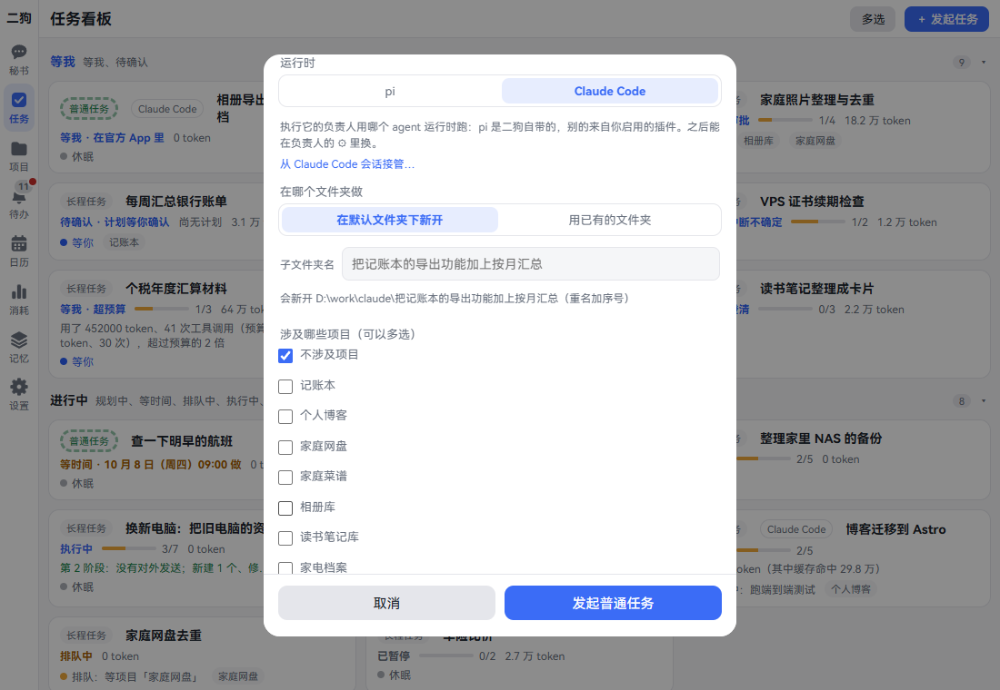
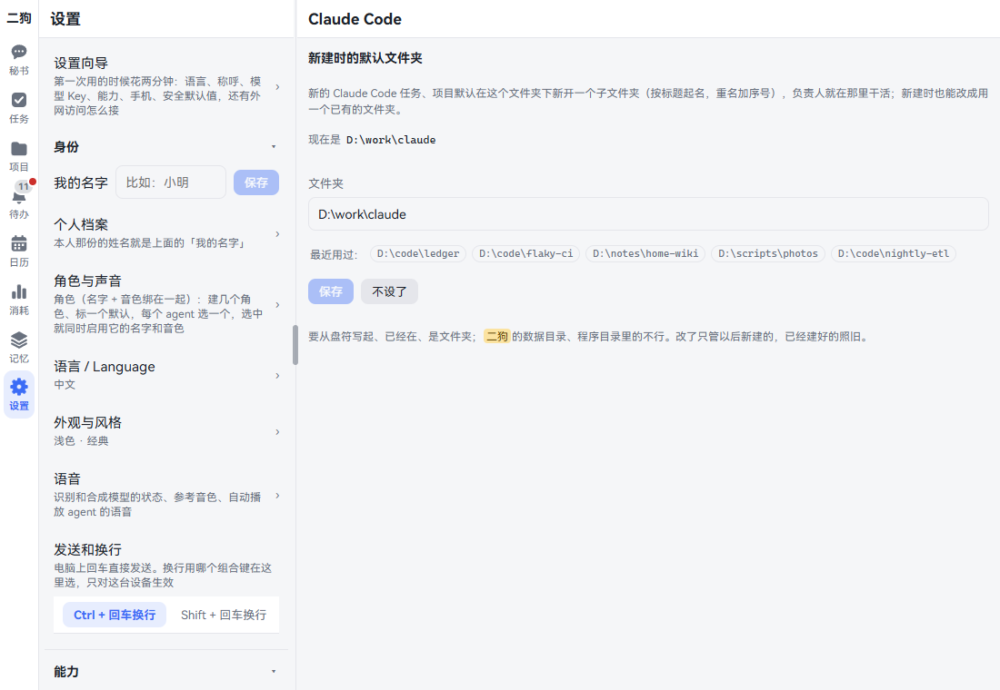
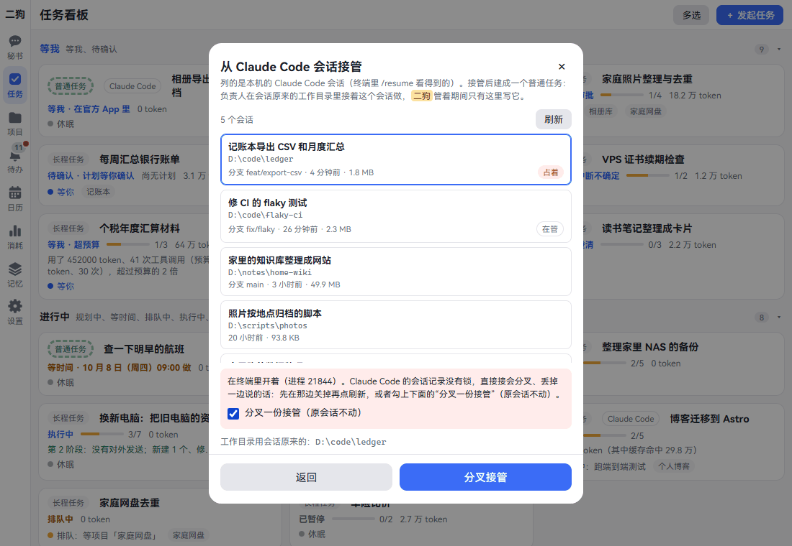
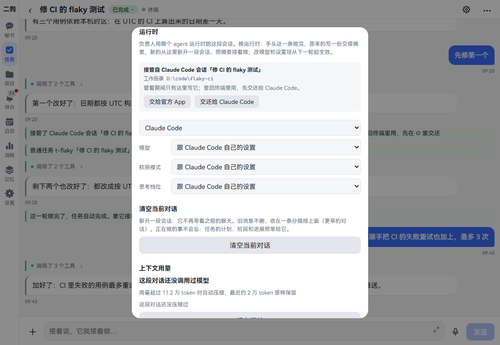
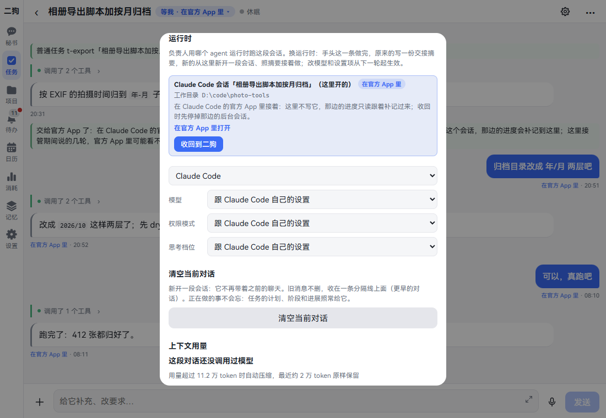
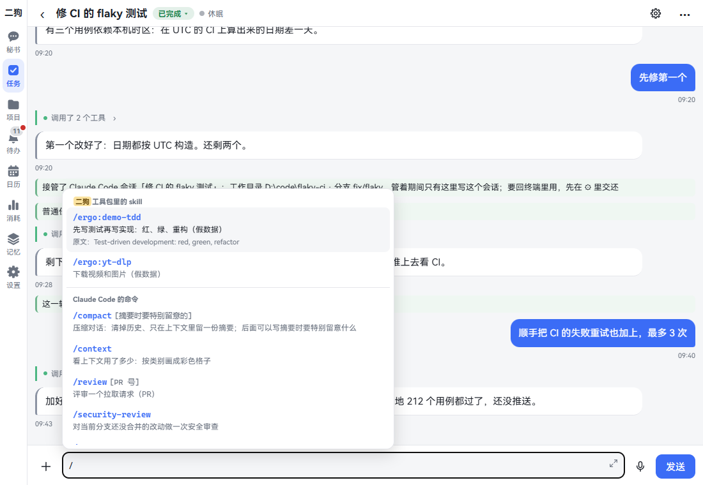

[中文](claude-code.md) | **English**

# Claude Code

Screenshots show the Chinese interface; the labels in the text are the English ones.

If Claude Code is installed on this computer, task and project owners can work through it. For example, you can hand coding work to it, on your own subscription quota; ergo still records every tool call, and still blocks risky ones or asks you about them.

A Claude Code session already open in a terminal can also be handed to ergo to continue, and handed back to the terminal when it's done. It can also go to the official app, so you can keep talking to it on your phone when you're out.

Only task and project owners can use Claude Code. The secretary can't switch.

This chapter covers connecting it, creating and taking over sessions, and handing them back and forth. By the end you can have Claude Code work under ergo's management.

## What you need first

1. Install Claude Code on this computer and sign in. ergo uses your local sign-in and subscription quota, and your own configuration (CLAUDE.md, skills, MCP, hooks) loads as usual.
2. Open **Settings · Capabilities · Components** and find "Claude Code integration". If it says "Installed" or "Available", you're set. If it says "Not installed", click "Install"; that downloads about 120 MB.
3. Open **Settings · Capabilities · Plugins** and find Claude Code. If it says "Running", you're set. If it says "Off", click "Turn on".

After that, the new task and new project dialogs get a "Runtime" row. pi comes with ergo; the other one is Claude Code.

**Good to know**

- Without the component, Claude Code under "Runtime" is grayed out, the line below says `Needs "Claude Code integration"`, and "Install ›" takes you straight to the Components page.
- If you run ergo from source, the Plugins page says which command to run in which folder to install it.
- When the plugin is off, owners using Claude Code no longer start. Tasks in progress become "Waiting for me", with the note "The Claude Code plugin isn't enabled", and carry on once it's turned back on.

## Creating a task that uses Claude Code

**Where to open it:** Tasks · "+ New task" at the top right.

1. Click "+ New task". The dialog opens.
2. Pick the approach: Plain task, Workflow or Long-running task.
3. In "What to do (the first line becomes the title)", write clearly what needs doing.
4. Pick an option under "When". If you pick "Just remind me", the rest below goes away.
5. Under "Runtime", click **Claude Code**. "Take over a Claude Code session…" and "Working folder" appear below.
6. For "Working folder", pick one of two:
   - **New in default folder**: creates a new subfolder named after the title, with a number added if the name is taken. You can change "Subfolder name", and the line below says where it will be created. If no default folder is set, this option says "ergo's working folder".
   - **Existing folder**: enter the path, starting from the drive letter, such as `D:\code\ledger`. Click one under "Recently used:" to fill it in.
7. Leave "Projects involved (pick any)" at "No project".
8. Click the button at the bottom. For a plain task it says "Start plain task", for a workflow "Start workflow", and for a long-running task "Start long-running task".

After clicking you see a short message, and a new card appears on the task board, marked "Claude Code".

**You can just say**

- Use Claude Code to add a monthly summary to the ledger's export
- Use Claude Code to fix the export bug in D:\code\ledger

**Good to know**

- If you pick just one project, the task counts as that project's internal task and uses the project's runtime. "Runtime" and "Working folder" no longer show.
- A path that doesn't exist, is a file, or is inside ergo's data or program folder isn't accepted. The dialog says why on the spot.
- Deleting the task doesn't delete this folder.
- A plain task counts as done after one round of work. To have it continue, keep talking in the task.

## Creating a project that uses Claude Code

**Where to open it:** Projects · "+ New project" at the top right.

1. Click "+ New project" and write a sentence in "What project do you have in mind (something long-term)".
2. Under "Runtime", click **Claude Code**, then pick "Working folder", same as for tasks.
3. Click "Hand to ergo". The name on the button is the one you gave your assistant.
4. The secretary shows a project suggestion card that says "The owner runs on Claude Code".
5. Click "Start project". The project starts as Preparing, and the owner speaks first to go through the charter Q&A with you.

**You can just say**

- Start a project: turn the home wiki into a searchable site, with the owner on Claude Code

For what happens after that, see [Projects](projects.en.md).

## Setting a default folder

**What it is:** New Claude Code tasks and projects all go under this folder, each in its own subfolder. You don't have to choose each time.

**Where to open it:** Settings · Capabilities · Claude Code.

1. Enter a path under "Folder", such as `D:\work\claude`. You can also click one under "Recently used:".
2. Click "Save". It says "Saved: new Claude Code tasks and projects get a subfolder here".
3. If you don't want it any more, click "Clear".

**Good to know**

- It must start from the drive letter, and the folder must already exist. Anything inside ergo's data or program folder isn't accepted.
- Changes only affect what's created later; what already exists stays as it is.
- When it isn't set, new tasks use the working folder ergo sets up for them, and projects keep theirs in the project records.
- This page comes with the Claude Code plugin. When the plugin is off, it isn't in the Settings list.

## Taking over an existing session

**What it is:** You're midway through something with Claude Code in a terminal, and want ergo to continue it. The working folder and how far the conversation got stay as they were.

**Where to open it:** In the New task or New project dialog, after picking Claude Code under "Runtime", click "Take over a Claude Code session…".

1. Click "Take over a Claude Code session…". It lists the sessions on this computer, the ones you see with `/resume` in a terminal. Each row shows the title, working folder, branch, recent activity and size. If the list isn't up to date, click "Refresh".
2. Click a session. Below it says "Uses the session's original working folder: …".
3. See whether the row has a small tag:
   - **No tag**: idle, take it over directly.
   - **In use**: it's open in a terminal, or a background session is running. Go close it there and click "Refresh", or tick "Take over a fork (the original stays as it is)".
   - **Held**: another ergo task or project holds it. To take it over you have to tick the fork option.
4. When taking over as a task, write a sentence in "What should it do next"; this is required. When taking over as a project, "What the project should become (optional; the session title is used if empty)" can stay empty.
5. Click "Take over". With fork ticked the button says "Take over a fork".

Taken over as a task, it starts working right away. Taken over as a project, it's created directly, with no card from the secretary. The session first lists the backstory: the last few dozen messages from Claude Code. The backstory is only for you to see and doesn't count as new input.

**Good to know**

- Claude Code sessions have no lock. If two sides write at once the session forks, and what one side said is lost. That's why a session in use can't be taken over directly.
- While it's taken over, only ergo writes to this session. Don't open it in a terminal again.
- If the session's original working folder is gone, it can't be taken over.
- Made a mistake and want to go back? Click "Back" to return to the original dialog.

## Handing back to the terminal, and taking it back

**What it is:** You want to go back to using a taken-over session by hand in the terminal for a while.

**Where to open it:** Click ⚙ in the title bar of the task details or the project owner's session, and find the "Runtime" section.

1. Click "Hand back to Claude Code". It says "Handed back: you can continue in Claude Code".
2. Carry on in the terminal. ergo doesn't write to this session during this time, and talking here gets the message "take it back in ⚙ before continuing".
3. When you're done, first close the session in the terminal, then go back to ⚙ and click "Take back to ergo". It says "Taken back: continuing this session".

**Good to know**

- You can't hand it back while it's in the middle of a turn. Wait for the turn to finish, or stop it first.
- Before taking it back, ergo checks that the session isn't open somewhere else. If it is, it won't take it back, and says where it's open.

## Handing to the official app, and taking it back

**What it is:** You're heading out and want to continue this session on your phone or on claude.ai. Both taken-over sessions and ones ergo started itself can be handed over.

**Where to open it:** The same ⚙ · Runtime.

1. Click "Hand to the official app". Wait a few seconds to half a minute; the button says "Handing to the official app…".
2. Once it works, this section gains "Open in the official app" and a link. The task card says "Waiting for me · In the official app".
3. Open the link and continue in the official app.
4. To bring it back, go to ⚙ and click "Take back to ergo". The background session over there stops, and the same session continues here.

While it's in the official app, nothing here writes to this session, and talking here asks you to take it back first. What's said and which tools are called over there, ergo copies here about once a minute, labeled "In the official app".

**Good to know**

- This only works with a subscription sign-in, and Claude Code on this computer must be signed in.
- If the session is still open in a terminal, it can't be handed over; it says why, and the session stays here.
- A session with no messages yet can't be handed over. It says "Say something here first, then hand it over".
- The turns said here while it was taken over may not show in the official app.
- Handing it over again wakes the same background session, with the same link.

## Choosing a model, permission mode and thinking level

**Where to open it:** ⚙ · Runtime, the three dropdowns below. All default to "Follow Claude Code's own settings".

1. **Model**: the list is what Claude Code itself reports. Until it has started once, it lists Opus, Sonnet and Haiku.
2. **Permission mode**: see the table below.
3. **Thinking level**: Low, Medium, High, Very high, Max.

After a change it says "Saved; applies from the next turn".

| Permission mode | What it does |
|---|---|
| Follow Claude Code's own settings | Uses what your Claude Code settings say |
| Default (your allow rules) | Follows the allow and deny rules in your settings |
| Accept file edits automatically | File edits no longer need confirming |
| Plan mode (read-only, plan first) | It only reads, makes a plan, and shows a card for your approval |
| Auto (the model decides) | The model decides whether to allow it |
| Don't ask (deny anything not allowed) | Anything not already allowed is denied |

**Good to know**

- Whichever you pick, every tool call goes through ergo's guard first. What the guard blocks can't be opened up here, and the allow rules in your Claude Code settings can't get around it either.
- Once the guard allows something, if Claude Code itself wants to ask a person, ergo just allows it and doesn't ask you again. To be asked, tighten it under [Watch categories](settings.en.md#watch-categories).
- There's no option that allows everything.
- With "Don't ask" selected, a newly authorized folder can only be read after the next process start.

## Switching runtime

**What it is:** Moves an existing owner from pi to Claude Code, or back.

1. Pick the other one in the dropdown at the top of ⚙ · Runtime.
2. "Switch to X?" pops up; click "Switch". It says "Switching to X".

Once the current message is done, the old one writes a handoff summary, and the new one starts a fresh session and continues from it. Earlier chat stays where it is.

## Slash commands

**Where to open it:** In the session of an owner using Claude Code, type `/` in the input box.

1. Type `/` and suggestions pop up, listed in groups. The selected row's description expands in full.
2. Keep typing to filter, or use the arrow keys to choose. On a phone, tap a row to select it, or tap the ⓘ on the right just to read the description.
3. Once selected, the command goes into the input box. To add arguments, keep writing, such as `/compact focus on the database changes`.
4. Send.

| Group | What's in it |
|---|---|
| ergo commands | ergo's own, such as `/workflow` and `/task`. Listed only in sessions where they work |
| Skills in ergo's toolkit | Skills in this task's or project's toolkit, written as `/ergo:<name>` |
| Claude Code commands | Commands Claude Code itself reports, such as `/compact`, `/context` and `/review` |

**Good to know**

- Apart from ergo's own commands, everything goes to Claude Code as is.
- Descriptions not in your language are replaced with ones that are, with the original written below. Your own commands show the original first, and switch once translated.
- Typing a skill's name, like `/weekly-report`, also works; it's converted to `/ergo:weekly-report`. If it has the same name as one of Claude Code's own commands, Claude Code's own is used.

## Its questions become ergo cards

When Claude Code needs to ask you something, a card appears in its session and in the Inbox.

- **Multiple choice**: options come with descriptions, some let you pick several, and if none fit, write under "None fit? Write your own". Click "Submit answers" or "Don't answer".
- **Plan**: click "Approve", or click "Send back" and write what to change under "Add a note (when sending back, say what to change)".

Cards still unanswered when the turn ends are void.

## Rolling back

When the session is zoomed out, the ↶ to the left of a row still works. Claude Code starts another session from before that message and continues there; the original stays as an abandoned branch you can switch back to.

Files it changed with Write or Edit are restored to how they were before that message. Changes made through Bash can't be traced. You can't roll back past the backstory imported at takeover. To see how to do it, see [Talking to the secretary](chat.en.md).

## Good to know

- Every tool call's arguments and results are recorded in ergo, including calls inside subagents.
- Its built-in to-do list, spawning subagents, using skills and other things inside the session work as usual. Tools it doesn't recognize (such as an MCP server you configured yourself) are judged as "Unknown write".
- It can call all of ergo's tools (submitting plans, reporting progress, sending attachments, web search, MCP servers in the toolkit), and each call still goes through the guard.
- It uses your subscription quota. `ANTHROPIC_API_KEY` is removed from the environment it gets, so it won't quietly switch to pay-as-you-go billing.
- Scope review and the branch summary when rolling back still use ergo's own model.
- ergo doesn't touch your `~/.claude` or the project's `.claude/`.
- Newly authorized [folders](browser.en.md#authorized-folders): the next call is judged against the new list. But in the "Don't ask (deny anything not allowed)" permission mode, they can only be read after the next process start; and in this mode, reading elsewhere through Bash never works.

## Related

- [Skills, MCP, toolkits and plugins](skills-mcp-plugins.en.md): what to set up for Claude Code in a toolkit.
- [Tasks](tasks.en.md), [Projects](projects.en.md): the three approaches, starting projects and acceptance.
- [Settings · Watch categories](settings.en.md#watch-categories): which operations ask you.
