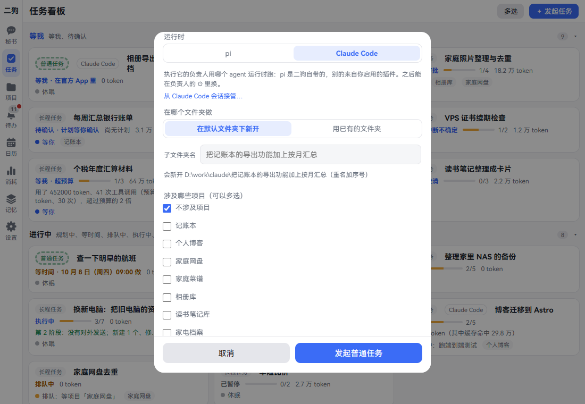
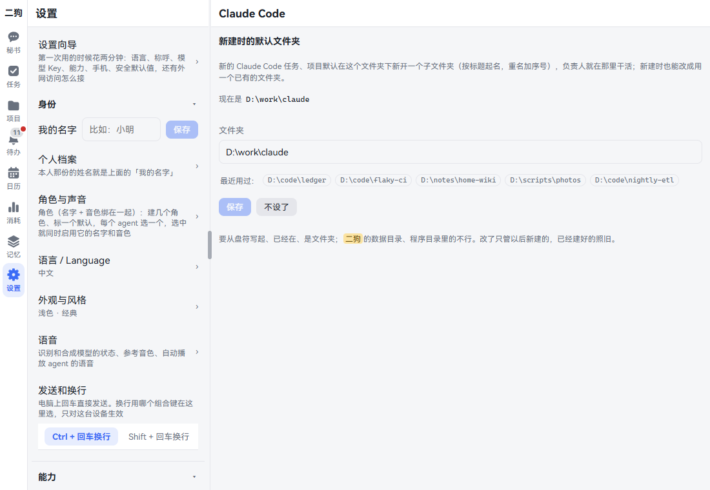
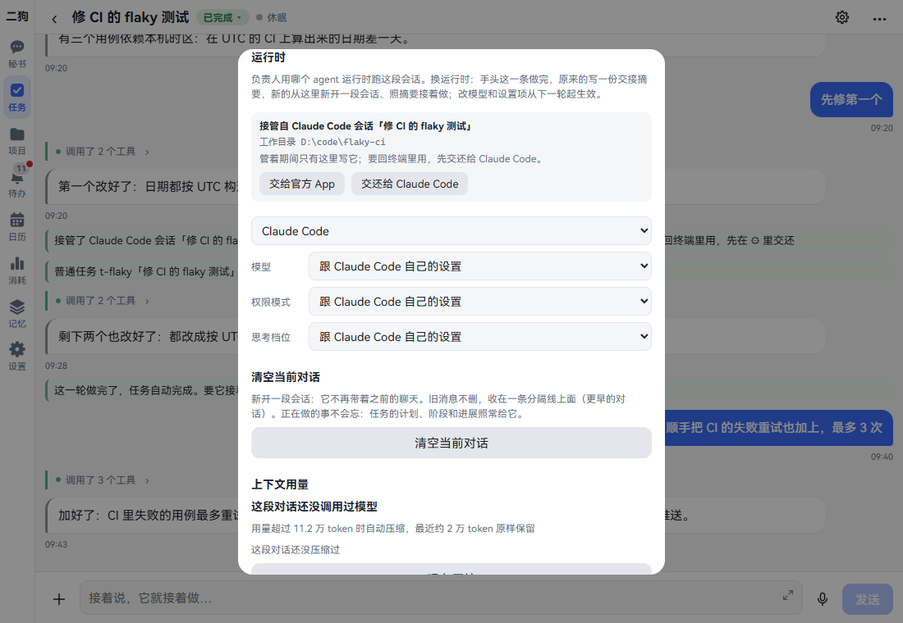
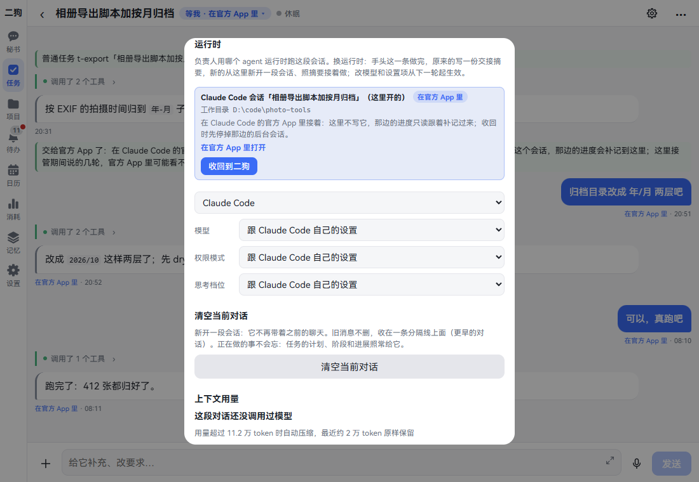
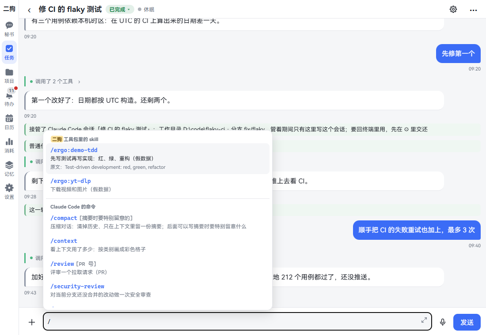

# Claude Code

这台电脑上装了 Claude Code 的，可以让任务、项目的负责人用它干活。比如写代码的活交给它，用你自己的订阅额度；二狗照样记下它的每一次工具调用，有风险的照样拦下或者问你。

已经在终端里开着的 Claude Code 会话，也能交给二狗接着做，做完再交回终端。还能交给官方 App，出门用手机接着说。

只有任务、项目的负责人能用 Claude Code。秘书不能换。

这一章讲怎么接上、怎么新建和接管会话、怎么来回交接。看完你能让 Claude Code 在二狗的管理下干活。

## 用之前要准备什么

1. 在这台电脑上装好 Claude Code 并登录。二狗用的是你本机的登录和订阅额度，你自己的配置（CLAUDE.md、技能、MCP、钩子）也照常加载。
2. 打开 **设置 · 能力 · 组件**，找「Claude Code 接入」。写「已装」或「已有」就好了。写「没装」就点「安装」，要下载约 120 MB。
3. 打开 **设置 · 能力 · 插件**，找 Claude Code。写「运行中」就好了。写「已停用」就点「启用」。

做完以后，发起任务和新建项目的对话框里会多一排「运行时」。pi 是二狗自带的，另一个就是 Claude Code。

**要知道的**

- 组件没装时，「运行时」里的 Claude Code 是灰的，下面一行写「要先装「Claude Code 接入」」，点「去装 ›」直接到组件页。
- 自己从源码跑二狗的，插件页上写着在哪个目录跑哪条命令来装。
- 插件停用后，用 Claude Code 的负责人不再启动。正在做的任务转成「等我」，写明「Claude Code插件没启用」，启用后接着做。

## 新建一个用 Claude Code 的任务

**在哪里打开：** 任务 · 右上角「＋ 发起任务」。

1. 点「＋ 发起任务」。对话框打开。
2. 选做法：普通任务、流程或长程任务。
3. 在「要做什么（第一行当标题）」里写清楚要做的事。
4. 「什么时候做」选一种。选「只提醒我」就没有下面这些了。
5. 「运行时」点 **Claude Code**。下面多出「从 Claude Code 会话接管…」和「在哪个文件夹做」。
6. 「在哪个文件夹做」二选一：
   - **在默认文件夹下新开**：按标题新开一个子文件夹，重名加序号。「子文件夹名」能改，下面一行写着会建在哪。没设默认文件夹时，这一项写的是「二狗开的工作目录」。
   - **用已有的文件夹**：填路径，要从盘符写起，比如 `D:\code\ledger`。下面的「最近用过：」点一下就填上。
7. 「涉及哪些项目（可以多选）」保持「不涉及项目」。
8. 点最下面的按钮。普通任务写「发起普通任务」，流程写「发起流程」，长程任务写「发起长程任务」。

点完看到一句提示，任务看板上多一张卡，卡上标着「Claude Code」。

**可以直接说的话**

- 用 Claude Code 把记账本的导出加上按月汇总
- 用 Claude Code 在 D:\code\ledger 里修一下导出的 bug

**要知道的**

- 只选了一个项目时，任务算这个项目的内部任务，用项目的运行时。「运行时」和「在哪个文件夹做」都不再显示。
- 填的路径不存在、是文件、在二狗的数据目录或程序目录里，都不行。对话框里当场写明原因。
- 删任务时不删这个文件夹。
- 普通任务做完一轮自动算完成。要它接着做，在任务里接着说。

## 新建一个用 Claude Code 的项目

**在哪里打开：** 项目 · 右上角「＋ 新建项目」。

1. 点「＋ 新建项目」，在「想立个什么项目（一件长期的事）」里写一句。
2. 「运行时」点 **Claude Code**，再选「在哪个文件夹做」，和任务一样。
3. 点「交给二狗」。按钮上的名字是你给助理起的。
4. 秘书出一张建议立项卡，上面写着「负责人用 Claude Code」。
5. 点「立项」。项目以筹备中诞生，负责人先开口和你做立项问答。

**可以直接说的话**

- 立个项目：把家里的知识库整理成能搜的网站，负责人用 Claude Code

立项之后的事见[项目](projects.md)。

## 定一个默认文件夹

**这是什么：** 新的 Claude Code 任务、项目都放在这个文件夹下面，各开一个子文件夹。不用每次都选。

**在哪里打开：** 设置 · 能力 · Claude Code。

1. 在「文件夹」里填路径，比如 `D:\work\claude`。也可以点「最近用过：」里的一个。
2. 点「保存」。提示「存好了：新的 Claude Code 任务、项目在它下面新开」。
3. 不想要了点「不设了」。

**要知道的**

- 要从盘符写起、文件夹已经在。二狗的数据目录、程序目录里的不行。
- 改了只管以后新建的，已经建好的照旧。
- 没设时，新的任务用二狗给它开的工作目录，项目的在项目档案里。
- 这一页由 Claude Code 插件带来。插件停用时设置列表里没有它。

## 接管已有的会话

**这是什么：** 你在终端里用 Claude Code 做到一半，想让二狗接着做。工作目录和之前聊到哪都照原来的。

**在哪里打开：** 发起任务或新建项目的对话框，「运行时」选 Claude Code 后，点「从 Claude Code 会话接管…」。

1. 点「从 Claude Code 会话接管…」。列出这台电脑上的会话，就是终端里 `/resume` 看得到的那些。每行写标题、工作目录、分支、最近活动和大小。列表不是最新的就点「刷新」。
2. 点选一个会话。下面写「工作目录用会话原来的：…」。
3. 看这一行有没有小签：
   - **没有签**：空闲，直接接。
   - **占着**：终端里开着，或者后台会话在跑。先去那边关掉再点「刷新」，或者勾「分叉一份接管（原会话不动）」。
   - **在管**：二狗的另一个任务或项目在管。要接只能勾分叉。
4. 接成任务时，在「接着让它做什么」里写一句，这一项必填。接成项目时，「项目要做成什么（可不填，空着用会话标题）」可以空着。
5. 点「接管」。勾了分叉的按钮写「分叉接管」。

接成任务的马上开始做。接成项目的直接建好，不经秘书出卡。会话里先列出前情：Claude Code 那边最近的几十条对话。前情只给你看，不算新的输入。

**要知道的**

- Claude Code 的会话没有锁。两边一起写会分叉，丢掉一边说的话。所以被占着的不让直接接。
- 接管期间只有二狗写这个会话。终端里别再打开它。
- 会话原来的工作目录不在了，接不了。
- 写错了想回去，点「返回」回到原来的对话框。

## 交还给终端，再收回来

**这是什么：** 接管来的会话，想回终端里亲手用一会儿。

**在哪里打开：** 任务详情或者项目负责人会话的标题栏，点 ⚙，找「运行时」这一块。

1. 点「交还给 Claude Code」。提示「交还了：可以回 Claude Code 里接着用」。
2. 回终端里接着用。这时二狗不写这个会话，在这里发话会提示「先在 ⚙ 里收回，再接着说」。
3. 用完了，先在终端里关掉这个会话，再回 ⚙ 点「收回到二狗」。提示「收回了：接着这个会话」。

**要知道的**

- 它正在做一轮时交还不了。等这一轮做完，或者先停下。
- 收回前二狗会核对这个会话没在别处开着。还开着就不收回，写明在哪开着。

## 交给官方 App，再收回来

**这是什么：** 要出门，想在手机上、claude.ai 上接着这个会话。接管来的和二狗自己开的都能交。

**在哪里打开：** 同一个 ⚙ · 运行时。

1. 点「交给官方 App」。等几秒到半分钟，按钮写「正在交给官方 App…」。
2. 成了以后，这一块多出「在官方 App 里打开」和链接。任务卡写「等我 · 在官方 App 里」。
3. 打开链接，在官方 App 里接着说。
4. 要接回来，回 ⚙ 点「收回到二狗」。那边的后台会话停掉，这里接着同一个会话。

在官方 App 里时，这里不写这个会话，发话会提示先收回。那边说的话、调的工具，二狗大约每分钟补记一次，标着「在官方 App 里」。

**要知道的**

- 这件事只认订阅登录，要本机的 Claude Code 登录着。
- 终端里还开着这个会话时交不出去，写明原因，会话照旧留在这边。
- 还没说过话的会话交不了。提示「先在这里说一句再交」。
- 接管期间在这里说的几轮，官方 App 里可能看不到。
- 再交一次是唤醒原来那个后台会话，还是同一个链接。

## 选模型、权限模式、思考档位

**在哪里打开：** ⚙ · 运行时，下面三个下拉。默认都是「跟 Claude Code 自己的设置」。

1. **模型**：列表是 Claude Code 自己报的。它还没起来过时先列 Opus、Sonnet、Haiku。
2. **权限模式**：见下表。
3. **思考档位**：低、中、高、很高、最高。

改完提示「改好了，从下一轮起生效」。

| 权限模式 | 选了会怎样 |
|---|---|
| 跟 Claude Code 自己的设置 | 用你 Claude Code 设置里写的 |
| 默认（照你的放行规则） | 照你设置里的放行、禁止规则 |
| 自动接受改文件 | 改文件不再要确认 |
| 计划模式（只看不改，先出计划） | 它只看不改，做好计划出一张卡等你批准 |
| 自动（模型判断要不要放行） | 由模型判断放不放行 |
| 不问（没放行的一律拒绝） | 没放行过的直接拒绝 |

**要知道的**

- 不管选哪种，每次工具调用先过二狗的守卫。守卫拦下的这里放不开，你 Claude Code 设置里的放行规则也绕不过它。
- 守卫放行之后，Claude Code 自己要问人时二狗直接放行，不再问你一遍。想让它问你，到[关注类别](settings.md#关注类别)里调严。
- 没有「全部放行」这一档。
- 选了「不问」时，刚授权的文件夹要等下一次起进程才读得了。

## 换运行时

**这是什么：** 让已有的负责人从 pi 换到 Claude Code，或者换回来。

1. 在 ⚙ · 运行时最上面的下拉里选另一个。
2. 弹出「换成 X？」，点「换」。提示「正在换成 X」。

手头这一条做完，原来的写一份交接摘要，新的新开一段会话，照摘要接着做。之前的聊天留在原处。

## 斜杠命令

**在哪里打开：** 用 Claude Code 的负责人的会话，在输入框打 `/`。

1. 打 `/`，弹出候选，分组列着。选中的一行说明完整展开。
2. 接着打字过滤，或者用方向键选。手机上点一行就选中，点右边的 ⓘ 只看说明。
3. 选中后命令填进输入框。要带参数接着写，比如 `/compact 留意数据库改动`。
4. 发送。

| 组 | 里面有什么 |
|---|---|
| 二狗的命令 | 二狗自己的，比如 `/workflow`、`/task`。在能用的会话里才列 |
| 二狗工具包里的 skill | 这个任务、项目工具包里的 skill，写成 `/ergo:<名字>` |
| Claude Code 的命令 | Claude Code 自己报的命令，比如 `/compact`、`/context`、`/review` |

**要知道的**

- 除了二狗自己的命令，别的都原样交给 Claude Code 执行。
- 英文说明换成了中文，原文写在下面。你自己的命令第一次先显示原文，翻好后换上。
- 打 `/weekly-report` 这种 skill 的名字也行，会自动换成 `/ergo:weekly-report`。和 Claude Code 自己的命令同名时用它自己的。

## 它问你的事，变成二狗的卡

Claude Code 要问你的，在它的会话里和待办里各出一张卡。

- **选择题**：选项带说明，能多选的可以选几个，都不合适就在「都不合适就自己写」里写。点「提交回答」或者「不答」。
- **计划**：点「批准」，或者点「打回」并在「附一句（打回时写让它怎么改）」里写怎么改。

这一轮结束了还没答的卡作废。

## 撤回

会话缩小后，条左边的 ↶ 照常能点。Claude Code 从那条之前另起一个会话接着做，原来的留着，成了一条能切回去的废弃分支。

它用 Write、Edit 改过的文件恢复到那条之前。Bash 改的追不到。接管时导入的前情，撤回不到它之前。怎么操作见[和秘书说话](chat.md)。

## 要知道的

- 每次工具调用的参数和结果都记进二狗。子代理里的调用也一样。
- 它自带的待办清单、派子代理、用技能这些会话里的事照常做。认不出的工具（比如你自己配的 MCP）按「未知的写操作」判。
- 二狗的工具（提交计划、汇报进展、发附件、联网搜索、工具包里的 MCP）它都能调，每次照样过守卫。
- 用你的订阅额度。交给它的环境里去掉了 `ANTHROPIC_API_KEY`，不会悄悄改成按量计费。
- 范围审视和撤回时的分支摘要，还是用二狗自己的模型。
- 二狗不动你的 `~/.claude` 和项目的 `.claude/`。
- 新授权的[文件夹](browser.md#授权的文件夹)：下一次调用就按新的名单判。但选了「不问（没放行的拒绝）」权限模式时，要等下一次起进程才读得到；这个模式下用 Bash 读别处一直不行。

## 相关

- [skill、MCP 和插件](skills-mcp-plugins.md)：工具包里给 Claude Code 配什么。
- [任务](tasks.md)、[项目](projects.md)：三种做法、立项和验收。
- [设置 · 关注类别](settings.md#关注类别)：调哪些操作要问你。
