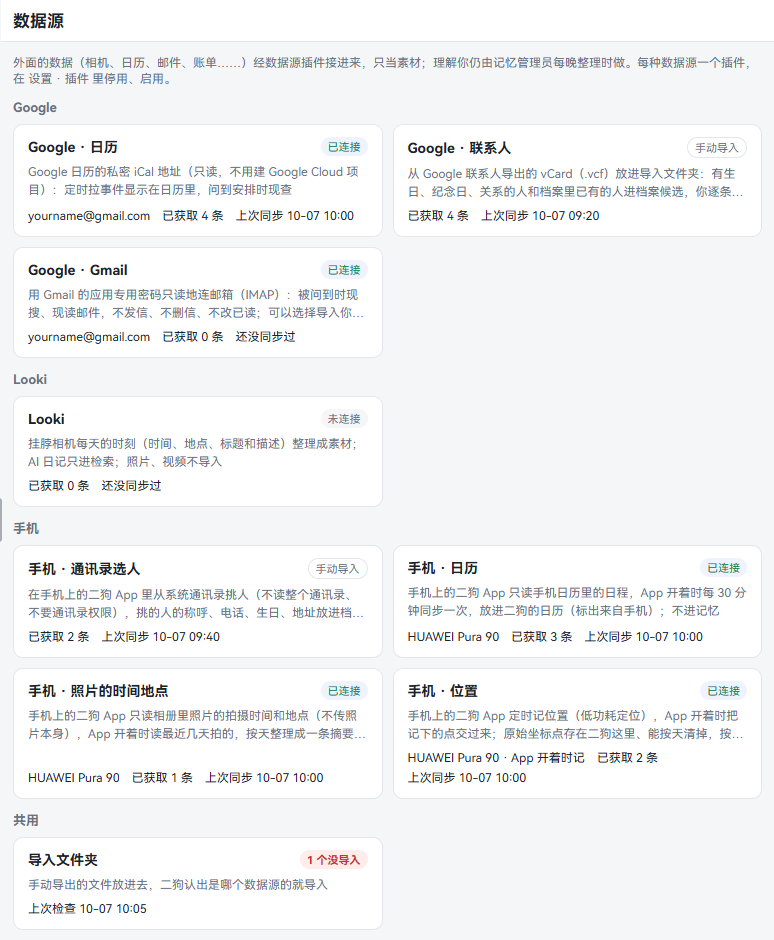
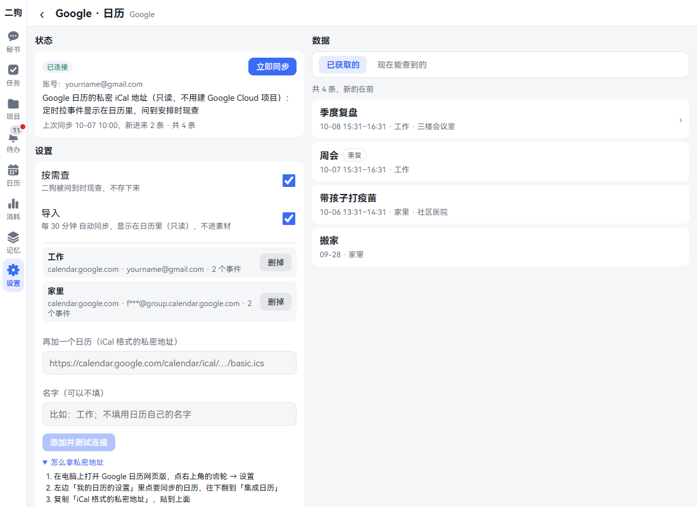
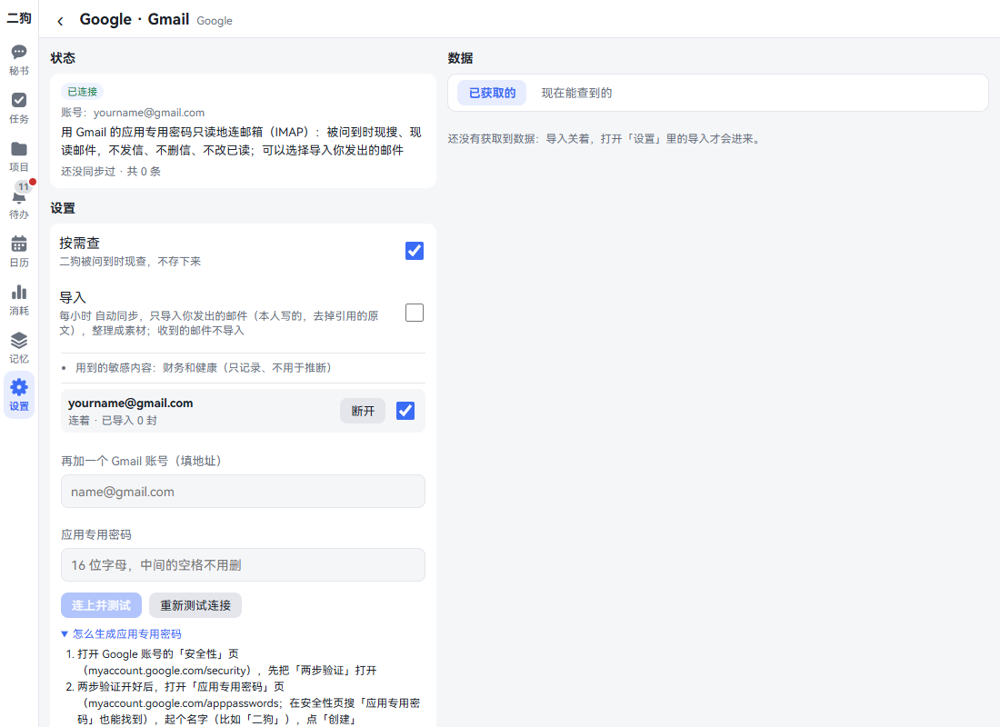
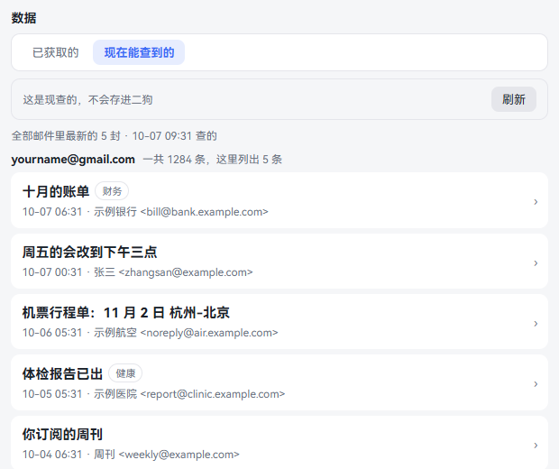
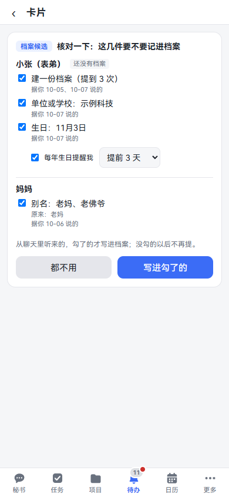
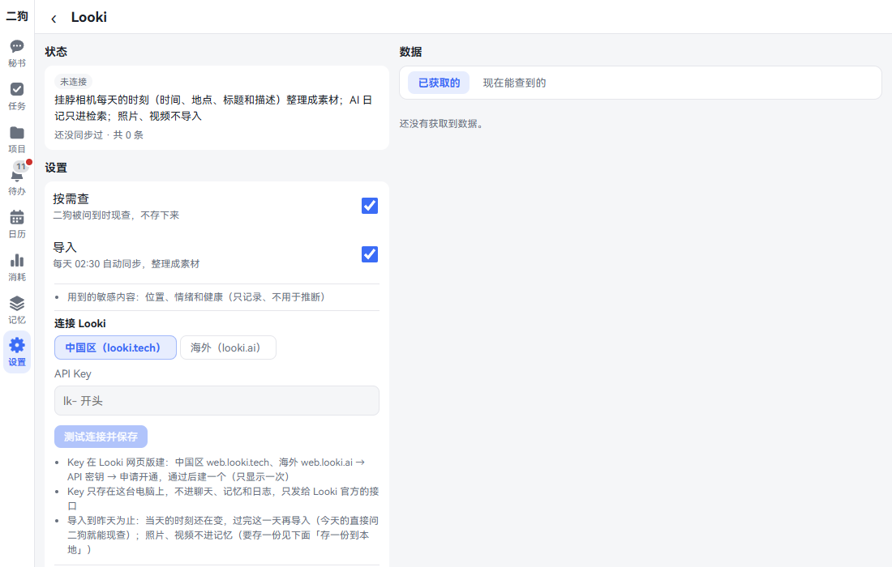
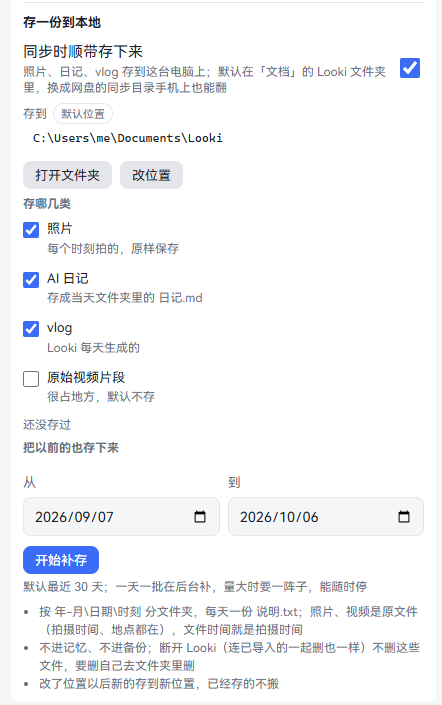
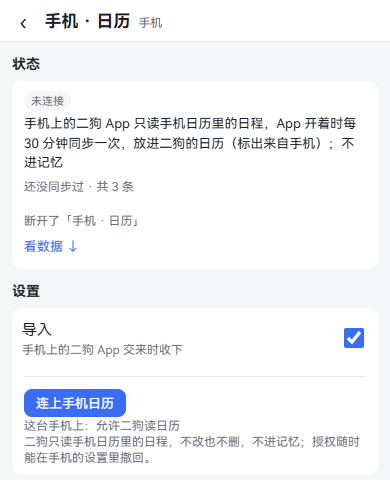
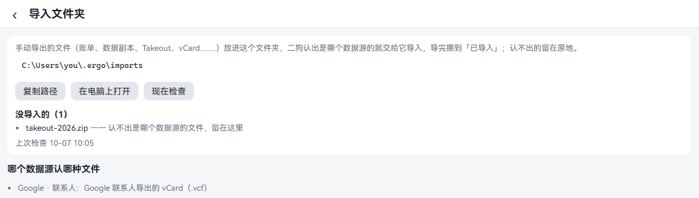
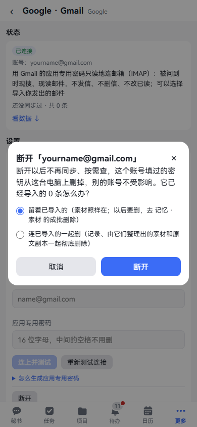

[中文](data-sources.md) | **English**

# Data sources

Screenshots show the Chinese interface; the labels in the text are the English ones.

Data sources bring data from outside ergo into it: Google Calendar, Gmail, Google Contacts, the Looki wearable camera, and your phone's contacts, calendar, photos and location. Once they're connected you can ask "What's on my schedule next Wednesday?", "What did that plane ticket email say last month?" or "What was I doing yesterday afternoon?"

This data only counts as material, not as something you said. If it contains instructions for ergo, ergo won't follow them.

This chapter goes through the data sources one by one: how to connect each, what you can ask, and how to disconnect and delete it. By the end you can bring in the data you want, and you know how to take it back.

## First look

**Where to open it:** Settings · Data & devices · Data sources. On a phone, Settings is under **More**.

The page is a set of cards, grouped by source. Each card shows the name, one line of description, status, account, how many items were fetched, and the last sync.

**Status tags:**

| It says | Meaning |
|---|---|
| Connected | Connected and working |
| Not connected | Not authorized yet |
| Needs authorization | The authorization stopped working and has to be filled in again |
| Error | Can't connect, or there's a problem with the authorization; the details page gives the reason. Google and Looki retry automatically every hour |
| Manual import | No connection needed; data comes in only when you hand over a file or pick people |
| Plugin off | The matching plugin is turned off |

Tap a card to open its own page, which has three parts:

- **Status**: connection status, account, what went wrong, last sync. Sources that can sync have **Sync now**.
- **Settings**: enter a key or address, usage switches, disconnect.
- **Data**: **Fetched** is what has already come into ergo; **Available now** asks the other side on the spot.

**Two ways of using a source, each with its own switch:**

- **On-demand lookup**: ergo looks it up when asked, and doesn't store it.
- **Import**: syncs regularly and stores it in ergo. Some is organized into materials and some shows in the calendar; the page says where it goes. Before the nightly memory consolidation, every connected source with import on also syncs once (unless it synced in the last 10 minutes), so what just came in is consolidated that same night, and **Last sync** shows that run. Phone sources aren't synced then. See [Memory curator](memory.en.md#memory-curator).

## All of them in one table

| Data source | How to authorize | Where you see it after authorizing | How to disconnect |
|---|---|---|---|
| Google · Calendar | Paste the secret iCal address | **Other calendars** on the Calendar page, and this data source's **Data** | **Disconnect**, or **Remove** just one calendar |
| Google · Gmail | Enter your address and an app password | Ask the secretary, **Available now**; with import on, in Memory · Materials | **Disconnect** next to the account, or **Disconnect all** |
| Google · Contacts | No authorization; put the exported file in the import folder | A review card in the Inbox; once confirmed, in Memory · Files | **Delete imported data** |
| Looki | Pick a region, enter an API key | Ask the secretary, Memory · Materials; photos and journals in a local folder | **Disconnect** |
| AMap | Enter the Web key and its security code (Web service key optional) | The map page uses AMap inside China; with the Web service key, places and routes inside China are looked up on AMap (**Run a test lookup** checks it works; without it, China uses OpenStreetMap too); see [Maps](map.en.md) | **Disconnect** |
| Phone · Pick contacts | Tap **Pick from phone contacts** in the HarmonyOS app | A review card in the Inbox; once confirmed, in Memory · Files | **Delete imported data** |
| Phone · Calendar | Tap **Connect phone calendar** in the HarmonyOS app | **Other calendars** on the Calendar page | **Disconnect** |
| Phone · Photo times and places | Tap **Connect album** in the HarmonyOS app | One summary a day in Memory · Materials | **Disconnect** |
| Phone · Location | Tap **Start recording location** in the HarmonyOS app | One summary a day in Memory · Materials | **Disconnect** |

## Google · Calendar

**What it is:** Puts Google Calendar events into ergo's calendar, and looks them up live when you ask about your schedule. Read-only: it changes nothing on Google's side. No Google Cloud project needed.

**Where to open it:** Settings · Data & devices · Data sources, then **Google · Calendar**.

**How to authorize:**

1. On a computer, open Google Calendar on the web and click the gear at the top right → Settings.
2. Under **Settings for my calendars** on the left, pick the calendar to sync and scroll to **Integrate calendar**.
3. Copy the **Secret address in iCal format**.
4. Back in ergo, paste it into **Secret address in iCal format**. This is a password box, so you can't see what you paste.
5. If you want to give it a name, fill in **Name (optional)**, such as "Work".
6. Click **Add and test connection**. The button says **Testing the connection…**.
7. When it works it says **Added; N synced in**, and a row for this calendar appears above.

These steps are also on the page; click **How to get the secret address** to expand them. If you have several calendars, repeat this; the box then says **Add another calendar (secret address in iCal format)**.

**Where you see it after authorizing:**

- [The Calendar page](calendar-reminders.en.md): cells get a small orange mark. Open that day for an **Other calendars** section with the time, title and where it came from.
- **Data** on this page: **Fetched** is what was synced. **Available now** looks up the next 30 days on the spot, without storing them.
- It syncs automatically every 30 minutes; you can also click **Sync now**.

**You can just say:**

- "What's on my schedule next Wednesday?"
- "How many meetings are on my Google Calendar this month?"

**How to disconnect:**

- To remove one calendar: click **Remove** on its row.
- To disconnect everything: click **Disconnect** at the bottom and choose to keep or delete, see [Disconnecting and deleting](#disconnecting-and-deleting). Nothing changes on the Google Calendar side.

**Good to know:**

- This address works like a password: anyone with it can see your calendar. ergo only keeps it in this computer's secrets area. If it leaks, click **Reset** in the same place in Google Calendar and enter the new address here.
- If the address was reset on Google's side, this page says **The address no longer works** and you need to copy it again.
- Admins of work and school accounts may have turned this feature off.
- The address must start with `https://`. If you paste the wrong thing, it says why.

## Google · Gmail

**What it is:** Searches and reads mail live when you ask about it. Read-only: it doesn't send, delete or change read status, and received mail isn't stored. You can connect several accounts.

**Where to open it:** Settings · Data & devices · Data sources, then **Google · Gmail**.

**How to authorize:**

1. Open the Security page of your Google account (myaccount.google.com/security) and turn on 2-Step Verification first.
2. Open the App passwords page (myaccount.google.com/apppasswords; you can also search for **App passwords** on the Security page). Give it a name, like "ergo", and click **Create**.
3. Copy the 16-letter password that pops up.
4. Back in ergo, fill in **Gmail address** and **App password**. You don't need to remove the spaces in the password.
5. Click **Connect and test**. When it works it says **Connected**, and a row for this account appears above.

These steps are also on the page; click **How to create an app password** to expand them.

**Adding another account:** Enter the new address under **Add another Gmail account (address)** along with its password, and click **Connect and test**.

**Changing the password:** Enter the existing address and the new password; the button becomes **Change password and test**. When it asks you to enter it again, click **Enter a new password** next to the account, and the address is filled in for you.

**Pausing an account:** Turn off the switch to the right of the account. When off it isn't searched or imported, and it isn't disconnected either.

**Where you see it after authorizing:**

- Ask the secretary. If you don't say which account, it searches all of them, and the results say which account each came from.
- **Available now** on this page: the latest few messages of each account, one group per account. The list has only the sender, subject and time; the body is fetched only when you open a message. None of it is stored in ergo, goes into memory, or passes through a model.
- The **Import** switch is off by default. Turn it on and it syncs every hour, importing only **the mail you sent** (without quoted original text), organized into materials you can see under **More · Memory · Materials**. The first time it goes back 30 days, up to 50 messages at a time; what's left continues next time. Received mail isn't imported.

**You can just say:**

- "Check my mailbox for last week's plane ticket emails"
- "Search only the name@gmail.com account for reimbursement emails"
- "Read that health checkup report email"

**How to disconnect:**

- One account: click **Disconnect** next to it, and choose in the confirmation box whether to keep or delete what was imported. Other accounts aren't affected.
- All accounts: click **Disconnect all** at the bottom. With only one account, this button says **Disconnect**.
- If you're done with it, also delete the password on Google's App passwords page.

**Good to know:**

- This password can read your whole mailbox. ergo only keeps it in this computer's secrets area, and it never shows on pages or in logs.
- Changing your Google account password revokes all app passwords, and you need to create a new one.
- No **App passwords** option? Google doesn't offer it when 2-Step Verification uses only security keys, for work or school accounts, or with Advanced Protection on.
- If login fails, the reason appears under the account and the status changes to **Needs authorization**. ergo retries automatically every hour.

## Google · Contacts

**What it is:** Turns people in Google Contacts who have a birthday, anniversary or relationship into suggestions for your personal files. They go into the files only after you confirm them one by one. Nothing goes into memory.

**Where to open it:** Settings · Data & devices · Data sources, then **Google · Contacts**.

**How to authorize:** No sign-in and nothing to fill in. You export a file and hand it to ergo.

1. On a computer, open Google Contacts on the web (contacts.google.com) and click **Export** at the top right.
2. Pick the contacts to export, choose **vCard (for iOS Contacts)**, then click **Export**.
3. Put the downloaded `contacts.vcf` into the [import folder](#import-folder).
4. ergo imports it once it recognizes the file, and moves the file to **Imported**.

**Where you see it after authorizing:**

- A **Check suggestions for your personal files** card appears in the Inbox, with one group per person showing what would be recorded. Tick what you want and tap **Save the ticked ones**, or tap **None of these** if you want none.
- What's saved is under **More · Memory · Files**.
- **Fetched** on this page lists the imported people.

The card in the image comes from a chat. One from contacts looks the same, and the note below it says **From an imported address book**.

**How to disconnect:** Click **Delete imported data** at the bottom and confirm, which deletes the imported records. Profile suggestions you haven't handled yet are dropped too. What's already in your files stays, and Google Contacts itself is untouched.

**Good to know:**

- People with a birthday, anniversary or relationship, and people already in your files, become suggestions. The birthday and phone number on your own entry go into your own file, and family listed on it come in with their relationship. People with only a phone number or email don't.
- A review card holds up to 10 people; when you finish, the next batch follows. Dropping the same file in again won't ask again.

## Looki wearable camera

**What it is:** Connects to the official API of the Looki neck-worn camera. Each day's "moments" (when, where, what you were doing) are organized into materials, and looked up live when you ask "What was I doing yesterday afternoon?" It can also save a copy of photos, journals and vlogs on your computer.

**Where to open it:** Settings · Data & devices · Data sources, then **Looki**.

**How to authorize:**

1. Open Looki Web: web.looki.tech for China, web.looki.ai for elsewhere.
2. Go to **API keys**, apply for access, and create a key once approved. The key is shown only once, so remember to copy it.
3. Back in ergo, under **Connect Looki**, pick the region: **China (looki.tech)** or **International (looki.ai)**. Keys don't work across the two.
4. Paste the key into **API key**. It starts with `lk-`.
5. Click **Test connection and save**. When it works it says **Connected: account (region)**. If it doesn't, it says why, such as **Looki doesn't accept this key**.

**Where you see it after authorizing:**

- Ask the secretary; today's can also be looked up live.
- **More · Memory · Materials**: every day at 02:30 it automatically imports moments up to yesterday. Today's are still changing, so they're imported after the day ends.
- **Available now** on this page: the last 3 days of moments, looked up live and not stored.
- AI journals are only searchable. Photos and videos don't go into memory.

**Keeping a local copy:**

1. Further down the same page, under **Keep a local copy**, **Save while syncing** is on by default.
2. By default it saves to a Looki folder in **Documents**. To change it, click **Change folder**, fill in the full path and click **Save folder**. Point it at a cloud drive's sync folder and you can browse it on your phone too.
3. Tick under **What to keep**: Photos and AI journals are saved by default; Raw video clips take a lot of space and aren't saved by default; Vlogs (the video Looki cuts automatically each day) aren't saved by default. Tick Vlogs and the video is saved, and its description also counts toward that day's AI journal (written into the journal file and kept as material); leave it unticked and ergo skips the whole entry: it isn't saved, isn't treated as a journal, and isn't listed when you ask about that day's journal.
4. To save earlier ones too, pick start and end dates under **Save earlier days too** and click **Start catching up**. The default is the last 30 days, and it goes back at most 366 days at a time. You can **Stop** and **Continue** at any time.
5. Click **Open folder** to see the saved files.

**You can just say:**

- "What was I doing yesterday afternoon?"
- "Where did I go last Saturday?"

**How to disconnect:** Click **Disconnect** at the bottom and choose to keep or delete. Photos, journals and vlogs saved locally aren't deleted: they're your own archive, and if you want them gone, delete them from the folder yourself.

**Good to know:**

- Once connected, the title of this section says **Change key or region, or test again**. Leave the key empty and the saved one is used, with the button saying **Test again**. Enter a new one and the button says **Test connection and save**.
- Looki allows at most 60 requests a minute per key. When rate-limited, it waits a while and carries on syncing.
- Location, emotion and health count as sensitive content: by default they're recorded only, not used for inference.

## Data on your phone

**What it is:** The ergo app on your phone reads data on the phone and hands it to ergo on your computer: picking people from contacts, the phone calendar, photo times and places, and location.

**For now only the HarmonyOS app has these four.** The Android app doesn't yet, and the page says **not in the Android app yet**. Computer and phone browsers only show an explanation, and the computer can't query the phone, so these have no **Available now**. To install the app, see [On your phone](mobile.en.md).

**Where to open it:** In the HarmonyOS app, open More · Settings · Data & devices · Data sources, and tap the **Phone · …** cards.

Calendar, photos and location each pop up the system's permission box on the phone. If you refuse, you can tap the button again, or turn it on in the phone's Settings · Apps & services · Ergo · Permissions.

### Phone · Pick contacts

**How to authorize:** No contacts permission needed.

1. Tap **Pick from phone contacts**. The system's contact picker opens.
2. Pick people. ergo only gets the name, phone number, birthday and address of the people you pick, and doesn't read your whole contacts.

**Where you see it after authorizing:** The page says **Sent to profile suggestions: …**; tap **Review**. The review card is also in the Inbox. Only what you tick goes into the files, and what's saved is under **More · Memory · Files**. Nothing goes into memory.

**How to disconnect:** Tap **Delete imported data**. Profile suggestions you haven't handled yet are dropped too. What's already in your files stays, and the contacts on the phone are untouched.

### Phone · Calendar

**How to authorize:**

1. Tap **Connect phone calendar** and allow it in the system box.
2. Below it says **On this phone: Ergo may read the calendar**, and the button becomes **Sync now**.

**Where you see it after authorizing:** **Other calendars** on [the Calendar page](calendar-reminders.en.md), marked as from the phone. It syncs every 30 minutes while the app is open. Read-only: it doesn't change or delete anything, and nothing goes into memory.

**When the phone sends 0 events:** if plenty of events were synced before (20 or more) and this time none arrive, most likely the phone didn't manage to read its calendar just then (the app was in the background, or the system didn't allow it). Ergo doesn't delete anything; the line on the Data sources page says "0 events (most likely the phone didn't manage to read its calendar just then …)", and syncing carries on the next time the phone reads its events. If it's 0 three times in a row, or still 0 a day later, **Inbox** asks once: **Did you really clear the calendar on your phone?** If you did (or removed the calendar account, or switched phones), tap **Yes, delete them** and only then is ergo's copy deleted; if not, tap **No, keep them**. When there were only a few events, they're deleted along with the phone as usual.

**How to disconnect:** Tap **Disconnect**. Synced events stop showing, and the phone's calendar is untouched. Choose **Delete what was imported too** and the records on ergo's side are deleted as well. You can also withdraw the permission in the phone's settings.

### Phone · Photo times and places

**How to authorize:**

1. Tap **Connect album** and allow reading the album and photo locations in the system box.
2. It's also fine to allow only the album and not location; then photos have no place.

**Where you see it after authorizing:** **More · Memory · Materials**, one summary a day, such as how many photos in which part of the day. Today's is organized after the day ends. While the app is open it reads photos from the last few days: once on opening, once on returning to the foreground, and once every 30 minutes.

**How to disconnect:** Tap **Disconnect**. Choose **Delete what was imported too** and the summaries and raw data are both deleted. To clear only raw data, view it by day under **Raw photo times and places**: each day has a **Clear**, which takes two taps. What's cleared isn't accepted again, even if the phone sends it again.

**Good to know:** The photos themselves never leave the phone or go to your computer; only the time and place taken are sent. Place names are converted by the phone's system, and coordinates are sent to the phone's map service.

### Phone · Location

**How to authorize:**

1. Tap **Start recording location** and allow location in the system box.
2. Below it shows the permission and whether it's recording, such as **Ergo may use location (precise), recording (while the app is open)**.
3. If you want the app to record in the background too, turn on **Also record when the app is in the background**. A notification stays on, and it uses more battery.

**Where you see it after authorizing:** **More · Memory · Materials**, one summary a day of where you went and how long you stayed.

**Frequent places:** Further down the same page you can name places you go often, such as home or work.

1. **Places you stay often (not named yet)** lists them; tap **Name it**.
2. Or tap **Add a place**, fill in a name, pick a range (100 to 1000 meters), and use **Use current location** or **Find** by place name.
3. Later summaries use this name. Naming or renaming doesn't change earlier summaries.

**How to disconnect:** Tap **Disconnect**. The phone stops recording, and points not yet sent are deleted. Choose **Delete what was imported too** and the summaries, raw location points and named places are all deleted. To clear only raw data, clear it by day under **Raw location points**.

**Good to know:**

- Location only exists from the moment recording starts; it can't get anything earlier.
- While the app is open it records a point every 5 minutes with low-power positioning, no GPS. A few seconds after the app goes to the background the system suspends it and nothing is recorded, unless you turned on background recording (every 10 minutes).
- The whole summary counts as **Location**, a kind of sensitive content. While inference isn't turned on for location in memory, it isn't used for inference.

## Import folder

**What it is:** Put files you exported by hand in this folder; ergo works out which data source each belongs to and passes it along for import.

**Where to open it:** **Import folder** at the bottom of the data sources overview. The details page of a file-based source (such as Google · Contacts) has it too.

**Step by step:**

1. The page shows the folder's path. Click **Copy path** or **Open on computer**.
2. Put the file in.
3. ergo checks by itself, with a result within a minute. To see right away, click **Check now**.
4. Imported files move to the **Imported** folder inside and are listed under **Recently imported**. Those it can't recognize stay where they are and are listed under **Not imported**, followed by the reason.

**Good to know:**

- The folder is on ergo's computer. **Open on computer** also opens it on that computer.
- Right now it recognizes vCard files (`.vcf`) exported from Google Contacts. **Which source takes which files** lower on the page has the current list.
- Only put files at the top level. Subfolders aren't looked at, and neither are temporary files still downloading.

## Disconnecting and deleting

Clicking **Disconnect** opens a confirmation box; pick one:

- **Keep what was imported**: no more syncing or on-demand lookups, and any key you entered is deleted from this computer. What was imported stays.
- **Delete what was imported too**: the records, the materials organized from them and the original copies are all completely deleted, and can't be recovered. The copy in backup snapshots disappears as snapshots rotate.

The box spells out what will actually be deleted for each data source.

To delete kept materials later, use **Delete materials in bulk** in **More · Memory · Materials**.

## Turning off and removing

Each kind of data source is a plugin, which you can see in **Settings · Capabilities · Plugins**: **Data source - Google**, **Data source - Looki wearable camera**, **Data source - Phone**.

- **Turn off**: pages and tools are gone, earlier data stays. The data source card says **Plugin off**.
- **Remove**: you can choose to delete the data too.

For details see [Skills, MCP, toolkits and plugins](skills-mcp-plugins.en.md).

## Read next

- [Calendar and reminders](calendar-reminders.en.md): where other calendars show.
- [Memory](memory.en.md): materials, files, sensitive content.
- [On your phone](mobile.en.md): installing the app.
