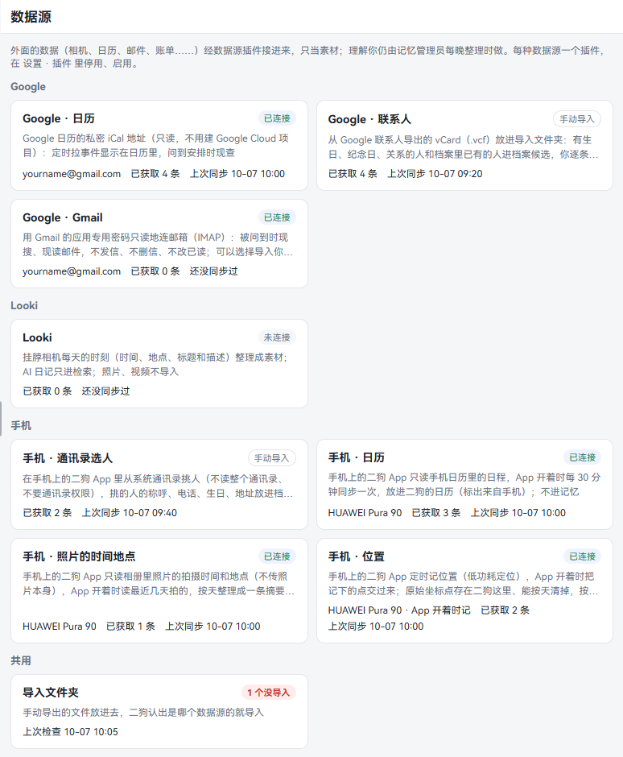
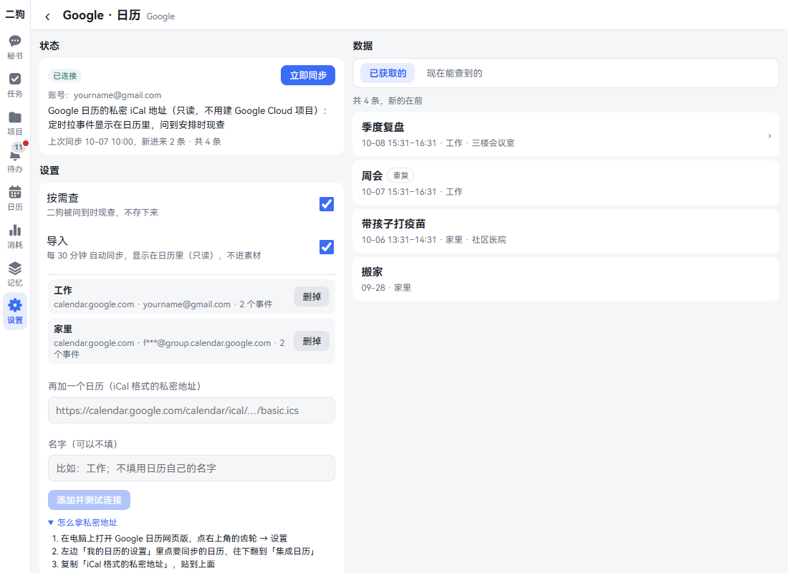
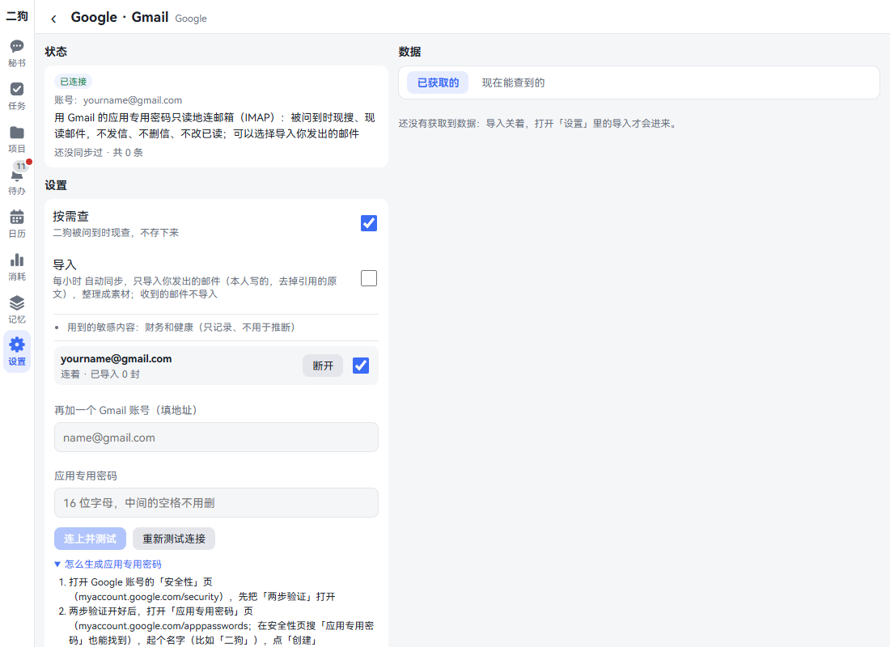
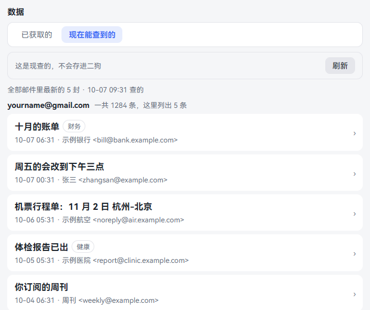
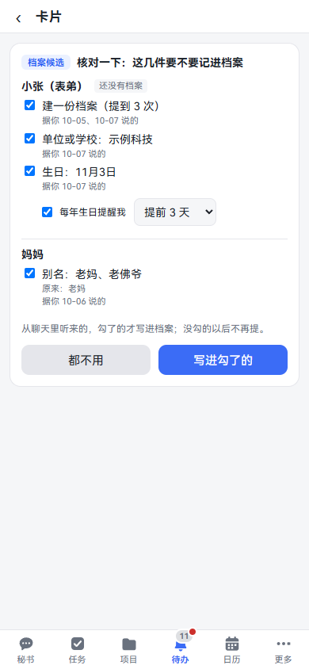
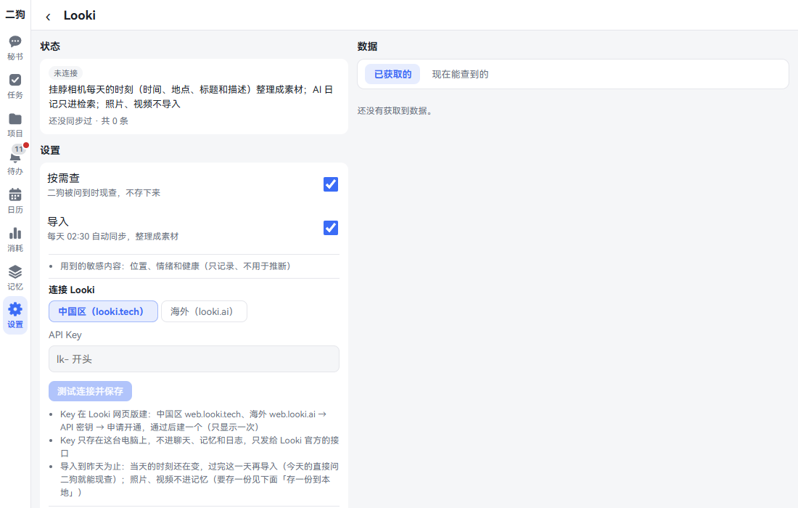
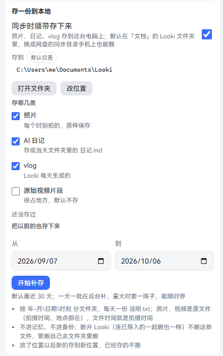
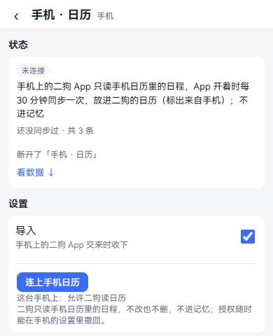
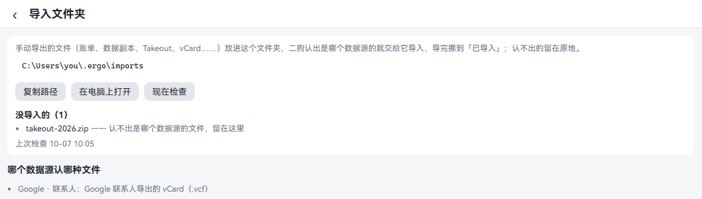
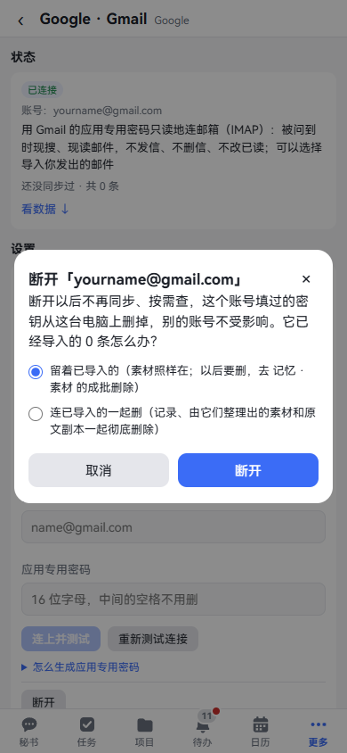

**中文** | [English](data-sources.en.md)

# 数据源

数据源把二狗外面的数据接进来：Google 日历、Gmail、Google 联系人、Looki 穿戴式相机，还有手机上的通讯录、日历、照片和位置。接好以后，你可以问"我下周三有什么安排""上个月那封机票邮件说了什么""我昨天下午在干嘛"。

这些数据只当素材，不是你说的话。里面写着让二狗做什么，它不会照做。

这一章一个数据源一个数据源地讲怎么连、能问什么、怎么断开和删除。看完你能把想接的数据接进来，也知道怎么收回去。

## 先看一眼

**在哪里打开：** 设置 · 数据与设备 · 数据源。手机上设置在「更多」里。

这一页是一张张卡片，按来源分组。每张卡写着名字、一句话、状态、账号、已获取几条、上次同步。

**状态签：**

| 写的是 | 意思 |
|---|---|
| 已连接 | 连着，正常 |
| 未连接 | 还没授权 |
| 要授权 | 授权失效了，要重新填 |
| 出错 | 连不上或者授权有问题，详情页写着原因。Google 和 Looki 每小时自动再试一次 |
| 手动导入 | 不用连接，你交文件或者挑人时才进来 |
| 插件没启用 | 对应的插件停用了 |

点一张卡进它单独的一页，分三块：

- **状态**：连接状态、账号、出了什么问题、上次同步。能同步的有「立即同步」。
- **设置**：填 Key 或地址、用法开关、断开。
- **数据**：「已获取的」是已经进到二狗的，「现在能查到的」是当场去问对方。

**两种用法，各有一个开关：**

- **按需查**：二狗被问到时现查，不存下来。
- **导入**：定期同步，存进二狗。有的整理成素材，有的显示在日历里，页面上写着去哪。每晚整理记忆之前，开着导入、连着的也会先各同步一次（10 分钟内刚同步过的不再同步），刚进来的当晚就整理得到，「上次同步」写的就是这一次；手机的不在这时同步。见[记忆管理员](memory.md#记忆管理员)。

## 一张表看全部

| 数据源 | 怎么授权 | 授权后在哪里看到 | 怎么断开 |
|---|---|---|---|
| Google · 日历 | 贴 iCal 私密地址 | 日历页的「外部日历」、这个数据源的「数据」 | 「断开」，或者只「删掉」一个日历 |
| Google · Gmail | 填邮箱和应用专用密码 | 问秘书、「现在能查到的」；开了导入的在 记忆 · 素材 | 账号旁边的「断开」，或者「全部断开」 |
| Google · 联系人 | 不用授权，把导出的文件放进导入文件夹 | 待办里的核对卡，确认后在 记忆 · 档案 | 「删除已导入的」 |
| Looki | 选区域、填 API Key | 问秘书、记忆 · 素材，本地文件夹里的照片和日记 | 「断开」 |
| 高德地图 | 填 Web 端 Key 和安全密钥（Web 服务 Key 选填） | 地图页在国内用高德地图，见[看地图](map.md) | 「断开」 |
| 手机 · 通讯录选人 | 鸿蒙 App 里点「从手机通讯录挑人」 | 待办里的核对卡，确认后在 记忆 · 档案 | 「删除已导入的」 |
| 手机 · 日历 | 鸿蒙 App 里点「连上手机日历」 | 日历页的「外部日历」 | 「断开」 |
| 手机 · 照片的时间地点 | 鸿蒙 App 里点「连上相册」 | 记忆 · 素材里每天一条摘要 | 「断开」 |
| 手机 · 位置 | 鸿蒙 App 里点「开始记位置」 | 记忆 · 素材里每天一条摘要 | 「断开」 |

## Google · 日历

**这是什么：** 把 Google 日历的日程放进二狗的日历，问安排时也能现查。只读，不改 Google 那边。不用建 Google Cloud 项目。

**在哪里打开：** 设置 · 数据与设备 · 数据源，点「Google · 日历」。

**怎么授权：**

1. 在电脑上打开 Google 日历网页版，点右上角的齿轮 → 设置。
2. 左边「我的日历的设置」里点要同步的日历，往下翻到「集成日历」。
3. 复制「iCal 格式的私密地址」。
4. 回到二狗，贴进「iCal 格式的私密地址」。这个框是密码框，贴进去看不到内容。
5. 想起个名字就填「名字（可以不填）」，比如"工作"。
6. 点「添加并测试连接」。按钮写"正在测试连接……"。
7. 成了写"加好了，同步进来 N 条"，上面多一行这个日历。

这几步也写在页面上，点「怎么拿私密地址」展开。有好几个日历就重复一遍，框上写"再加一个日历（iCal 格式的私密地址）"。

**授权后在哪里看到：**

- [日历页](calendar-reminders.md)：格子上多一个橙色小标，点开那一天有「外部日历」一节，写着时间、标题和来自哪里。
- 这一页的「数据」：「已获取的」是同步来的。「现在能查到的」当场查未来 30 天的日程，不存。
- 每 30 分钟自动同步一次，也可以点「立即同步」。

**可以直接说的话：**

- "我下周三有什么安排？"
- "这个月 Google 日历上有几个会？"

**怎么断开：**

- 只去掉一个日历：点那一行的「删掉」。
- 全部断开：点最下面的「断开」，选留着还是一起删，见[断开和删除](#断开和删除)。Google 日历那边不动。

**要知道的：**

- 这个地址相当于密码，拿到它的人能看你的日历。二狗只把它存在这台电脑的密钥区。不小心泄露了，在 Google 日历同一处点「重置」，再把新地址填进来。
- 在 Google 那边重置过地址，这里会写"地址失效了"，要重新复制。
- 工作、学校账号的管理员可能关了这个功能。
- 地址要以 `https://` 开头。贴错了会写明原因。

## Google · Gmail

**这是什么：** 问到邮件时现搜、现读。只读：不发信、不删信、不改已读未读，收到的邮件不存下来。可以连几个账号。

**在哪里打开：** 设置 · 数据与设备 · 数据源，点「Google · Gmail」。

**怎么授权：**

1. 打开 Google 账号的「安全性」页（myaccount.google.com/security），先把「两步验证」打开。
2. 打开「应用专用密码」页（myaccount.google.com/apppasswords，在安全性页搜「应用专用密码」也能找到）。起个名字，比如"二狗"，点「创建」。
3. 复制弹出来的 16 位密码。
4. 回到二狗，填「Gmail 地址」和「应用专用密码」。密码中间的空格不用删。
5. 点「连上并测试」。成了写"连上了"，上面多一行这个账号。

这几步也写在页面上，点「怎么生成应用专用密码」展开。

**再加一个账号：** 在「再加一个 Gmail 账号（填地址）」填新地址和它的密码，点「连上并测试」。

**换密码：** 填已有的地址和新密码，按钮变成「换密码并测试」。提示要重新填时，点账号旁边的「重新填密码」，地址自动带下来。

**一个账号先不用：** 关掉账号右边的开关。关了不查、不导入，也不断开。

**授权后在哪里看到：**

- 问秘书。不说哪个账号就查全部，结果写明来自哪个账号。
- 这一页的「现在能查到的」：每个账号最新几封，一个账号一组，列表只有发件人、主题和时间，点开一封才取正文。不存进二狗，不进记忆，也不经过模型。
- 「导入」开关默认关。打开后每小时同步一次，只导入**你发出的邮件**（去掉引用的原文），整理成素材，在 **更多 · 记忆 · 素材** 里看得到。第一次往回取 30 天，一次最多 50 封，没导完的下次接着导。收到的邮件不导入。

**可以直接说的话：**

- "查一下我邮箱里上周的机票邮件"
- "只查 name@gmail.com 这个账号，有没有报销的邮件"
- "把那封体检报告的邮件读一下"

**怎么断开：**

- 断开一个账号：点账号旁边的「断开」，确认框里选留着已导入的还是一起删，别的账号不受影响。
- 断开全部：点最下面的「全部断开」。只有一个账号时这个按钮写「断开」。
- 不想用了，再去 Google 的「应用专用密码」页把密码删掉。

**要知道的：**

- 这个密码能读你整个邮箱。二狗只把它存在这台电脑的密钥区，页面、日志里都不显示。
- 改了 Google 账号密码，所有应用专用密码都失效，要重新生成一个。
- 找不到「应用专用密码」：两步验证只用了安全密钥、是工作或学校账号、开了高级保护时，Google 不给这一项。
- 登录没通过时，账号下面写着原因，状态变成「要授权」。二狗每小时自动再试一次。

## Google · 联系人

**这是什么：** 把 Google 联系人里有生日、纪念日、关系的人，放进个人档案的候选，你逐条确认才写进档案。不进记忆。

**在哪里打开：** 设置 · 数据与设备 · 数据源，点「Google · 联系人」。

**怎么授权：** 不用登录，也不用填什么。你导出一个文件交给二狗。

1. 在电脑上打开 Google 联系人网页版（contacts.google.com），点右上角的「导出」。
2. 选要导出的联系人，格式选「vCard（适用于 iOS 通讯录）」，点「导出」。
3. 把下载的 `contacts.vcf` 放进[导入文件夹](#导入文件夹)。
4. 二狗认出来就导入，文件挪到「已导入」里。

**授权后在哪里看到：**

- 待办里多一张"核对要记进档案的候选"，卡上一个人一组，写着要记什么。勾要的，点「写进勾了的」，不要就点「都不用」。
- 写好的在 **更多 · 记忆 · 档案** 里。
- 这一页的「已获取的」列着导入的人。

图上这张来自聊天。通讯录来的长得一样，下面的说明写"从导入的通讯录来的"。

**怎么断开：** 点最下面的「删除已导入的」，确认后删掉导入的记录。档案候选里还没处理的一起作废。已经写进档案的不动，Google 联系人那边也不动。

**要知道的：**

- 进候选的是有生日、纪念日、关系的人，和档案里已经有的人。你自己那张上的生日、电话进你的档案，上面写的家人带着关系进来。只有电话、邮箱的人不进。
- 一张核对卡最多 10 个人，处理完接着上下一批。同一份文件再放一次不会重复问。

## Looki 穿戴式相机

**这是什么：** 接 Looki 挂脖相机的官方接口。每天的「时刻」（什么时候、在哪、在做什么）整理成素材，问"我昨天下午在干嘛"时现查。还能把照片、日记、vlog 存一份到电脑上。

**在哪里打开：** 设置 · 数据与设备 · 数据源，点「Looki」。

**怎么授权：**

1. 打开 Looki 网页版：中国区 web.looki.tech，海外 web.looki.ai。
2. 进「API 密钥」，申请开通，通过后建一个 Key。Key 只显示一次，记得复制。
3. 回到二狗，在「连接 Looki」下面选区域：「中国区（looki.tech）」或「海外（looki.ai）」。两边的 Key 不通用。
4. 把 Key 贴进「API Key」，它是 `lk-` 开头。
5. 点「测试连接并保存」。成了写"连上了：账号（区域）"。没过的写明原因，比如"Looki 不认这个 Key"。

**授权后在哪里看到：**

- 问秘书，当天的也能现查。
- **更多 · 记忆 · 素材**：每天 02:30 自动导入到昨天为止的时刻。当天的还在变，过完这一天才导入。
- 这一页的「现在能查到的」：最近 3 天的时刻，现查，不存。
- AI 日记只进检索。照片、视频不进记忆。

**存一份到本地：**

1. 同一页往下，「存一份到本地」下面的「同步时顺带存下来」默认开着。
2. 默认存到「文档」里的 Looki 文件夹。要换，点「改位置」填完整路径，点「保存位置」。换成网盘的同步目录，手机上也能翻。
3. 在「存哪几类」里勾：照片、AI 日记默认存；原始视频片段很占地方，默认不存；vlog（Looki 每天自动剪的视频）默认不存。勾上 vlog 才存视频，它那段说明也会算进当天的 AI 日记（写进 日记.md、进素材）；不勾就整条不要，二狗不存它、不把它当日记，问"那天的日记"时也不列。
4. 要把以前的也存下来，在「把以前的也存下来」选开始和结束日期，点「开始补存」。默认最近 30 天，一次最多往回 366 天。能随时「停下」「接着补」。
5. 点「打开文件夹」看存下的文件。

**可以直接说的话：**

- "我昨天下午在干嘛？"
- "上周六我去了哪些地方？"

**怎么断开：** 点最下面的「断开」，选留着还是一起删。存到本地的照片、日记、vlog 不删，那是你自己的档案，要删自己去文件夹里删。

**要知道的：**

- 连上以后，这一块的标题写"换 Key、换区域、再测一次"。不填 Key 就沿用存着的，按钮写「再测一次」。填了新的，按钮写「测试连接并保存」。
- Looki 每个 Key 每分钟最多 60 次。限速了会等一会儿接着同步。
- 位置、情绪、健康算敏感内容，默认只记录，不用于推断。

## 手机上的数据

**这是什么：** 手机上的二狗 App 读本机的数据交给你电脑上的二狗：从通讯录挑人、手机日历、照片的时间地点、位置。

**现在只有鸿蒙 App 有这四样。** 安卓 App 还没有，页面上写着"安卓 App 暂时没有"。电脑和手机浏览器里只显示说明，电脑也查不了手机，所以这几个没有「现在能查到的」。App 怎么装见[手机上用](mobile.md)。

**在哪里打开：** 在鸿蒙 App 里打开 更多 · 设置 · 数据与设备 · 数据源，点「手机 · ……」那几张卡。

日历、照片、位置都在手机上弹系统的授权框。拒绝了可以再点一次按钮，或者到手机的 设置 · 应用和元服务 · 二狗 · 权限 里打开。

### 手机 · 通讯录选人

**怎么授权：** 不要通讯录权限。

1. 点「从手机通讯录挑人」。弹出系统的选人界面。
2. 挑人。二狗只拿到你挑的人的称呼、电话、生日、地址，不读整个通讯录。

**授权后在哪里看到：** 页面写"交给档案候选了：……"，点「去核对」。待办里也有这张核对卡，勾了的才写进档案，写好的在 **更多 · 记忆 · 档案**。不进记忆。

**怎么断开：** 点「删除已导入的」。档案候选里还没处理的一起作废，已经写进档案的不动，手机上的通讯录也不动。

### 手机 · 日历

**怎么授权：**

1. 点「连上手机日历」，在系统框里允许。
2. 下面写"这台手机上：允许二狗读日历"，按钮变成「现在同步」。

**授权后在哪里看到：** [日历页](calendar-reminders.md)的「外部日历」，写着来自手机。App 开着时每 30 分钟同步一次。只读，不改也不删，不进记忆。

**手机交来 0 条时：** 以前同步来不少日程（20 条以上）、这次一条都没交来，多半是手机那一下没读到日历（App 在后台、系统没给），二狗不删，数据源页上那行写"手机交来：0 条日程（多半是手机这一下没读到日历……）"，手机下次读到了接着同步。连着 3 次都是 0 条，或者隔了一天还是 0 条，待办里会问一次"手机上的日程是不是真的清空了？"：真的清空了（或者删了日历账号、换了手机）点「清空了，删掉」，二狗这边的才删；没有就点「没清空，留着」。原来只有几条的，照常跟着手机删。

**怎么断开：** 点「断开」。同步来的日程不再显示，手机上的日历不动。选"连已导入的一起删"，二狗这边的记录也删掉。也可以在手机设置里撤回授权。

### 手机 · 照片的时间地点

**怎么授权：**

1. 点「连上相册」，在系统框里允许读相册、读照片的位置。
2. 只允许读相册、没允许读位置也行，这时照片不带地点。

**授权后在哪里看到：** **更多 · 记忆 · 素材**，每天一条摘要，比如哪个时段拍了几张。今天的过完这一天再整理。App 开着时读最近几天拍的，打开、回到前台、每 30 分钟各读一次。

**怎么断开：** 点「断开」。选"连已导入的一起删"，摘要和原始数据一起删。只想清原始数据，在「原始的照片时间地点」里按天看，一天一个「清掉」，点两下才清。清掉的手机再交来也不再收。

**要知道的：** 照片本身不离开手机，也不传给你的电脑，只传拍摄时间和地点。地名由手机系统转换，坐标会发给手机的地图服务。

### 手机 · 位置

**怎么授权：**

1. 点「开始记位置」，在系统框里允许定位。
2. 下面写着授权和在不在记，比如"允许二狗定位（精确位置），正在记（App 开着时）"。
3. 想让 App 在后台也记，打开「App 在后台也记」。通知栏会一直显示，更费电。

**授权后在哪里看到：** **更多 · 记忆 · 素材**，每天一条"去过哪、待了多久"的摘要。

**常去的地方：** 同一页下面能给常去的地方起名，比如家、公司。

1. 「最近常待的（还没起名）」列着常待的地方，点「起名」。
2. 或者点「加一处」，填名字，选范围（100 到 1000 米），用「用现在的位置」或者按地名「找」。
3. 以后的摘要里写这个名字。起名、改名不改以前的摘要。

**怎么断开：** 点「断开」，手机上停止记，还没交出去的点一起删。选"连已导入的一起删"，摘要、原始位置点和起了名的地方一起删。只想清原始数据，在「原始位置点」里按天清掉。

**要知道的：**

- 位置只能从开始记的那一刻起有，拿不到以前的。
- App 开着时每 5 分钟用低功耗定位记一个点，不开 GPS。App 退到后台几秒后被系统挂起，这时记不到，除非打开了后台也记（每 10 分钟一次）。
- 整条摘要算「位置」这类敏感内容。记忆那边位置没打开推断时，不拿来推断。

## 导入文件夹

**这是什么：** 手动导出的文件放进这个文件夹，二狗认出是哪个数据源的就交给它导入。

**在哪里打开：** 数据源总览最下面的「导入文件夹」。认文件的数据源（比如 Google · 联系人）详情页里也有。

**一步一步：**

1. 页面上写着文件夹的路径。点「复制路径」，或者「在电脑上打开」。
2. 把文件放进去。
3. 二狗自己会检查，一分钟内就有结果。想马上看，点「现在检查」。
4. 导入的文件挪到里面的「已导入」，列在「最近导入的」。认不出的留在原地，列在「没导入的」，后面写着原因。

**要知道的：**

- 文件夹在二狗那台电脑上。「在电脑上打开」也是在那台电脑上开。
- 现在认的是 Google 联系人导出的 vCard（`.vcf`）。页面下面「哪个数据源认哪种文件」写着现在的清单。
- 文件只放第一层。子文件夹不看，还没下载完的临时文件也不看。

## 断开和删除

点「断开」后弹确认框，选一个：

- **留着已导入的**：不再同步、不再按需查，填过的密钥从这台电脑上删掉。已导入的留着。
- **连已导入的一起删**：记录，以及由它们整理出的素材和原文副本，一起彻底删除，不能恢复。备份快照里的一份随快照轮换消失。

确认框按数据源写清实际会删什么。

留着的素材以后要删，去 **更多 · 记忆 · 素材** 的成批删除。

## 停用和移除

每种数据源是一个插件，在 **设置 · 能力 · 插件** 里能看到：「数据源-Google」「数据源-Looki穿戴式相机」「数据源-手机」。

- **停用**：页面和工具没了，以前的数据还在。数据源卡片上写「插件没启用」。
- **移除**：可以选连数据一起删。

详细的见[skill、MCP 和插件](skills-mcp-plugins.md)。

## 接着看

- [日历和提醒](calendar-reminders.md)：外部日历显示在哪。
- [记忆](memory.md)：素材、档案、敏感内容。
- [手机上用](mobile.md)：装 App。
