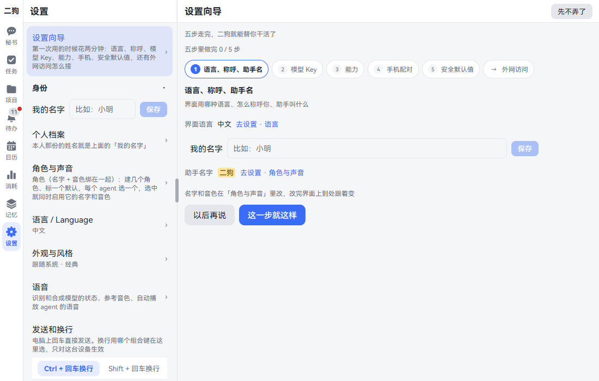
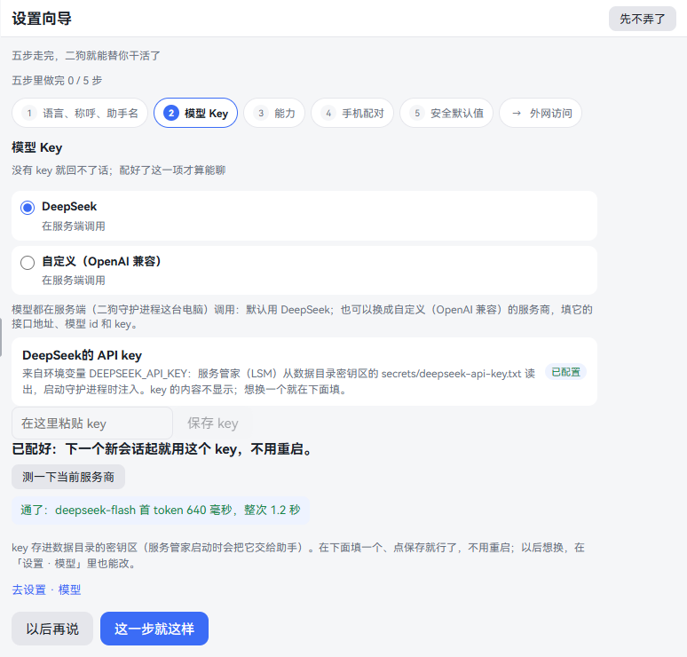
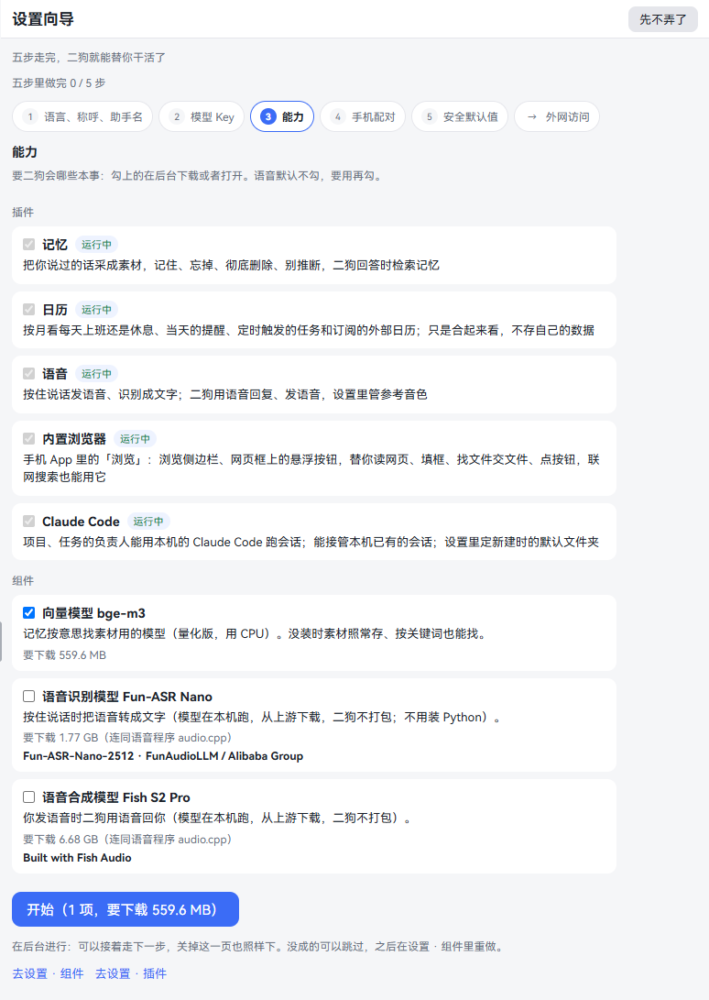
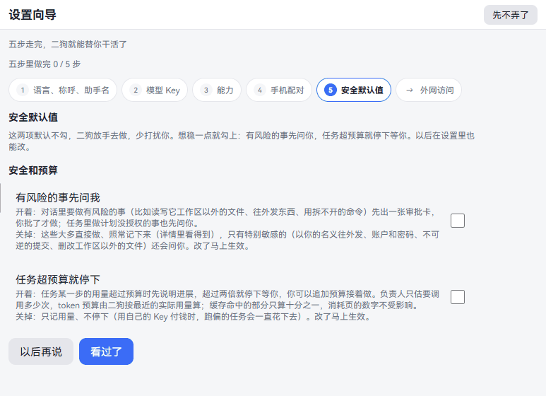
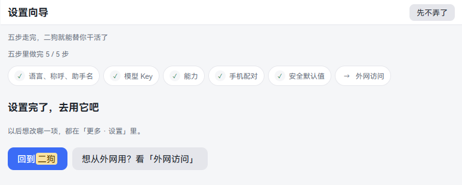
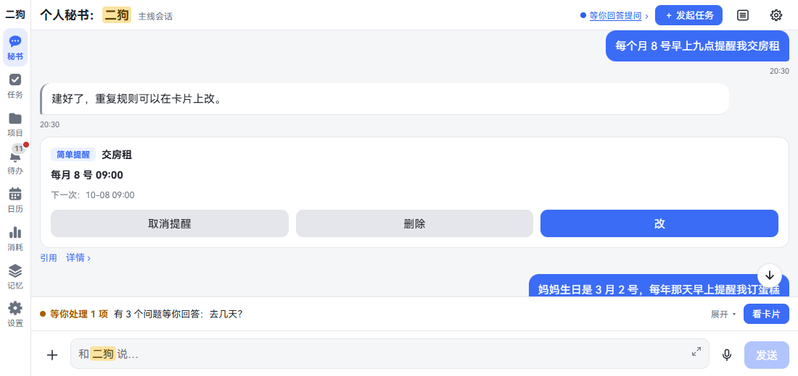
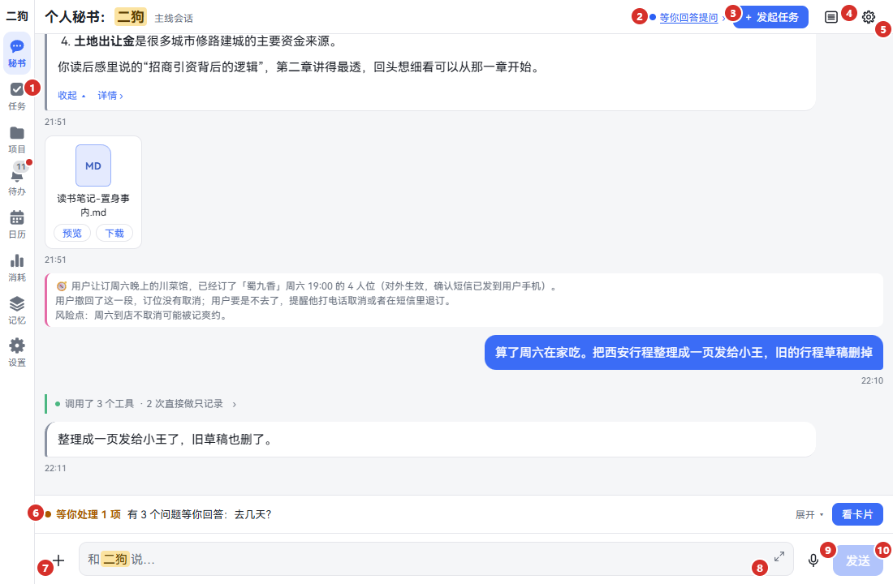
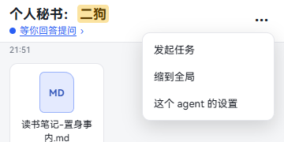

[中文](getting-started.md) | **English**

# Getting started

Screenshots show the Chinese interface; the labels in the text are the English ones.

This chapter starts once ergo is installed. If it isn't yet, see [Install, update and uninstall](install.en.md) first.

This chapter does four things: go through the setup wizard, fill in a model key, say your first sentence, and get to know the interface. By the end, ergo is set up and you can have it do its first job.

## Opening ergo

- **On this computer:** Run `ergo open`, or open <http://127.0.0.1:8810/> in a browser. Coming in through this address needs no pairing.
- **On a phone:** You have to set up outside access and pair first. See [On your phone](mobile.en.md).

It opens on the Secretary page. The first time, a bar at the top of the page says **Take two minutes to set up ergo (model key, phone, safety defaults)**.

1. Click it to enter the setup wizard.
2. If you don't want to do it now, click the × on its right. The bar won't appear again on this device.

You can come back any time:

- **Computer:** Click **Settings** in the left-hand rail, then the top row, **Setup wizard**.
- **Phone:** Tap **More** at the bottom, then **Settings**; the top row is **Setup wizard**.

## Going through the setup wizard

The page says **0 of 5 steps done**. The row below it has the five steps, and the last item is **Access from outside**. Only one step shows at a time.

| Click | What it does |
|---|---|
| **This is fine** | Records this step as done and goes to the next. On step 5 this button says **Read it** |
| **Later** (next to **This is fine**) | Leaves it for now and goes to the next step. This step also gets a tick, with the note **Left for later — you can come back any time** |
| A step in the row at the top | Goes back to look at that step. You can come back and change finished ones too |
| **Later** at the top right | Back to the Secretary page. It remembers where you got to and picks up there next time |

**Good to know:**

- Three steps tick themselves once their condition is met: **My name** filled in, a model key set up, a device paired.
- The **Capabilities** and **Safety defaults** steps tick only after you've clicked through them.
- Once all five are ticked, the bar at the top no longer appears.
- Everything a wizard step changes has the same block in Settings, so changing it there later works the same. See [Settings](settings.en.md).

## Step 1: Language, how to call you, assistant name

**What it is:** Which language the interface uses, what ergo calls you, and what you call it.

**Step by step:**

1. **Interface language:** This row shows the language in use. To change it, click **Settings · Language**. See [Language](settings.en.md#语言--language).
2. **My name:** Type your name in the box, say "Alex", and click **Save**. 8 characters at most. ergo calls you this when it talks or reads to you. If you leave it empty, it just says "you".
3. **Assistant name:** **ergo** by default. To change it, click **Settings · Roles & voices**. The whole interface follows the change. See [Roles & voices](voice.en.md#roles--voices).
4. Click **This is fine**.

**Good to know:** Clicking **Settings · …** leaves the wizard. When you've made the change, come back to **Settings · Setup wizard** and carry on.

## Step 2: Model key

**What it is:** ergo relies on a large model to talk. The model service needs your own API key, and without one it can't reply. The default is DeepSeek.

**Step by step:**

1. Register at the [DeepSeek Open Platform](https://platform.deepseek.com/), create an API key and copy it.
2. Back in the wizard, pick **DeepSeek** as the provider (it's the default).
3. Look at the **DeepSeek API key** block. Until it's set up, the right side says **Not configured**.
4. Paste the key into the **Paste the key here** box. The box doesn't show what you paste.
5. Click **Save key**. Below it says **Configured: the next new session will use this key, no restart needed.** and the right side changes to **Configured**.
6. Click **Test the current provider**. If it works, it says **Connected:** plus the model name and the time taken. If not, it gives the reason; follow it to check your key and network.
7. Click **This is fine**.

**To use another company's model:** Pick **Custom (OpenAI-compatible)**, then fill in **Endpoint URL**, **Model id**, **API style** and the key. See [Models](settings.en.md#models). If you switch to custom, memory consolidation, web search and reading web pages still need a DeepSeek key; the page says so too.

**Good to know:**

- The key is stored only in this computer's data folder. Agents can't read it, and the page never shows it again.
- To see what you've spent, see [Usage](settings.en.md#usage).
- If you skip this step, you can still use the other pages for now. Above the input box on the Secretary page it keeps saying **No model set up yet: ergo can't reply (no DeepSeek API key).** Click **Set it up** to fill it in.

## Step 3: Capabilities

**What it is:** What you want ergo to be able to do. Plugins are feature switches; components are large downloads.

| Item | What it does | On a new install |
|---|---|---|
| Memory (plugin) | Saves what you've said, can remember and forget, and looks things up when answering | On |
| Calendar (plugin) | Month view of workdays and days off, reminders, scheduled tasks | On |
| Voice (plugin) | Hold to talk and voice replies. To actually make sound and recognize speech, it also needs the two models below | On |
| Built-in browser (plugin) | **Browse** in the phone app; can also search the web for agents | On |
| Claude Code (plugin) | Lets owners work through the Claude Code on this computer | Ticked by default only if detected on this computer |
| Embedding model bge-m3 (component) | Lets memory find materials by meaning. Without it, keyword search still works | Ticked by default |
| Speech recognition model Fun-ASR Nano (component) | Turns hold-to-talk voice into text | Not ticked |
| Speech model Fish S2 Pro (component) | ergo answers you by voice | Not ticked |

**Step by step:**

1. Tick what you want. Things you already have say **Running** or **Available** and don't need ticking.
2. Under each item is how much it needs to download. Voice models also download the speech program audio.cpp, noted in brackets.
3. Click the blue button, for example **Start (1 selected, 559.6 MB to download)**.
4. Voice models first pop up a confirmation with the license. They download only if you agree; otherwise nothing is downloaded.
5. This row shows progress: how much is downloaded, the speed, the time left. You can go on to the next step, and downloads continue even if you close this page.
6. Anything that doesn't work says **Didn't work:** plus the reason, with **Retry** (or **Resume** if a download stopped) and **Skip** below. What you skip can be redone later in **Settings · Capabilities · Components**.
7. Click **This is fine**.

Further down this page are two blocks:

- **What's installed now:** Components with their versions, and plugins in one line.
- **Start at boot:** A switch saying **On** or **Off**. When on, the service manager starts by itself after the computer boots and you log in, then starts ergo. When off, you run `ergo start` yourself. See [Starting at boot](settings.en.md#starting-at-boot).

**Good to know:** If you don't want to download voice now, don't tick it. You can install it later by following the [Voice](voice.en.md#installing-the-voice-components) chapter.

## Step 4: Pair your phone

**What it is:** Connects your phone to the ergo on this computer. This step shows the pairing QR code directly. If you're not using a phone, skip it for now; it doesn't affect using ergo on the computer.

**Step by step:**

1. You see the QR code, with the address and **Waiting for the phone to scan** below it.
2. Open the ergo app on your phone, tap **Scan to connect** and scan this code. If you don't have the app, scanning with the phone's camera opens it in the browser.
3. When the phone sends its request, the device name, short code and short fingerprint appear right on this page.
4. Check they match what's on the phone, then click **They match, approve**.
5. This page says **Connected:** plus the device name. This step ticks itself, and at the top it says **A device is already paired**.

**No QR code, and it says Ergo can't be reached from outside right now, so a phone can't connect:** There's no route in from outside yet. A local network doesn't count either: you need one even on the same Wi-Fi. Click **Later** for now and see [Access from outside](#access-from-outside) below.

For how to pick an address, each pairing step and what to do if it won't connect, see [On your phone](mobile.en.md).

## Step 5: Safety defaults

**What it is:** Two switches that decide how free a hand ergo has. Neither is ticked on a new install.

| Switch | Ticked | Not ticked (default) |
|---|---|---|
| **Ask me before risky things** | In a chat, when it wants to read or write files outside its workspace or send things out, it first shows an approval card, and acts only after you approve. In a task, anything the plan doesn't authorize asks you first too | Mostly just does it and logs it as usual. The especially sensitive things still ask: sending out in your name, accounts and passwords, irreversible commits, changing or deleting files outside the workspace |
| **Stop tasks that go over budget** | When one step of a task uses more than its budget, it first reports progress; at more than twice, it stops and waits for you | Only records usage; doesn't stop |

**Step by step:**

1. Read the two items. If you want it more careful, tick them. Flipping one takes effect at once, with no need to save.
2. Click **Read it**.

**Good to know:** You can change these later at the top of **Settings · Rules · Watch categories**; it's the same pair of switches. See [Watch categories](settings.en.md#watch-categories).

## Access from outside

**What it is:** **→ Access from outside**, the last item in the row at the top, doesn't count as a step. This screen explains how a phone or tablet connects back to this computer from outside. There are three ways. It only explains them; it doesn't configure anything or connect it for you.

1. Click **→ Access from outside** to read it.
2. When you're done, click **Back to the wizard**.

For which of the three to pick, see [Letting your phone reach your computer](mobile.en.md#letting-your-phone-reach-your-computer-choosing-outside-access). If you don't use a phone, you can skip it.

## All done

Once all five steps are ticked, the wizard says **Setup is done — go use it**.

- Click **Back to ergo** to return to the Secretary page.
- Click **Want to use it from outside? See Access from outside** to see the screen above.

## Your first sentence

**What it is:** A test that everything's set up right. A reminder is ideal: one sentence does it, and you see the result straight away.

**Things you can just say:**

- Remind me to drink water in two minutes
- Remind me to pay the rent at 9 am on the 8th of every month
- Remember: pick up the car Wednesday afternoon
- Check tomorrow's weather for me

**Step by step:**

1. Click **Secretary** in the left-hand rail (at the bottom on a phone).
2. In the input box at the very bottom, type "Remind me to drink water in two minutes".
3. Press Enter, or click **Send**. On a phone Enter makes a new line, so tap **Send**.
4. ergo replies with a sentence, and a **Reminder** card appears below. The card shows the time, and offers **Cancel reminder**, **Delete** and **Edit**.

   

5. Two minutes later, **Reminder: drink water** pops up at the top of the page. Click **View** or **Close**.
6. Click **Inbox** in the navigation. The reminder is pinned there. Open it, then click **Got it**.

**What the secretary can do:** Anything one step can finish it does directly, such as a reminder, remembering something, or looking something up. For things that take time, it starts a task or a project for you, hands it to a dedicated owner, and passes on progress.

**Try next:**

- To start something that takes time, see [Tasks](tasks.en.md).
- To make something long-term, see [Projects](projects.en.md).
- To have it remember you, see [Memory](memory.en.md).
- For everything about typing and talking, see [Talking to the secretary](chat.en.md).

## Getting to know the interface

On a computer, a tablet or a phone in landscape, the navigation is a rail on the left. On a phone in portrait, it's a row at the bottom. If you make the window very narrow on a computer, it switches to the phone layout too.

### On a computer

| No. | Name | What it does |
|---|---|---|
| 1 | Navigation | The rail on the left: **Secretary**, **Tasks**, **Projects**, **Inbox**, **Calendar**, **Usage**, **Memory**, **Settings**. If the window is too short, the last few move into **More** |
| 2 | Status | What this agent is doing now: **Asleep**, **Working**, **Waiting for you**, **Queued**. When it says **Waiting for you…** you can click it to jump to the card that needs handling. See ["Waiting for you…" in the title](chat.en.md#waiting-for-you-in-the-title) |
| 3 | **+ New task** | Start something by filling in a form, without talking. See [Tasks](tasks.en.md) |
| 4 | Zoom | Zoom out to see the whole thing, click again to return to the conversation. See [Zooming the timeline: three layers](chat.en.md#zooming-the-timeline-three-layers) |
| 5 | ⚙ **Settings for this agent** | Its own prompt, clearing the conversation, context usage. See [Settings for this agent](chat.en.md#settings-for-this-agent) |
| 6 | **Waiting on you** | Things in this session waiting for your decision. See [Waiting on you](chat.en.md#waiting-on-you) |
| 7 | ＋ | Send images or files, or feed material. See [Attachments](chat.en.md#attachments) |
| 8 | Input box | Type here. The small arrow at the top right enlarges the box |
| 9 | Mic | Switches to hold to talk. See [Hold to talk](chat.en.md#hold-to-talk) |
| 10 | **Send** | Enter also sends; Ctrl + Enter makes a new line |

The title says **Secretary: ergo**, where ergo is the name you gave it. The small text after it is **Main session**; once you've filled in **My name**, it says **Alex's main session**.

Click any item in the session and a details pane slides out on the right. Click the ‹ at its top left to close it.

### On a phone

| No. | Name | What it does |
|---|---|---|
| 1 | First line of the title | Says **Secretary: ergo** |
| 2 | Second line of the title | The subtitle and status. **Waiting for you…** can be tapped here too |
| 3 | ⋯ | **New task**, zoom and **Settings for this agent** are tucked in here |
| 4 | **Waiting on you** | Same as on a computer |
| 5 | Input row | ＋, input box, mic, **Send** |
| 6 | Navigation | A row at the bottom; what doesn't fit goes into **More** |

**The title bar has two lines:** A phone in portrait can't fit it all on one, so the name gets a line, the status gets a line, and the other buttons go into ⋯.

**Tap the ⋯ at the top right:**

| Menu item | What it does |
|---|---|
| **New task** | Same as the button on a computer |
| **Zoom out to overview** | Zooms out to see the full picture. Once zoomed out, this item becomes **Back to conversation** |
| **Settings for this agent** | Same as ⚙ on a computer; slides up from the bottom |

**Task and project chats:** Also two lines. The first line has ‹, the name and ⋯. The second has the status chip, **Waiting for you…** and the background agents. Besides zoom and settings, ⋯ also holds records, **Plan**, **Toolkit**, **Usage** and the like. See [Tasks](tasks.en.md) and [Projects](projects.en.md).

**More:** What doesn't fit on a phone is here, usually **Usage**, **Memory** and **Settings**.

**Details:** Tap an item in the session and its details slide in as a full page. Tap the ‹ at the top left to come back.

**The phone app has one more item:** After **Inbox** there's **Browse**, the built-in browser. A phone browser doesn't have it. See [Built-in browser](browser.en.md).

### What each page is for

| Navigation | What it's for | More |
|---|---|---|
| **Secretary** | Talk to your personal assistant; anything can start here | [Talking to the secretary](chat.en.md) |
| **Tasks** | A board: waiting on you, in progress, scheduled | [Tasks](tasks.en.md) |
| **Projects** | Long-term work, with one fixed owner per project | [Projects](projects.en.md) |
| **Inbox** | Everything that needs your decision | [Inbox](chat.en.md#inbox) |
| **Browse** | The built-in browser, only in the phone app | [Built-in browser](browser.en.md) |
| **Calendar** | Workdays and days off, reminders, scheduled tasks | [Calendar and reminders](calendar-reminders.en.md) |
| **Usage** | Tokens and rough cost by day and by agent | [Usage](settings.en.md#usage) |
| **Memory** | Files, conclusions, question box, materials | [Memory](memory.en.md) |
| **Settings** | Everything else is here | [Settings](settings.en.md) |

## Troubleshooting

| What you see | What to do |
|---|---|
| The page won't open | Run `ergo status` to see whether ergo is running; if not, run `ergo start`. See [Install, update and uninstall](install.en.md) |
| Above the input box it says **No model set up yet** | Click **Set it up** and fill in the key as in [Step 2](#step-2-model-key) |
| You send something and get no reply, or an error every time | The key is wrong, or your quota has run out. Go to **Settings · Capabilities · Models**, fill in the key again, and click **Test the current provider** |
| The test says it can't connect | Check what the reason says: key, network, the provider's quota |
| Stuck after starting a download | Look at the reason in that row. Upstream can be slow from mainland China; see [Components](settings.en.md#components) |
| Your phone scanned but can't connect | See [When it can't connect](mobile.en.md#when-it-cant-connect) |
| The bar at the top is gone and you want the wizard back | **Settings · Setup wizard** |

For more, see [Troubleshooting](install.en.md#troubleshooting).

## Read next

- [Talking to the secretary](chat.en.md): typing, talking, attachments, rollback, Inbox.
- [Tasks](tasks.en.md) and [Projects](projects.en.md): hand off the work.
- [On your phone](mobile.en.md): the app, pairing, outside access.
- [Settings](settings.en.md): every item, one by one.
