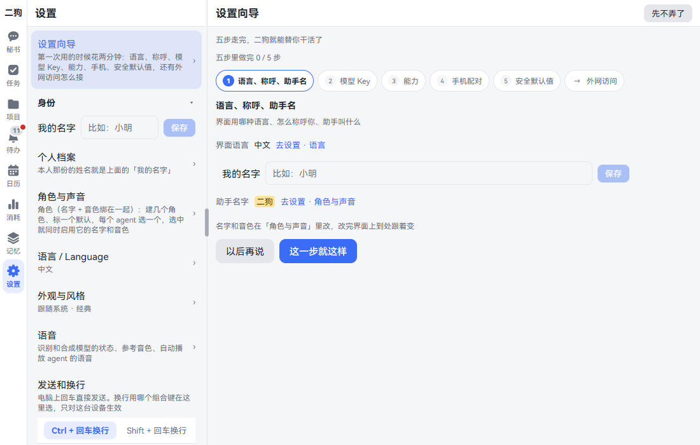
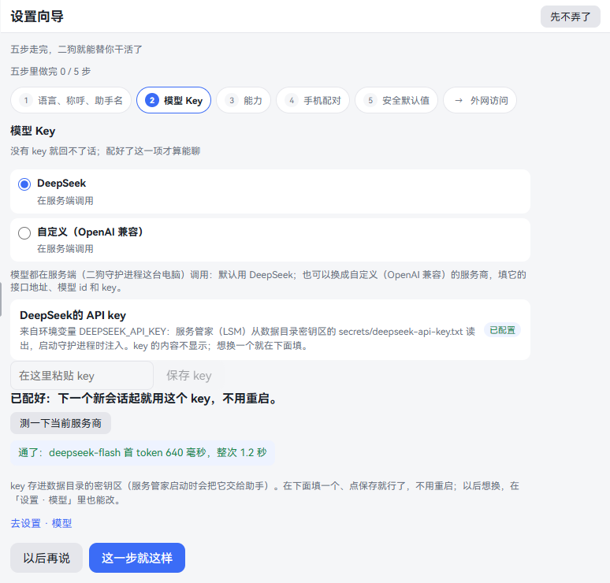
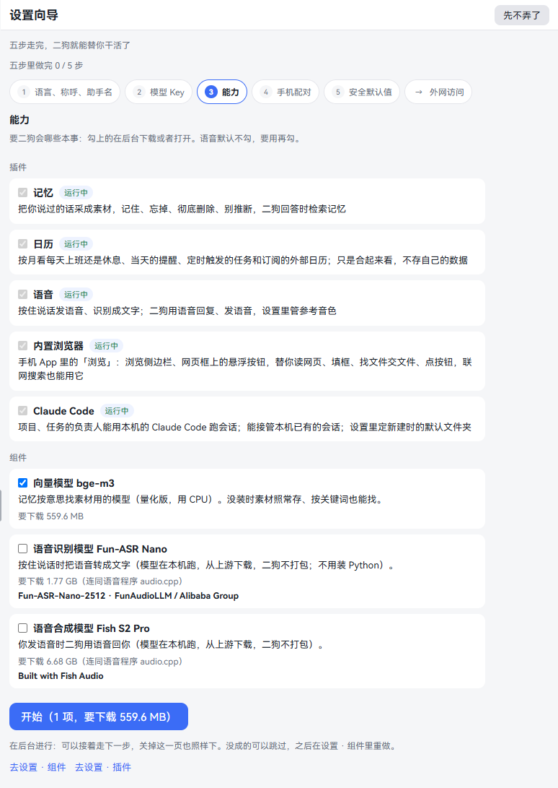
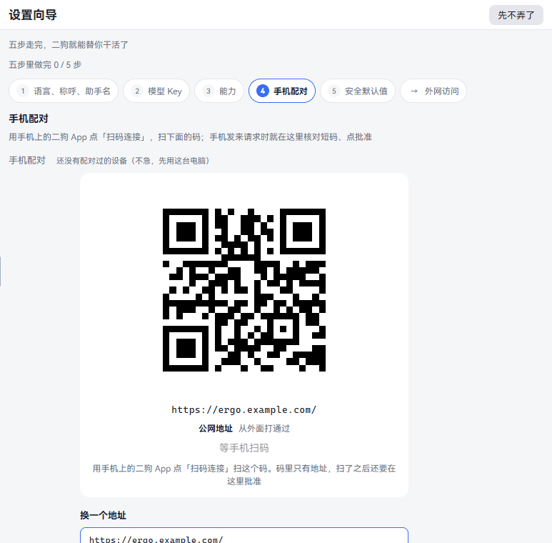
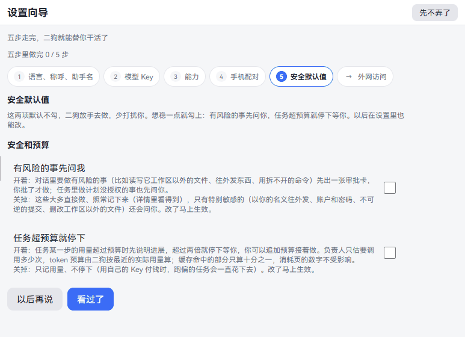
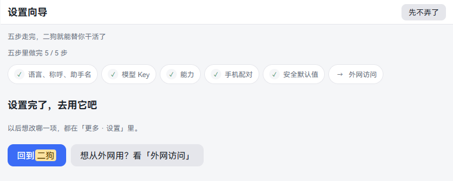
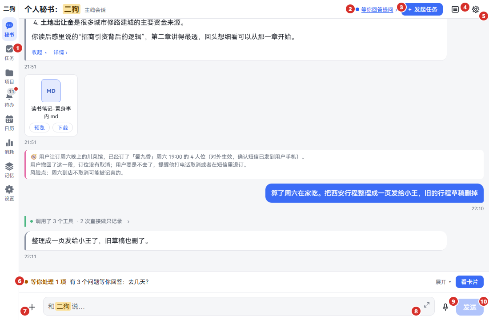
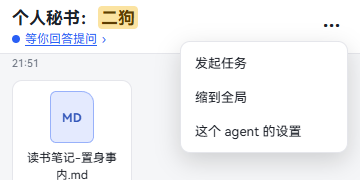

# 开始使用

这一章从二狗装好之后开始。还没装的，先看[安装、升级和卸载](install.md)。

这一章做四件事：走完设置向导，填模型 Key，说第一句话，认识界面。看完你就把二狗配好了，能让它办第一件事。

## 打开二狗

- **这台电脑：** 运行 `ergo open`，或者用浏览器打开 <http://127.0.0.1:8810/>。从这个地址进来不用配对。
- **手机：** 要先接好外网、配对，见[手机上用](mobile.md)。

打开后是秘书页。第一次打开时，页面顶上有一条「花两分钟把二狗配一下（模型 Key、手机、安全默认值）」。

1. 点这一条，进设置向导。
2. 现在不想走，点右边的 ×。这台设备上以后不再出现这一条。

以后随时能回来：

- **电脑：** 点左边竖栏的「设置」，再点最上面一行「设置向导」。
- **手机：** 点底部的「更多」，再点「设置」，最上面一行就是「设置向导」。

## 设置向导怎么走

页面上写着「五步里做完 0 / 5 步」。下面一排是五步，最后一个是「外网访问」。一屏只显示一步。

| 点哪里 | 做什么 |
|---|---|
| 这一步就这样 | 记下这一步做完了，跳到下一步。第五步这个按钮写「看过了」 |
| 以后再说 | 先放着，跳到下一步。这一步也打勾，提示「这一项先放着，随时能回来接着弄」 |
| 上面一排的某一步 | 回到那一步看。做完的也能回来改 |
| 右上角的「先不弄了」 | 回秘书页。走到哪都记着，下次接着走 |

**要知道的：**

- 有三步满足了条件会自己打勾：填了「我的名字」、配好了模型 Key、配对过一台设备。
- 「能力」和「安全默认值」两步要你点过才打勾。
- 五步都打勾后，顶上那一条不再出现。
- 向导每一步改的东西，设置里都有同一块，以后在设置里改也一样。见[设置](settings.md)。

## 第一步：语言、称呼、助手名

**这是什么：** 界面用哪种语言，二狗怎么叫你，你怎么叫它。

**一步一步：**

1. **界面语言：** 这一行写着现在用的语言。要换，点「去设置 · 语言」。见[语言](settings.md#语言--language)。
2. **我的名字：** 在框里填你的名字，比如「小明」，点「保存」。最多 8 个字。二狗说话、念给你听时这样称呼你。不填就只叫你「你」。
3. **助手名字：** 默认叫「二狗」。要改，点「去设置 · 角色与声音」。改完界面上到处跟着变。见[角色与声音](voice.md#角色与声音)。
4. 点「这一步就这样」。

**要知道的：** 点「去设置 · ……」会离开向导。改完回到 设置 · 设置向导 接着走。

## 第二步：模型 Key

**这是什么：** 二狗靠大模型说话。模型服务要你自己的 API key，没有 key 它回不了话。默认用 DeepSeek。

**一步一步：**

1. 到 [DeepSeek 开放平台](https://platform.deepseek.com/)注册，建一个 API key，复制下来。
2. 回到向导，服务商选「DeepSeek」（默认就是）。
3. 看「DeepSeek的 API key」这一块。还没配时右边写「没配置」。
4. 把 key 粘贴到「在这里粘贴 key」的框里。框里不显示内容。
5. 点「保存 key」。下面写「已配好：下一个新会话起就用这个 key，不用重启。」右边变成「已配置」。
6. 点「测一下当前服务商」。通了写「通了：」加模型名和用时。不通写原因，照原因查 key 和网络。
7. 点「这一步就这样」。

**用别家的模型：** 选「自定义（OpenAI 兼容）」，再填接口地址、模型 id、接口类型和 key。见[模型](settings.md#模型)。换了自定义，记忆整理、联网搜索和读网页还要用 DeepSeek 的 key，页面上也写着。

**要知道的：**

- key 只存在这台电脑的数据目录里，agent 读不到，页面上也不再显示。
- 花了多少钱，看 [消耗](settings.md#消耗)。
- 跳过了也能先用别的页面。秘书页输入框上面会一直写「还没配模型：二狗现在回不了话（没有 DeepSeek 的 API Key）。」，点「去配置」来填。

## 第三步：能力

**这是什么：** 要二狗会哪些本事。插件是功能开关，组件是要下载的大件。

| 项 | 能做什么 | 新装时 |
|---|---|---|
| 记忆（插件） | 存下你说过的话，能记住、忘掉，回答时去查 | 开着 |
| 日历（插件） | 按月看上班还是休息、提醒、定时任务 | 开着 |
| 语音（插件） | 按住说话、语音回话。真要出声、能识别，还要下面两个模型 | 开着 |
| 内置浏览器（插件） | 手机 App 里的「浏览」，也能替 agent 联网搜索 | 开着 |
| Claude Code（插件） | 让负责人用本机的 Claude Code 干活 | 本机检测到才默认勾 |
| 向量模型 bge-m3（组件） | 记忆按意思找素材。没有时按关键词也能找 | 默认勾 |
| 语音识别模型 Fun-ASR Nano（组件） | 按住说话转文字 | 不勾 |
| 语音合成模型 Fish S2 Pro（组件） | 二狗用语音回你 | 不勾 |

**一步一步：**

1. 勾上要的。已经有的写「运行中」「已有」，不用勾。
2. 每项下面写着要下载多大。语音模型还要连语音程序 audio.cpp 一起下，写在括号里。
3. 点蓝色按钮，比如「开始（1 项，要下载 559.6 MB）」。
4. 语音模型先弹确认框，写明许可。同意了才下，不同意就不下。
5. 这一行写进度：已下多少、速度、还要多久。可以接着走下一步，关掉这一页也照样下。
6. 没成的写「没成：」加原因，下面有「重试」（下载停了的写「继续」）和「跳过」。跳过的以后到 设置 · 能力 · 组件 里重做。
7. 点「这一步就这样」。

这一页再往下有两块：

- **现在装了什么：** 组件带版本，插件一行列出。
- **开机自启：** 开关写着「开着」或「关着」。开着时，电脑开机登录后服务管家自己起来，再拉起二狗。关掉后要自己跑 `ergo start`。见[开机自启](settings.md#开机自启)。

**要知道的：** 现在不想下语音，就别勾。以后在[语音](voice.md#装语音组件)那一章照着装。

## 第四步：手机配对

**这是什么：** 让手机连上这台电脑上的二狗。这一步直接显示配对二维码。不用手机可以先跳过，不影响在电脑上用。

**一步一步：**

1. 看到二维码，下面写着地址和「等手机扫码」。
2. 手机上打开二狗 App，点「扫码连接」，扫这个码。没装 App 的，手机相机扫也能在浏览器里打开。
3. 手机发来请求时，这一页上直接出现设备名、短码和短指纹。
4. 核对和手机上一样，点「一致，批准」。
5. 这一页写「连好了」。这一步自己打勾，上面写「已经配对过设备了」。

**没有二维码，写着「二狗现在从外面连不上，手机没法连」：** 还没接外面的路。局域网也不算，同一个 Wi-Fi 下也要接。先点「以后再说」，看下面的[外网访问](#外网访问)。

地址怎么选、配对的每一步、连不上怎么办，都在[手机上用](mobile.md)。

## 第五步：安全默认值

**这是什么：** 两个开关，定二狗有多放手。新装时都不勾。

| 开关 | 勾上 | 不勾（默认） |
|---|---|---|
| 有风险的事先问我 | 对话里要读写工作区以外的文件、往外发东西时，先出一张审批卡，你批了才做。任务做计划里没授权的事也先问你 | 大多直接做、照常记下来。特别敏感的还会问：以你的名义往外发、账户和密码、不可逆的提交、删改工作区以外的文件 |
| 任务超预算就停下 | 任务一步的用量超过预算先说明进展，超过两倍停下等你 | 只记用量，不停 |

**一步一步：**

1. 读这两项。想稳一点就勾上，拨一下马上生效，不用保存。
2. 点「看过了」。

**要知道的：** 以后在 设置 · 规则 · 关注类别 最上面改，是同一对开关。见[关注类别](settings.md#关注类别)。

## 外网访问

**这是什么：** 上面一排最后的「→ 外网访问」不算一步。这一屏说明手机、平板怎么从外面连回这台电脑，有三种方法。它只讲不配，不会替你接。

1. 点「→ 外网访问」看。
2. 看完点「回到向导」。

三种方法怎么选，见[让手机连得到电脑](mobile.md#让手机连得到电脑外网访问怎么选)。不用手机可以不看。

## 走完了

五步都打勾后，向导写「设置完了，去用它吧」。

- 点「回到二狗」，回秘书页。
- 点「想从外网用？看「外网访问」」，看上面那一屏。

## 说第一句话

**这是什么：** 试一下配得对不对。提醒最合适：一句话办完，马上看得到结果。

**可以直接说的话：**

- 两分钟后提醒我喝水
- 每个月 8 号早上九点提醒我交房租
- 帮我记一句：周三下午去取车
- 帮我查一下明天的天气

**一步一步：**

1. 点左边竖栏（手机上是底部）的「秘书」。
2. 在最下面的输入框打「两分钟后提醒我喝水」。
3. 按回车，或者点「发送」。手机上回车是换行，要点「发送」。
4. 二狗回一句话，下面出一张「简单提醒」卡。卡上写着时间，能「取消提醒」「删除」「改」。

   

5. 两分钟后，页面顶上弹出「提醒：喝水」。点「查看」或者「关闭」。
6. 点导航的「待办」。这条提醒置顶放着，点开它，再点「知道了」。

**秘书能做什么：** 一步就能办完的直接办，比如提醒、记住一件事、查一下。要花时间的，它帮你发起任务或者立项，交给专门的负责人，有进展再转告你。

**接着试试：**

- 想发起一件要花时间的事，见[任务](tasks.md)。
- 想做一个长期的东西，见[项目](projects.md)。
- 想让它记住你，见[记忆](memory.md)。
- 打字和说话的全部用法，见[和秘书说话](chat.md)。

## 认识界面

电脑、平板和手机横屏，导航在左边竖栏。手机竖屏，导航在底部一排。电脑上把窗口拉得很窄，也会换成手机的样子。

### 电脑上

| 编号 | 叫什么 | 做什么 |
|---|---|---|
| 1 | 导航 | 左边竖栏：秘书、任务、项目、待办、日历、消耗、记忆、设置。窗口太矮放不下时，后面几项收进「更多」 |
| 2 | 状态 | 这个 agent 现在在干什么：休眠、干活中、等你、排队。写着「等你……」时能点，直接跳到要处理的卡，见[标题上的「等你……」](chat.md#标题上的等你) |
| 3 | 发起任务 | 不用说话，直接填表发起一件事，见[任务](tasks.md) |
| 4 | 缩放 | 缩到全局看整件事，再点回到对话，见[时间线三层缩放](chat.md#时间线三层缩放) |
| 5 | ⚙ 这个 agent 的设置 | 单独的提示词、清空对话、上下文用量，见[这个 agent 的设置](chat.md#这个-agent-的设置) |
| 6 | 等你处理 | 这个会话里等你拍板的事。见[等你处理](chat.md#等你处理) |
| 7 | ＋ | 发图片、文件，或者投喂材料，见[附件](chat.md#附件) |
| 8 | 输入框 | 打字。右上角的小箭头能放大输入框 |
| 9 | 话筒 | 切到按住说话，见[按住说话](chat.md#按住说话) |
| 10 | 发送 | 回车也是发送，Ctrl + 回车换行 |

标题写「个人秘书：二狗」，二狗是你起的名字。后面的小字是「主线会话」，填了「我的名字」后写「小明的主线会话」。

点会话里的任何一条，右边滑出详情栏。点详情栏左上角的 ‹ 关掉。

### 手机上

| 编号 | 叫什么 | 做什么 |
|---|---|---|
| 1 | 标题第一行 | 写「个人秘书：二狗」 |
| 2 | 标题第二行 | 副标题和状态。「等你……」一样能点 |
| 3 | ⋯ | 发起任务、缩放、这个 agent 的设置都收在这里 |
| 4 | 等你处理 | 和电脑上一样 |
| 5 | 输入行 | ＋、输入框、话筒、发送 |
| 6 | 导航 | 底部一排，放不下的收进「更多」 |

**标题栏分两行：** 手机竖屏放不下一行，所以名字一行，状态一行，别的按钮收进 ⋯。

**点右上角的 ⋯：**

| 菜单项 | 做什么 |
|---|---|
| 发起任务 | 和电脑上的按钮一样 |
| 缩到全局 | 缩小看全貌。缩小后这一项变成「回到对话」 |
| 这个 agent 的设置 | 和电脑上的 ⚙ 一样，从底部弹出 |

**任务和项目的对话框：** 也是两行。第一行是 ‹、名字和 ⋯。第二行是状态签、「等你……」、背后的 agent。⋯ 里除了缩放和设置，还有档案、计划、工具包、消耗这些。见[任务](tasks.md)、[项目](projects.md)。

**更多：** 手机上放不下的在这里，一般是消耗、记忆系统、设置。

**详情：** 点会话里的一条，详情整页滑入。点左上角的 ‹ 回来。

**手机 App 多一项：** 待办后面多一个「浏览」，是内置浏览器。手机浏览器里没有，见[内置浏览器](browser.md)。

### 每一页是干什么的

| 导航 | 干什么 | 细看 |
|---|---|---|
| 秘书 | 和你的个人助理说话，什么事都能从这里开始 | [和秘书说话](chat.md) |
| 任务 | 看板：等你的、进行中的、定时的 | [任务](tasks.md) |
| 项目 | 长期的事，一个项目一个固定的负责人 | [项目](projects.md) |
| 待办 | 所有要你拍板的事 | [待办](chat.md#待办) |
| 浏览 | 内置浏览器，只在手机 App 里有 | [内置浏览器](browser.md) |
| 日历 | 上班还是休息、提醒、定时任务 | [日历和提醒](calendar-reminders.md) |
| 消耗 | 按天、按 agent 看 token 和粗估成本 | [消耗](settings.md#消耗) |
| 记忆 | 档案、结论、问题箱、素材 | [记忆](memory.md) |
| 设置 | 其余都在这里 | [设置](settings.md) |

## 出问题怎么办

| 看到什么 | 怎么办 |
|---|---|
| 打不开页面 | 跑 `ergo status` 看二狗在不在跑，不在就 `ergo start`。见[安装、升级和卸载](install.md) |
| 输入框上面写「还没配模型」 | 点「去配置」，照[第二步](#第二步模型-key)填 key |
| 发了话不回，或者每次都出错 | key 不对，或者额度用完了。到 设置 · 能力 · 模型 重新填 key，点「测一下当前服务商」 |
| 测一下写不通 | 照写的原因查：key、网络、服务商的额度 |
| 开始下载后一直卡着 | 看这一行写的原因。国内访问上游可能慢，见[组件](settings.md#组件) |
| 手机扫了连不上 | 见[连不上怎么办](mobile.md#连不上怎么办) |
| 顶上那一条不见了，想回向导 | 设置 · 设置向导 |

更多情况见[出问题怎么办](install.md#出问题怎么办)。

## 接着看

- [和秘书说话](chat.md)：打字、说话、附件、撤回、待办。
- [任务](tasks.md)、[项目](projects.md)：把活交出去。
- [手机上用](mobile.md)：App、配对、外网。
- [设置](settings.md)：每一项逐个讲。
