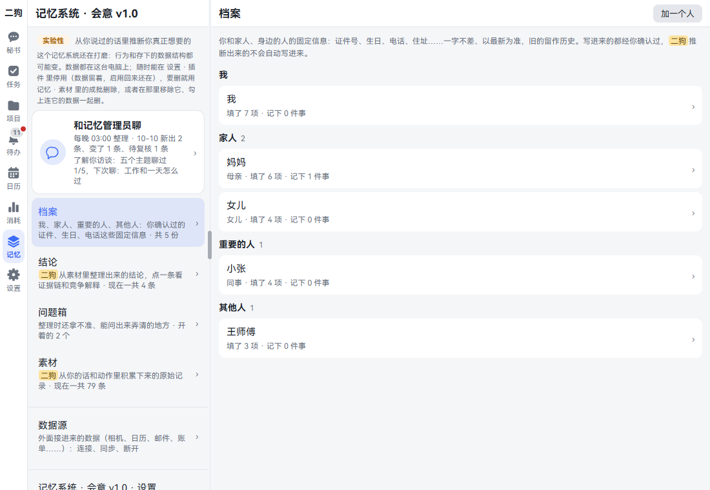
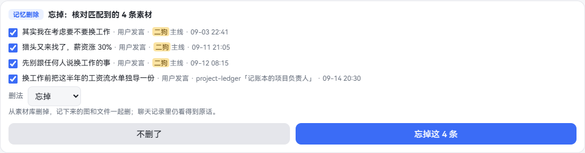
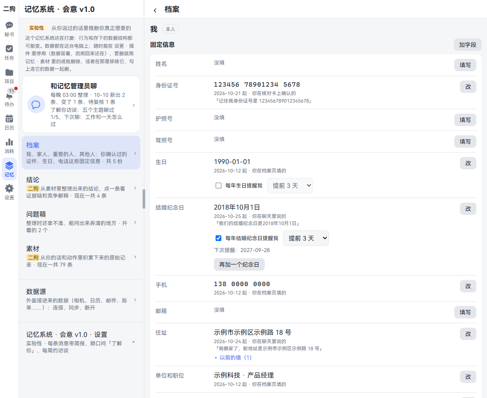
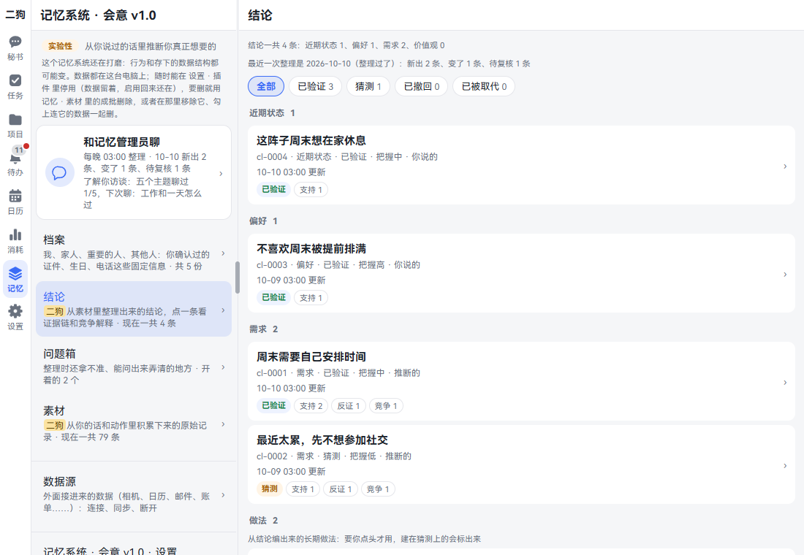
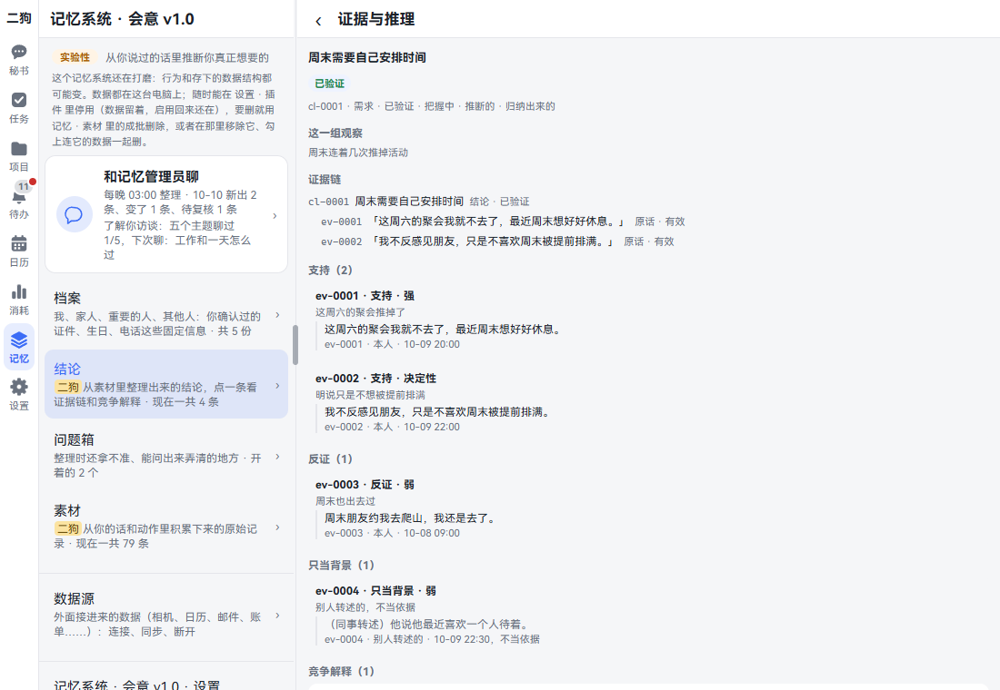
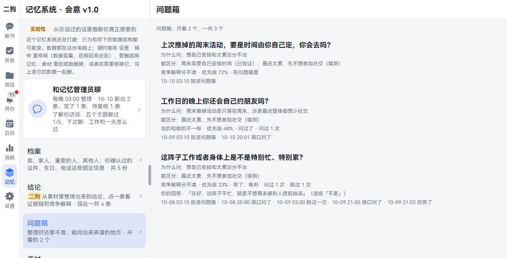
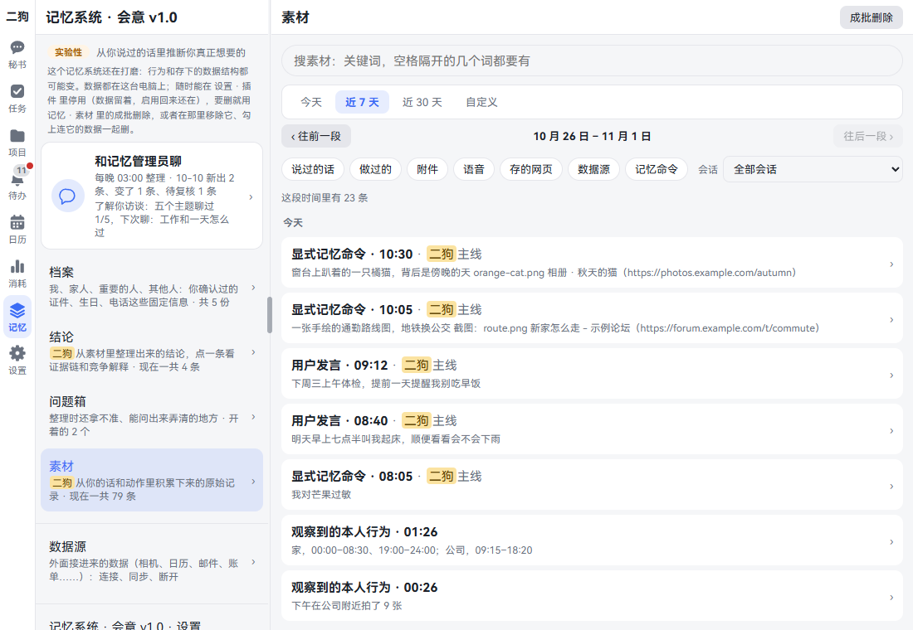
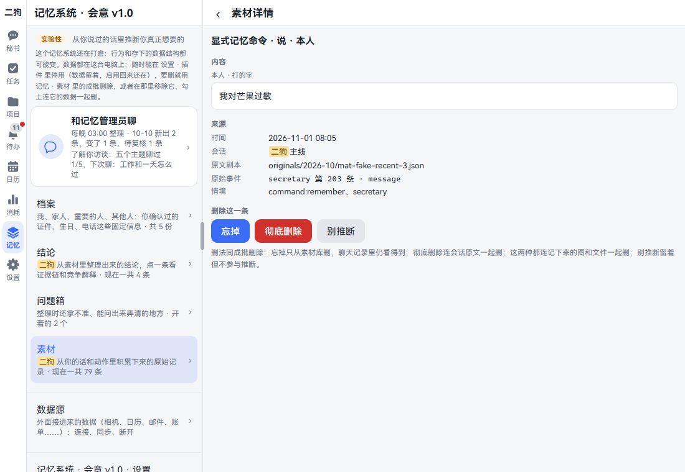
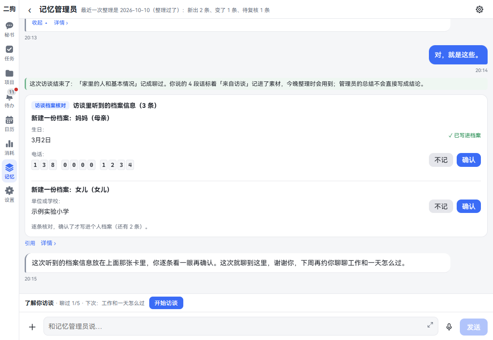
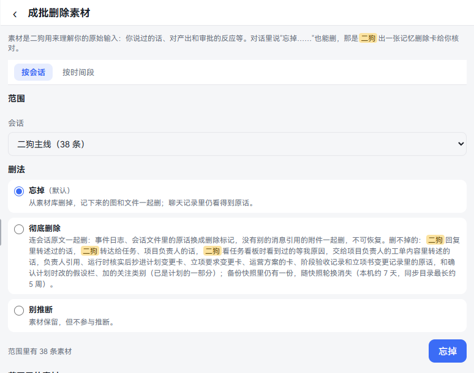

[中文](memory.md) | **English**

# Memory

Screenshots show the Chinese interface; the labels in the text are the English ones.

ergo remembers what you say and slowly gets to know you. This chapter covers five things: how to make it remember, how to make it forget, how to see what it has learned, how to correct what it got wrong, and how to delete data for good. By the end you can stay in control of what it keeps and what it uses.

This memory system is called **Subtext**, and the top of the page is marked **Experimental**: it's still being polished, and both its behavior and the data it stores may change. All the data stays on your own computer.

## The basics

| Name | What it is | Who writes it | Example |
|---|---|---|---|
| Materials | Raw records: what you said, decisions you made, things you saved | ergo saves them automatically, in your exact words | "I'll skip the get-together this Saturday" |
| Conclusions | Understanding inferred from materials, each with evidence | The memory curator, consolidating every night at 03:00 | "Needs weekend time to themselves" |
| Question box | Things that were unclear during consolidation, which one question could clear up | The memory curator | "Do you still make plans with friends on weeknights?" |
| Files | Fixed facts like ID numbers, birthdays and phone numbers | Only what you've confirmed goes in | Mom's birthday |

The **memory curator** is the agent dedicated to memory. It consolidates once a night, and you can talk to it any time.

## Opening the Memory page

- **On a PC:** click **Memory** in the vertical bar on the left.
- **On a phone:** tap **More** at the bottom, then **Memory System · Subtext v1.0**.

From top to bottom, the page has:

1. **Talk to the memory curator:** shows the latest consolidation result and how far the get-to-know interview has gone.
2. **Files, Conclusions, Question box, Materials:** four sections, each followed by its current count.
3. **Data sources:** data brought in from outside; see [Data sources](data-sources.en.md).
4. **Memory System · Subtext v1.0 · Settings:** three switches, collapsed by default; see [The three switches](#the-three-switches).

In this chapter, **Memory · Materials** means: open the Memory page, then click **Materials**.

## Having ergo remember something

**What it is:** ergo saves everything you say as material, so normally you don't need to ask. If there's something you want it to be sure to remember, such as a mango allergy, say so clearly.

**Things you can just say:**

- Remember: pick up the car Wednesday afternoon
- Remember that I'm allergic to mangoes

**Step by step:**

1. Type in the secretary's input box, or hold to talk, and say something like the above.
2. The secretary replies "Noted".
3. To check, open Memory · Materials and click **Memory commands** in the filters. This item's kind says **Memory command**, and the content is your exact words.

**Good to know:**

- It only records this way when you say so explicitly, and it records your exact words. In English that means a sentence opening with "Remember: …", "Remember that …" or "Remember this: …"; case doesn't matter. "Remember, …", "Remember to …" and questions don't count. The secretary won't record its own inferences as something you said; when it's unsure, it shows you a card to ask.
- Fixed facts like ID numbers and birthdays belong in [Files](#files).
- To feed it a document: click + to the left of the input box, choose **Feed as material**, then pick a file and send it. Its kind says **Material you shared**.
- In the built-in browser, long-press an image and say "Remember this image", and the image itself is saved to materials as well. See [Built-in browser](browser.en.md).
- If you misspoke, there's no need to look for somewhere to fix it. Just say "No, not …, it's …". That sentence is saved as material too, and the next consolidation recognizes it as a correction.

## Having ergo save what it read

**What it is:** Emails, web pages, calendar events and Looki moments the secretary reads for you are normally gone once it's done with them. If you want to ask about one later ("what did that building email say last month?"), have it saved to materials. Nothing is saved unless you ask; the secretary doesn't pick things to keep on its own.

**Things you can just say:**

- Save this email
- Save this page to materials, a month is enough

**Step by step:**

1. Right after the secretary has read it, say something like the above.
2. The secretary replies that it's saved. It keeps the title, the text (shortened first if it's too long), the source (email ID, web address and so on) and the item's own date.
3. When you ask about it later, the secretary can find it and says the answer comes from that item.
4. To check, open Memory · Materials and click **Saved outside info** in the filters.

**Good to know:**

- What's saved was written by someone else and doesn't count as something you said. Memory consolidation only uses it as background and never infers anything about you from it.
- If you said how long to keep it ("keep it for a month"), the material's details show when cleanup is suggested; once that date passes, the list tags it **Due for cleanup**. It's never deleted automatically; delete it yourself.
- Deleting one of these always deletes it completely: the details only have **Delete completely** and **Don't infer**. Afterwards the secretary can't find it, and the text in the chat record of the call that saved it is deleted too.

## Having ergo forget something

**What it is:** there are things you'd rather ergo stopped using. There are three ways to delete:

| Method | Materials | Chat history | Conclusions |
|---|---|---|---|
| Forget | Deleted, along with any saved images and files | Your words can still be seen | Conclusions that use it are marked **Under review**; verified ones fall back to guesses, and ones relying only on it are withdrawn |
| Delete completely | Deleted, along with any saved images and files | Your words are replaced by a deletion marker; can't be recovered | Same as above, and the evidence is really deleted too |
| Don't infer | Kept, marked **Excluded from inference** | Untouched | No longer used as a basis; conclusions that use it are treated as above |

**Things you can just say:**

- Forget what I said about changing jobs
- Delete completely those messages where I mentioned my salary
- Don't infer from what I said about being really tired lately

**Step by step:**

1. Say something like the above to the secretary.
2. The secretary checks the materials first, then shows a **Memory deletion** card. Nothing has been deleted yet.
3. Check each item on the card. Untick anything you don't want deleted.
4. To use a different method, change it in the **Method** dropdown. The explanation below updates.
5. Click the button at the bottom right, such as **Forget: these 4**. To back out, click **Keep them**.
6. When the card says **Forget: done for 4 materials**, it's done.

**Good to know:**

- One card holds at most 50 items. For more, use [Bulk delete](#bulk-delete).
- Neither Forget nor Delete completely can be undone. Don't infer has no place to cancel it for now either.
- To delete a single item, open it in [Materials](#materials).
- You can also tell the memory curator to forget or not to infer. It first works out which items you mean, and once you say that's right it does it directly, without a card. It can't delete completely; that needs the card or the Materials page.

## Files

**What it is:** fixed facts about you and the people around you: ID numbers, birthdays, phone numbers, addresses. They're kept exactly as written, the latest one counts, and old values stay as history. Everything here has been confirmed by you; what ergo infers doesn't get written in automatically.

**Where to open it:** Memory · Files. You can also get there from Settings · Identity · Personal files; it's the same place.

The list has four groups: Me, Family, Important people, Others.

### Adding a person

1. Click **Add a person** at the top right.
2. Fill in **Name**, for example "Mom". **Relationship (optional)** can be left blank.
3. If you leave **Group** alone, it's guessed from the relationship; you can change it later.
4. Click **Add**. You go straight to this person's file.

### Filling in or editing an item

1. Find the item under **Facts** and click **Fill in** or **Edit**.
2. Write the value and click **Save**.
3. When editing an existing value, you can also click **Undo last change** to go back to the previous value, or click **Delete**.

Below each item it says since when it's been in effect and how it got there. Items that have changed have **N earlier values** below them; click to see the history.

- **Adding your own item:** click **Add field**, and enter a field name and value, such as a license plate number. If the field name has "birthday" or "anniversary" in it (for example "Daughter's birthday"), you pick the value as a date.
- **Anniversaries:** you can have several. Click **Fill in**, enter a name and pick the date; to add another, click **Add another anniversary**.
- **Your own name:** this is the same as Settings · Identity · My name. Changing one changes the other.

### Filling in birthdays and anniversaries

You don't type birthdays and anniversaries; you pick them:

1. Click **Fill in** or **Edit**.
2. Choose **Gregorian** or **Lunar**.
3. Pick the year, month and day. If you don't remember the year, pick **Year unknown**. Lunar months go from the 1st month to the 12th, and days from 1 to 30; tick **Leap month** for a leap month.
4. Click **Save**.

Gregorian days follow the year and month: February 29 is only there in leap years or when the year is unknown. When you open it, the current value is already picked.

After saving, it shows as "Mar 2, 1990", "Mar 2" or "Lunar 8th month, day 15". If you say "Mom's birthday is March 2" in chat, ergo saves it the same way; if you can't name a day ("next month"), it asks you first.

Dates written freely before this change that can be read ("March 2nd", "1990/3/2" and the like) have been converted by ergo to the same format. The date doesn't change, and yearly reminders you'd already turned on stay as they were. The source line for that entry says **ergo standardized the format**, and the original entry (since when, and how it was filled in) is under the earlier values. Chinese month-and-day without 日 or 号 ("八月十五") counts as lunar; entries that would become lunar this way and have a yearly reminder on were left alone for you to change with **Edit**.

Dates that can't be read aren't rewritten. They're shown as they were, with **Couldn't read this date. Tap "Edit" to pick it again** next to it. Click **Edit** and pick the date once.

### Yearly reminders

Birthdays and anniversaries have **Remind me every year (Birthday)** below them. Tick it and choose **How many days before** (3 by default). It takes effect right away. You get the reminder at 09:00 on that day.

Yearly reminders for lunar dates aren't supported yet; the page says so. The reminders plugin has to be on.

### Notes

For things that aren't fixed fields, such as "Has trouble with stairs":

1. Click **Add a note**.
2. Write the content and pick a date (today by default).
3. Click **Save**.

### What ergo has learned

This block is at the bottom of every file: conclusions, facts and quotes about this person that ergo has gathered and inferred from your chats. It's read-only, and isn't written into the file automatically.

### Deleting

- To delete an item: click **Edit**, then **Delete**.
- To delete a note: click **Delete** next to it.
- To delete a person: click the button at the very bottom, which reads: **Delete the whole file for “Mom”**. Your own file can't be deleted.

Each one asks which method to use:

- **Forget (default):** gone from the file and ergo can't read it; your words in the chat history remain.
- **Delete completely:** erased along with its history, the check cards and the records of ergo having read it. This can't be taken back. Here you can also tick **Also delete the original messages completely**.

**Things you can just say:**

- Remember: my mom's birthday is March 2
- My ID number is …, please save it
- When is my mom's birthday

**Good to know:**

- Birthdays and anniversaries you state clearly in chat are written straight into the file by the secretary, and yearly reminders are set up; its reply says so.
- Numbers always get a check card that lists them digit by digit, because voice transcription can get one digit wrong. If it's right, click **Confirm and save**.
- During the nightly consolidation, ergo may also pick up candidate facts from what you said, and puts a card in Inbox the next day: **Check: should these go into your personal files?**. Tick the ones you want and click **Save the ticked ones**, or click **None of these**. At most one card a day.
- The secretary reads your files only when it fills in a web form for you or when you ask. What it reads is sent to your configured model provider. During the nightly consolidation, numbers and addresses are replaced with placeholders and aren't sent to the model.
- Your phone's contacts and imported address books can also create files; see [Data sources](data-sources.en.md).

## Conclusions

**What it is:** the understanding the memory curator infers from materials. For example, if you've turned down several weekend get-togethers, it might conclude "Needs weekend time to themselves", or it might guess "Too tired lately". Both explanations are kept, and it keeps looking at the evidence.

**Where to open it:** Memory · Conclusions.

**Step by step:**

1. Look at the two lines at the top: the total count, and what the latest consolidation did. If data sources were synced before consolidating, one more line below says which ones, how many new items each brought in, which had just synced, and which didn't sync and why.
2. To see only one status, use the filter: All, Verified, Guess, Withdrawn, Replaced.
3. Conclusions are ordered by layer: Recent state, Preferences, Needs, Values.
4. Click one to open **Evidence and reasoning**.

**Evidence and reasoning** shows, from top to bottom:

- **Evidence chain:** conclusion → premises → facts → your exact words.
- **Supports, Counter-evidence, Background only:** each says why it counts, how much weight it carries, and the words it quotes. What others passed on second-hand is only background, never a basis.
- **Competing explanations:** another reading of the same observations; click one to switch to it.
- **Reasoning, Revision history:** how it was inferred, how many times it has changed, and why.
- **Quotes used:** which of your words this conclusion cites.

**What the tags mean:**

| Tag | Meaning |
|---|---|
| Verified | Enough evidence; the secretary can use it directly |
| Guess | Not confirmed yet. The secretary says "I guess" when using it; the details page for such a conclusion has **Why it's still a guess** |
| Under review | Its basis changed; the next consolidation judges it again |
| High confidence, Medium confidence, Low confidence | How sure it is |
| You said so, Inferred, You confirmed it | Where this one came from |

**If one is wrong, how to fix it:** there's no edit button on the page; talk to the [memory curator](#memory-curator).

**Good to know:**

- This page is empty before the first consolidation.
- At the bottom of the list there may be a **Habits** section: long-term habits compiled from conclusions, such as "When planning weekend activities, leave some open time". The page says they're **used only once you agree**, but there's no place to agree yet. This section is view-only, and items marked **Awaiting your OK** won't be used.

## Question box

**What it is:** things that were unclear during consolidation and that one question could clear up. ergo won't interrupt you for these; it only asks in passing when a related topic comes up.

**Where to open it:** Memory · Question box.

Each question shows:

- **Why ask**, and which conclusions it **Tells apart**.
- What kind of question it is, its priority, its current status, how many times it's been asked and skipped.
- Your answer, and how it read that answer (yes, no, not sure).
- Its history: when it was added, when it was asked, when you answered.

This page is view-only. To answer, just reply when the secretary asks; to bring it up yourself, see the lines below.

**Things you can just say:**

- (to the memory curator) What else do you want to ask me
- (when asked) Skip this one
- (when asked) Don't ask this

**Good to know:**

- The secretary asks at most one in passing per day. It won't ask during something urgent, or when the last turn is waiting on a decision from you.
- You don't have to answer. A question skipped twice is dropped; say "Don't ask this" and that type isn't asked again.
- If you'd rather not be asked, turn off the [switch](#the-three-switches) at the bottom of the Memory page. The questions stay here.

## Materials

**What it is:** the raw records ergo has built up, which are also the basis for conclusions. Here you can look up what it has recorded, and delete a single item.

**Where to open it:** Memory · Materials.

**Step by step:**

1. Pick a time range: Today, Last 7 days (default), Last 30 days, Custom. Use **‹ Earlier** and **Later ›** to move through it.
2. To search, type keywords at the top; all the space-separated words must appear. If nothing turns up in this period, click **Search all time instead**.
3. To filter, click kinds: Said, Did, Attachments, Voice, Saved pages, Data sources, Saved outside info, Memory commands. You can pick several.
4. To see only one conversation, pick it in the **Conversation** dropdown. Click **Clear filters** to clear kinds and conversation.
5. The list shows 30 at a time; click **Show N more** to continue.
6. Click one to open **Material details**.

**Material details** shows the content and source. If the original message still exists, there's **Go to this message ›**. At the bottom, **Delete this item** has three buttons: **Forget**, **Delete completely** and **Don't infer**. Clicking one first brings up a confirmation box explaining what this method does; then click the button in the box, such as **Forget**.

**Good to know:**

- Items in the list can have tags: **From an interview**, **Excluded from inference**, **On an abandoned branch**, **Due for cleanup** (saved outside info past its suggested cleanup date).
- The kind also tells you where it came from: What you said, Approval decision, Answer to a clarifying question, Task outcome, Something you did (observed)…
- When something you said was a reply to the other side (say your assistant asked "Should I wake you as usual on weekend mornings too?" and you answered "No, not on weekends"), the details show a small line above the content, **Replying to: …**, with the gist of what was said just before. The memory curator adds it before the nightly consolidation. It isn't your words and is only used to understand your reply; a new topic you start, or the first thing you say in a conversation, has none. Older materials get it in batches, night by night. It's deleted together with the material.
- Finding materials by meaning needs the [embedding model](#troubleshooting). Search on this page uses keywords and doesn't need it.

## Get-to-know interview

**What it is:** the memory curator invites you to chat for about ten minutes, one topic at a time and one question at a time. It gets to know you faster this way than through scattered chats.

There are five topics:

1. Family and the basics
2. Work and a typical day
3. A few big choices in life
4. What you care about and what bothers you
5. What kind of help you want

Once all five are covered, the topic becomes **What's changed lately**.

**How to start (four ways, all the same interview):**

- On the Memory page, click **Talk to the memory curator**, then **Start interview** in the line above the input box.
- Type `/interview` in the memory curator's input box; you can add a topic after it.
- Click **Start** on the invitation card in Inbox.
- Tell the secretary "I'd like to do an interview".

**Step by step:**

1. Once it starts, the memory curator asks the first question on its page. The line above the input box becomes: **Interviewing: Work and a typical day · say “that's enough” to stop**.
2. Type or hold to talk, one question and one answer at a time, usually about ten rounds.
3. If you don't want to answer, say "skip".
4. If you'd rather not keep what you just said, say "don't keep this". It replies "OK, I won't keep that" and carries on.
5. To stop, say "that's enough".
6. At the end it says "Here's what I noted today", lists a few key points, and asks if they're right. Once you answer, this round is over and a result line appears in the chat.
7. If birthdays, phone numbers and the like come up, it puts them together on one card, **Profile details from the interview**, in the chat and in Inbox. Click **Confirm** or **Don't save** for each. Only what you confirm goes into your files.

**A weekly invitation:** every Saturday at 10:00, an invitation card may appear in Inbox: **Got 10 minutes to chat? This time: …**. Once all five topics are covered, it's once a month. This card doesn't block anything.

- **Start:** go chat with the memory curator.
- **Maybe later:** you're invited again next week.
- **Not interested:** no more invitations.

Want invitations again? The switch is at the bottom of the Memory page; see [The three switches](#the-three-switches).

**Good to know:**

- What you say is saved to materials tagged **From an interview** and used in that night's consolidation. The curator's summary is only said to you; it isn't written as a conclusion.
- If you stop midway, that topic doesn't count as covered, and you continue next time.
- If an interview has been open for 3 hours without wrapping up, it counts as dropped. What you say after that isn't part of the interview.
- Interviews cost model money, recorded under the memory curator in Usage.

## Memory curator

**What it is:** the agent that consolidates memory every night at 03:00. You can also talk to it any time: ask where a conclusion came from, have it change one, have it forget something.

**Where to open it:**

- **Talk to the memory curator** at the top of the Memory page.
- **Memory consolidation · Daily at 03:00** on the task board; click **Open the curator ›**.

The page is a normal chat. Past messages and each night's consolidation diary are above; type or hold to talk below. ⚙ in the title bar lets you edit its own prompt, clear the conversation and see context usage.

**Things you can just say:**

- Where did this conclusion come from: needs weekend time to themselves
- "Too tired lately" is wrong
- "Needs weekend time to themselves" is right
- I'm not sure about this one, keep looking
- Forget those messages where I talked about changing jobs
- Consolidate now (or type `/consolidate`)

You can say these to the secretary too. It passes them on and relays the answer to you.

**Good to know:**

- **Your verdict counts:** when you say "this is right" or "this is wrong", it records that as your verdict, and later consolidations won't change it back. If you change your mind, just say so again.
- **Two cases it can't change:** a conclusion you stated yourself can't be withdrawn; it will ask whether you want to forget that message or not infer from it. One withdrawn because its basis is gone can't go back to Verified.
- **It only handles memory:** for changing settings, deleting projects and so on, it says "I don't do that" and tells you where to go.
- **The first reply may be slow:** it isn't normally running. It starts when you send a message and exits after sitting idle for a while. Viewing history isn't affected.
- **Data sources sync first:** before each nightly consolidation (including the catch-up run after the computer slept through it) and before "Consolidate now" starts reading materials, every data source with import on (Google Calendar, mail you sent from Gmail, Looki) syncs once, and consolidation waits for it, so what just came in is read the same night. A source that synced in the last 10 minutes isn't synced again. Each one gets up to 3 minutes; if it isn't done, consolidation goes ahead and what it brings in is read next time. A source with an error isn't retried here (the data source retries by itself every hour). Phone data comes from the app, so it isn't synced here. The result is shown at the top of Memory · Conclusions.

## Delete completely

There are four places:

| What you want to delete | Where to go |
|---|---|
| One thing you can describe | Tell the secretary "Delete completely …", and check it on the Memory deletion card |
| One material | Memory · Materials, open it, click **Delete completely** |
| A conversation's or a period's materials | Bulk delete, below |
| An item or a person in your files | The Files page; see [Files](#deleting) |

### Bulk delete

**Where to open it:** Memory · Materials, click **Bulk delete** at the top right.

1. Choose **By conversation** or **By time range**.
2. Under **Scope**, pick a conversation or enter start and end times.
3. Under **How to delete**, choose: Forget (default), Delete completely, Don't infer.
4. Below it says **N materials in scope**. The materials are listed below that; open one to see its content or delete it on its own.
5. Click the button on the right (it carries the method's name).
6. A confirmation box spells out the scope and the consequences. Click **Delete completely**.

Delete completely also removes voice messages in the scope that have no recognized text; the page says how many.

### What "Delete completely" can't delete

After deleting completely, these remain, and the page says so too:

- Anything ergo has relayed in its replies, and anything it has passed on to task or project owners.
- Words relayed in work orders given to project owners, and original words copied into plan change cards, acceptance records and charter change records.
- Assumptions you changed and watch categories you added when confirming a plan. These are already part of the plan.
- The copy in your backups. It's gone only once the backups rotate: about 7 days on this computer, up to about 5 weeks in the sync folder.

### Removing the memory plugin

**Where to open it:** Settings · Capabilities · Plugins, find **Memory**.

- **Turn off:** the Memory page is hidden and no new materials are collected; all earlier data stays. Turn it back on and what you said while it was off gets collected too.
- **Remove:** click **Remove**, tick **Also delete its data completely**, click **Next**. The dialog lists what will and won't be deleted. Then click **Remove and delete**.

Removing only deletes what belongs to the plugin itself: things you told ergo to "Remember", Memory deletion cards, consolidation records, interview records and so on. **Materials and conclusions are not deleted with it.** To delete materials, use the bulk delete above.

When the memory plugin is off: there's no **Memory** in the navigation, **Personal files** appears under **More**, and **Delete materials** appears in Settings. Files and deletion keep working.

## The three switches

**Where to open it:** at the bottom of the Memory page, click **Memory System · Subtext v1.0 · Settings** to expand.

| Switch | When on | When off |
|---|---|---|
| Bring related memories with each message | When what you say matches a conclusion, the related conclusions and your original words come along in this turn, so you don't have to explain the background again | Memory is only consulted when needed |
| Ask in passing during chats | When a related topic comes up, it asks one question along the way, at most one a day | It doesn't ask; questions stay in the Question box |
| Weekly get-to-know interview | It invites you once a week in Inbox (monthly once all five topics are covered) | No invitations; start one yourself when you want |

All three are on by default. Flipping one saves it right away, it applies on all devices, and it takes effect from the next message.

## How ergo uses memory when it replies

When ergo checks memory, an extra line appears in the chat: **Memory　Recalled 3: <title of the first memory> ›**. If the title can't be fetched it says **Recalled 3 memories**.

Open it to see **Memories used this time**:

- **Why it searched, and what it searched for.**
- **Each item found:** your exact words, when you said them, and in which conversation. Click **See original ›** to jump to that message.
- **The brief added automatically:** says why it was included. Click **Evidence and reasoning ›** to see that conclusion.

Anything already deleted says **This memory has been deleted**.

How many tokens the automatic memory used is on the Usage page, in the **Memory brief** row.

## Troubleshooting

| What you see | What's going on | What to do |
|---|---|---|
| Conclusions and Question box are empty, or say **The reasoning DB hasn't been built yet** | No consolidation has run yet | Wait until 03:00, or tell the memory curator "Consolidate now" |
| It says **Skipped (no model key)** | Consolidation only accepts a DeepSeek key, even if you switched to another provider's model | Go to Settings · Capabilities · Models and fill in the DeepSeek row under **API key**. No materials are lost; it continues the next night |
| It says **The nightly consolidation is using the reasoning DB right now** | Consolidation is running | Refresh in a moment |
| **Memory consolidation didn't finish** in Inbox | Consolidation hit an error or timed out | Read the reason inside. No materials were lost; the next run continues |
| **Memory consolidation needs a rebuilt reasoning DB** in Inbox | The memory data doesn't match the program version | No materials were lost. There's no rebuild button in the interface yet; please report this message to us |
| ergo can only find materials by keyword | The embedding model isn't installed | Go to Settings · Capabilities · Components and install **Embedding model bge-m3**. No restart needed |
| The Memory page is gone | The memory plugin is off | Go to Settings · Capabilities · Plugins and turn it on |

## Related chapters

- [Voice](voice.en.md): hold to talk, have ergo read things to you.
- [Talking to the secretary](chat.en.md)
- [Data sources](data-sources.en.md): bring calendars, email and photos into materials.
- [Built-in browser](browser.en.md): long-press a page element to remember it, save web pages to materials.
- [Settings](settings.en.md): backup and restore, models.
- [Backup](settings.en.md#backup)
