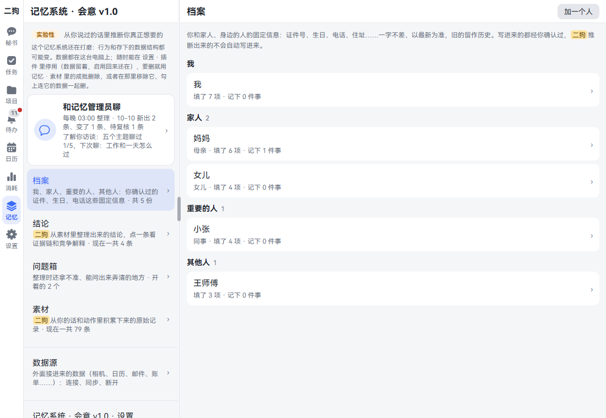
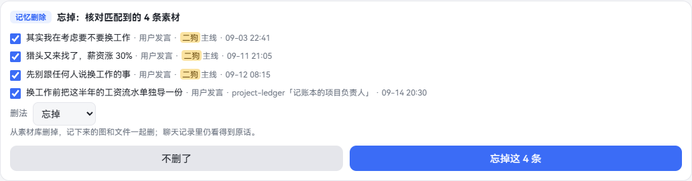
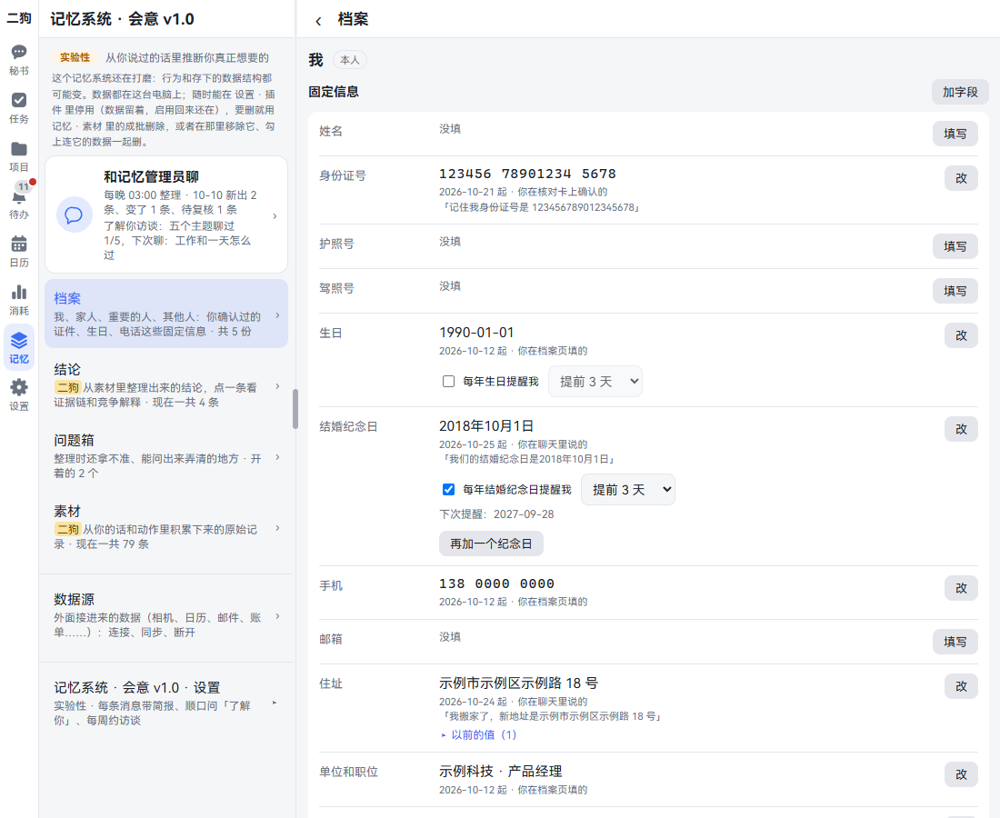
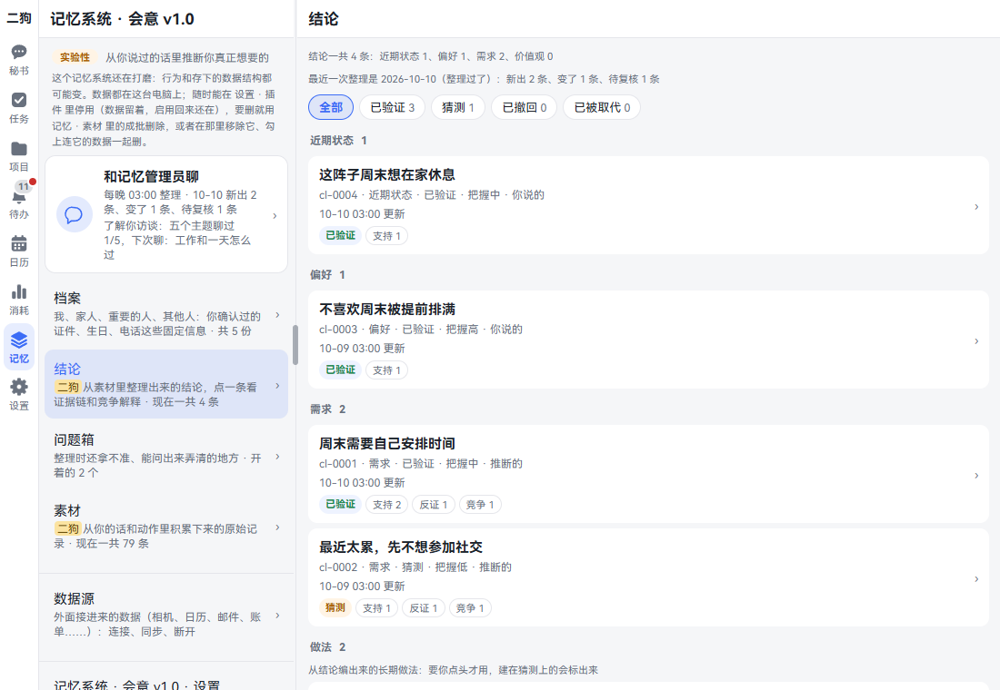
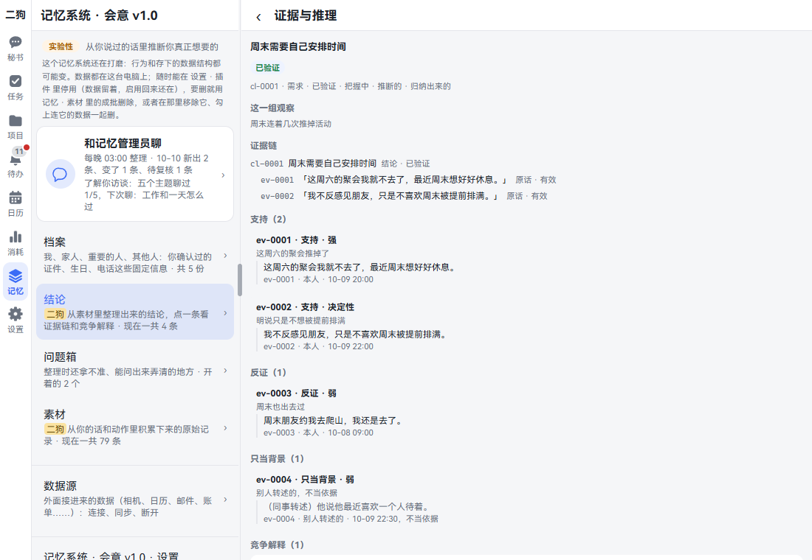
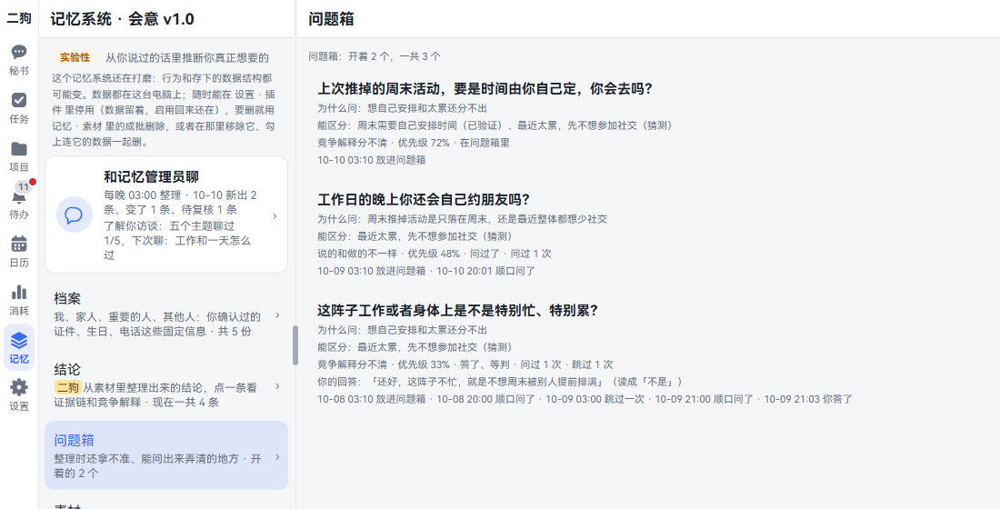
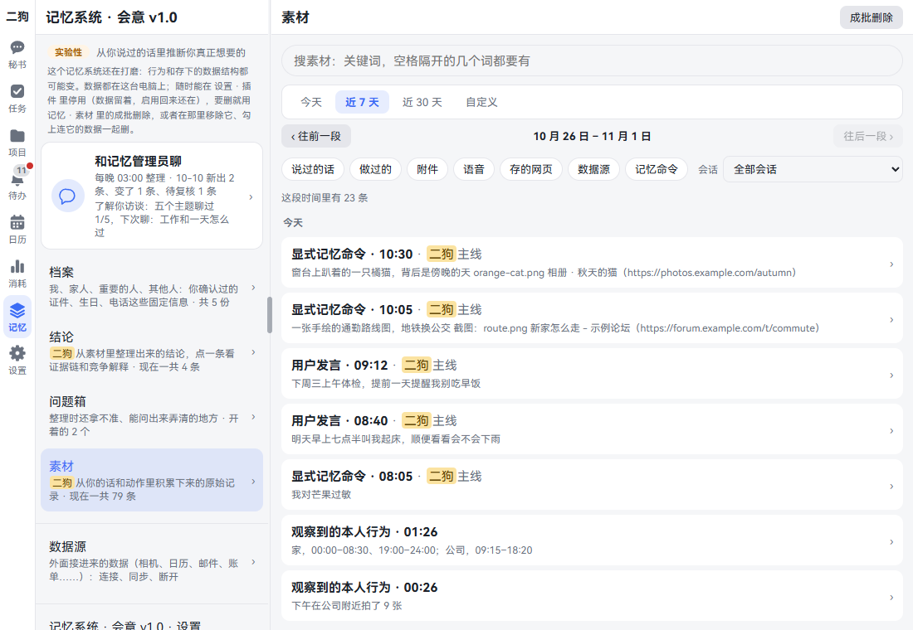
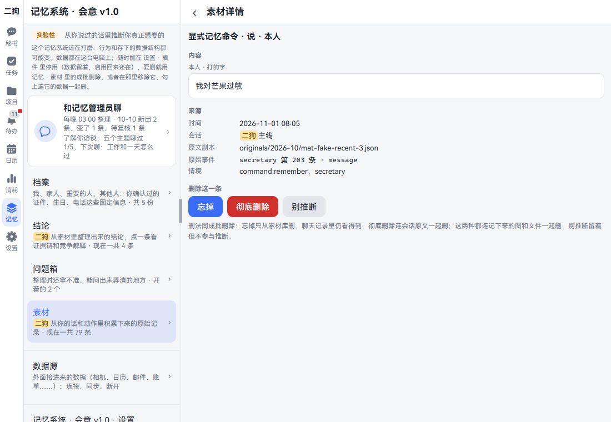
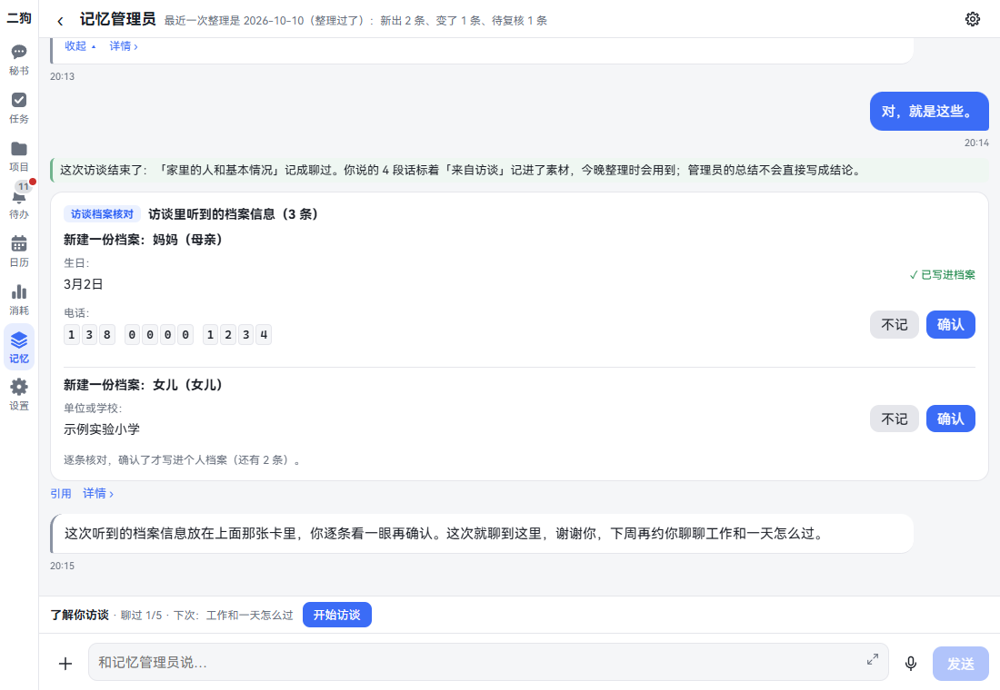
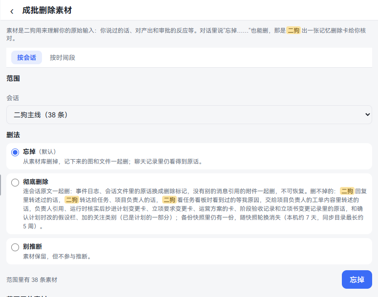

**中文** | [English](memory.en.md)

# 记忆

二狗会记住你说过的话，慢慢了解你。这一章讲五件事：怎么让它记住，怎么让它忘掉，怎么看它了解了什么，怎么改它了解错的地方，怎么把数据彻底删掉。看完你能管好它记了什么、用了什么。

这套记忆系统叫「会意」，页面顶上标着「实验性」：它还在打磨，行为和存下的数据都可能变。数据都在你自己的电脑上。

## 先认识这几样东西

| 叫什么 | 是什么 | 谁写的 | 例子 |
|---|---|---|---|
| 素材 | 原始记录：你说过的话、做过的决定、存过的东西 | 二狗自动存，原话不改 | 「这周六的聚会我就不去了」 |
| 结论 | 从素材推出来的理解，每条都带证据 | 记忆管理员每晚 03:00 整理 | 「周末需要自己安排时间」 |
| 问题箱 | 整理时拿不准、问一句就能弄清的地方 | 记忆管理员 | 「工作日的晚上你还会自己约朋友吗？」 |
| 档案 | 证件号、生日、电话这些固定信息 | 只有你确认过的才写进来 | 妈妈的生日 |

**记忆管理员**是专门管记忆的 agent。它每晚整理一次，平时你也能找它聊。

## 打开记忆页

- **电脑：** 点左边竖栏的「记忆」。
- **手机：** 点底部的「更多」，再点「记忆系统 · 会意 v1.0」。

页面从上到下是：

1. **和记忆管理员聊**：写着最近一次整理的结果，和了解你访谈聊到哪了。
2. **档案、结论、问题箱、素材**：四栏，后面写着现在有几条。
3. **数据源**：外面接进来的数据，见[数据源](data-sources.md)。
4. **记忆系统 · 会意 v1.0 · 设置**：三个开关，默认收起，见[三个开关](#三个开关)。

这一章写的「记忆 · 素材」，意思就是打开记忆页，再点「素材」。

## 让二狗记住一件事

**这是什么：** 你说的话二狗都会存成素材，平时不用特意交代。有件事你想让它一定记住，比如你对芒果过敏，就明确说一声。

**可以直接说的话：**

- 帮我记一句：周三下午去取车
- 记住，我对芒果过敏

**一步一步：**

1. 在秘书的输入框里打字，或者按住说话，说上面这样的话。
2. 秘书回一句「记下了」。
3. 想核对的话，打开 记忆 · 素材，点筛选里的「记忆命令」。这一条的种类写着「显式记忆命令」，内容是你的原话。

**要知道的：**

- 只有你明确说了才这样记，记的是原话。秘书不会把自己的推断记成你的话；它拿不准时会出一张卡问你。
- 证件号、生日这类固定信息，要放进[档案](#档案)。
- 想喂一份材料：点输入框左边的 ＋，选「作为材料投喂」，再选文件发出去。它的种类写着「用户主动投喂的材料」。
- 在内置浏览器里长按一张图，说「这张图记下来」，图本身也会存进素材。见[内置浏览器](browser.md)。
- 说错了不用找地方改，直接说「不是……是……」。这句话也存成素材，下一次整理时会认出这是纠正。

## 让二狗存下读到的东西

**这是什么：** 秘书替你读过的邮件、网页、日程、Looki 的时刻，平时用完就散。哪一份你以后还想问（「上个月物业那封邮件说了什么」），让它存进素材。不说就不存，秘书不会自己挑着存。

**可以直接说的话：**

- 把这封邮件存下来
- 这个网页存进素材，存一个月就行

**一步一步：**

1. 秘书刚读完那份东西时，跟它说上面这样的话。
2. 秘书回一句存下了。存的是标题、正文（太长的它先缩短）、出处（邮件编号、网址这些），和这份东西本身的时间。
3. 以后问起，秘书能检索到，回答时说清是那份东西里写的。
4. 想核对，打开 记忆 · 素材，点筛选里的「存下的外部信息」。

**要知道的：**

- 存下的是别人写的东西，不算你说的话。整理记忆时它只当背景，不会拿来推断你。
- 说了存多久（「存一个月」），素材详情里写着建议哪天清理；到了，列表上标「该清理了」。不会自动删，要删自己点。
- 删这种素材就是彻底删除：详情里只有「彻底删除」和「别推断」两个按钮。删完秘书检索不到，存它那一次的对话记录里的正文也一起删。

## 让二狗忘掉一件事

**这是什么：** 有些话你不想让二狗再用。删法有三种：

| 删法 | 素材 | 聊天记录 | 结论 |
|---|---|---|---|
| 忘掉 | 删掉，记下来的图和文件一起删 | 原话还看得到 | 用到它的结论标上「复核中」，已验证的退回猜测，只靠它的撤回 |
| 彻底删除 | 删掉，记下来的图和文件一起删 | 原话换成删除标记，不可恢复 | 同上，证据也真的删掉 |
| 别推断 | 留着，标上「不参与推断」 | 不动 | 不再当依据，用到它的结论同上 |

**可以直接说的话：**

- 忘掉我说过要换工作的事
- 彻底删除我说过工资的那几句
- 我说最近很累那几句，别推断

**一步一步：**

1. 对秘书说上面这样的话。
2. 秘书先查素材，再出一张记忆删除卡。这时什么都还没删。
3. 核对卡上的每一条。不想删的，把前面的勾去掉。
4. 想换一种删法，在「删法」下拉框里换，下面的说明跟着变。
5. 点右下角的按钮，比如「忘掉这 4 条」。不删了就点「不删了」。
6. 卡上写「已忘掉 4 条素材」，就删好了。

**要知道的：**

- 一张卡最多 50 条。更多的用[成批删除](#成批删除)。
- 忘掉、彻底删除都没有撤销。别推断现在也没有取消的地方。
- 单独删一条，到[素材](#素材)里点开它。
- 也可以对记忆管理员说忘掉、别推断。它先找出是哪几条，你说对了它就直接做，不出卡。彻底删除它做不了，要走卡片或者素材页。

## 档案

**这是什么：** 你和身边人的固定信息：证件号、生日、电话、住址。一字不差，以最新的为准，旧的留作历史。写进来的都经你确认过，二狗推断出来的不会自动写进来。

**在哪里打开：** 记忆 · 档案。也可以从 设置 · 身份 · 个人档案 点进来，是同一个地方。

列表分四组：我、家人、重要的人、其他人。

### 加一个人

1. 点右上角「加一个人」。
2. 填「称呼」，比如「妈妈」。「和我的关系」可以不填。
3. 「分组」不选就按关系猜，以后能改。
4. 点「加上」，直接进这个人的档案。

### 填一项、改一项

1. 在「固定信息」里找到这一项，点「填写」或者「改」。
2. 写好点「保存」。
3. 改已有的值时，还能点「撤销最近一次」回到上一个值，或者点「删除」。

每一项下面写着从哪天起、怎么写进来的。改过的项下面有「以前的值」，点开看历史。

- **自己加一项：** 点「加字段」，填字段名和值，比如车牌号。字段名里带「生日」「纪念日」的（比如「女儿生日」），值也是选的。
- **纪念日：** 能有几个。点「填写」，写名字、选日子；要再加一个，点「再加一个纪念日」。
- **本人的姓名：** 就是 设置 · 身份 · 我的名字，改一边另一边跟着变。

### 生日、纪念日怎么填

生日、纪念日不用打字，是选的：

1. 点「填写」或者「改」。
2. 先选「公历」还是「农历」。
3. 选年、月、日。不记得哪年，年就选「不记得哪年」。农历的月是正月到腊月，日是初一到三十；闰月勾上「闰月」。
4. 点「保存」。

公历的日子按那一年那个月来：2 月 29 日只有闰年、或者「不记得哪年」时才有。打开时已经按现在的值选好了。

保存以后显示成「1990 年 3 月 2 日」「3 月 2 日」「农历八月十五」这样。在聊天里说「我妈生日是 3 月 2 号」，秘书照样记成这个样子；说不出具体哪天的（「下个月」）它会先问你。

以前随手写的、认不出的日子不会被改掉，照原样显示，旁边写着「格式认不出，点「改」重新选」。点「改」重新选一次就好。

### 每年提醒

生日、纪念日下面有「每年生日提醒我」。勾上，选提前几天（默认 3 天），当场生效。到了那天 09:00 提醒你。

农历的日子暂时不能自动提醒，页面上会写明。要提醒插件开着才行。

### 记下的事

不是固定字段的事，比如「腿脚不好，爬楼吃力」：

1. 点「记一件事」。
2. 写内容，选日期，默认今天。
3. 点「保存」。

### 二狗了解到的

每份档案最下面有这一块：二狗从聊天里整理、推断出来的，和这个人有关的结论、事实、原话。只能看，不会自动写进档案。

### 删除

- 删一项：点「改」，再点「删除」。
- 删一件事：点那件事旁边的「删除」。
- 删一个人：点最下面的按钮，上面写着 删掉「妈妈」的整份档案。你本人那份删不掉。

都会问你用哪种删法：

- **忘掉（默认）：** 档案里没有了，二狗读不到；聊天记录里的原话还在。
- **彻底删除：** 连同历史、核对卡、二狗读过它的记录一起抹掉，收不回。这时还能勾「出处的原话也一起彻底删除」。

**可以直接说的话：**

- 记一下，我妈生日是 3 月 2 日
- 我的身份证号是 ……，帮我记下来
- 我妈的生日是哪天

**要知道的：**

- 在聊天里明说的生日、纪念日，秘书直接写进档案，并建好每年提醒，回话里写明。
- 号码类总会出一张核对卡，一位一位列出来，因为语音转写可能错一位。确认无误点「确认写入」。
- 夜里整理时，二狗还可能从你的话里听出候选信息，第二天放一张卡进待办：「核对一下：这几件要不要记进档案」。勾上的点「写进勾了的」，都不要就点「都不用」。一天最多一张。
- 秘书替你填网页表单、你问起时，它才读档案。读到的内容会发给你配的模型服务。夜里整理时，号码和住址换成占位，不发给模型。
- 手机通讯录、导入的通讯录也能建档，见[数据源](data-sources.md)。

## 结论

**这是什么：** 记忆管理员从素材里推出来的理解。比如你推掉了几次周末聚会，它可能推出「周末需要自己安排时间」，也可能猜「最近太累」。两种解释都留着，还要看证据。

**在哪里打开：** 记忆 · 结论。

**一步一步：**

1. 看顶上两行：一共几条、最近一次整理做了什么。整理之前同步过数据源的，下面还有一行：同步了哪几个、各新增几条，刚同步过的，没同步上的和为什么。
2. 想只看某种状态，点筛选：全部、已验证、猜测、已撤回、已被取代。
3. 结论按层排：近期状态、偏好、需求、价值观。
4. 点一条，进「证据与推理」。

「证据与推理」从上到下写着：

- **证据链：** 结论 → 前提 → 事实 → 你的原话。
- **支持、反证、只当背景：** 每条写着为什么算、分量多重、引的原话。别人转述的只当背景，不当依据。
- **竞争解释：** 同一组观察的另一种说法，点一条换过去看。
- **推理、修订记录：** 怎么推出来的，改过几次、为什么改。
- **用到的原话：** 这条结论引了哪些话。

**小签是什么意思：**

| 小签 | 意思 |
|---|---|
| 已验证 | 有足够的证据，秘书可以直接用 |
| 猜测 | 还没证实。秘书用时会说「我猜」；这种结论详情页写着「为什么还是猜测」 |
| 复核中 | 依据变了，下一次整理重新判 |
| 把握高、把握中、把握低 | 有多大把握 |
| 你说的、推断的、你确认过的 | 这条是怎么来的 |

**这条不对，怎么改：** 页面上没有改的按钮，去找[记忆管理员](#记忆管理员)说。

**要知道的：**

- 第一次整理之前，这里是空的。
- 列表最下面可能有一节「做法」：从结论编出来的长期做法，比如「安排周末的活动时，留出空白」。页面写着「要你点头才用」，但现在还没有点头的地方，这一节只能看，标「待你确认」的不会被用上。

## 问题箱

**这是什么：** 整理时拿不准、问一句就能弄清的地方。二狗不会为了这些事打扰你，只在聊到相关话题时顺口问一句。

**在哪里打开：** 记忆 · 问题箱。

每个问题写着：

- **为什么问**，**能区分**哪几条结论。
- 哪种问题、优先级、现在什么状态、问过几次、跳过几次。
- 你的回答，它读成了什么（是、不是、说不好）。
- 经过：什么时候放进来、什么时候问的、你什么时候答的。

这一页只能看。要答，等秘书问到时回话就行；想主动聊，见下面的话。

**可以直接说的话：**

- （对记忆管理员）你还想问我什么
- （被问到时）这个跳过
- （被问到时）别问这个

**要知道的：**

- 秘书一天最多顺口问一个。急事不问，上一轮在等你做决定也不问。
- 不答也没关系。跳过两次的问题就退下了；说「别问这个」，这一类不再问。
- 不想被问，到记忆页最下面关掉[开关](#三个开关)，问题还留在这里。

## 素材

**这是什么：** 二狗积累下来的原始记录，也是结论的依据。你能在这里查到它记过什么，也能单独删一条。

**在哪里打开：** 记忆 · 素材。

**一步一步：**

1. 选时间：今天、近 7 天（默认）、近 30 天、自定义。「‹ 往前一段」「往后一段 ›」翻页。
2. 想搜就在顶上打关键词，空格隔开的几个词都要有。这段时间里搜不到，点「换成全部时间来搜」。
3. 想筛就点种类：说过的话、做过的、附件、语音、存的网页、数据源、存下的外部信息、记忆命令。可以多选。
4. 想只看某个会话，在「会话」下拉框里选。点「不筛了」清掉种类和会话。
5. 列表一次 30 条，点「再显示」接着看。
6. 点一条，进「素材详情」。

「素材详情」写着内容和来源。出处的消息还在时，有「跳到这条消息 ›」。最下面「删除这一条」有三个按钮：「忘掉」「彻底删除」「别推断」。点了先弹确认框，写清这种删法会怎样，再点「确认忘掉」这样的按钮。

**要知道的：**

- 列表上有小签：「来自访谈」「不参与推断」「在废弃分支里」「该清理了」（存下的外部信息到了建议清理的日子）。
- 种类也能看出来历：用户发言、审批决定、澄清问题的回答、任务结局、观察到的本人行为……
- 你接着对方的话说的一句（比如秘书问「周末早上要不要也照常叫你」，你回「不用，周末别叫」），详情的内容上面有一行小字「回的是：……」，写着前面对方说的是什么意思。这是记忆管理员每晚整理之前补上的，不是你说的话，只用来读懂你这句；自己开的新话题、会话的第一句没有。以前的素材每晚分批补。删这条素材时它跟着删。
- 按意思找素材要[向量模型](#出问题怎么办)。这一页的搜索是关键词，不用它。

## 了解你访谈

**这是什么：** 记忆管理员约你聊十来分钟，一次一个主题，一次问一个问题。比零碎聊天更快让它了解你。

主题有五个：

1. 家里的人和基本情况
2. 工作和一天怎么过
3. 人生里几次重要的选择
4. 在意什么和烦什么
5. 想要什么样的帮忙

五个都聊过以后，主题换成「最近有什么变化」。

**怎么开始（四种，开的是同一次）：**

- 在记忆页点「和记忆管理员聊」，再点输入框上面那一行的「开始访谈」。
- 在记忆管理员的输入框里打 `/interview`，后面可以写主题。
- 在待办里的约访卡上点「开始」。
- 对秘书说「我想做个访谈」。

**一步一步：**

1. 开始以后，记忆管理员在它的页面上问第一个问题。输入框上面那一行变成：正在访谈：工作和一天怎么过 · 想停就说“就到这里”。
2. 打字或者按住说话，一问一答，一般十来个来回。
3. 不想答就说「跳过」。
4. 刚说的不想留，就说「这个别记」，它回「好，这段不记」，接着聊。
5. 想停就说「就到这里」。
6. 收尾时它说「今天我记下了这些」，列几条要点，问你对不对。你答了以后这次就结束，会话里出一行结果。
7. 聊到生日、电话这些，它合成一张卡「访谈里听到的档案信息」，放在会话和待办里。逐条点「确认」或者「不记」。确认了才写进档案。

**每周约一次：** 每周六 10:00，待办里可能出现一张约访卡：「有空聊 10 分钟吗？这次聊：……」。五个主题都聊过以后，改成每月一次。这张卡不卡任何事。

- **开始：** 去记忆管理员那里聊。
- **下次再说：** 下周再约。
- **不想做了：** 以后不再约。

想再约：开关在记忆页最下面，见[三个开关](#三个开关)。

**要知道的：**

- 你说的话标着「来自访谈」存进素材，当晚整理时用上。管理员的总结只是说给你听，不写成结论。
- 中途停了，这个主题不算聊过，下次接着聊。
- 开了 3 小时还没收尾，算放下了。之后说的话不算访谈。
- 访谈要花模型的钱，记在 消耗 里记忆管理员名下。

## 记忆管理员

**这是什么：** 每晚 03:00 整理记忆的 agent。平时你也能找它：问一条结论是哪来的，让它改，让它忘掉。

**在哪里打开：**

- 记忆页顶上的「和记忆管理员聊」。
- 任务页看板上的「记忆整理 · 每天 03:00」，点「进去找它 ›」。

页面就是普通的对话。上面是历史消息和每一夜的整理日记，下面打字或者按住说话。标题栏的 ⚙ 能改它单独的提示词、清空对话、看上下文用量。

**可以直接说的话：**

- 这条结论是哪来的：周末需要自己安排时间
- 「最近太累」这条不对
- 「周末需要自己安排时间」这条对
- 这条拿不准，再看看
- 忘掉我说过换工作的那几句
- 现在整理一次（或者输入 `/consolidate`）

这些话对秘书说也行，秘书会转给它，再把回答转告你。

**要知道的：**

- **表态算数：** 你说「这条对」「这条不对」，它记成你的表态，以后整理不会改回去。改主意了再说一次。
- **有两种情况改不了：** 你自己明说的结论撤不掉，它会问你要不要忘掉或者别推断那句话；依据已经没了才撤回的，改不回已验证。
- **它只管记忆：** 改配置、删项目这些，它会说「这个我不做」，告诉你该去哪。
- **第一句可能慢一点：** 它平时不在跑，你发消息才启动，闲置一会儿退出。看历史不受影响。
- **整理之前先同步数据源：** 每晚整理（电脑睡过了头、开机补的那次也算）和「现在整理一次」，开始读素材之前，开着导入的数据源（Google 日历、Gmail 发出的邮件、Looki）先各同步一次，导完再整理，刚进来的这一次就读得到。10 分钟内刚同步过的不再同步；每个最多等 3 分钟，没完的照常整理，导进来的下次整理读；出错的不在这时重试（数据源那边每小时自动再试）。手机的数据由 App 送来，不在这里同步。结果写在 记忆 · 结论 顶上。

## 彻底删除

有四个地方：

| 想删什么 | 去哪里 |
|---|---|
| 说得出来的一件事 | 对秘书说「彻底删除……」，在记忆删除卡上核对 |
| 一条素材 | 记忆 · 素材，点开它，点「彻底删除」 |
| 一个会话、一段时间的素材 | 下面的成批删除 |
| 档案里的一项或者一个人 | 档案页，见[档案](#删除) |

### 成批删除

**在哪里打开：** 记忆 · 素材，点右上角「成批删除」。

1. 选「按会话」或者「按时间段」。
2. 在「范围」里选会话，或者填起止时间。
3. 在「删法」里选：忘掉（默认）、彻底删除、别推断。
4. 下面写着「范围里有 N 条素材」。下面还列着这些素材，点开能看内容，也能单独删。
5. 点右边的按钮（写着删法的名字）。
6. 确认框写清范围和后果。点「确认彻底删除」。

彻底删除还会连带范围里没识别出文字的语音，页面上写着多少条。

### 彻底删除删不掉什么

彻底删除后，这些还在，页面上也写着：

- 二狗回复里转述过的话，它转达给任务、项目负责人的话。
- 交给项目负责人的工单里转述的话，抄进计划变更卡、验收记录、立项书变更记录的原话。
- 确认计划时改的假设、加的关注类别。这些已经是计划的一部分。
- 备份里的一份。备份轮换后才消失：本机约 7 天，同步目录最长约 5 周。

### 移除记忆插件

**在哪里打开：** 设置 · 能力 · 插件，找到「记忆」。

- **停用：** 记忆页收起，不再采集新素材，以前的数据都在。启用回来，停用期间的话会补采。
- **移除：** 点「移除」，勾「连它的数据一起彻底删除」，点「下一步」，对话框列出会删掉什么、删不掉什么，再点「移除并彻底删除」。

移除时删得掉的只有插件自己的：让二狗「记住」的话、记忆删除卡、整理记录、访谈记录这些。**素材和结论不跟着删**。要删素材，用上面的成批删除。

记忆插件停用时：导航里没有「记忆」，「更多」里出现「个人档案」，设置里出现「删除素材」。档案和删除照常能用。

## 三个开关

**在哪里打开：** 记忆页最下面，点「记忆系统 · 会意 v1.0 · 设置」展开。

| 开关 | 开着时 | 关掉后 |
|---|---|---|
| 每条消息自动带上相关记忆 | 你说的话和结论对得上时，相关的结论和你当时的原话一起带进这一轮，不用再交代前因后果 | 只在需要时再去问记忆 |
| 在对话里顺口问 | 聊到相关的事时，顺着话题问一个问题，每天最多一个 | 不问，问题留在问题箱 |
| 每周约一次了解你访谈 | 每周在待办里约一次（五个主题都聊过以后每月一次） | 不约，想聊时自己开 |

三个都默认开。拨一下当场存好，所有设备一样，下一条消息起按新的。

## 二狗回话时怎么用记忆

二狗查了记忆，会话里多一行「记忆　回忆了 3 条：<第一条记忆的标题> ›」。取不到标题时写「回忆了 3 条记忆」。

点开看「这次用到的记忆」：

- **为什么查、查了什么。**
- **找到的每一条：** 原话、什么时候说的、在哪个会话。点「看原话 ›」跳到那条消息。
- **自动带上的简报：** 写着为什么带它。点「看证据与推理 ›」看那条结论。

已经删掉的，写着「这条记忆已删除」。

自动带上记忆用了多少 token，在 消耗 页的「记忆简报」那一行。

## 出问题怎么办

| 看到什么 | 怎么回事 | 怎么办 |
|---|---|---|
| 结论、问题箱是空的，或者写着「还没建推理库」 | 还没整理过 | 等到 03:00，或者对记忆管理员说「现在整理一次」 |
| 写着「没跑（没配模型 key）」 | 整理只认 DeepSeek 的 key。换成别家模型也一样要它 | 到 设置 · 能力 · 模型，在 API key 那块填 DeepSeek 那一行。素材不丢，下一夜接着做 |
| 写着「推理库这会儿正被每晚整理占着」 | 正在整理 | 过一会儿刷新 |
| 待办里有「记忆整理没做完」 | 整理出错或者超时 | 看里面写的原因。素材一条没少，下一次接着做 |
| 待办里有「记忆整理要重建推理库」 | 记忆数据和程序版本对不上 | 素材一条没少。现在界面上没有重建的按钮，请把这句话反馈给我们 |
| 二狗只能按关键词找素材 | 向量模型没装 | 到 设置 · 能力 · 组件，安装「向量模型 bge-m3」。装好不用重启 |
| 记忆页不见了 | 记忆插件停用了 | 到 设置 · 能力 · 插件，启用它 |

## 相关章节

- [语音](voice.md)：按住说话、让二狗念给你听。
- [和秘书说话](chat.md)
- [数据源](data-sources.md)：把日历、邮件、照片接进素材。
- [内置浏览器](browser.md)：长按网页元素记下来，把网页存进素材。
- [设置](settings.md)：备份和恢复、模型。
- [备份](settings.md#备份)
