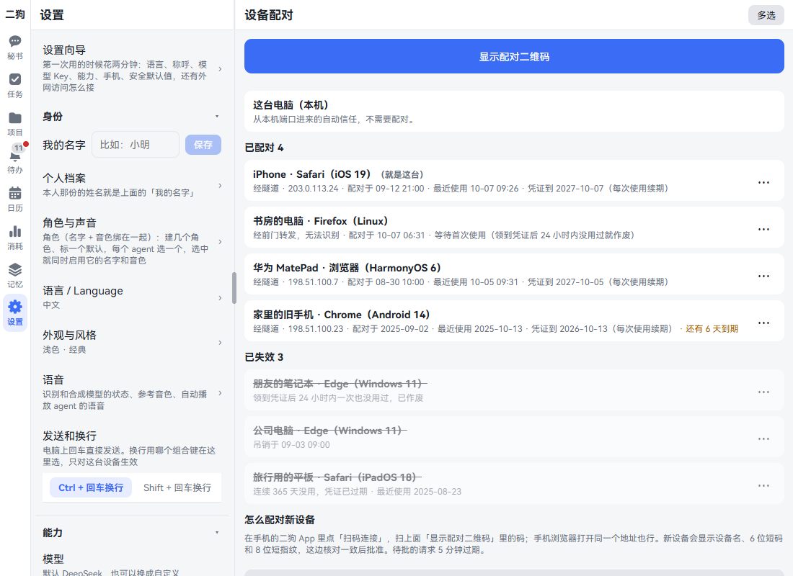
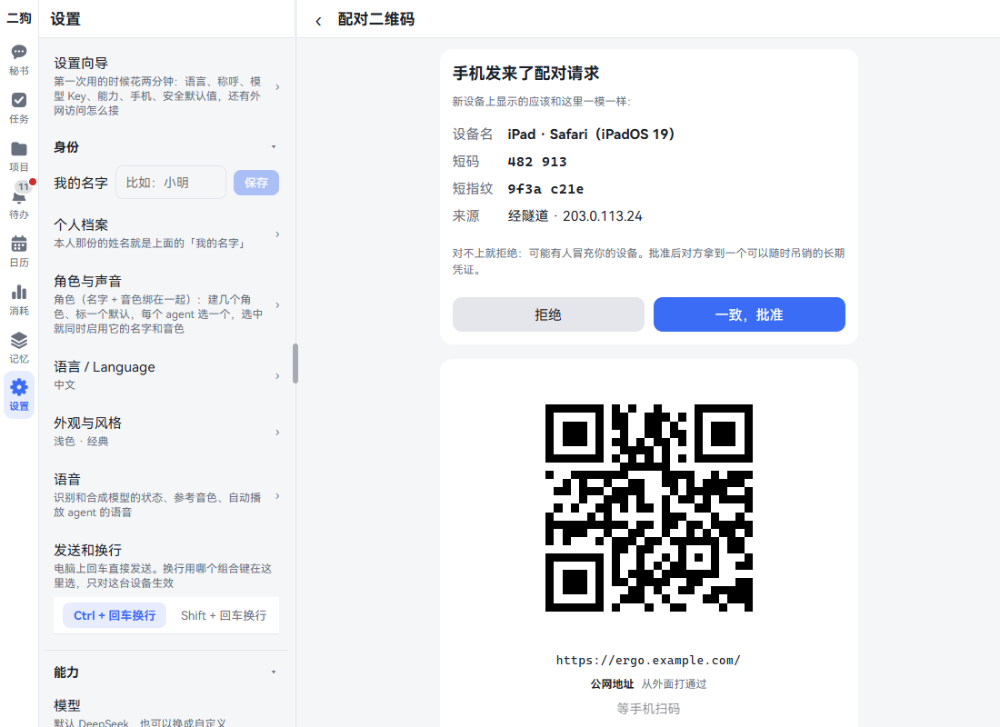
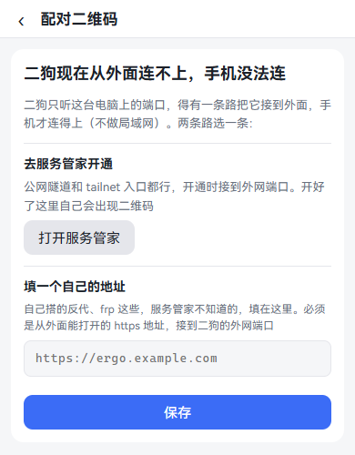
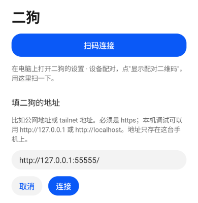
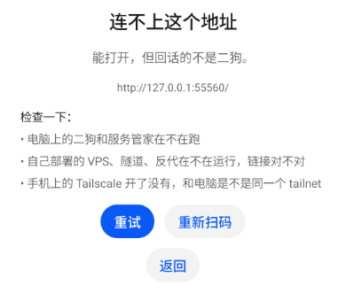
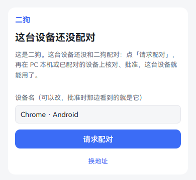
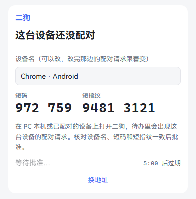
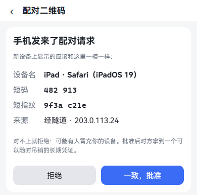
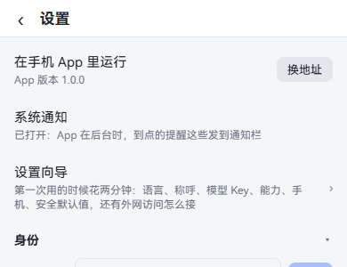
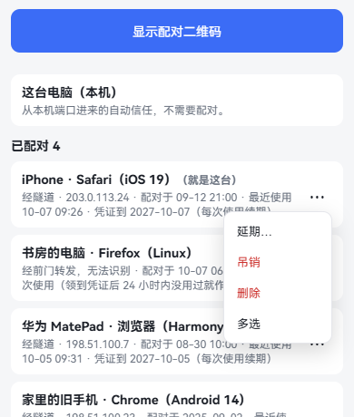

[中文](mobile.md) | **English**

# On your phone

Screenshots show the Chinese interface; the labels in the text are the English ones.

ergo runs on your computer. Your phone connects back to that computer, and you get all of ergo. There are three ways to use it: a phone browser, the HarmonyOS app or the Android app.

Whichever you pick, it's the same three steps: let your phone reach your computer → show the pairing code on your computer → connect from your phone and approve on your computer. This chapter follows those three steps. By the end you can talk to ergo from your phone while you're out.

## How the three ways differ

| | Phone browser | HarmonyOS app | Android app |
|---|---|---|---|
| How to install | Nothing to install | Sign it with your own Huawei account, then install | Download and install |
| All of ergo's pages | Yes | Yes | Yes |
| [Built-in browser](browser.en.md) (the **Browse** tab) | No | Yes | Yes |
| Hold to talk | Yes, with the browser's recording | Yes, native recording | Yes, native recording |
| Notifications when something is due | Browser notifications, which you have to allow first | System notifications | System notifications |
| Downloading files | Browser download | The system's **Save to** | The system's **Save to** |
| [Data on your phone](data-sources.en.md#data-on-your-phone) (contacts, calendar, photos, location) | No | Yes | Not yet |

**The apps aren't in any app store.** On Android you download and install. On HarmonyOS you have to sign with your own Huawei account. The steps are in [Install the app](#install-the-app) below.

## Letting your phone reach your computer: choosing outside access

**What it is:** ergo only listens on ports on this computer. Something has to connect it to the outside before your phone can reach it. **Your local network doesn't count:** even on the same Wi-Fi, you need one of the routes below.

Pick one of these three:

| | Official Tailscale (recommended) | Self-hosted Headscale (advanced) | VPS + tunnel + nginx (public) |
|---|---|---|---|
| What you need | Tailscale on your computer and phone, signed in to the same account | A VPS | A VPS and a domain certificate |
| Who can open it | Only devices in your tailnet | Only devices in your tailnet | Any browser; pairing is the only gate |
| Difficulty | Easiest | Medium | Hardest |
| Good for | A first setup, when you don't want any fuss | Keeping control yourself, or speed inside China | Not wanting Tailscale on your phone |
| Watch out for | Signing in takes a Google, Microsoft, GitHub or similar account; its relays are overseas, so it may be slow in China | The VPS side hasn't been verified on real Debian yet, so follow the docs step by step | It's exposed on the public internet, so strangers can see the pairing page; the one-command VPS setup hasn't been verified on real Debian yet |

If you're not sure, pick the first one. A tailnet is simply the devices you've signed in to the same Tailscale account.

**Connecting Tailscale (the first way):** three manual steps.

1. Install [Tailscale](https://tailscale.com/download/windows) on your computer and sign in. In Tailscale's admin console, turn on MagicDNS and HTTPS certificates.
2. In PowerShell on your computer, run this line. It makes Tailscale offer ergo's external port to your devices over HTTPS:

   ```powershell
   tailscale serve --bg --https=443 http://127.0.0.1:8811
   ```

3. Install Tailscale on your phone and sign in to **the same account**. In the browser, open `https://<computer name>.<your tailnet>.ts.net/` and follow [pairing](#pairing-check-and-approve) below.

**The second and third ways** need a VPS. For the steps, see [Option 2](../architecture/deployment.en.md#option-2-self-hosted-headscale-advanced) and [Option 3](../architecture/deployment.en.md#option-3-vps--ssh-reverse-tunnel--nginx-public).

**Good to know:** All three ways may only connect ergo's external port 8811. Never connect local port 8810 to the outside. Requests arriving there are trusted automatically, so exposing it lets anyone into your ergo.

## Show the pairing code on your computer

**What it is:** Scanning this code tells your phone ergo's address. The code only holds the address, no password. After scanning, you still approve the phone here.

**Where to open it:** Settings · Data & devices · Device pairing. The **Pair your phone** step of the setup wizard has the same QR code panel built in, and a link below it, **See paired devices: Settings · Device pairing**, comes to this page.

**Step by step:**

1. Open ergo on your computer and go to this page. At the very top is the big **Show pairing code** button.

   

2. Click **Show pairing code**. You see a big QR code. Below it are the address, what kind of address it is, and **Waiting for the phone to scan**.

   

3. When there are several addresses, **Use another address** lists them below. Click one and the code changes with it. Public addresses come first, then tailnet ones, and those that have been reached from outside go ahead of the rest.
4. Leave this page open and connect from your phone.

**The small text next to an address:**

| It says | Meaning |
|---|---|
| Reached from outside | The service manager tested it from outside and got through |
| Not tested from outside yet | It hasn't been tested. Try scanning it and see |
| The service manager can't reach it | This may be a problem on its side only. Try scanning anyway |
| The phone must join the same tailnet first | Only on Tailnet addresses. Tailscale has to be on on your phone |

**No code, and it says Ergo can't be reached from outside right now, so a phone can't connect:** The route to the outside isn't set up yet. The page gives you two ways:

- **Set it up in the service manager**. A public tunnel or a tailnet entry both work; point it at the external port when you open it. Once it's open, the code appears here by itself.
- **Enter your own address**. See below.



**Using your own address:** This is for a `tailscale serve` you ran by hand, a reverse proxy you set up yourself, or frp. The service manager doesn't know about these.

1. Click **Use your own address** below the code.
2. Enter an https address that opens from outside and goes to ergo's external port. The placeholder says `https://ergo.example.com`.
3. Click **Save**. To drop it, click **Remove**.

Local network addresses and this computer's own addresses aren't accepted, and the page says why.

## Phone browser

**What it is:** For when you don't want to install an app, or want to try it first.

**Step by step:**

1. Open your address in the phone's browser. Or scan the code on your computer with the ordinary camera: it's just a normal web address.
2. When you see the pairing page, follow [Pairing: check and approve](#pairing-check-and-approve) below.
3. To open it like an app, use the browser's **Add to Home Screen**.

**Good to know:** After the server updates, open pages show **A new version of ergo is available** at the very top. Tap **Refresh**, or tap **Later** to hide it for now. If the update came while the page was in the background with nothing typed and no voice playing, the page switches to the new version by itself (on a computer while it is still in the background, on the phone when you switch back); no tap needed. When you come back after a long time in the background and the connection is dead, it reconnects within seconds and catches up on what happened meanwhile.

## Install the app

**The HarmonyOS and Android apps are the same product:** a native shell running the same web pages, plus native recording, system notifications, file downloads and the built-in browser. Neither is in an app store. The install packages are on the GitHub releases page.

| | Android | HarmonyOS |
|---|---|---|
| Download | [ergo-android-debug.apk](https://github.com/catmaniii/ergo/raw/main/downloads/ergo-android-debug.apk) | [ergo-harmony-unsigned.hap](https://github.com/catmaniii/ergo/raw/main/downloads/ergo-harmony-unsigned.hap) (unsigned) |
| Installing on the phone | Tap it and it installs, no computer needed | Sign it first with your own Huawei account, then install from a computer |
| Who it's for | Everyone | Developers who don't mind some setup |

To check that a download hasn't been tampered with: `SHA256SUMS` on the releases page has the hashes of both files, and that list is signed with the release key.

### Android app

**Download: [ergo-android-debug.apk](https://github.com/catmaniii/ergo/raw/main/downloads/ergo-android-debug.apk)**

Supports Android 8 and later. You don't need a computer, and you don't need to know any code.

**Step by step:**

1. Open the download link above in your phone's browser and download the file.
2. When it's done, open it: tap the browser's download prompt, or find the **Downloads** folder in the phone's **Files**.
3. If the system says it isn't allowed to install unknown apps from this source, tap **Settings** and turn on **Allow from this source** (允许来自此来源的应用 on a Chinese system).
4. The system asks whether to install this app. Its name is Ergo (二狗 on a Chinese system). Tap **Install**.
5. If a security prompt says it hasn't seen this app before and suggests a scan (Google Play Protect does this), open the details and choose Install without scanning (不扫描直接安装 on a Chinese system). You see this because the app has never been in an app store.
6. Once it's installed, tap **Open**. The first time, it opens on the page for entering an address. Then see "Connecting to ergo" below.

**What we've walked through, and what we haven't:** We went through steps 2 to 6 on an English-language Android 16 emulator, opening the file from **Files**. The English wording in those steps is what was on screen at the time; the Chinese in brackets is the equivalent wording. **Not verified:** actually downloading from the releases page in a phone browser, opening the file from the browser's download prompt, and the prompts on real phones of each brand. Brands differ in wording and switches. Some call it **外部来源应用下载** (downloading apps from external sources) or **纯净模式** (pure mode). Just turn on whatever your screen says.

**Connecting to ergo:** The same three steps from the start of this chapter.

1. [Let your phone reach your computer](#letting-your-phone-reach-your-computer-choosing-outside-access). If you've never set this up, pick Tailscale.
2. [Show the pairing code](#show-the-pairing-code-on-your-computer) on your computer.
3. On your phone, [scan to connect](#scan-to-connect-in-the-app), then go back to your computer to [check and approve](#pairing-check-and-approve).

**Good to know:**

- This package has a **debug signature**. It works normally, but no app store has reviewed it; this project packages and publishes it itself. Its debugging features are off, so even over USB, debugging tools can't read the credentials inside.
- Every future version is signed with the same key. Download a new version and install it right over the old one, and your pairing stays.
- **A build you make yourself has a different signature from the download,** so neither can install over the other. To switch, uninstall first. After uninstalling, you have to pair again.
- If opening it says **The system WebView is too old for the ergo app**, update **Android System WebView** in your app store.

**Installing with adb (optional):** On the phone, turn on developer options and USB debugging, connect it to your computer over USB, then:

```powershell
adb devices
adb -s <device id> install -r ergo-android-debug.apk
adb -s <device id> shell am start -n com.catmaniii.ergo/.MainActivity
```

**To build it yourself:** You need ergo's source code (see [Install from source](install.en.md#install-from-source)) and [Android Studio](https://developer.android.com/studio) (with the Android SDK and JDK). In the ergo directory, run `npm run build:android`. The first run needs the network to fetch build tools. You get `frontend\android\app\build\outputs\apk\debug\app-debug.apk`; install it with the adb commands above. For build and debugging details, see the [development docs](../architecture/development.en.md#android-app).

### HarmonyOS app

This section is for developers who don't mind some setup. You need DevEco Studio and a Huawei account. If you'd rather skip all that, use the [phone browser](#phone-browser) for now.

**Why you can't just download and install:** A HarmonyOS package that isn't in the store has to be signed with your own Huawei account, and the signature names the phones it can install on. We can't sign it for you. So the HAP we provide is unsigned: **it installs directly on the emulator but not on a real phone.** On a real phone, installing it fails with `no signature file`.

**First check that your phone is new enough:** The package is built for HarmonyOS 6.1.1 (API 24) and won't install on an older system. With the phone connected to your computer, check with `hdc shell param get const.ohos.apiversion`. It must be 24 or higher.

**Choosing between the two routes:**

| | Route 1: build it yourself | Route 2: download the HAP, sign it yourself |
|---|---|---|
| What you need | Source code, Node, DevEco, a Huawei account | DevEco, a Huawei account, and a certificate and profile applied for on Huawei's developer site |
| Signing | One click in DevEco generates it | Apply for it yourself, sign by hand |
| If the bundle name is taken | You can change the bundle name | Dead end: the downloaded package's bundle name can't be changed |
| Which to pick | **Start here** | Try it only if Route 1 doesn't work for you |

`$hdc` in the commands below is the hdc that comes with DevEco. Set it in PowerShell first:

```powershell
$dev = "D:\Program Files\Huawei\DevEco Studio"   # change to your install folder
$hdc = "$dev\sdk\default\openharmony\toolchains\hdc.exe"
```

#### Turn on developer mode on the phone

Both routes need this. For the official steps, see [Running an app on a local device](https://developer.huawei.com/consumer/cn/doc/harmonyos-guides/ide-run-device) (in Chinese).

1. On the phone, open Settings → System and look for **Developer options**. If it isn't there, go to Settings → About phone (on some systems, the device name), tap **Version number** (on some systems, **Software version**) seven times, confirm, and enter your lock screen password. The phone restarts.
2. Go to Settings → System → Developer options and turn on **USB debugging**.
3. Connect to the computer over USB. When the phone asks to allow USB debugging, tap Allow.
4. On the computer, run `& $hdc list targets`. You should see a device ID.

#### Route 1: build it yourself

**You need:** [DevEco Studio](https://developer.huawei.com/consumer/cn/deveco-studio/) (site in Chinese; we build with 26.0.0, and other versions are untested), a Huawei developer account with real-name verification, Node 22 (22.19 or later), and Git.

1. Get the source and install dependencies:

   ```powershell
   git clone https://github.com/catmaniii/ergo.git
   cd ergo
   npm ci
   ```

2. Run `npm run build:harmony` once. This run isn't signed yet. Its purpose is to generate the local project config `frontend\harmony\build-profile.json5`, which isn't in the repo. The script finds DevEco by itself: the default locations are `D:\Program Files\Huawei\DevEco Studio` and `C:\Program Files\Huawei\DevEco Studio`. If it's installed elsewhere, set the environment variable `DEVECO_HOME` first.
3. Keep the phone connected over USB. Open `frontend\harmony` in DevEco Studio, go to File → Project Structure → Project → Signing Configs, and click Sign In to sign in to your Huawei account.
4. **Tick only Automatically generate signature. Don't tick Associate with registered application.** Click OK. DevEco generates the key, certificate and profile, writes the connected phone into them, and writes the paths into that config file. Your computer's clock must match Beijing time, or signing fails. For the official notes, see [Automatic signing](https://developer.huawei.com/consumer/cn/doc/harmonyos-guides/ide-signing-auto) (in Chinese).
5. Run `npm run build:harmony` again. You get `frontend\harmony\entry\build\default\outputs\default\entry-default-signed.hap`.
6. Install and open it:

   ```powershell
   & $hdc list targets
   & $hdc -t <device id> install -r frontend\harmony\entry\build\default\outputs\default\entry-default-signed.hap
   & $hdc -t <device id> shell aa start -a EntryAbility -b com.catmaniii.ergo
   ```

Once it's open, connecting to ergo works the same as on Android: see the three steps under [Connecting to ergo](#android-app).

**How far this has been verified:** This route has worked on the maintainer's own account and phone. **Not verified:** whether the bundle name `com.catmaniii.ergo` works with a different Huawei account; see [Bundle name](#bundle-name) below.

To upgrade later: pull the new code and rerun steps 5 and 6. When the certificate expires or you change phones, redo steps 3 and 4 with the phone connected.

#### Route 2: download the HAP and sign it yourself

**Not verified:** We haven't taken this route all the way to a phone. The steps below follow Huawei's official docs. We ran the signing command on the published HAP with a throwaway test certificate. The tool signed it and verified its own result. That only shows the command is written correctly; a phone won't accept a package signed that way.

**First, two places where this can dead-end:**

- **Bundle name:** This route needs an app under your account with the bundle name `com.catmaniii.ergo`, and Huawei requires bundle names to be unique across the whole platform. If another account has created it, you can't, and the downloaded package's bundle name can't be changed, so you're back to Route 1.
- **Restricted permissions:** This HAP requests two restricted permissions: `ohos.permission.READ_WHOLE_CALENDAR` (phone calendar) and `ohos.permission.READ_IMAGEVIDEO` (photo album). A manually requested profile must include them. That means first [applying for ACL permissions](https://developer.huawei.com/consumer/cn/doc/app/agc-help-apply-acl-0000002394212138) (in Chinese) on Huawei's developer site and getting approved, and [the official docs say](https://developer.huawei.com/consumer/cn/doc/harmonyos-guides/restricted-permissions) (in Chinese) only a small number of apps that fit special scenarios get approved. Without them, installing will most likely fail with `grant request permissions failed` (not verified). Route 1's automatic signing doesn't have this problem: the official docs state that debug signing doesn't enforce checks on these permissions.

**What you need:**

| Item | File | Where it comes from |
|---|---|---|
| Keystore | `.p12` | DevEco: Build → Generate Key and CSR. Remember the password and alias |
| Certificate request | `.csr` | Generated together with the above |
| App | No file | [Create a HarmonyOS app](https://developer.huawei.com/consumer/cn/doc/app/agc-help-create-app-0000002247955506) (in Chinese), with the bundle name `com.catmaniii.ergo` |
| Debug certificate | `.cer` | [Apply for a debug certificate](https://developer.huawei.com/consumer/cn/doc/app/agc-help-debug-cert-0000002283256797) (in Chinese) and upload the `.csr`. Up to 3 per account. Valid for 1 year on a real-name account, 14 days without real-name verification |
| Register the phone | No file | [Register a device](https://developer.huawei.com/consumer/cn/doc/app/agc-help-add-device-0000002283189937) (in Chinese) with the phone's UDID. Look it up with `& $hdc -t <device id> shell bm get --udid` |
| Debug profile | `.p7b` | [Apply for a debug profile](https://developer.huawei.com/consumer/cn/doc/app/agc-help-debug-profile-0000002248181278) (in Chinese). Choose the debug type (**调试**), and select the certificate and phone above |

For the whole process, see the official [manual signing](https://developer.huawei.com/consumer/cn/doc/harmonyos-guides/ide-signing-manual) guide (in Chinese).

**Step by step:**

1. Download [ergo-harmony-unsigned.hap](https://github.com/catmaniii/ergo/raw/main/downloads/ergo-harmony-unsigned.hap), put it in the same folder as the items above, and open PowerShell in that folder.
2. Run the signing tool with the Java that comes with DevEco. Don't use a JDK installed elsewhere; some versions crash the tool:

   ```powershell
   & "$dev\jbr\bin\java.exe" -jar "$dev\sdk\default\openharmony\toolchains\lib\hap-sign-tool.jar" sign-app `
     -mode localSign -signAlg SHA256withECDSA `
     -keyAlias <alias> -keyPwd <key password> `
     -keystoreFile my.p12 -keystorePwd <keystore password> `
     -appCertFile my.cer -profileFile my.p7b `
     -inFile ergo-harmony-unsigned.hap -outFile ergo-harmony-signed.hap
   ```

   When DevEco generates the key, the key password and the keystore password are the same. For the official command reference, see "对未签名的 HAP/APP 进行签名" (signing an unsigned HAP/APP) in [Setting up a build pipeline](https://developer.huawei.com/consumer/cn/doc/harmonyos-guides/ide-command-line-building-app) (in Chinese).

3. Install and open it:

   ```powershell
   & $hdc -t <device id> install -r ergo-harmony-signed.hap
   & $hdc -t <device id> shell aa start -a EntryAbility -b com.catmaniii.ergo
   ```

To upgrade later: download the new HAP, sign it again with the same materials, and install it again.

#### Emulator

For a first look, or when you don't have a HarmonyOS phone handy. The emulator doesn't check signatures, so the downloaded HAP installs directly, with no Huawei certificate.

1. In DevEco, click Tools → Device Manager → Local Emulator → New Emulator and pick a device (the image must be API 24 or higher). The first time, it has to download the image. Click Finish, then start it. For the official notes, see [Creating an emulator](https://developer.huawei.com/consumer/cn/doc/harmonyos-guides/ide-emulator-create) (in Chinese); for what your computer needs, see [Requirements](https://developer.huawei.com/consumer/cn/doc/harmonyos-guides/ide-emulator-requirements) (in Chinese).
2. Install and open it:

   ```powershell
   & $hdc list targets        # the emulator's device ID looks like 127.0.0.1:<port>
   & $hdc -t 127.0.0.1:<port> install -r ergo-harmony-unsigned.hap
   & $hdc -t 127.0.0.1:<port> shell aa start -a EntryAbility -b com.catmaniii.ergo
   ```

   You can also drag the HAP file onto the emulator screen to install it.

3. To connect to ergo on this computer: first connect the emulator's port back to the computer, then enter `http://127.0.0.1:8811` on the address page.

   ```powershell
   & $hdc -t 127.0.0.1:<port> rport tcp:8811 tcp:8811
   ```

   This opens the pairing page and sends a pairing request, but **pairing doesn't complete:** after you approve, the page goes back to **This device isn't paired yet**. That's what we measured: HarmonyOS's web component doesn't store the device credential on an http address. To really use it in the emulator, enter an https address (not verified).

We've walked through installing, opening and reaching the pairing page on a Pura 90 emulator (API 24) with the published HAP, connected to a temporary test ergo.

#### Bundle name

The app's bundle name is `com.catmaniii.ergo`. We checked Huawei's official docs, and here's what they add up to:

| How you sign | What the official docs say | Does this bundle name work? |
|---|---|---|
| Only Automatically generate signature ticked | This kind of signature [isn't tied to an app in the app market](https://developer.huawei.com/consumer/cn/doc/harmonyos-guides/ide-signing-auto) (in Chinese). The docs don't say it checks whether someone else has taken the bundle name | **Not verified:** we haven't tried it with another account |
| Associate with registered application ticked | Looks up your team's apps on the developer site by bundle name | If another account has created this bundle name, you get `Bundle name *** is already in use`. [The official fix](https://developer.huawei.com/consumer/cn/doc/harmonyos-faqs/signature-service-faq-0002) (in Chinese) is to change the bundle name or join that team |
| Manual signing (Route 2) | You must first [create an app](https://developer.huawei.com/consumer/cn/doc/app/agc-help-create-app-0000002247955506) (in Chinese), and the bundle name can't match any other app (Android apps included) | Same as above: if another account has created it, you can't |

**To change the bundle name (only Route 1 can):**

1. Change `bundleName` in `frontend\harmony\AppScope\app.json5`, for example to `com.yourname.ergo`. Officially it needs at least three segments, each using English letters, digits and underscores, no reserved words such as `harmony` or `ohos`, and 7 to 128 characters in total.
2. Go back to DevEco, generate the signature automatically once more (steps 3 and 4 of Route 1), then build.
3. In the start command, replace the value after `-b` with the new bundle name.

**What changing it affects:** The system treats it as a different app. It won't replace the old one, so you have to uninstall the old one and pair again. ergo's features aren't affected; nothing else in the code hardcodes this bundle name. That line is your local change, so keep it when you pull new code.

#### Common errors

For the full lists, see the official [install error reference](https://developer.huawei.com/consumer/cn/doc/harmonyos-guides/bm-tool) and [automatic signing troubleshooting](https://developer.huawei.com/consumer/cn/doc/harmonyos-faqs/signature-service-troubleshooting-0001) (both in Chinese).

| Error you see | What it means | What to do |
|---|---|---|
| `no signature file` (9568320) | You installed an unsigned package on a real phone | Sign it with Route 1 or Route 2. The emulator doesn't report this |
| `device is unauthorized` (9568423) | This phone isn't registered in the profile | Regenerate the automatic signature with the phone connected. If you signed manually, add the phone to the device list, download the profile again and re-sign |
| `not trusted app source` (9568322) | The profile and certificate don't match, or the phone isn't registered, or you used a release profile | Same as above, and make sure the profile is the debug type and was applied for with this certificate |
| `The certificate has expired!` | The certificate expired | For automatic signing, regenerate with the phone connected. For manual signing, apply for a new certificate and profile |
| `The signature does not take effect or has expired` | Your computer's clock doesn't match Beijing time | Correct the clock and sign again |
| `Bundle name *** is already in use` | Another account has taken the bundle name | See [Bundle name](#bundle-name) above |
| `Bundle name *** does not exist` | You ticked Associate with registered application, but your account has no such app | Untick it and keep only Automatically generate signature |
| `Failed to query agreement signing records` | The account isn't real-name verified, or there's a network proxy problem | Complete developer real-name verification, and don't set DevEco's proxy to auto-detect (**自动检测**) |
| `The number of certificates has reached the limit` | You've hit the debug certificate limit | On the developer site, delete a debug certificate you don't use |
| `Provision number exceeds limit` | More than 150 automatic signings within 30 days | There's no need to keep re-signing the same app for the same phone. Try again after a while |
| `older sdk version in the device` (9568297) | The phone's system is below API 24 | Upgrade the phone's system |
| `debug bundle can only be installed in developer mode` (9568401) | Developer mode isn't on | See [Turn on developer mode on the phone](#turn-on-developer-mode-on-the-phone) above |
| `grant request permissions failed` (9568289) | The profile doesn't include restricted permissions the app requests | Use Route 1, or get the ACL permissions approved and add them to the profile |
| `install provision type not same` (9568286) | The copy already on the phone has a different profile type from this package | Uninstall the old one, then install: `& $hdc -t <device id> shell bm uninstall -n com.catmaniii.ergo`. After uninstalling, you have to pair again |
| `generate SignerBlock failed`, `Verify Signature failed` | The `.p12` and `.cer` don't match | Apply for the certificate again with a `.csr` generated from the same key |

## Scan to connect in the app

**What it is:** Telling the app where ergo is, the first time you open it. Scanning is the easiest way, with no typing.

**Where to open it:** This is the page you get when you first open the app. Later, come back through [Change address](#change-address).

**Step by step:**

1. First keep the code showing on your computer; see above.
2. On your phone, open the ergo app and tap **Scan to connect**.

   

3. The scanning screen opens:
   - HarmonyOS uses the system's scanning screen, so the app needs no camera permission.
   - Android asks for camera permission only once you tap. It says **Scan the pairing code on your computer**; fit the code inside the frame. If you refuse, you can still type the address by hand.
4. Once it has scanned, the app first tries a real connection. The screen says **Connecting…**.
5. If it gets through, you go to the pairing page; continue with [Pairing: check and approve](#pairing-check-and-approve). The first time you connect, the system first asks whether to send notifications, on top of the pairing page. Tap Allow. If it can't get through, it reports an error and doesn't go to the pairing page.

## When it can't connect

If it can't connect after scanning, the app says **Can't connect to this address**, with the reason, the scanned address and what to check. Below that are **Try again**, **Scan again** and **Back**.



| Reason the app gives | Most likely | What to do |
|---|---|---|
| This domain doesn't resolve, so the phone can't find it. | The phone isn't on the tailnet, or the domain is wrong | Turn on Tailscale on the phone and confirm it's on the same tailnet as your computer. Check the address |
| Timed out: no answer after 10 seconds. | The phone can't reach this address | Is your computer on? Are the tunnel and VPS running? Try another network |
| Certificate problem: this address's HTTPS certificate doesn't check out. | The certificate expired, the domain doesn't match, or the network is intercepting | Check the certificate on the VPS or reverse proxy |
| Can't get through: the connection was refused or the network is down. | The reverse proxy, tunnel or ergo isn't running | Check ergo and the service manager on your computer |
| It opens, but what answered is not ergo. | The address points to another site, or to the wrong port | Confirm it connects to external port 8811 |
| Can't connect (…). | Some other reason; the brackets hold the original message | Look into it using the original message |

**The three items under Check these:**

- Is Tailscale on for this phone, and on the same tailnet as your computer?
- Are ergo and the service manager running on your computer?
- Is your VPS, tunnel or reverse proxy running, and is the link right?

If the address is recognizably a tailnet one, the Tailscale item comes first.

**If you scan some other code:** It says **That isn't an ergo address** and shows what was scanned. Below that are **Scan again** and **Back**.

**If you can't scan:** It says **Scanning isn't available right now** or **Without camera access the code can't be scanned**. Go back to the address page and type it in.

## Enter the address by hand

**Step by step:**

1. On the address page, type in the box under **Enter ergo's address**, for example `https://ergo.example.com`.
2. Tap **Connect**.

**Good to know:**

- It must be https; the only exceptions are `http://127.0.0.1` and `http://localhost`, for local debugging. If you type it wrong, the reason appears below the box, such as **That address doesn't look right**. Don't put a user name or password in the address.
- The address is stored only on this phone.
- A typed address isn't tested first; it opens directly. If it can't open, it says **Can't open ergo** and the reason, such as **Can't connect** or **The server replied 502**, with **Retry** and **Edit address** below.
- If the address redirects somewhere else, it says where. Change the address to that one.
- If a page opens but doesn't look like ergo, **Not ergo?** appears at the bottom, with **Change address** and **Close** on the right.

## Pairing: check and approve

**What it is:** The first time a new device connects, you have to approve it on your computer. Only approved devices can get into ergo. Phone browsers and the app use the same page.

**Step by step:**

1. On the phone you see **This device isn't paired yet**. You can change the device name; it's what the approver sees.
2. Tap **Request pairing**.

   

3. The phone shows a 6-digit short code and an 8-character short fingerprint, with **Waiting for approval…** and a countdown.

   

4. Go back to your computer. If the code page is open, **A phone wants to pair** appears right there, with **Device name**, **Short code**, **Short fingerprint** and **From**. If that page isn't open, find this pairing request in the **Inbox**. Devices already paired can approve too.

   

5. Check that the phone and computer show exactly the same thing, then click **They match, approve**. **If they don't match, click Deny:** someone may be posing as your device.
6. The computer says **Connected**. The phone says **Paired**. Tap **Open ergo**.

**Good to know:**

- Pending requests expire after 5 minutes. If one expires or is denied, go back to the pairing page and tap **Request pairing** again.
- At most 5 requests from the same source within 10 minutes. After repeated failures, wait 10 minutes and try again.
- You can also change the device name while waiting for approval, and the computer's side updates to match.
- This computer doesn't need pairing itself: connections from its local port are trusted automatically.

## Change address

**What it is:** For when you've changed how you connect, the address has changed, or you want to scan again. Only in the app.

**Where to open it (either place works):**

- **If you can get into ergo:** More · Settings. In the top row, **Running in the phone app**, tap **Change address** on the right.

  

- **If you can't get into ergo:** It isn't paired yet, this device was revoked, or a request was never approved. **Change address** is at the very bottom of the pairing page.

**Step by step:**

1. Tap **Change address**. You go back to the app's address page, with the current address in the box.
2. Tap **Scan to connect** to scan again, or change the address and tap **Connect**.
3. If you change your mind, tap **Cancel**.

## Manage paired devices

**Where to open it:** Settings · Data & devices · Device pairing.

**Step by step:**

1. Each device has a row showing where it connects from, when it was paired, when it was last used, and the date its credential runs until. A phone that has opened the app shows the app version, and one that's too old is marked **needs updating to x.y** (see [Update the app](#update-the-app)). With 30 days or less left, it's marked **expires in N days**.
2. Click ⋯ at the end of the row, or long-press or right-click the row, to open the menu.

   

3. Pick one:

| Menu item | What it does |
|---|---|
| Extend… | Pick 30 days, 90 days or 1 year, then click the confirm button in the box. A device that's no longer valid works again after extending. A revoked device can't be extended |
| Revoke | The credential stops working right away, open pages disconnect immediately, and pairing is needed next time |
| Delete | Removes it from the list, and its credential is no longer accepted |
| Select | Tick several devices and act on them together. The action bar below says how many each action applies to |

**Good to know:**

- A credential is valid for one year and renews each time it's used. It expires after a full year without use.
- If a credential isn't used even once within 24 hours of being issued, it's automatically void.
- If you lose your phone, revoke it from your computer.
- A revoked phone says **This device has been revoked**. Tap **Request pairing** to apply again, and you'll have to approve it again too.
- The phone keeps a copy of how things looked last time, together with the records it has fetched (everything except conversations: cards, Inbox, the task board, activity and so on; only in this phone's browser storage). Next time it shows that first, then fetches from your computer only what changed since, instead of going through the whole history every time. After ergo updates its web page (including the automatic refresh when you switch back), the new version rebuilds from the records on the phone and still fetches only what's new; conversations fetch their latest page from the computer again. All of this is deleted when this phone is revoked, expires or goes back to the pairing page.
- Chat history you've scrolled up to is also kept on this phone (stored separately, up to about 50 MB; when it's full, the conversations you haven't looked at for longest go first). Scrolling up again shows what the phone has right away, even offline; only what's missing is fetched from your computer, and that gets kept too. If you rolled back a conversation, permanently deleted messages or restored the data folder on the computer, what the phone kept is discarded and fetched again, so it never shows outdated history. How much is kept is shown in the Debug toolkit (Settings → About ergo) under Connection. It's all deleted when this phone is revoked, expires or goes back to the pairing page.

## Update the app

**What it is:** The app is only a shell, and the pages come from ergo on your computer. So when ergo on your computer updates, the app on your phone usually doesn't need to. You only have to update it when ergo starts relying on something new in the app.

**When it's too old you'll see:**

- A bar at the very top of the app: **The ergo app needs updating to x.y**, with a button to go and update.
- The same reminder in your inbox, which also goes to the notification bar while the app is in the background. Each phone is only reminded once.

**Android: tap Update in the app.** ergo on your computer carries the Android app of the same version, so the phone downloads it from ergo instead of GitHub, which is also fast in mainland China.

1. In the ergo app on your phone, open Settings · Data & devices · Device pairing. This phone's row says **new version x.y.z**, with an **Update** button under it. When the app is too old, the button in the bar at the top is **Update** too.
2. Tap **Update**. The percentage downloaded shows under it.
3. **Only the first time:** Android opens the **Install unknown apps** page. Turn on **Allow from this source**, press Back to return to ergo, and the install continues. You won't be asked again.
4. On Android 12 and later, when Android allows an app to update itself, there's nothing more to confirm. When it wants a confirmation, it shows a dialog; tap **Update**.
5. The ergo app closes while it installs. When it's done, a notification says **The ergo app is updated to x.y.z**; tap it to open the app (without notification permission, just open the app again). The **new version** note in the row is gone, and you're still paired.

When it doesn't install, the reason shows under **Update**: the download failed (check your network and tap again), the downloaded file doesn't match the checksum from ergo (tap again to download it again), it isn't an ergo app package, it isn't newer than the app on your phone, it's signed differently from the app on your phone (one you built yourself and a released one have different signatures; the only way is to uninstall, reinstall and pair again), you cancelled, your phone is out of storage, or ergo isn't allowed to install apps. The temporary file is deleted either way.

**What we tested and what we didn't:** steps 1 to 5, plus the three refusals (different signature, not newer than the installed app, checksum mismatch), on an Android 16 emulator in English: the first time it went to **Install unknown apps**, carried on after allowing it, and Android showed no confirmation dialog; once installed, the app didn't open by itself (since Android 10 apps can't open their own screens from the background), and tapping the notification opened it. **Not tested:** real phones, Android versions before 12, and how each brand words the prompts or whether it asks to confirm.

**Older apps (0.4.2 and earlier)** don't have this, so the first update to a version that does goes like this: tap **Update** the same way, and the app downloads the package. Choose where to save it (the file is called `ergo-android-x.y.z.apk`), then open it in the phone's Files app to install over the old version. The first time, Android asks whether to allow installs from this source; allow it, go back to Files and tap the file again. After that, every update is one tap in the app. When ergo on your computer doesn't carry the package (for example a source install whose `downloads/` version doesn't match), the button is **Download** and takes you to the releases page; see [Android app](#android-app).

**HarmonyOS:** tap **Installation guide** and sign and install again as in [HarmonyOS app](#harmonyos-app). HarmonyOS never shows **new version**: both apps share one version number, so the HarmonyOS package gets a new number even when nothing in it changed, and ergo can't install it for you (you sign it yourself). It only reminds you when the app is below the minimum version. You don't need to pair again.

Once it's updated, the bar and the reminder go away by themselves. When the app is new enough, nothing shows. The phone browser never needs updating and never shows this bar.

**To see the current version:** Settings · Data & devices · Device pairing. A phone that has opened the app shows the app version in its row. On the phone you can also look under **Running in the phone app** at the top of More · Settings.

## System notifications

**What it is:** While the app is in the background, due reminders and the like go to the phone's notification bar.

**Where to open it:** More · Settings: the **System notifications** row under **Running in the phone app** at the very top.

**Step by step:**

1. If it says **On**, there's nothing to do.
2. If it says **Off: reminders only show inside the page**, tap **Turn on**. If you've never been asked, the system's permission box pops up. If you refused before, the system's notification settings open.

The first time you connect to ergo, the app first asks whether to send notifications, in a box on top of the pairing page. Tap Allow, then carry on pairing.

**Good to know:**

- The app sends notifications itself, with no phone maker's or Google's push service involved. After the system kills the app, you won't get any until you open it again.
- To miss as few as possible, set ergo's battery policy to **Unrestricted** in system settings.
- Notifications aren't sent while the app is in the foreground; the page already shows them at the top.

## Troubleshooting

| What you see | What to do |
|---|---|
| Can't connect after scanning | See [When it can't connect](#when-it-cant-connect) |
| The phone stays on the pairing page | Make sure you approved on the computer. If the request expired, request again |
| The phone says **This device has been revoked** | Tap **Request pairing** to apply again. If you don't want to connect it any more, leave it |
| The phone says its credential expired | It went unused for too long. Tap **Request pairing** to pair again |
| Not sure whether the route to the outside works | On your computer, see **Outside access** under Settings · Data & devices · Checkup |

For more, see [Troubleshooting](install.en.md#troubleshooting).

## Read next

- [Built-in browser](browser.en.md): **Browse** in the app.
- [Data sources](data-sources.en.md#data-on-your-phone): contacts, calendar, photos and location on your phone.
- [Voice](voice.en.md): hold to talk.
- [Deployment and outside access](../architecture/deployment.en.md): the technical details of outside access.
