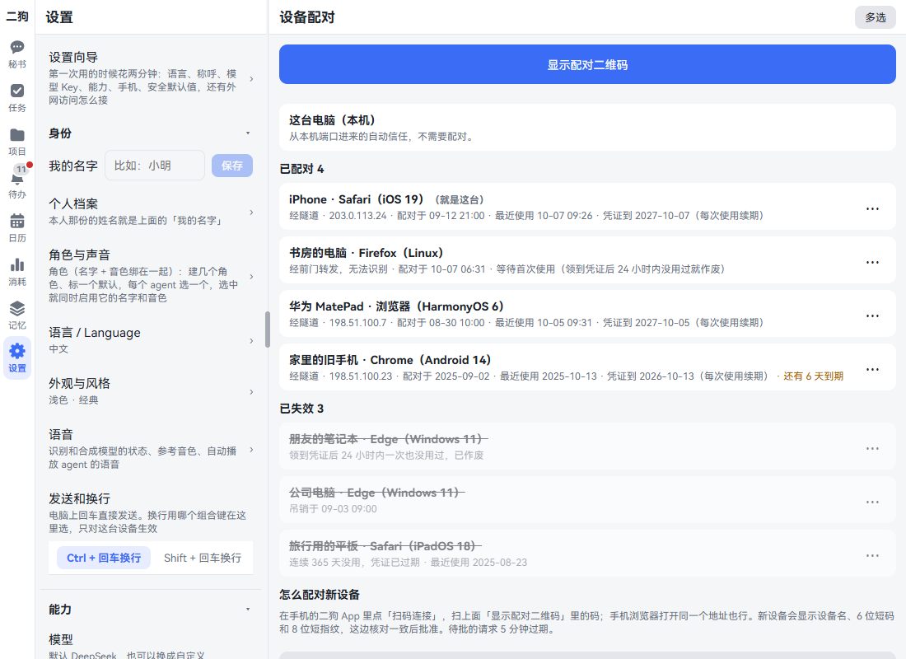
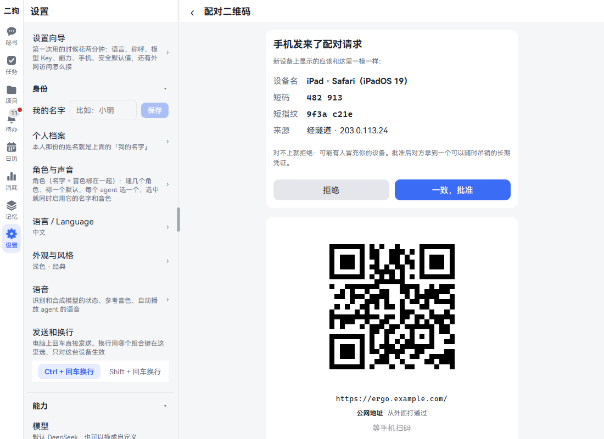
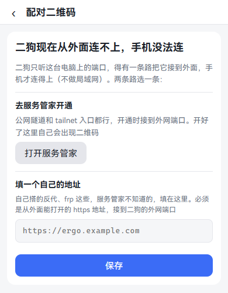
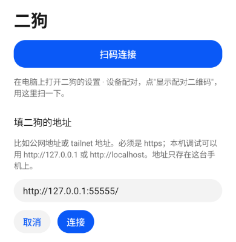
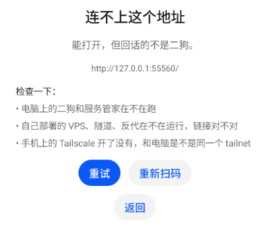
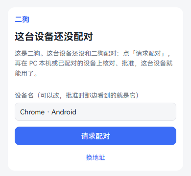
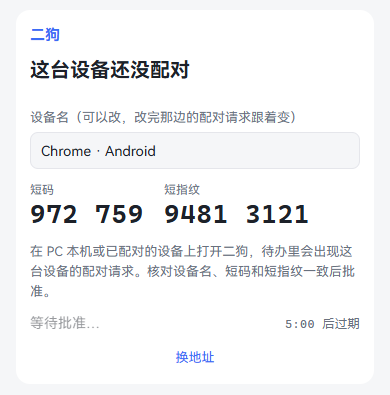
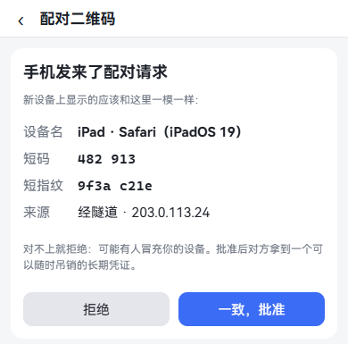
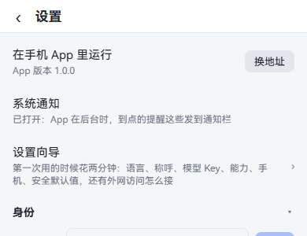
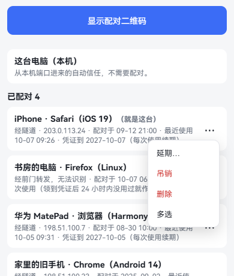

**中文** | [English](mobile.en.md)

# 手机上用

二狗跑在你的电脑上。手机连回这台电脑，就能用完整的二狗。有三种用法：手机浏览器、鸿蒙 App、安卓 App。

不管用哪种，都是三步：让手机连得到电脑 → 电脑上显示配对二维码 → 手机连上、在电脑上批准。这一章就照这三步讲。看完你能在外面用手机跟二狗说话。

## 三种用法有什么不同

| | 手机浏览器 | 鸿蒙 App | 安卓 App |
|---|---|---|---|
| 怎么装 | 不用装 | 用你自己的华为账号签名后装 | 下载就能装 |
| 二狗的全部页面 | 有 | 有 | 有 |
| [内置浏览器](browser.md)（「浏览」页签） | 没有 | 有 | 有 |
| 按住说话 | 有，用浏览器录音 | 有，原生录音 | 有，原生录音 |
| 到点通知 | 浏览器通知，要先允许 | 系统通知 | 系统通知 |
| 下载文件 | 浏览器下载 | 系统的"保存到" | 系统的"保存到" |
| [手机数据](data-sources.md#手机上的数据)（通讯录、日历、照片、位置） | 没有 | 有 | 还没有 |

**App 不在应用市场里。** 安卓下载就能装，鸿蒙要用你自己的华为账号签名。步骤见下面的[装 App](#装-app)。

## 让手机连得到电脑：外网访问怎么选

**这是什么：** 二狗只听这台电脑上的端口。要有一条路把它接到外面，手机才连得上。**局域网不算**：同一个 Wi-Fi 下也要走下面的路。

三种方式选一种：

| | Tailscale 官方（推荐） | 自建 Headscale（进阶） | VPS + 隧道 + nginx（公网） |
|---|---|---|---|
| 要什么 | 电脑、手机装 Tailscale，登同一个账号 | 一台 VPS | 一台 VPS、域名证书 |
| 谁能打开 | 只有你 tailnet 里的设备 | 只有你 tailnet 里的设备 | 任何浏览器，全靠配对把关 |
| 难度 | 最简单 | 中等 | 最难 |
| 适合 | 第一次接，不想折腾 | 想自己掌握，或者要国内快 | 手机不想装 Tailscale |
| 注意 | 登录要 Google、微软、GitHub 等账号；中转在海外，国内可能慢 | VPS 那头还没在真 Debian 上验过，照文档一步步来 | 暴露在公网上，陌生人能看到配对页；一条命令搭的 VPS 那头还没在真 Debian 上验过 |

拿不准就选第一种。tailnet 就是你登同一个 Tailscale 账号的这几台设备。

**接 Tailscale（第一种）：** 手动三步。

1. 电脑上装 [Tailscale](https://tailscale.com/download/windows) 并登录。在 Tailscale 的管理后台打开 MagicDNS 和 HTTPS 证书。
2. 在电脑的 PowerShell 里跑这一条，让 Tailscale 把二狗的外网端口用 HTTPS 提供给你的设备：

   ```powershell
   tailscale serve --bg --https=443 http://127.0.0.1:8811
   ```

3. 手机装 Tailscale，登**同一个账号**。浏览器打开 `https://<电脑的机器名>.<你的 tailnet>.ts.net/`，照下面的[配对](#配对核对和批准)做。

**第二种、第三种** 要一台 VPS，步骤见[方式二](../architecture/deployment.md#方式二自建-headscale进阶)、[方式三](../architecture/deployment.md#方式三vps--ssh-反向隧道--nginx公网)。

**要知道的：** 三种方式都只能接二狗的外网端口 8811。本机端口 8810 绝不能接到外面，从那里进来的请求自动信任，接出去等于谁都能进你的二狗。

## 电脑上显示配对二维码

**这是什么：** 手机扫这个码，就知道二狗的地址。码里只有地址，不放口令。扫了之后还要你在这里批准。

**在哪里打开：** 设置 · 数据与设备 · 设备配对。设置向导的「手机配对」那一步里直接嵌着同一块二维码面板，下面还有一个链接「看已配对的设备：设置 · 设备配对」，点了来这一页。

**一步一步：**

1. 在电脑上打开二狗，进这一页。最上面是大按钮「显示配对二维码」。

   

2. 点「显示配对二维码」。看到大二维码，下面写着地址、这是什么地址、"等手机扫码"。

   

3. 地址有好几个时，下面列着「换一个地址」，点一个，二维码跟着换。公网在前，tailnet 其次，从外面打通过的排前面。
4. 让这一页开着，到手机上连。

**地址旁边的小字：**

| 写的是 | 意思 |
|---|---|
| 从外面打通过 | 服务管家从外面测通了 |
| 还没从外面测过 | 没测过，可以扫了试试 |
| 服务管家这边打不通 | 也可能只是它那边的问题，可以扫了试试 |
| 手机要先连上同一个 tailnet | Tailnet 地址才有，手机上的 Tailscale 要开着 |

**没有二维码，写着"二狗现在从外面连不上，手机没法连"：** 还没接好外面的路。页面给两条路：

- 去服务管家开通。公网隧道和 tailnet 入口都行，开通时接到外网端口。开好了这里自己出现二维码。
- 填一个自己的地址，见下面。



**用自己的地址：** 手动跑的 `tailscale serve`、自己搭的反代、frp，服务管家不知道。

1. 点二维码下面的「用自己的地址」。
2. 填从外面能打开的 https 地址，要接到二狗的外网端口。占位提示写着 `https://ergo.example.com`。
3. 点「保存」。不要了点「去掉」。

局域网地址、这台电脑的地址不收，页面会写明原因。

## 手机浏览器

**这是什么：** 不想装 App，或者想先试试。

**一步一步：**

1. 手机浏览器打开你的地址。普通相机扫电脑上的二维码也行，它就是一个普通网址。
2. 看到配对页，照下面的[配对：核对和批准](#配对核对和批准)做。
3. 想像 App 一样打开，用浏览器的"添加到主屏幕"。

**要知道的：** 服务端更新以后，开着的页面最上面出现"二狗有新版本"，点「刷新」，或者点「等会儿」先收起。页面在后台时更新的，没打字、没在放语音就自己换成新的（电脑上趁还在后台就换好，手机上切回来时换），不用点。在后台放久了切回来，连接不通的几秒内自己重连、补上这段时间的消息。

## 装 App

**鸿蒙和安卓 App 是同一个产品**：原生外壳里跑同一套网页，多了原生录音、系统通知、文件下载和内置浏览器。两种都不在应用市场里，安装包放在 GitHub 的发布页。

| | 安卓 | 鸿蒙 |
|---|---|---|
| 下载 | [ergo-android-debug.apk](https://github.com/catmaniii/ergo/raw/main/downloads/ergo-android-debug.apk) | [ergo-harmony-unsigned.hap](https://github.com/catmaniii/ergo/raw/main/downloads/ergo-harmony-unsigned.hap)（没有签名） |
| 手机上怎么装 | 点开就装，不用电脑 | 先用你自己的华为账号签名，再用电脑装 |
| 适合谁 | 所有人 | 愿意折腾的开发者 |

想核对下载的文件没被改过：发布页的 `SHA256SUMS` 里有这两个文件的哈希，这份清单带发布钥匙的签名。

### 安卓 App

**下载：[ergo-android-debug.apk](https://github.com/catmaniii/ergo/raw/main/downloads/ergo-android-debug.apk)**

支持安卓 8 及以上。不用电脑，也不用懂代码。

**一步一步：**

1. 用手机的浏览器打开上面的下载链接，把文件下载下来。
2. 下载完点开它：从浏览器的下载提示点，或者到手机的「文件」里找「下载」文件夹。
3. 系统说不允许安装这个来源的未知应用时，点「设置」，打开「允许来自此来源的应用」（英文系统写 Allow from this source）。
4. 系统问要不要安装这个应用，名字是「二狗」（英文系统写 Ergo），点「安装」。
5. 系统的安全提示说没见过这个应用、建议扫描时（Google Play 保护机制会这样），点开详细信息，选不扫描直接安装（英文系统写 Install without scanning）。它没上过应用市场，所以才这样提示。
6. 装好后点「打开」。第一次打开是填地址的页面，接着看下面的「连上二狗」。

**实际走过的和没走过的：** 第 2 到第 6 步，我们在英文系统的安卓 16 模拟器上从「文件」里点开走过一遍。括号里的英文是当时屏幕上的字，中文是对应的说法。**未验证：** 用手机浏览器真的从发布页下载、从浏览器的下载提示点开，以及各品牌真机上的提示。各品牌的字样和开关不一样，有的叫"外部来源应用下载"或"纯净模式"，照屏幕上写的打开就行。

**连上二狗：** 还是这一章开头说的三步。

1. [让手机连得到电脑](#让手机连得到电脑外网访问怎么选)。没接过就选 Tailscale。
2. 在电脑上[显示配对二维码](#电脑上显示配对二维码)。
3. 手机上[扫码连接](#app-上扫码连接)，再回电脑上[核对和批准](#配对核对和批准)。

**要知道的：**

- 这是**调试签名**的包，能正常用，但不是应用市场审过的，是这个项目自己打包发布的。它关着调试功能，接上 USB 也不能用调试工具读里面的凭证。
- 以后每个版本都用同一把钥匙签，新版直接覆盖安装，配对还在。装好之后升级不用再下载：电脑上的二狗带着同一版的 App，在 App 里点「更新」就行，见[升级 App](#升级-app)。
- **自己构建的和下载的签名不同**，不能互相覆盖。换着装要先卸载，卸载后要重新配对。
- 打开时提示"系统的 WebView 版本太旧"，到应用商店升级「Android System WebView」。

**用 adb 装（可选）：** 手机打开开发者选项和 USB 调试，用 USB 连上电脑，然后：

```powershell
adb devices
adb -s <设备号> install -r ergo-android-debug.apk
adb -s <设备号> shell am start -n com.catmaniii.ergo/.MainActivity
```

**想自己构建：** 要二狗的源码（见[从源码安装](install.md#从源码安装)）、[Android Studio](https://developer.android.com/studio)（带 Android SDK 和 JDK）。在二狗目录里跑 `npm run build:android`，第一次要联网取构建工具，得到 `frontend\android\app\build\outputs\apk\debug\app-debug.apk`，用上面的 adb 命令装。构建和调试的细节见[开发文档](../architecture/development.md#安卓-app)。

### 鸿蒙 App

这一节写给愿意折腾的开发者，要用 DevEco Studio 和华为账号。不想折腾就先用[手机浏览器](#手机浏览器)。

**为什么不能下载就装：** 没上架的鸿蒙包，要用你自己的华为账号签名，签名里写明能装在哪几台手机上。我们没法替你签。所以我们提供的 HAP 没有签名：**模拟器能直接装，真机不能直接装**，真机上装它报 `no signature file`。

**先看手机够不够新：** 这个包按 HarmonyOS 6.1.1（API 24）构建，系统更低的手机装不上。手机连上电脑后可以用 `hdc shell param get const.ohos.apiversion` 查，要 24 或更高。

**两条路怎么选：**

| | 路一：自己构建 | 路二：下载 HAP，自己签 |
|---|---|---|
| 要准备 | 源码、Node、DevEco、华为账号 | DevEco、华为账号，在华为开发者网站上申请证书和描述文件 |
| 签名 | DevEco 点一下自动生成 | 自己申请，手动签 |
| 包名被占用时 | 能改包名 | 走不通，下载的包包名改不了 |
| 选哪条 | **先走这条** | 走不了路一时再试 |

下面命令里的 `$hdc` 是 DevEco 自带的 hdc，先在 PowerShell 里设好：

```powershell
$dev = "D:\Program Files\Huawei\DevEco Studio"   # 换成你的安装目录
$hdc = "$dev\sdk\default\openharmony\toolchains\hdc.exe"
```

#### 手机打开开发者模式

两条路都要。官方步骤见[使用本地真机运行应用](https://developer.huawei.com/consumer/cn/doc/harmonyos-guides/ide-run-device)。

1. 手机打开 设置 → 系统，看有没有「开发者选项」。没有的话到 设置 → 关于本机（有的系统是设备名称），连点七下「版本号」（有的系统是「软件版本」），确认开启、输入锁屏密码，手机会重启。
2. 设置 → 系统 → 开发者选项，打开「USB 调试」。
3. 用 USB 连上电脑，手机上弹"允许 USB 调试"时点允许。
4. 电脑上跑 `& $hdc list targets`，能看到一串设备号就对了。

#### 路一：自己构建

**要准备：** [DevEco Studio](https://developer.huawei.com/consumer/cn/deveco-studio/)（我们用 26.0.0 构建，别的版本没试过）、实名认证过的华为开发者账号、Node 22（22.19 或更高）、Git。

1. 拿源码、装依赖：

   ```powershell
   git clone https://github.com/catmaniii/ergo.git
   cd ergo
   npm ci
   ```

2. 跑一次 `npm run build:harmony`。这一次还没签名，目的是生成本机的工程配置 `frontend\harmony\build-profile.json5`，它不进仓库。脚本自己找 DevEco：默认位置是 `D:\Program Files\Huawei\DevEco Studio` 和 `C:\Program Files\Huawei\DevEco Studio`，装在别处就先设环境变量 `DEVECO_HOME`。
3. 手机用 USB 连着电脑。用 DevEco Studio 打开 `frontend\harmony`，点 File → Project Structure → Project → Signing Configs，点 Sign In 登录华为账号。
4. **只勾 Automatically generate signature，不要勾 Associate with registered application**，点 OK。DevEco 生成密钥、证书和描述文件，把连着的手机写进去，路径写进上面那份配置。电脑时间要和北京时间一致，否则签不成。官方说明见[自动签名](https://developer.huawei.com/consumer/cn/doc/harmonyos-guides/ide-signing-auto)。
5. 再跑一次 `npm run build:harmony`，得到 `frontend\harmony\entry\build\default\outputs\default\entry-default-signed.hap`。
6. 装上并打开：

   ```powershell
   & $hdc list targets
   & $hdc -t <设备号> install -r frontend\harmony\entry\build\default\outputs\default\entry-default-signed.hap
   & $hdc -t <设备号> shell aa start -a EntryAbility -b com.catmaniii.ergo
   ```

打开后连二狗的步骤和安卓一样，见[连上二狗](#安卓-app)那三步。

**验证到哪一步：** 这条路在作者自己的账号和手机上走通过。**未验证：** 换一个华为账号时包名 `com.catmaniii.ergo` 能不能用，见下面的[包名](#包名)。

以后升级：拉新代码，再跑第 5、6 步。证书过期或者换手机时，连着手机重新做第 3、4 步。

#### 路二：下载 HAP，自己签

**未验证：** 这条路我们没有真的走到手机上。下面的步骤照华为官方文档写。签名命令我们用临时生成的测试证书对发布的 HAP 跑过，工具签成了、自己也验过，这只说明命令写得对，这样签的包手机不认。

**先知道两个可能走不通的地方：**

- **包名：** 这条路要在你的账号下建一个包名是 `com.catmaniii.ergo` 的应用，而华为要求包名全网唯一。别的账号建过，你就建不了，下载的包也改不了包名，只能回去走路一。
- **受限权限：** 这个 HAP 申请了两个受限权限：`ohos.permission.READ_WHOLE_CALENDAR`（手机日历）和 `ohos.permission.READ_IMAGEVIDEO`（相册）。手动申请的描述文件要带上它们，要先在华为开发者网站上[申请 ACL 权限](https://developer.huawei.com/consumer/cn/doc/app/agc-help-apply-acl-0000002394212138)并通过审批，而[官方说](https://developer.huawei.com/consumer/cn/doc/harmonyos-guides/restricted-permissions)只有少量符合特殊场景的应用才批得下来。没带上时安装多半报 `grant request permissions failed`（未验证）。路一的自动签名没有这个问题：官方写明调试签名时不强制校验这类权限。

**要哪些材料：**

| 材料 | 文件 | 从哪来 |
|---|---|---|
| 密钥库 | `.p12` | DevEco：Build → Generate Key and CSR。记住口令和别名 |
| 证书请求 | `.csr` | 同上一起生成 |
| 应用 | 没有文件 | [创建 HarmonyOS 应用](https://developer.huawei.com/consumer/cn/doc/app/agc-help-create-app-0000002247955506)，包名填 `com.catmaniii.ergo` |
| 调试证书 | `.cer` | [申请调试证书](https://developer.huawei.com/consumer/cn/doc/app/agc-help-debug-cert-0000002283256797)，上传 `.csr`。每个账号最多 3 个，实名账号有效期 1 年，没实名 14 天 |
| 登记手机 | 没有文件 | [注册设备](https://developer.huawei.com/consumer/cn/doc/app/agc-help-add-device-0000002283189937)，填手机的 UDID，用 `& $hdc -t <设备号> shell bm get --udid` 查 |
| 调试描述文件 | `.p7b` | [申请调试 Profile](https://developer.huawei.com/consumer/cn/doc/app/agc-help-debug-profile-0000002248181278)，类型选"调试"，选上面的证书和手机 |

整个流程见官方的[手动签名](https://developer.huawei.com/consumer/cn/doc/harmonyos-guides/ide-signing-manual)。

**一步一步：**

1. 下载 [ergo-harmony-unsigned.hap](https://github.com/catmaniii/ergo/raw/main/downloads/ergo-harmony-unsigned.hap)，和上面的材料放在同一个目录，在这个目录打开 PowerShell。
2. 用 DevEco 自带的 Java 跑签名工具。别用别处装的 JDK，有的版本会让工具崩掉：

   ```powershell
   & "$dev\jbr\bin\java.exe" -jar "$dev\sdk\default\openharmony\toolchains\lib\hap-sign-tool.jar" sign-app `
     -mode localSign -signAlg SHA256withECDSA `
     -keyAlias <别名> -keyPwd <密钥口令> `
     -keystoreFile my.p12 -keystorePwd <密钥库口令> `
     -appCertFile my.cer -profileFile my.p7b `
     -inFile ergo-harmony-unsigned.hap -outFile ergo-harmony-signed.hap
   ```

   DevEco 生成密钥时，密钥口令和密钥库口令是同一个。官方的命令说明见[搭建流水线](https://developer.huawei.com/consumer/cn/doc/harmonyos-guides/ide-command-line-building-app)的"对未签名的 HAP/APP 进行签名"。

3. 装上并打开：

   ```powershell
   & $hdc -t <设备号> install -r ergo-harmony-signed.hap
   & $hdc -t <设备号> shell aa start -a EntryAbility -b com.catmaniii.ergo
   ```

以后升级：下载新的 HAP，用同一套材料再签一次、再装。

#### 模拟器

想先看看，或者手边没有鸿蒙手机。模拟器不看签名，下载的 HAP 能直接装，不用华为证书。

1. DevEco 里点 Tools → Device Manager → Local Emulator → New Emulator，选一个设备（镜像要 API 24 或更高），第一次要下载镜像，点 Finish，再点启动。官方说明见[创建模拟器](https://developer.huawei.com/consumer/cn/doc/harmonyos-guides/ide-emulator-create)，对电脑的要求见[使用环境](https://developer.huawei.com/consumer/cn/doc/harmonyos-guides/ide-emulator-requirements)。
2. 装上并打开：

   ```powershell
   & $hdc list targets        # 模拟器是 127.0.0.1:<端口> 这样的设备号
   & $hdc -t 127.0.0.1:<端口> install -r ergo-harmony-unsigned.hap
   & $hdc -t 127.0.0.1:<端口> shell aa start -a EntryAbility -b com.catmaniii.ergo
   ```

   也可以把 HAP 文件拖到模拟器屏幕上装。

3. 想连这台电脑上的二狗：先把模拟器的端口接回电脑，地址页再填 `http://127.0.0.1:8811`。

   ```powershell
   & $hdc -t 127.0.0.1:<端口> rport tcp:8811 tcp:8811
   ```

   这样能打开配对页、发出配对请求，但**配对成不了**：批准之后页面还是回到"这台设备还没配对"。我们实测是这样，鸿蒙的网页组件在 http 地址上不存设备凭证。想在模拟器里真的用，要填一个 https 地址（未验证）。

安装、打开、连到配对页，我们在 Pura 90 模拟器（API 24）上用发布的 HAP 走过，连的是临时的测试二狗。

#### 包名

App 的包名是 `com.catmaniii.ergo`。查了华为官方文档，结论是：

| 怎么签 | 官方怎么说 | 这个包名行不行 |
|---|---|---|
| 只勾 Automatically generate signature | 这种签名[不和应用市场的应用绑定](https://developer.huawei.com/consumer/cn/doc/harmonyos-guides/ide-signing-auto)，文档没说要查包名是否被别人占用 | **未验证：** 我们没换账号试过 |
| 勾了 Associate with registered application | 按包名查你团队在开发者网站上的应用 | 别的账号建过这个包名就报 `Bundle name *** is already in use`，[官方给的办法](https://developer.huawei.com/consumer/cn/doc/harmonyos-faqs/signature-service-faq-0002)是改包名或者加入那个团队 |
| 手动签名（路二） | 要先[创建应用](https://developer.huawei.com/consumer/cn/doc/app/agc-help-create-app-0000002247955506)，包名不能和别的应用（包括安卓应用）相同 | 同上，别的账号建过就建不了 |

**要改包名时（只有路一能改）：**

1. 改 `frontend\harmony\AppScope\app.json5` 里的 `bundleName`，比如 `com.yourname.ergo`。官方要求至少三段，每段用英文字母、数字、下划线，不能用 `harmony`、`ohos` 这类保留字，总长 7 到 128 个字符。
2. 回 DevEco 重新点一次自动生成签名（路一第 3、4 步），再构建。
3. 启动命令里的 `-b` 换成新包名。

**改了有什么影响：** 系统把它当成另一个 App，不会覆盖旧的，要卸载旧的并重新配对。二狗的功能不受影响，代码里没有别处写死这个包名。这一行是你本地的改动，以后拉新代码要留着。

#### 常见报错

报错的完整列表见官方的[安装报错说明](https://developer.huawei.com/consumer/cn/doc/harmonyos-guides/bm-tool)和[自动签名报错定位](https://developer.huawei.com/consumer/cn/doc/harmonyos-faqs/signature-service-troubleshooting-0001)。

| 看到的报错 | 意思 | 怎么办 |
|---|---|---|
| `no signature file`（9568320） | 在真机上装了没签名的包 | 走路一或路二签名。模拟器不会报这个 |
| `device is unauthorized`（9568423） | 这台手机没登记进描述文件 | 连着手机重新自动生成签名。手动签的，把手机加进设备列表，重新下载描述文件再签 |
| `not trusted app source`（9568322） | 描述文件和证书不配套，或者手机没登记，或者用了发布用的描述文件 | 同上，确认描述文件是用这份证书申请的调试类型 |
| `The certificate has expired!` | 证书过期了 | 自动签名的连着手机重新生成。手动的重新申请证书和描述文件 |
| `The signature does not take effect or has expired` | 电脑时间和北京时间不一致 | 校准电脑时间再签 |
| `Bundle name *** is already in use` | 包名被别的账号占了 | 看上面的[包名](#包名) |
| `Bundle name *** does not exist` | 勾了 Associate with registered application，但你的账号下没有这个应用 | 取消勾选，只留 Automatically generate signature |
| `Failed to query agreement signing records` | 账号没实名，或者网络代理的问题 | 做开发者实名认证，DevEco 的代理不要选"自动检测" |
| `The number of certificates has reached the limit` | 调试证书到上限了 | 到开发者网站删一个不用的调试证书 |
| `Provision number exceeds limit` | 自动签名 30 天内超过 150 次 | 同一个 App、同一台手机不用反复签，过一阵再试 |
| `older sdk version in the device`（9568297） | 手机系统低于 API 24 | 升级手机系统 |
| `debug bundle can only be installed in developer mode`（9568401） | 手机没开开发者模式 | 见上面的[手机打开开发者模式](#手机打开开发者模式) |
| `grant request permissions failed`（9568289） | 描述文件里没有 App 申请的受限权限 | 走路一，或者把 ACL 权限申请下来加进描述文件 |
| `install provision type not same`（9568286） | 手机上已经装的和这个包的描述文件类型不同 | 卸载旧的再装：`& $hdc -t <设备号> shell bm uninstall -n com.catmaniii.ergo`，卸载后要重新配对 |
| `generate SignerBlock failed`、`Verify Signature failed` | `.p12` 和 `.cer` 不配套 | 用同一套密钥生成的 `.csr` 重新申请证书 |

## App 上扫码连接

**这是什么：** 第一次打开 App 时告诉它二狗在哪。扫一下最省事，不用打字。

**在哪里打开：** 第一次打开 App 就是这一页。以后从[换地址](#换地址)回来。

**一步一步：**

1. 先让电脑上的二维码显示着，见上面。
2. 手机上打开二狗 App，点「扫码连接」。

   

3. 打开扫码界面：
   - 鸿蒙用系统的扫码界面，不用给 App 相机权限。
   - 安卓点了才要相机权限。写着"扫电脑上的配对二维码"，把二维码放进框里。拒绝了照样能手填地址。
4. 扫到以后，App 先真的连一次，屏幕写"正在连接…"。
5. 连得上就进配对页，接着看[配对：核对和批准](#配对核对和批准)。第一次连上时系统会先问要不要发通知，盖在配对页上面，点允许。连不上就报错，不进配对页。

## 连不上怎么办

扫完连不上时，App 写"连不上这个地址"，写明原因、扫到的地址和要检查什么。下面有「重试」「重新扫码」「返回」。



| App 写的原因 | 多半是 | 怎么办 |
|---|---|---|
| 解析不了这个域名，手机找不到它。 | 手机没连上 tailnet，或者域名写错了 | 开手机上的 Tailscale，确认和电脑是同一个 tailnet。检查地址 |
| 连接超时：等了 10 秒没有回应。 | 手机到不了这个地址 | 电脑开着吗？隧道、VPS 在不在运行？换个网络试试 |
| 证书不对：这个地址的 HTTPS 证书验证不过。 | 证书过期、域名对不上，或者网络在拦截 | 检查 VPS 或反代上的证书 |
| 连不上：对方拒绝了连接，或者网络不通。 | 反代、隧道、二狗没在跑 | 看电脑上的二狗和服务管家 |
| 能打开，但回话的不是二狗。 | 地址指到了别的网站，或者接错了端口 | 确认接的是外网端口 8811 |
| 连不上（……）。 | 别的原因，括号里是原话 | 照原话查 |

**"检查一下"里的三条：**

- 手机上的 Tailscale 开了没有，和电脑是不是同一个 tailnet。
- 电脑上的二狗和服务管家在不在跑。
- 自己部署的 VPS、隧道、反代在不在运行，链接对不对。

看得出是 tailnet 的地址，Tailscale 那条排最前。

**扫到别的码：** 写"扫到的不是二狗地址"，还写着扫到的内容。下面有「重新扫码」「返回」。

**扫不了码：** 写"现在用不了扫码"或者"没有相机权限，扫不了码"。回到地址页手填。

## 手填地址

**一步一步：**

1. 在地址页"填二狗的地址"下面的框里填，比如 `https://ergo.example.com`。
2. 点「连接」。

**要知道的：**

- 必须是 https，只有本机调试用的 `http://127.0.0.1`、`http://localhost` 例外。写错了框下面写明原因，比如"地址的写法不对"。地址里不要带用户名和密码。
- 地址只存在这台手机上。
- 手填不先测，直接打开。打不开时写"打不开二狗"和原因，比如"连不上"或"服务器回了 502"，下面有「重试」「改地址」。
- 地址跳到了别的地址时，写明跳到了哪，把地址改成那个。
- 页面打开了但不像二狗，底部出现"这不是二狗？"，右边有「换地址」「关闭」。

## 配对：核对和批准

**这是什么：** 新设备第一次连上，要你在电脑上批准。只有批准过的设备才能进二狗。手机浏览器和 App 走同一个页面。

**一步一步：**

1. 手机上看到"这台设备还没配对"。设备名能改，批准时那边看到的就是它。
2. 点「请求配对」。

   

3. 手机上出现 6 位短码和 8 位短指纹，写着"等待批准…"和倒计时。

   

4. 回到电脑。开着的二维码页上直接出现"手机发来了配对请求"，写着设备名、短码、短指纹、来源。没开这一页的，到**待办**里找这条配对请求。已经配对的设备也能批准。

   

5. 核对手机和电脑上显示的一模一样，点「一致，批准」。**对不上就点「拒绝」**，可能有人冒充你的设备。
6. 电脑上写"连好了"。手机上写"已配对"，点「进入二狗」。

**要知道的：**

- 待批的请求 5 分钟过期。过期或者被拒，回到配对页再点一次「请求配对」。
- 同一来源 10 分钟内最多 5 个请求。连着失败就等 10 分钟再试。
- 等批准时也能改设备名，电脑那边跟着变。
- 这台电脑自己不用配对，从本机端口进来的自动信任。

## 换地址

**这是什么：** 换了接法、地址变了，或者想重新扫码。只有 App 里有。

**在哪里打开，两处都行：**

- **进得了二狗时：** 更多 · 设置，最上面一行"在手机 App 里运行"，点右边的「换地址」。

  

- **进不了二狗时：** 还没配对、这台设备被吊销了、请求一直没人批准，配对页最下面有「换地址」。

**一步一步：**

1. 点「换地址」，回到 App 的地址页，框里是现在的地址。
2. 点「扫码连接」重新扫，或者改地址点「连接」。
3. 不换了点「取消」。

## 管理已配对的设备

**在哪里打开：** 设置 · 数据与设备 · 设备配对。

**一步一步：**

1. 每台设备一行，写着来源、配对时间、最近使用、凭证到哪天。还剩 30 天以内的标"还有 N 天到期"。开过手机 App 的写着 App 的版本，太旧的标"要升级到 x.y"，安卓手机的 App 比电脑上的二狗带的旧时标"有新版 x.y.z"（见[升级 App](#升级-app)）。
2. 点行尾的 ⋯，或者长按、右键这一行，弹出菜单。

   

3. 选一项：

| 菜单项 | 做什么 |
|---|---|
| 延期… | 选 30 天、90 天或 1 年，再点框里的确认按钮。已经失效的延期后重新能用，吊销了的不能延期 |
| 吊销 | 凭证立刻失效，开着的页面马上断开，下次打开要重新配对 |
| 删除 | 从列表里去掉，凭证不再认 |
| 多选 | 勾好几台一起做，下面的操作栏写着能对几台做 |

**要知道的：**

- 凭证有效期一年，每次使用都续期。连续一年没用就过期。
- 领到凭证后 24 小时内一次都没用过，自动作废。
- 手机丢了，在电脑上吊销它。
- 吊销了的手机上写"此设备已被吊销"，点「请求配对」能重新申请，也要你再批准。
- 手机上留着一份上次打开时的样子，连同补过来的记录（对话以外的：卡片、待办、任务看板、活动状态这些；只在这台手机的浏览器存储里），下次打开先照它画出来，再从电脑上补关掉之后的新内容，不用每次把全部历史过一遍。二狗更新了网页之后再打开（包括切回前台时自己刷新），用手机上存的记录在新版本里重新算一遍，也只补新的；对话从电脑上再取最近一页。这台手机被吊销、过期、回到配对页时这些都删掉。
- 聊天往上翻看过的记录也存在这台手机上（和上面那份分开存，最多约 50 MB，超了先删最久没看的会话）：再往上翻时手机上有的直接显示，没网也能看；没有的才向电脑要，要来的存下。在电脑上回退过、彻底删除过消息、数据目录恢复过的，手机上存的跟着作废，重新向电脑要，不会显示错的历史。存了多少在 设置 → 关于二狗 的 Debug 工具集「连接」里。这台手机被吊销、过期、回到配对页时一起删掉。

## 升级 App

**这是什么：** App 只是个壳，页面是电脑上的二狗给的。所以电脑上的二狗升级了，手机上的 App 多半不用动。只有二狗开始依赖 App 里新的能力时，才要你升级。

**太旧时你会看到：**

- App 最上面一条"二狗 App 需要升级到 x.y"，点按钮去升级（安卓是「更新」，见下面）。
- 待办里一条同样的提醒，App 在后台时也发到通知栏。一台手机只提醒一次。

**安卓：在 App 里点「更新」。** 电脑上的二狗带着和它同一版的安卓 App，手机从二狗下载，不去 GitHub，国内也快。

1. 在手机的二狗 App 里打开设置 · 数据与设备 · 设备配对。这台手机那一行写着"有新版 x.y.z"，下面一个「更新」。太旧时 App 最上面那一条的按钮也是「更新」。
2. 点「更新」，下面写着下载到百分之几。
3. **只有第一次：** 系统打开"安装未知应用"那一页（英文系统写 Install unknown apps），打开「允许来自此来源的应用」（Allow from this source），按返回键回到二狗，接着装。以后不再问。
4. 安卓 12 及以上，系统允许 App 自己更新自己时不用再点确认；系统要确认时弹一个框，点「更新」。
5. 装的时候二狗 App 会关掉。装好后通知栏里一条"二狗 App 已更新到 x.y.z"，点它打开（没给通知权限就自己再打开 App）。打开后那一行的"有新版"没了。配对还在。

没装上时，「更新」下面写着为什么：下载失败（检查网络再点一次）、下载的文件和二狗给的校验值对不上（再点一次重新下）、不是二狗 App 的安装包、不比手机上装着的新、签名和手机上的不一样（自己构建的和发布的签名不同，只能卸载重装、重新配对）、你取消了、手机空间不够、没允许安装。没装上的临时文件会删掉。

**实际走过的和没走过的：** 第 1 到第 5 步，以及签名不同、版本不比装着的高、校验值对不上三种不装，我们在英文系统的安卓 16 模拟器上走过：第一次去了"安装未知应用"那一页，允许后回来接着装，系统没弹确认框；装好后 App 没有自己开起来（安卓 10 起不许应用在后台打开自己的界面），点通知打开。**未验证：** 真机、安卓 12 以前的系统、各品牌的提示和要不要确认。

**旧 App（0.4.2 及以前）** 没有这个功能，第一次要这样升到带这个功能的版本：同样点「更新」，App 会把安装包下载下来，选个地方保存（文件名是 `ergo-android-x.y.z.apk`），再到手机的「文件」里点开它覆盖安装（第一次系统会问要不要允许这个来源安装应用，允许后回到「文件」再点一次）。装上之后，以后都在 App 里点一下。电脑上的二狗没带安装包时（比如自己从源码装、`downloads/` 里的版本对不上），按钮是「下载新版」，去发布页下载，步骤见[安卓 App](#安卓-app)。

**鸿蒙：** 点「看安装教程」，照[鸿蒙 App](#鸿蒙-app) 重新签名、安装。鸿蒙不会写"有新版"：两种 App 用同一个版本号，鸿蒙的包内容没变也会跟着升号，而且装不了（要你自己签名），所以只在低于最低版本时提示。升级不用重新配对。

升级完提示和待办自动消失。App 够新时什么都不显示。手机浏览器不用升级，也不会有这条提示。

**看现在的版本：** 设置 · 数据与设备 · 设备配对，开过 App 的手机那一行写着 App 的版本。在手机上也可以看更多 · 设置最上面的"在手机 App 里运行"。

## 系统通知

**这是什么：** App 在后台时，到点的提醒这些发到手机通知栏。

**在哪里打开：** 更多 · 设置，最上面"在手机 App 里运行"下面一行「系统通知」。

**一步一步：**

1. 写"已打开"的就不用管。
2. 写"没打开：只有页面里的提醒"的，点「去打开」。没问过就弹系统的授权框，拒绝过就打开系统的通知设置。

第一次连上二狗时，App 会先问要不要发通知，这个框盖在配对页上面。点允许，再接着配对。

**要知道的：**

- 通知是 App 自己发的，没有接手机厂商或 Google 的推送服务。App 被系统杀掉后收不到，要重新打开才有。
- 想尽量不漏，在系统设置里把二狗的电池策略设成"不限制"。
- App 在前台时不发通知，页面顶上已经有了。

## 出问题怎么办

| 现象 | 怎么办 |
|---|---|
| 扫码后连不上 | 看[连不上怎么办](#连不上怎么办) |
| 手机一直停在配对页 | 确认电脑上批准了。请求过期了就重新请求 |
| 手机上写"此设备已被吊销" | 点「请求配对」重新申请。不想再连了就不用管 |
| 手机上写凭证过期了 | 太久没用。点「请求配对」重新配对 |
| 不确定外面的路通不通 | 电脑上看 设置 · 数据与设备 · 体检 的「外网入口」 |

更多情况见[出问题怎么办](install.md#出问题怎么办)。

## 接着看

- [内置浏览器](browser.md)：App 里的「浏览」。
- [数据源](data-sources.md#手机上的数据)：手机上的通讯录、日历、照片、位置。
- [语音](voice.md)：按住说话。
- [部署和外网访问](../architecture/deployment.md)：外网入口的技术细节。
