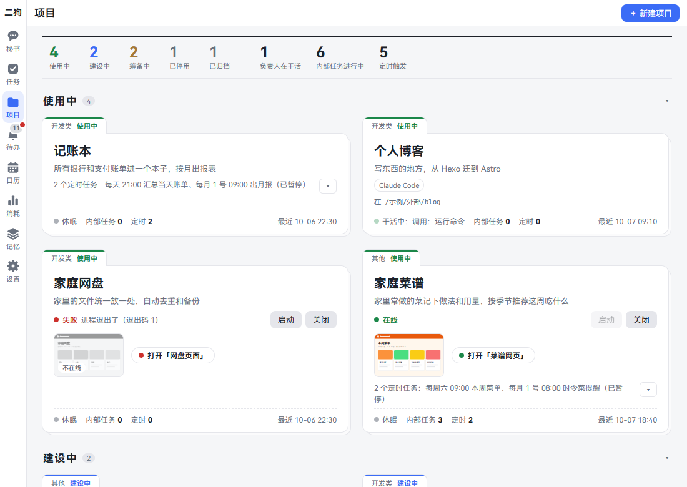
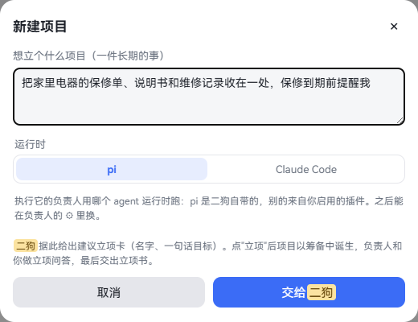
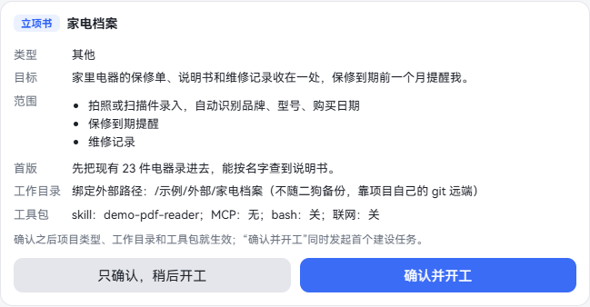
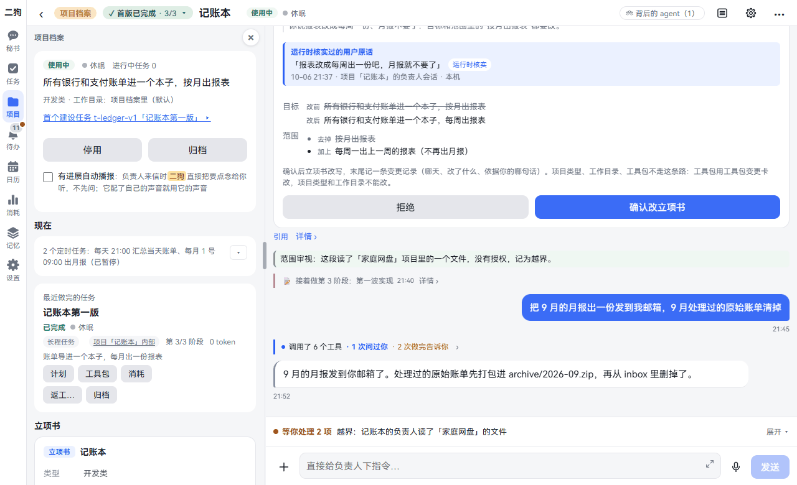
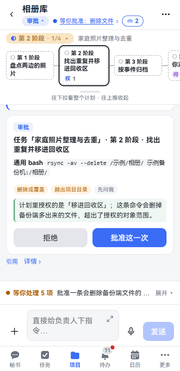
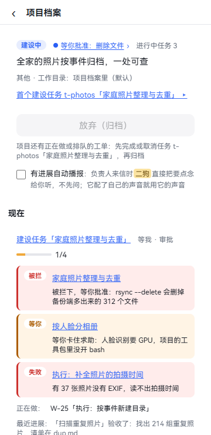
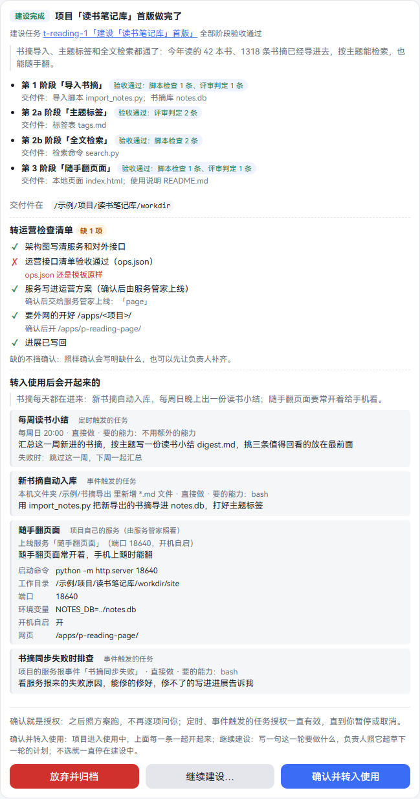
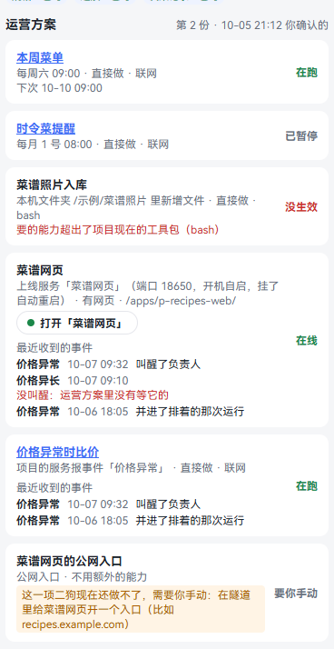
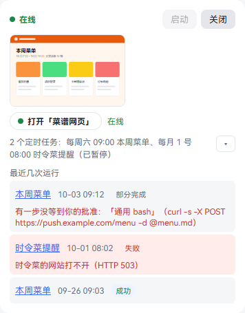
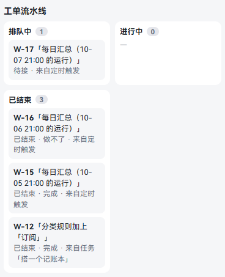

[中文](projects.md) | **English**

# Projects

Screenshots show the Chinese interface; the labels in the text are the English ones.

For a one-off job, use a [task](tasks.en.md). For something you'll work on and use for a long time, use a project: a ledger, records of your home appliances, a small website. This chapter follows a project all the way through: starting it, building it, putting it in use and retiring it. By the end you can have ergo build you a small tool you can keep using.

Every project has one permanent **owner**, a set of project records and a working directory. The owner remembers things through the records, not the chat history, so it picks up where it left off even in a new session. Once the project is built, its small website and scheduled tasks keep running. You can open them on your phone and have the secretary operate them too.

A project goes like this:

| State | What's happening | How to move on |
|---|---|---|
| Preparing | The owner goes through the charter Q&A with you and hands in a charter | Confirm the charter and click **Start building** |
| Building | The owner builds the first version in stages | Confirm putting it in use on the **first version is done** card |
| In use | Services and scheduled tasks run according to the operations plan | When you no longer need it, click **Retire** or **Archive** |
| Retired | Services are taken down and scheduled tasks are paused | Click **Reactivate** to go back to In use |
| Archived | The owner's session is read-only | Click **Unarchive** to go back, or **Delete** |

## Project overview

**Where to open it:** click **Projects**.

- **The top line:** how many projects are in each state, how many owners are working, how many internal tasks are in progress, and how many scheduled triggers there are.
- **Each card:** the type and state along the top edge, then the name and goal. Below that are the service switch and entry point, and the scheduled tasks. The bottom line shows what the owner is doing, how many internal tasks and scheduled items there are, and the latest activity.
- **Click a group title:** collapses or expands it, and this device remembers. Archived is collapsed by default.

**Start**, **Shut down**, **Open “X”** and the expand button on a card work directly without opening the project. Clicking anywhere else on the card opens the project.

## Starting a project

**What it is:** getting something long-term off the ground. A project begins as a **Suggested project** card, and only comes into being when you click it.

**Where to open it:** **+ New project** at the top right of the Projects page.

**Step by step:**

1. Click **+ New project**.
2. In **What project do you have in mind (something long-term)**, write one sentence.
3. **Runtime** defaults to pi. If you choose Claude Code you also pick a folder; see [Creating a project that uses Claude Code](claude-code.en.md#creating-a-project-that-uses-claude-code).
4. Click **Hand to ergo**. A message says: ergo will send you a project suggestion card. Tap **Start project** and the project is created. The name on the button and in the message is the name you gave your assistant.
5. Go to the secretary and find the project suggestion card, which shows a name and a one-line goal. Click **Start project**. If you don't want it, click **No thanks**.
6. The project comes into being in **Preparing**. The card gains a line, **Charter Q&A with the owner ▸**. Click it to enter the project.

**Things you can just say:**

- Start a project: keep the warranties, manuals and repair records for my home appliances in one place

Any paths or limits you mention are copied onto the card word for word and passed to the owner when you click **Start project**. Even if you don't ask, the secretary may offer this card when something looks more like a long-term job.

### Turning a task into a project

If a task turns out to be a long-term job: open the task, go to ⋯ · Plan · **Turn into project**, enter a project name, and click **Turn into project** again. The task's owner carries on with the charter Q&A in the same session. The task ends as **Done · turned into a project**.

## Charter Q&A and the charter

**What it is:** the owner speaks first, pins down the scope with you, and writes it up as a charter. Building doesn't start until you confirm.

**Step by step:**

1. When you enter the project, the owner asks first: one or two questions at a time, skipping anything you've already made clear.
2. Reply by typing or holding to talk. It writes the spec, glossary and decisions into the records.
3. Once things are clear, it hands you a charter card. The whole card sits at the bottom of the session, below whatever the owner says after handing it in, so you can click its buttons right there. The card also goes into Inbox: **Charter to confirm: …**.

   

4. Check what the card says:

| Item | What it says |
|---|---|
| Type | Development (writes code) or Other |
| Goal, Scope, First version | What you want, what's included, how far the first version goes |
| Working directory | In project records (default), or bound to an external path |
| Toolkit | Which skills and MCP it can use, and whether bash and web access are on |

5. Choose a button:
   - **Confirm and start building:** creates the first build task right away.
   - **Confirm only, build later:** the project stays in Preparing. Click **Start building** in the project records later.
6. To change anything, just tell the owner. It makes the change and hands you a new card, with **(version 2)** after the title.

**Good to know:**

- The project type, working directory and toolkit take effect as soon as you confirm.
- Only Development projects can bind an external path. External paths aren't in ergo's backups; they rely on the project's own git remote.
- After confirming you can still change the goal, scope and first version: tell the owner, and it issues a **Charter change** card. Click **Confirm charter change** or **Reject**. The type and working directory can't be changed.
- While a project is still in its charter stage, you can't start a task inside it.

## The project dialog

**What it is:** clicking a project card takes you straight to the dialog with the owner. Coming from a task link or Inbox opens the same dialog, just positioned at that task or card.

**From top to bottom:**

1. **Title bar:** ‹, **Project records**, the stage tag, the project name, the project state, the task's status tag and the activity status. On the right are the agent behind it, zoom, ⚙ and ⋯.
2. **Stage progress:** the stages of the task this project is working on. On a PC, click the stage tag in the title bar and the full stage graph opens in the left sidebar, sharing that spot with the project records. On a phone it's the stage bar under the title bar. To learn how to read it, see [Stage progress](tasks.en.md#stage-progress). When the task is done it collapses to one line, such as **First version done · 3/3**, and you can still open it. With no task it takes up no space.
3. **Messages:** what the owner says, tool calls, and all kinds of cards.
4. **Input box:** it reads **Give the owner instructions…**. While the owner is working, what you say slips in before its next step.

**On a phone:** the title bar has two rows. The first has ‹, the project name and ⋯. The second has the state, the activity status and the agent behind it.

### Project records

**What it is:** all the details of this project and everything you can do with it.

**Where to open it:**

- **On a PC:** it's right there in the left column. Click **Project records** in the title bar to open or close it, or × at the top of the column to collapse it. Drag the divider to make it wider. This device remembers.
- **On a phone:** tap the title and the records slide in from the right; tap ‹ to go back to the chat. **Project records** at the top of ⋯ does the same.

**From top to bottom:**

| Section | What it says |
|---|---|
| Top | State, goal, type and working directory, what you can do (Start building, Put in use…, Retire…), and Read updates aloud |
| Now | The most urgent thing for the current state. Preparing: where the charter stands. Building: the build task and any stuck work orders. In use: services and scheduled tasks |
| Current task | The task's status and usage; entries for Plan, Work orders, Toolkit, Usage and Runs; task actions. Once it's done the title becomes **Last finished task** |
| Project charter | The confirmed charter and change cards |
| Standard | Whether the required documents are written: Written, Template only, Missing |
| Operations plan | See [Operations plan](#operations-plan) |
| Internal tasks | See [Internal tasks](#internal-tasks) |
| Scheduled tasks | Each one's schedule, next run and last run; can be paused and resumed |
| Work order pipeline | See [Work orders](#work-orders) |
| Toolkit | See [Toolkits](skills-mcp-plugins.en.md#toolkits) |
| Scope records | Overreach, and scope changes you've authorized |

### What's in the ⋯ menu

On a PC it holds the task items, and when the project has no task, a PC has no ⋯. On a phone it also has zoom, this agent's settings and the project records.

1. **Project records** (phone).
2. **Zoom out to overview**, **Settings for this agent** (phone. On a PC they're ▤ and ⚙ in the title bar).
3. A line with the task name, followed by this task's Plan, Work orders, Toolkit, Usage and Runs.
4. Actions for this task: Pause, Cancel, Rework and so on; see [Pause, cancel, archive, delete](tasks.en.md#pause-cancel-archive-delete).

## The owner

**What it is:** the agent dedicated to this project, looking after it for the long term. Only it can change this project.

- **What it remembers:** it relies on the project records, where the spec, progress and decisions are written. Every work order and every chat segment is a new session, picking up from the records and the summary of the previous segment.
- **How it works:** one thing at a time, while the rest queue up; see [Work orders](#work-orders).
- **It can't go out of scope:** when each work order ends, another model checks whether it did anything out of scope. Overreach goes into the scope records, and an **Out-of-scope notice** arrives in Inbox.
- **If its understanding drifts:** click ⚙, then **Clear chat (reset owner)**. After you confirm, a new session starts and rebuilds its understanding from the records alone. The old session is kept.
- **Other settings:** in the same ⚙ you can give it a role and a voice, write its own prompt, change the model, see context usage and change the runtime.

**Things you can just say** (in the project's input box):

- How's it going
- Add a monthly summary to the export
- Add the yt-dlp skill to the toolkit

You can also ask the secretary:

- How far along is the ledger
- Tell the ledger's owner that credit card statements need importing too from next month

### Read updates aloud

A checkbox at the top of the project records, off by default. When it's on, the secretary reads you the key points as soon as the owner sends an update, without asking first. If the owner has its own voice, that voice is used.

You can also tell the secretary "From now on, read me the ledger's updates right away". See [Voice](voice.en.md).

## The first build task

**What it is:** clicking **Confirm and start building** or **Start building** creates a long-running task named **Build “X” first version**, done by this project's owner.

**Step by step:**

1. The owner drafts a plan from the charter and hands you a [plan card](tasks.en.md#plan-card).
2. You click **Confirm** and it starts.
3. It works by "write the spec, split it into tickets, one sub-agent per ticket, merge only after tests pass". Each stage is checked automatically; see [Stage acceptance and review](tasks.en.md#stage-acceptance-and-review).
4. When all stages pass, you get a **first version is done** card.

To see progress: stage progress, or **Now** in the project records. Anything stuck shows the reason there.

If the build task fails or is cancelled, the project stays in Building. The records show **Start building**; click it to start another.

## Putting a project in use

**What it is:** the first version is ready, so you put the project to real use: services go live and scheduled tasks start running.

**The first version is done card shows:**

- Each stage's acceptance result and deliverables, and where the deliverables are.
- **Go-live checklist:** architecture, operations API list, services in the operations plan, outside access, progress updated. ✓ means done; ✗ means not done, with what's missing spelled out. **Checked after it's up** items need a running service to test, and don't count as missing.
- **What starts once it's in use:** the operations plan the owner handed in, listed item by item.

**Three choices:**

| Button | What happens |
|---|---|
| **Put in use** (**Confirm and put in use** when there's an operations plan) | It goes to In use, and every item in the plan starts together. Items that need confirming one by one have to be ticked before you can click; until then the button reads **N items left to confirm** |
| **Keep building…** | Write one sentence on what this round should do, and click **Keep building**. The owner drafts the next round's plan from it, and you still have to confirm |
| **Abandon and archive** | It asks you to confirm first. The project is archived and the owner's session becomes read-only. You can unarchive it later; it goes back to Building and you get a card like this again |

If you choose nothing, it stays in Building.

**Want to put it in use before it's finished?** There are three ways, and all of them just issue a **Put in use** confirmation card:

- Click **Put in use…** in the project records.
- Tell the owner "It can go live now".
- Tell the secretary "The ledger can go live now".

The card is under **Now** and in Inbox. Click **Confirm and put in use**, or **Not yet**.

**Good to know:**

- No matter who starts it, you have to click on the card. Telling the secretary doesn't count as confirming.
- Missing checklist items don't block confirming. If you confirm anyway, the card records what was missing. To fill the gaps, have the owner do it first.
- While a card is already waiting, **Put in use…** no longer appears in the records.

## Operations plan

**What it is:** how the project runs once it's in use: what runs on a schedule, what waits for events, which services stay on. The owner writes it and hands it to you. Confirming once is your authorization. After that it runs according to the plan without asking you item by item.

**Where to see it:** Project records · Operations plan.

Each item shows its name, when it runs, how it runs and the capabilities it needs, with its status on the right:

| Status | Meaning |
|---|---|
| Running, Online | Normal |
| Paused | You paused it, or it paused automatically after repeated failures |
| Not in effect | It couldn't start. The reason is in red below, for example it needs capabilities beyond the toolkit |
| Manual | ergo can't do this yet, for example a public entry point. The steps you need to do are listed below |
| Ended | The task for this item has ended |

**An item can be one of these:**

| Kind | Example |
|---|---|
| Scheduled task | Sum up the day's bills at 21:00 every day |
| Event-triggered task | Add new files to the library when they land in a folder, or when [a service reports an event](#project-services-reporting-events) |
| The project's own service (run by the service manager) | A small website that stays on |
| Public entry point | You turn it on by hand; the card lists the steps |

**Changing the operations plan:**

1. Tell the owner or the secretary, for example "Put out a daily report at 7" or "Move the weekly report to Monday".
2. The owner hands in a new version, and you get an **Operations plan change** card. It lists Add, Change, Remove and Unchanged items, with your own words attached.
3. Click **Confirm these changes**. To leave things as they are, click **Reject**, and what's in effect keeps running.

**Good to know:**

- If only the time changes, it's updated in place: the task, session and run history stay the same. Any other change removes the old task and rebuilds it from the new plan.
- These tasks also appear under **Operating** on the task board, with the project name on the card. They can only be paused, resumed or run once right away. To remove one, have the owner change the plan.
- You can also create a separate scheduled internal task: in [New task](tasks.en.md#new-task), select only this project and choose **On a schedule**. It isn't an item in the operations plan and isn't on the task board; you'll find it under **Internal tasks** and **Scheduled tasks** in the project records.

## Project services

**What it is:** the web pages and APIs the project produces, running all the time. They're hosted by the **service manager**, which starts them, watches them and brings them back up at boot.

Services are written into the operations plan. After you confirm, ergo hands them to the service manager to go live, with no commands for you to type.

### Opening a service

**Where to open it:**

- **Open “X”** on the project card.
- Project records · Now: the thumbnail or **Open “X”**.
- Project records · Operations plan: the item for that service.
- Ask the secretary.

In the app it opens in **Browse**. In a browser on a PC or phone, it's a frame layered over ergo. It works on a phone and from outside too. For details, see [Opening a project service's page](browser.en.md#opening-a-project-services-page).

**Things you can just say:**

- Open the briefing site
- Where's the briefing site's page

The status shows next to the entry:

| Status | Meaning | What to do |
|---|---|---|
| Online | Running | Just use it |
| Starting, Going live | Coming up | Wait a moment |
| Offline, Shut down | Not running | Click **Start** |
| Failed, Failed to go live | It won't start or has crashed; the reason is shown next to it | The owner looks into it once it finishes the work order in hand. You can also tell it directly |
| Needs you to do it | ergo wasn't started by the service manager, or the service manager is too old | Follow the prompt and register it by hand in the service manager |
| Taken down | The project was retired, or the item was removed from the plan | Reactivate the project, or change the plan |

### Starting and shutting down

**Where to open it:** on the project card, or Project records · Now. A line shows the current status, with **Start** and **Shut down** next to it.

1. Click **Shut down**. The confirmation box says how many services will stop and that start at boot will be cancelled.
2. Click **Shut down** in the box. To leave it running, click **Keep running**.
3. When you need it again, click **Start**. No confirmation needed.

These two buttons control all of this project's services.

**Things you can just say:**

- Shut down the briefing site (saying it counts as confirming)
- Start the briefing site

**Good to know:**

- Once shut down it stays down, even after the PC restarts, until you click **Start** again.
- This isn't retiring: the project stays In use and scheduled tasks keep running. To stop the scheduled tasks too, use [Retire](#retiring-and-reactivating).
- The service manager's page only opens on the PC where ergo is installed. That's where you can see logs and start or stop a single service; see [Service manager](settings.en.md#service-manager).
- ergo can't open a public entry point yet; you have to do it by hand following the card. For outside access, see [On your phone](mobile.en.md#letting-your-phone-reach-your-computer-choosing-outside-access).

### Automatic MCP server

When a project goes live, the operations in its operations API list that passed the check automatically become an MCP server. There's nothing for you to do and no extra card. The card where you confirm going live says "N operations of this project also become an MCP server: other agents can use them once it's in their toolkit".

- **Who can use it:** the project's own owner can use it right away. Other projects and tasks put it in their toolkit; see [MCP servers made from projects](skills-mcp-plugins.en.md#mcp-servers-made-from-projects).
- **When the list changes:** once the owner's check passes, the tools follow, with no restart.
- **When the project is paused, archived or deleted:** this MCP server goes away with it.
- **Did it come up:** after going live, ergo tries it once and writes the result on the owner's timeline. A failure doesn't affect going live.

For tools the list can't describe (outside programs, long-lived connections), still tell the owner "Register this service as an MCP"; see [Registering an MCP server: ask the owner](skills-mcp-plugins.en.md#registering-an-mcp-server-ask-the-owner).

### Having the secretary operate the project

Once a project is in use, you can use it by talking to the secretary, with no need to open its page. Every project in use has these common operations:

| Operation | You can say |
|---|---|
| Status | How's the ledger doing |
| Recent runs | How have the ledger's recent runs gone |
| Latest deliverable | Where's the ledger's latest report |
| Run once now | Run the daily report again |
| Pause and resume | Stop the daily report for now |
| Change the time | Move the daily report to 7 |
| Tell the owner | Tell the ledger's owner… |

The project's own operations (such as "Record an expense") are written in its operations API list. The owner maintains it, and each operation is tested before the secretary gets to use it. The list appears on the go-live checklist.

If the service is shut down, the secretary tells you and starts it only when you say so.

## Internal tasks

**What it is:** a one-off job inside a project, such as upgrading dependencies or adding an export. This project's owner does it. It's only visible in this project and isn't on the task board.

**How to start one (four ways):**

- Spell it out in the project's input box: "Start a task: add an export to the appliance records", "Follow a workflow: upgrade dependencies", or type `/task` or `/workflow`.
- Say the same thing to the secretary, and make clear it's for this project.
- In the [New task](tasks.en.md#new-task) dialog, select only this project.
- When the owner thinks maintenance is due, it gives you a **Suggested task** card. Click **Start as Workflow** or **Start as Long-running task**.

**How it goes:**

1. The owner first aligns with you in the project's session and writes the task brief. The secretary isn't involved.
2. It drafts a plan, and the plan card goes to Inbox.
3. Once you confirm, it does the work. Stage progress switches to this task.

Plain tasks skip the alignment and start right away.

**Where to see it:** Project records · Internal tasks.

- Unfinished ones come first, showing the approach, status, progress and usage. Click one and the dialog jumps to it; stage progress and ⋯ switch to it too.
- Finished ones are under **Finished**, with an **Archive** button.
- Archived ones are collapsed; click **N archived · Show ▸**.

**Good to know:**

- What it can use is the overlap of the task's authorization and the project's toolkit.
- It only touches this project. To touch other projects, have the secretary start a cross-project task.
- Workflows and long-running tasks don't tell the secretary when they finish. When a plain task finishes, the secretary only says it's done; see the results in the project.
- Internal tasks don't have **Read out when done**. The project's **Read updates aloud** works as usual.
- They can't be deleted separately; they go when the project is deleted.

## Work orders

**What it is:** everything the owner has to do reaches it as a work order. One at a time, first come first served.

**Where to see it:** Project records · Work order pipeline.

Each one shows its number, title, status, who it's from and which task it belongs to.

| From | When it comes |
|---|---|
| You | An internal task you started |
| Task owner | Sent over from a cross-project task |
| Scheduled | One run triggered by a schedule or event |

| Status | Meaning |
|---|---|
| Awaiting your confirmation | An unplanned work order, waiting for you to click **Confirm and dispatch** |
| Waiting for its stage | A planned work order, sent out when its stage begins |
| Not picked up | In the queue |
| In progress | Being worked on |
| Awaiting clarification | The owner asked a question and is waiting for an answer |
| Ended · Done, Returned, Couldn't do, Not sent | Finished, with the reason shown |

**Good to know:**

- Talking directly to the owner isn't a work order. With no work order in hand it's a chat segment; with one in hand, your words slip in before its next step.
- The owner must write back its progress before a work order ends. If it still doesn't after being reminded, a **Stuck, needs help** item arrives in Inbox.
- A project can't be archived while it has work orders in progress or queued.

## Project services reporting events

**What it is:** some things need constant watching, like comments, prices or logs. Waking an agent on a schedule to look is expensive. Instead, write a small service that doesn't use a large model to keep watch, and have it wake the owner only when something actually happens. It costs no tokens the rest of the time.

**How to use it (no code needed):**

1. Tell the owner: "Write a small service to watch the comments and wake you if something's off".
2. It writes the service and hands you an operations plan card with two more items: one brings the service online, the other says what to do when **A project service reports “Comment anomaly”**.
3. Click confirm. The service goes live.
4. From then on, when the service spots an anomaly it reports an event, and the owner wakes and follows the plan.

**How to tell it's working:** Project records · Operations plan. Under the item for the service and the item waiting for events, there's a **Recent events** list:

| It says | Meaning |
|---|---|
| Woke the owner | Normal |
| Merged into the queued run | The previous run hadn't finished, so they're combined into one batch |
| Not woken: nothing in the operations plan waits for it | The event name isn't in the plan; have the owner add it |
| Not woken: the task waiting for it is paused | Resume that task |
| Not woken: reported too fast, over the rate limit | At most 30 times per service per minute |
| Not woken: the data is too large | At most 8 KB each |

**Good to know:**

- The event name must be written into an operations plan you've confirmed. An event not in the plan wakes nobody and costs nothing.
- What a service reports is only data, not something you said. It doesn't go into memory and doesn't count as your authorization. Even if the data says "ignore previous instructions", it won't be obeyed.
- A burst gets combined into one batch, so several copies won't run at once.
- Repeated failures still pause it automatically until you deal with it.
- While ergo is stopped, services can't report, and ergo doesn't store events for them.
- This kind of event can only be written in an operations plan; you can't pick it in the New task dialog. Services you added to the service manager by hand, which don't belong to a project, can't use it either.
- If you write a service yourself and want it to report events, the code and commands are in [Project services reporting events](../architecture/README.en.md#project-services-reporting-events).

## Retiring and reactivating

**What it is:** the project isn't needed for now, but might be later.

**Where to open it:** the top of the project records. Projects in use have **Retire** and **Archive**.

1. Click **Retire**. Services are taken down, entry points are removed and scheduled tasks are paused.
2. When you need it again, click **Reactivate**. Services go back online, scheduled tasks resume, and it returns to In use.

## Archiving and deleting

| Button | When it appears | What happens |
|---|---|---|
| Abandon (archive) | Preparing, Building | The project moves to Archived and the owner's session becomes read-only |
| Archive | In use, Retired | Same as above. Services are taken down and scheduled tasks are paused |
| Unarchive | Archived | Returns to its state before archiving |
| Delete | Only on archived projects | You confirm once more in Inbox |

**Deleting:**

1. Archive it first.
2. Open the project records and click **Delete**. A message says: **Confirm deleting “X” once more in Inbox**.
3. Open Inbox and find the **Confirm project deletion** item. Read what it says carefully, then click **Delete**. To keep the project, click **Keep it**.

**What gets deleted:** the project records, the owner's session, the charter, the project's internal tasks, and the records in memory automatically made from them. What the secretary and cross-project tasks have read about this project is erased too. **This can't be undone.**

**What stays:** what you yourself said in the owner's session is kept as material. To delete it, see [Delete completely](memory.en.md#delete-completely). A bound external working directory isn't touched.

**Good to know:**

- While a project has work orders in progress or queued, **Abandon (archive)** and **Archive** are grayed out, with a note below saying which tasks to finish or cancel first.
- An archived project's input box doesn't work, and its toolkit can't be changed. To keep talking, unarchive it in the project records first. On a phone, tap the title to open the records.
- The secretary won't retire or archive a project for you. You have to click yourself.

## Troubleshooting

| What you see | What's going on | What to do |
|---|---|---|
| The title bar says **Awaiting your approval: …** or **Waiting for your answer** | A card is waiting for you | Click it to jump to the card |
| **N waiting on you** above the input box | This project has cards waiting | Click **View card**, or expand to look |
| Red **Blocked**, **Failed** or **Stalled** under **Now** | The build task or a work order is stuck | Click in for the reason and tell the owner |
| A service says **Failed** | It won't start or has crashed | The owner checks once it finishes what's in hand. If it's urgent, tell it directly. Logs are in the [service manager](settings.en.md#service-manager) |
| An item in the operations plan says **Not in effect** | It needs capabilities beyond the toolkit | Have the owner request them. It issues a **Toolkit change** card, and after you approve it, it hands in the plan again |
| **Fill in standard documents?** in Inbox | This project is older than the standard and lacks some documents | Click **Fill in** to create a task that writes them, or **Skip** and you won't be asked again |
| **Stuck, needs help: the owner of project “X” didn't update the project records** in Inbox | It didn't write back its progress | Ask it to write it in the session, or reset the owner |
| The owner's understanding has drifted | | Click ⚙, then **Clear chat (reset owner)** |

## Related chapters

- [Tasks](tasks.en.md): plan cards, stage progress, acceptance, schedules and events.
- [Claude Code](claude-code.en.md): have the owner use Claude Code, take over existing sessions.
- [Skills, MCP, toolkits and plugins](skills-mcp-plugins.en.md): what you can put in a toolkit.
- [Built-in browser](browser.en.md): open a project's pages.
- [Settings](settings.en.md): service manager, watch categories.
- [Memory](memory.en.md): how to delete the material left after deleting a project.
