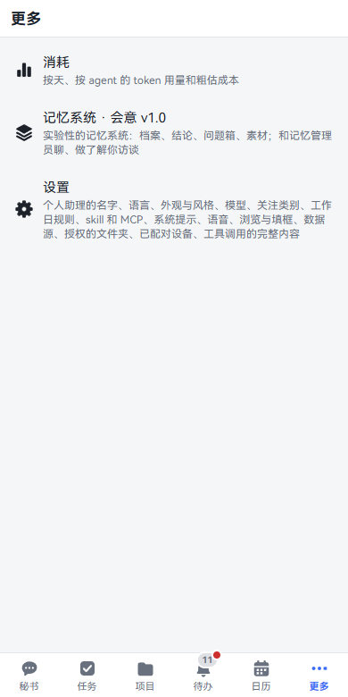
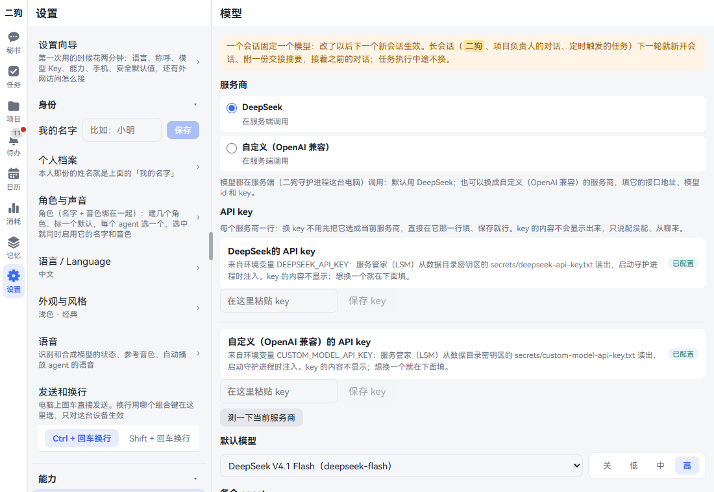
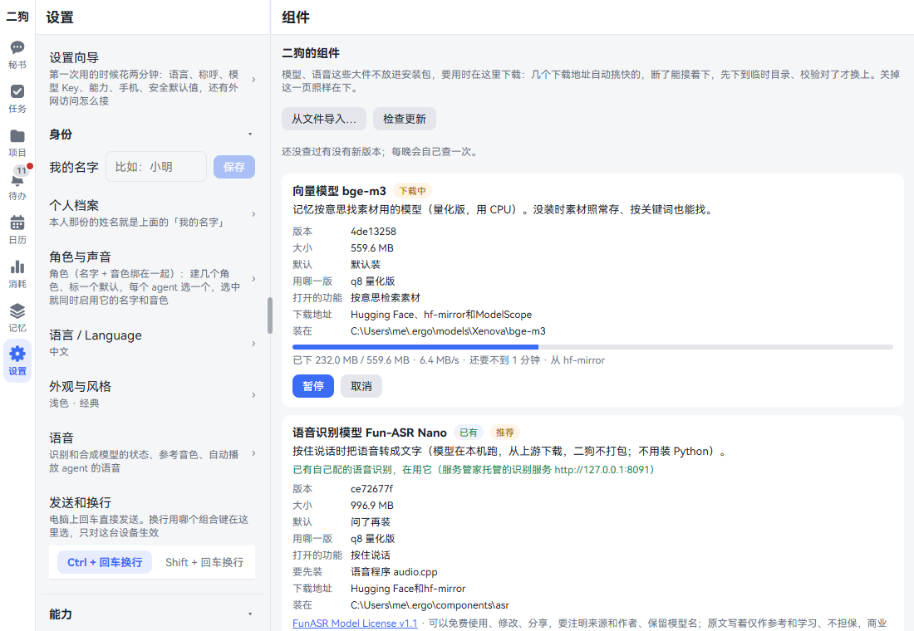
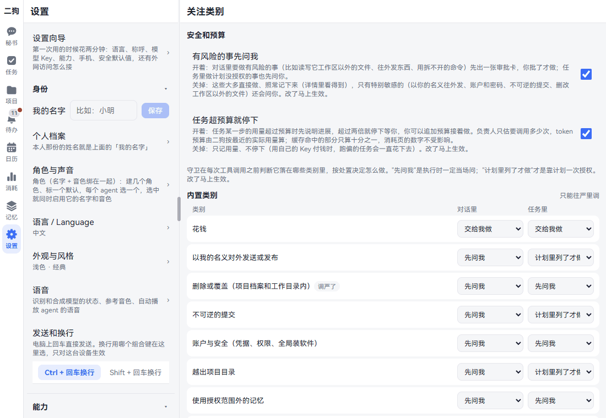
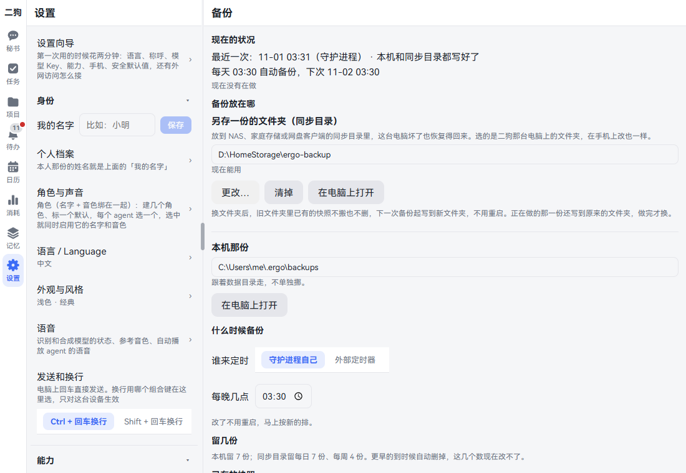
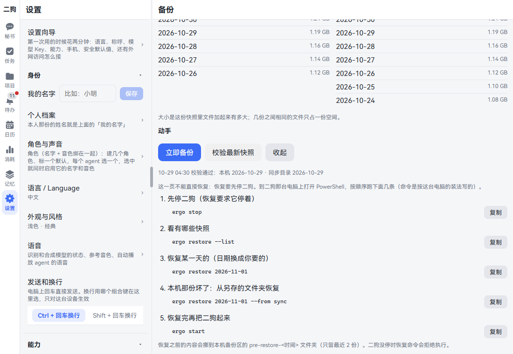
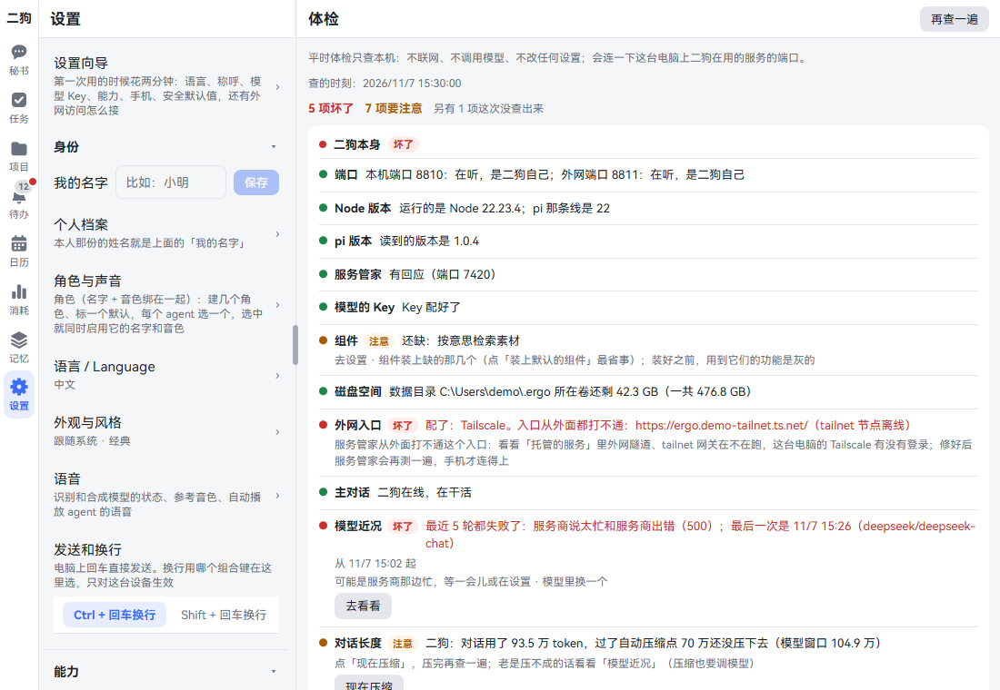
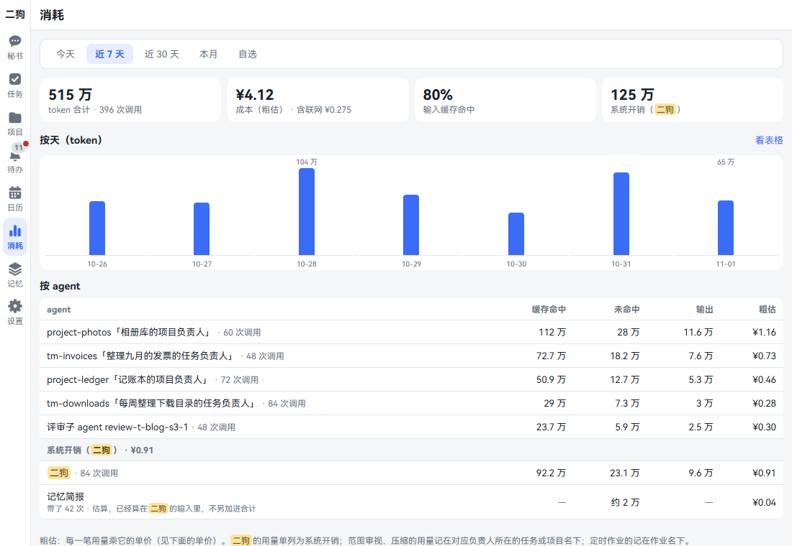
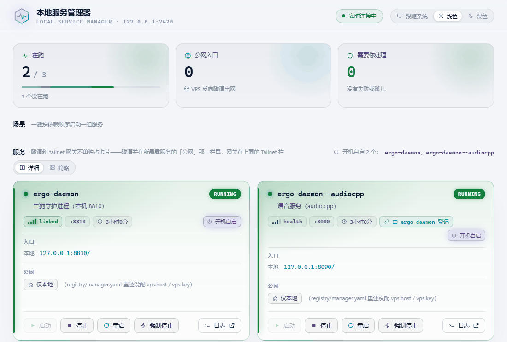

[中文](settings.md) | **English**

# Settings

Screenshots show the Chinese interface; the labels in the text are the English ones.

This chapter goes through the Settings list from top to bottom: what each item is, how to change it, and what changing it does. Last come two things that aren't in the Settings list but are often needed: usage and the service manager. By the end you know what each switch controls, and where to look first when something goes wrong.

Features with a lot to say get one line here and a link to their own chapter.

## Opening Settings

- **On a computer:** Click **Settings** at the bottom of the left rail. The list is on the left, and the page you open is on the right. If the window is too short to fit it, it moves into **More**.
- **On a phone:** Tap **More** at the bottom, then **Settings**. Tap an item to open it, and go back from the top left.




At the top of the list is **Setup wizard**, then four groups: Identity, Capabilities, Rules, Data & devices. Tap a group's title to collapse or expand it; this device remembers.

A few items apply only to this device: Appearance & style, Send and new line, Search engine, Auto-play agents' voice replies, and collapsed groups. Everything else changes on all devices when changed in one place.

When opened in the phone app, the top of the list gains a **Running in the phone app** block: it shows the app version, has **Change address**, and shows whether **System notifications** is on, with **Turn on** when it isn't. See [On your phone](mobile.en.md).

Memory's switches aren't in Settings but at the bottom of the Memory page. See [Memory](memory.en.md).

## Setup wizard

**What it is:** A guided tour for your first time. Five steps: Language, how to call you, assistant name; Model key; Capabilities; Pair your phone; Safety defaults. After those, one more screen covers outside access.

**How to use it:** Click **Setup wizard**. On each step you can click **This is fine** or **Later**; the fifth step has **Read it**. At any time you can click **Later** in the title bar to leave, and come back another time.

For a full walk-through see [Getting started](getting-started.en.md).

## Identity

### My name

**What it is:** Your own name, not your assistant's.

**How to change it:** Enter it in the box on this row and click **Save**. To remove it, click **Clear**.

**Effect:** Agents use this name when they talk or read aloud to you. If it's empty they just call you "you".

**Good to know:** At most 8 characters. The name in your own personal file is this name; change one and the other follows.

### Personal files

**What it is:** IDs, birthdays, phone numbers and addresses of you and your family, kept word for word.

**How to open it:** Click this row. With the Memory plugin on it goes to Memory · Files; with it off, it's under **More**.

See [Memory](memory.en.md) for more.

### Roles & voices

**What it is:** A name and a voice bound into a role; pick one for each agent. The assistant's name is changed here too: it's the default role's name. Until you name it, the name follows the interface language: ergo in English, 二狗 in Chinese. Once you've named it, it stays the same in every language.

See [Voice](voice.en.md) for more.

### 语言 / Language

**What it is:** The language of the interface and of what ergo says.

**How to change it:** Open it and click a language. No refresh needed; open pages switch right away. Chinese and English are built in.

**Effect:** All devices switch together, and the secretary and owners answer you in this language too. Earlier chats and cards keep their original language; only what's new after the switch is in the new language.

**Good to know:**

- If you pick the wrong one you can still find your way back: this row is always written in both Chinese and English.
- To add a language or change a translation, the page has instructions further down; put the files in place, with no restart. Details in [Adding a language yourself](../architecture/README.en.md#adding-a-language-yourself).
- If a language file you added can't be read, the page lists which file and where the error is.

### Appearance & style

**What it is:** Light or dark, and how the interface looks. This row in the list shows the current choice, such as **System · Classic**.

**How to change it:** Open it.

- **Appearance:** Light, Dark, System. The default is System.
- **Display · Text size:** Small, Default, Large, Extra large, plus a slider below for fine-tuning (85% to 150%). The example below changes as you go, and so does the whole page. With bigger text the title bar and navigation grow only a little and the blank space doesn't grow with them, so messages keep the room; with smaller text only reading text shrinks, while buttons, links and input boxes stay at the default size so they're still easy to tap, and the smallest text never goes below 11 pixels. Phone width, unfolded width, and tablet or computer width each keep their own size: folding or unfolding switches to the size for that width, and widths you haven't changed stay at Default.
- **Style:** Classic, Paper journal, Clean grid, Night cockpit, Soft candy, Glass glow, Blueprint, Sticker bento, Pixel cottage, Ink wash, Retro magazine. Each has a preview with light on the left and dark on the right; click to switch.
- **Accent color:** With Classic selected a row of swatches appears: Blue, Indigo, Teal, Green, Orange, Red, Pink, Graphite.

**Effect:** Immediately, on this device only.

### Voice

**What it is:** The status of speech recognition and speech synthesis, reference voices, and the **Auto-play agents' voice replies** switch.

See [Voice](voice.en.md) for more. This item isn't in the list when the Voice plugin is off.

### Send and new line

**What it is:** On a computer Enter sends right away; this picks the key combination for a new line.

**How to change it:** On this row click **Ctrl + Enter for a new line** or **Shift + Enter for a new line**. The default is Ctrl.

**Effect:** Immediately, on this device only.

**Good to know:** Phones and tablets don't have this. There, Enter is a new line and you send with the send button.

## Capabilities

### Models

**What it is:** Which provider and which model ergo uses, and where the key goes.

**Where:** Settings · Capabilities · Models.



This page has six blocks, from top to bottom:

| Block | How to change it | Effect |
|---|---|---|
| Provider | Click DeepSeek or **Custom (OpenAI-compatible)** | Which provider handles conversations. Picking custom expands the endpoint URL, model id and API style |
| API key | One row per provider. Paste, then click **Save key** | Takes effect at once, no restart. The key isn't shown; it only says whether it's set and where from |
| Default model | Pick a model, then click a thinking level: Off, Low, Medium, High | Used by every agent without its own setting |
| Auto-compaction | Enter a number of tokens and click **Save**; **Restore default (700K)** sets it back | A conversation is compacted automatically once it reaches this many tokens. Every agent follows it, and each can have its own in its ⚙ |
| Agents | Secretary, Task owner, Project owner, Sub-agent, Reviewer and Scope review each have two dropdowns | The first option is **Use default**; you can also pick a model and thinking level |
| Image understanding | One dropdown per model: Follow the model catalog, Can see images, Can't see images | Models that can't see images don't get images from chat, only a one-line placeholder |

**Testing the connection:** At the bottom of the API key block, click **Test the current provider**. It replies that it works, or says why it doesn't.

**Switching to another provider:**

1. Click **Custom (OpenAI-compatible)**.
2. Fill **Endpoint URL** up to the `/v1` level.
3. Type the **Model id** by hand, or click **Fetch list** to pick one if you don't know it. If you can't find one, click **Type it instead**.
4. For **API style**, use the default if you're unsure.
5. In the API key block, enter the key on the custom row and click **Save key**.
6. Click **Test the current provider**.

**When it takes effect:** A session stays on one model, so after a change the next new session uses the new one. The secretary, project owner conversations and scheduled tasks start a new session on their next turn, with a handoff summary attached. A task in the middle of running doesn't switch.

**Good to know:**

- With custom selected, the default model dropdown, Agents and Image understanding all collapse. Switching back to DeepSeek brings them back.
- After switching to custom, memory's nightly consolidation and DeepSeek's web search and page reading still use the DeepSeek key. Don't delete it.
- Custom models have no unit price, so their cost on the Usage page comes out as 0.
- If an owner needs its own model, set it in its ⚙. This page lists which ones have their own setting; click a name to jump there.
- A new auto-compact point applies right away, without waiting for a new session: it's checked after every turn and compacts once passed. At least 50K; at most the model window minus 16384, and anything larger counts as that. Agents run by Claude Code or Codex handle compaction themselves and ignore it.
- Auto-compaction runs after the reply is done. Messages you send while it runs wait and are answered afterwards. If it fails (for example, the provider is busy) it doesn't retry every turn: it waits 15 minutes first, longer after each further failure, up to 2 hours.
- You don't have to make a provider current before entering its key. Filling in the custom row doesn't touch the DeepSeek one.
- **Fetch list** and **Test the current provider** save this block into settings first. If the list can't be fetched it says why, and you can still type by hand.
- A custom model's capabilities are estimated: text only, no thinking, context about 128k, at most about 8192 tokens generated at a time. If your provider's limits are lower, replies may be cut off or return an error.
- Switching back to DeepSeek loses nothing. The address, model id, API style and key you entered stay, so picking custom later needs no re-entry.
- Technical details are in [Model providers](../architecture/README.en.md#model-providers).

### Skills & MCP

**What it is:** Import skills, see which MCP servers are registered, and set up the secretary's skills.

See [Skills, MCP, toolkits and plugins](skills-mcp-plugins.en.md) for more.

### Plugins

**What it is:** See which feature plugins ergo has installed; turn them off, on or remove them, with no restart.

See [Skills, MCP, toolkits and plugins](skills-mcp-plugins.en.md#plugins) for more.

### Components

**What it is:** Large pieces such as models and speech aren't in the install package; download them here when needed. A feature whose component isn't installed is grayed out, and clicking it brings you here.

**Where:** Settings · Capabilities · Components.



| Component | What it turns on | Size | Default |
|---|---|---|---|
| Embedding model bge-m3 | Memory searching materials by meaning. Without it, keyword search still works | About 560 MB | Installed by default |
| Speech recognition model Fun-ASR Nano | Push-to-talk | About 1 GB | Asks first |
| Speech program audio.cpp | The speech service itself. Installed first when you install a model | About 31 MB to 853 MB, depending on whether you have an NVIDIA GPU | Asks first |
| Speech model Fish S2 Pro | Voice replies | About 6 GB | Asks first |
| Claude Code integration | Using Claude Code for tasks | About 120 MB | Installed only if Claude Code is on this computer |

**Installing one:**

1. Click **Install** on that block.
2. If a license has to be accepted, **Check the license before downloading** pops up first, showing the size, license and a link to the full text. Click **Agree and download**. Once accepted, it won't ask again.
3. While downloading it shows progress, speed, time left and the source address. You can **Pause**, **Resume** and **Cancel**. Closing this page doesn't stop the download.
4. It's swapped in only after verification passes, and the tag changes to **Installed**.

**Other buttons:**

- **Install the default components (N):** Installs in one go whatever should be installed by default and isn't. With everything installed this button isn't there.
- **Import from file…:** If downloading doesn't work, download it yourself and enter the path of the file, folder or .tar / .tgz package. If verification matches, it's installed. When a download fails, that block lists the files still missing and their addresses.
- **Check for updates:** Checks right away for new versions. It also checks by itself every night; with a new version the tag says **Update available**, and the Inbox gets a notice. It's only swapped when you click **Update**, and the old version keeps working until then.
- **Remove:** The confirmation box says which folder gets deleted and which features will be grayed out. Install it again when you need it.
- **Start, Stop:** Only on the speech program block, which also shows running status, port and whether it starts at boot.

The **Available** tag means you've already set it up elsewhere; it's left alone here, and the line below says what provides it.

**Good to know:**

- Interrupted downloads resume, the fastest of several sources is picked automatically, and it goes through the system proxy.
- The speech service only connects if ergo was started by the service manager. The data folder path can't contain Chinese characters. See [Voice](voice.en.md) for details.
- Components aren't in backups, since they can be downloaded again.
- Checking for updates only fetches one version list, and doesn't send your account, device or usage. The page shows which address it checks.
- If the release page doesn't have that list yet, it says **No component update information for this version yet**, and nothing is affected. If the check fails, it just shows one line with the reason and doesn't bother you; in that case components update along with ergo itself.

### Claude Code

**What it is:** Which folder new Claude Code tasks and projects go under by default.

See [Claude Code](claude-code.en.md#setting-a-default-folder) for more. This item isn't in the list when the Claude Code plugin is off.

### Codex

**What it is:** Which folder new Codex tasks and projects go under by default. It works the same as the Claude Code page.

See [Codex](codex.en.md) for more. This item isn't in the list when Codex isn't installed or the plugin is off.

### Browsing & form filling

**What it is:** Two unrelated things on one page: which search engine **Browse** uses in the phone app, and which methods agents use to search the web.

**Where:** Settings · Capabilities · Browsing & form filling.

**Search engine:**

- Click Bing, Baidu, Sogou or Google. The default is Bing.
- Effect: It's used when what you type in the address bar of **Browse** in the phone app isn't a web address. Applies to this device only.

**Agent web search and page reading:**

Four methods in a list; the higher ones go first. If one fails (error, timeout, no results, out of credit), it moves to the next in order.

| Method | What it's like |
|---|---|
| DeepSeek paid search | Charged per call, fastest, search and read only. Can't be turned on without a DeepSeek key |
| Ergo's built-in browser search | Free, medium speed, search and read only |
| agent-browser | Free, slowest, uses the most tokens, can download files and operate web pages |
| Built-in browser in the phone app | Free, runs on your phone where you can see it, can click, fill boxes and hand over files. Only available in a turn from the browse sidebar or floating button |

- **Reordering:** Click up or down on each one. On a computer you can also drag by the handle on the left.
- **Turning off:** Click the switch on the right. At least one must stay on, and the last one's switch can't be clicked.
- Effect: Shared across all devices; the next search follows the new setting. Turning off agent-browser only stops it being used to search; downloading files and operating web pages work as before.

Ergo's built-in browser search uses Chrome or Edge on this computer, found automatically. If it can't find one or you want to name one, see `web.browserPath` in [Config files](../architecture/README.en.md#data-directory-and-config).

The bottom line of the page, **Authorized folders**, links to that item in the Data & devices group below. For how to use the built-in browser, see [Built-in browser](browser.en.md).

## Rules

### Watch categories

**What it is:** Before each tool call, ergo's guard works out which categories it falls into, and acts according to the handling you set. This page sets which operations ask you.

**Where:** Settings · Rules · Watch categories.



**The two switches at the top:**

| Switch | On | Off |
|---|---|---|
| Ask me before risky things | In chats, risky things show an approval card first and run only once you approve; in tasks, things the plan didn't authorize ask you first too | Most just run and are logged as usual. Especially sensitive ones (sending out in your name, accounts and passwords, irreversible commits, deleting or changing files outside the workspace) still ask you |
| Stop tasks that go over budget | When a task step goes over budget it first explains its progress, and at double the budget it stops and waits for you; you can add budget and carry on | Only records usage, doesn't stop. If you pay with your own key, a task that goes astray keeps spending |

Both are off on a fresh install. Tick them if you want it more careful; changes take effect right away.

**Six handlings:**

| Handling | Meaning |
|---|---|
| Just do it, log only | Doesn't bother you |
| Do it, then tell me | Does it first, tells you when done |
| Only if in the plan | Authorized once through the plan. Chats have no plan, so it works like **Ask me first** there |
| Ask me first | Asks on the spot when running |
| Hand it to me | ergo doesn't do it; you do it yourself and click **Done** |
| Never | Doesn't do it |

**Built-in categories:** Each has two dropdowns, **In chats** and **In tasks**. The dropdowns only offer levels no looser than the default, so you can only make them stricter. Those changed say **Stricter**.

| Built-in category | Default in chats | Default in tasks |
|---|---|---|
| Spending money | Hand it to me | Hand it to me |
| Sending or publishing in my name | Ask me first | Only if in the plan |
| Deleting or overwriting (in project records and working folders) | Ask me first | Do it, then tell me |
| Irreversible commit | Ask me first | Only if in the plan |
| Accounts and security (credentials, permissions, global installs) | Ask me first | Ask me first |
| Outside the project folders | Ask me first | Only if in the plan |
| Using memory outside the granted scope | Ask me first | Ask me first |
| Unplanned work order | Doesn't apply | Ask me first |
| Unknown write | Ask me first | Ask me first |

**Two bottom lines:** Can't be changed. Payments and transfers, creating accounts, changing passwords or two-step verification are **Hand it to me**; putting credentials in outgoing content is **Never**.

**Adding your own:**

1. Click **+ New category**.
2. Fill in **Name**, then write rules: **Matching tools**, **Path is inside these folders**, **Recipient is**, **Amount over**. If you write several they must all be met; several values within one rule mean any of them.
3. Pick a level for **In chats** and for **In tasks**; all six are available here.
4. Click **Save**.

Once created you can **Edit rule** or **Delete** it.

**Effect:** Takes effect right away; the next tool call is judged by the new setting.

**Good to know:**

- When a call matches several categories the strictest wins, so your own categories can't loosen built-in categories or bottom lines.
- Calls outside every category just run and are logged.
- For tasks in progress, categories made stricter when the plan was confirmed are still checked by the settings at confirmation.
- If the settings file gets broken by hand-editing, the guard blocks every tool call. The top of this page says what's wrong, and there's an item in the Inbox too. Fix it with the button on the page, or fix it by hand and click **I fixed it by hand, reload**.

### System prompts

**What it is:** Each agent's system prompt: view, edit or restore the default. Use it when you want to change ergo's speaking habits.

**Where:** Settings · Rules · System prompts. The list has three sections: Prefix, Roles, Shared fragments. Each one says **Default** or **Edited**.

**How to change it:**

1. Open one.
2. Edit in the box. A wrong placeholder gets a note right there saying which line is wrong and where, and it can't be saved.
3. Click **Save**. It says **Saved. Takes effect the next time the agent starts**.
4. To go back, click **Restore default** and confirm. The edited copy is deleted and can't be recovered. For unsaved changes use **Discard changes**.

**Effect:** Takes effect the next time the agent starts, with no restart. The secretary's takes effect once it finishes the current message.

**Good to know:**

- **Prefix** goes at the very start of every agent's system prompt, and is empty by default.
- If an edited copy has errors, ergo falls back to the default, and the page says so.
- To change just one agent, write an **Own prompt** in its ⚙ and leave this alone.

### Workday rules

**What it is:** Extra workday rules, such as working the last Saturday of each month. Scheduled tasks triggered on workdays go by it.

**Where:** Settings · Rules · Workday rules. The top of the page says how it's worked out: Your workdays = Singapore workdays ∪ China workdays (including make-up workdays) ∪ extra workday rules ∪ days you marked as workdays − days you marked as off.

**How to change it:**

1. Pick the type: **Every week**, **Nth of each month**, **Last of each month**.
2. Pick the day of the week. For Nth of each month, also pick which one.
3. Click **Add**. To remove one, click **Delete** on it.

**You can just say:**

- I'm not working next Monday

That's a manual mark, not a rule. The secretary shows a quick action card and marks it once you confirm. You can also tap the day in the calendar to change it.

**Good to know:** Whether each day is a workday or a day off, and why, shows in the calendar. Holiday data for the next year is checked every December, and you get a notice in the Inbox if any is missing. See [Calendar and reminders](calendar-reminders.en.md).

## Data & devices

### Data sources

**What it is:** Data brought in from outside: Google Calendar, Gmail, Contacts, the Looki camera, the app on your phone. One card each, showing whether it's connected and how many items were fetched.

See [Data sources](data-sources.en.md) for more.

### Authorized folders

**What it is:** Folders on your computer whose files every agent can read without asking you. At most 20.

**How to change it:**

1. Click **Add folder**.
2. Click a common place or drive, go into the folder you want, and click **Authorize this folder**. You can also paste a full path.
3. To remove one, click × on its row; it's gone right away.

**You can just say:**

- Authorize D:\Photos for you to read

The secretary shows a card, and it's added only after you click **Run**. Agents can't change this list themselves.

**Good to know:**

- This only opens up reading. Writing, deleting and overwriting follow the usual rules.
- What gets read is sent to your model provider. Don't authorize folders that hold keys or passwords.
- The folder you pick is on ergo's computer, even when you do this from a phone.

See [Built-in browser](browser.en.md) for more.

### Folder grants

**What it is:** Each agent has its own list: one for your personal assistant, one per project, one per task. In a registered folder, it can do the kinds of access you ticked (read, write and delete are ticked separately) without asking you. Sub-agents and reviewers don't inherit them.

**Where:** Settings · Folder grants lists every agent's grants. The top group, "All agents · read only", is the authorized folders above; recent use is listed at the bottom. Adding and removing happens in each agent's own ⚙ (the title bar of the personal assistant, a project page or a task page).

**How to add one:**

1. In that agent's ⚙, click **Register a folder**.
2. Write the full path, tick read, write and/or delete (ticking delete doesn't include write), pick how long it's valid (the default is "No expiry"), and write a line about why.
3. Click **Register**.

When a chat raises an approval card because the agent reached a folder outside its scope, the card also has **Always allow (register this folder)**: it registers the folder as a lasting grant for the kinds of access needed this time, and approves this once.

**Good to know:**

- Kinds of access you didn't tick work as before: in chat it asks you, in tasks it has to be in the plan.
- Never allowed, registered or not: ergo's own config, secrets, database and program folders; secret files in a registered folder such as .env, *.key, *.pem, secrets*, id_rsa* and credentials* are refused for reading and writing.
- Grants stop working when they expire and are marked "Expired"; you get one reminder in Inbox three days before. You can clear all expired grants at once, or all of one agent's.
- The usage log only records the paths written in a bash command, not every file the program actually touched.
- `rm -rf` outside the project is still never done, even with delete ticked.

### Delete materials

**What it is:** Delete materials in bulk by conversation or time range.

**Where:** With the Memory plugin on, this is in Memory · Materials and not in the Settings list. **It's listed here only when the Memory plugin is off.**

Three ways to delete: Forget, Delete completely, Don't infer. See [Memory](memory.en.md) for more.

### Full tool-call records

**What it is:** The full arguments and results of each tool call, which ergo keeps separately. This row shows how much space they take and how many calls are stored. By default they're kept for 90 days, up to 2 GB in total, and cleaned automatically once a day.

**How to clear them:**

1. This row says **N calls can be cleared now**. Click **Clean up now**.
2. Read the confirmation box and click **Clean up**.

**Effect:** Only the full arguments and results are cleared. Chat records, key points and effect records stay, and the details page falls back to a summary. What's cleared can't be recovered.

**Good to know:**

- Anything from unfinished tasks or still referenced by the Inbox isn't cleared.
- To change how long they're kept, edit the config file, see [Config files](../architecture/README.en.md#data-directory-and-config); it takes effect after a restart.

### Backup

**What it is:** ergo takes a snapshot of the data folder every night. If your computer dies or data gets messed up, you can go back to a given day. This page manages where, when, how many to keep and how to restore.

**Where:** Settings · Data & devices · Backup. It also opens on a phone, and the folder you pick is still on ergo's computer. Changes here take effect right away, no restart.



#### Where backups go

There are two copies:

- **Local copy:** In the data folder's `backups\`, by default `%USERPROFILE%\.ergo\backups`. It stays with the data folder and can't be moved separately.
- **Sync folder (an extra copy):** A folder you choose, where the snapshot is copied again. Point it at a NAS, home storage or a cloud drive client's sync folder, and you can recover even if this computer dies. **Strongly recommended.** When it isn't set it says **Not set: only the local copy is kept**.

Click **Open on the computer** to open this folder on ergo's computer.

#### Changing the sync folder

1. If none is set click **Choose a folder…**; if one is, click **Change…**. **Choose the sync folder (on ergo's computer)** pops up.
2. Click a common place (Pictures, Downloads, Desktop, Documents, user folder) or a drive, click subfolders to go down level by level, and **Up one level** to go back.
3. At the folder you want, click **Use this folder**. You can also paste a full path below and click **Use this path**.
4. It's checked on the spot. If the folder doesn't exist it asks **This folder doesn't exist yet**; click **Create** or **No**.
5. When it works it says **Done. The next backup goes to X**.

Rules for the check: full path, not inside the data folder, must be writable. If it fails it says why, and the setting stays unchanged.

If you no longer want the extra copy, click **Clear** and confirm. After that only the local copy is kept.

After changing folders, existing snapshots in the old folder are neither moved nor deleted. A backup in progress still writes to the original folder and switches once finished.

#### When to back up

- **Every night at:** The default is 03:30. After changing the time, **Save** appears beside it; click it. It says **Saved** and reschedules right away.
- **Who schedules it:** The default is **The daemon**. If the computer is off at that time, it catches up at the next start.
- With **External timer**, ergo no longer backs up on its own, and the time above has no effect. The page shows the command to call every day; click **Copy**:

  ```powershell
  ergo backup --scheduled
  ```

  Put it in your own scheduled task. If it doesn't run for two days in a row, the Inbox reminds you.

#### How many are kept

This computer keeps 7. The sync folder keeps 7 daily and 4 weekly. Older ones are deleted automatically when the time comes. These numbers can't be changed for now.

#### Existing snapshots

This computer and the sync folder each list dates and sizes. If one can't be loaded it says why. The size is the total of the files in that snapshot; files that are the same across snapshots take up space only once.

#### Backing up now, checking

- **Back up now:** Click to queue it; the button says **Backing up…**, and a line with the result pops up when done. A manual backup redoes today's snapshot.
- **Check the latest snapshots:** Checks whether the latest snapshots are complete, with the result under the button. It also checks automatically every Sunday at 04:30, and posts a notification if it fails.

#### How to restore

Restoring requires stopping ergo first, so there's no one-click restore on the web page. Click **How to restore** and the page lists commands worked out for how ergo is installed on this computer, each with **Copy**.



On ergo's computer, open PowerShell and run them in order:

```powershell
ergo stop                             # stop ergo first
ergo restore --list                   # see which snapshots exist
ergo restore 2026-10-15               # restore a given day
ergo start                            # start it again
```

If the local copy is broken, restore from the sync folder:

```powershell
ergo restore 2026-10-15 --from sync
```

**On a new computer:** First install ergo on the new computer, then restore pointing at the sync folder.

```powershell
ergo stop
ergo restore 2026-10-15 --from "D:\NAS\ergo-backup"
ergo start
```

After restoring:

- What was there before is moved to a `pre-restore-<time>` folder in the local backup area, with only the last 2 kept. If you restored the wrong thing you can still get it back.
- Config is in the snapshot too. The sync folder and backup time go back to how they were that day, so have a look at this page.

**Good to know:**

- **These aren't backed up:** keys (model keys, Gmail passwords and so on), models and components, the import folder, temporary files and caches. Neither are the `.ergo-tmp` folders where agents keep temporary files for tasks and projects (browser profiles, half-finished downloads and so on). Restoring leaves them in place. On a new computer, re-enter keys and reinstall components.
- **Files in use are skipped and noted:** If a file is open in another program and can't be read during a backup (say, the Cookies file of a running browser), ergo tries again a few times, and if that still fails it skips that file and finishes the snapshot, which counts as a success. **Last backup** then ends with "N files in use by other programs were left out", and the full list is in the log. Key files such as databases and settings are never skipped: if one can't be read, the backup fails.
- The service manager's own data isn't in this backup.
- The restore command refuses to run while ergo is running. It also refuses if the snapshot fails its check.
- Writing to the sync folder counts as success. Whether the cloud drive client has finished uploading, ergo doesn't know and doesn't wait. If the client is holding the folder so it can't be renamed right away, ergo waits a few seconds and tries again a few times before calling it a failure.
- When a backup fails there's a **Backup failed** item in the Inbox saying why; click **Retry** to try again right away. The local snapshot is kept regardless.
- The log is at `logs\backup.log` in the data folder.
- If you run from source, or your data folder isn't the default, the commands differ. Follow what **How to restore** on the page says; it's worked out for your install. If you run from source, you can also see the [development docs](../architecture/development.en.md#backup-and-restore).

### Device pairing

**What it is:** Connect a phone by scanning a code, and manage paired devices. At the top is **Show pairing code**; devices below can be extended, revoked or deleted.

See [On your phone](mobile.en.md) for more.

### Checkup

**What it is:** Whether ergo is working well on this computer right now: ergo itself and each plugin, checked one by one. When something's wrong, look here first.

**Where:** Settings · Data & devices · Checkup.



**How to use it:** It checks as soon as you open it and has results within a few seconds. The top line is the overall status: how many items are broken and how many need attention, or **All good** if none; items that couldn't be checked this time get a separate grey line. Below that come the blocks:

- **ergo itself**: the eight checks, the six checks and the ten checks in the three tables below.
- **One block per plugin**, titled with the plugin's name; blocks with problems come first. The first line of each block is **The plugin itself**: running, or not loaded (with the reason). ergo also checks each data source and each agent runtime (Claude Code, Codex) that a plugin brings. Plugins can bring their own checks too: install a plugin and you get its block; disable it and the block goes away (disabled plugins are listed on the last line).

Each item has a small dot in front, and there are five results:

| Result | Meaning |
|---|---|
| OK (green) | Fine |
| Heads-up (orange) | Works, but not fully |
| Broken (red) | The related feature can't be used |
| Not checked (grey) | The check timed out or failed this time. That doesn't count as broken and doesn't lower the overall status. Press **Run again** |
| Not applicable (hollow, faded) | The feature isn't on or the data source isn't connected, so it isn't checked; listed last in its block |

Items that aren't OK show what was found, since when, and how to fix it. Where one click fixes it there's a button: **Take a look** jumps to the right page, **Compact now** compacts that conversation, **Open service manager** opens the service manager's web page in a new tab (managed services and speech synthesis being down both come with it; it only works on the computer running ergo). After fixing, click **Run again** at the top right.

What ergo checks for each plugin:

| Item | How it's judged |
|---|---|
| The plugin itself | Running is OK; not loaded is broken, with the reason; an external program it needs isn't installed and you don't use it, that's just a hint (not applicable) |
| Data sources | Not connected, or both uses off: not checked. Needs authorizing again, or can't connect: broken. Scheduled import with no successful sync for over 3 times its interval counts as stale (heads-up); the last sync failing is also a heads-up |
| Runtimes | Usable is OK; not installed and no task or project uses it is just a hint; not installed while a task or project uses it is broken |

The memory plugin brings six checks of its own (they only read the state already at hand: they don't open the reasoning DB or call a model):

| Item | How it's judged |
|---|---|
| Vector index | Computing vectors failing is broken; the vector model missing is a heads-up (materials can only be found by keyword; **Take a look** goes to Settings · Components); more than a tenth, and at least 100, still without vectors is also a heads-up |
| Reasoning DB | Needing a rebuild (doesn't match this version of ergo), not opening, or missing while consolidation is on: broken. Consolidation turned off on this computer and no DB yet: not checked |
| Memory system | The one in use (Subtext) running is OK, with how much evidence it holds and when it last consolidated; it reporting a problem is a heads-up; none running is broken |
| Memory brief | Since ergo started, within the last 24 hours, asked at least 5 times with timeouts plus errors at three in ten or more: heads-up (a turn over 3 seconds goes without memory). Briefs turned off on the Memory page: not checked |
| Nightly consolidation | The latest one failing, being skipped for lack of a DeepSeek key, or needing the reasoning DB rebuilt, or no success for over 36 hours: broken (**Take a look** goes to the consolidation records on the memory curator's page). Succeeded but timed out along the way: heads-up. Consolidation turned off on this computer: not checked |
| Data source import before consolidation | A data source not imported before consolidating (error, can't connect, still importing at the time limit): heads-up. No data sources to import first: not checked |

The voice plugin brings five checks of its own. Voice replies count as on when speech synthesis is installed in Settings · Components, or a service is registered on the synthesis port in the service manager (an audio.cpp you registered by hand counts too); voice input counts as on when speech recognition is installed in Settings · Components or you've configured your own. Checks for what isn't on are skipped.

| Check | How it's judged | If it's wrong |
|---|---|---|
| Speech synthesis | The synthesis service (audio.cpp) can be reached. ergo already probes it every minute; the checkup reads that result and probes right away if it's been too long | Can't reach it, or the trial synthesis failed: broken. On the computer running ergo, open the service manager and start the service the fix names (press **Open service manager**). The GPU being busy with another program is a heads-up |
| Speech recognition | Recognition can be used. The process ergo starts itself is judged by its status; a service run by the service manager or on audio.cpp gets its port probed | Follow the fix: check that service in the service manager, or the Python in the config |
| Reference voices | There's at least one | None at all is a heads-up: import some clean speech in Settings · Voice |
| ffmpeg | It's on PATH | Not found is a heads-up: without it reference voices can only be imported as WAV. Install ffmpeg and restart ergo |
| NVIDIA GPU | There is one | None is just a hint (not applicable): synthesis and recognition run on the CPU and will be slow |

ergo's own eight checks:

| Check | What it checks | If it's wrong |
|---|---|---|
| Ports | Something is listening on 8810 and 8811, and it's ergo itself | Close the program using the port, or change the port and restart ergo |
| Node version | The running Node matches what's required | Install the Node that comes with ergo, or Node 22, then start ergo |
| pi version | The version of pi, ergo's agent core, can be read | Without it ergo can't chat. For a one-line install, run `ergo uninstall --keep-data` first, then run the install command again; data isn't touched. For an npm install, reinstall with `npm i -g ergo-ai@latest`. If you run from the repository, run `npm ci` in the repository folder, then restart ergo |
| Service manager | The service manager responds; if it started ergo, ergo's link to it is up (down and reconnecting is a heads-up) | Run `ergo start` to bring it up again; if that doesn't help, look at its log. If only the link is down and the service manager just restarted, wait a few seconds and check again |
| Model key | A key is set (no real request is sent) | Enter one in Settings · Models |
| Components | Everything that should be installed by default is | Install what's missing in Settings · Components; **Install the default components** is the easiest |
| Disk space | The drive holding the data folder has over 1 GB free; so must the drive holding the service manager's data and logs, if that's a different one | Clear old backups and logs, or move the data folder to a bigger drive |
| Outside access | Any one of: an entry registered in the service manager, an entry it reports, an address entered by hand, or a paired device; and every entry the service manager tested from outside must be reachable | Ignore it if you only use this computer. If an entry can't be reached, check under **Managed services** whether the tunnel and the tailnet gateway are running, and whether Tailscale is signed in. If your phone can't connect, see [On your phone](mobile.en.md) |

ergo itself has six more checks (they only read state that's already there; no extra requests):

| Check | What it checks and how it's judged | If it's wrong |
|---|---|---|
| Main conversation | Whether the ergo you talk to is online; offline for over half a minute is broken, with how long and why | Wait a moment and check again; if it stays offline, look at **Model calls lately** and **Conversation length** first, then restart ergo in the service manager |
| Model calls lately | How recent model calls went (succeeded, failed, timed out; turns you stopped don't count): the last 5 turns all failing is broken, 30% or more failing in the last 15 minutes is a heads-up; shows the gist of the errors (the provider is too busy, 500, rate-limited, wrong key…). Right after a restart with no calls yet it says **No model calls lately** | Usually the provider is busy: wait a while, or switch to another model in Settings · Models; for key or balance problems, check the key |
| Conversation length | How many tokens the ergo you talk to and each working owner have used: past its own auto-compaction point without being compacted, or the last automatic compaction failed, is a heads-up; 90% of the model's window is broken. Agents run by Claude Code or Codex aren't checked (they manage this themselves) | Press **Compact now**; if that doesn't bring it down, clear the current conversation from its ⚙ |
| Managed services | Services the service manager runs that ergo cares about: speech synthesis and recognition (when the voice plugin is on and the address is on this computer), the tunnel that gives ergo outside access, the tailnet gateway, and the project services registered by ergo. Something ergo needs being stopped or failed is broken; a project service failing is broken, and one set to start at boot but stopped is a heads-up. Shows the service name, its state and the last error the service manager recorded | Press **Open service manager** and start it; if it won't start, read the error and logs it recorded |
| Plugins | Whether any enabled plugin failed to load (details are in that plugin's own block); one that failed is a heads-up | See the reason in Settings · Plugins |
| Web page files | Whether ergo's web page files are there; missing is broken (if ergo's pages won't open, telling ergo "run a checkup on yourself" still shows this check) | Running from source: run `npm run build:web` in the repository root. Installed program: reinstall (`ergo uninstall --keep-data`, then run the install command again; your data stays) |

ergo itself has ten more checks, all based on what this computer has on record:

| Check | How it's judged | If it's wrong |
|---|---|---|
| Backup | Never backed up successfully (the last attempt failed, or the first backup is over 48 hours overdue): broken. The last backup failed, or no successful backup for over 48 hours: heads-up, with the error as written. A backup that succeeded but left out files held by other programs, or a failed last snapshot check: also heads-up | **Take a look** opens Settings · Backup: fix the cause, then press **Back up now**; for a failed check, press **Check the latest snapshots** again |
| Triggered tasks | Paused automatically after failing several times in a row, or a run that has been running for over 3 hours or queued for over 1 hour: heads-up | **Take a look** opens it; for an auto-paused one, fix the cause and press **Resume** |
| Internal jobs | ergo's own routine jobs (nightly backup, weekly snapshot check, temp folder cleanup and so on): one whose last run failed is a heads-up, with which one, when, and the error | It runs again when it's next due; if it keeps failing, send these lines and the log to the developers |
| Stuck agents | An agent stuck on the same step (waiting for the model, or calling a tool) for longer than one model call plus one tool call may take (5 + 10 minutes by default; a tool that declares a longer timeout gets it): heads-up. Agents running at once reaching 90% of the limit: also heads-up. Waiting for your approval doesn't count as stuck | **Take a look** opens its conversation; if it's really stuck, press **Stop**. For more room, raise `agents.maxLive` in `config/ergo.json` |
| Log size | A single file over 200 MB in the service manager's log folder or in ergo's data folder logs: heads-up, with which file and how big | Stop the service that writes it, delete or move the file, then start the service again |
| Config files | The MCP registrations (`mcp.json`) can't be read, the model settings file can't be read (defaults are in use), or credentials an MCP needs aren't in ergo's environment: heads-up, with which file and what's wrong | Fix `mcp.json`; save once in Settings · Models to overwrite the model settings; add the missing environment variables to ergo's registration in the service manager and restart ergo |
| Missing skills | Skills listed in a collection's list, in a project's or task's toolkit, or among the skills chosen for your assistant, but not in the skill library: heads-up, with names and where they're listed | For a collection: import it again, or remove them from its list on the skills page. For a toolkit: remove them there or import them |
| Inbox | Hint: how many items are in the inbox, and how many of them wait for approval | — |
| Phone app version | Hint: how many paired phones have an app older than required; not checked without a paired phone | Update the app on that phone using the banner at the top of the app |
| Database write-ahead log | Hint: mentioned when a database's `-wal` file is over 256 MB | ergo folds it back into the database when it restarts; if it's still that big after a restart, tell the developers |

The three hints always count as OK and don't lower the overall status; they just show the numbers.

**Good to know:**

- The regular checkup only looks at this machine: it doesn't go online, call a model, or change any settings. It may connect to the ports of local services ergo uses (speech synthesis, for example).
- When one of the eight is wrong: ports, pi, the model key and disk space count as broken; the Node version, the service manager, components and outside access count as heads-up — except that outside access with no entry reachable from outside counts as broken.
- The result of the last snapshot check is kept in the local backup area, so Settings · Backup and the checkup still show it after ergo restarts.
- Tell ergo "run a checkup on yourself" and it reads this page too, then tells you what's wrong and how to fix it. It only looks; it doesn't fix things for you.
- **Outside access** saying **No outside access is registered in the service manager; if your phone already connects, you can ignore this** doesn't mean it isn't set up.
- Something the service manager doesn't know about, such as running `tailscale serve` by hand, counts as fine once a phone has paired.
- An entry connected to local port 8810 counts as unhealthy for this check. Port 8810 automatically trusts local requests and must never be connected to the outside.
- **Outside access** and **Managed services** read what the service manager has already tested; the checkup itself doesn't connect out. While ergo's link to the service manager is down, whether the entries work is from before it dropped.

### About ergo

**What it is:** The version and changelog. Copy the version from here when reporting a problem.

**How to look:** Open it. The large text is the version number. Below it are the web build, the daemon's version and uptime, and how this device connects. In the app there's also the app version. Further down is **What's new in this version**. Once there are older versions, **Earlier versions** expands.

### Debug tools

**What it is:** For troubleshooting. Normally hidden.

**How to open it:** In About ergo, tap the version number 8 times in a row, with no more than 2 seconds between taps. From the 4th tap, a note at the bottom says how many remain. Once open, a new item appears at the bottom of the Settings list, valid for 1 hour; refreshing the page or reopening the app makes it go away. **Close now** closes it right away.

**What's in it:** System notifications, version & environment, connection, voice, logs & local storage. When someone's helping you look into a problem, click **Copy all** to send them the version and environment.

## Usage

**What it is:** How many tokens ergo has spent and roughly how much money. Every model call is recorded.

**Where:** **Usage** in the left rail on a computer. On a phone, **More · Usage**.



**How to read it:**

1. At the top pick a time range: Today, Last 7 days, Last 30 days, This month, Custom. It opens on Last 7 days.
2. Four big numbers: tokens in total and number of calls, cost (rough estimate), input cache hit rate, system overhead.
3. **By day (tokens):** A bar chart. Click **Table** to switch to a table, and **Chart** to switch back.
4. **By agent:** Each agent's cache hit, cache miss, output and rough estimate. The secretary's is listed separately under **System overhead**. Scope review and compaction usage is recorded under the task or project of the owner concerned.
5. **Web search & page reads (billed per call):** How much DeepSeek's web search and page reads cost. Browser search is free.
6. **Unit prices (per million tokens):** Unit prices of the models used, split into peak and off-peak.

**Good to know:**

- Cost is a rough estimate, not a bill. If the official site changes its prices, go by the official site.
- The **Memory brief** line is already counted in the secretary's input, and isn't added to the totals again.
- Custom models have no unit price, so their cost comes out as 0.
- To see just one task: **⋯ · Usage** in the task details. Plain tasks don't have this.

## Service manager

This page only comes in Chinese for now, so the button names below are written as they appear on the page, with the English meaning in brackets.

**What it is:** A small, stable watchdog process that runs separately from ergo. It brings ergo up at boot, brings it back if it's killed, and also hosts the speech service and services that projects build.

**How to open it:** On the computer ergo is installed on, open <http://127.0.0.1:7420/> in a browser. If the page title says 服务管家 (service manager), that's it.

It only opens on this computer, not on a phone. If the port has been changed, run `ergo status` to see its address.



### What's on the page

- **Three numbers at the top:** How many are running, how many public entries, how many need you.
- **场景 (Scenes):** Starts a group of services in dependency order with one click. Empty if none are configured.
- **服务 (Services):** A card for each service. 详细 (Detailed) and 简略 (Compact) on the right switch the card style.
- **Bottom of the page:** Explains what each light guarantees.

### What you can do on a card

| Where | What it does |
|---|---|
| 启动 (Start), 停止 (Stop), 重启 (Restart) | What they say. If it's running a job it asks; click 等空闲后再停 (stop when idle) or 等空闲后再重启 (restart when idle) and it waits for the job to finish |
| 强制停止 (Force stop) | Doesn't wait for idle. If it hasn't stopped within 10 seconds the process is killed, and unsaved work is lost |
| 日志 (Log) | Shows all this service's output in a new tab, following it live |
| 开机自启 (Start at boot) | When lit, it will be started at the next boot. Click again to cancel. Doesn't affect what's running now |
| Entries | Click an address to open this service's page |
| 开通公网 (Open public access), 开通 tailnet (Open tailnet access) | Opens an outside entry for this service; only there once configured. See [On your phone](mobile.en.md#letting-your-phone-reach-your-computer-choosing-outside-access) |

**Status:**

| Top right of the card | Meaning |
|---|---|
| RUNNING | Running |
| DEGRADED | Running but with a problem; yellow light. For ergo, a yellow light usually means a plugin didn't load |
| STARTING, STOPPING | Starting, stopping |
| STOPPED | Stopped |
| FAILED | Can't start or has crashed; the card says why |
| ORPHAN | An unknown process is holding its port; click 认领 (Adopt) or 杀掉 (Kill) |

`ergo-daemon` is ergo. The speech service is called `ergo-daemon--audiocpp`.

**Good to know:**

- If you stop `ergo-daemon`, ergo's web page won't open; start it again here or with `ergo start`.
- If ergo is killed or crashes, the service manager brings it back automatically. After a restart, work in progress carries on by the usual rules; operations it can't tell were finished are handed to you to confirm.
- Cards marked 由 ergo-daemon 登记 (registered by ergo-daemon) are services ergo registered for projects or speech, and can be started and stopped the same way.

### Starting at boot

There are two layers. **Only with both on does ergo come up by itself after a restart.** The one-line install turns both on by default.

- **The service manager starting itself at boot:** change it with the **Start at boot** switch in the setup wizard's **Capabilities** step, or with a command.
- **Which services the service manager starts:** change it with 开机自启 (Start at boot) on the card. The page shows which ones are on the list now.

It starts when you log in to Windows, not when the computer boots. For commands and details see [Starting automatically](install.en.md#starting-automatically).

## Related

- [Getting started](getting-started.en.md): the setup wizard the first time.
- [Skills, MCP, toolkits and plugins](skills-mcp-plugins.en.md), [Claude Code](claude-code.en.md), [Voice](voice.en.md), [Memory](memory.en.md), [Built-in browser](browser.en.md), [Data sources](data-sources.en.md), [On your phone](mobile.en.md), [Calendar and reminders](calendar-reminders.en.md).
- [Config files](../architecture/README.en.md#data-directory-and-config), [Data folder](../architecture/README.en.md#data-directory-and-config): what can't be changed on the Settings page, and where the data lives.
- [Troubleshooting](install.en.md#troubleshooting).
- [Install, update and uninstall](install.en.md).
