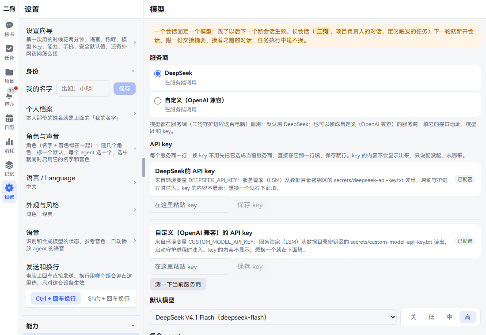
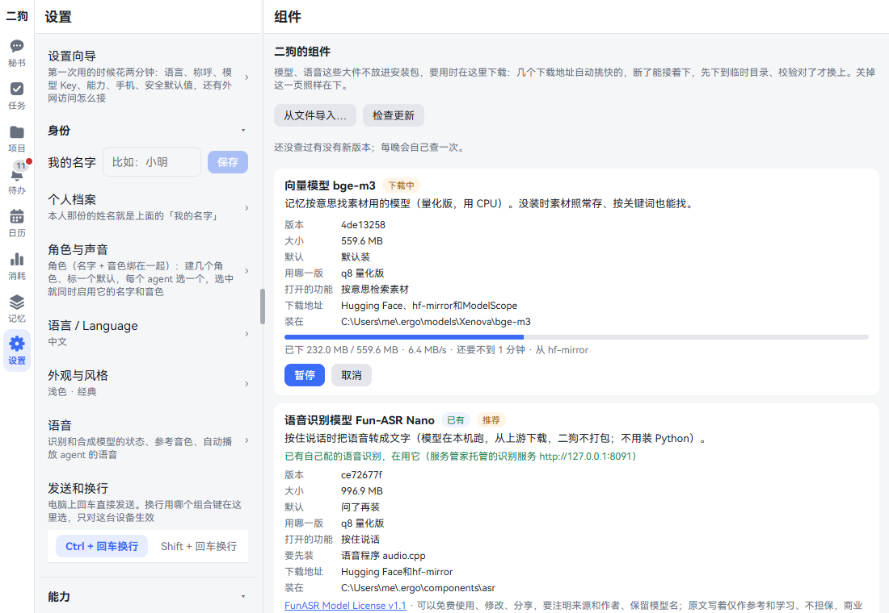
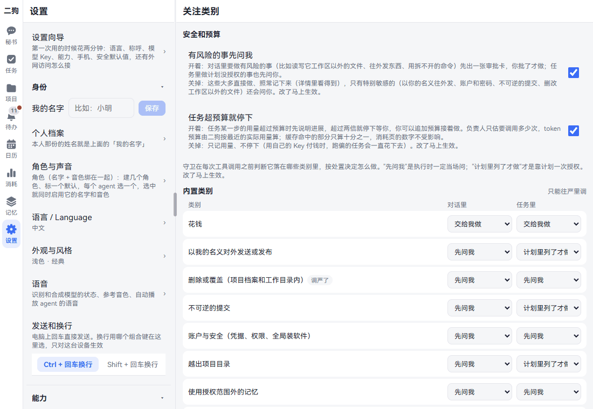
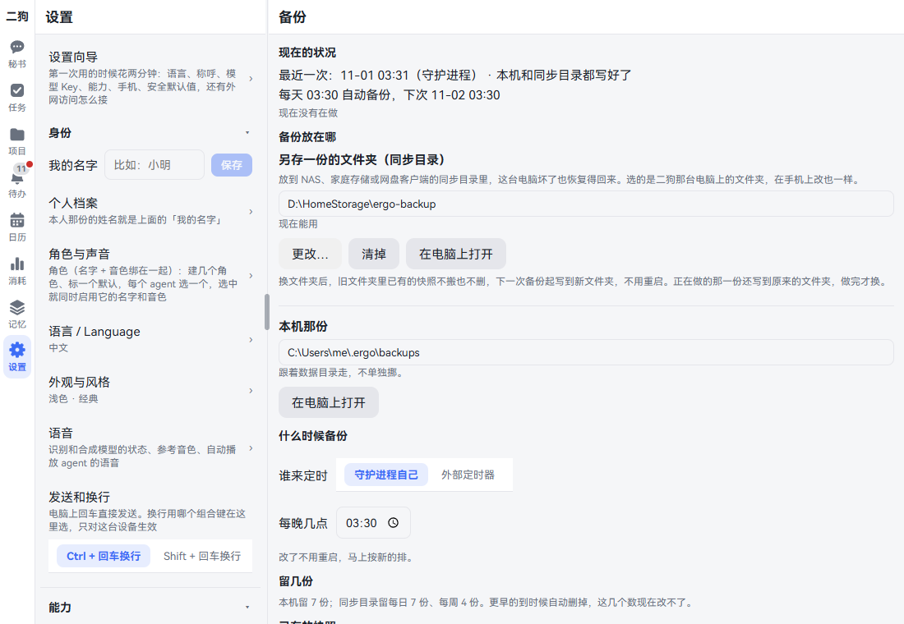
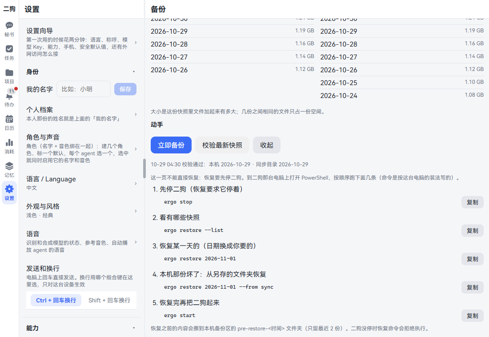
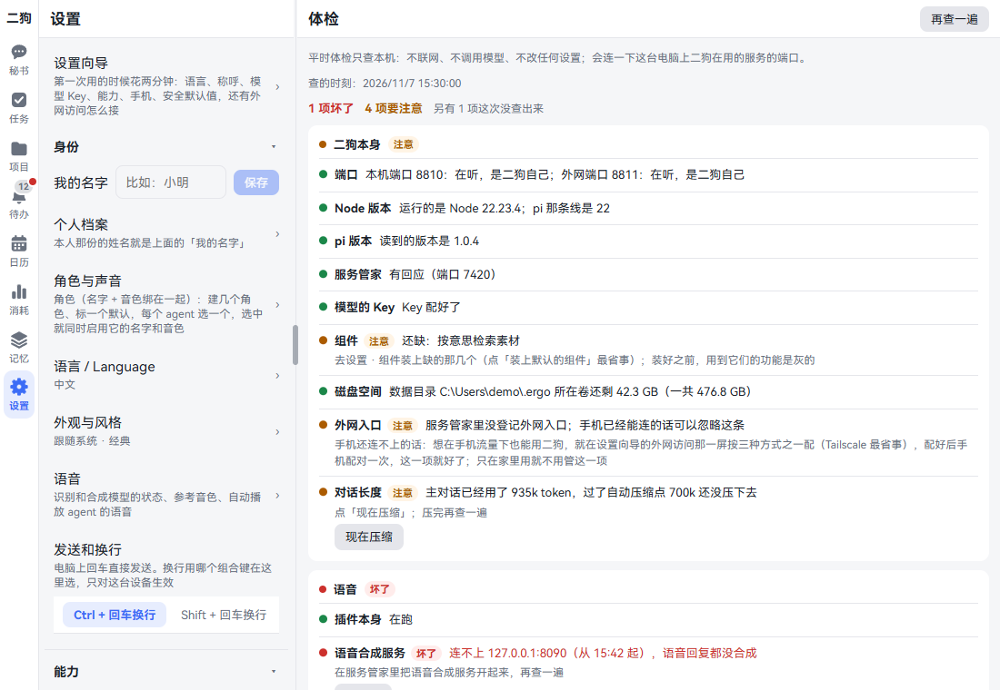
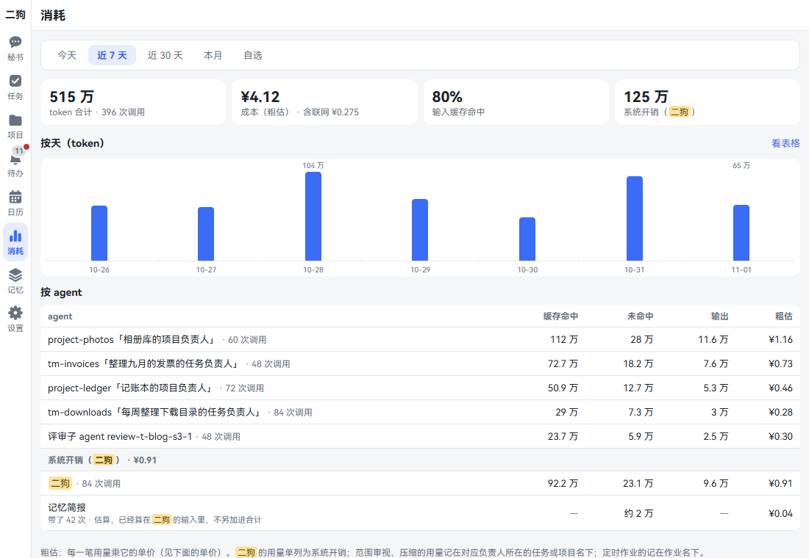
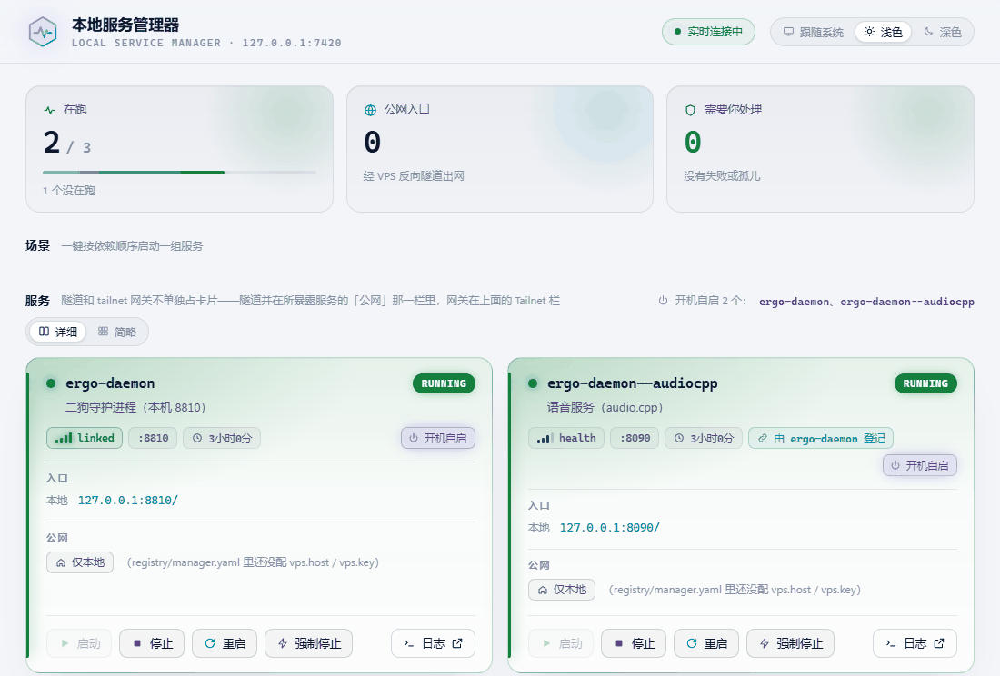

**中文** | [English](settings.en.md)

# 设置

这一章照设置页的列表，从上到下一项一项讲：每项是什么、怎么改、改了有什么效果。最后讲不在设置列表里、但常要看的两样：消耗和服务管家。看完你知道每个开关管什么，出了问题先去哪看。

讲得多的功能这里只说一句，再链到专门的一章。

## 打开设置

- **电脑上：** 点左边竖栏最下面的「设置」。左边是列表，右边是点开的那一页。窗口太矮放不下时，它收进「更多」里。
- **手机上：** 点底部的「更多」，再点「设置」。点进一项，用左上角返回。


列表最上面是「设置向导」，下面分四组：身份、能力、规则、数据与设备。点组的标题能收起、展开，这台设备记住。

有几项只对这台设备生效：外观与风格、发送和换行、搜索引擎、自动播放语音、组的收起。别的改一处，所有设备都一样。

在手机 App 里打开时，列表最上面多一块「在手机 App 里运行」：写着 App 版本，有「换地址」，还有「系统通知」开没开，没开时点「去打开」。见[手机上用](mobile.md)。

记忆的几个开关不在设置里，在记忆页最下面。见[记忆](memory.md)。

## 设置向导

**是什么：** 第一次用时走一遍的引导。五步：语言、称呼、助手名，模型 Key，能力，手机配对，安全默认值。后面还有一屏讲外网访问。

**怎么用：** 点「设置向导」。每一步可以点「这一步就这样」或者「以后再说」，第五步是「看过了」。随时能点标题栏的「先不弄了」出去，以后再回来。

详细走法见[开始使用](getting-started.md)。

## 身份

### 我的名字

**是什么：** 你自己的名字，不是助理的。

**怎么改：** 在这一行的输入框里填，点「保存」。不想要了点「清除」。

**效果：** agent 说话、念给你听时这样称呼你。不填就只叫你"你"。

**要知道的：** 最多 8 个字。个人档案里本人那份的姓名就是它，改一边另一边跟着变。

### 个人档案

**是什么：** 你和家人的证件、生日、电话、住址，一字不差地记着。

**怎么打开：** 点这一行。记忆插件开着时去 记忆 · 档案，停用时在「更多」里。

详细见[记忆](memory.md)。

### 角色与声音

**是什么：** 名字和音色绑成一个角色，给每个 agent 选一个。助理的名字也在这里改：默认角色的名字就是它。没起过名字时，名字跟着界面语言走，中文叫二狗，英文叫 ergo；起过名字的，换语言也不变。

详细见[语音](voice.md)。

### 语言 / Language

**是什么：** 界面和二狗说的话用哪种语言。

**怎么改：** 点进去，点一种语言。不用刷新，开着的页面马上换。自带中文和 English。

**效果：** 所有设备一起换，秘书和负责人也用这种语言回答你。以前的聊天和卡片保持原来的语言，换了之后新产生的才是新语言。

**要知道的：**

- 选错了也找得回来：这一行永远中英两种写着。
- 想加一种语言、改某句译法，页面下面写着做法，放好文件不用重启。细节见[用户自己加一种语言](../architecture/README.md#用户自己加一种语言)。
- 放进去的语言文件读不进来时，页面上逐条写哪个文件哪里错。

### 外观与风格

**是什么：** 深浅色和界面的样子。列表上这一行写着现在选的，比如「跟随系统 · 经典」。

**怎么改：** 点进去。

- **外观：** 浅色、深色、跟随系统。默认跟随系统。
- **显示 · 字号：** 小、标准、大、特大四档，下面一根滑杆细调（85% 到 150%），下面的示例跟着变，整个页面也马上跟着变。字调大时，标题栏和导航只长一点，留白不跟着涨，多出来的地方留给消息；调小时只缩看的字，按钮、链接、输入框保持标准大小，好点；最小的字不会小于 11 像素。手机宽度、折叠屏展开、平板和电脑上各记各的：折叠屏折起展开时自动换成那种宽度自己的字号，没调过的是标准。
- **风格：** 经典、暖纸手帐、净白格栅、夜航仪表、软糖圆角、玻璃光纹、工程蓝图、贴纸便当、像素小屋、水墨国风、复古杂志。每套都有左浅右深两张预览，点一下就换。
- **主色：** 选中经典时多一排色块：蓝、靛紫、青绿、绿、橙、红、粉、石墨灰。

**效果：** 马上生效，只对这台设备。

### 语音

**是什么：** 语音识别和语音合成的状态、参考音色，还有「自动播放 agent 的语音」开关。

详细见[语音](voice.md)。语音插件停用时列表里没有这一项。

### 发送和换行

**是什么：** 电脑上回车直接发送，换行用哪个组合键。

**怎么改：** 在这一行点「Ctrl + 回车换行」或者「Shift + 回车换行」。默认是 Ctrl。

**效果：** 马上生效，只对这台设备。

**要知道的：** 手机、平板上没有这一项。那里回车就是换行，用发送按钮发。

## 能力

### 模型

**是什么：** 二狗用哪家的模型、哪个模型、Key 填在哪。

**在哪里：** 设置 · 能力 · 模型。



这一页从上到下六块：

| 块 | 怎么改 | 效果 |
|---|---|---|
| 服务商 | 点 DeepSeek 或者「自定义（OpenAI 兼容）」 | 对话用哪家。选自定义时展开接口地址、模型 id、接口类型 |
| API key | 每个服务商一行。粘贴，点「保存 key」 | 当次生效，不用重启。Key 不显示出来，只写配没配、从哪来 |
| 默认模型 | 选模型，再点思考档位：关、低、中、高 | 没单独指定的 agent 都用它 |
| 自动压缩 | 填一个 token 数，点「保存」；「恢复默认（70 万）」改回去 | 对话到这么多 token 就自动压缩。每个 agent 跟随它，也能在 ⚙ 里单独设 |
| 各个 agent | 秘书、任务负责人、项目负责人、子 agent、评审、范围审视各两个下拉 | 第一项是「跟随默认」，也能选定模型和思考档位 |
| 看图能力 | 每个模型一个下拉：跟随模型目录、能看图、看不了 | 看不了的模型收不到聊天里的图片，只收到一行占位 |

**测一下通不通：** API key 那一块最下面点「测一下当前服务商」。回通了，或者写不通的原因。

**换成别家服务商：**

1. 点「自定义（OpenAI 兼容）」。
2. 「接口地址」填到 `/v1` 这一层。
3. 「模型 id」手填，不知道就点「拉取列表」挑一个。挑不到点「还是手填」。
4. 「接口类型」不确定就用默认。
5. 到 API key 那一块，在自定义那一行填 Key，点「保存 key」。
6. 点「测一下当前服务商」。

**什么时候生效：** 一个会话固定一个模型，改了以后下一个新会话用新的。秘书、项目负责人的对话、定时触发的任务下一轮就新开会话，附一份交接摘要。任务执行中途不换。

**要知道的：**

- 选了自定义时，默认模型的下拉、各个 agent、看图能力都收起。切回 DeepSeek 都回来。
- 换成自定义后，记忆的每晚整理、DeepSeek 的联网搜索和读网页还是用 DeepSeek 的 Key。别把它删了。
- 自定义模型没有单价，消耗页上它的成本算出来是 0。
- 某个负责人想单独用别的模型，到它的 ⚙ 里配。这一页会列出哪几个单独配了，点名字跳过去。
- 自动压缩的点改了马上生效，不用等新会话：每轮说完就按新的点比一次，过了就压缩。最少 5 万；最多到模型窗口减 16384，填得更大按那里算。Claude Code、Codex 跑的 agent 自己管压缩，不看这里。
- 自动压缩在回复说完之后做。压的时候你接着发的消息先排着，压完再回。没压成（比如服务商忙）不会每轮都重试：先等 15 分钟，再没成等得更久，最多 2 小时。
- 给哪个服务商填 Key 都不用先把它选成当前的。填自定义那一行不动 DeepSeek 那份。
- 「拉取列表」和「测一下当前服务商」会先把这一块存进设置。列不出来时写原因，照样能手填。
- 自定义模型的能力是按估算记的：只看文字、不思考，上下文约 128k，一次最多生成约 8192 token。你那家比这小可能被截断或者报错。
- 切回 DeepSeek 不丢东西。填过的地址、模型 id、接口类型和 Key 都留着，以后再选自定义不用重填。
- 技术细节见[模型服务商](../architecture/README.md#模型服务商)。

### skill 和 MCP

**是什么：** 导入 skill、看登记了哪些 MCP、配秘书用的 skill。

详细见[skill、MCP 和插件](skills-mcp-plugins.md)。

### 插件

**是什么：** 看二狗装了哪些功能插件，停用、启用、移除，不用重启。

详细见[skill、MCP 和插件](skills-mcp-plugins.md#插件)。

### 组件

**是什么：** 模型、语音这些大件不放进安装包，要用时在这里下载。没装的组件对应的功能是灰的，点一下就来这里。

**在哪里：** 设置 · 能力 · 组件。



| 组件 | 打开什么功能 | 大小 | 默认 |
|---|---|---|---|
| 向量模型 bge-m3 | 记忆按意思检索素材。没装时按关键词也能找 | 约 560 MB | 默认装 |
| 语音识别模型 Fun-ASR Nano | 按住说话 | 约 1 GB | 问了再装 |
| 语音程序 audio.cpp | 语音服务本身。装模型时会先装它 | 约 31 MB 到 853 MB，看有没有 N 卡 | 问了再装 |
| 语音合成模型 Fish S2 Pro | 用语音回复 | 约 6 GB | 问了再装 |
| Claude Code 接入 | 用 Claude Code 做任务 | 约 120 MB | 本机装了 Claude Code 才装 |

**装一个：**

1. 点那一块的「安装」。
2. 要确认许可的先弹「下载前先看许可」，写着大小、许可和原文链接。点「同意并下载」。确认过的不再问。
3. 下载时显示进度、速度、还要多久、从哪个地址下。能「暂停」「继续」「取消」。关掉这一页照样在下。
4. 校验对了才换上，小签变成「已装」。

**别的按钮：**

- **装上默认的组件（N 个）：** 把照默认该装、还没装的一次装上。全装了就没有这个按钮。
- **从文件导入…：** 下载不下来时自己下好，填文件、文件夹或 .tar / .tgz 包的路径。校验对得上就装上。下载失败时，那一块列着还差的文件和地址。
- **检查更新：** 马上查有没有新版本。每晚也自己查一次，有新版本时小签写「有新版本」，待办里提醒一声。点「更新」才换，换上之前旧版本照常用。
- **删除：** 确认框写会删哪个文件夹、哪些功能会灰掉。要用时再装一次。
- **启动、停止：** 语音程序这一块才有，下面写运行状态、端口和开机自启。

小签「已有」是说你别处已经配好了，这里不动它，下面写着谁提供的。

**要知道的：**

- 断了能接着下，几个下载地址自动挑快的，走系统代理。
- 语音服务要二狗是由服务管家拉起来的才接得上。数据目录路径里不能有中文。详细见[语音](voice.md)。
- 组件不进备份，能重新下。
- 检查更新只取一份版本清单，不带你的账号、设备和使用情况。页面上写着查的是哪个地址。
- 发布页上还没有这份清单时写「这个版本还没有组件更新信息」，不影响使用。没查成只写一行原因，不打扰你，这时组件跟着二狗本身一起升级。

### Claude Code

**是什么：** 新的 Claude Code 任务、项目默认放在哪个文件夹下面。

详细见[Claude Code](claude-code.md#定一个默认文件夹)。Claude Code 插件停用时列表里没有这一项。

### Codex

**是什么：** 新的 Codex 任务、项目默认放在哪个文件夹下面。填法和 Claude Code 那一页一样。

详细见[Codex](codex.md)。本机没装 Codex 或者插件停用时列表里没有这一项。

### 浏览与填框

**是什么：** 两件不相干的事放在一页：手机 App 里「浏览」用哪个搜索引擎，和 agent 联网搜索用哪几种方式。

**在哪里：** 设置 · 能力 · 浏览与填框。

**搜索引擎：**

- 点必应、百度、搜狗或谷歌。默认必应。
- 效果：手机 App 的「浏览」地址栏打的不是网址时用它搜。只对这台设备生效。

**agent 联网搜索、读网页：**

四种方式排成一列，排上面的先用。失效了（出错、超时、没结果、余额不足）按顺序换下一个。

| 方式 | 特点 |
|---|---|
| DeepSeek 付费搜索 | 按次收费、最快、只能搜和读。没配 DeepSeek 的 Key 时启用不了 |
| 二狗自带的浏览器搜索 | 免费、中等速度、只能搜和读 |
| agent-browser | 免费、最慢、最费 token，能下载文件、能操作网页 |
| 手机 App 的内置浏览器 | 免费，在你手机上做、你看得见，能点、能填框、能交文件。只在浏览侧边栏和悬浮按钮那一轮能用 |

- **调顺序：** 点每一项的上移、下移。电脑上也能按住左边的把手拖。
- **停用：** 点右边的开关。至少留一种，最后一种的开关点不了。
- 效果：所有设备共用，下一次搜索就按新的。停用 agent-browser 只是不拿它来搜索，下载文件、操作网页照旧。

二狗自带的浏览器搜索用这台电脑上的 Chrome 或 Edge，会自动找。找不到或者想指定一个，见[配置文件](../architecture/README.md#配置文件)里的 `web.browserPath`。

页面最下面一行「授权的文件夹」链到下面数据与设备组里那一项。内置浏览器的用法见[内置浏览器](browser.md)。

## 规则

### 关注类别

**是什么：** 二狗的守卫在每次工具调用之前判断它落在哪些类别里，按你定的处置决定怎么做。这一页定哪些操作要问你。

**在哪里：** 设置 · 规则 · 关注类别。



**最上面两个开关：**

| 开关 | 开着 | 关掉 |
|---|---|---|
| 有风险的事先问我 | 对话里要做有风险的事先出审批卡，你批了才做；任务里做计划没授权的事也先问你 | 这些大多直接做、照常记下来。特别敏感的（以你的名义往外发、账户和密码、不可逆的提交、删改工作区以外的文件）还会问你 |
| 任务超预算就停下 | 任务某一步超预算时先说明进展，超过两倍就停下等你，你可以追加预算接着做 | 只记用量，不停。用自己的 Key 付钱时，跑偏的任务会一直花下去 |

新装时两个都不勾。想稳一点就勾上，改了马上生效。

**六档处置：**

| 处置 | 意思 |
|---|---|
| 直接做只记录 | 不打扰你 |
| 做完告诉我 | 先做，做完说一声 |
| 计划里列了才做 | 靠计划一次授权。对话里没有计划，等同「先问我」 |
| 先问我 | 执行时当场问 |
| 交给我做 | 二狗不做，你亲手做完点「已完成」 |
| 永不 | 不做 |

**内置类别：** 每类两个下拉，「对话里」和「任务里」。下拉里只有不比默认更松的档，所以只能往严里调。调过的写「调严了」。

| 内置类别 | 对话里默认 | 任务里默认 |
|---|---|---|
| 花钱 | 交给我做 | 交给我做 |
| 以我的名义对外发送或发布 | 先问我 | 计划里列了才做 |
| 删除或覆盖（项目档案和工作目录内） | 先问我 | 做完告诉我 |
| 不可逆的提交 | 先问我 | 计划里列了才做 |
| 账户与安全（凭据、权限、全局装软件） | 先问我 | 先问我 |
| 越出项目目录 | 先问我 | 计划里列了才做 |
| 使用授权范围外的记忆 | 先问我 | 先问我 |
| 计划外工单 | 不适用 | 先问我 |
| 未知的写操作 | 先问我 | 先问我 |

**两条底线：** 不能改。付款转账、创建账户、改密码或两步验证是「交给我做」；把凭据写进对外内容是「永不」。

**加一条自己的：**

1. 点「＋ 新建类别」。
2. 填「名字」，再写规则：「匹配工具」「路径在这些目录之内」「收件人是」「金额大于」。几条都写了要同时满足，每条里写几个值是其中之一。
3. 选「对话里」「任务里」各一档，这里六档都能选。
4. 点「保存」。

建好的能「改规则」「删除」。

**效果：** 改了马上生效，下一次工具调用就按新的判。

**要知道的：**

- 一次调用命中好几个类别时取最严的，所以自己加的类别放宽不了内置类别和底线。
- 不落在任何类别里的调用直接做只记录。
- 进行中的任务，确认计划时调严过的类别仍按确认时的设置检查。
- 设置文件被手改坏了，守卫一律拦下工具调用。这一页最上面写明问题，待办里也有一条。按页面上的按钮修，或者手改好后点「我手改好了，重新读取」。

### 系统提示

**是什么：** 各 agent 的系统提示，能看、能改、能恢复默认。想改二狗说话的习惯时用。

**在哪里：** 设置 · 规则 · 系统提示。列表分三段：前缀、各角色、共用片段。每一份写着「默认」还是「改过」。

**怎么改：**

1. 点进某一份。
2. 在编辑框里改。占位符写错时就地提示第几行错在哪，存不进去。
3. 点「保存」。提示「已保存，下一次拉起时生效」。
4. 不想要了点「恢复默认」，确认。改过的那份会删掉，找不回来。没保存的用「撤销修改」。

**效果：** agent 下一次拉起时生效，不用重启。秘书的改了之后，手头这一条处理完就按新的。

**要知道的：**

- 「前缀」加在每个 agent 的系统提示最前面，默认是空的。
- 改过的那份写错了时，二狗退回用默认的，页面上写明。
- 只想改某一个 agent，到它的 ⚙ 里写「单独的提示词」，别动这里。

### 工作日规则

**是什么：** 额外的上班规则，比如每月最后一个周六上班。按工作日触发的定时任务照它算。

**在哪里：** 设置 · 规则 · 工作日规则。页面最上面写着怎么算：你的上班日 = 新加坡工作日 ∪ 国内工作日（含调休补班）∪ 额外上班规则 ∪ 手动标记的上班日 − 手动标记的休息日。

**怎么改：**

1. 选写法：「每周」「每月第几个」「每月最后一个」。
2. 选周几。选了每月第几个的，再选第几个。
3. 点「加上」。不要了点那一条的「删除」。

**可以直接说的话：**

- 下周一我不上班

这是手动标记，不是规则。秘书出一张快速动作卡，确认后标上。也能在日历里点那一天改。

**要知道的：** 每天上班还是休息、为什么，在日历里看。节假日数据每年 12 月查一次下一年的，缺了在待办里提醒。见[日历和提醒](calendar-reminders.md)。

## 数据与设备

### 数据源

**是什么：** 外面接进来的数据：Google 日历、Gmail、联系人，Looki 相机，手机上的 App。每个一张卡，写着连没连上、已获取几条。

详细见[数据源](data-sources.md)。

### 授权的文件夹

**是什么：** 电脑上哪些文件夹，所有 agent 读里面的文件都不用再问你。最多 20 个。

**怎么改：**

1. 点「添加文件夹」。
2. 点常用位置或盘，进到要的文件夹，点「授权这个文件夹」。也能贴完整路径。
3. 不要了点那一行的 ×，马上拿掉。

**可以直接说的话：**

- 把 D:\照片 授权给你读

秘书出一张卡，你点「执行」才加上。agent 自己改不了这份名单。

**要知道的：**

- 只放开了读。写、删、覆盖还是原来的规矩。
- 读到的内容会发给你配的模型服务。不要授权放密钥、密码的文件夹。
- 选的是二狗那台电脑上的文件夹，在手机上操作也一样。

详细见[内置浏览器](browser.md)。

### 目录授权

**是什么：** 每个 agent 一份：个人助理一份，每个项目一份，每个任务一份。登记了的目录里，它做你勾了的那几种操作（读、写、删分开勾）不用再问你。子 agent 和评审不继承。

**在哪里：** 设置 · 目录授权列出所有 agent 的全部授权，最上面一组是「所有 agent · 只读」（就是上面的授权的文件夹），最下面是最近的使用记录。加、删在各个 agent 自己的 ⚙ 里（个人助理、项目页、任务页的标题栏）。

**怎么加：**

1. 在那个 agent 的 ⚙ 里点「登记一个目录」。
2. 写完整路径，勾读、写、删（勾了删不会带上写），选有效期（不选是「长期有效」），写一句为什么给。
3. 点「登记」。

对话里它碰到范围之外的目录、弹出审批卡时，卡上还有「以后都允许（登记这个目录）」：点了把这个目录按这次要的操作登记成长期授权，同时批准这一次。

**要知道的：**

- 没勾的操作照旧：对话里先问你，任务里要计划里写了。
- 登记了也不放：二狗自己的配置、密钥、数据库和程序目录；登记目录里的 .env、*.key、*.pem、secrets*、id_rsa*、credentials* 这类密钥文件，读写都拒。
- 到期自动失效，标「已过期」；到期前三天待办里提醒一次。能一次清掉全部已过期的，也能整个 agent 一起清。
- 使用记录：bash 里的只记得到命令里写着的路径，不是程序实际读写了哪些文件。
- 项目外的 `rm -rf` 照旧不做，勾了删也一样。

### 删除素材

**是什么：** 按会话或按时间段成批删素材。

**在哪里：** 记忆插件开着时，这一项在 记忆 · 素材 里，设置列表里没有。**记忆插件停用时才列在这里。**

三种删法：忘掉、彻底删除、别推断。详细见[记忆](memory.md)。

### 工具调用的完整内容

**是什么：** 二狗另存的每次工具调用的完整参数和返回。这一行写着占多大、存了多少次。默认保留 90 天、总量最多 2 GB，每天自动清一次。

**怎么清：**

1. 这一行写着「现在可以清掉 N 次」。点「现在就清理」。
2. 看确认框，点「确认清理」。

**效果：** 清掉的只是完整参数和返回。聊天记录、要点、效果记录照旧，详情页里退回摘要。清掉后找不回来。

**要知道的：**

- 没结束的任务里的、待办里还引用着的不清。
- 想改保留多久要改配置文件，见[配置文件](../architecture/README.md#配置文件)，重启后生效。

### 备份

**是什么：** 二狗每晚给数据目录做一份快照。电脑坏了、数据弄乱了，能回到某一天。这一页管放在哪、什么时候、留几份和怎么恢复。

**在哪里：** 设置 · 数据与设备 · 备份。手机上也能开，选的文件夹照样是二狗那台电脑上的。这一页改的马上生效，不用重启。



#### 备份到哪

有两份：

- **本机那份：** 在数据目录的 `backups\`，默认是 `%USERPROFILE%\.ergo\backups`。跟着数据目录走，不能单独挪。
- **另存一份的文件夹（同步目录）：** 你选的一个文件夹，快照再复制一份过去。放到 NAS、家庭存储或网盘客户端的同步目录里，这台电脑坏了也恢复得回来。**强烈建议配上。** 没配时写「没配：只留本机那份」。

点「在电脑上打开」，在二狗那台电脑上打开这个文件夹。

#### 改另存的位置

1. 没配过点「选一个文件夹…」，配过点「更改…」。弹出「选另存的文件夹（二狗那台电脑上的）」。
2. 点常用位置（图片、下载、桌面、文档、用户目录）或者盘，点子文件夹一层层进去，「上一级」往回走。
3. 到了要的文件夹，点「用这个文件夹」。也能在下面贴完整路径，点「用这个路径」。
4. 当场校验。文件夹不存在时问「这个文件夹还不存在」，点「新建」或者「不了」。
5. 成了提示「改好了，下一次备份写到 X」。

校验的规矩：要完整路径，不能在数据目录里，要写得进去。不合格的写明原因，配置不变。

不想另存了点「清掉」，确认。之后只留本机那份。

换文件夹后，旧文件夹里已有的快照不搬也不删。正在做的那一份还写到原来的文件夹，做完才换。

#### 什么时候备份

- **每晚几点：** 默认 03:30。改时刻后旁边出现「保存」，点它。提示「改好了」，马上按新的排。
- **谁来定时：** 默认「守护进程自己」。电脑那时关着，下次启动补做。
- 选「外部定时器」时，二狗不再到点备份，上面的时刻也不起作用。页面写着要每天调的命令，点「复制」：

  ```powershell
  ergo backup --scheduled
  ```

  把它放进你自己的定时任务。连着两天没跑，待办里提醒你。

#### 留几份

本机留 7 份。另存的文件夹留每日 7 份、每周 4 份。更早的到时候自动删。这几个数现在改不了。

#### 已有的快照

本机和另存的文件夹各列日期和大小。取不到的写原因。大小是这份快照里文件加起来有多大，几份之间相同的文件只占一份空间。

#### 马上备份、校验

- **立即备份：** 点了排进队列，按钮写「备份中…」，做完弹一句结果。手动的会重做当天的快照。
- **校验最新快照：** 查最新的快照完不完整，结果写在按钮下面。每周日 04:30 也自动校验一次，没通过的放一条通知。

#### 怎么恢复

恢复要先停二狗，所以网页上不能一键恢复。点「怎么恢复」，页面列出按这台电脑的装法算好的命令，每条都能「复制」。



到二狗那台电脑上打开 PowerShell，按顺序跑：

```powershell
ergo stop                             # 先停二狗
ergo restore --list                   # 看有哪些快照
ergo restore 2026-10-15               # 恢复某一天的
ergo start                            # 再起来
```

本机那份坏了，从另存的文件夹恢复：

```powershell
ergo restore 2026-10-15 --from sync
```

**换了一台电脑：** 先在新电脑上装好二狗，再指着另存的文件夹恢复。

```powershell
ergo stop
ergo restore 2026-10-15 --from "D:\NAS同步\ergo-backup"
ergo start
```

恢复之后：

- 恢复之前的内容挪到本机备份区的 `pre-restore-<时间>` 文件夹，只留最近 2 份。恢复错了还能找回来。
- 配置也在快照里。另存的文件夹、备份时刻回到那一天的样子，到这一页看一眼。

**要知道的：**

- **这些不进备份：** 密钥（模型的 Key、Gmail 密码这些）、模型和组件、导入文件夹、临时文件和缓存。恢复时它们原地不动。换了电脑要重新填 Key、重新装组件。
- 服务管家自己的数据不在这份备份里。
- 二狗没停时，恢复命令拒绝执行。快照校验没过也拒绝。
- 写进同步目录就算成功。网盘客户端传没传完，二狗不知道也不等。
- 备份失败时待办里有一条「备份失败」，写明原因，点「重试」马上再做一次。本机快照照样留着。
- 日志在数据目录的 `logs\backup.log`。
- 自己从源码跑的，或者数据目录不是默认的，命令不一样。照页面上「怎么恢复」写的跑，那里是按你的装法算好的。从源码跑的也可以看[开发文档](../architecture/development.md#备份和恢复)。

### 设备配对

**是什么：** 手机扫码连上二狗，管已配对的设备。最上面是「显示配对二维码」，下面的设备能延期、吊销、删除。

详细见[手机上用](mobile.md)。

### 体检

**是什么：** 这台电脑上二狗现在好不好用：二狗本身和每个插件各查一遍。出了问题先看这里。

**在哪里：** 设置 · 数据与设备 · 体检。



**怎么用：** 打开就查，几秒内出结果。最上面一行是总状态：几项坏了、几项要注意，都没有就写「都正常」；这次没查出来的另写一句灰字。下面一块一块：

- **二狗本身**：下表的八项。
- **每个插件一块**，标题是插件的名字，有问题的排在前面。每块第一行是「插件本身」：在跑、没装上（附原因）。插件用到的数据源、agent 运行时（Claude Code、Codex）二狗自动各查一项；插件自己也能带体检项，装上插件就多一块，停用了那一块就没了（最底下一行列出停用的插件）。

每项前面一个小圆点，结果分五种：

| 结果 | 意思 |
|---|---|
| 正常（绿） | 好的 |
| 注意（橙） | 能用，但打了折扣 |
| 坏了（红） | 相关的功能用不了 |
| 没查出来（灰） | 这次查的时候超时或出错，不算坏，不拉低总状态。点「再查一遍」 |
| 不适用（空心、淡显） | 没开这个功能、没连这个数据源，就不查；排在块的最后 |

不正常的项写着查出来的事实、从什么时候起、怎么修；能一点就修的带一个按钮：「去看看」跳到对应的页面，「现在压缩」把那个对话压缩一下。修完点右上角「再查一遍」。

二狗自动替插件查的：

| 项 | 怎么算 |
|---|---|
| 插件本身 | 在跑是正常；没装上是坏了，附原因；要的外部程序没装、你也没用它，只是提示（不适用） |
| 数据源 | 没连、两种用法都关着的不查；要重新授权、连不上是坏了；定期导入超过间隔 3 倍没同步成功算过期（注意），最近一次同步出错也是注意 |
| 运行时 | 能用是正常；没装、没有任务和项目用它只是提示；没装可有任务或项目用着它，是坏了 |

二狗本身的八项：

| 项 | 查什么 | 不对时怎么办 |
|---|---|---|
| 端口 | 8810、8811 有人在听，听的是二狗自己 | 关掉占端口的程序，或者换端口重启二狗 |
| Node 版本 | 运行的 Node 和要求的一致 | 装二狗自带的 Node 或者 Node 22，再启动二狗 |
| pi 版本 | 读得到二狗的 agent 内核 pi 的版本 | 缺了就没法聊天。一行命令装的先跑 `ergo uninstall --keep-data`，再跑一遍安装命令，数据不动；npm 装的用 `npm i -g ergo-ai@latest` 重装；从仓库跑的在仓库目录跑 `npm ci`，再重启二狗 |
| 服务管家 | 服务管家有回应 | 跑 `ergo start` 重新拉起，还不行看它的日志 |
| 模型的 Key | Key 配好了（不真发请求） | 到设置 · 模型填一个 |
| 组件 | 照默认该装的都装好了 | 到设置 · 组件装缺的，点「装上默认的组件」最省事 |
| 磁盘空间 | 数据目录所在的盘还剩 1 GB 以上 | 清旧备份、日志，或者把数据目录挪到大的盘 |
| 外网入口 | 服务管家登记的入口、手填的地址或者已配对的设备，有一样就算好 | 只在这台电脑上用不用管。手机连不上时看[手机上用](mobile.md) |

**要知道的：**

- 平时体检只查本机：不联网、不调用模型、不改任何设置；会连一下这台电脑上二狗在用的服务的端口（比如语音合成）。
- 八项不对时：端口、pi、模型的 Key、磁盘空间算坏了；Node 版本、服务管家、组件、外网入口算注意。
- 跟二狗说「你自己体检一下」，它也能查这一页，照着告诉你哪里不对、怎么修；它只看，不替你修。
- 「外网入口」写「服务管家里没登记外网入口；手机已经能连的话可以忽略这条」，不等于没配。
- 手动跑 `tailscale serve` 这种服务管家不知道的，手机配对之后就算好。
- 接到本机端口 8810 的入口这一项算不健康。8810 对本机请求自动信任，绝不能接到外面。

### 关于二狗

**是什么：** 版本和更新日志。报问题时从这里抄版本。

**怎么看：** 点进去。大字是版本号，下面是页面构建、守护进程的版本和已运行多久、这台设备怎么连进来的。在 App 里还有 App 版本。再下面是「这一版更新了什么」，有更早的版本时，「以前的版本」能展开。

### Debug 工具集

**是什么：** 排查用的。平时看不到。

**怎么打开：** 在关于二狗里连点版本号 8 次，两次之间不超过 2 秒。第 4 次起底部提示还差几次。打开后设置列表最下面多一项，1 小时内有效，刷新页面、重开 App 就没了。「现在收起」马上关掉。

**里面有什么：** 系统通知、版本与环境、连接、语音、日志与本机存储。有人帮你查问题时，点「一键复制」把版本和环境发过去。

## 消耗

**是什么：** 二狗花了多少 token、大概多少钱。每次模型调用都记一笔。

**在哪里：** 电脑上左边竖栏的「消耗」。手机上「更多」·「消耗」。



**怎么看：**

1. 最上面选时间范围：今天、近 7 天、近 30 天、本月、自选。打开时是近 7 天。
2. 四个大数：token 合计和调用次数、成本（粗估）、输入缓存命中、系统开销。
3. **按天（token）：** 柱状图。点「看表格」换成表格，点「看图」换回来。
4. **按 agent：** 每个 agent 的缓存命中、未命中、输出和粗估。秘书的单列在「系统开销」下面。范围审视、压缩的用量记在对应负责人所在的任务或项目名下。
5. **联网搜索、读网页（按次计费）：** DeepSeek 的联网搜索和读网页花了多少。浏览器搜索不花钱。
6. **单价（每百万 token）：** 用到的模型的单价，分高峰、空闲。

**要知道的：**

- 成本是粗估，不是账单。官网改价后以官网为准。
- 「记忆简报」那一行已经算在秘书的输入里，不另加进合计。
- 自定义模型没有单价，成本算出来是 0。
- 只想看某个任务：任务详情「⋯」·「消耗」。普通任务没有这一项。

## 服务管家

**是什么：** 一个小而稳的看门进程，跟二狗分开跑。它负责开机把二狗拉起来，二狗被杀了拉回来，也托管语音服务和项目做出来的服务。

**怎么打开：** 在装二狗的那台电脑上，浏览器打开 <http://127.0.0.1:7420/>。页面标题写的是「服务管家」，就是它。

只能在这台电脑上开。手机上开不了。端口被改过的话，跑 `ergo status` 看它的地址。



### 页面上有什么

- **最上面三个数：** 在跑几个、公网入口几个、需要你处理几个。
- **场景：** 一键按依赖顺序启动一组服务。没配的话这里是空的。
- **服务：** 每个服务一张卡片。右边「详细」「简略」切换卡片样式。
- **页面最下面：** 解释每盏灯保证了什么。

### 卡片上能做什么

| 地方 | 做什么 |
|---|---|
| 「启动」「停止」「重启」 | 字面意思。它正在跑任务时会问，点「等空闲后再停」或者「等空闲后再重启」，等它做完 |
| 「强制停止」 | 不等空闲。10 秒内没停下就杀进程，没保存的工作会丢 |
| 「日志」 | 新标签页里看这个服务的全部输出，实时跟着 |
| 「开机自启」 | 亮着是下次开机会拉起它，再点一下取消。不影响现在在跑的 |
| 入口 | 点地址打开这个服务的页面 |
| 「开通公网」「开通 tailnet」 | 给这个服务开外面的入口，配好才有。见[手机上用](mobile.md#让手机连得到电脑外网访问怎么选) |

**状态：**

| 卡片右上角 | 意思 |
|---|---|
| RUNNING | 在跑 |
| DEGRADED | 在跑但有问题，亮黄灯。二狗亮黄灯多半是某个插件没装上 |
| STARTING、STOPPING | 正在起、正在停 |
| STOPPED | 停着 |
| FAILED | 起不来或者挂了，卡片上写原因 |
| ORPHAN | 有个不认识的进程占着它的端口，点「认领」或者「杀掉」 |

`ergo-daemon` 就是二狗。语音服务叫 `ergo-daemon--audiocpp`。

**要知道的：**

- 停了 `ergo-daemon`，二狗的网页就打不开了，要到这里或者跑 `ergo start` 再起来。
- 二狗被杀或者崩溃，服务管家自动拉回。重启后正在做的事按规则接着做，说不清做没做完的转给你确认。
- 卡片上「由 ergo-daemon 登记」的是二狗替项目、语音登记的服务，一样能启停。

### 开机自启

分两层，**两层都开，重启电脑后二狗才会自己起来**。一行命令安装默认两层都开好了。

- **服务管家自己开机起来：** 在设置向导「能力」那一步的「开机自启」开关改，或者用命令。
- **服务管家拉起哪些服务：** 在卡片上的「开机自启」改。页面上写着现在名单里有哪几个。

是登录 Windows 时起来，不是开机时。命令和细节见[开机自启](install.md#开机自启)。

## 相关

- [开始使用](getting-started.md)：第一次走设置向导。
- [skill、MCP 和插件](skills-mcp-plugins.md)、[Claude Code](claude-code.md)、[语音](voice.md)、[记忆](memory.md)、[内置浏览器](browser.md)、[数据源](data-sources.md)、[手机上用](mobile.md)、[日历和提醒](calendar-reminders.md)。
- [配置文件](../architecture/README.md#配置文件)、[数据目录](../architecture/README.md#数据目录的各区)：设置页改不了的项和数据都放在哪。
- [出问题怎么办](install.md#出问题怎么办)。
- [安装、升级和卸载](install.md)。
