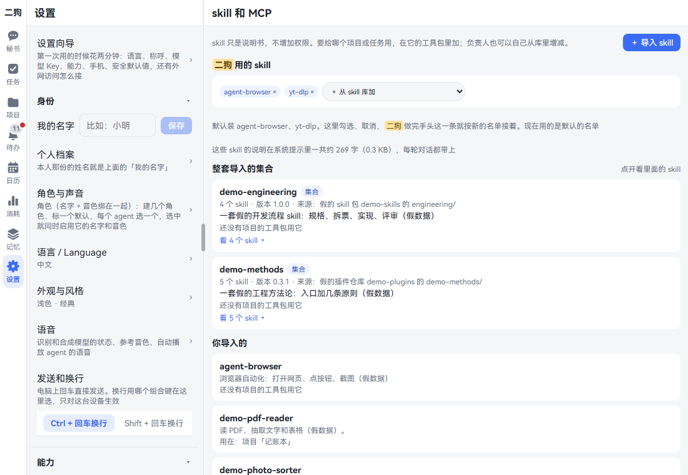
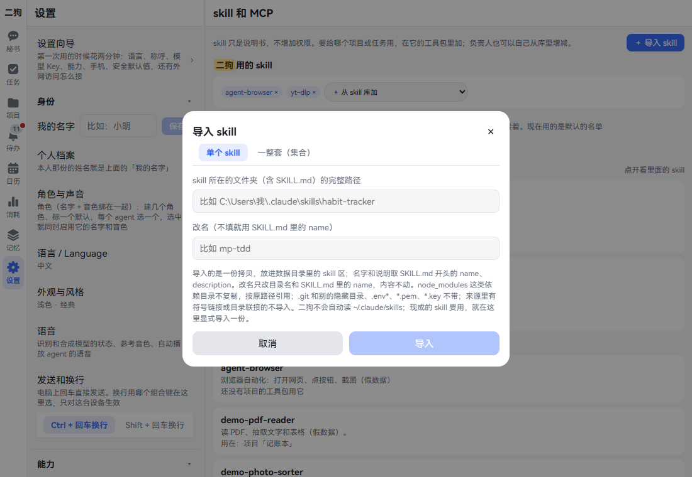
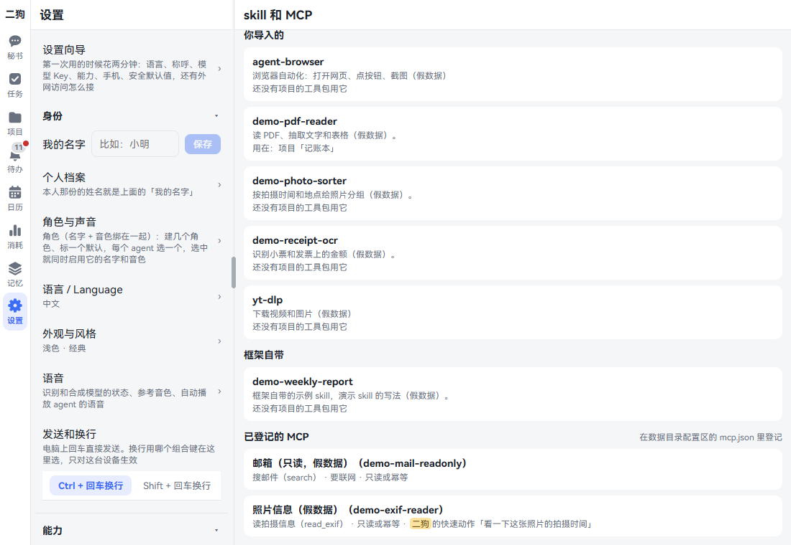
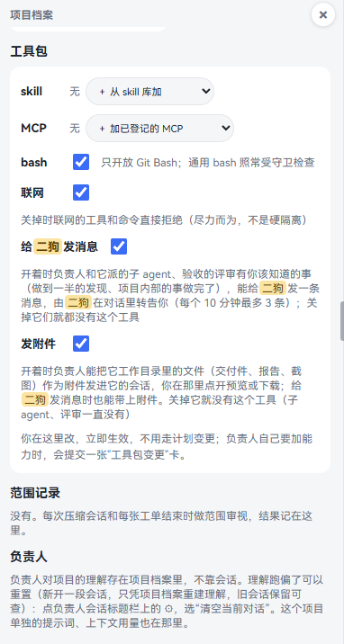
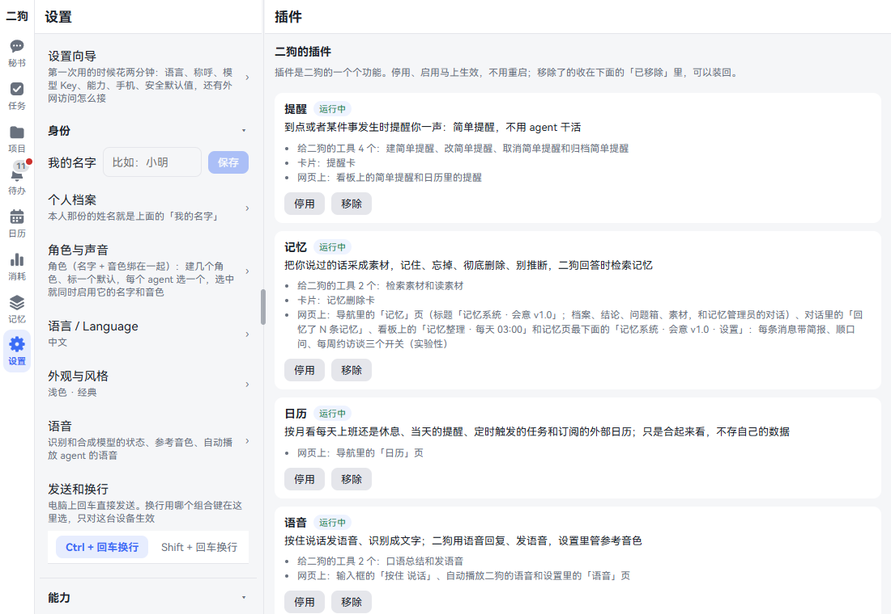
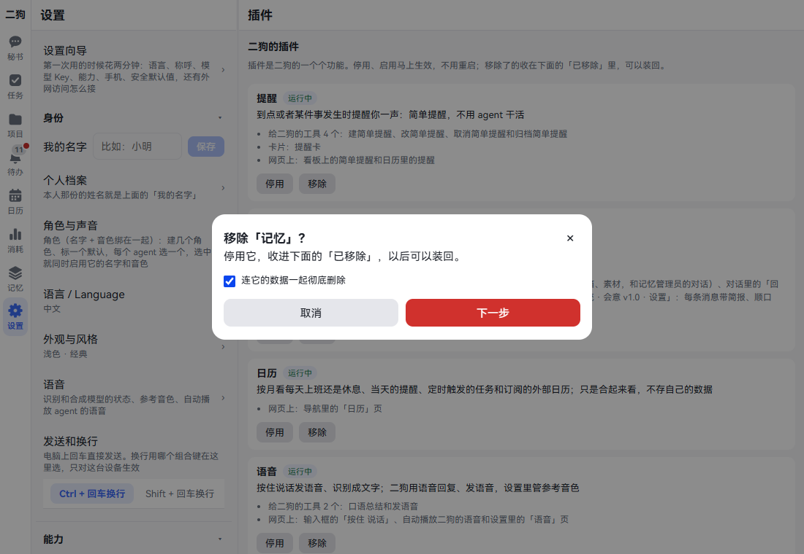

[中文](skills-mcp-plugins.md) | **English**

# Skills, MCP, toolkits and plugins

Screenshots show the Chinese interface; the labels in the text are the English ones.

This chapter covers giving ergo new abilities: importing skills, registering MCP servers, setting up toolkits and managing plugins. By the end you can give agents the tools you want, and take them away at any time.

These four are easy to mix up, so first:

| What it is | For example | Where to manage it |
|---|---|---|
| **Skill**: a set of instructions telling an agent how to do something. Grants no permissions | How to write a weekly report, how to download a video | Settings · Capabilities · Skills & MCP |
| **MCP**: an outside tool service that agents can call | Searching notes, reading mail | A config file; the page is view-only |
| **Toolkit**: which skills and MCP servers a project or task can use, and whether it can run bash or go online | The ledger project has network on and bash off | Project page, task details |
| **Plugin**: a chunk of ergo's own functionality that can be turned off as a whole | Memory, calendar, voice | Settings · Capabilities · Plugins |

A skill or MCP server in the library can't be used by agents yet. It has to go into a toolkit. The secretary's skills are set up separately.

## Skills

### Importing a skill

**When to use it:** You already have a skill, say one you used in Claude Code, and want ergo's agents to use it too. ergo doesn't read `~/.claude/skills` by itself; you have to import a copy.

**Where to open it:** Settings · Capabilities · Skills & MCP · **+ Import skill** at the top right.





1. Click **+ Import skill** and stay on **Single skill**.
2. Under **Full path of the skill's folder (the one with SKILL.md)**, enter the path on ergo's computer.
3. To rename it, fill in **Rename (leave empty to use the name in SKILL.md)**. Only lowercase letters, digits and hyphens are allowed.
4. Click **Import**. It says **Imported skill “X”**, and a report appears on the page; click **Got it** when you've read it.

It appears under **Imported by you** on the page, with **Not in any project's toolkit yet** below it.

### Importing a whole set

**When to use it:** A folder holds a batch of skills that refer to each other and need to come together.

1. In the import dialog, click **Whole set (collection)**.
2. Fill in **Full path of the collection's root folder**, then **Collection name**, **Version**, **Source** and **One-line description**. These four are required.
3. If the skills aren't directly in the root, fill in **Subfolder of the root that holds the skills**.
4. If names clash with the library, write one `old=new` per line under **Rename skills**.
5. Click **Import**.

The collection takes one row under **Imported collections**. Click **Show N skills** to list its members.

**Good to know**

- What's imported is a copy. Later changes to the original folder aren't reflected here.
- `.git` and other hidden folders, `.env*`, `*.pem` and `*.key` aren't brought in, and the report lists them.
- Dependency folders such as `node_modules` aren't copied; they're referenced at their original path.
- Sources with symlinks or directory junctions aren't imported.
- Names that clash with the library aren't imported, and it says which one they clash with. Rename and import again.
- Anything too large is refused. A skill is a set of instructions, so it shouldn't be big.

### Giving skills to the secretary

**Where to open it:** **ergo's skills** at the very top of the same page. The name here is the one you gave your assistant.

1. Click the **+ Add from skill library** dropdown and pick a skill.
2. A collection has two options: **Whole set: X** takes all of it, and **Pick some from X…** opens for you to tick some.
3. To remove one, click × on its small tag.

It says **Saved. ergo switches to the new skill list after finishing the current message**.

**Good to know**

- The defaults are agent-browser and yt-dlp. Those not imported yet keep their names, and install automatically once imported.
- Below it shows how many characters these skills' descriptions come to in total. They're sent with every turn of conversation, and if they're too long it reminds you to remove ones you don't use.
- Plain tasks (not belonging to a project) use this list too.

### Calling one by name in a chat

Type `/` in the input box; the suggestions include a **Skills in ergo's toolkit** group. The command is the skill's folder name, such as `/weekly-report write this week's`.

### Skills submitted by owners

What an owner learns while working can be submitted as a skill. A **Skill change** card appears in your Inbox.

The card shows the name, description, who submitted it, the file list and size. If it has scripts, it says prominently **It contains N scripts that agents using it may run**. **Full SKILL.md** can be expanded.

- Click **Approve**: it goes into the library and into the submitter's toolkit, and its session can use it right after. If another project wants it, add it to that toolkit.
- Click **Deny**: nothing changes. Either way you can attach a note to the owner.
- If the source has changed since it was submitted, approving doesn't add it to the library, and the card says it needs to be submitted again.

### Deleting a skill

There's no delete button on the page. There are two ways:

- **Ask the owner:** Tell the owner "Delete the X skill from the library". It shows a **Skill change** card listing which toolkits use it now; it's deleted only after you click **Approve**, and one old version is kept. Only single skills you imported and skills owners submitted can be deleted this way.
- **Delete the folder yourself:** Delete its folder under `skills\` in the data folder, by default under `%USERPROFILE%\.ergo\skills\`. A whole collection is one folder. Skills built into the framework aren't here and can't be deleted.

After deletion, the name stays in toolkits and is skipped when used, with no error. A skill with the same name coming back into the library works again.

## MCP

### Seeing what's registered

**Where to open it:** Settings · Capabilities · Skills & MCP, scroll down to **Registered MCP servers**.



Each MCP server lists its name and registered tools. After a tool it says **needs internet** or **read-only or idempotent**; those authorized for the secretary's quick actions say so too. This section is view-only; you can't change it on the page.

### Registering an MCP server: write the config yourself

**When to use it:** You have an MCP service and want agents to use it.

1. Open `%USERPROFILE%\.ergo\config\mcp.json`, or create it if it isn't there.
2. Write it like this:

   ```json
   {
     "servers": {
       "notes": {
         "title": "Notes service",
         "command": "node",
         "args": ["D:\\tools\\notes-mcp\\server.js"],
         "env": { "NOTES_API_TOKEN": { "fromEnv": "ERGO_NOTES_API_TOKEN" } },
         "tools": {
           "search": { "title": "Search notes", "readOnlyOrIdempotent": true, "network": true }
         }
       }
     }
   }
   ```

3. Save. No restart needed; refresh the page and it's there. If something's wrong the page says **Can't read the MCP registry: …**.

| Item | Meaning |
|---|---|
| `notes` | The MCP server's name: letters, digits, `-`, `_` |
| `command`, `args` | How to start it. `command` set to `node` uses the copy that comes with ergo, so it runs even without Node on the computer; an absolute path or any other program is used as is |
| `env` | Environment variables for it. A string is the value as is; `{ "fromEnv": "NAME" }` takes it from ergo's environment |
| `tools` | The tools it uses. **Agents can't use tools not written here** |
| `network` | Whether it goes online. If left out it counts as going online, and can't be used when the toolkit's network is off |

A full example is at `config\mcp.example.json` in the repository.

**Don't write keys in plain text.** The config file isn't the secrets area: agents can't write to it, but may read it. Write `fromEnv`, then add the variable to the `ergo-daemon` entry in the service manager, so ergo gets it at startup.

`ergo start`, `ergo restart` and updates rewrite this entry for the new version. Extra items you added in `env` and any `exposure:` you wrote yourself stay. `ERGO_DATA_DIR`, `LSM_DATA_DIR`, `DEEPSEEK_API_KEY` and `CUSTOM_MODEL_API_KEY`, which ergo writes itself, get written back, so don't use these names.

### Registering an MCP server: ask the owner

**When to use it:** A project produced an MCP service, or the owner thinks one should be connected.

Tell the owner "Register this service as an MCP server". It puts an **MCP registration change** card in the Inbox, showing the start command, environment variables and tools.

- Click **Approve**: it's written into the registry and actually started once to try it. The card says **it started and reported …** or **it didn't start: …**. A registration that didn't start stays too; to withdraw it, have the owner submit another card to delete it.
- Click **Deny**: nothing changes.

If an environment variable that looks like a secret is written in plain text, this card can't be submitted; change it to `fromEnv`.

### Getting agents to use it

- **Owner:** Add it to the toolkit, see below. What isn't in the toolkit, it can't use.
- **Secretary:** Once registered it can call it, no setup needed.

**You can just say**

- Search last week's meeting notes with the notes service
- Check the notes sync status

When the secretary calls one, the timeline records who called what. The guard judges it as usual.

### Removing an MCP server

Delete that section from `mcp.json`, or have the owner submit a card to delete it.

## Toolkits

**What it is:** What a project or task can use. Changes here take effect immediately, no plan change needed.

**Where to open it:**

- **Project:** In the project records on the project page, scroll down to **Toolkit**. On a computer the project records are in the left column, and **Project records** in the title bar opens and closes them.
- **Workflows and long-running tasks:** **⋯ · Toolkit** at the top right of the task details.
- **Plain tasks:** Don't have this. Those not in a project use the secretary's skills, no MCP, and can run bash and go online. Those in a project use the project's toolkit.



| This row | How to change it | Effect |
|---|---|---|
| skill | **+ Add from the skill library**; × on a small tag removes | Which instructions it can follow |
| MCP | **+ Add a registered MCP server**; × on a small tag removes | Which outside tools it can call |
| bash | Checkbox | Git Bash only, and commands are still checked by the guard |
| Network | Checkbox | When off, network tools and commands are refused, best effort, not hard isolation. When on, read-only GET requests don't bother you; other requests count as **sending out in my name** |
| Message ergo | Checkbox | Owners, sub-agents and reviewers can message the secretary, who passes it on to you. Each can send at most 3 every 10 minutes |
| Send attachments | Checkbox | Owners can send files from the working folder as attachments in the session, where you preview or download them |

After a change it says **Toolkit updated. If the owner is working, it switches to the new toolkit after its current step**. A Claude Code owner switches on the spot.

**Can owners change it themselves?**

- Add or remove skills: yes, on their own, recorded in the timeline.
- Reduce abilities: yes.
- Turn on bash, add MCP, turn on network: needs your approval. A project owner not on a task shows a **Toolkit change** card; one on a task submits a plan change.

**You can just say** (to the owner)

- Add the yt-dlp skill to the toolkit
- This project needs to go online to check exchange rates; please apply for it

**Good to know**

- A project's toolkit only exists after the charter is confirmed. A task's only exists after the plan is confirmed.
- After a project is archived or a task ends, the toolkit is view-only.
- Tasks involving a project: bash, network, MCP, messaging the secretary and sending attachments count only if both the task and the project have them on. Skills from both sides can be used.

## Plugins

**What it is:** The individual features of ergo. Those you don't want can be turned off, with no restart.

**Where to open it:** Settings · Capabilities · Plugins.



Each plugin has a block: name, status, one line of description, and below it what it brings, what it needs and what needs it. Statuses are Running, Off, Didn't load and Removed; those missing an outside component say **Not installed** and how to install it.

| Plugin | When turned off |
|---|---|
| Reminders | The secretary can't create reminders, and reminders no longer show on the board and calendar |
| Memory | The Memory page goes away and no new materials are collected. Existing ones can still be viewed and deleted in Settings · Delete materials, and personal files move back to **More** |
| Calendar | The Calendar page goes away. Workday rules in Settings remain |
| Voice | Push-to-talk and Settings · Voice go away, and replies are text only |
| Built-in browser | **Browse**, the sidebar and the floating button in the app go away |
| Claude Code | Settings · Claude Code goes away, owners using it no longer start, and tasks in progress become **Waiting for me** |
| Data source - Phone, Data source - Google, Data source - Looki wearable camera | That data source stops syncing, and ergo can't query it either |

### Turning off and on

1. Click **Turn off** on that block. The confirmation box says **Turn off X?** and what will happen. Plugins that need it are listed too, and will be turned off with it.
2. Click **Turn off** in the confirmation box. It says **Turned off: X**.
3. To use it again, click **Turn on**. If a plugin it needs is off, it confirms first and turns both on.

It takes effect right away: its pages and panels close immediately, the tools it gives ergo are gone from the next turn, and its scheduled jobs and event subscriptions stop. All the data stays and is there when you turn it back on.

### Removing



1. Click **Remove**. The confirmation box says **Turns it off and moves it to “Removed” below. You can put it back later.**
2. If you only want to put it away, just click **Remove**.
3. To delete its data too, tick **Also delete its data completely** and click **Next**.
4. The second step spells out **This deletes:** and **This can't delete:**. When you've read it, click **Remove and delete**. **Deleting can't be undone.**

Removed plugins are kept under **Removed (N)** lower on the page; open it to **Put back**.

**Good to know**

- Plugins with no data of their own (such as Calendar and Claude Code) don't have that checkbox.
- Even with delete ticked when removing Memory, materials in the library aren't deleted. To delete them, use **Delete materials in bulk** in Memory · Materials.
- A copy stays in backup snapshots, and disappears as snapshots rotate.
- The secretary can't do these; you have to click on the page.

## Related

- [Claude Code](claude-code.en.md): how toolkit skills are used in Claude Code.
- [Settings](settings.en.md): other settings such as components and data sources.
- [Projects](projects.en.md), [Tasks](tasks.en.md): who toolkits are for.
- [Memory](memory.en.md): have a look before turning off the Memory plugin.
