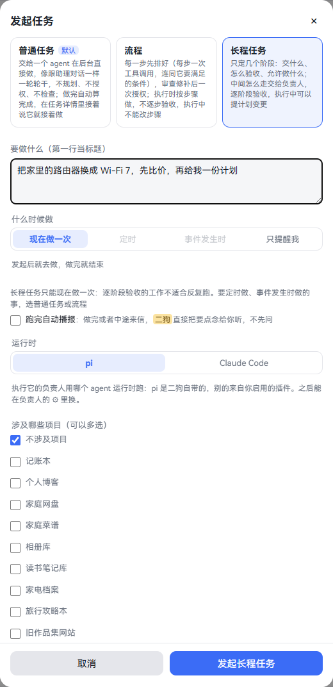
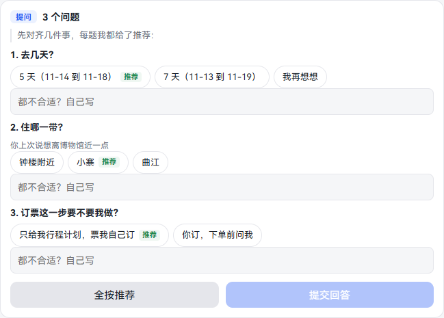
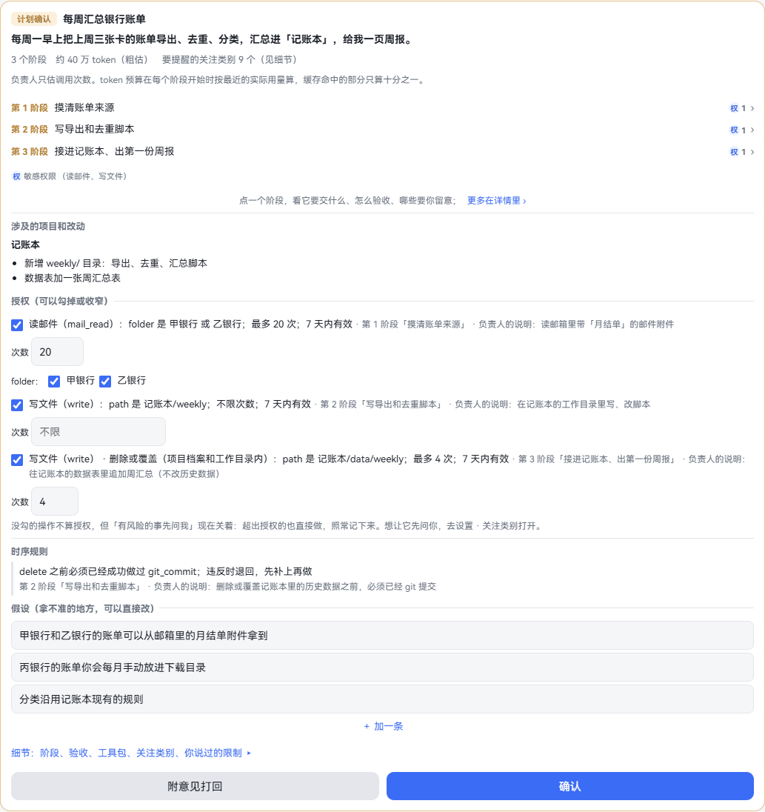
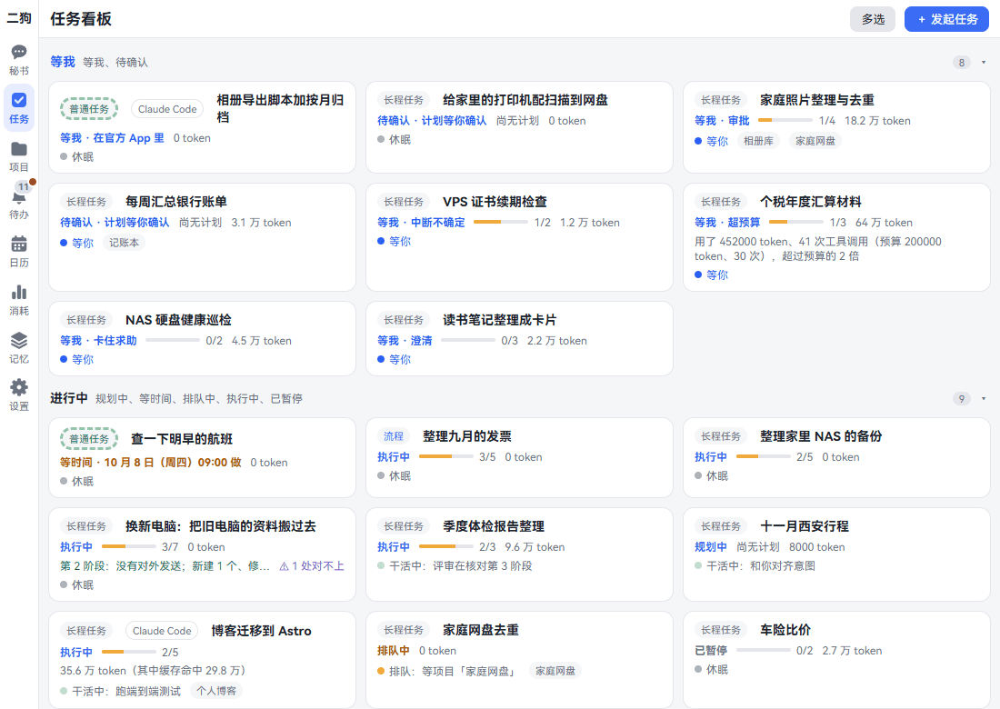
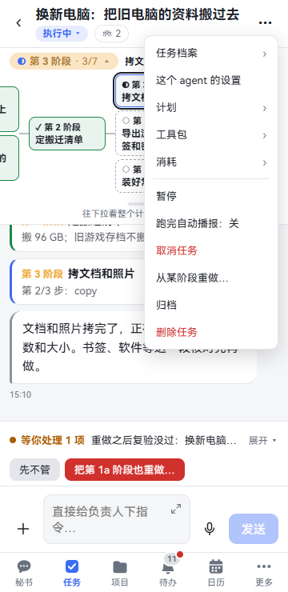
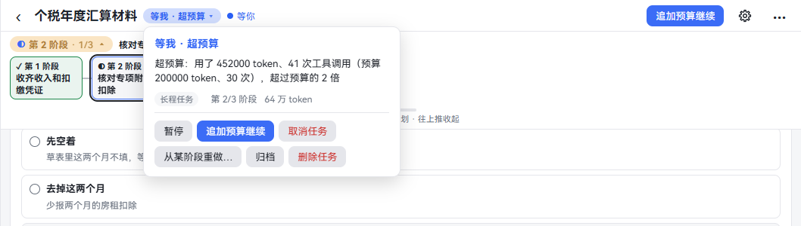
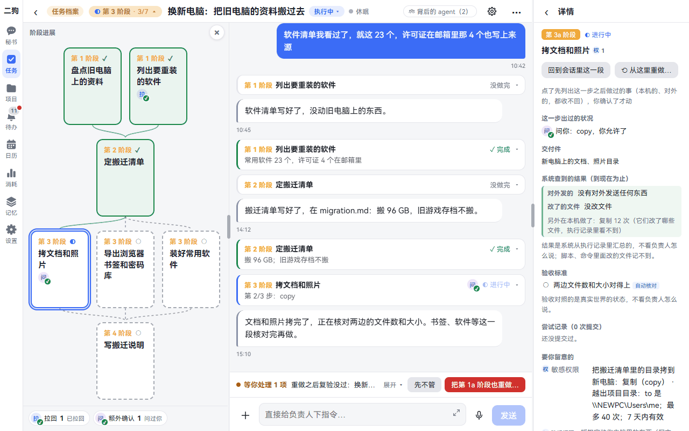
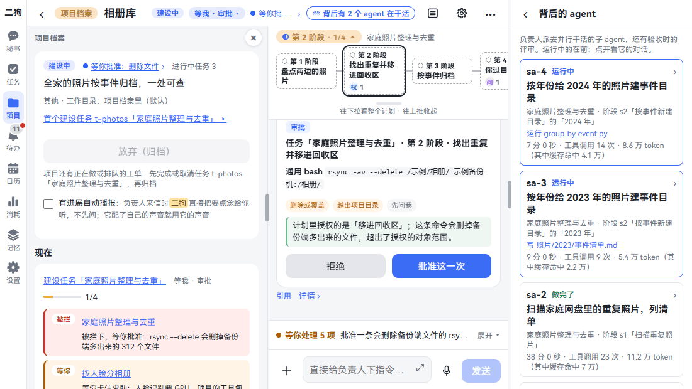
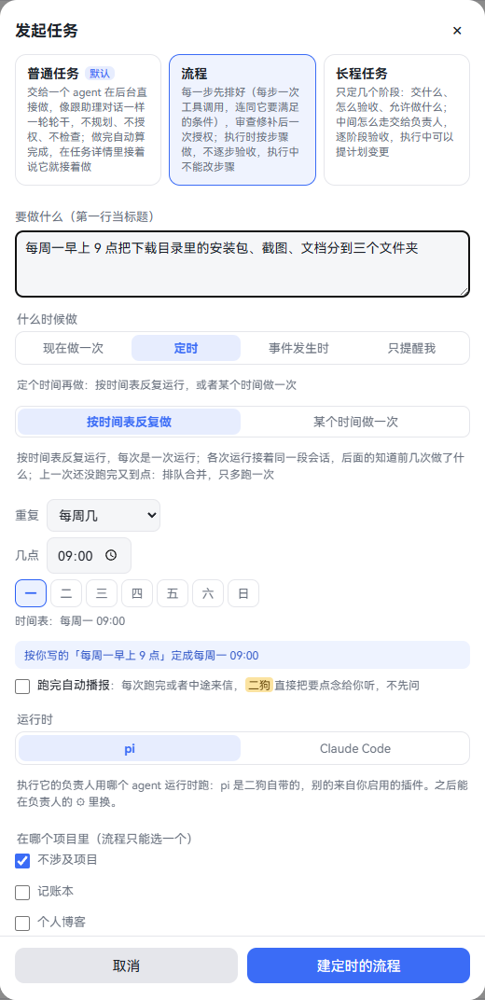
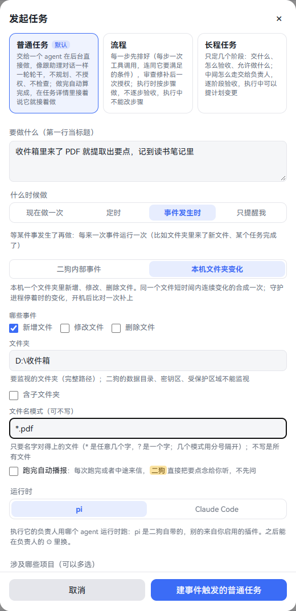

[中文](tasks.md) | **English**

# Tasks

Screenshots show the Chinese interface; the labels in the text are the English ones.

Hand anything that takes time to a task. Each task has an agent working on it in the background, called its **owner**, while you keep chatting with the secretary about other things.

This chapter covers six things: which kind to pick, how to start one, how to confirm the plan, how to follow along while it runs, how to schedule and trigger by event, and how to clean up when you don't want it any more. By the end you can hand off time-consuming work without keeping watch.

Work that belongs to just one project is also a task, done by the project's owner. For how that works, see [Projects](projects.en.md).

## First pick a kind: three kinds, three triggers

The **kind** decides how it works and how much you need to manage:

| Kind | Good for | How it works | What you do |
|---|---|---|---|
| **Plain task** | Downloading a song, looking something up | The agent just does it, with no planning, authorizing or checking. It counts as done automatically when finished | Write a paragraph. To change something, keep talking in the task |
| **Workflow** | The same few steps every time, such as sorting the Downloads folder | Every step is laid out in advance, with the conditions each must meet. Rules review and patch it, then it comes to you | Click **Authorize and run** once on the plan card. Steps can't change during the run; to change them, start a new one |
| **Long-running task** | Writing a tool, doing research, replacing a router | Split into several stages, with what to deliver, how it's accepted and what's allowed all set. How it gets there in between is up to the owner | Click **Confirm** on the plan card. Each stage is accepted automatically. The owner can propose plan changes during the run |

The **trigger** decides when it happens:

| When | Plain task | Workflow | Long-running task |
|---|---|---|---|
| **Once, now** | Yes | Yes | Yes |
| **On a schedule** · **Repeat on a schedule** | Yes | Yes | No |
| **On a schedule** · **Once at a set time** | Yes | Yes | No |
| **When something happens** | Yes | Yes | No |

A long-running task can only run once, now. Work accepted stage by stage doesn't suit repeated runs.

The dialog also has a fourth option, **Just remind me**: no agent, just a notification when it's time. See [Calendar and reminders](calendar-reminders.en.md#creating-reminders).

## New task

**Where to open it:**

- **Tasks page:** **+ New task** at the top right, on both computer and phone.
- **Secretary page:** On a computer it's in the title bar, also **+ New task**. On a phone, tap ⋯ at the top right, then **New task**.

**Step by step:**

1. Click **+ New task**.
2. Pick the kind. The default is plain task. Below each kind is how it differs.
3. Write it clearly in **What to do (the first line becomes the title)**. The first line is the task's title.
4. Under **When**, pick one; the default is **Once, now**. For scheduling and events, see [Running on a schedule](#running-on-a-schedule) and [Running when something happens](#running-when-something-happens).
5. To have it read out straight away when done, tick **Read out when done**. Not ticked by default.
6. **Runtime** defaults to pi, which comes with ergo. To use Claude Code, see [Claude Code](claude-code.en.md). When pi is the only choice, this item isn't shown.
7. For **Projects involved (pick any)**, choose according to the table below. For a workflow, this item says **Which project (a workflow can have only one)**.
8. Click the button at the very bottom. Its text follows what you picked:

| You picked | Button |
|---|---|
| **Once, now** | **Start plain task**, **Start workflow**, **Start long-running task** |
| **On a schedule** · **Repeat on a schedule** | **Create scheduled plain task**, **Create scheduled workflow** |
| **On a schedule** · **Once at a set time** | **Start plain task at that time**, **Start workflow at that time** |
| **When something happens** | **Create event-triggered plain task**, **Create event-triggered workflow** |

**Choosing the projects involved:**

| You picked | What you get | Where to see it |
|---|---|---|
| **No project** | A task done by its own owner | The task board |
| One project | An internal task of that project, done by the project's owner | Only in the project; see [Internal tasks](projects.en.md#internal-tasks) |
| Several projects | A cross-project task, whose owner sends work orders to each project | The task board |

**What happens when you click:**

- **Plain task:** It skips the secretary, and this text is the brief given to the agent. It starts when its turn comes. A new card appears on the board.
- **Workflow, long-running task:** A card marked **Planning** appears on the board. The secretary first aligns with you, then writes the task brief. See the next section.

**Things you can just say:**

- Download this video for me (the secretary decides for itself: anything that takes time goes to the background, and that's a plain task)
- Look up flights for me tomorrow at 9 am (done once at that time)
- `/task Upgrade the home router to Wi-Fi 7: compare prices first, then give me a plan`
- `/workflow Sort the installers, screenshots and documents in Downloads into three folders`

Type `/task` or `/workflow` in the input box, followed by what to do. A sentence opening with "Start a task: …" or "Follow a workflow: …" does the same, and so does its Chinese counterpart, 发起任务：… or 按流程做：….

**Good to know:**

- Workflows and long-running tasks start only when you ask for them explicitly. That means `/task` or `/workflow`, or a sentence opening with one of the phrases below (or a Chinese one like 发起任务 or 按流程做). Case doesn't matter, but the phrase has to open the sentence. A question doesn't count, unless it's a polite request such as "Can you start a task to …?".
  - Workflow: "Follow a workflow", "Follow this workflow", "Start a workflow", "Start a new workflow".
  - Long-running task: "Start a task", "Start a new task", "Start a long-running task". "Start a task" and 发起任务 on their own count as long-running tasks.
- If you don't, the secretary can at most offer a **Suggested task** card, with **Start as Workflow**, **Start as Long-running task** and **No thanks**. It creates the task only after you click.
- The secretary can't create scheduled or event-triggered tasks. If they don't belong to a project, it asks you to create them in this dialog. If they do, it passes them to the project's owner, and an [Operations plan change card](projects.en.md#operations-plan) appears.
- A task's kind can't be changed once it's created.
- By default at most 3 tasks run at once; the rest wait. While waiting, the card says **Queued**.
- If the only project you picked is still in kickoff, you can't start the task until its charter is confirmed.

## The task brief and clarifying questions

**What it is:** Before a workflow or long-running task begins, the secretary asks until what you want is clear, then writes it up as a task brief. The owner sees only the brief, not what you and the secretary talked about.

Plain tasks skip this. For a project's internal tasks, the project's owner asks in its own session.

**Step by step:**

1. The secretary first says what it understood, for example "I take it you want …, right?". Just reply.
2. If there's a lot to ask, it shows a question card. The card also goes into the Inbox.

   

3. Click one option per question. If none fit, write in **None fit? Write your own**.
4. Click **Submit answers**. If you can't be bothered to choose, click **Use all recommendations**.
5. Once aligned, the secretary writes the brief: goal, acceptance criteria, constraints, projects involved. The brief goes to the owner, and the owner drafts a plan.
6. Open the task, and this brief is at the very top of the session.

**Good to know:**

- File paths and things not to touch need spelling out, or the secretary can't put them in the brief.
- So does where the data you need is. Say "the bills are in D:\Bills" and it can write that down.

## Plan card

**What it is:** The plan the owner drafted. It doesn't start until you confirm.

**Where to open it:**

- In the Inbox: **Plan awaits your confirmation: …**.
- In the task's session. Above the input box it says **1 waiting on you**; click **View card**.
- The board card says **To confirm · Plan needs your OK**.

### Long-running task plan card

Read it from top to bottom:

1. **Goal and summary:** How many stages and roughly how many tokens. Only if there are places it will still stop after you authorize does it say **Still stops N times after authorization**, listed item by item below.
2. **Stage outline:** Click a stage to expand in place what it delivers, its acceptance criteria and what to watch for. Click **Stage details ›** to see everything.
3. **Small tags:** **P** is sensitive permissions, touching things on your computer. **E** is external actions, which other people or platforms receive. **?** means it stops here to wait for your OK, or hands it to you to do yourself. The number after it is how many places.
4. **Projects and changes involved:** What it will touch in which project.
5. **Grants (you can uncheck or narrow them):** The operations the owner wants approved in advance, showing kind, target, count, validity and which stage they belong to.
6. **Temporal rules:** Such as "git commit before deleting". Breaking one sends it back.
7. **Assumptions (uncertain points; edit them directly):** What the owner assumed on your behalf. Fix wrong ones and fill in gaps with **+ Add one**.
8. **Details:** Open to see each stage's full content, the toolkit, limits added from what you said, and watch categories to flag.

**Step by step:**

1. For grants you don't want to give, untick them. To give less, lower **Uses**, or remove some values from the scope.
2. If an assumption is wrong, just edit it.
3. When you've read it, click **Confirm**. The task goes into the queue and starts when its turn comes.
4. If you're not happy, click **Send back with comments**, write what to change, then click **Send back**. To back out, click **Never mind**. The owner revises and sends a new card, with **(v2)** after the title.

**Good to know:**

- Unticked operations aren't authorized. With **Ask me before risky things** on, it asks you when it gets to that step. With it off (as on a new install), even what's beyond the grants just runs and is logged as usual. The sentence under the grants follows the current switch setting. With it off, unticked items, narrowed items and **Ask me first** items don't count as stops, and the line for an **Ask me first** item is marked **runs without asking for now**; only **Hand it to me** items still stop. For the switch, see [Budget and notifications](#budget-and-notifications).
- On or off, it can't write to protected areas, read the secrets area or send secrets out.
- Watch categories added when confirming apply only to this task. Under **Details**, click **+ Add a watch category for this task (only applies to this task)**. You can add but not remove.
- Grants are valid for 7 days by default. Shortly before they expire, a **Grant renewal** item comes to the Inbox; click **Renew** or **Don't renew**. Once one you didn't renew expires, it no longer counts as a grant: with the switch on, it asks you at that step; with it off, it goes ahead and logs it. For scheduled and event-triggered tasks, grants stay valid until you pause or cancel.

### Workflow plan card

Unlike a long-running task's, this card lists things step by step:

1. At the top is **Plan v1** and the steps.
2. **Plan review** shows which rules this plan passed, how many risks it found, and how many it fixed automatically. The review is a fixed set of rules and doesn't rely on a model.
3. Things needing your OK are listed one by one, and you have to tick each. Until all are ticked, the button says **N items left to confirm**.
4. Click **Authorize and run**, or **Reject**. When rejecting you can write why.

If it doesn't pass review, the card says so. There are two cases:

| The card says | What to do |
|---|---|
| **Review sent this plan back to the owner to fill in, so it wasn't sent to you for authorization** | Nothing. The owner will fix it and give you another card. If you no longer want it, click **Cancel task** |
| **Review found this plan can't run, so it wasn't sent to you for authorization** | Click **Have the owner revise** or **Cancel task** |

## Board

**Where to open it:** Click **Tasks**.

| Group | What's in it |
|---|---|
| **Waiting for me** | Waiting for me, to confirm |
| **In progress** | Planning, scheduled, queued, running, paused |
| **Operating** | Reminders, scheduled and event-triggered tasks |
| **Recently ended** | Done, failed, cancelled |
| **Archived** | Collapsed by default |

**A card shows:** Kind, title, status and reason, progress, tokens used, and what the owner is doing. Progress means stages accepted for a long-running task, and steps done for a workflow.

The line in green is what the system found, such as **nothing sent out; files 1 created, 1 modified**, regardless of what the owner says. **⚠ 1 mismatch** means the owner mentioned a file the system didn't find.

**What you can do:**

- **Click a card:** Opens the task.
- **Press and hold (phone), right-click (computer):** Opens a menu. See [Pause, cancel, archive, delete](#pause-cancel-archive-delete).
- **Click a group title:** Collapses or expands it. This device remembers.
- **Multi-select:** Click **Multi-select** at the top right, then click cards to tick them. Each group title has **Select all** on its right. The action bar below shows how many each action can apply to: pause, resume, cancel, archive, delete. When finished, click **Exit multi-select**.

**Good to know:**

- Internal tasks of just one project aren't on the board. The exception is the items in force in an operations plan: their cards are labeled with the project name, and open into the project's chat.
- **Memory consolidation · daily at 03:00** is also in the **Operating** group. See [Memory curator](memory.en.md#memory-curator).
- For managing reminder cards, see [Calendar and reminders](calendar-reminders.en.md#managing-it-on-the-task-board).

## The task's chat

**What it is:** Opening a task shows a chat with its owner. Title bar at the top, messages in the middle, input box at the bottom. Stage progress opens on the left on a computer, and under the title bar on a phone. A project's chat looks the same.

**The title bar on a computer:** ‹, **Task records**, the stage tag, the title, the status chip and the activity status; on the right, key buttons, background agents, ⚙ and ⋯.

**The title bar on a phone has two lines:** ‹, title and ⋯ on the first; the status chip and background agents on the second. Zoom and settings are tucked into ⋯.

**What each thing in the title bar is:**

| Where | What it does |
|---|---|
| Status chip | Click to see the reason, kind, current stage, usage, and what you can do now |
| Activity status | **Asleep**, **Working**, **Waiting for you**. When it says **Waiting for you…**, click it to jump to the card that needs handling. On a phone it's in the panel that opens from the status chip |
| Key buttons | Computer only, and only when waiting on you or failed. For example **Add budget and continue**, **Continue**, **Retry** |
| ⚙ (on a phone, **Settings for this agent** under ⋯) | This owner's role, own prompt, model, clearing the conversation, context usage, runtime |
| ⋯ | The upper part holds the items in the table below; the lower part holds task actions |
| **Task records** | The task's status, usage, a few entry points and actions. On a computer it's in the left column; click **Task records** to open or close it. On a phone, tap the title to slide it in; it's also at the very top of ⋯ |

**The upper part of ⋯:**

| Item | What's in it | Which tasks have it |
|---|---|---|
| **Plan** | The plan card, each stage, scope records, and **Turn into project** | Workflows, long-running tasks |
| **Work orders** N | Work orders this task sent to projects | Those with work orders |
| **Toolkit** | What this task can use | Workflows, long-running tasks; it has content only after the plan is confirmed |
| **Usage** | How many tokens each agent used | Workflows, long-running tasks |
| **Runs** N | Each run: how it was triggered, the result, the reason | Scheduled and event-triggered |

**Talking to the owner:** Type in the input box or hold to talk. While it's working, your words go in before its next step.

- Plain tasks say **Add details or change the requirements…**, and once done **Keep talking and it keeps working…**.
- Scheduled and event-triggered ones say **Change what each run does or add requirements; later runs follow the new version…**.
- A finished long-running task is read-only. To change it, use **Rework…** below.

Rollback, zoom, tool call details and so on work the same as in the secretary's session. See [Talking to the secretary](chat.en.md).

## Stage progress

**What it is:** How a long-running task tells you how far it's got. On a computer it's a full stage graph in the left column; on a phone it's a stage bar under the title bar.

**How to read it:**

- **Tag:** **Stage 3 · 3/7** means it's now on stage 3, and 3 of the 7 stages have been accepted.
- **Stages:** One block per stage. ✓ accepted, ◐ in progress, ○ not started. Side-by-side ones on the same level can run at once, and the details write them as 3a, 3b.
- **While scrolling messages:** The tag changes to the stage you're looking at.

**On a computer:**

1. Click the stage tag in the title bar and the full graph opens on the left; click again to close it.
2. The left column has only one slot, shared by stage progress and records. Click **Task records** or **Project records** to swap in the records, and the stage tag to swap back. This device remembers which you looked at last.
3. Click a stage to see its details on the right. The line under the graph shows what has come up and how many times; click a number to see which ones.
4. To adjust the width, drag the divider on the right of the left column. Stage progress and records share a width. Click × to close the whole column.

**On a phone:**

1. Tap the tag to collapse or expand. This device remembers.
2. Tap a stage and its details slide in as a full page.
3. Pull the handle down to see the whole plan's dependency graph, with a line below showing what has come up and how many times. Push up to put it away, or tap the chat area.

**What's in stage details:**

| Block | What it says |
|---|---|
| **Back to this part of the conversation** | Click to jump to this stage's messages |
| **Redo from here…** | See [If you're not happy](#if-youre-not-happy) |
| **What came up in this step** | Blocked, pulled back, what it asked you |
| **Deliverables** | What this stage has to deliver |
| **What the system found** | What was sent out and which files changed, compiled from the execution log, regardless of what the owner says |
| **Acceptance criteria** | Whether each is an auto check or a review, and whether it passed |
| **Attempts** | How many submissions, and which criteria each failed |
| **Worth your attention** | This stage's grants and how much of them was used |
| **Budget** | How much was used and how much was given |
| **Rules for this stage** | The rules the Guard checks before every call |

**When the task is done:** Stage progress is collapsed by default, and the tag says something like **Done**. You can still open it to see each stage.

**Workflows and plain tasks:** A workflow has a progress line at the top, such as **3/5 ›**; open it to see each step. Plain tasks have no stage progress.

## Stage acceptance and review

**What it is:** Each stage of a long-running task is accepted automatically, so you don't click through them one by one. The gatekeeping happens in the acceptance criteria on the plan card.

**A stage goes like this:**

1. The owner declares this stage done.
2. Anything a script can check runs first; the page says **Auto check**.
3. Then it goes to review. A review is another agent, in a fresh session every time, that looks only at the deliverables and acceptance criteria and doesn't take the owner's word.
4. If all pass, a progress card appears in the session saying **Acceptance passed**, and it moves on to the next stage.
5. If not, it goes back to the owner to fix. The session says which criteria failed.
6. If it still fails the 3rd time, the task stops and turns to **Waiting for me · Stuck, needs help**, waiting for your call.

Once all stages pass, the task completes automatically.

Reviews also appear under [Background agents](#background-agents), where you can see what they checked.

### If you're not happy

If you're still not happy after acceptance, or want a different approach, redo from a given stage. This is how you send a stage back.

**Where to open it:**

- Task not finished yet: **Redo from a stage…** under ⋯ or in the status chip.
- Task done: **Rework…** under ⋯.
- **Redo from here…** in stage details.

**Step by step:**

1. Choose which stage to redo from. Only stages that have started can be chosen.
2. In **What to change this time (passed on to the Owner)**, write something like "keep those ones".
3. To change the standard, edit it in **Acceptance criteria for this stage (editable)** and in the deliverables. Your edits count as your confirmation, so no card is raised.
4. Look at the two blocks below: **To redo**, and **Already done in these steps; not rolled back before the redo**.
5. Click **Reopen and let the Owner continue**. If you changed the criteria, the button says **Reopen with the changes and let the Owner continue**.

**Good to know:**

- Only this stage and those depending on it are redone; unrelated ones stay as they are. The old record stays where it was, marked abandoned.
- What's already been done isn't rolled back. What was sent out can't be taken back, and the owner knows it happened when redoing.
- After a redo, accepted stages outside the scope are checked again. If one no longer meets its criteria, an item **Re-check failed after a redo** comes to the Inbox; click **Leave it for now**, or redo that stage too.
- Workflows have no rework: to redo, start a new one. Plain tasks don't either: just keep talking in the task.
- Old tasks whose plan says **Accepted by you** are now judged by review against the original text, with the result saying **Was yours to accept; under the new rule, review checks it**.

## Budget and notifications

These are all off on a new install, so ergo gets on with things and interrupts you less. Turn them on if you want it more careful.

| Switch | Where | Default | When on |
|---|---|---|---|
| **Stop tasks that go over budget** | **Settings · Rules · Watch categories**, at the top | Off | When a stage goes over budget it first reports progress; at more than twice, it stops and waits for you |
| **Ask me before risky things** | Same | Off | In a task, anything the plan doesn't authorize asks you first |
| **Read out when done** | Tick when starting, or toggle under ⋯ | Off | When it's done or sends an update midway, the secretary reads you the key points right away, without asking first |

For more on the two switches, see [Watch categories](settings.en.md#watch-categories); you can also tick them in the setup wizard. A project's internal tasks don't have **Read out when done**; they use the project's [Read updates aloud](projects.en.md#read-updates-aloud).

### Budget

**What it is:** When writing the plan, the owner estimates how many tool calls each stage needs, and ergo works out a token budget from recent actual usage.

**Step by step (with the switch on):**

1. When usage goes over budget, the owner first reports progress; the task doesn't stop.
2. At more than twice, this stage stops and the task turns to **Waiting for me · Over budget**. An item appears in the Inbox.
3. After looking, click **Add budget and continue**. The stage gets a whole new budget. If you don't want to spend more, pause or cancel.

The owner can also declare it done and send it for acceptance itself, or raise a plan change card to add budget.

**Good to know:**

- With the switch off, it only records usage and doesn't stop. When you're paying with your own key, a task that drifts off course keeps spending.
- Budget tokens count cached input at one tenth, so it isn't the same number as the real tokens on the **Usage** page.
- To see how much it's used: ⋯ · **Usage**, or the budget in stage details. For total spending, see [Usage](settings.en.md#usage).

### When it stops even with the switches off

| Situation | Result |
|---|---|
| Pulled back by the rules 3 times, then does it again | This stage stops: **Waiting for me · Stuck, needs help** |
| No progress for 20 minutes, still none after 3 nudges | This stage stops: **Waiting for me · Stuck, needs help** |
| Sent back at acceptance twice, fails a 3rd time | This stage stops: **Waiting for me · Stuck, needs help** |
| You've denied approvals or plan changes 5 times in total | The whole task: **Paused · Rejected too often** |

### How it tells you

- **Things needing your decision:** Go to the Inbox, and above the session's input box it says **N waiting on you**. The board and the title say so too.
- **When it's done:** The secretary tells you the result in the main session, and may ask whether to read it out. With **Read out when done** on, it reads it straight away; see [Voice](voice.en.md). When a plain internal task of a project finishes, the secretary only says it's done; see the result in the project. When a project's internal workflow or long-running task finishes, the secretary isn't told.
- **Findings along the way:** The owner messages the secretary, who passes it on to you. If you don't want that, turn off **message ergo** in the toolkit.
- **Phone notification bar:** See [System notifications](mobile.en.md#system-notifications).

## Background agents

**What it is:** Owners send out sub-agents to do several things at once, and acceptance adds reviews. Here you can see who they are, what they're doing and how it's going.

**Where to open it:** The chat's title bar.

- **Computer:** It says **3 agents working in the background**. When none are running, **Background agents (2)**.
- **Phone:** An icon and a count on the second line.
- If none has ever been sent out, this entry isn't there.

**Step by step:**

1. Click the entry to open the list: on the right on a computer, sliding in on a phone. Running ones come first.
2. Each shows: a number (reviews say **Review**), status, what it was sent to do, which task and stage, which step it's on, time taken, number of tool calls, usage.
3. Click one to see its conversation: the instructions it received, what it said, each tool call, the result it handed back. Click a tool call to expand its full arguments and result.

**Good to know:**

- Running ones update live, with **It's working; this updates live.** below.
- Finished ones are read-only, with **It has finished. You can read this, but it can't be picked up again.** below. To continue the work, talk to the owner.
- When an owner wants to run in parallel, it first shows a **Run in parallel** card saying how many and what each does. It sends them out only after you click **Run in parallel**. Click **One at a time** and it does them one by one.
- A sub-agent's toolkit and grants never exceed its owner's. They don't take up run slots. They disband when done.
- Their records are deleted along with the task or project.

## Grants and toolkits

**Grants and toolkits aren't the same thing:**

| | What it is | Where to change it |
|---|---|---|
| Grant | A specific operation approved in advance, such as "write to this folder, 40 times at most" | On the plan card. You can only untick or narrow |
| Toolkit | Which skills and MCP it can use, and whether it can run bash or go online | ⋯ · **Toolkit**. Changes take effect at once |

For how to change the toolkit, see [Toolkits](skills-mcp-plugins.en.md#toolkits). It's only there after the plan is confirmed. Plain tasks don't have it.

**Cards you'll meet during a run:** All in the session and the Inbox.

| Card | When it comes | What you click |
|---|---|---|
| **Approval** | With **Ask me before risky things** on: anything in an **Ask me first** category or beyond the grants. With it off, only very few kinds, such as breaking a temporal rule | **Approve once**, **Deny** |
| **Plan change** | The owner wants to change the plan or add abilities. Only affected stages pause | **Confirm change**, **Reject**. If rejected, it rearranges within the existing grants |
| **For me to do** | Only you can do this yourself, such as spending money | Click **Done** when finished |
| **Unplanned work order** | A cross-project task's owner wants to send one more work order | **Confirm and dispatch**, **Deny** |
| **Questions** | The owner needs to ask you | Choose or write, then click **Submit answers** |

When an owner makes small changes to the plan without widening its grants, it doesn't need to ask you; the timeline notes it.

## Pause, cancel, archive, delete

**Where to open it (all four are the same set):**

- The lower part of ⋯ in the chat.
- The status chip in the title bar.
- Press and hold or right-click a board card.
- **Multi-select** on the board, for several at once.

| Action | When it's there | What happens |
|---|---|---|
| **Pause** | Running, waiting on you, queued | Stops for now; **Resume** any time |
| **Continue** | **Stuck, needs help**; **Interrupted, unsure** | The owner carries on. Replying in the session counts too |
| **Add budget and continue** | Over budget | The stage gets a whole new budget |
| **Retry** | Failed | Back to running; if run slots are full, it queues |
| **Cancel task** | Not ended, or failed | A confirmation pops up first. It stops running, the session and records stay, and it goes to **Recently ended** |
| **Archive** | Not yet archived | Ended ones go straight to **Archived**. For ones not ended, it confirms first: click **Cancel and archive** |
| **Delete task** | Almost always | A confirmation pops up first. Click **Delete** to remove the task, its session, working folder and output |

**Interrupted, unsure:** It was in the middle of something when the computer restarted, and can't tell whether it finished. After checking, click **It ran, continue** or **It didn't run, redo this step**.

**Archive list:** Every Monday at 09:00, tasks that ended more than 7 days ago and aren't archived are gathered into one card in the Inbox. For each, choose **Archive**, **Keep working** or **Keep for now**.

**Turn into project:** If it turns out to be a long-term thing along the way: ⋯ · **Plan** · **Turn into project**, then fill in a project name. This owner goes on to do the charter Q&A with you. The task ends as **Done · Turned into a project**. See [Projects](projects.en.md#turning-a-task-into-a-project).

**Things you can just say:**

- Pause the car insurance comparison
- Resume the car insurance comparison
- Cancel "car insurance comparison"
- Delete "car insurance comparison" (it always shows a card for you to confirm)
- Tell t-5 to add GitHub trending from now on

**Good to know:**

- Deleting can't be undone. What you said in it stays as material; to delete it completely, see [Delete completely](memory.en.md#delete-completely). If you just don't want to see it, archive it.
- A project's internal tasks can't be deleted on their own: they go when the project is deleted. The menu says why.
- An item in an operations plan can only be paused, resumed or run once now. To remove it, have the project's owner change the operations plan.

## Running on a schedule

**What it is:** Sorting the Downloads folder every Monday morning, a morning briefing every day. Plain tasks and workflows can be scheduled.

**Step by step:**

1. Click **+ New task** and pick plain task or workflow.
2. Write it in **What to do**. The dialog only understands times written in Chinese. If your text has one, such as 每周一早上 9 点 (every Monday at 9 am), **On a schedule** is selected below, the time is filled in, and a line says **Set to Every Monday at 09:00, as you wrote “每周一早上 9 点”**. English phrases like "every Monday" aren't understood, so check what's filled in.
3. If it doesn't fill in, pick it yourself: under **When**, click **On a schedule**.
4. Pick one:
   - **Repeat on a schedule:** Under **Repeat**, pick **Daily**, **Weekly**, **Monthly**, **Yearly** or **On my workdays**, then fill in **Time**.
   - **Once at a set time:** Pick a date and time. It runs once at that time and then counts as done.
5. Click the button, for example **Create scheduled plain task**.

**After it's created:**

- **Plain task:** Registered right away, and runs in the background on time. Repeating ones are in **Operating** on the board; ones set to run once at a set time are in **In progress**, marked **Scheduled**.
- **Workflow:** It lays out the steps first, and you authorize once on the plan card. After that, every run follows the authorized steps, checking each, and doesn't ask you again.

**Managing it:** The card shows the schedule, the next run and the latest result, with **Pause**, **Resume** and **Cancel**. Once opened, ⋯ also has:

| Item | What it does |
|---|---|
| **Runs** N | A record of every run. Workflows also list each step |
| **Run once now** | One extra run now, without changing the schedule |
| **Reschedule** | Opens a dialog; choose and click **Save**. The task, session and run records stay the same |
| **Read out when done** | On or off |

**Things you can just say:**

- Run the morning briefing again
- From now on, read the morning briefing to me when it's done

**Good to know:**

- All runs continue the same session, so later ones know what earlier ones did.
- If it comes due again while the last run is still going, they queue and merge, adding only one extra run.
- After 3 failures in a row it pauses itself, and an item appears in the Inbox; click **Resume** to carry on.
- Runs missed while ergo was stopped get made up once after it starts. However many were missed, only one is made up.
- **On my workdays** follows your calendar. See [Workdays and holidays](calendar-reminders.en.md#workdays-and-holidays).
- If you set a time and then change it by hand so that it differs from what you wrote, it gets flagged, and you can still start it.

## Running when something happens

**What it is:** Pull out the key points when a PDF lands in the inbox folder; look into why when some task fails. It doesn't run normally, only when the event comes. Plain tasks and workflows can use this.

**Step by step:**

1. Click **+ New task**, pick plain task or workflow, and write what to do.
2. Under **When**, click **When something happens**.
3. Choose an event source, tick **Which events**, and fill in the conditions:

| Source | Which events | Conditions |
|---|---|---|
| **Ergo internal events** | **Task done**, **Task failed**, **Task waiting for you**, **Project state changed**, **A run failed** | **Which task**, **Which project**; leave empty for any |
| **Local folder changes** | **File added**, **File changed**, **File deleted** | **Folder** needs a full path. You can tick **Include subfolders** and write a **File name pattern**, such as `*.pdf` |

4. If something's missing, it says **Still needed: …** below, and the button is grey.
5. Click the button, for example **Create event-triggered plain task**.

**After it's created:** It's in **Operating** on the board, and the card says **Waiting for: Files added matching `*.pdf` in local folder `D:\Inbox`**. It runs once per event, and the event's content (file path, task number and so on) goes to the agent. A workflow also needs authorizing once on the plan card.

**Good to know:**

- Events that arrive while the last run is still going are merged into one batch for the next run.
- A workflow's step arguments can use this event's values; once you pick an event, the dialog lists what you can write.
- Folders can only be on local drives. ergo's data folder, the secrets area and protected areas can't be watched.
- Folder changes made while ergo was stopped are caught up by one comparison after it starts.
- Event-triggered tasks have no **Reschedule**. To run at a set time, cancel it and create another.
- After 3 failures in a row it pauses itself.
- A project's own services can report events too, which can only be written in the operations plan. See [Project services reporting events](projects.en.md#project-services-reporting-events).

## What to do about these statuses

| Status | What it means | What to do |
|---|---|---|
| **Planning** | The secretary is aligning with you, or the owner is drafting a plan | Reply, answer question cards |
| **To confirm · Plan needs your OK** | The plan is in | See the [plan card](#plan-card) |
| **Scheduled** | Set to run once at a time that hasn't come yet | Wait, or cancel |
| **Queued** | Run slots are full, or waiting on work orders the project has in hand | Wait |
| **Waiting for me · Approval** | A step needs your approval | **Approve once** or **Deny** |
| **Waiting for me · Clarification** | The owner has questions for you | Answer the question card |
| **Waiting for me · Stuck, needs help** | It can't go on | See the reason. Reply in the session, or do what it asked and then click **Continue** |
| **Waiting for me · Over budget** | Over twice the budget | **Add budget and continue**, or pause or cancel |
| **Waiting for me · Interrupted, unsure** | It was mid-step at a restart | After checking, click **It ran, continue** or **It didn't run, redo this step** |
| **Waiting for me · Plan change** | The owner wants to change the plan | **Confirm change** or **Reject** |
| **Waiting for me · Handed to me** | You have to do it yourself | Click **Done** when finished |
| **Waiting for me · Runtime not enabled** | The runtime plugin it uses is off | Enable it at **Settings · Capabilities · Plugins**. See [Claude Code](claude-code.en.md) |
| **Waiting for me · In the official app** | The session was handed to the official app | See [Handing to the official app, and taking it back](claude-code.en.md#handing-to-the-official-app-and-taking-it-back) |
| **Paused · Rejected too often** | You've refused too many times | After looking, **Resume** or cancel |
| **Failed** | The owner judged it can't be done | **Retry**, **Redo from a stage…** or **Cancel task** |

## Related chapters

- [Projects](projects.en.md): long-term work, internal tasks, operations plans.
- [Talking to the secretary](chat.en.md): rollback, zoom, Inbox.
- [Claude Code](claude-code.en.md): having owners work through Claude Code.
- [Skills, MCP and plugins](skills-mcp-plugins.en.md): what you can put in a toolkit.
- [Calendar and reminders](calendar-reminders.en.md): for things that only need a reminder.
- [Voice](voice.en.md): read out when done.
- [Settings](settings.en.md): watch categories, usage.
