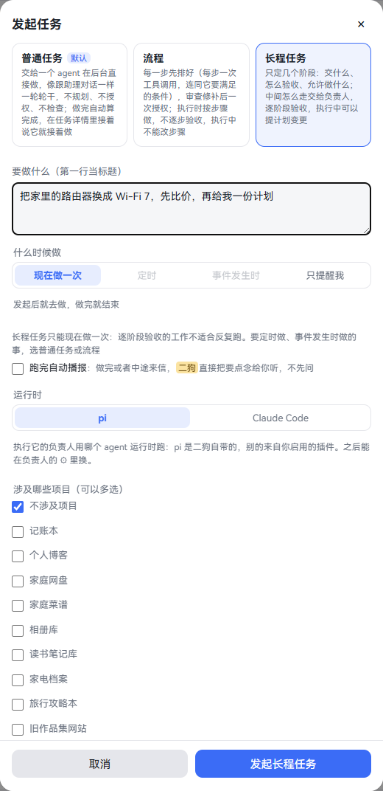
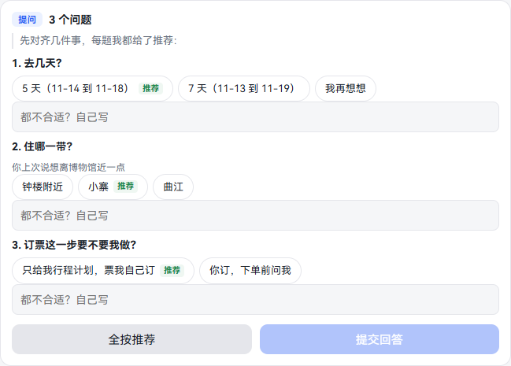
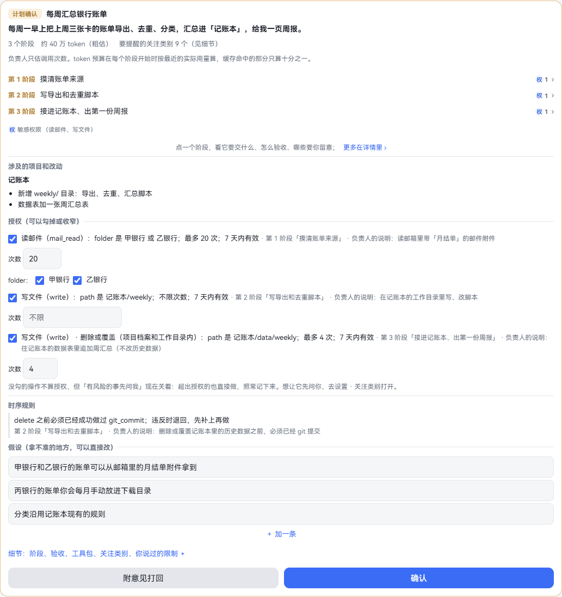
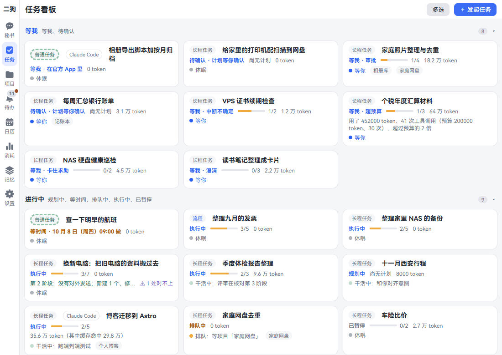
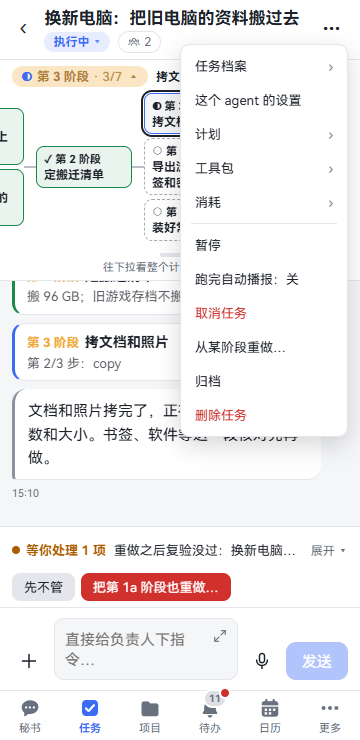
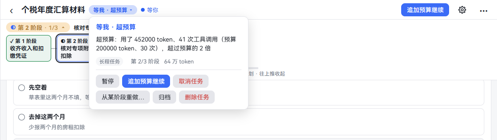
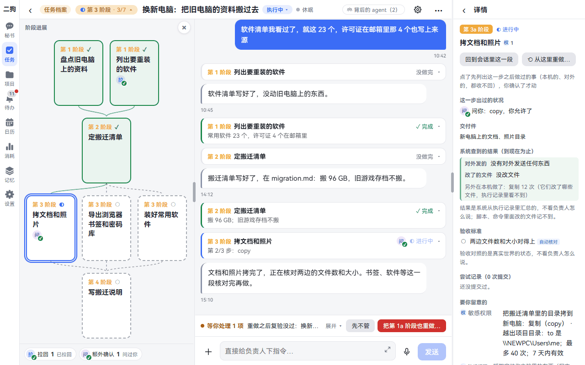
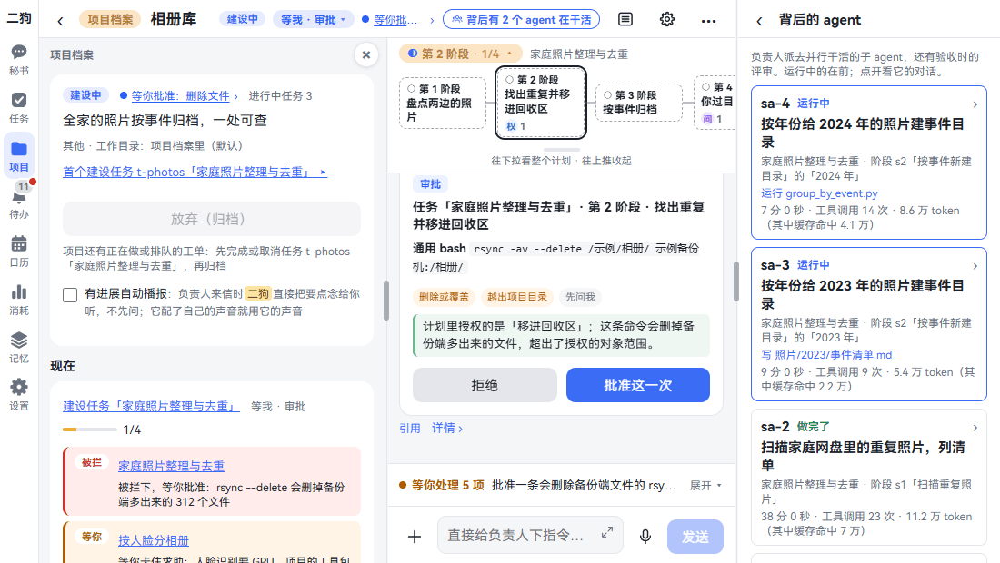
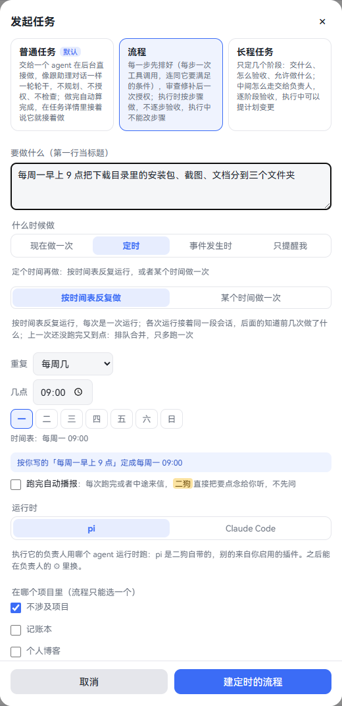
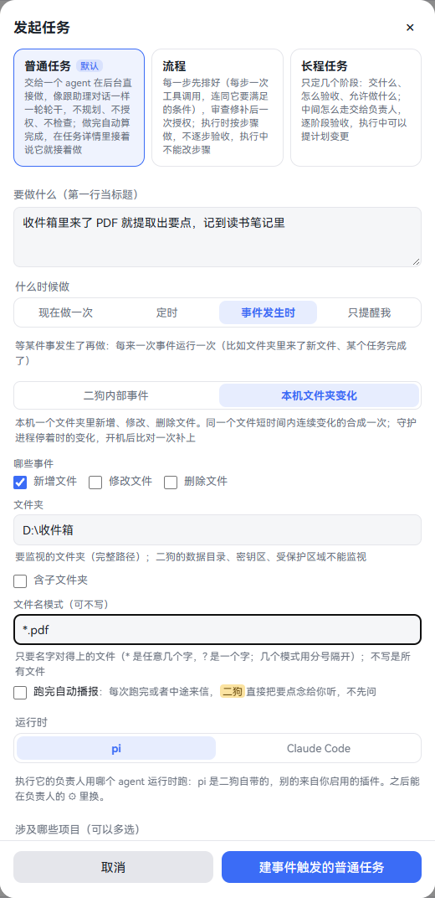

**中文** | [English](tasks.en.md)

# 任务

要花时间的事交给任务。每个任务有一个 agent 在后台做，叫**负责人**，你可以同时和秘书聊别的。

这一章讲六件事：选哪种做法，怎么发起，怎么确认计划，做的时候怎么看，怎么定时和按事件触发，不要了怎么收拾。看完你能把要花时间的活交出去，不用一直盯着。

只属于一个项目的事也是任务，由项目的负责人做。项目那边的做法见[项目](projects.md)。

## 先选做法：三种做法、三种触发

**做法**决定它怎么做、你要管多少：

| 做法 | 适合 | 它怎么做 | 你要做什么 |
|---|---|---|---|
| 普通任务 | 下一首歌、查点资料 | agent 直接做，不规划、不授权、不检查。做完自动算完成 | 写一段话。想改就在任务里接着说 |
| 流程 | 每次都是固定几步，比如把下载目录分类 | 每一步事先排好，连同每步要满足的条件。规则审查修补后交给你 | 在计划卡上点一次「授权执行」。执行中不能改步骤，要改就重新发起 |
| 长程任务 | 写个工具、做份调研、换路由器 | 分几个阶段，定好交什么、怎么验收、允许做什么。中间怎么走由负责人定 | 在计划卡上点「确认」。每个阶段自动验收。执行中负责人能提计划变更 |

**触发**决定什么时候做：

| 什么时候做 | 普通任务 | 流程 | 长程任务 |
|---|---|---|---|
| 现在做一次 | 能 | 能 | 能 |
| 定时 · 按时间表反复做 | 能 | 能 | 不能 |
| 定时 · 某个时间做一次 | 能 | 能 | 不能 |
| 事件发生时 | 能 | 能 | 不能 |

长程任务只能现在做一次。逐阶段验收的工作不适合反复跑。

对话框里还有第四个选项「只提醒我」：不用 agent，到点发一条通知。见[日历和提醒](calendar-reminders.md#建提醒)。

## 发起任务

**在哪里打开：**

- **任务页：** 右上角「＋ 发起任务」。电脑和手机都有。
- **秘书页：** 电脑上在标题栏，也是「＋ 发起任务」。手机上点右上角 ⋯，再点「发起任务」。

**一步一步：**

1. 点「＋ 发起任务」。
2. 选做法。默认是普通任务。每种做法下面写着区别。
3. 在「要做什么（第一行当标题）」里写清楚。第一行就是任务的标题。
4. 「什么时候做」选一种，默认「现在做一次」。定时和事件见[定时](#定时做)、[事件](#事件发生时做)。
5. 想让它做完直接念给你听，勾「跑完自动播报」。默认不勾。
6. 「运行时」默认 pi，是二狗自带的。想用 Claude Code 见 [Claude Code](claude-code.md)，想用 Codex 见 [Codex](codex.md)。只有 pi 能选时没有这一项。
7. 「涉及哪些项目（可以多选）」按下面的表选。流程这一项写「在哪个项目里（流程只能选一个）」。
8. 点最下面的按钮。按钮上的字跟着你选的变：

| 选的 | 按钮 |
|---|---|
| 现在做一次 | 「发起普通任务」「发起流程」「发起长程任务」 |
| 定时 · 按时间表反复做 | 「建定时的普通任务」「建定时的流程」 |
| 定时 · 某个时间做一次 | 「定好时间，发起普通任务」「定好时间，发起流程」 |
| 事件发生时 | 「建事件触发的普通任务」「建事件触发的流程」 |

**涉及的项目怎么选：**

| 选了 | 建出来的是 | 在哪里看 |
|---|---|---|
| 不涉及项目 | 自己的负责人做的任务 | 任务看板 |
| 一个项目 | 这个项目的内部任务，由项目的负责人做 | 只在项目里，见[项目内部任务](projects.md#项目内部任务) |
| 几个项目 | 跨项目的任务，它的负责人给每个项目派工单 | 任务看板 |

**点完会怎样：**

- **普通任务：** 不经秘书，这段话就是交给 agent 的任务书。排到了就开始做。看板上多一张卡。
- **流程、长程任务：** 看板上多一张「规划中」的卡。秘书先和你对齐，再写任务书，见下一节。

**可以直接说的话：**

- 帮我把这个视频下载下来（秘书自己判断，要花时间的交给后台，就是普通任务）
- 明天早上 9 点帮我查一下航班（到那个时间做一次）
- 发起任务：把家里的路由器换成 Wi-Fi 7，先比价，再给我一份计划
- 按流程做：把下载目录里的安装包、截图、文档分到三个文件夹

也可以在输入框打 `/task` 或者 `/workflow`，后面写要做的事。

**要知道的：**

- 流程和长程任务要你点明才发起。一句话开头就要是「发起任务」「按流程做」这样的说法。只说「发起任务」按长程任务算。
- 没点明时，秘书最多给一张「建议发起任务」卡。卡上有「作为流程」「作为长程任务」「不用了」，你点了才建。
- 秘书建不了定时和事件触发的任务。不属于项目的，它会请你到这个对话框里建。属于项目的，它转给项目的负责人，出一张[运营方案变更卡](projects.md#运营方案)。
- 做法建好后不能换。
- 默认同时最多 3 个任务在执行，多的排队。排队时卡上写「排队中」。
- 只选了一个还在立项的项目时发起不了，要等立项书确认。

## 任务书和澄清提问

**这是什么：** 流程和长程任务开工前，秘书先把你要的事问清楚，写成一份任务书。负责人只看得到任务书，看不到你和秘书聊过什么。

普通任务没有这一步。项目内部的任务由项目的负责人在它的会话里问。

**一步一步：**

1. 秘书先说它的理解，比如「我理解你要的是……，对吗？」。你直接回话。
2. 要问的多了，它出一张提问卡。卡也放进待办。

   

3. 每题点一个选项。都不合适就在「都不合适？自己写」里写。
4. 点「提交回答」。懒得选就点「全按推荐」。
5. 对齐后秘书写任务书：目标、验收标准、约束、涉及的项目。任务书交给负责人，负责人起草计划。
6. 打开任务，会话最上面就是这份任务书。

**要知道的：**

- 文件路径、不能碰的东西要说清楚，秘书才写得进任务书。
- 用得上的数据在哪也要说。说「账单在 D:\账单」，它才写得上。

## 计划卡

**这是什么：** 负责人起草的计划。你确认之前，它不动手。

**在哪里找：**

- 待办里的「计划等你确认：…」。
- 任务的会话里。输入框上面写着「等你处理 1 项」，点「看卡片」。
- 看板卡写着「待确认 · 计划等你确认」。

### 长程任务的计划卡

从上到下这样看：

1. **目标和汇总：** 几个阶段、大约多少 token。授权后还有要停下来的地方，才写「授权后还会在几处停下来」，下面逐条列出。
2. **阶段提纲：** 点一个阶段，就地展开它要交什么、验收标准、要留意什么。点「这一阶段的详情 ›」看全部。
3. **小签：** 「权」是敏感权限，动你电脑里的东西。「外」是对外动作，别人或平台会收到。「问」是到这一步停下来等你点头，或者交给你亲手做。后面的数字是几处。
4. **涉及的项目和改动：** 会动哪个项目的什么。
5. **授权（可以勾掉或收窄）：** 负责人想预先批准的操作，写着种类、对象、次数、有效期、属于哪个阶段。
6. **时序规则：** 比如「删之前要先 git 提交」，违反了会退回。
7. **假设（拿不准的地方，可以直接改）：** 负责人替你假设的。改错的、补漏的，「＋ 加一条」。
8. **细节：** 点开看各阶段的完整内容、工具包、按你说过的话加的限制、要提醒的关注类别。

**一步一步：**

1. 不想给的授权，去掉前面的勾。想少给，改小「次数」，或者去掉范围里的几个值。
2. 假设不对就直接改。
3. 看完点「确认」。任务进排队，排到了开始做。
4. 不满意，点「附意见打回」，写要改的地方，再点「打回」。不打回了点「算了」。负责人改好交一张新的，标题后面写「（第 2 版）」。

**要知道的：**

- 没勾的操作不算授权。「有风险的事先问我」开着时，执行到那一步再问你；关着时（新装就是关着的）超出授权的也直接做，照常记下来。授权下面那句话按现在的开关写。关着时勾掉的、收窄的、「先问我」类的都不算停点，「先问我」类的那一行标「现在直接做，不问你」；只有「交给我做」类的还会停。开关见[预算和通知](#预算和通知)。
- 不管开没开，写受保护区域、读密钥区、把密钥往外送都做不了。
- 确认时加的关注类别只对这个任务生效。在「细节」里点「＋ 给这个任务加一个关注类别（只对这个任务生效）」，只能加不能删。
- 授权项默认 7 天有效。快到期时待办里来一条「授权到期续期」，点「续期」或者「不续」。不续的，到期后不再算授权：开关开着时执行到那一步会问你，关着时照常做、记下来。定时、事件触发的任务一直有效，直到你暂停或者取消。

### 流程的计划卡

和长程任务的不一样，卡上列的是一步一步：

1. 上面是「计划 v1」和步骤。
2. 「计划审查」写着这份计划过了哪些规则、发现几处风险、自动修好几处。审查是一套固定规则，不靠模型。
3. 要你点头的事项逐条列出，要一条条勾上。没勾完时按钮写「还有 N 项待确认」。
4. 点「授权执行」，或者「拒绝」。拒绝时可以写为什么。

审查过不了的，卡上写明，有两种：

| 卡上写 | 怎么办 |
|---|---|
| 审查把这版计划退回负责人补充，没有交给你授权 | 不用管，负责人改好会再给你一张。不想做了就点「取消任务」 |
| 审查判定这版计划不能执行，没有交给你授权 | 点「让负责人改」，或者「取消任务」 |

## 看板

**在哪里打开：** 点「任务」。

| 组 | 里面有 |
|---|---|
| 等我 | 等我、待确认 |
| 进行中 | 规划中、等时间、排队中、执行中、已暂停 |
| 运营中 | 简单提醒、定时和事件触发的任务 |
| 最近结束 | 已完成、失败、已取消 |
| 已归档 | 默认收起 |

**一张卡上写着：** 做法、标题、状态和原因、进度、用了多少 token、负责人在干什么。长程任务的进度是验收了几个阶段，流程的是做完几步。

绿字一行是系统查到的结果，比如「没有对外发送；新建 1 个、修改 1 个文件」，不看负责人怎么说。「⚠ 1 处对不上」是负责人提到了系统没查到的文件。

**能做什么：**

- **点卡片：** 打开任务。
- **长按（手机）、右键（电脑）：** 出菜单，见[暂停、取消、归档、删除](#暂停取消归档删除)。
- **点组标题：** 收起或展开。这台设备记住。
- **多选：** 点右上角「多选」，再点卡片勾上。每组标题右边有「全选」。下面的操作栏写着每个操作能做几个，里面有暂停、继续、取消、归档、删除。做完点「退出多选」。

**要知道的：**

- 只属于一个项目的内部任务不在看板上。运营方案里生效的那几条例外，卡上标着项目名，点开进项目的对话框。
- 「记忆整理 · 每天 03:00」也在运营中一组，见[记忆管理员](memory.md#记忆管理员)。
- 简单提醒的卡怎么管，见[日历和提醒](calendar-reminders.md#在任务看板上管)。

## 任务的对话框

**这是什么：** 点开一个任务，就是和它的负责人的对话框。上面是标题栏，中间是消息，下面是输入框。阶段进展电脑上开在左边，手机上在标题栏下面。项目的对话框和它是同一个样子。

**电脑上的标题栏：** ‹、「任务档案」、阶段标签、标题、状态签、活动状态，右边是关键按钮、背后的 agent、⚙、⋯。

**手机上的标题栏分两行：** 第一行 ‹、标题、⋯。第二行状态签、背后的 agent。缩放、设置都收进 ⋯。

**标题栏上每样东西是什么：**

| 地方 | 做什么 |
|---|---|
| 状态签 | 点开看原因、做法、第几阶段、用量，和现在能做的操作 |
| 活动状态 | 休眠、干活中、等你。写着「等你……」时点它，跳到要处理的那张卡。手机上在状态签点开的浮层里 |
| 关键按钮 | 只在电脑上，只在等我、失败时出现。比如「追加预算继续」「继续执行」「重试」 |
| ⚙（手机上是 ⋯ 里的「这个 agent 的设置」） | 这个负责人的角色、单独的提示词、模型、清空当前对话、上下文用量、运行时 |
| ⋯ | 上半是下面这张表的几样，下半是任务操作 |
| 任务档案 | 任务的状态、用量、几个入口和操作。电脑上在左栏，点「任务档案」开合。手机上点标题滑进来，⋯ 最上面也有 |

**⋯ 上半的几样：**

| 这一项 | 里面是什么 | 哪些任务有 |
|---|---|---|
| 计划 | 计划卡、各阶段、范围记录，还有「转为项目」 | 流程、长程任务 |
| 工单 N | 这个任务派给项目的工单 | 有工单的 |
| 工具包 | 这个任务能用什么 | 流程、长程任务，计划确认后才有内容 |
| 消耗 | 每个 agent 用了多少 token | 流程、长程任务 |
| 运行 N | 每一次运行：怎么触发的、结果、原因 | 定时、事件触发的 |

**和负责人说话：** 在输入框里打字或者按住说话。它正在干活时，你的话插在它下一步之前。

- 普通任务写着「给它补充、改要求…」，做完了写「接着说，它就接着做…」。
- 定时、事件触发的写着「改每次要做的事、补充要求：之后的运行照新的做…」。
- 长程任务做完了只读。要改用下面的「返工…」。

撤回、缩放、工具调用详情这些和秘书的会话一样，见[和秘书说话](chat.md)。

## 阶段进展

**这是什么：** 长程任务告诉你做到哪了。电脑上是一整张阶段图，开在左边栏；手机上是标题栏下面的阶段条。

**怎么看：**

- **标签：** 「第 3 阶段 · 3/7」，意思是现在在第 3 阶段，一共 7 个阶段验收了 3 个。
- **阶段：** 一个阶段一块。✓ 验收过了，◐ 正在做，○ 没开始。同一层并排的能同时做，详情里写成 3a、3b。
- **滚动消息时：** 标签跟着变，写你正在看的那一阶段。

**电脑上：**

1. 点标题栏上的阶段标签，整张图开在左边，再点一下收起。
2. 左边栏只有一个位置，阶段进展和档案共用。点「任务档案」或「项目档案」就换成档案，点阶段标签换回来。这台设备记住你上次看的是哪个。
3. 点一个阶段，右边看它的详情。图下面一行是出过的状况和次数，点一个数看是哪几次。
4. 想调宽窄，拖左边栏右侧的分界线。阶段进展和档案是同一个宽度。点 × 收起整栏。

**手机上：**

1. 点标签，收起或展开。这台设备记住。
2. 点一个阶段，详情整页滑进来。
3. 把手往下拉，看整个计划的依赖图，下面一行是出过的状况和次数。往上推收回来，点聊天区也收回。

**阶段详情里有什么：**

| 一块 | 写什么 |
|---|---|
| 回到会话里这一段 | 点了跳到这一阶段的消息 |
| 从这里重做… | 见[不满意怎么办](#不满意怎么办) |
| 这一步出过的状况 | 被拦下、被拉回、问过你什么 |
| 交付件 | 这一阶段要交什么 |
| 系统查到的结果 | 对外发了什么、改了哪些文件，从执行记录汇总，不看负责人怎么说 |
| 验收标准 | 每一条是自动核对还是评审、过没过 |
| 尝试记录 | 提交过几次，每次哪几条不满足 |
| 要你留意的 | 这一阶段的授权和用到多少 |
| 预算 | 用了多少、给了多少 |
| 这一阶段的规则 | 守卫每次调用前核对的规则 |

**任务做完了：** 阶段进展默认收起，标签写着「已完成」这样的话。点开还能看每个阶段。

**流程和普通任务：** 流程顶上是一条进度，比如「3/5 ›」，点开看每一步。普通任务没有阶段进展。

## 阶段验收和评审

**这是什么：** 长程任务的每个阶段自动验收，你不用一个个点。把关的地方是计划卡上的验收标准。

**一个阶段这样走：**

1. 负责人宣布这一阶段做完了。
2. 能脚本查的先跑脚本，页面上写「自动核对」。
3. 再交给评审。评审是另一个 agent，每次都是新会话，只看交付件和验收标准，不听负责人的说法。
4. 都过了，会话里出一张进度卡，写着「验收通过」，接着做下一阶段。
5. 没过，退回负责人修改。会话里写没过的是哪几条。
6. 第 3 次还不过，任务停下，转成「等我 · 卡住求助」，等你拍板。

全部阶段过了，任务自动完成。

评审也在[背后的 agent](#背后的-agent) 里，能看它查了什么。

### 不满意怎么办

验收过了你还是不满意，或者想换个做法，就从某个阶段重做。这就是你退回一个阶段的办法。

**在哪里打开：**

- 任务还没做完：⋯ 或者状态签里的「从某阶段重做…」。
- 任务已完成：⋯ 里的「返工…」。
- 阶段详情里的「从这里重做…」。

**一步一步：**

1. 选从哪个阶段重做。开始过的阶段才能选。
2. 在「这次要怎么改（会转告负责人）」里写，比如「那几张要留着」。
3. 想改标准，就在「这一阶段的验收标准（可以直接改）」和交付件里改。你改的就是你的确认，不出卡。
4. 看下面两块：「要重做的」，「这几步已经做了的事，重做前不会撤回」。
5. 点「重开并让负责人接着做」。改过标准时按钮写「按改过的重开，让负责人接着做」。

**要知道的：**

- 只重做这一阶段和依赖它的阶段，不相干的照常留着。原来那段记录留在原处，标为已废弃。
- 已经做了的事不会撤回。对外发出去的收不回，负责人重做时知道它发生过。
- 重做之后，范围外已验收的阶段再核一遍。不满足了待办里来一条「重做之后复验没过」，点「先不管」，或者把那个阶段也重做。
- 流程没有返工，要重做就重新发起。普通任务也没有，在任务里接着说就行。
- 老任务的计划里写着「由你验收」的，现在改由评审照原文判，结果上写「原定由你验收，按新规矩改由评审」。

## 预算和通知

这几样新装时都关着，二狗放手去做，少打扰你。想稳一点就打开。

| 开关 | 在哪里 | 默认 | 打开后 |
|---|---|---|---|
| 任务超预算就停下 | 设置 · 规则 · 关注类别，最上面 | 关 | 某一阶段超预算先说明进展，超过两倍就停下等你 |
| 有风险的事先问我 | 同上 | 关 | 任务里做计划没授权的事先问你 |
| 跑完自动播报 | 发起时勾，或者 ⋯ 里切换 | 关 | 做完或者中途来信，秘书直接把要点念给你听，不先问 |

两个开关的说明见[关注类别](settings.md#关注类别)，设置向导里也能勾。项目内部的任务没有「跑完自动播报」，用项目的[有进展自动播报](projects.md#有进展自动播报)。

### 预算

**这是什么：** 负责人写计划时估每个阶段要调用多少次工具，二狗按最近的实际用量算 token 预算。

**一步一步（打开了开关时）：**

1. 用量超过预算，负责人先说明进展，任务不停。
2. 超过两倍，这一阶段停下，任务转「等我 · 超预算」。待办里有一条。
3. 看过之后点「追加预算继续」。这一阶段重新给一整份预算。不想花了就暂停或者取消。

负责人也能自己宣布做完交去验收，或者提一张计划变更卡加预算。

**要知道的：**

- 开关关着时只记用量，不停。用自己的 Key 付钱时，跑偏的任务会一直花下去。
- 预算里的 token 把缓存命中的只算十分之一，和消耗页的真实 token 不是一个数。
- 看用了多少：⋯ · 消耗，或者阶段详情里的预算。花费的总账见[消耗](settings.md#消耗)。

### 不开开关也会停下的情况

| 情况 | 结果 |
|---|---|
| 被规则拉回 3 次后又犯 | 这一阶段停下，「等我 · 卡住求助」 |
| 20 分钟没有进展，催了 3 次还没有 | 这一阶段停下，「等我 · 卡住求助」 |
| 验收退回 2 次后，第 3 次还不过 | 这一阶段停下，「等我 · 卡住求助」 |
| 你累计拒绝了 5 次审批、计划变更 | 整个任务「已暂停 · 累计被拒」 |

### 它怎么告诉你

- **要你拍板的：** 进待办，会话的输入框上面写「等你处理 N 项」。看板和标题上也写着。
- **做完了：** 秘书在主线说一声结果，可能问要不要念给你听。开了「跑完自动播报」就直接念，见[语音](voice.md)。项目内部的普通任务做完，秘书只说一句做完了，结果在项目里看。项目内部的流程、长程任务做完不告诉秘书。
- **做到一半的发现：** 负责人给秘书发消息，秘书转告你。不想要就关掉工具包里的「给二狗发消息」。
- **手机通知栏：** 见[系统通知](mobile.md#系统通知)。

## 背后的 agent

**这是什么：** 负责人会派子 agent 去同时做几件事，验收时还有评审。这里能看到它们是谁、在做什么、进展如何。

**在哪里打开：** 对话框标题栏。

- **电脑：** 写着「背后有 3 个 agent 在干活」。没有在跑的写「背后的 agent（2）」。
- **手机：** 第二行的图标和个数。
- 从来没派过就没有这个入口。

**一步一步：**

1. 点入口，打开列表。电脑上在右边，手机上滑进来。运行中的在前。
2. 每个写着：编号（评审写「评审」）、状态、派去做什么、哪个任务哪个阶段、现在在做哪一步、用时、工具调用次数、用量。
3. 点一个，看它的对话：收到的指令、它说的话、每次工具调用、交回的结果。点一次工具调用，展开完整的参数和返回。

**要知道的：**

- 在跑的实时更新，下面写「它正在干活，这里跟着实时更新。」
- 做完的只能看，下面写「它已经结束了，这里只能看，不能再叫它接着做。」要接着做，对负责人说。
- 负责人要并行时先出一张「并行确认」卡，写着派几个、各做什么。点「同意并行」才派。点「不并行，按顺序做」它就一件件做。
- 子 agent 的工具包和授权不超过负责人。它们不占执行名额。做完就解散。
- 它们的记录跟着任务、项目一起删。

## 授权和工具包

**授权和工具包不是一回事：**

| | 是什么 | 在哪里改 |
|---|---|---|
| 授权 | 预先批准的具体操作，比如「写这个目录，最多 40 次」 | 计划卡上。只能勾掉或者收窄 |
| 工具包 | 能用哪些 skill、MCP，能不能跑 bash、联网 | ⋯ · 工具包。改了马上生效 |

工具包怎么改见[工具包](skills-mcp-plugins.md#工具包)。计划确认后才有。普通任务没有这一项。

**执行中会遇到的卡：** 都在会话和待办里。

| 卡 | 什么时候来 | 你点什么 |
|---|---|---|
| 审批 | 「有风险的事先问我」开着时：落在「先问我」或者超出授权的事。关着时只剩很少几种，比如违反了时序规则 | 「批准这一次」「拒绝」 |
| 计划变更 | 负责人要改计划、加能力。只停受影响的阶段 | 「确认变更」「拒绝」。拒绝后它在现有授权内重排 |
| 交给我做 | 这件事只能你亲手做，比如花钱 | 做完点「已完成」 |
| 计划外工单 | 跨项目任务的负责人要多派一张工单 | 「确认派出」「拒绝」 |
| 提问 | 负责人要问你 | 选或者写，点「提交回答」 |

负责人小改计划、不扩大授权时不用问你，时间线上记一笔。

## 暂停、取消、归档、删除

**在哪里打开（四处是同一份）：**

- 对话框的 ⋯ 下半。
- 标题栏的状态签。
- 看板卡长按或者右键。
- 看板「多选」，一次做几个。

| 操作 | 什么时候有 | 会怎样 |
|---|---|---|
| 暂停 | 执行中、等我、排队中 | 先停一停，随时「继续」 |
| 继续执行 | 卡住求助、中断不确定 | 负责人接着做。在会话里回一句也算 |
| 追加预算继续 | 超预算 | 这一阶段重新给一整份预算 |
| 重试 | 失败 | 回到执行中，名额满了就排队 |
| 取消任务 | 没结束的、失败的 | 先弹确认框。不再执行，会话和记录都留着，进最近结束 |
| 归档 | 还没归档的 | 结束了的直接进已归档。没结束的先确认，点「取消并归档」 |
| 删除任务 | 大多都有 | 先弹确认框。点「删除」后删掉任务、会话、工作目录和产出 |

**中断不确定：** 电脑重启时它正在做一件事，说不清做没做完。查过之后点「已经执行了，继续」或者「没执行，重做这一步」。

**归档清单：** 每周一 09:00，结束超过 7 天还没归档的任务汇成一张卡放进待办。每项选「归档」「继续改」「先留着」。

**转为项目：** 做着做着发现是件长期的事：⋯ · 计划 · 「转为项目」，填项目名。这个负责人接着和你做立项问答。任务以「已完成 · 已转为项目」结束。见[项目](projects.md#从任务转过来)。

**可以直接说的话：**

- 暂停车险比价
- 继续车险比价
- 取消「车险比价」
- 把「车险比价」删了（总会出卡让你确认）
- 告诉 t-5，以后把 GitHub 热门也加上

**要知道的：**

- 删了收不回。你在里面说过的话作为素材保留，要彻底删见[彻底删除](memory.md#彻底删除)。只是不想看到，用归档。
- 项目内部任务不能单独删，删项目时一起删。菜单里写着原因。
- 运营方案里的一条只能暂停、恢复、立即运行一次。要去掉，让项目的负责人改运营方案。

## 定时做

**这是什么：** 每周一早上整理下载目录，每天出一份早报。普通任务和流程能定时。

**一步一步：**

1. 点「＋ 发起任务」，选普通任务或者流程。
2. 在「要做什么」里写。里面说了时间的，下面自动选好「定时」，填好时间，写一行「按你写的「每周一早上 9 点」定成每周一 09:00」。
3. 没自动填就自己选：「什么时候做」点「定时」。
4. 选一种：
   - **按时间表反复做：** 「重复」选每天、每周几、每月几号、每年、按我的工作日，再填「几点」。
   - **某个时间做一次：** 选日期和时间，到点做一次，做完就算完成。
5. 点按钮，比如「建定时的普通任务」。

**建好之后：**

- **普通任务：** 马上登记好，到点在后台做。反复做的在看板「运营中」，某个时间做一次的在「进行中」，写着「等时间」。
- **流程：** 先排步骤，你在计划卡上授权一次。之后每次都照授权的步骤做、逐步核对，不再问你。

**管它：** 卡上写着时间表、下次、最近一次的结果，有「暂停」「恢复」「取消」。打开后 ⋯ 里还有：

| 这一项 | 做什么 |
|---|---|
| 运行 N | 每一次运行的记录。流程还列着每一步 |
| 立即运行一次 | 现在多跑一次，不改时间表 |
| 改时间 | 弹出对话框，选好点「保存」。任务、会话、运行记录都不变 |
| 跑完自动播报 | 开或者关 |

**可以直接说的话：**

- 把早报再跑一次
- 早报以后做完直接念给我听

**要知道的：**

- 各次运行接着同一段会话，后面的知道前几次做了什么。
- 上一次还没跑完又到点，排队合并，只多跑一次。
- 连续失败 3 次自动暂停，待办里有一条，点「恢复」接着跑。
- 二狗停着时错过了，开机后补一次。错过几次也只补一次。
- 「按我的工作日」看你的日历，见[工作日和节假日](calendar-reminders.md#工作日和节假日)。
- 定了时间又手动改了，和写的话不一样时会标出来，照样能发起。

## 事件发生时做

**这是什么：** 收件箱里来了 PDF 就提取要点，某个任务失败了就去查原因。平时不跑，事件来了才跑。普通任务和流程能用。

**一步一步：**

1. 点「＋ 发起任务」，选普通任务或者流程，写要做的事。
2. 「什么时候做」点「事件发生时」。
3. 选事件来源，勾「哪些事件」，填条件：

| 来源 | 哪些事件 | 条件 |
|---|---|---|
| 二狗内部事件 | 任务完成、任务失败、任务转等我、项目状态变化、一次运行失败 | 「哪个任务」「哪个项目」，不选是任何一个 |
| 本机文件夹变化 | 新增文件、修改文件、删除文件 | 「文件夹」要写完整路径。可以勾「含子文件夹」，可以写「文件名模式」，比如 `*.pdf` |

4. 没填全时下面写「还要：…」，按钮是灰的。
5. 点按钮，比如「建事件触发的普通任务」。

**建好之后：** 在看板「运营中」，卡上写「在等：本机文件夹 D:\收件箱里新增 *.pdf 文件」。来一次事件运行一次，事件的内容（文件路径、任务编号这些）交给 agent。流程还要在计划卡上授权一次。

**要知道的：**

- 上一次还没跑完又来的事件合成一批，交给下一次。
- 流程的步骤参数里可以写这次事件的值，选了事件后对话框里列着能写哪些。
- 文件夹只能是本机盘上的。二狗的数据目录、密钥区、受保护区域不能监视。
- 二狗停着时文件夹的变化，开机后比对一次补上。
- 事件触发的没有「改时间」。要按时间做，取消了另建。
- 连续失败 3 次自动暂停。
- 项目自己的服务也能报事件，只能写在运营方案里，见[项目的服务报事件](projects.md#项目的服务报事件)。

## 看到这些状态怎么办

| 状态 | 什么意思 | 怎么办 |
|---|---|---|
| 规划中 | 秘书在和你对齐，或者负责人在起草计划 | 回话、答提问卡 |
| 待确认 · 计划等你确认 | 计划交上来了 | 去看[计划卡](#计划卡) |
| 等时间 | 定了某个时间做一次，还没到 | 等，或者取消 |
| 排队中 | 执行名额满了，或者在等项目手上的工单 | 等 |
| 等我 · 审批 | 有一步要你批 | 「批准这一次」或者「拒绝」 |
| 等我 · 澄清 | 负责人问你问题 | 答提问卡 |
| 等我 · 卡住求助 | 它走不下去了 | 看原因。在会话里回它，或者做完它要的事后点「继续执行」 |
| 等我 · 超预算 | 超过预算两倍 | 「追加预算继续」，或者暂停、取消 |
| 等我 · 中断不确定 | 重启时正做到一半 | 查过后点「已经执行了，继续」或者「没执行，重做这一步」 |
| 等我 · 计划变更 | 负责人要改计划 | 「确认变更」或者「拒绝」 |
| 等我 · 交给我做 | 要你亲手做 | 做完点「已完成」 |
| 等我 · 运行时没启用 | 它用的运行时插件关了 | 到 设置 · 能力 · 插件 启用，见 [Claude Code](claude-code.md) |
| 等我 · 在官方 App 里 | 会话交给了官方 App | 见[交给官方 App，再收回来](claude-code.md#交给官方-app再收回来) |
| 已暂停 · 累计被拒 | 你拒绝了太多次 | 看过之后「继续」，或者取消 |
| 失败 | 负责人判它做不了 | 「重试」「从某阶段重做…」或者「取消任务」 |

## 相关章节

- [项目](projects.md)：长期的事、内部任务、运营方案。
- [和秘书说话](chat.md)：撤回、缩放、待办。
- [Claude Code](claude-code.md)、[Codex](codex.md)：让负责人用它们干活。
- [skill、MCP 和插件](skills-mcp-plugins.md)：工具包里能配什么。
- [日历和提醒](calendar-reminders.md)：只提醒一声的事。
- [语音](voice.md)：跑完自动播报。
- [设置](settings.md)：关注类别、消耗。
