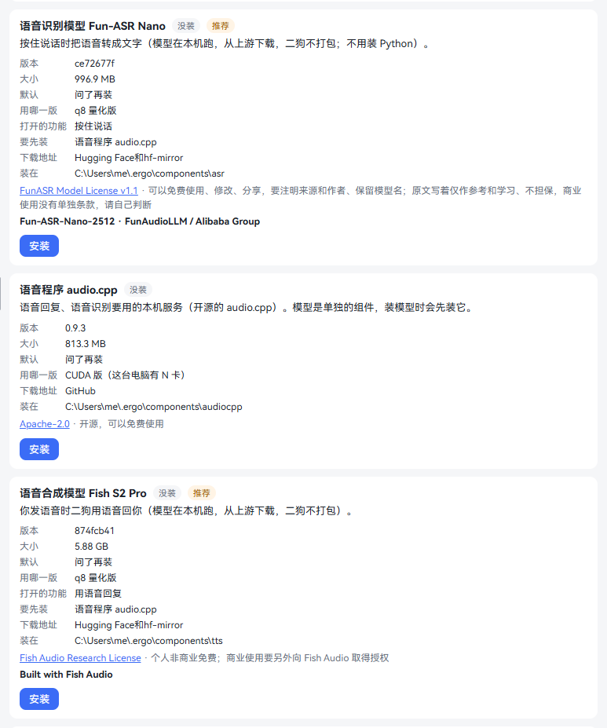
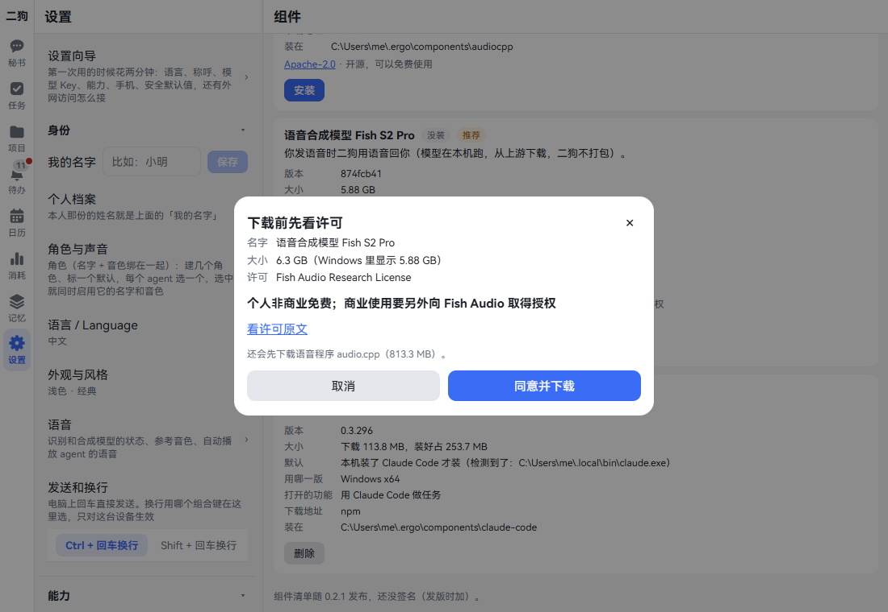
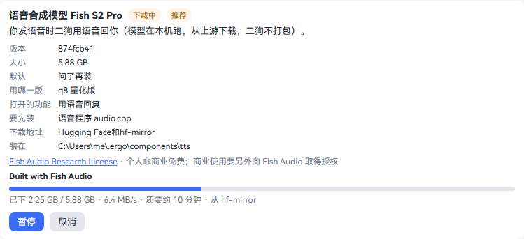
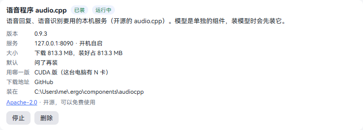
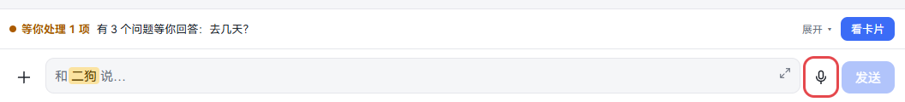
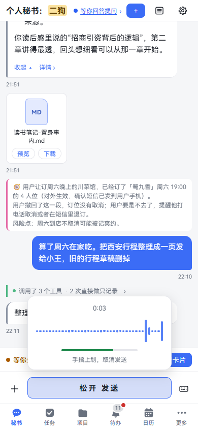
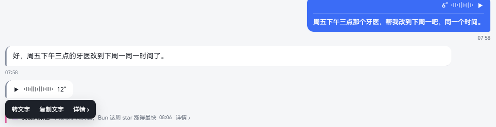
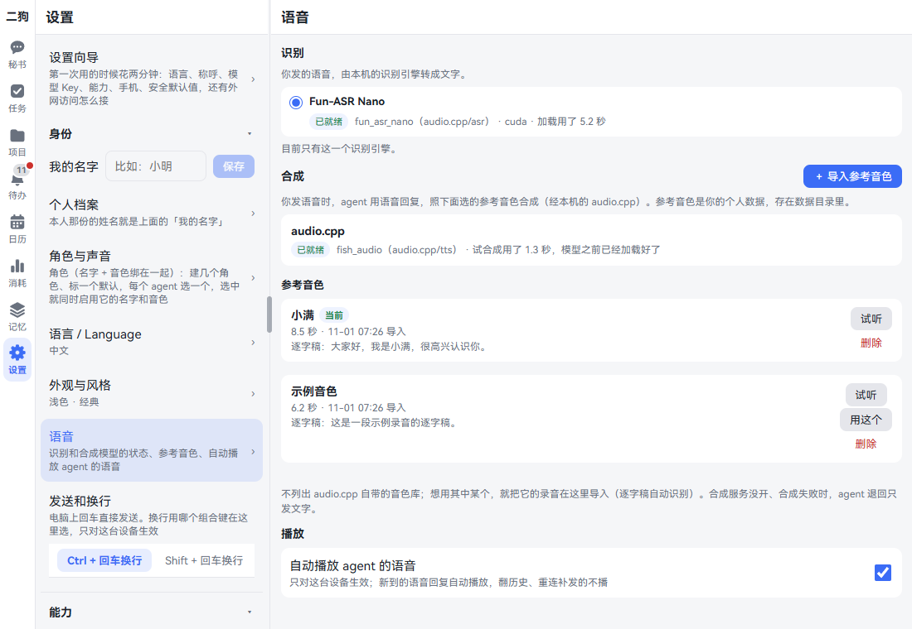
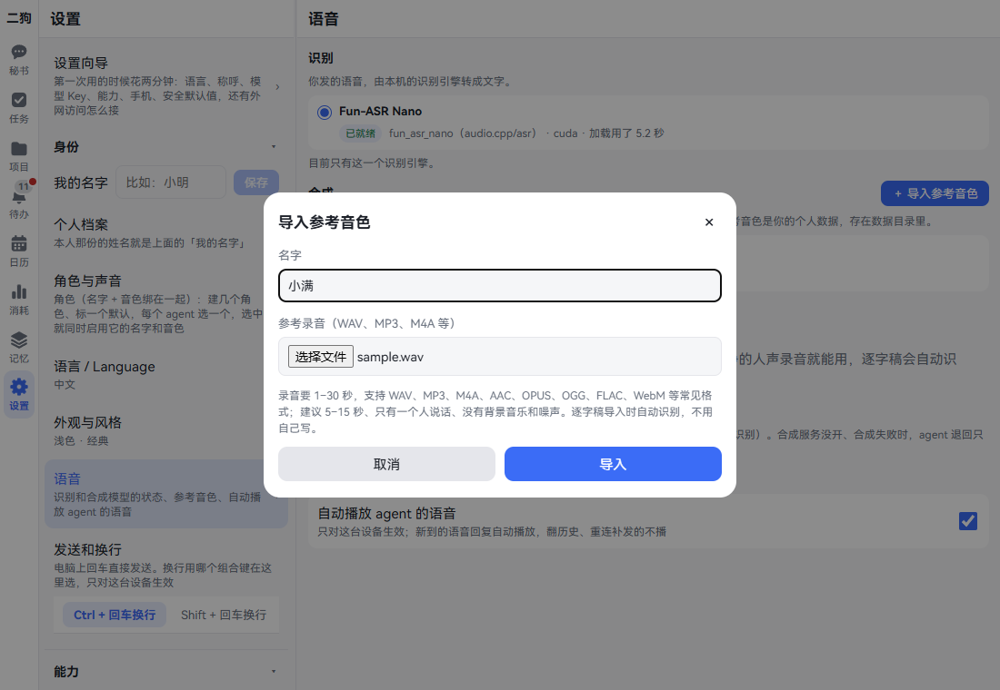
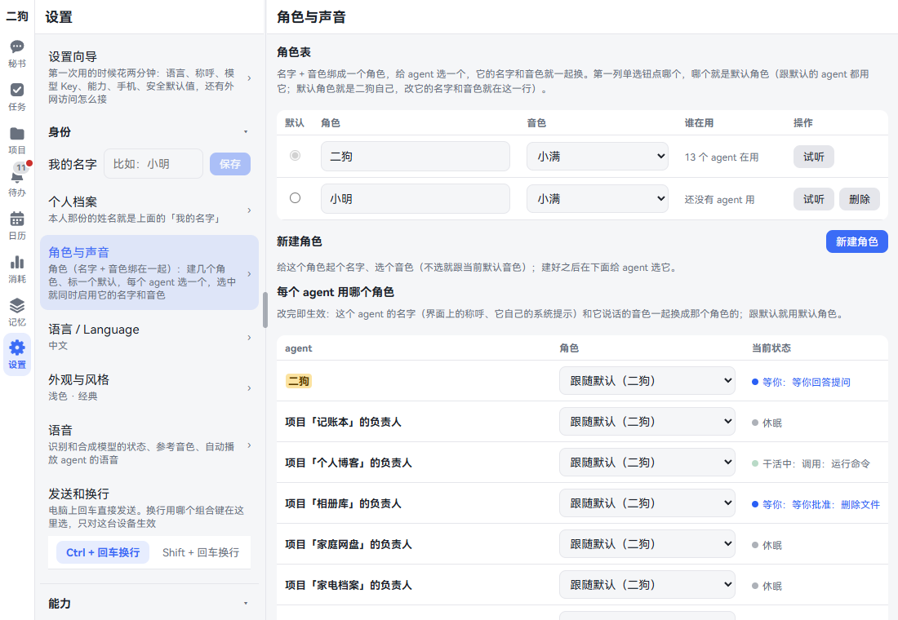

[中文](voice.md) | **English**

# Voice

Screenshots show the Chinese interface; the labels in the text are the English ones.

You can hold to talk, and ergo can reply by voice too. Both recognition and synthesis run on your own computer. This chapter covers how to install them, how to talk, how to listen, and how to give different agents different voices. By the end you can go back and forth with ergo by voice.

## The basics

| Name | What it is | Component |
|---|---|---|
| Speech recognition | Turns what you say into text | Speech recognition model Fun-ASR Nano |
| Speech synthesis | Reads ergo's words aloud | Speech model Fish S2 Pro |
| Speech program | Both models run on it | Speech program audio.cpp |
| Reference voice | A recording; ergo speaks in that voice | One comes built in: "Xiaoman" |
| Role | A name + a voice; you pick one for each agent | Nothing to install |

None of these are in the installer; install them when you need them. If you only want to hold to talk, speech recognition is enough. To hear ergo speak, install speech synthesis as well.

## Installing the voice components

**Where to open it:** Settings · Capabilities · Components.

These also lead to that page:

- The grayed-out microphone next to the input box: click it.
- The line in Settings · Identity · Voice that says "Needs …": click "Install ›".

The "Capabilities" step of the setup wizard lets you tick them as well; see [Getting started](getting-started.en.md).

**Step by step:**

1. Find the "Speech recognition model Fun-ASR Nano" block and click "Install".
2. "Check the license before downloading" pops up, showing the name, size and license. For the full text, click "Read the full license". If the speech program isn't installed yet, it also says "Speech program audio.cpp will be downloaded first".
3. Click "Agree and download". Once you've confirmed a license, it doesn't ask again.

   

4. A progress bar appears in the block, showing how much is downloaded, the speed, the time left and the source. You can click "Pause", "Resume" or "Cancel" along the way. The download continues even if you leave this page.

   

5. When it finishes, the rest happens automatically: it generates the config, registers with the service manager, starts, checks health and joins the start-at-boot list. No need to restart ergo.
6. Look at the "Speech program audio.cpp" block: when it says "Installed" and "Running", and the "Service" line shows the port and "starts at boot", you're done.

   

7. To have ergo reply by voice, install "Speech model Fish S2 Pro" as well. The steps are the same.
8. Take a look at Settings · Identity · Voice: both recognition and synthesis should say "Ready".

**How big it is:**

| Component | Size shown on the page | Good to know |
|---|---|---|
| Fun-ASR Nano | 996.9 MB | About 2 GB of video memory. It also works without a graphics card; on a CPU a sentence takes a second or two. Free to use, modify and share, as long as you credit the source and authors and keep the model name. The original text says it's for reference and learning only, with no warranty, and has no separate terms for commercial use; please judge for yourself |
| audio.cpp | 813.3 MB with an NVIDIA graphics card, 29.1 MB without | Installed first automatically when you install a model. The graphics card build needs driver 580 or newer; older cards like the GTX 10 series can't use it |
| Fish S2 Pro | 5.88 GB | About 7.3 GB of video memory. It also works without a graphics card, but very slowly. Free for personal, non-commercial use; commercial use needs separate authorization from Fish Audio |

With both models installed, the graphics card needs room for over 9 GB. Whichever doesn't fit gives an error when loading, and the Components and Voice pages state the reason.

**If the download fails:**

1. When a download fails or is paused, the block shows the reason and lists the files still needed and their download addresses.
2. Click "Retry" to continue. What's already downloaded is kept.
3. If that doesn't work, download the files yourself with a browser or download tool and put them on the computer running ergo.
4. Click "Import from file…", enter the path of the file, folder or package, and click "Import". If the checksum matches, it gets installed.

**Good to know:**

- **Start and stop:** the speech program's block has "Start" and "Stop". Both speech recognition and speech synthesis rely on it; when it's stopped, neither works.
- **Removing:** remove the models first, then the program. While a model is still using the program, it can't be removed; the page says which one.
- **Updates:** click "Check for updates" at the top of the page; ergo also checks once a night by itself. When there's a new version the block says "Update available", and it only switches when you click "Update". For details, see [Components](settings.en.md#components).
- **ergo must be started by the service manager:** otherwise the page says "Speech synthesis runs under the service manager, which is not reachable now". Starting with `ergo start` is the right way.
- **The data folder's path can't contain Chinese characters:** otherwise the page says "audio.cpp cannot read this path". Move the data folder to an all-English path, then install.
- **If you've already set it up yourself:** the block says "Available" and "You already have your own speech recognition; using it". You can't install from here, and ergo won't change your setup. For how to configure it by hand, see [Configuring voice by hand](../architecture/README.md#手动配语音备用) (in Chinese).

## Hold to talk

**What it is:** like sending a WeChat voice message. Use it when you're driving, walking or just don't feel like typing. When you finish, it's turned into text and handed to ergo automatically.

**Where to use it:** the secretary, task and project owners, the memory curator: the input boxes of these sessions all have a microphone next to them. You can also hold to talk on the floating button in the built-in browser; see [Built-in browser](browser.en.md).

**Step by step:**

1. Click the microphone next to the input box. The input box becomes "Hold to talk". It stays that way next time; this browser remembers.
2. The first time, the browser asks whether it can use the microphone; allow it.
3. Press and hold "Hold to talk": with a finger on a phone, the left mouse button on a PC. A recording panel pops up with the time, a waveform and the volume, and the button changes to "Release to send".
4. Speak.
5. Let go to send.
6. To cancel, while holding slide up a little (on a PC, move the mouse up). The prompt changes to "Release to cancel" and so does the button; let go then.
7. To type instead, click the keyboard icon next to the input box.

**After it's sent:** the bubble has a play bar and duration at the top and the recognized text below. Until recognition finishes it says "Recognizing…". That text is what ergo sees.

Long-press the bubble (right-click on a PC) for a menu:

- **Copy text**
- **Transcribe again:** only on messages where recognition failed.
- **Details ›**

Click the bubble to play, and again to pause.

**Good to know:**

- **Length:** under 1 second isn't sent, and you see "Too short". The maximum is 60 seconds; in the last 10 seconds it shows "N seconds left", and it sends automatically when time's up.
- **With attachments:** first click + and pick the attachments. Above the input box it says "Hold to talk; the attachments go out with it", and they go out together.
- **When the microphone is on:** once you switch to voice input the microphone stays open and waits, but nothing is recorded unless you're holding. It's released as soon as you switch back to typing or go to the background.
- **While you're holding:** any voice message playing pauses, and new ones wait until you let go.
- **Languages:** Fun-ASR Nano only handles Chinese, English, Japanese and auto.
- **Saved to memory:** text from voice is saved to materials just like typed text; you can see it by filtering for "Voice" in Memory · Materials. To delete it, see [Memory](memory.en.md#having-ergo-forget-something).
- **On a phone:** a phone browser has to open ergo from an HTTPS address to use the microphone; see [On your phone](mobile.en.md). The phone app uses its own recording and doesn't have this limit.

## ergo answering by voice

**What it is:** send a voice message, and ergo replies by voice this turn. When you type, you can also ask it to read to you.

Speech synthesis has to be installed first. The built-in voice is "Xiaoman"; to change it, see [Reference voices](#reference-voices).

**Step by step:**

1. Hold to talk, then let go.
2. The interface shows "Replying…", then "Generating voice…". This turn doesn't show text as it replies.
3. A voice bubble appears. When it's synthesized in parts, you can listen as soon as the first part arrives, and "Generating" appears after the duration.
4. If autoplay is on, it starts reading by itself.
5. To see the text: long-press the bubble (right-click on a PC) and click "Show text". The text expands in the bubble; click "Hide text" to collapse it.

**When the reply is long:**

- If it can be read in about 60 seconds and has nothing unreadable: the whole thing is read, with the text tucked in the bubble.
- If it's too long, or has code, tables or links: it reads a spoken summary, and the details are sent in the chat as usual.

**Having it read to you:**

| You want | How |
|---|---|
| To hear something while typing | Say "Read me what you just said" |
| To hear it when a task is done | When a task finishes, the secretary tells you in text, then asks "Want me to read it to you?". Say yes and it reads |
| A finished task read right away | Tick "Read out when done" when starting the task. After that, use the menu under ⋯ in the task details' title bar to turn it on or off (it says "Read out when done: Off") |
| A project's updates read right away | Tick "Read updates aloud" at the top of the project page; off by default |

When the switch is off, the owner's updates come as text, and the secretary asks if you want them read. Tasks inside a project have no auto-announce.

**Things you can just say:**

- Read me what you just said
- When this task is done, read it to me right away from now on
- From now on, read me the ledger's updates right away
- You can stop reading now
- How's the ledger coming along

**Good to know:**

- **It goes by your last message:** if your last message this turn is voice, it reads; if it's typed, it sends text.
- **Only your voice counts:** replies caused by system messages like task stage notices aren't read, unless auto-announce is on.
- **One synthesis at a time:** the graphics card may be busy with other things, so the rest queue up.
- **Nothing is lost if it can't read:** when the synthesis service is off or fails, only text is sent, with a line in the chat: "Couldn't create the voice reply (reason), so this one is text only." If only part was synthesized, the reply's text still shows as usual.

## Autoplay

**What it is:** new voice replies play automatically. You can turn this off where sound isn't convenient.

**Where to open it:** Settings · Identity · Voice, "Auto-play agents' voice replies" under "Playback" at the bottom. On by default, and it only applies to this device.

**When it plays automatically:**

- The switch is on, the page is in the foreground, and that conversation is open.
- It doesn't play while you're holding to talk; it plays after you let go.
- It doesn't play when you scroll through history, or for messages resent after reconnecting.

**Good to know:**

- Browsers sometimes block autoplay. The bubble then says "tap to play"; one tap and it's fine. On a phone, after you've held to talk once, autoplay usually works.
- Voice the secretary read while you were away doesn't play by itself. When you return, there's a line above the secretary's input box: "While you were away, ergo sent 1 voice message". Click "▶ Play" or "Show me".
- Only one plays at a time.

## Reference voices

**What it is:** a recording that ergo uses as the voice to speak in. One comes built in, "Xiaoman". It's synthesized and doesn't contain any real person's voice.

**Where to open it:** Settings · Identity · Voice, the "Synthesis" block.

**Importing one:**

1. Click "+ Import reference voice".
2. Fill in "Name" and pick a "Reference recording" file.
3. Click "Import". The button changes to "Converting and transcribing…"; wait a moment.
4. When it's done, it's listed below with its length and the recognized transcript.

**How to record well:** the recording has to be 1–30 seconds; 5–15 seconds is recommended, with one person speaking and no background music or noise. WAV, MP3, M4A, AAC, OPUS, OGG, FLAC and WebM all work, up to 20 MB. The transcript is recognized automatically; you don't need to write it.

**Managing:**

- **Play:** plays the recording itself.
- **Use this:** switches to this one, and "In use" appears next to it.
- **Delete:** click "Delete", then "Confirm delete".

**Good to know:**

- Importing needs ffmpeg on this computer, and speech recognition must be working. If either is missing, it says so.
- Once you delete "Xiaoman", it doesn't come back by itself. With no voices at all, voice replies fall back to text, and Inbox reminds you to import one.
- The voice library that comes with audio.cpp isn't listed. To use one of those, import its recording.
- The recording's path can't contain Chinese characters, or it says "audio.cpp can't read". Put the data folder on an all-English path.

## Roles & voices

**What it is:** a role is a name plus a voice. For example, you could call the ledger's owner "Lin" and give it a different voice. When it reports progress, you know who it is just by listening.

**Where to open it:** Settings · Identity · Roles & voices.

**Changing ergo's own name and voice:**

1. Look at "Roles". The radio button selected in the first column marks the default role, which is ergo itself.
2. To change the name: edit it in the "Role" cell, then click "Save name" when it appears.
3. To change the voice: pick in the "Voice" dropdown. Click "Listen" to hear it.

**Creating a role:**

1. Click "New role".
2. Fill in "Name" and pick a "Voice". If you don't pick, it follows the default voice.
3. Click "New role". A new row appears in the table.

**Choosing a role for an agent:**

1. Look at the "Which role each agent uses" table.
2. Find the owner and pick in the "Role" dropdown. It takes effect as soon as you change it.
3. To switch back, choose "Follow the default (ergo)".

You can also click ⚙ in a session's title bar and choose in the "Role" block. Changes there take effect from its next turn, and the new voice is used from the next synthesis.

**Owners reporting in their own voice:** once an owner has a voice different from the secretary's, its updates are read like this: the secretary opens, then the owner's voice takes over, all in one voice message. Long-press and choose "Show text" to see who said what.

When it's read this way:

- A task with "Read out when done" on finishes.
- A task or project with auto-announce on sends an update.
- You type or say a question about a task's or project's progress, and it has written to the secretary.

If the owner has no voice set, its voice is the same as the secretary's, or its voice was deleted, you get a single voice message from the secretary.

**Good to know:**

- The default role can't be deleted. A role an agent is still using can't be deleted either, and the page says who's using it. For agents that can still be changed, give them another role first; a finished task can't be changed, so delete the task first; for an archived project, unarchive it and switch, or delete the project.
- Deleting takes two clicks: "Delete", then "Confirm delete".
- After you change a name, how it's shown in the interface and this agent's own system prompt both change.
- Project and task owners only appear in the table once they exist. Archived projects are view-only.

## Checking how voice is doing

**Where to see it:** Settings · Identity · Voice.

Recognition and synthesis each have a tag:

| Tag | Meaning |
|---|---|
| Waiting to load, Loading | The model is getting ready |
| Ready | Usable |
| Off | The service isn't on |
| Busy | The service is busy; try again later |
| Error | The reason follows |
| Unloaded | It exited after sitting idle, and loads again when the next voice message comes |

**To test it on its own:** go to Settings · Data & devices · About Ergo, tap the version number 8 times, click "Debug tools are open", and go to the "Voice" block. You can use "Record 3 s and play back", "Record 3 s and recognize" and "Speak a test sentence". It closes by itself after 1 hour.

## Troubleshooting

| What you see | What's going on | What to do |
|---|---|---|
| The microphone is gray | Speech recognition isn't installed | Click the microphone and install it on the Components page |
| No microphone next to the input box | The voice plugin is off | Go to Settings · Capabilities · Plugins and turn on "Voice" |
| The microphone can't be used from this address | Browsers only allow the microphone on HTTPS or local addresses | On a phone, use an HTTPS address or the app; see [On your phone](mobile.en.md) |
| No microphone permission | The browser or system refused | Browser: click the site settings at the left of the address bar and allow the microphone. Phone app: turn on the microphone for ergo in system settings |
| Another program is using the microphone, so recording isn't possible | Another program is using it | Close that program and press again |
| Nothing was recorded. Press again to retry | What was recorded was silence | Check whether the microphone is muted and whether the right one is selected |
| The bubble says "Recognition failed" and Inbox has "Speech recognition unavailable" | The recognition service has a problem. The recording is still there | Fix it according to the reason in Inbox, then long-press the bubble and click "Transcribe again" |
| Transcribing again says "there is no ffmpeg on this computer to convert it" | This clip was recorded before the switch to Fun-ASR Nano | Install ffmpeg, put it on PATH, and click "Transcribe again" |
| The chat says "Couldn't create the voice reply (The speech service isn't running…)" | The speech program isn't running | Click "Start" on the Components page, and check that the Voice page says "Ready" |
| Inbox has "Import a reference voice to get voice replies" | There are no voices at all | Import one on the Voice page. This item archives itself after that |
| The Components page says "The speech service could not be connected", followed by which step and why | A step failed while connecting the service. This attempt's registration and config were removed; the program and model stay | Deal with the reason and click "Retry". No need to download again |
| The Components page says "The CUDA runtime is incomplete" | The graphics card build's runtime package wasn't fully installed | Remove this component and install it again, or extract the runtime package into that folder as prompted |
| It reads very slowly | No graphics card, or the graphics card is busy | This is normal. An NVIDIA graphics card is much faster |

## Turning off voice

**Where to open it:** Settings · Capabilities · Plugins, find "Voice".

- **Turn off:** no microphone in the input box, typing only; new voice messages don't play automatically; there's no "Voice" page in Settings. Older voice bubbles can still be clicked and played. Turn it back on to restore everything.
- **Remove:** click "Remove", tick "Also permanently delete its data", click "Next". The dialog lists what will and won't be deleted. Then click "Remove and delete".

Deleted along with it: recordings you sent, voice ergo synthesized, the text in voice records, reference voices, and the two kinds of voice notices in Inbox.

What can't be deleted: content already transcribed and handed to ergo in sessions, materials made from voice in the material library (to delete those, use bulk delete in Memory · Materials), and the copy in backups.

## Related chapters

- [Getting started](getting-started.en.md): tick voice in the setup wizard.
- [Talking to the secretary](chat.en.md)
- [Tasks](tasks.en.md): tick "Read out when done" when starting a task.
- [Projects](projects.en.md): "Read updates aloud" on the project page.
- [Memory](memory.en.md): how text from voice is saved and deleted.
- [On your phone](mobile.en.md): how to use the microphone in a phone browser and the app.
- [Built-in browser](browser.en.md): hold to talk on a web page.
