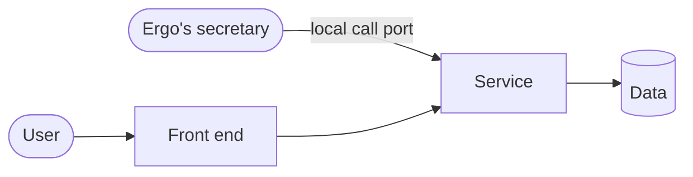

# Architecture

> **What goes here**: one diagram showing what the project is made of and how the parts connect: the services it uses (background processes registered with LSM), its front ends (web pages, apps), its interfaces to the outside (the local call port the secretary uses, `/apps/<project-id>-<service>/` forwarded by Ergo, public entry points), and the outside things it depends on (data, external APIs, MCP servers). List them in tables under the diagram.
> **When to update**: draw the first version once the structure is settled during building; update it whenever services, front ends or interfaces are added or removed. Before the project goes into use (building → in use) it must spell out the services and interfaces: the checklist looks at it.
> Project standard v1 · Development · Required (checked)

## Services

| Service | What it does | Port | Health check | Starts at boot |
|---|---|---|---|---|

## Front ends

| Front end | Address | Notes |
|---|---|---|

## Interfaces

| Interface | Used by | Route (local call port, /apps/…, public) |
|---|---|---|

Interfaces the secretary can call go into `ops.json` (the operations API list).
