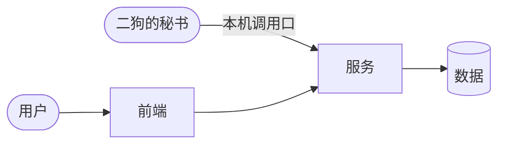

# 架构图

> **这份写什么**：一张图说清项目由哪些部分组成、怎么连起来：用到的服务（在 LSM 登记的后台进程）、前端（网页、App）、对外接口（给秘书调的本机调用口、经二狗转发的 `/apps/<项目编号>-<服务名>/`、公网入口），以及依赖的外部东西（数据、外部 API、MCP）。图下面再列成表。
> **什么时候更新**：建设中定下结构时画第一版；加减服务、前端、对外接口时跟着改。转运营（建设中 → 使用中）之前必须写清服务和对外接口：检查清单查它。
> 项目规范 v1 · 开发类 · 必须有（会检查）

## 用到的服务

| 服务名 | 做什么 | 端口 | 健康检查 | 开机自启 |
|---|---|---|---|---|

## 前端

| 前端 | 地址 | 说明 |
|---|---|---|

## 对外接口

| 接口 | 给谁用 | 走哪条路（本机调用口、/apps/…、公网） |
|---|---|---|

秘书能调的接口写进 `ops.json`（运营接口清单）。
